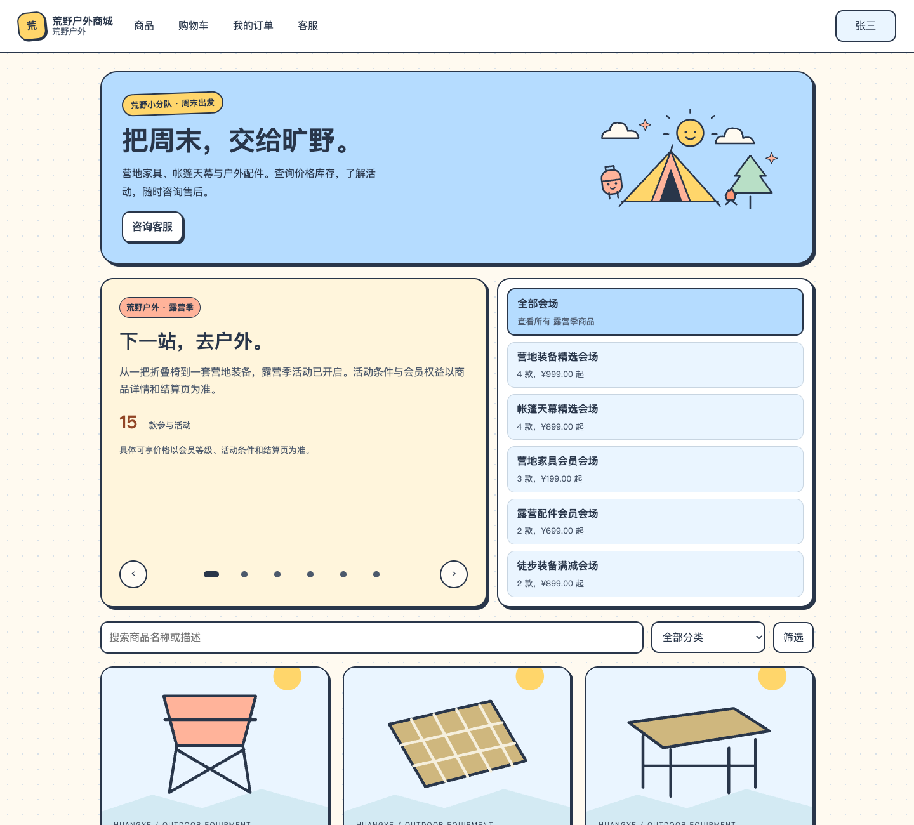
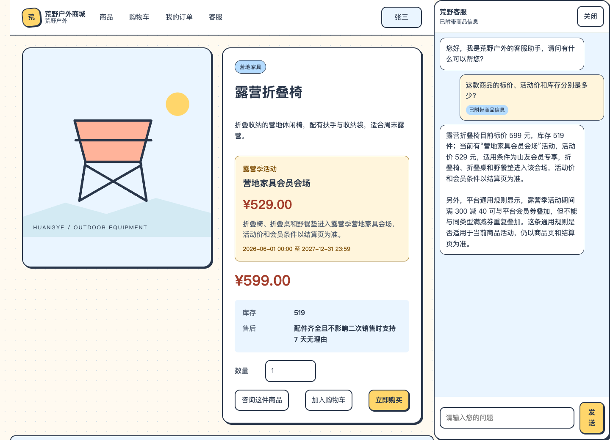
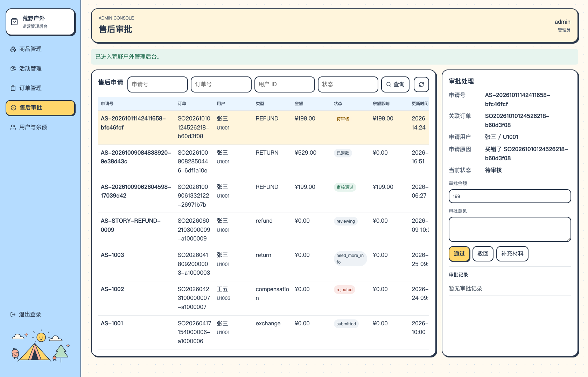
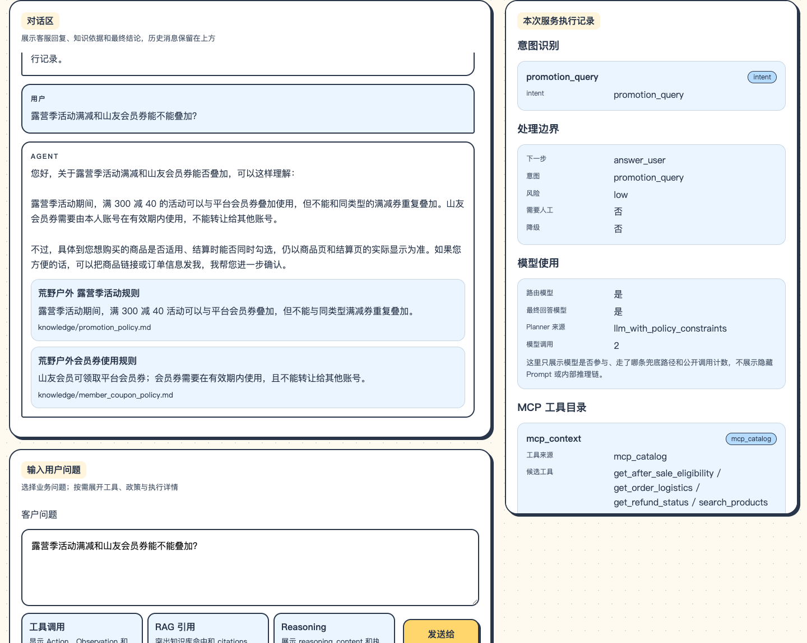
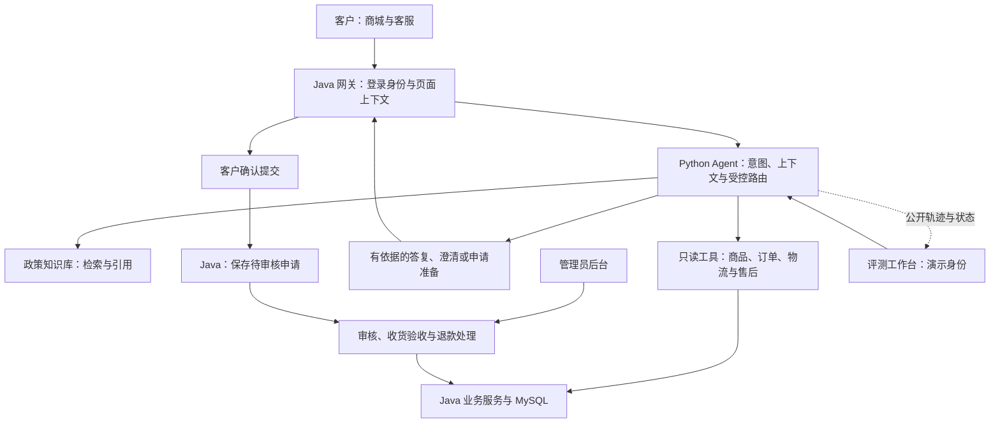

<div align="center">
  

# 🏕️ 荒野户外 · AI 客服与售后助手

**把规则讲清楚，把订单查明白，把申请交给正确的人。**

RAG 政策检索 · 实时工具查询 · Runtime Context · 多轮会话 · 售后申请与人工审核 · 可观察评测

</div>

荒野户外是一个围绕户外装备零售设计的 AI 客服与售后项目。客户可以在商城里咨询商品、了解政策、查询订单和售后资格，再决定是否提交申请；管理员通过后台独立审核，评测工作台则帮助检查回答依据和执行过程。

项目关注一条完整的服务链路：**客户表达需求 → 系统找到可信信息 → 给出可理解的答复或下一步 → 必要时确认并进入业务流程。**



## 产品全景

### 三个入口，服务三类任务

| 入口 | 使用者 | 可以做什么 |
|---|---|---|
| 🛍️ 商城与客服 | 客户 | 浏览商品、购物车与演示余额支付；咨询政策、查询商品与订单、核验售后资格、确认提交申请、填写退回物流 |
| 📋 管理后台 | 管理员 | 管理商品与活动、查看订单和用户、审核售后、记录收货验收并处理演示余额退款 |
| 🔎 评测工作台 | 产品与开发人员 | 切换演示用户、观察意图与上下文、检查工具与政策引用、查看执行轨迹、运行回归评测和记录反馈 |

商城通过登录会话识别客户，管理后台独立校验管理员权限。工作台使用演示身份，售后审批与提交记录属于模拟流程，和商城的实际业务记录分开。

### 客户能获得哪些帮助

| 客户的问题 | 系统提供的服务 |
|---|---|
| “这款折叠椅多少钱，还有货吗？” | 确定商品，查询标价、活动信息与库存，说明适用条件 |
| “会员券和满减可以一起用吗？” | 检索政策知识库，给出规则、限制及引用依据 |
| “我的订单到哪了？退款处理到哪了？” | 核验订单归属，读取订单、物流或售后状态 |
| “这笔订单现在能退吗？我先问问。” | 只查询资格，解释可办理项或阻断原因 |
| “我决定申请退款。” | 核验最新事实，补齐必要信息，展示确认卡；确认后登记待审核 |
| “收到了，我想七天无理由退货。” | 核验整单退货条件，串起申请、审核、寄回、验收与退款 |
| “我需要换货／维修／部分退款。” | 说明自动办理的能力边界，提供人工客服入口；当前入口为功能说明页 |

## AI 产品设计：让每类问题走合适的路径

设计的起点是客户要完成的任务，以及这项任务需要什么证据、会影响哪些业务状态。

### 1. 按信息性质选择来源

| 信息类型 | 客户场景 | 产品机制 | 设计考虑 |
|---|---|---|---|
| 通用规则 | 退货政策、发票时效、活动叠加规则 | **RAG**：从本地政策知识库检索相关内容，返回引用 | 规则有出处，便于核对；证据不足时明确说明 |
| 实时业务事实 | 商品价格库存、订单物流、退款进度 | **Tool Calling**：调用商品、订单、物流与售后接口 | 用当前业务数据回答，避免拿静态政策替代实时状态 |
| 当前身份与业务对象 | 谁在咨询、会员等级、正在看哪件商品或哪笔订单 | **Runtime Context**：商城网关注入登录身份、页面对象及相关业务上下文 | 减少客户重复输入，让工具查询和权限校验有明确对象 |
| 会话里的延续关系 | “第二款呢？”“就第一笔”“继续刚才的申请” | **Memory 与上下文管理**：保存会话内的候选、已选对象和待办 | 支持连续交流，处理明确输入、页面对象与历史对象的冲突 |

Runtime Context 提供本轮处理所需的上下文；**信息是否准确，还要结合工具读取的最新事实、政策依据和服务端校验。** 用户自称的会员身份、审批结果或订单归属，不能覆盖系统记录。

RAG 承接“通常怎样规定”，工具承接“这件商品／这笔订单现在怎样”。涉及活动时，也会区分平台通用叠加规则、商品活动条件和最终结算结果。



*从商品页发问时，客户可以直接说“这款商品”。截图中的价格和库存来自本地演示业务数据，数值会随数据变化。*

### 2. 理解需求之后，再约束执行范围

一句“我想问问能不能退”和一句“我确定要申请退款”，会进入不同的产品流程。

- **意图识别**区分政策咨询、实时查询、资格咨询与明确申请。模型不可用或输出不可信时，使用规则兜底。
- **受控路由**为每类任务指定可用工具、知识域和业务流程，限制本轮执行范围。
- **对象澄清**在存在多件商品或多笔订单时展示候选；客户选择后绑定本会话中的对象，再读取事实。
- **多轮续办**保留当前任务需要的信息，允许客户补充、切换或取消未提交申请；关键业务事实仍需重新核验。

整体采用单 Agent 编排：只读查询使用受限的工具循环，售后申请使用明确的状态流程。商城的身份校验、申请提交、审核和余额更新由 Java 业务服务执行。

### 3. 售后是有角色和状态的业务流程

**客户决定是否申请，管理员决定是否批准，系统按规则执行和记录结果。**

未发货整单退款：

```text
核验本人订单、支付与履约状态
  → 展示订单、实付金额与原因的确认卡
  → 客户确认提交
  → 保存待审核申请
  → 管理员独立审核
  → 通过后退回演示余额，并同步订单、支付与履约状态
```

签收后七天无理由整单退货退款：

```text
核验签收时间与整单可退条件
  → 客户确认申请
  → 管理员同意退货，提供退回信息
  → 客户寄回并填写物流
  → 管理员确认收货、验收
  → 验收通过后退款；异常时记录原因，等待人工处理
```

“符合资格”“申请已提交”“审核通过”“退款完成”分别展示。退货初审同意后先等待寄回，收货验收通过后才退款。

提交前重新核对归属、支付凭证、金额和状态；确认凭证绑定当前申请，旧卡失效与重复提交由服务端控制。管理员操作保留处理记录，退款通过事务和重复入账检查控制。

<details>
<summary><b>📋 查看管理后台：待审核申请与独立审批</b></summary>



*截图查看的是已有待审核退款申请，拍摄时没有执行审批或退款。*

</details>

### 4. 无法确定时，给客户可行动的下一步

| 情况 | 客户看到的处理 |
|---|---|
| 商品或订单不明确 | 询问必要信息或列出候选 |
| 政策依据不足 | 说明无法确认，提示进一步核验 |
| 查询无匹配或确实无库存 | 分别说明“没有找到”和“当前无货” |
| 工具超时、读取失败或只有部分事实 | 说明本次查询未成功；已核实的信息可以回答，未知字段不补写 |
| 超出自动办理范围 | 保留原诉求，说明能力边界并提供人工入口 |
| 用户或检索内容试图改变权限和流程 | 保持系统身份、工具范围与业务校验约束 |

### 5. 用业务结果评测，用执行记录定位问题

工作台展示意图、工具调用、政策引用、Runtime Context、会话记忆、流程节点和成本估算。评测检查公开回复与执行状态，覆盖回答内容、应调用与禁止调用的工具、引用依据、状态变化和恢复行为。

产品上的判定是：**回答有依据、对象选对、权限有效、状态变化符合客户授权，才算这项任务完成。** HTTP 返回成功或工具调用成功，只是其中一步。



*截图使用真实本地服务查询政策。工作台便于观察执行过程；截图本身不代表完整业务验收。专项结论及范围见[项目评测记录](docs/03-评测与问题/项目评测记录.md)。*

## 系统如何分工



| 层次 | 主要技术 | 职责 |
|---|---|---|
| 交互层 | React、TypeScript、Vite | 商城客服、管理后台与评测工作台 |
| Agent 层 | Python、FastAPI、LangChain | 意图识别、受控工具调用、政策检索与答复 |
| 模拟流程与观察 | LangGraph、会话状态、Trace、Eval | 工作台售后流程、审批恢复、执行记录与回归检查 |
| 业务层 | Java 17、Spring Boot、Spring Security | 登录与权限、商品订单、售后提交与审批、业务事务 |
| 数据与运行 | MySQL 8、Docker Compose | 演示业务数据和本地运行环境 |

## 本地运行

### 准备环境与配置

核心体验需要 **Docker Compose、Python 3.12+**。Docker 构建包含商城与管理后台页面，以及 Java 服务和 MySQL。开发前端或使用评测工作台时，还需要 **Node.js 22.12+**。

首次运行，在项目根目录创建 `.env.local`，设置两项数据库密码：

```dotenv
HUANGYE_DB_PASSWORD=替换为你设置的数据库密码
HUANGYE_DB_ROOT_PASSWORD=替换为你设置的数据库管理员密码
```

已有 `.env.local` 和数据卷时继续使用原配置，避免更换密码导致旧数据库无法连接。

需要模型理解和生成答复时，创建 `.env.model.local`，填写可用的 OpenAI 兼容接口配置：

```dotenv
AGENT_OPENAI_API_KEY=填入你的APIKey
AGENT_OPENAI_BASE_URL=填入模型服务的API地址
AGENT_OPENAI_MODEL=填入该服务支持的模型名称
```

这两个文件均被 Git 忽略。模型配置可执行 `chmod 600 .env.model.local` 限制访问权限。暂不配置模型时，可以在下方启动命令中设置 `AGENT_COURSE_DISABLE_LLM=1`，使用规则路径体验页面与业务查询。

### 启动核心服务

以下命令均从项目根目录开始执行。

**终端一：启动业务服务、数据库与商城页面。**

```bash
docker compose --env-file .env.local -f compose.local.yml up -d --build
docker compose --env-file .env.local -f compose.local.yml ps
```

**终端二：安装并启动 Python Agent。**

```bash
python3 -m venv .venv
.venv/bin/python -m pip install -r requirements.txt

PYTHONPATH=backend \
AGENT_COURSE_ENV="$PWD/.env.model.local" \
AGENT_COURSE_DISABLE_LLM=0 \
AGENT_COURSE_OFFLINE_RAG=1 \
AGENT_COURSE_OFFLINE_FACTS=0 \
AGENT_ECOMMERCE_SERVICE_TOKEN=course-debug-agent-service \
LANGCHAIN_TRACING_V2=false \
LANGSMITH_TRACING=false \
.venv/bin/uvicorn api.routes:app --host 127.0.0.1 --port 8000
```

| 入口 | 地址 | 演示账号 |
|---|---|---|
| 商城 | [http://127.0.0.1:8081/](http://127.0.0.1:8081/) | `zhangsan / 123456` |
| 管理后台 | [http://127.0.0.1:8081/admin/](http://127.0.0.1:8081/admin/) | `admin / admin123456` |
| Python API 文档 | [http://127.0.0.1:8000/docs](http://127.0.0.1:8000/docs) | 本地调试入口 |
| 业务服务健康检查 | [http://127.0.0.1:8081/actuator/health](http://127.0.0.1:8081/actuator/health) | — |

### 可选：评测工作台与前端开发

评测工作台，另开终端：

```bash
cd frontend
npm ci
npm run dev
```

访问 [http://127.0.0.1:5173/](http://127.0.0.1:5173/)，选择演示用户后发送问题。审批决定在工作台中模拟，不会替代管理员后台的审核。

商城与管理后台前端开发，另开终端：

```bash
cd ecommerce-backend/frontend
npm ci
npm run dev
```

开发地址为 [http://127.0.0.1:5174/](http://127.0.0.1:5174/)，后台为 `/admin/`，`/api` 请求代理到 8081。README 的商城与后台截图取自这一开发入口。

<details>
<summary><b>配置说明与停止方式</b></summary>

| 变量 | 作用 |
|---|---|
| `AGENT_COURSE_ENV` | 显式指定模型配置文件 |
| `AGENT_COURSE_DISABLE_LLM=1` | 禁用聊天模型，使用规则兜底 |
| `AGENT_COURSE_OFFLINE_RAG=1` | 政策检索使用本地简化字符向量；上述启动方式使用此模式 |
| `AGENT_COURSE_OFFLINE_FACTS=0` | 从 Java 业务接口读取事实，关闭种子镜像回退 |
| `AGENT_ECOMMERCE_SERVICE_TOKEN` | 与 Compose 中 Java 网关的服务身份配置保持一致 |
| `AGENT_EMBEDDING_MODEL` | 使用在线向量检索时指定 Embedding 模型；接口也需支持该模型 |
| `AGENT_COURSE_TODAY` | 工作台模拟售后的日期基准，默认 `2026-07-15`；商城按业务服务日期校验 |

如果需要完全离线的规则演示，可同时设置 `AGENT_COURSE_DISABLE_LLM=1`、`AGENT_COURSE_OFFLINE_RAG=1`、`AGENT_COURSE_OFFLINE_FACTS=1`。种子镜像只覆盖有限样例，不代表完整商城数据。

启用在线聊天或 Embedding 会向配置的模型服务发送相应内容并消耗 API 额度。

停止容器并保留数据：

```bash
docker compose --env-file .env.local -f compose.local.yml stop
```

恢复时使用相同配置执行 `up -d`；源码变化后加 `--build`。Python 与前端开发服务在各自终端用 `Ctrl+C` 停止。

</details>

## 第一次体验，建议这样走

1. **商品咨询**：登录商城，打开一件商品，点击“咨询这件商品”，询问“这款商品的标价、活动价和库存分别是多少？”观察页面上下文与实时查询。
2. **政策咨询**：问“露营季活动满减和山友会员券能不能叠加？”，再到工作台查看政策引用和执行记录。
3. **资格咨询**：打开本人订单问“这笔订单现在能退款吗？我先了解一下”，确认回复停在资格说明。
4. **申请与审核**：选一笔符合条件的本人订单，明确提出申请，核对确认卡。仅在需要体验完整业务流程时提交，再用管理员账号审核；这会改变演示业务数据和余额。

## 项目边界

- 面向本地演示与产品验证，商品、账号和政策为演示数据；支付与退款使用本地模拟余额，未接入真实支付渠道。
- 自动售后范围为本人已支付、未发货的整单退款，以及符合条件的签收七天无理由整单退货退款。运输中拦截、换货、维修和部分退款不自动办理。
- 人工客服入口已提供交互和说明页，尚未接入真人、工单分配与交接回执。
- 会话记忆及部分流程状态保存在内存中，重启不保证恢复。自然语言取消增强保持默认关闭，未提交申请可通过取消按钮终止。
- 当前 MCP 模块用于本地能力目录与元数据展示，尚未接入远程 MCP 服务。模型表现和专项评测均应按各自验证范围理解，不外推真实用户或生产指标。

## 继续了解项目

```text
backend/                  Agent API、工具、检索、状态、评测与测试
frontend/                 独立评测工作台
ecommerce-backend/         Java 业务服务与商城／管理后台前端
docs/                     项目概览、全局设计、评测、复盘与参考
analysis/                 按业务主题整理的验证脚本、结果、日志与截图
compose.local.yml         本地业务服务与数据库运行配置
```

| 想看什么 | 入口 |
|---|---|
| 整体架构与源码入口 | [项目导读](docs/01-项目概览/项目导读.md) |
| 文档阅读顺序 | [文档导航](docs/README.md) |
| 具体业务的设计与约束 | [产品设计目录](docs/02-产品设计/README.md) |
| 测试用例、验收结论与已知问题 | [评测与问题](docs/03-评测与问题/README.md) |
| 原始验证材料 | [验证证据导航](analysis/README.md) |
| 当前工作停点 | [项目交接](docs/01-项目概览/项目交接.md) |

文档与资源链接检查：

```bash
python3 analysis/90-项目改造与运行/文档整理验证/check_documents.py
```

Agent 单元检查（规则与显式离线配置）：

```bash
PYTHONPATH=backend \
AGENT_COURSE_DISABLE_LLM=1 \
AGENT_COURSE_OFFLINE_RAG=1 \
AGENT_COURSE_OFFLINE_FACTS=1 \
AGENT_COURSE_ENV=/tmp/huangye-no-model.env \
.venv/bin/python -m unittest discover -s backend/tests
```
