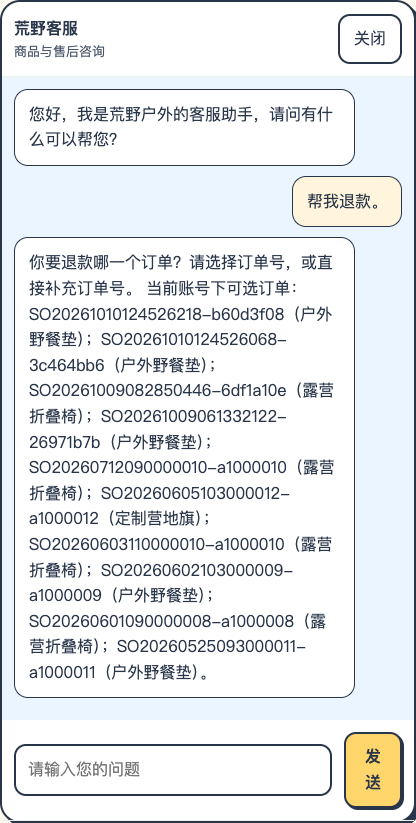
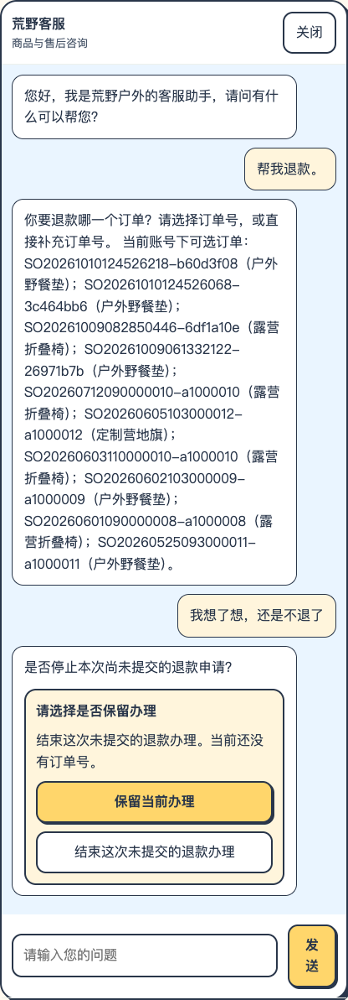
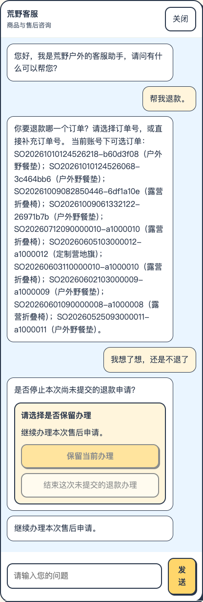
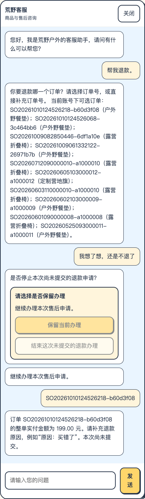
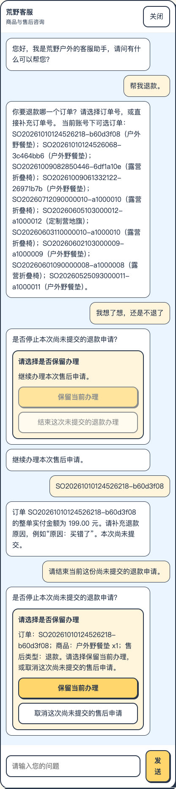
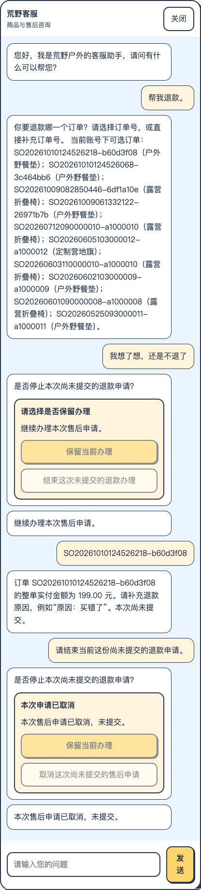

# 保留后补订单：真实对话与逐轮截图

日期：2026-10-11。以下来自本轮实际页面，不包含提交售后。

## 第1轮

客户输入：帮我退款。

系统：你要退款哪一个订单？请选择订单号，或直接补充订单号。 当前账号下可选订单：SO20261010124526218-b60d3f08（户外野餐垫）；SO20261010124526068-3c464bb6（户外野餐垫）；SO20261009082850446-6df1a10e（露营折叠椅）；SO20261009061332122-26971b7b（户外野餐垫）；SO20260712090000010-a1000010（露营折叠椅）；SO20260605103000012-a1000012（定制营地旗）；SO20260603110000010-a1000010（露营折叠椅）；SO20260602103000009-a1000009（户外野餐垫）；SO20260601090000008-a1000008（露营折叠椅）；SO20260525093000011-a1000011（户外野餐垫）。

返回阶段：`None`；是否需要确认：`False`。

## 第2轮

客户输入：我想了想，还是不退了

系统：是否停止本次尚未提交的退款申请？

返回阶段：`REFUND_ORDER_REQUIRED`；是否需要确认：`True`。

## 第3轮

客户点击：保留当前办理

系统：继续办理本次售后申请。

返回阶段：`KEEP`；是否需要确认：`False`。

## 第4轮

客户输入：SO20261010124526218-b60d3f08

系统：订单 SO20261010124526218-b60d3f08 的整单实付金额为 199.00 元。请补充退款原因，例如“原因：买错了”。本次尚未提交。

返回阶段：`REFUND_REASON_REQUIRED`；是否需要确认：`False`。

## 第5轮

客户输入：请结束当前这份尚未提交的退款申请。

系统：是否停止本次尚未提交的退款申请？

返回阶段：`REFUND_REASON_REQUIRED`；是否需要确认：`True`。

## 第6轮

客户点击：取消这次尚未提交的售后申请

系统：本次售后申请已取消，未提交。

返回阶段：`CANCELLED`；是否需要确认：`False`。

