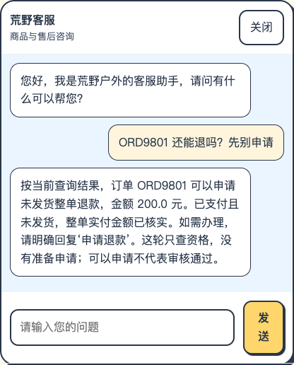
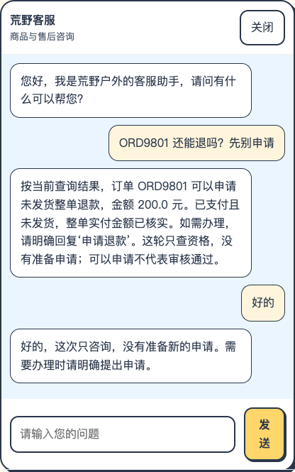
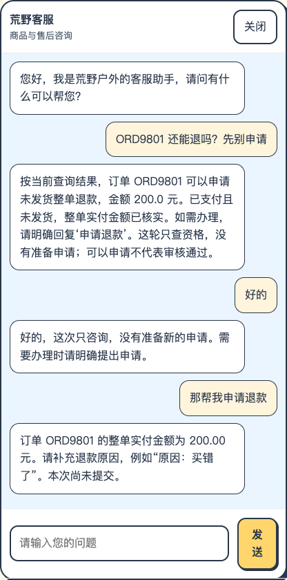
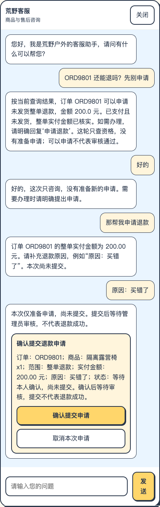
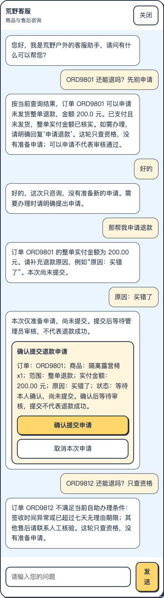
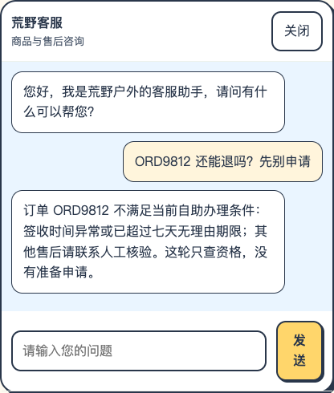

# 只读资格咨询：实际对话与截图

2026-10-11。本机隔离H2、规则路由，外部模型调用0。预期示例已替换为本次实际记录；停在提交前。

## 第1轮

客户：ORD9801 还能退吗？先别申请

系统：按当前查询结果，订单 ORD9801 可以申请未发货整单退款，金额 200.0 元。已支付且未发货，整单实付金额已核实。如需办理，请明确回复‘申请退款’。这轮只查资格，没有准备申请；可以申请不代表审核通过。

状态：ELIGIBILITY_QUERY；确认卡：False。

## 第2轮

客户：好的

系统：好的，这次只咨询，没有准备新的申请。需要办理时请明确提出申请。

状态：ELIGIBILITY_QUERY；确认卡：False。

## 第3轮

客户：那帮我申请退款

系统：订单 ORD9801 的整单实付金额为 200.00 元。请补充退款原因，例如“原因：买错了”。本次尚未提交。

状态：REFUND_REASON_REQUIRED；确认卡：False。

## 第4轮

客户：原因：买错了

系统：本次仅准备申请，尚未提交。提交后等待管理员审核，不代表退款成功。

状态：CONFIRM_SUBMIT；确认卡：True。

## 第5轮

客户：ORD9812 还能退吗？只查资格

系统：订单 ORD9812 不满足当前自助办理条件：签收时间异常或已超过七天无理由期限；其他售后请联系人工核验。这轮只查资格，没有准备申请。

状态：ELIGIBILITY_QUERY；确认卡：False。

## 第6轮

客户：ORD9812 还能退吗？先别申请

系统：订单 ORD9812 不满足当前自助办理条件：签收时间异常或已超过七天无理由期限；其他售后请联系人工核验。这轮只查资格，没有准备申请。

状态：ELIGIBILITY_QUERY；确认卡：False。

