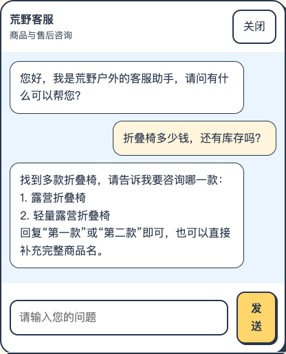
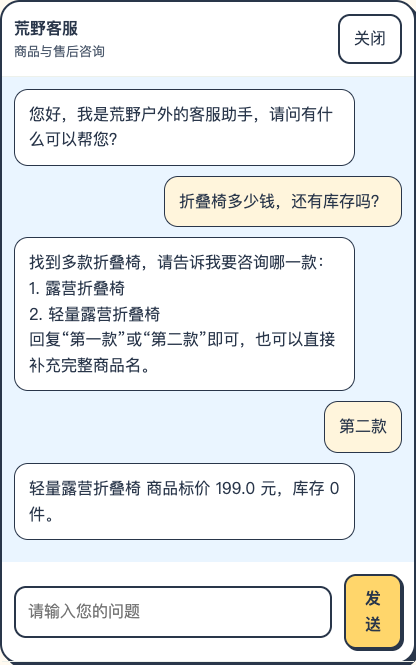
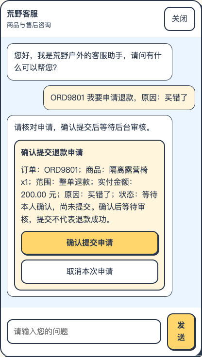
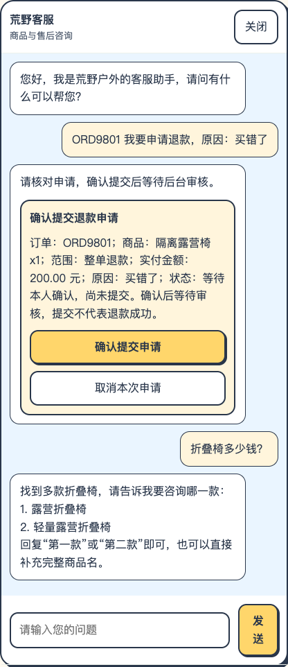
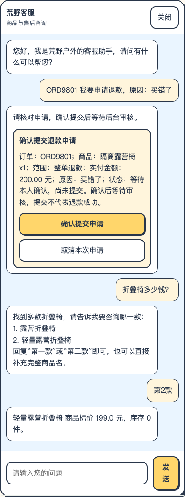
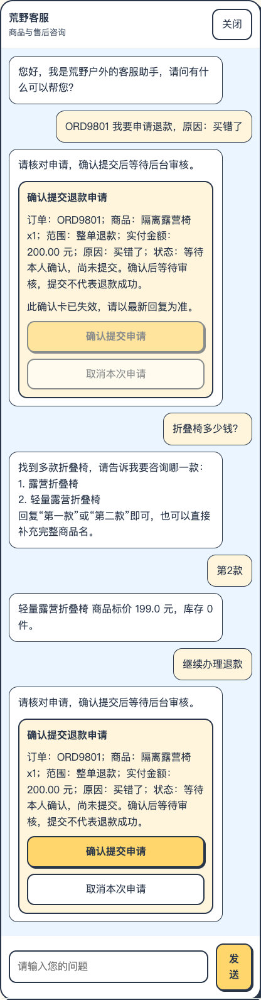

# 商品对象定位：隔离页面对话与截图

2026-10-12。真实浏览器、当前 Java／Python 代码、临时 H2；模型禁用。所有确认提交按钮均未点击。

第一条验证中文序号；第二条验证已有退款卡时的数字序号与回到退款。每轮实际输入和回复如下。

## 第 1 轮

客户：折叠椅多少钱，还有库存吗？

系统：

> 找到多款折叠椅，请告诉我要咨询哪一款：
> 1. 露营折叠椅
> 2. 轻量露营折叠椅
> 回复“第一款”或“第二款”即可，也可以直接补充完整商品名。

## 第 2 轮

客户：第二款

系统：

> 轻量露营折叠椅 商品标价 199.0 元，库存 0 件。

## 第 3 轮

客户：ORD9801 我要申请退款，原因：买错了

系统：

> 请核对申请，确认提交后等待后台审核。

## 第 4 轮

客户：折叠椅多少钱？

系统：

> 找到多款折叠椅，请告诉我要咨询哪一款：
> 1. 露营折叠椅
> 2. 轻量露营折叠椅
> 回复“第一款”或“第二款”即可，也可以直接补充完整商品名。

## 第 5 轮

客户：第2款

系统：

> 轻量露营折叠椅 商品标价 199.0 元，库存 0 件。

## 第 6 轮

客户：继续办理退款

系统：

> 请核对申请，确认提交后等待后台审核。

