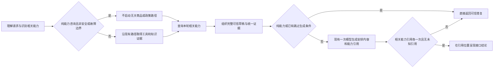

# BC-022：先收集证据，再统一答复

日期：2026-10-15。编号：BC022-FLOW-001。用户明确授权按此前设计修改代码，并要求今后从整体流程合理性出发确定改动范围。**代码已修改，188/188 项后端隔离检查通过；日常服务未重启、真实模型未复测。CAP-LIVE-001 的完整交互 2/3 和原失败保持原样。**

## 触发问题与修复范围

原真实输入“支持到货提醒吗？”被路由为 unknown，代码生成“不知道需求”的模板、跳过最终模型，之后才查询到不支持并追加，形成前后冲突。只删该模板不能同时解决混合咨询证据取得过晚、生成遗漏和重复。原响应见[CAP-LIVE-02](../日常加载与三会话验收/CAP-LIVE-02.json)。

沿主编排、能力查询、最终模型客户端、Prompt、调用方与测试核对后，本轮只改 3 个 Python 业务模块、1 个 Prompt、1 份测试。Java 的单一能力目录、接口及权限契约不变；未改模型、知识、业务数据、取消执行开关或日常进程。基于原有未提交工作区修改，没有重置或提交 Git。

## 新流程与取舍



- 纯能力咨询不再依赖主路由是否恰好分到 product_query。已明确识别时统一进入现有 general_chat 直接答复路径，覆盖此前 unknown 漏洞；退款／退货能力咨询不再先拉取无关整套政策，也不建申请。安全和故障分支仍优先。
- 能力查询移到最终答复之前；Trace 先记录查询，再记录生成。最终客户端收到本轮 `capability_results`，包含状态、版本、失败、可信答复内容及内部引用。
- 混合咨询保留工具和知识路径，模型基于同一组证据安排答复。能力结论通过内部引用在所安排的位置呈现；这些引用不会原样展示给客户。引用遗漏、重复或出现未查询能力时，**整条生成弃用并回到生成前的可信草稿**，不再给生成内容补一句。
- 模型未配置、超时／空答等客户端降级，以及澄清、缓存、安全和工具故障导致跳过生成的路径，也使用已经包含相关能力结论的可信草稿。能力接口失败仍说不能确认，不变成不支持。
- 不增加模型调用、新 Agent、依赖、意图枚举或对外 API。使用内部引用约束内容覆盖，避免靠某句中文逐字匹配判定生成有效；客户验收仍看实际含义、事实和副作用。

源码入口：`backend/agent/customer_service_agent.py:158`、`:790`、`:1332`、`:1386`；`backend/agent/service_capabilities.py:150`和`:163`；`backend/agent/models/answer_client.py:116`；`backend/resources/prompts/final_answer_style.md`。

## 验证及保留的失败

运行前保存[范围与标准](frozen-scope.json)、[原文件指纹](source-before.json)及本轮触达文件的文本副本。先新增 4 个回归方法运行，原实现出现 5 条断言失败和 1 个错误（含同一方法的 3 个子场景）；错误来自不应进入的政策／生成替身分支返回 MagicMock，不宣称生产出现 TypeError。原 unknown 回复与事后追加的错误行为可在[修改前日志](before-regression.log)核对。

修改后第一轮42项中2项旧断言失败，见[first-targeted.log](first-targeted.log)：纯退款咨询的主路径改为直接能力答复，旧断言仍期待政策意图；错误承诺清理后若仍缺能力引用，新机制会整条降级，原因不再是仅删句。按最终流程同步这两处契约，并使正常引用生成测试验证确实采用模型输出，而非恰好回落草稿。

最终命令：

```sh
PYTHONPATH=backend AGENT_COURSE_DISABLE_LLM=1 AGENT_COURSE_OFFLINE_RAG=1 AGENT_COURSE_OFFLINE_FACTS=1 .venv/bin/python -m unittest discover -s backend/tests -v
```

**188/188 通过，2.579秒。** 新增5个方法覆盖unknown纯咨询、纯退款不查无关政策、能力证据在最终生成前实际进入客户端payload、生成遗漏／重复／未知引用整条降级，以及安全边界不被能力咨询覆盖。原有商品、查询故障、资格、审批恢复、取消、路由及知识检查同时通过。

模型传输为替身，能力与商品读取也为隔离替身；没有外部模型或日常Java请求，不把它称为真实质量复测。最终测试后只补充已知限制注释，未改变可执行逻辑，不重复跑相同检查。

## 限制和后续

内部引用只保证这次能力结果被覆盖、位置合法和不重复引用，不能证明任意自由文本都没有语义重复或事实错误；模型若在引用外再次复述能力，仍依赖Prompt和实际质量验收。真实模型遵守新格式的比例、是否频繁整条降级尚未测量。能力问法识别仍是当前明确规则，本轮不扩大。

后续仅需按日常加载授权重启Python（Java无变化），保留现场DeepSeek、Qwen3／OFFLINE_RAG=0、115块与业务／取消配置；用新编号复测纯提醒、价格加提醒、退款能力三条。不要覆盖旧2/3或把本次188项计入真实通过数。最新停点只维护在项目交接。

证据：[结果数据](result.json)、[完整检查日志](backend-regression.log)、[本轮增量](change.diff)、[修改前](source-before.json)／[修改后](source-after.json)指纹。
