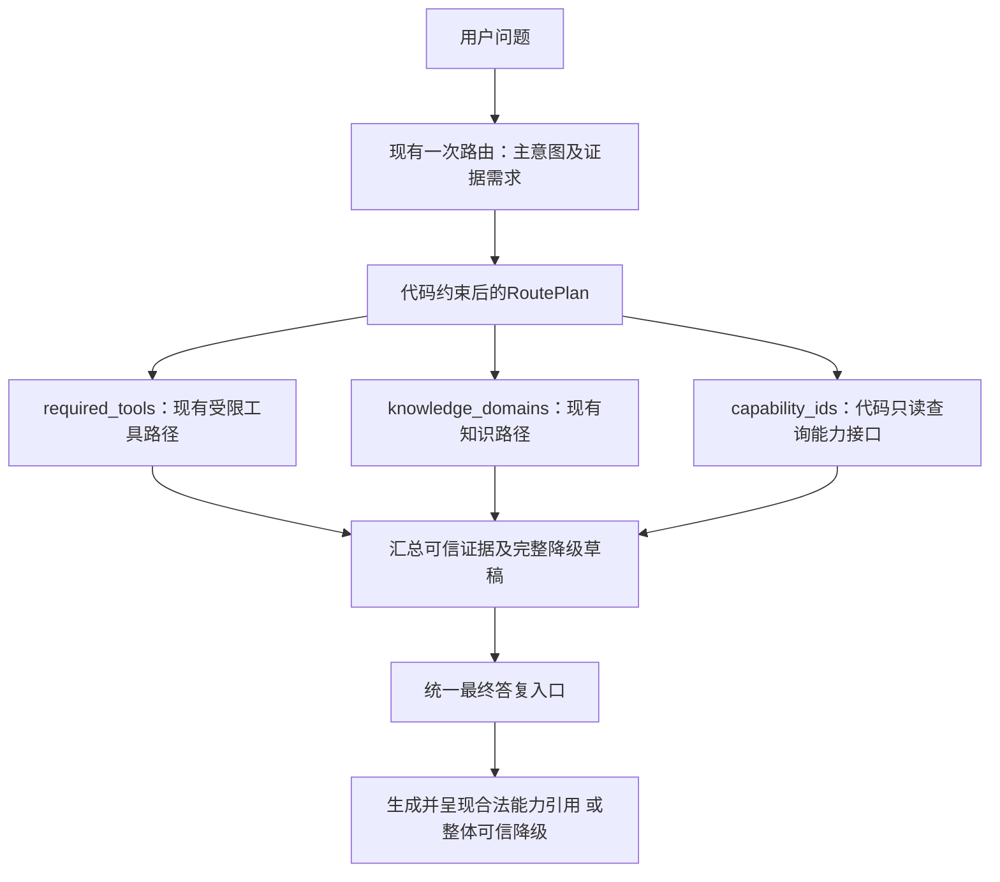

# 能力取证纳入统一 RoutePlan

日期：2026-10-15。编号：CAP-PLAN-001。用户授权按“能力查询作为可复用取证动作，独立问题可走服务范围咨询，混合问题也可使用同一查询”的方向重新改代码。

**结果：代码及隔离验证完成；Python199/199、Java68项断言和工作台构建通过。后端未加载日常服务，真实模型未调用。** 此前BC022-FLOW-001的188项工程检查和CAP-LIVE-001的真实2/3各保留原范围，不覆盖或合并成绩。

## 实现与职责



上图是职责分配，不表示三个取证分支已经并发执行。

| 层次 | 本轮实现 |
|---|---|
| 主意图 | 新增 `service_scope_query`，单独询问服务范围不再改成 `general_chat`。 |
| 同次路由 | `ModelRouteResult`增加`capability_ids`。商品／政策等主意图也可携带能力需求，沿用同一次路由调用；Prompt补充范围和混合示例。 |
| 校验 | 拒绝非数组、重复、非法路径型ID和过长列表。新服务意图须包含该字段；旧意图缺字段仍兼容，留为`None`。 |
| 统一计划 | `RoutePlan.capability_ids`保存最终查询需求；显式`[]`表示不查询，缺字段才在建计划时使用共享规则补齐。安全／故障边界不计划能力查询。 |
| 执行 | 主流程只遍历`route_plan.capability_ids`，不再在执行阶段重新分析用户原话。能力接口由代码确定性调用，不伪装为新注册的LangChain工具。 |
| 答复 | 服务咨询、商品和政策混合问题进入同一个最终答复函数。删除`capability_only`、改闲聊及按纯能力跳过生成的专用路径；unknown已有相关证据时不套无关澄清。保留上一轮生成前证据、内部引用覆盖与整体降级机制。 |
| 会话状态 | 只读服务咨询不启动Workflow，不覆盖退款待办，不清理商品候选和待补政策问题。误分申请的服务咨询先纠正意图，再更新状态。 |
| 调用方 | Java网关认识Python的`service_scope_query`，即使旧问法规则没匹配也可直接返回并保留草稿；原不支持业务及占位人工前置出口保留。 |
| 观察 | 路由Trace记录原能力需求，计划Trace与工作台显示最终能力ID，可与实际查询事件逐项核对。 |

结构举例，不代表本轮真实模型已答对：

```json
{"intent":"service_scope_query","capability_ids":["stock_notification"]}
```

```json
{"intent":"product_query","needs_product_facts":true,"knowledge_domains":[],"clarification_fields":[],"capability_ids":["stock_notification"]}
```

主意图决定业务入口，能力ID决定可复用的取证需求；能力支持状态仍只来自Java接口，不由路由模型决定。计划里的`required_tools`继续是原工具模型白名单，`capability_ids`是代码执行的只读取证项；没有新增评审模型、Agent或通用任务引擎。

## 实际触达范围

- 契约：`backend/api/schemas.py`、`backend/agent/models/router_client.py`、`backend/resources/prompts/route_contract.md`。
- 建计划与执行：`backend/agent/tools/planning.py`、`backend/agent/customer_service_agent.py`、`backend/agent/service_capabilities.py`。旧纯能力判定改为规则路由的服务范围识别，只用于兼容／离线路由，不再决定快捷答复。
- 观察及调用方：`backend/agent/trace.py`、`frontend/src/components/TracePanel.tsx`、`ecommerce-backend/src/main/java/com/teachdemo/ecommerce/customer_service/CustomerServiceGatewayService.java:191`。
- 回归：`backend/tests/test_service_capabilities.py`，新增11个方法，原相关断言随统一生成路径同步。

基于当前未提交工作区增量修改；[change.diff](change.diff)对比本轮前文本，未使用HEAD总差异冒充本轮改动。模型、凭据、知识及业务／取消开关未修改，未提交Git。

## 验证与失败保留

1. 修改前新增3个回归方法未通过（4条断言失败、1个错误，包含子场景）；旧版不识别新路由字段，建计划尚无对应参数，见[修改前日志](before-regression.log)。参数契约错误不是生产异常声明。
2. 中间检查中发现新意图使原商品候选被清空，已补齐只读状态保留；政策待办测试最初没有构造待澄清条件而触发KeyError，随后修正fixture，不归因为生产问题。原日志保留在[state-before-fix.log](state-before-fix.log)及[中间全量](backend-final.log)。
3. 最终显式离线运行完整后端：**199/199通过，2.200秒**，见[backend-complete.log](backend-complete.log)。覆盖同一次路由返回主意图和能力、非关键词问法按模型证据执行、显式空计划不补猜、商品与政策复用、未知及查询失败、无申请、状态保留和原有资格／审批／商品回归。传输和业务数据为替身，不是实际模型精度评测。
4. 用已有Maven/JDK17镜像及依赖，禁外网、源码只读、内存H2：159个业务Java源码加隔离入口编译成功，**68/68断言通过、9轮固定Agent咨询**，八张H2业务表前后哈希一致。额外覆盖旧问法规则不匹配但返回新意图的请求，以及已有草稿保留。见[Java结果](Java隔离验证/result.json)、[检查](Java隔离验证/checks.json)、[HTTP证据](Java隔离验证/http-responses.json)。不是镜像打包或真实Python到Java链路验收。
5. 工作台TypeScript检查通过。首次Vite使用x64 Node24.13而现有原生依赖为arm64，构建失败日志[保留](workbench-build.log)；改用已有arm64 Node24.15后[构建通过](workbench-build-arm64.log)。未安装依赖或修改环境配置，产物输出分析目录，未覆盖日常dist；未做浏览器验收。

后端复跑命令：

```sh
PYTHONPATH=backend AGENT_COURSE_DISABLE_LLM=1 AGENT_COURSE_OFFLINE_RAG=1 AGENT_COURSE_OFFLINE_FACTS=1 .venv/bin/python -m unittest discover -s backend/tests -v
```

## 边界与下一步

- 新Prompt要求每个意图给`capability_ids`，解析器兼容缺字段旧响应；显式空数组是计划依据，模型若漏识别需求，不会由执行层另起关键词规则纠正。这项语义质量尚未真实验证。
- 未知合法ID的接口结果仍为unknown，查询错误／超时不变成unsupported。路由器不能用能力ID批准申请。
- Java旧不支持业务前置处理仍保留，本次没有重写全部网关路由。内部引用仍是内容覆盖约束，不是任意自由文本语义核验器。
- 本轮无在线模型、日常服务重启、日常数据库访问或业务写入。当前运行状态只沿用此前核验，不保证此刻健康。
- 下一步加载必须同时包含本次Java网关和Python，不能再按上一轮“只重启Python”执行；MySQL不重启。用新编号有限验收服务范围、价格加提醒和退款咨询，核对新意图、计划／实际查询一致、无内部引用泄漏及无业务写入。原CAP-LIVE-001的2/3不覆盖。

证据：[结果汇总](result.json)、[本轮差异](change.diff)、[修改前指纹](source-before.json)／[修改后指纹](source-after.json)、[冻结范围](frozen-scope.json)。最新停点只在项目交接维护。
