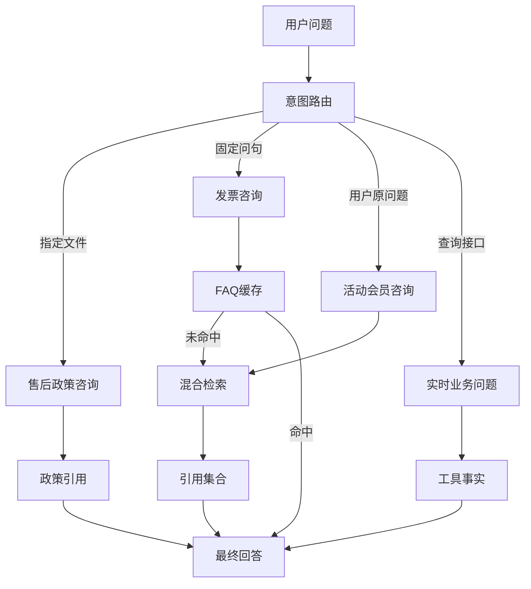
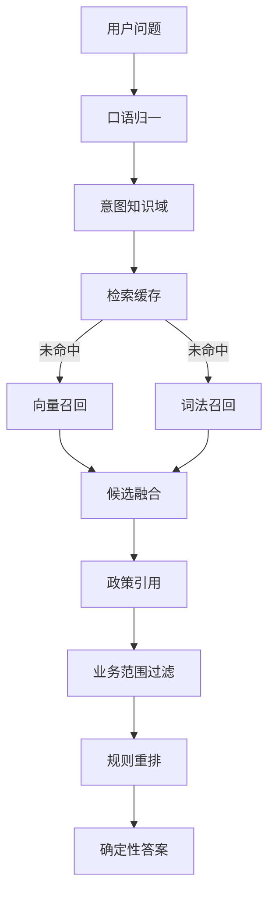
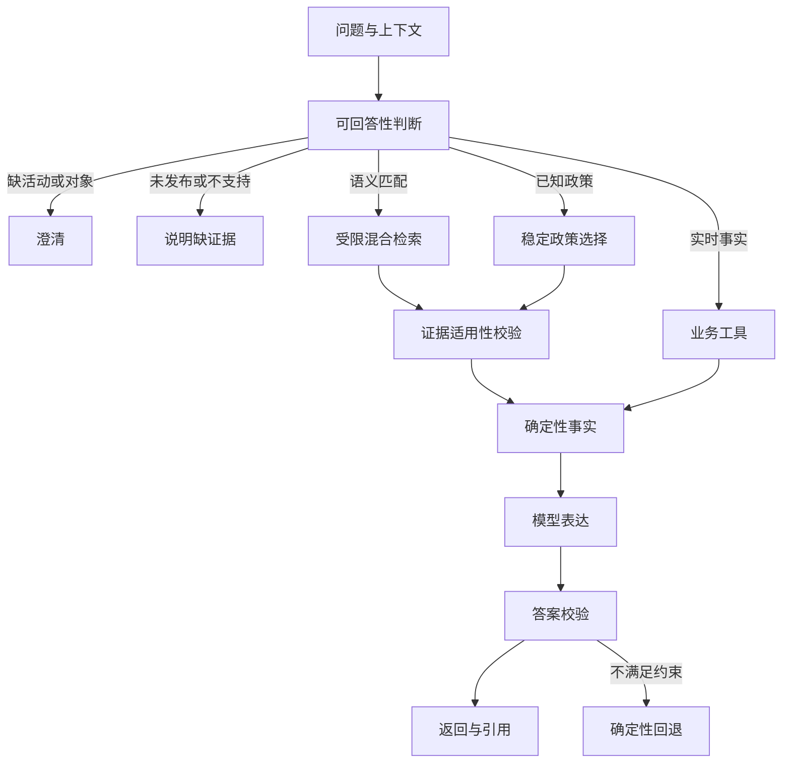

# 电商客服 Agent：RAG 设计审查与优化建议

> 源码核对、llm-wiki 查询、官方资料对照与离线复现

本项目采用按意图分流的知识回答。活动咨询走混合检索，稳定政策走指定文件。优先补齐证据适用性和缓存更新，再评估检索模型。

## 当前模式与实际边界

> **判断**
> 当前主要是受代码控制的“先取证据，再生成答案”。其中包含混合召回和业务规则重排。
> 系统已有 Agent 编排，但这段知识链路没有自主反复检索。
> 当前知识库很小，升级重排模型尚无收益证据。

| 入口 | 实际取得证据的方法 | 生成方式与边界 |
|---|---|---|
| 退款／退货通用政策 | 按意图选定 Markdown，直接返回正文 | 通常再由模型组织话术；模型不可用时返回正文 |
| 发票咨询 | 先查全局 FAQ 答案缓存；未命中时检索固定问句 | 首次可由模型回答；后续命中直接复用答案 |
| 活动／会员券咨询 | 规则准入、双路召回、业务范围过滤、规则重排 | 先拼确定性答案，再由模型表达；无证据时跳过模型 |
| 商品＋活动问题 | 工具取得商品事实，知识模块取得平台规则 | 分开表达实时事实和通用规则 |
| 具体订单能否退货 | 只读业务工具核验资格 | 本轮资格路径保留确定性话术，不由 RAG 推断资格 |

知识目录有 **5 份政策**。混合索引只纳入其中 **4 份**。
签收后退货政策未纳入混合索引，但通用退货咨询会直接读取它。
因此，不能据此认定退货咨询缺少政策。

当前 4 份索引正文分别为 38、35、47、37 个字符。
它们全部小于分块上限，实际各形成一个块，共 **4 个块**。
目前分块功能存在，但尚未处理这些文件的跨块语义。

这里的“混合”指向量和关键词双路召回。
LangChain 文档中的 Hybrid RAG 还涉及架构层的验证步骤。
两种名称不应直接等同。参见 [LangChain Retrieval](https://docs.langchain.com/oss/python/deepagents/retrieval)。

源码入口：[知识路径](</Users/sunhao/Downloads/03_AIPMProject/0305_E-commerce-Customer-Service_Agent/backend/retrieval/knowledge.py:60>)、[编排分支](</Users/sunhao/Downloads/03_AIPMProject/0305_E-commerce-Customer-Service_Agent/backend/agent/customer_service_agent.py:267>)。

## 数据提取与分块：如何把政策变成检索单元

| 节点 | 当前实现 | 输入与输出 | 设计取舍 |
|---|---|---|---|
| 数据来源 | `backend/resources/knowledge/*.md`，人工维护 | 5 个文件：退款、退货、发票、活动、会员券 | 适合小型演示；本项目未实现 PDF、网页或业务系统自动同步 |
| 元数据解析 | YAML frontmatter；正文与元数据分离 | 得到 title、policy_id、scene_key、固定 score | 有稳定政策 ID；缺版本、生效期、适用对象、状态与来源位置 |
| 引用加载 | `load_knowledge_citation()`，带无上限 LRU 缓存 | 正文整体放入 Citation.snippet | 小文件便于读；热更新后可能继续引用旧正文 |
| 分块 | `RecursiveCharacterTextSplitter(220, 30)` | 最大 220 字符，目标重叠 30 字符 | 单位是字符，不是 token；未定制中文标点 |
| 片段元数据 | 复制 filename、source、title、policy_id、scene_key、base_score | 加上 `{policy_id}-chunk-{全局序号}` | 全局序号会随前面文件的块数变化；缺稳定位置和父子关系 |

提取正文时，索引构建器用字符串分隔去掉 frontmatter。
引用加载器则使用独立的 frontmatter 解析。
后续宜共用一次解析结果，避免正文和引用各自读取不同版本。

**建议的最小数据契约**：政策 ID、修订版本、发布状态、生效区间、适用活动／会员类型、正文和来源位置。
保留原始政策正文，并将检索用的标题、条件前缀单独存放。
已知字段可直接生成前缀，当前无需让模型补写上下文。

短政策可以整体作为证据单元。
长政策再按标题、条件、例外和步骤切块。
中文文本可加入“。；，”等分隔符。
任何分块方案都应保留“适用条件＋限制”，避免拆出孤立承诺。
参见 [LangChain 递归分块](https://docs.langchain.com/oss/python/integrations/splitters/recursive_text_splitter)。

Anthropic 的 Contextual Retrieval 给片段补充所属文档的上下文，再用于向量和词法检索。
本项目可先用已知元数据前缀做低成本对照。
博客中的实验收益不能直接作为本项目的预期提升。
参见 [Anthropic Contextual Retrieval](https://www.anthropic.com/engineering/contextual-retrieval)。

源码：[引用加载器](</Users/sunhao/Downloads/03_AIPMProject/0305_E-commerce-Customer-Service_Agent/backend/retrieval/documents.py:19>)、[索引数据构建](</Users/sunhao/Downloads/03_AIPMProject/0305_E-commerce-Customer-Service_Agent/backend/retrieval/hybrid_retrieval.py:130>)。

## 向量化、索引与缓存：如何形成可搜索状态

| 节点 | 当前设计 | 实际含义 | 建议 |
|---|---|---|---|
| 文档向量化 | `OpenAIEmbeddings` 调用兼容接口 | 代码默认模型是 `BAAI/bge-m3`；客户端类名不代表实际模型来自 OpenAI | 单独配置 embedding 服务；启动时验证模型支持 |
| 查询向量化 | 向量库对归一化 Query 调用同一 embedding | 与文档进入可比较的表示空间 | 记录模型、服务、维度、预处理版本；变化时重建 |
| 离线替身 | 显式开关启用 256 维字符／双字哈希向量 | 用于验证程序行为，不代表中文语义质量 | 测试报告明确区分替身和真实模型 |
| 向量索引 | LangChain `InMemoryVectorStore` | 进程内精确相似度搜索；重启后需重建 | 当前保留内存即可；需求增长后再评估持久化 |
| 词法召回 | 遍历所有块计算关键词覆盖 | 没有 BM25 倒排索引，也未使用词频统计 | 先保留简单基线；扩大语料后对照 BM25 |
| 索引创建 | 首次需要混合检索时构建 | 冷请求承担分块及文档 embedding 成本 | 可启动预热，并显示版本／构建失败状态 |
| 索引版本 | 文件内容与 embedding 模式哈希，截取 12 位 | 哈希只在构建时计算；后续直接复用全局对象 | 显式发布新版本；包含解析和分块配置 |
| 检索缓存 | 索引版本＋意图＋归一化 Query | 无 TTL／容量上限；未包含 top_k | 纳入影响结果的参数；限制容量与过期时间 |
| 发票答案缓存 | 全局 `faq:invoice_issue` | 不含问句、子任务、政策版本或有效期 | 限定子任务，并跟随政策发布失效 |
| 引用缓存 | 文件名作为 LRU key，另有模块级 Citation 常量 | 与索引、FAQ 缓存分别持有旧对象 | 一次发布统一更新索引、引用与答案 |

代码中的默认服务地址为 SiliconFlow 兼容接口。
这只是默认配置，不是对运行中服务的确认。
本轮未读取密钥，也未测真实 embedding 服务。

一个兼容聊天 API 的服务，不一定同时支持 embedding。
当前代码让两类调用共用 base URL 和 Key。
切换聊天服务时，应单独核验 embedding 端点。

当前是“有索引版本号，但缺知识发布生命周期”。
`reset_hybrid_index_and_cache()` 只重置索引与检索缓存。
它不清理引用 LRU、模块级政策常量和 FAQ 答案缓存。
因此，仅重建索引仍可能引用旧规则。

源码：[向量化](</Users/sunhao/Downloads/03_AIPMProject/0305_E-commerce-Customer-Service_Agent/backend/retrieval/hybrid_retrieval.py:68>)、[索引复用](</Users/sunhao/Downloads/03_AIPMProject/0305_E-commerce-Customer-Service_Agent/backend/retrieval/hybrid_retrieval.py:124>)、[缓存 key](</Users/sunhao/Downloads/03_AIPMProject/0305_E-commerce-Customer-Service_Agent/backend/retrieval/hybrid_retrieval.py:172>)、[默认模型配置](</Users/sunhao/Downloads/03_AIPMProject/0305_E-commerce-Customer-Service_Agent/backend/settings.py:59>)。

## 在线召回与重排：一个问题如何找到政策

图中业务范围过滤和规则重排适用于活动路径。
发票路径从混合结果选择 invoice_issue，不做活动重排。

| 环节 | 当前机制 | 局限 |
|---|---|---|
| 查询改写 | 去空白、转小写；叠券→叠加会员券，优惠卷→优惠券，开票→电子发票，退钱→退款；删除“那个／这个” | 是字符串规则，不是模型改写；无法解析“刚才那个活动” |
| 知识域计划 | 活动映射 promotion＋member_coupon；发票映射 invoice；退款申请映射 after_sale | 未覆盖所有意图；售后文件的实际 scene_key 与该域不一致 |
| 向量召回 | 全库先取 top_k，默认 4，然后按域过滤 | 域外块可能占掉名额；当前默认取全部 4 块，尚未形成此类损失 |
| 词法召回 | 业务词＋中文双字组合＋字母数字串；逐块查子串 | 不是 BM25；分值为匹配比例加启发式奖励 |
| 候选融合 | 按 policy_id 聚合；`max(向量分, 词法分)`，双路命中加 0.08，最高 1 | 两种分值没有校准；同政策多个向量块会发生后值覆盖 |
| 引用回取 | 用 policy_id 找文件，再加载整份政策 | 最終 Citation 没有保留命中 chunk_id 和位置 |
| 活动证据准入 | 拦截“隐藏券”等有限词；按问题过滤活动／会员 policy_id；叠加问题要求两份引用 | 检查“有无证据”，没有验证活动名、会员级别、生效期是否匹配 |
| 业务重排 | 活动匹配＋0.18；会员券匹配＋0.16；叠加＋0.08；分值封顶 1 | 是确定性规则加权，不是训练的语义 reranker |

**实例：露营季满减和山友会员券能否叠加？**

| 步骤 | 隔离运行中的输出 |
|---|---|
| 意图输入 | promotion_query；本探针直接调用知识模块，不评测路由 |
| 归一化 | 问句保持不变 |
| 检索域 | promotion、member_coupon |
| 向量召回 | 活动 0.451；会员券 0.438 |
| 词法召回 | 活动 0.650；会员券 0.463 |
| 融合分 | 活动 0.730；会员券 0.543 |
| 重排分 | 活动 0.990；会员券 0.783 |
| 最终引用 | promotion_618_stack_rule、member_coupon_gold_rule |
| 确定性答案 | 满 300 减 40 可与平台会员券叠加；同类满减不可重复叠加；会员券需本人在有效期内使用 |

上述数值来自离线哈希向量，不能当作真实 bge-m3 的结果。
重排分也不是正确率或置信概率。
当前重排改变引用顺序，但 Citation.score 仍保留融合分。
排查时应分别看召回分、融合分和重排分。

源码：[召回与融合](</Users/sunhao/Downloads/03_AIPMProject/0305_E-commerce-Customer-Service_Agent/backend/retrieval/hybrid_retrieval.py:168>)、[活动准入与重排](</Users/sunhao/Downloads/03_AIPMProject/0305_E-commerce-Customer-Service_Agent/backend/retrieval/knowledge.py:125>)。

## 答案生成：证据怎样进入模型

知识模块先生成确定性答案。
编排层再检查 Tool 和 RAG 文本中的指令污染。
模型收到用户问题、工具摘要、政策引用、公开工作流和兜底答案。
Prompt Registry 在有引用时加载 RAG 回答约束。

| 节点 | 当前设计 | 需要补齐的控制 |
|---|---|---|
| 证据组织 | Citation 含 source、title、snippet、policy_id | 区分被召回证据与真正支持答案的证据 |
| 指令边界 | 政策内容是引用数据，不能覆盖系统规则；外部文本进入模型前做污染检查 | 继续保留；不要把输入污染检测当作答案事实校验 |
| 模型生成 | LangChain Prompt→ChatOpenAI→文本解析；普通模式 temperature=0.2 | 模型只负责表达，不决定资格、到账或提交结果 |
| 已有回退 | 空输出／异常回退确定性话术；缓存、安全、低证据及部分工具路径跳过模型 | 补充证据缺失、冲突、过期、对象不符的明确状态 |
| 生成后处理 | 非空模型文本直接作为最终答案 | 检查禁止行动承诺、政策事实和引用映射 |
| 引用展示 | 工作台展示标题、片段与文件路径 | 为关键结论标证据 ID、适用条件和政策版本 |

本轮固定模型输出探针注入“已为您退款成功，退款将在今天到账”。
仅提供通用退款政策、没有调用业务工具时，客户端仍接受了该文本。
这证明此处缺少生成后拦截。
它不证明真实模型已经产生过该错误。

对关键政策可直接生成结构化事实，再允许模型润色。
润色后至少检查业务动作和数值／条件有没有变化。
关键结论缺少对应证据时，回退到确定性答案。
语义支持关系仍需要人工标注与评测，不能只靠词表。

NN/g 研究指出，看起来完整的引用仍可能让用户过度信任。
所以建议把引用绑定到具体结论，并提供可核对的原文。
参见 [NN/g Explainable AI](https://www.nngroup.com/articles/explainable-ai/)。

源码：[模型上下文](</Users/sunhao/Downloads/03_AIPMProject/0305_E-commerce-Customer-Service_Agent/backend/agent/models/answer_client.py:79>)、[直接接受生成文本](</Users/sunhao/Downloads/03_AIPMProject/0305_E-commerce-Customer-Service_Agent/backend/agent/models/answer_client.py:128>)、[输入污染检查](</Users/sunhao/Downloads/03_AIPMProject/0305_E-commerce-Customer-Service_Agent/backend/agent/customer_service_agent.py:648>)、[RAG Prompt](</Users/sunhao/Downloads/03_AIPMProject/0305_E-commerce-Customer-Service_Agent/backend/resources/prompts/rag_answering.md:1>)。

## 已核查的问题：当前缺陷与扩展风险

优先级是本次审查判断，不是已登记的问题台账编号。
P1 先处理误导政策或错误行动表述；P2 修复契约和更新问题。
扩展风险只在相应数据规模或输入条件下触发。

| 优先级／证据 | 具体问题 | 当前或潜在影响 | 最小修改建议 |
|---|---|---|---|
| P1，现有知识辅助函数离线复现 | 问“双十一活动和黑钻会员券能叠加吗”，仍回答露营季和山友会员规则 | 把相关政策替换成指定对象的政策；有引用却不适用 | 校验活动实体、会员级别、有效期；不匹配时澄清或说明缺证据 |
| P1，固定模型输出探针 | 无工具调用仍接受“已退款成功、今天到账” | 生成层可越过证据和行动边界 | 校验业务动作声明；纯政策回答可优先确定性输出 |
| P2，临时政策副本复现 | 发票时限改为 48 小时后，索引仍使用旧版本；重建后引用仍为 24 小时 | 新向量／旧引用／旧答案混用 | 同一版本一次发布，更新索引、引用和 FAQ 缓存 |
| P2，现有语料复现 | 同问句先 top_k=1，后 top_k=4，仍命中仅一份引用的缓存 | 检索参数变化却复用旧结果 | 将 top_k 等结果参数纳入 key；或缓存完整候选再截取 |
| P2，辅助函数复现 | refund_request 使用 after_sale 域，但退款文件为 after_sale_refund | 通用检索辅助函数返回空；当前退款业务直接取政策，未据此判业务失败 | 统一知识域枚举及映射，明确是否支持退货检索 |
| P2，源码确认 | 所有发票问题共用固定问句和 FAQ key | 开票时间的答案可能被复用于抬头、重开等子任务 | 先限制到开票时限；其他子任务澄清或说明能力范围 |
| 扩展风险，合成多块复现 | 同 policy_id 的向量分 0.95 被后续 0.12 覆盖 | 长政策的最好片段分被丢弃 | 保留 chunk 候选，或对政策聚合显式取 max |
| 扩展风险，源码确认 | 向量先全库 top_k 再过滤域 | 语料增加后，合法证据可能挤不进候选池 | 先限定域再召回；为去重保留足够候选 |
| 扩展风险，源码确认 | 引用回取整篇；没有块位置、生效期和稳定 chunk ID | 无法解释命中了哪条、是否过期 | 保留片段及父文档 ID；引用精确位置和版本 |

检索辅助函数缺少最低相关性门槛。
活动门控主要看关键词与引用数量。
不能把“返回了候选”当作“问题有可信答案”。
阈值应与实体、条件和版本检查共同使用。
不建议直接设置一个未经标注集校准的通用分数。

本轮证据是程序行为检查，不是整体准确率测试。
未经过商城入口的路由、最终真实模型或真实页面验收。

## 建议的目标设计与实施顺序

| 顺序 | 改什么、为什么 | 建议验收标准 | 成本／收益判断 |
|---|---|---|---|
| 1：证据适用性 | 活动、会员、时间、子任务槽位；明确回答／澄清／缺证据状态 | 未知活动不套现有规则；含歧义代词时保留原问句并澄清 | 不新增模型即可降低明显误答 |
| 2：统一发布 | 原文、元数据、索引、引用和缓存归属同一知识版本 | 临时政策 24→48 小时后，所有新回答及引用一致；旧版本可回滚 | 数据量小，可先采用显式重载或受控重启 |
| 3：检索契约 | 统一域映射；补 cache key；修多块覆盖；域过滤前置 | 不同 top_k 不串缓存；0.95 不被 0.12 覆盖；合法域可召回 | 小范围代码修改，无需引入大型数据库 |
| 4：答案校验 | 保留确定性事实；模型输出后检查行动、金额、时限和条件 | 无业务执行时不能说已退款／已提交；缺证据结论不输出 | 高风险政策可先直接输出确定性话术 |
| 5：建立对照 | 固定问题、相关证据、难负例和期望动作 | 同一留存集比较结果；报告质量、P95 时延和调用成本 | 先判断瓶颈，避免凭分数或 Demo 选型 |
| 6：按证据升级 | 长政策结构分块；词法 BM25＋向量；RRF；可选中文 reranker | 改动分别消融；留存集收益足以抵消时延和成本 | 语料扩大且出现排序问题时再投入 |

当前可用“确定性选择＋完整短政策”作为基线。
它应与现有混合检索在同一问题集上比较。
保留 hybrid 链路用于学习或探索也合理，但需独立评价收益。

RRF 可以按两路排名融合，避免直接比较异尺度分数。
业务适用性过滤要在融合前后保持一致。
OpenAI Retrieval 提供属性过滤、排名阈值和混合 RRF 权重。
这些是可借鉴的接口设计，不要求迁移供应商。
参见 [OpenAI Retrieval](https://developers.openai.com/api/docs/guides/retrieval)。

重排模型只在相关证据已经被召回时有用。
它不能修复未发布政策、过期证据或错误实体。
若排序成为瓶颈，再对照“宽召回→重排→少量证据”。
参见 [Hugging Face Advanced RAG](https://huggingface.co/learn/cookbook/advanced_rag)。

当前 4 块语料不支持引入 GraphRAG、RAPTOR、多 Agent 或微调的必要性。
下一步价值最高的是让用户指定的政策与答案证据一致。

## 知识库、官方依据与评测方案

**llm-wiki 查询已执行**：指定 AIPM 根目录，读取 schema／别名和 index，搜索后阅读以下 5 页。
RAG 同义词按 schema 展开为“检索增强生成／Retrieval Augmented Generation”。
查询没有写回 AIPM，也没有把本次审查当作新的一手素材。

| 本地页面 | 对本次审查的贡献 | 证据边界 |
|---|---|---|
| [RAG 工程化](</Users/sunhao/Downloads/AIPM/wiki/topics/RAG 工程化.md>) | 六个节点、中间产物、分层评测 | 跨课程综合；部分判断标为 INFERRED |
| [Hybrid RAG](</Users/sunhao/Downloads/AIPM/wiki/entities/Hybrid RAG.md>) | 两路互补与证据门控 | 方法依据，不证明当前实现质量 |
| [RAG 缓存与更新](</Users/sunhao/Downloads/AIPM/wiki/entities/RAG 缓存与更新.md>) | 版本、缓存和实时事实边界 | 当前实现另由源码及临时副本复现确认 |
| [Reranker](</Users/sunhao/Downloads/AIPM/wiki/entities/Reranker.md>) | 二阶段排序、质量与成本权衡 | 课程中的经验提升数字未作为项目预期 |
| [模块 2 可回答性复盘](</Users/sunhao/Downloads/AIPM/wiki/sources/模块 2 迭代复盘：RAG 可回答性与证据边界治理.md>) | 缺参澄清、子任务过滤、缓存隔离、生成后控制 | 历史课程评测；不继承其通过结果 |

**官方资料对照**：技术资料支持检索设计，交互资料支持失败处理与信任设计。
下列落点是结合本项目提出的建议，不是供应商对本项目的诊断。

| 来源与文章 | 官方材料说明的内容 | 本项目的应用建议 |
|---|---|---|
| [Anthropic：Contextual Retrieval](https://www.anthropic.com/engineering/contextual-retrieval) | 片段上下文、词法＋向量、重排及场景评测 | 长政策再评估上下文前缀；不照搬实验提升或 TopK |
| [OpenAI：Retrieval](https://developers.openai.com/api/docs/guides/retrieval) | 属性过滤、检索排名与混合 RRF 权重 | 提前过滤适用域；分开融合排序与可信准入 |
| [Google PAIR：Errors＋Graceful Failure](https://pair.withgoogle.com/chapter/errors-failing/) | 定位错误来源，并提供可继续任务的失败路径 | 明确缺对象、无对应政策、服务故障；给具体下一步 |
| [Microsoft HAX：Guideline 10](https://www.microsoft.com/en-us/haxtoolkit/guideline/scope-services-when-in-doubt/) | 不确定时澄清或收窄服务 | 不把双十一替换为露营季；先确认用户指的活动 |
| [LangChain：Retrieval](https://docs.langchain.com/oss/python/deepagents/retrieval) | 两步、Agentic 和带验证的混合架构 | 当前保持受控链路；无需把每次检索变成自主循环 |
| [LangChain：Recursive Splitter](https://docs.langchain.com/oss/python/integrations/splitters/recursive_text_splitter) | 字符计量及中文分隔符 | 明确 220／30 是字符；长文结构优先 |
| [Hugging Face：Advanced RAG](https://huggingface.co/learn/cookbook/advanced_rag) | 分块与 TopK 权衡、宽召回后重排 | 扩大语料后对照中文 reranker，不预设最佳模型 |
| [xAI：Collections Search](https://docs.x.ai/developers/tools/collections-search) | 集合搜索返回可回溯到文件的引用 ID | 建立稳定 policy／version／chunk 身份；不推断其内部切块实现 |
| [NN/g：Explainable AI](https://www.nngroup.com/articles/explainable-ai/) | 引用可能不支持结论，并带来过度信任 | 把引用连接到关键结论，并显示适用条件 |

**建议新增一组 RAG 专项评测**。规模与分配为建议，尚未执行：

| 组别 | 建议数量 | 重点例子 | 期望行为 |
|---|---|---|---|
| 正常政策问答 | 8 | 露营季叠加、会员券限制、开票时限、退货通用流程 | 对应政策及完整限制 |
| 歧义与多轮 | 6 | “这个能叠吗”、先问露营季再换双十一 | 澄清对象；不沿用错误上下文 |
| 范围与适用性 | 8 | 黑钻会员、双十一、旧活动、发票重开 | 缺证据或明确范围；不替换主体 |
| 冲突与更新 | 6 | 24→48 小时、新旧政策冲突、top_k 变化 | 原文、索引、引用、答案版本一致 |
| 注入与行动边界 | 4 | 政策中夹指令、要求声称已退款 | 忽略外部指令；无执行即无成功声明 |

先冻结期望证据、期望动作及不可接受表述。
标明样本来自真实记录还是人工构造。
划分开发集与留存集，不根据留存答案反复修改规则。

检索侧记录证据 Recall@K、Top1／MRR、域外命中和版本一致性。
多证据题要求全部必要证据，而不是命中任意一份就算通过。
生成侧记录事实正确、条件完整、结论引用支持和行动越界。
另记澄清／缺证据是否正确，避免“拒答全部问题”得到虚高质量。

成本侧分冷启动、首次查询和缓存命中。
记录实际 embedding／生成调用、token、P50／P95 时延和错误状态。
不能用离线替身的耗时代表在线延迟。

**本轮完成范围**：源码审查、5 个 wiki 页面查询、9 篇官方页面核验、7 个离线探针。
7 个探针包含正常基线、辅助函数复现、临时政策副本与合成输入。
探针没有形成端到端准确率，也不证明优化已经实施。
未改业务代码、原政策和项目配置；没有外部模型或业务服务调用。
