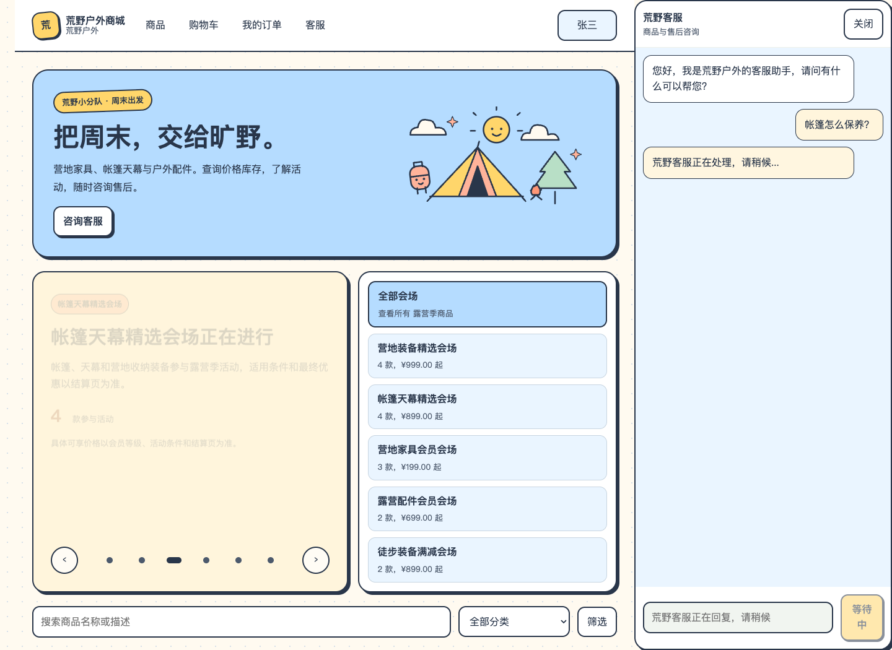
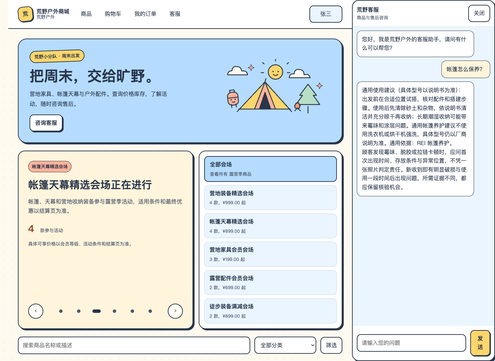
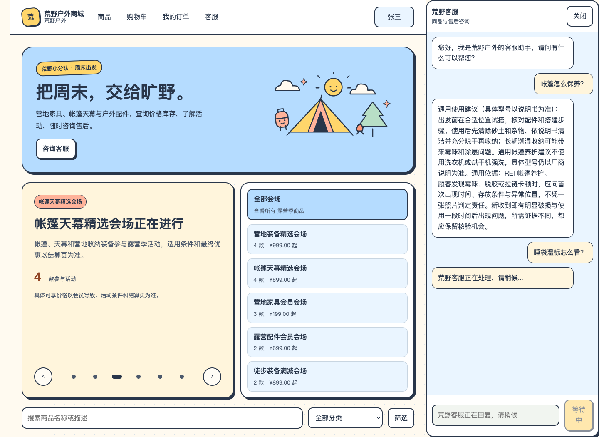
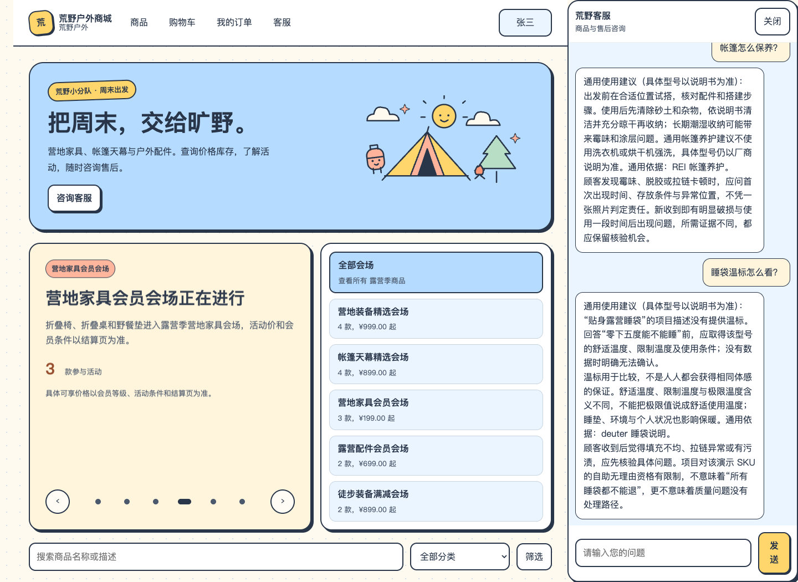
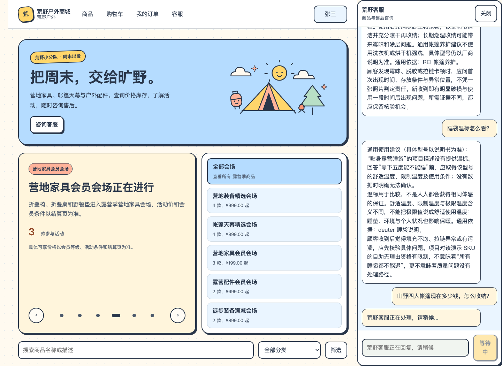
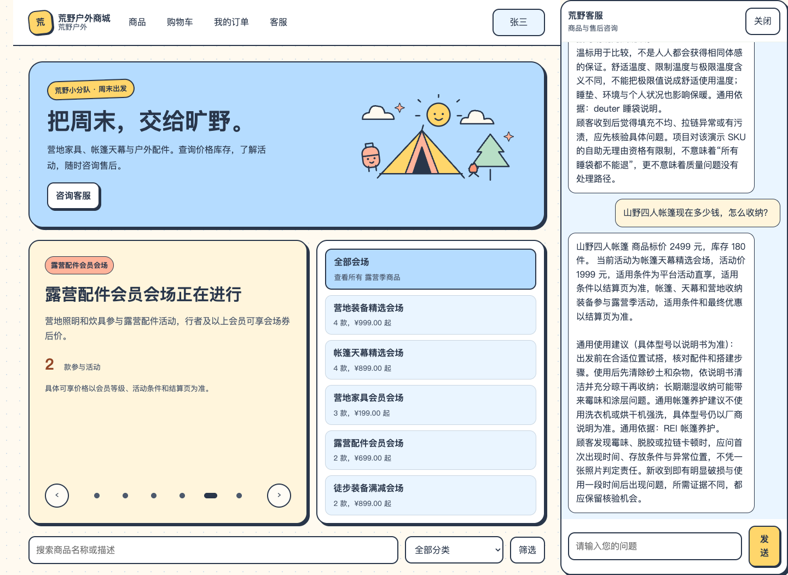

# 商品知识接入：最终页面对话与截图

2026-10-12。日常商城 5174 → Java 8081 → Python 8000；使用公开演示账号。仅咨询，不下单、支付或确认售后。最终三组页面咨询与公开 Trace 均通过。

初版多小节回复及截图保留在 `first-load/`，不与最终三组重复计数。

## 1. tent-care

用户：帐篷怎么保养？

实际回复：

通用使用建议（具体型号以说明书为准）：
出发前在合适位置试搭，核对配件和搭建步骤。使用后先清除砂土和杂物，依说明书清洁并充分晾干再收纳；长期潮湿收纳可能带来霉味和涂层问题。通用帐篷养护建议不使用洗衣机或烘干机强洗，具体型号仍以厂商说明为准。通用依据：REI 帐篷养护。  
顾客发现霉味、脱胶或拉链卡顿时，应问首次出现时间、存放条件与异常位置，不凭一张照片判定责任。新收到即有明显破损与使用一段时间后出现问题，所需证据不同，都应保留核验机会。

结果：HTTP 200；confirmRequired=false；fallback=false；约 4.62 秒。

## 2. sleeping-bag

用户：睡袋温标怎么看？

实际回复：

通用使用建议（具体型号以说明书为准）：
“贴身露营睡袋”的项目描述没有提供温标。回答“零下五度能不能睡”前，应取得该型号的舒适温度、限制温度及使用条件；没有数据时明确无法确认。  
温标用于比较，不是人人都会获得相同体感的保证。舒适温度、限制温度与极限温度含义不同，不能把极限值说成舒适使用温度；睡垫、环境与个人状况也影响保暖。通用依据：deuter 睡袋说明。  
顾客收到后觉得填充不均、拉链异常或有污渍，应先核验具体问题。项目对该演示 SKU 的自助无理由资格有限制，不意味着“所有睡袋都不能退”，更不意味着质量问题没有处理路径。

结果：HTTP 200；confirmRequired=false；fallback=false；约 2.53 秒。

## 3. tool-and-knowledge

用户：山野四人帐篷现在多少钱，怎么收纳？

实际回复：

山野四人帐篷 商品标价 2499 元，库存 180 件。 当前活动为帐篷天幕精选会场，活动价 1999 元，适用条件为平台活动直享，适用条件以结算页为准，帐篷、天幕和营地收纳装备参与露营季活动，适用条件和最终优惠以结算页为准。

通用使用建议（具体型号以说明书为准）：
出发前在合适位置试搭，核对配件和搭建步骤。使用后先清除砂土和杂物，依说明书清洁并充分晾干再收纳；长期潮湿收纳可能带来霉味和涂层问题。通用帐篷养护建议不使用洗衣机或烘干机强洗，具体型号仍以厂商说明为准。通用依据：REI 帐篷养护。  
顾客发现霉味、脱胶或拉链卡顿时，应问首次出现时间、存放条件与异常位置，不凭一张照片判定责任。新收到即有明显破损与使用一段时间后出现问题，所需证据不同，都应保留核验机会。

结果：HTTP 200；confirmRequired=false；fallback=false；约 4.48 秒。

## 证据与边界

[页面原始响应](browser-acceptance.json) · [公开 Trace](live-trace.json) · [最终结果](result.json) · [业务行对比](live-after.json)

纯知识两轮没有业务工具调用；混合轮记录一次 search_products 业务工具调用。三轮使用真实路由模型，最终回复采用受控事实与知识片段，未再次调用生成模型。应用 Token 数据为估算，不是供应商账单。商城沿用原纯文本回复；Python 引用保留小节、原文、来源和版本，未新增商城引用卡组件。
