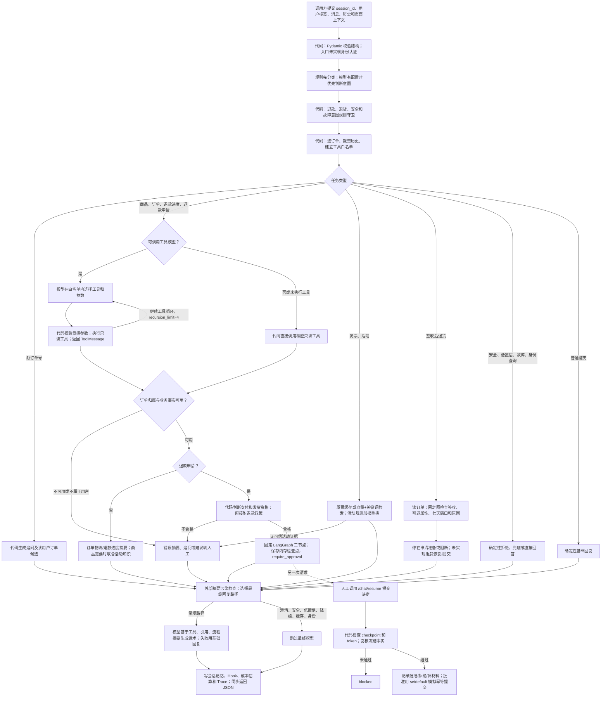

# 荒野户外服务助手项目导读

> 2026-10-12 商品读取：搜索空列表是零匹配，超时和其他读取失败分开；详情只有 404 且 `NOT_FOUND` 才表示该编号不存在。失败和部分事实不交给最终模型改写成缺货，也不改未提交退款草稿。定向验收见 [FAULT-001](../docs/项目评测记录.md#fault-0012026-10-12-工具故障反馈定向验收)。最新停点见 [项目交接](../docs/项目交接.md#唯一当前停点)。

> 2026-10-10 M07收尾：商城明确取消未提交办理会清理草稿和确认凭证；后续Python在路由前清理旧待办候选，保留已核验订单事实。没有修改意图Prompt或增加标签；日常商城2组9轮通过，已提交申请不撤销。更新时发现启动自动补回演示余额，已改为仅创建缺失账户，并精确恢复为更新前8表哈希；证据与范围见 [M07-001与INIT-001](../docs/项目评测记录.md#m07-0012026-10-10-取消未提交售后意向修复与验收)。最新停点见 [项目交接](../docs/项目交接.md#唯一当前停点)。

> 2026-10-10 M06收尾：用户说“第一笔/第二笔”已按同用户会话刚展示的候选顺序绑定订单，无效序号不回退页面或历史订单。日常本地8000/8081已更新，当前MySQL商城浏览器2组6轮生成正确确认卡，未提交售后；测试样本经用户授权扣398元演示余额，对话阶段无进一步业务写入。见 [M06-002](../docs/项目评测记录.md#m06-0022026-10-10-日常服务更新与商城浏览器收尾)；范围不扩大到全部自然语言指代或生产部署。

> 2026-10-10 收尾更新：用户确认最新版本B01/B02、相关场景与商城入口三项验收完成，“政策咨询与办理分离”按约定范围已完成。见 [MANUAL-002](../docs/项目评测记录.md#manual-0022026-10-10-用户确认政策咨询三项验收完成)。以下局部验收限制是当时的助手证据边界，后续用户确认单独保留；其他意图任务仍独立排期。

> 2026-10-10 意图更新：用户已新增退款/退货政策查询标签，并将发票标签改为 `invoice_query`，当前共14项。POLICY-002中 B01/B02 的标签和只读路径均通过；后续用户明确无理由无需填原因，政策已同步，POLICY-003仅B02复测通过。B01未在本次重跑，不能合并为同版本2/2。完整回复与局部验证边界见 [专项复测](../docs/B01-B02政策咨询修改后复测.md)；不继承旧版标签成绩为新版本全量成绩。

> 2026-10-09 范围更新：商城现已支持本人已支付未发货整单退款，以及签收后七天无理由整单退货退款。新增退货主线是“客户确认登记待审核→管理员同意并提供退货地址→客户填写退回物流→管理员确认收货验收→退回本地模拟余额”；初审同意不退款，验收失败保留人工恢复路径。实现及隔离验收见 [GAP-003](../docs/项目评测记录.md#gap-0032026-10-09-签收七天无理由退货退款完整闭环)；源码入口为 `ShopService.java:393`、`AdminAfterSaleService.java:128`及`:141`。Python工作台仍为独立模拟入口。下列2026-10-08及更早内容按历史范围阅读，当前停点与服务状态见 [项目交接](../docs/项目交接.md)。

> 2026-10-08 更新：商城客户确认提交现在直接登记 PENDING_REVIEW，已有管理员独立审核；工作台继续模拟，两条执行入口已分开。首版仅支持本人已支付未发货整单退款，不提交已发货/已签收七天无理由申请。实现与隔离证据见 [GAP-001](../docs/项目评测记录.md#gap-0012026-10-08商城确认提交待审核)；既有运行服务未更新，下文按日期保留历史拆解。

> 2026-10-07 补充：本轮已核对三份设计参考与当前源码，详细迁移建议见 [产品设计学习](../docs/产品设计学习.md#2026-10-07三份参考材料如何用于当前项目)。新增证据为 [DESIGN-001](../docs/项目评测记录.md#design-0012026-10-07三份材料与源码设计核验)：最新订单缺失回旧快照、支付状态缺失放行、普通角色模拟批准及冲突终态均已隔离核验；商城确认/取消跨端契约存在静态差异。未修改业务机制，未做商城端到端复测。下文早期静态分析中的“未运行/待验证”等状态按日期阅读，最新状态以 [项目交接](../docs/项目交接.md) 为准；本轮未核验运行服务及其部署版本。

分析日期：2026-10-06。版本标识：`lesson-41-final-rehearsal`（`backend/agent/customer_service_agent.py:698`）。首次分析仅覆盖当时的 Agent 后端快照；2026-10-06 随后补充商城、管理后台和 Java 电商后端，扩展范围见下方补充。该首次分析与补充静态核验当时均未启动服务或运行课程评测；后续实施与运行状态见下段。

本目录没有独立 `.git`；Git 向上解析到 `/Users/sunhao/Downloads/03_AIPMProject`，其 master 尚无提交、没有 remote。未找到 LICENSE、依赖清单或 README 引用的发布包运行手册。**当前只能确认这是第 41 课教学代码快照，无法确认上游仓库、开源许可证及允许分发/部署的范围。**

快照 SHA256：`3cd823e97e047c5446f0966ba8e8cc645979f7f4094f24d55dfe35eb65766f84`。计算口径：按相对路径排序的 README 与 backend 中 `.py/.md/.yml/.json`，依次拼接路径、NUL、文件内容、NUL；不含缓存及本轮学习文档。

当前改版（2026-10-06）：已实施户外场景、品牌与三套页面迁移；原有技术机制保留。Python 离线回归原版/改版均 10/13，8 项单元检查及两套前端构建通过；工作台调用实际离线 Agent，商城与后台 UI 使用 Java API fixture，Java/MySQL 未联调。下面的源码拆解保留首次观察，不能把其中“未运行”理解为当前状态；运行证据以评测记录为准。上方 SHA256 是原始 Agent 快照指纹，改造前的 [原版清单](改造验证/original-manifest.json) 为历史哈希。2026-10-07 已移除原源码备份，保留从原快照提取的 [非品牌迁移契约](改造验证/migration-contract.json)；不能据此完整还原原源码。

过程记录：[产品设计学习](../docs/产品设计学习.md) · [项目交接](../docs/项目交接.md) · [项目评测记录](../docs/项目评测记录.md) · [Bad Case](../docs/BadCase.md)。当前停点只维护在项目交接。

## 1. 项目概览

一句话定位：面向虚构“荒野户外”零售场景的客服演示 Agent，把商品/订单查询、活动规则解释和售后放进可观察链路；商城由客户确认提交、管理员独立处理并写入本地演示业务记录，Python工作台保留模拟审批，均不接外部支付退款。

判断：适合学习“模型负责理解和表达，代码负责数据与高风险流程”；不应把课程快照视为可直接上线的客服系统。README 自述课程边界见 `README.md:63`。

| 分层 | 实际构成 | 源码入口 |
|---|---|---|
| 产品 | 商城、管理后台、聊天、补订单号、售后审批恢复、Trace、Eval、反馈；已有 Agent 工作台及电商商城/管理后台，均未运行 | `backend/api/routes.py:32` |
| 应用 | 一个 `Lesson41Agent` 总编排；只读工具 Agent；两条固定售后 StateGraph | `backend/agent/customer_service_agent.py:36`；`backend/agent/tools/langchain_runtime.py:43`；`backend/agent/workflows/after_sale_graph.py:33` |
| 模型 | 意图路由、工具选择、最终话术；语义 Embedding | `backend/agent/models/router_client.py:47`；`backend/agent/models/answer_client.py:55`；`backend/retrieval/hybrid_retrieval.py:70` |
| 数据 | 五份 Markdown 政策、外部业务 API、显式离线种子镜像 | `backend/resources/knowledge/`；`backend/agent/ecommerce_client.py:84` |
| 基础设施 | FastAPI；LangChain；LangGraph；内存向量索引及状态；httpx | `backend/main.py:5`；`backend/agent/state.py:14` |

没有看到独立专家之间互相交接的多 Agent 团队。`LangChainToolRunner` 是总编排中限定只读工具的执行子环节，不等于多个自治专家协作。`MCPCatalog` 是本地能力目录和响应元数据，当前源码无真实 MCP 传输/服务端连接（`backend/agent/mcp_catalog.py:8`）。

### 2026-10-09 架构范式核验

当前 `backend/` 主要是**意图路由驱动的单 Agent 业务编排，局部嵌入受限的 ReAct 式工具循环，并用固定 Workflow 处理高风险售后**，不属于典型 Plan-and-Execute。`plan_intent` 只返回意图，`build_route_plan` 按代码映射生成工具白名单；主流程通过 `if/elif` 分支执行业务路径，没有模型生成的多步任务清单及其逐步执行器（`backend/agent/models/router_client.py:47`；`backend/agent/tools/planning.py:60`；`backend/agent/customer_service_agent.py:130`）。

局部 ReAct 依据是 `create_agent` 的模型→工具→模型闭环，采用 `AIMessage.tool_calls` / `ToolMessage`，不是解析文本 Thought/Action/Observation；调用限定工具白名单、受控参数及 `recursion_limit=4`，后者是图执行步数上限，不能理解为四次工具调用（`backend/agent/tools/langchain_runtime.py:76`、`:201`、`:214`）。物流工具包装器内部的订单→物流顺序也由代码固定（同文件`:125`）。退款图的三个节点和边预先定义，审批等待状态并不等于动态规划或 LangGraph 原图挂起续跑（`backend/agent/workflows/after_sale_graph.py:38`）。详细推理见 [本轮学习记录](../docs/产品设计学习.md#2026-10-09backend-的-react-与-plan-and-execute-架构判断)。本轮只做静态核验，未调用在线模型、未修改业务代码或重新验证服务。

## 2. 从一条业务请求理解项目

使用者：电商客户。示例输入：“请帮我查一下 SO20260602103000009-a1000009 的物流”。初始条件：调用方提供会话与用户身份，订单属于该用户，订单事实可读取。成功：回复有依据的物流状态；不得猜测送达时间，不得修改订单，也不得泄露他人订单。

预测路径：`/chat → 判断订单查询 → 找订单号 → 查详情并核对归属 → 读取订单内物流状态 → 生成回复 → 更新本会话最近订单 → 返回执行证据`。这是源码预测，尚未观察实际响应。

注意：`get_order_logistics` 本身没有独立访问物流承运商；它把已读订单中的物流状态转成摘要（`backend/agent/tools/tool_runtime.py:65`）。

## 3. 主链路流程图

图中的“暂停”是业务状态：StateGraph 实际执行到 END，另存字典供 `/chat/resume` 处理。没有使用 LangGraph 持久 checkpointer、`interrupt` 后原图续跑；主 API 是同步函数，没有后台异步任务或消息队列（`backend/agent/workflows/after_sale_graph.py:38`、`backend/agent/workflows/resume.py:103`、`backend/api/routes.py:44`）。

## 4. 逐步证据表

| 步骤 | 代码位置 | 行为说明 | 组件 |
|---|---|---|---|
| 接入 | `backend/api/schemas.py:87`；`backend/api/routes.py:44` | 必填会话、调用方确认的用户 ID 和消息；路由无登录验证依赖 | FastAPI/Pydantic |
| 意图 | `backend/agent/customer_service_agent.py:49`；`backend/agent/models/router_client.py:47` | 规则分类，再尝试模型 JSON 意图；失败回规则 | RouteModelClient |
| 高风险守卫 | `backend/agent/customer_service_agent.py:842` | 特定退款、退货、安全及故障规则覆盖不同模型意图 | 代码策略 |
| 上下文 | `backend/agent/context.py:40` | 消息订单号 > 页面订单 > 会话最近订单；客户端提交历史经裁剪 | Context Builder |
| 计划与澄清 | `backend/agent/tools/planning.py:60`、`:139` | 按意图生成白名单；缺订单号清空可执行订单工具并追问 | RoutePlan |
| 工具循环 | `backend/agent/tools/langchain_runtime.py:76`、`:175`、`:214` | StructuredTool 与 ToolMessage；模型参数必须匹配已选订单/关键词 | LangChain create_agent |
| 事实读取 | `backend/agent/tools/tool_runtime.py:23`；`backend/agent/ecommerce_client.py:104` | 先页面订单，再业务 API；有 owner 时核对归属；HTTP 超时 5 秒 | 电商适配层 |
| 检索 | `backend/retrieval/hybrid_retrieval.py:126`、`:170`；`backend/retrieval/knowledge.py:100` | 切块、向量与关键词合并；活动域过滤、规则重排与无证据兜底 | 内存 RAG |
| 售后 | `backend/agent/customer_service_agent.py:454`；`backend/agent/workflows/after_sale_graph.py:72` | 退款代码资格门、固定政策和审批检查点；签收退货另有资格图 | LangGraph |
| 来源安全 | `backend/agent/customer_service_agent.py:540`；`backend/agent/source_guard.py:9` | 正则识别特定注入语句，替换污染的工具摘要和引用 | Source Guard |
| 最终回复 | `backend/agent/customer_service_agent.py:779`；`backend/agent/models/answer_client.py:82` | 将事实与基础回复送入模型；多个边界跳过模型；并无通用输出事实核验器 | FinalAnswerModelClient |
| 记忆与观测 | `backend/agent/customer_service_agent.py:639`；`backend/agent/cost.py:37` | 写验证订单/商品及显式偏好；估算 token 和模型调用次数 | Memory/Hooks/Cost/Trace |
| 响应 | `backend/agent/customer_service_agent.py:685`；`backend/api/schemas.py:142` | JSON 包含 answer、citations、tool_calls、clarification、session_state | ChatResponse |
| 审批恢复 | `backend/agent/workflows/resume.py:103` | 检查 token 和冻结事实；模拟批准/拒绝/补信息 | 自建 Resume |
| 回归与反馈 | `backend/evals/runner.py:42`；`backend/api/routes.py:68` | 核对答案词组与结构证据；反馈归因后临时加入用例 | Eval/Feedback |

## 5. 工具、存储与降级矩阵

### 工具调用

| 工具名 | 输入 → 输出 | 触发条件 | 失败处理/边界 |
|---|---|---|---|
| get_order_detail | 模型 schema `{order_id: str}`；服务端附用户/context → 订单或 None + ToolCallTrace | 退款、退货；物流/退款进度包装器内部前置调用 | 缺 ID、无订单、owner 不符返回 error；只读；`tool_runtime.py:23` |
| get_order_logistics | 模型 schema `{order_id: str}`；底层接已查订单 → ToolCallTrace | order_query；模型白名单只有物流包装器，包装器先查详情 | 参数不匹配拦截；订单不可读就返回详情错误；`langchain_runtime.py:125` |
| get_refund_status | 模型 schema `{order_id: str}`；底层订单+用户 → ToolCallTrace | refund_status_query | 区分接口不可用与无申请；不会创建退款；`tool_runtime.py:77` |
| search_products | `{keyword: str}` → 商品列表 + ToolCallTrace | product_query | 多结果列候选，不默选第一款。成功空列表是无匹配；超时与其他读取失败分开，缺字段只答已核实值。`tool_runtime.py:247`、`ecommerce_client.py:176` |

Schema 定义见 `backend/agent/tools/langchain_runtime.py:23`；公开 ToolCallTrace 字段见 `backend/api/schemas.py:109`。政策检索是 Python 直接调用，不是注册给模型的 `retrieve_knowledge` 工具；当前注册目录只有上述四项。

### 存储读写

| 存储 | 存什么 | 读时机 | 写时机/边界 |
|---|---|---|---|
| backend/resources/knowledge/*.md | 售后、退货、发票、活动、会员政策及元信息 | 载入 Citation、初建索引 | 源文件编辑；本轮未改 |
| 外部电商 API | 商品、订单、售后记录 | 工具调用、恢复复核 | 当前 Agent 无实际业务写入 |
| SESSION_MEMORIES | 用户绑定、最近验证订单/商品、意图、显式颜色偏好 | 每次 build_context | 每次回复前 update_memory；进程内 |
| COMMON_HIT_CACHE | 发票咨询的最终回答 | invoice_query | 首次模型回复或显式禁模型后的兜底；全局固定 key `faq:invoice_issue` |
| RAG 索引和结果缓存 | 切块向量、版本指纹、检索结果 | 知识查询 | 首次索引/查询；内存；文件变更不自动重建 |
| WORKFLOW_CHECKPOINTS | 冻结事实、token、订单快照、政策、流程 | /chat/resume | 退款图末节点；内存 |
| SUBMITTED_ACTIONS | 幂等 key → 模拟 request_id | 批准恢复 | setdefault；没有真实退款事务 |
| TraceStore、计数、反馈、回填用例 | 事件、次数、反馈及临时 case | 查询、评测、反馈 | 请求期间；重启清空 |

证据：`backend/agent/state.py:14`；`backend/agent/context.py:13`；`backend/retrieval/hybrid_retrieval.py:30`；`backend/agent/trace.py:169`；`backend/api/routes.py:68`。

### 转人工、异常与降级

- **真实客服接管/工单系统：该项目无此设计。** `transfer_to_human` 是响应状态和提示语；源码没有分配坐席、建单、通知或后续客服消息接续。
- **模拟人工审批：有设计。** 退款通过 `/chat/resume`，无检查点/错 token 拦截；业务事实漂移则 blocked。批准、拒绝、补信息见 `backend/agent/workflows/resume.py:105`。签收退货只有准备状态，没有对应恢复接口。
- 路由模型调用出错或 JSON 无效回规则；只读工具 Agent 出错保留已发生的只读调用，否则走代码工具；最终模型出错回基础回复（`router_client.py:58`、`langchain_runtime.py:224`、`answer_client.py:145`）。
- 订单等通用 `ecommerce_get` 仍把非成功体收成 None，不区分超时、权限失败和不存在（`ecommerce_client.py:104`）。商品搜索和详情已分开：空列表是零匹配，超时是 `timeout`，其余读取失败是 `unavailable`；详情只有 404 且 `code=NOT_FOUND` 才是该编号不存在（`ecommerce_client.py:157`、`:176`、`:202`）。这类商品读取失败会把编排 `degraded` 设为真（`customer_service_agent.py:404`、`:993`）。
- 客户消息里带“故障注入演示”，或客户自己报告页面查不了，仍走 `degradation_request`。这是课程演示或用户报告，不是已经核实的商品读取失败（`customer_service_agent.py:224`）。
- 低置信活动回复不调用最终模型；规则关键词和证据门不等于通用置信度算法（`knowledge.py:100`）。
- RAG 缺 Key 且未显式离线时抛 RuntimeError；检索调用周围没有统一兜底，真实 Embedding 失败是否形成 HTTP 500 [待验证]（`hybrid_retrieval.py:70`、`knowledge.py:107`）。
- 审批复核失败回旧订单快照可能掩盖失去最新事实的问题，见 [BC-001](../docs/BadCase.md)。

## 6. 模型与 Prompt 留痕

这些是源码默认值，未核验当前环境实际有效配置。

| 步骤 | Prompt/调用 | 默认模型及参数 |
|---|---|---|
| 意图路由 | `resources/prompts/route_contract.md`，注册表叠加全局片段；LangChain chain.invoke，解析 JSON intent | Qwen/Qwen3-8B；temperature=0；timeout=30；max_retries=0；`router_client.py:115` |
| 工具选择 | 注册表按 final_answer/business_tools 等信号选片段；create_agent 的原生 tool_calls → StructuredTool → ToolMessage | 同聊天模型；temperature=0；timeout=30；max_retries=0；recursion_limit=4；`langchain_runtime.py:202`、`:269` |
| 最终话术 | 按风险、工具、知识选片段，受控 JSON payload；普通链 invoke | 同聊天模型；temperature=0.2；普通路径未显式设置 timeout/retries；`answer_client.py:171` |
| 教学推理视图 | 使用同一最终生成 payload，OpenAI 兼容 chat.completions.create | temperature=0.2；timeout=60；max_retries=0；max_tokens=512；特定供应商 enable_thinking/thinking_budget=512；`answer_client.py:204` |
| Embedding | 文档与查询向量，无生成 Prompt；OpenAIEmbeddings | BAAI/bge-m3；request_timeout=30；max_retries=0；`hybrid_retrieval.py:70` |

默认 base URL 为 `https://api.siliconflow.cn/v1`，配置项为 `AGENT_OPENAI_BASE_URL`、`AGENT_OPENAI_MODEL`、`AGENT_EMBEDDING_MODEL`、`AGENT_OPENAI_API_KEY`（`settings.py:58`）。均非流式返回；工具执行路径才涉及 tool calling，路由是文本 JSON。

Prompt 注册表位置 `backend/resources/prompts/prompt_registry.yml:4`，包括安全、客服角色、路由契约、高风险售后、工具使用、RAG 回答、最终风格。注册表及 Prompt 约束不等于执行权限或答案真实度保证。

## 7. 记忆与上下文工程

- 会话主键是调用方提交的 session_id。`current_memory` 检测 runtime_user_id 变化后重建该 session 的记忆；不是由服务端登录凭证确定身份（`context/builder.py:20`）。
- 用户显式订单号 > 页面 current_order_id/relatedOrderNo > 最近验证订单。工具先取页面 currentUserOrders 里的订单再访问业务后端（`context/builder.py:40`、`tools/tool_runtime.py:39`）。因此“页面可信”需要可信调用方保障，当前 API 自身没有认证。
- 服务器只记少量字段；完整聊天历史由调用方传入，不自动保存完整消息。历史优先最近 4 条并补匹配订单的旧消息，预算是 `len(text)//2` 的约 80 token；匹配订单的消息允许突破预算（`context/builder.py:131`、`planning.py:168`）。这不是模型摘要。
- **独立长期记忆、持久会话数据库、用户记忆向量召回：该项目无此设计。** 颜色偏好也是当前进程的会话字段；ttl='session' 是标签，无计时过期实现。
- RAG 向量召回用于政策，不是长期用户记忆。四份文档进混合索引，退货政策直接挂载；chunk_size=220、overlap=30、top_k=4。关键词相似度是词/双字命中比例，不是 BM25；活动 reranker 是规则加分，不是神经重排模型（`hybrid_retrieval.py:24`、`:152`、`:268`；`knowledge.py:199`）。
- 退款和退货政策直接 `load_knowledge_citation` 挂载，尽管产生 `rag_pre_retrieved` 事件，也不代表这两条路径做了语义搜索（`knowledge.py:13`、`customer_service_agent.py:243`、`:455`）。
- 安全脱敏存在局部差异：builder 注释称 user_id 不进模型，但最终 payload 带 runtime_user_id；工作流 payload 也含 resume_token。因此不能只按 Context Builder 注释宣称这些字段没有进入模型（`context/builder.py:56`、`models/answer_client.py:85`、`:152`）。

## 8. 快速阅读顺序与待验证清单

阅读顺序：`api/routes.py` → `agent/customer_service_agent.py` 的 chat → `agent/tools/planning.py` → `agent/tools/tool_runtime.py` → `agent/workflows/after_sale_graph.py` 与 `resume.py` → `resources/cases.yml`。无需先学完全部目录。

| 待验证项 | 最小验证方法 |
|---|---|
| 上游、版本、许可证及依赖版本 | 找原始课程发布包或仓库；对照 LICENSE、commit、运行手册和 lock/requirements |
| 本地能否跑 | 本轮默认 python3 缺 fastapi/uvicorn/httpx/yaml/pydantic/langchain/langgraph/langchain_openai/langchain_text_splitters；核实完整依赖环境后先启动 /health，再跑一条离线物流 |
| 真模型路由、工具调用与话术质量 | 明确预算后实跑，观察 used_model、模型名、tool_calls、来源与完整回答；离线测试不替代此项 |
| 13 条课程用例结果 | 明确离线开关与事实源后调用 EvalRunner；README 13/13 是发布材料陈述，尚未本地复测 |
| 审批复核失去最新事实 | 对 business_recheck 隔离注入 API 返回 None，检查能否因快照放行；见 BC-001 |
| 审批身份与重复/冲突决定 | 测非主管 reviewer_role、approved→rejected、rejected→approved、不同订单同会话；核查鉴权与终态是否强制约束 |
| 同会话多用户、缺失 owner 的页面订单 | 只用隔离数据尝试伪造 runtime 标签和 context；当前 schema 与 owner 条件并非完整认证 |
| 故障与知识过期 | 注入真实适配器超时、Embedding 错误，更新政策并检查缓存失效；不能用消息故障关键词替代 |
| 答案是否忠于证据 | 核对每个事实是否由工具/政策支持，单独评估；课程词组断言和 citation 存在不等于完整 groundedness |

本轮不提出新增 Agent 或重构。最值得学习的是任务责任边界与可观察证据；最小改进实验候选是“复核失败是否必须阻断”，尚未执行或授权改源码。

## 2026-10-06 材料补充：商城、管理后台与业务服务

本节更新首次仅有 Agent 后端时的材料边界；上文 Python 主链路和风险分析仍适用于 Agent 入口。用户已确认改编品牌为“荒野户外”，工作台为“评测工作台”。完整改造方案见 [产品设计学习](../docs/产品设计学习.md#2026-10-06保留机制改成自己的业务原型)。

| 层级 | 新增源码 | 实际职责与边界 |
|---|---|---|
| 评测工作台 | `frontend/src/App.tsx`、`hooks/useAgentChat.ts`、`components/TracePanel.tsx`、`components/EvaluationPanel.tsx` | React + Vite；直接调用 Agent 聊天、恢复、Trace、Eval 和反馈接口；演示用户及课程上下文不是商城登录 |
| 商城 | `ecommerce-backend/frontend/src/shop/App.tsx`、`src/shared/api.ts` | React + Vite；商品、购物车、余额支付、订单、售后及客服；请求携带登录凭据。功能只经静态确认，未运行 |
| 管理后台 | `ecommerce-backend/frontend/src/admin/App.tsx`、`src/admin/api.ts` | 商品、活动、订单、用户和售后管理；权限由业务后端承担 |
| 业务后端 | `ecommerce-backend/pom.xml`、`src/main/resources/application.yml`、`config/SecurityConfig.java` | Spring Boot、数据库持久化、登录身份、用户/管理角色与服务身份；默认 8081 和 MySQL，实际部署未知 |
| 商城客服网关 | `service/CustomerServiceGatewayService.java`、`RestCustomerServiceAgentClient.java` | 商城→Java `/api/customer-service/chat`→按登录用户检查会话/订单并组装上下文→Python `/chat`→清理面向客户响应；确认提交另调 `/chat/resume` |

新增材料证明完整项目有登录、业务存储和交易相关设计，不能再把 Python 入口没有登录等同于整套项目没有登录。但工作台直连 Agent 的路径仍独立，需要区分入口。新增 Java 网关恢复 DTO 与 Python 必填 reviewer_id/reviewer_role 不一致，联调是否失败待验证；也不能把用户确认提交等同于管理员审批。

商品、图片与活动种子在 `config/DataInitializer.java`；已有商品只在特定条件更新，名称迁移需核验实际数据库内容。源码可见的商城和管理能力不意味着客服 Agent 已连接支付、完成真实退款或实现坐席接管。两套前端构建及三层端到端链路尚未验证。
