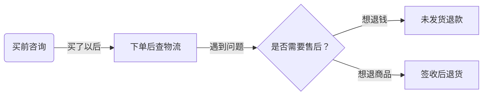
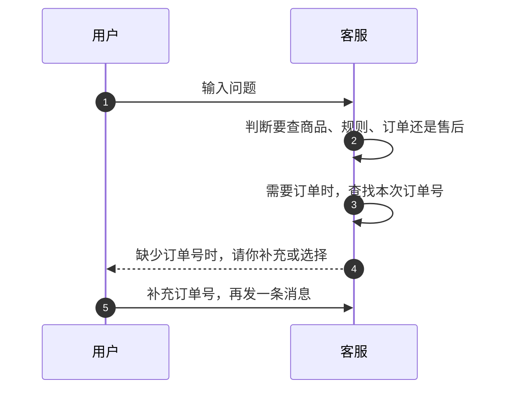
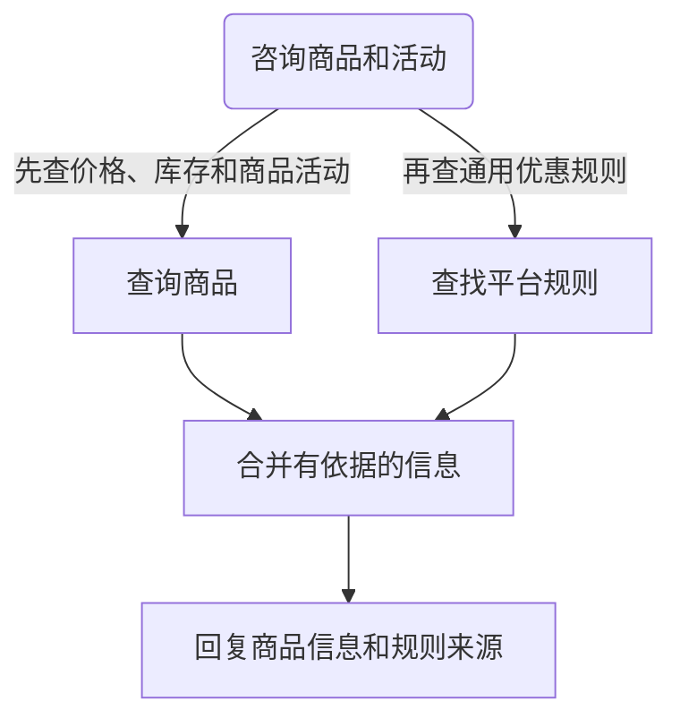
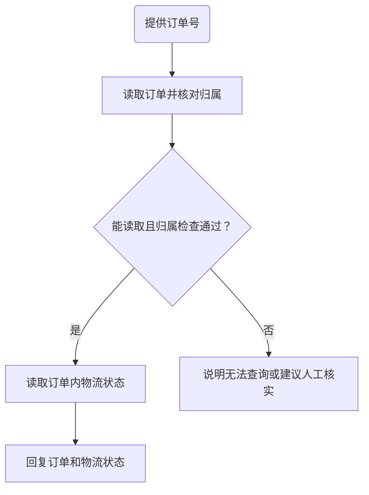
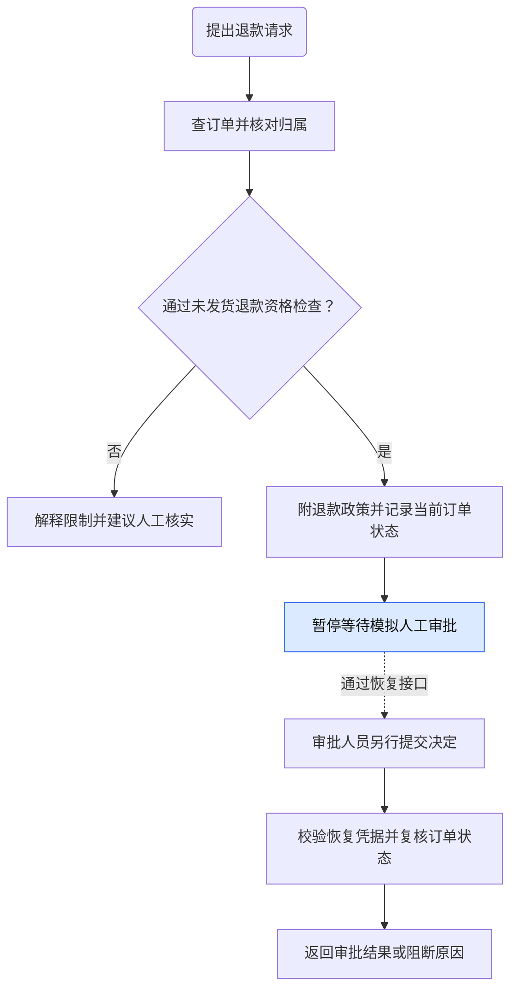
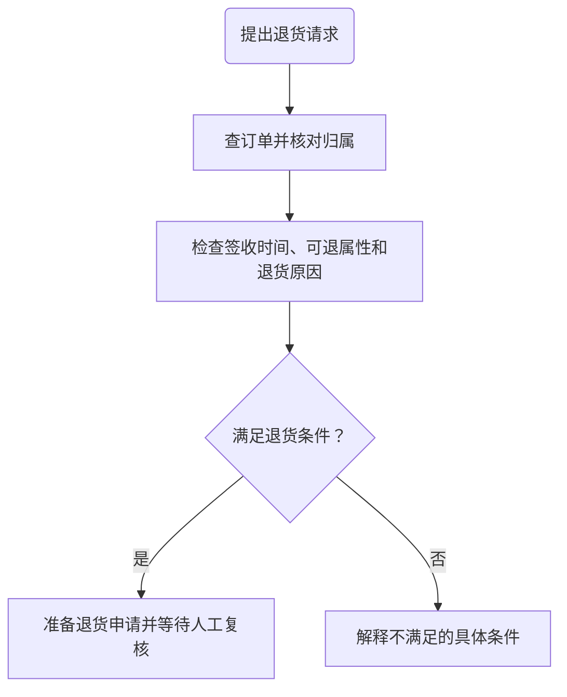
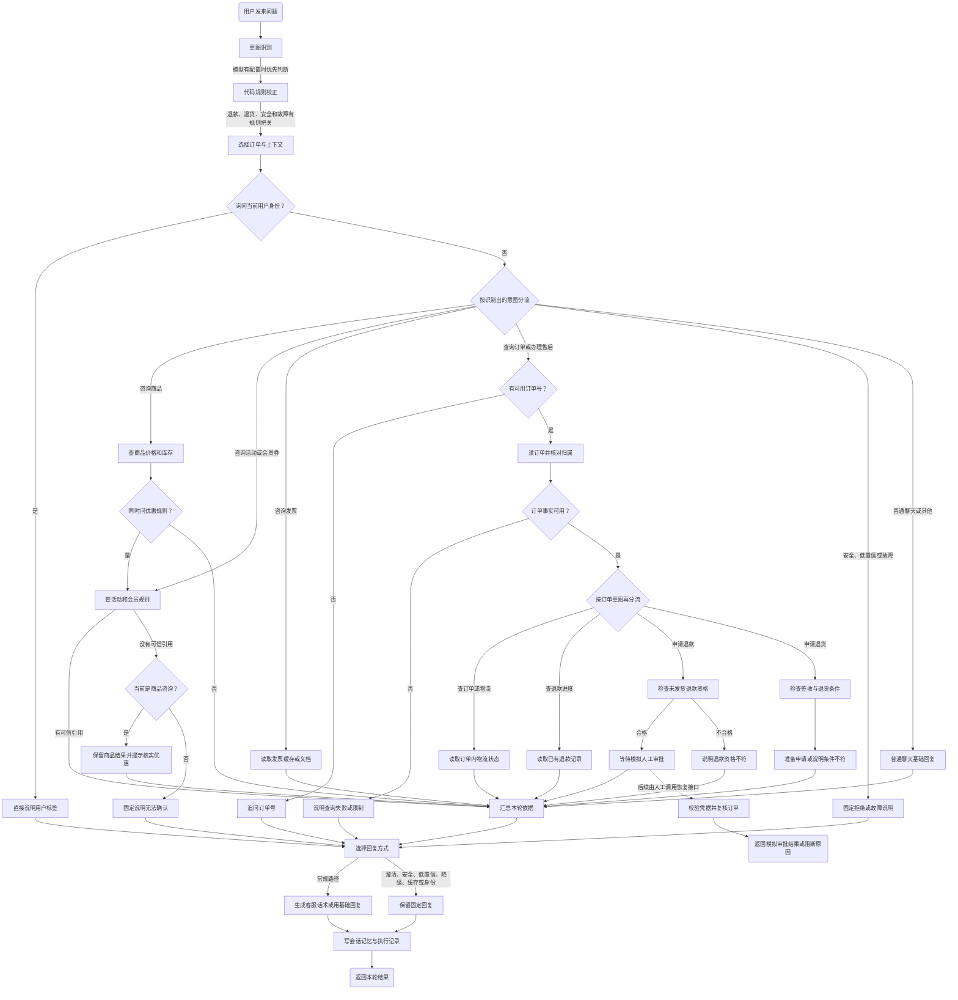

# 电商客服 Agent：跟着用户走一遍

> 从买前咨询，到查物流，再到退款与退货
> 本地第 41 课源码 · 2026-10-06 · 尚未实跑

这个客服先弄清你想做什么，再找订单事实或平台规则。涉及退款时，它会停下来等待模拟人工审批。

## 先看全景：用户在什么时刻需要它？

这是用户需求的阅读顺序，不是每次必须走完的流程。当前项目提供客服接口，没有购物车、下单和支付页面。

| 用户此刻想知道什么 | 客服去哪里找依据 | 用户得到什么 |
|---|---|---|
| 商品多少钱、有多少库存？ | 商品查询工具 | 查询到的价格与库存 |
| 优惠券能不能叠加？ | 平台规则文档 | 规则说明与来源引用 |
| 我的快递到哪里了？ | 订单中的物流字段 | 查询到的物流状态 |
| 没发货，能不能退款？ | 订单事实、退款政策和审批流程 | 资格判断与等待审批的状态 |
| 收到商品后，能不能退货？ | 订单事实与退货政策 | 条件检查与申请准备状态 |

源码入口：[客服主流程](/Users/sunhao/Downloads/03_AIPMProject/0305_DianShang_Agent/backend/agent/customer_service_agent.py:44)。

## 第一步：发来一句话，客服先找准需求

客服按顺序找订单号：先看本次消息，再看当前页面，最后看会话中最近核实的订单。都找不到时，它才会追问。

例如，你说“查一下物流”，客服可能问“你要查哪个订单？”如果上下文已有可用订单号，它可以继续查询。

模型有配置时参与判断需求；模型不可用时，代码按关键词分流。退款、退货和安全问题还有代码规则把关。

源码依据：[订单号选择](/Users/sunhao/Downloads/03_AIPMProject/0305_DianShang_Agent/backend/agent/context.py:40)、[补信息提示](/Users/sunhao/Downloads/03_AIPMProject/0305_DianShang_Agent/backend/agent/tools/planning.py:139)。

## 买前咨询：商品事实和优惠规则分开查
用户问：“降噪耳机现在多少钱、有多少库存？618 满减有什么规则？”

查询商品像“查业务账本”。查找规则像“翻平台说明书”。只问规则时，客服可以直接走规则路径。

两类依据不能混用：通用满减规则，不一定适用于某件商品。最终组合仍以商品页与结算页为准。

| 查询结果 | 客服怎么答 |
|---|---|
| 找到商品 | 说明查到的价格、库存和活动信息 |
| 找不到商品 | 说明没有匹配结果，不猜价格和库存 |
| 找到可信活动规则 | 解释规则，并附来源引用 |
| 没有可信活动规则 | 说明无法确认，建议核实或联系人工 |

源码依据：[商品与规则联合回答](/Users/sunhao/Downloads/03_AIPMProject/0305_DianShang_Agent/backend/agent/customer_service_agent.py:429)、[活动证据检查](/Users/sunhao/Downloads/03_AIPMProject/0305_DianShang_Agent/backend/retrieval/knowledge.py:100)。

## 下单之后：查物流，不猜送达时间
用户问：“请帮我查一下 SO20260602103000009-a1000009 的物流。”

订单可能来自调用方提交的页面资料，也可能来自业务接口。物流工具读取订单里的状态，没有独立查询承运商。

因此，源码里的“运输中”不等于已经知道“明天送达”。客服不能在缺少依据时承诺送达时间。

“核对归属”也有条件：订单带有用户字段时，代码才比较归属。入口身份来自调用方，当前没有完整登录认证。

如果用户问“退款进度”，客服改查已有售后记录。查进度不会创建新退款申请。

源码依据：[订单读取与归属检查](/Users/sunhao/Downloads/03_AIPMProject/0305_DianShang_Agent/backend/agent/tools/tool_runtime.py:23)、[物流摘要](/Users/sunhao/Downloads/03_AIPMProject/0305_DianShang_Agent/backend/agent/tools/tool_runtime.py:65)、[退款进度](/Users/sunhao/Downloads/03_AIPMProject/0305_DianShang_Agent/backend/agent/tools/tool_runtime.py:77)。

## 没发货想退款：先判断，再等待审批
用户问：“这笔订单还没发货，我现在能退款吗？”

客服检查订单状态、物流状态和支付字段。明确未支付或已经发货时，不能进入未发货退款审批。

当前实现允许缺失支付字段的课程样例通过部分检查。因此，不能把它理解为完整支付凭证核验。

| 审批恢复结果 | 用户看到什么 | 系统做到哪里 |
|---|---|---|
| 校验不通过 | 不能继续审批恢复 | 阻断本次恢复 |
| 批准 | 模拟退款申请审批通过 | 记录模拟结果，不退真实资金 |
| 拒绝 | 本次模拟申请未通过 | 告知拒绝结果 |
| 要求补充材料 | 还需补信息 | 继续暂停 |

恢复凭据用于找到并核对暂停的申请。重复批准复用同一条模拟提交记录。

这里有流程停点，但还没有完整审批权限验证。复核查不到最新订单时，还会退回旧快照。

源码依据：[退款资格](/Users/sunhao/Downloads/03_AIPMProject/0305_DianShang_Agent/backend/agent/workflows/after_sale_graph.py:72)、[模拟审批恢复](/Users/sunhao/Downloads/03_AIPMProject/0305_DianShang_Agent/backend/agent/workflows/resume.py:103)、[旧快照问题记录](/Users/sunhao/Downloads/03_AIPMProject/0305_DianShang_Agent/docs/BadCase.md)。

## 已签收想退货：通过条件检查，也只是准备申请
用户问：“订单已签收，我想七天无理由退货。”

这条路径与未发货退款不同。它关注商品是否收到、能否退，以及退货时间和原因。

| 检查项 | 当前代码要求 |
|---|---|
| 订单状态 | 已签收、已送达或已完成 |
| 商品可退属性 | 明确为可退，不能只是未知 |
| 签收时间 | 有可解析日期，距离基准日不超过七天 |
| 退货原因 | 用户明确表达代码支持的原因 |

满足条件后，系统只准备申请并提示人工复核。当前没有退货提交、寄回商品、验收或退款到账流程。

课程默认基准日固定为 2026-07-15，可通过配置覆盖。它不会默认使用今天的日期判断七天窗口。

源码依据：[签收后退货流程](/Users/sunhao/Downloads/03_AIPMProject/0305_DianShang_Agent/backend/agent/workflows/after_sale_graph.py:144)、[课程基准日](/Users/sunhao/Downloads/03_AIPMProject/0305_DianShang_Agent/backend/agent/workflows/after_sale_graph.py:15)。

## 每条旅程的结束：给结果，也留下依据
| 结束情况 | 用户得到什么 | 当前实现的边界 |
|---|---|---|
| 信息已核实 | 事实说明，规则路径还会附引用 | 模型生成的话术仍需检查是否忠于依据 |
| 缺少信息 | 补订单号或选择订单的提示 | 用户补充后，再发下一条消息 |
| 规则无法确认 | 保守说明，建议核实或联系人工 | 没有自动创建人工工单 |
| 服务故障 | 部分路径给出重试或转人工建议 | 各类真实故障尚未统一验证 |
| 索要受保护信息 | 拒绝提供 | 代码使用特定规则和正则检查 |
| 高风险售后 | 等待审批或人工复核的状态 | 不代表真实退款或退货已经完成 |

每次回复还会留下工具调用、规则引用、执行记录和成本估算。它们帮助开发者核对“查过什么、停在哪里”。

客服会记住同一会话最近核实的订单和商品。因此，下一句可以继续围绕这笔订单询问。

这些记忆与审批记录都在内存里，重启后会丢失。成本也是教学估算，不是实际账单。

读图时抓住三个分工：模型理解和表达，工具查事实，代码控制流程停点。所有图都来自源码分析，尚未观察真实运行。

源码依据：[返回结果与记录](/Users/sunhao/Downloads/03_AIPMProject/0305_DianShang_Agent/backend/agent/customer_service_agent.py:639)、[内存状态](/Users/sunhao/Downloads/03_AIPMProject/0305_DianShang_Agent/backend/agent/state.py:14)。完整技术证据见[项目导读](/Users/sunhao/Downloads/03_AIPMProject/0305_DianShang_Agent/analysis/dianshang-agent.md)。

## 整体流程：识别意图后，具体分到哪里？
这张图追踪一条请求，不是购物阶段的先后顺序。菱形表示分流点，箭头文字表示进入该路径的条件。

分支较多，可以[打开原尺寸总图](整体流程图.svg)放大查看。

**重点看三个分流点：意图分流、订单任务分流、回复方式选择。**

| 分流点 | 判断什么 | 一个具体例子 |
|---|---|---|
| 意图识别与意图分流 | 用户是在问商品、规则、订单还是售后？ | “耳机多少钱？”进入商品查询 |
| 商品查询后的判断 | 商品问题是否还涉及优惠？ | “耳机库存和满减规则？”继续查活动规则 |
| 订单号与事实检查 | 能否确定订单并读取可用事实？ | 没有订单号且上下文也没有，就先追问 |
| 订单任务分流 | 是查物流、查退款进度，还是申请售后？ | “退款到哪一步？”只查已有退款记录 |
| 售后资格检查 | 是否能进入对应售后流程？ | 未发货退款合格后，等待模拟人工审批 |
| 回复方式选择 | 让模型组织话术，还是保留固定回复？ | 缺订单号时，直接返回追问 |

用“耳机库存和满减规则？”走一遍：识别为商品咨询，查商品，再判断是否问优惠，查规则，汇总依据，生成回复。

模型只负责优先判断意图和组织部分话术。代码决定工具范围、参数要求和售后停点。

这是产品层面的总图。工具调用内部的模型循环和细项校验，见前面的分支图及项目导读。

商品联合回答没有查到活动规则时，会保留商品结果并提示核实优惠。纯活动咨询没有依据时，才走保守说明。

常规路径的模型不可用时，使用基础回复。退款进度接口出错时，会改走固定降级回复。

图中归属检查沿用源码条件，不能视为完整登录认证。审批恢复是另一次请求，也不会执行真实资金退款。

源码依据：[识别与编排](/Users/sunhao/Downloads/03_AIPMProject/0305_DianShang_Agent/backend/agent/customer_service_agent.py:49)、[按意图生成执行计划](/Users/sunhao/Downloads/03_AIPMProject/0305_DianShang_Agent/backend/agent/tools/planning.py:60)、[业务路径分支](/Users/sunhao/Downloads/03_AIPMProject/0305_DianShang_Agent/backend/agent/customer_service_agent.py:130)、[回复方式选择](/Users/sunhao/Downloads/03_AIPMProject/0305_DianShang_Agent/backend/agent/customer_service_agent.py:779)。
