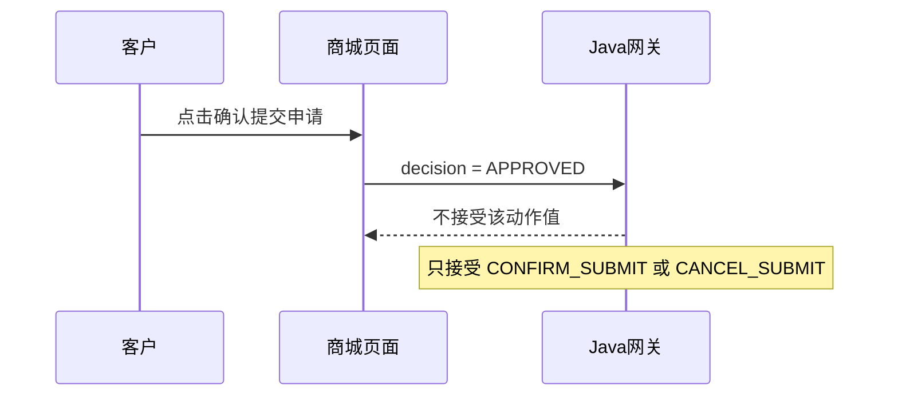
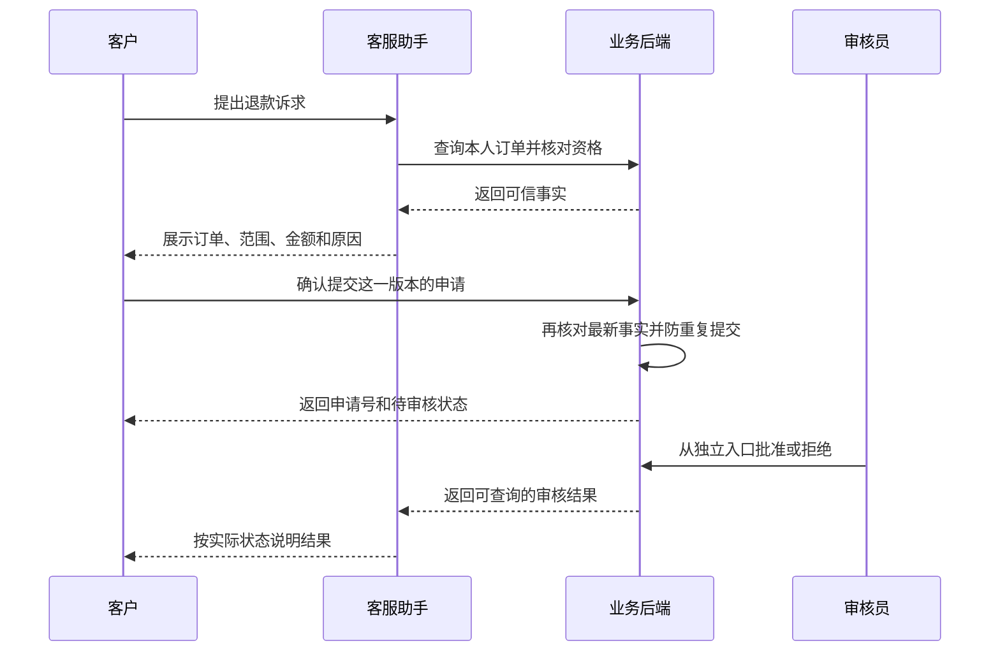

# 用户确认，为什么不能算审批通过？

> 第一项缺口：商城确认卡与后端审批流程没有接对

**先把两个决定分开：用户决定提交申请，审核员决定是否批准。**
当前项目有确认卡，但接口字段和业务含义都没有对齐。
本页解释现有缺口及修改方案，业务代码尚未修改。

## 这个缺口是什么？

> **一次点击，只能代表一种授权**
> 客户点击“确认提交申请”，表示同意提交卡片中的申请。
> 这次点击不能代替审核员批准，也不能证明资金到账。

| 阶段 | 谁决定或证明 | 系统可以说什么 |
|---|---|---|
| 提交申请 | 客户确认，后端记录成功 | 已提交，等待审核 |
| 批准申请 | 有权限的审核员决定 | 审核通过 |
| 资金结果 | 资金系统返回可核实结果 | 按实际资金结果说明 |

**示意场景：** 客户说“这笔订单不想要了，帮我退款”。
系统核对订单、范围、金额和原因，再展示确认卡。
客户确认一次后，系统应提交申请，并停在待审核状态。
审核员随后决定是否批准，客户不需要再扮演审核员。

“用户只确认一次”减少的是重复授权。
它不会取消必要的独立审核。

## 当前代码哪里接错了？

**先看现在的确认请求：**

前端使用“审批通过”的动作值，Java 使用“用户提交”的动作值。
这一步已经不一致，不能说商城确认链路已跑通。

**假如只修正前端动作值，后面还有两层问题：**

| 位置 | 当前实现 | 缺口 |
|---|---|---|
| Java → Python | 把客户确认转成 `decision=approved` | 客户授权被解释成审核通过 |
| 恢复请求字段 | Java 没有发送审核员 ID 和角色 | Python 必填校验不通过 |
| Python 恢复函数 | 没有验证真实审核员权限 | 匹配凭证不能证明具备审批权 |

因此，只补字段或统一拼写仍不够。
也不能给客户请求补上一个虚假的管理员角色。

旁支也存在缺口：“暂不提交”只追加页面文字。
前端没有通知后端撤销，所以旧申请并未因此失效。

## 为什么必须分开？

**同一句“确认”，对不同角色代表不同决定。**

| 参与者 | 负责什么 | 不能替谁决定 |
|---|---|---|
| 客户 | 确认本人要提交哪笔申请 | 不能替商家批准退款 |
| 模型 | 理解诉求、解释规则、补齐信息 | 不能用生成的文字授予权限 |
| 业务后端 | 验证身份、资格，保存状态 | 不能把界面点击当成审核结论 |
| 审核员 | 按权限批准或拒绝申请 | 不能把审核结果当成到账证据 |

当前确认按钮的名称是“提交申请”。
如果内部动作却是“批准退款”，客户无法知道真正授权了什么。
这个问题同时影响操作权限和状态说明。

从代码分工看，商城和 Python 表达的是两种不同任务。
商城处理客户提交，Python 恢复处理审核员决定。
两者复用了恢复入口，但没有独立表达两种授权。
这是根据实现推断的原因，不是作者动机说明。

目前 Python 只记录模拟审批，没有外部资金退款。
风险已在隔离函数中出现，不等于发生过真实资金损失。

## 应该改成怎样的交互？

**先保持当前模拟边界，修清每个动作的含义。**

图示是目标设计，当前项目尚未完成这条链路。
继续纯模拟时，客户提交后显示“模拟申请待审核”。
审核员决定后，显示“模拟审核通过”或“模拟审核拒绝”。
批准不代表外部支付渠道已经退款。

如果客户取消，后端撤销待确认意向，并让旧卡失效。
如果客户修改订单或金额，展示新卡，旧授权不再适用。

## 具体怎么做？

**复用现有确认卡和业务服务，不增加新的 Agent。**

| 修改位置 | 最小修改 | 修改后的行为 |
|---|---|---|
| 商城 `App.tsx` | 按后端 actions 发送提交或取消 | 两个按钮都通知后端 |
| Java 客服网关 | 移除客户确认到 `approved` 的转换 | 客户只能提交，不能审批 |
| 待确认申请状态 | 保存用户、订单、范围、金额、原因和版本 | 授权只对当前申请内容有效 |
| Python 审批恢复 | 从可信审核身份验证权限 | 自报角色不能获得审批权 |
| 业务状态与响应 | 保存终态，按 accepted/status 回复 | 失败不报成功，终态不被反转 |
| 确认卡 | 提交或取消后禁用旧按钮 | 界面状态与后端一致 |

第一步先让模拟提交进入“待审核”。
第二步再让独立模拟审核入口返回审核结果。
不要先补 reviewer 字段，让用户直接变成审核员。

将来接业务申请时，复用 `ShopService.createAfterSale`。
它已有创建待审核记录的能力。
审核可复用 `AdminAfterSaleService`，同时核对必要业务校验。

Java 审核可能改变本地演示余额。
连接这条业务链路会增加副作用，不能当成字段修补顺便完成。
本页没有执行接线，也没有触发余额入账。

## 怎么判断改好了？

每个场景同时检查：页面回复、实际请求、后端状态。

| 场景 | 应看到的结果 |
|---|---|
| 正常确认 | 只提交一笔申请，状态待审核 |
| 点击暂不提交 | 后端撤销意向，旧卡不能提交 |
| 只问“确认一下金额” | 解释金额，不把提问当成授权 |
| 修改订单、金额或原因 | 旧卡失效，确认对应新版本 |
| 重复点击确认 | 不产生重复申请 |
| 普通客户请求批准 | 拒绝审批，不改变审核状态 |
| 已批准后又请求拒绝 | 拒绝冲突决定，保留原终态 |
| 最新订单无法核实 | 停止提交，明确失败且允许安全重试 |

至少测一条真实商城入口链路。
只测 Python 函数，会漏掉前端动作值和 Java 字段差异。
只看到“请求成功”，也不能证明申请已经保存。

## 依据与验证边界

当前源码再次核对于 2026-10-07。
前端与 Java 动作差异已经静态确认。
Java 请求缺审核字段，已在上轮隔离校验中确认。
普通角色批准及冲突终态，也已在上轮隔离函数中复现。
本页未运行商城确认联调，未调用模型，未修改业务代码。

| 证据 | 阅读位置 |
|---|---|
| 前端提交与取消 | [商城 App.tsx：1053](../ecommerce-backend/frontend/src/shop/App.tsx#L1053) |
| Java 接收动作值与转发 | [客服网关：148](../ecommerce-backend/src/main/java/com/teachdemo/ecommerce/customer_service/CustomerServiceGatewayService.java#L148) |
| Java 恢复请求字段 | [AgentResumeRequest：5](../ecommerce-backend/src/main/java/com/teachdemo/ecommerce/customer_service/AgentResumeRequest.java#L5) |
| Python 必填审核字段 | [请求结构：220](../backend/api/schemas.py#L220) |
| Python 审批与状态处理 | [恢复函数：103](../backend/agent/workflows/resume.py#L103) |
| 可复用的申请服务 | [ShopService：316](../ecommerce-backend/src/main/java/com/teachdemo/ecommerce/order/ShopService.java#L316) |
| 可复用的审核服务 | [AdminAfterSaleService：94](../ecommerce-backend/src/main/java/com/teachdemo/ecommerce/aftersale/AdminAfterSaleService.java#L94) |
| 上轮隔离核验 | [DESIGN-001 结果](设计借鉴核验/result.json) |
| 完整修改建议 | [产品设计学习](../../docs/产品设计学习.md#第二p0用户确认不能变成人工审批) |

借鉴来源：[0304 的一次确认与状态分工](../../docs/参考/0304_电商客服产品设计借鉴总结_副本.md)。
补充来源：[0303 的执行权限与业务责任](../../docs/参考/0303_值得借鉴的产品设计_副本.md)。
