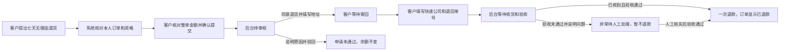

# 七天无理由退货退款产品设计计划

2026-10-09。用户已确认：做完整退货退款闭环。此计划扩展此前首版范围，保留未发货退款流程。

## 核心决定

已发货的订单需要先退回商品，再退款。首版自动受理本人已支付、已签收、符合七天无理由的整单申请。运输中的订单提示联系人工处理拦截，不提前退款。

后台有两次不同操作：**同意退货**只提供退回信息；**确认收到且验收通过，退款**才恢复余额并更新订单。

## 从客户到后台的流程

## 哪些订单能申请

| 条件 | 首版处理 |
|---|---|
| 本人已支付、已签收 | 服务端读取订单和实际支付流水；客户与模型不能指定身份或金额 |
| 签收七天内 | 上海时区，签收当日可申请，次日起算七天，第七天结束前提交有效 |
| 商品支持无理由退货 | 整单商品购买时的可退标记都为真；标记缺失提示人工核验 |
| 金额可核实 | 单笔余额实付与订单总额一致，尚无退款流水；只做整单全额退款 |
| 商品状况 | 提交时提示保持商品、配件及赠品完好；实际状况由后台收货验收，不由模型确认 |
| 没有冲突申请 | 已有退款、取消或退货处理中，进入原申请，不重复创建或入账 |
| 运输中、超期或事实缺失 | 告知具体原因和人工处理入口；不把无理由不适用说成所有售后均不可用 |

无理由退货不要求编造原因，申请类型固定为“七天无理由退货”。拆包装查看不直接等于商品不完好。期限以首次有效提交为准，后续审核、寄回和验收不重新使用七天门槛。

## 客户看到什么、怎么操作

1. 在订单详情点“咨询”，输入“这笔订单我要七天无理由退货”。
2. 客服展示订单、商品、整单实付金额及退回要求。点击“确认提交申请”才生成待审核记录；取消不会提交。
3. 订单详情和售后记录显示申请进度、后台意见。订单列表显示退货进度。
4. 同意后，展示后台填写的退货地址、联系人和电话。客户寄回后填写快递公司、单号。
5. 状态变为“待商家收货验收”。退款完成前余额不变；完成后订单和支付均显示“已退款”，履约显示“已退回”。

退货地址由后台填写，不假造真实商家地址。此项目使用模拟余额支付，按原支付路径退回模拟余额；不接外部支付或物流平台。

## 审核员看到什么、怎么操作

| 申请状态 | 可执行操作 | 资金变化 |
|---|---|---|
| 待审核 PENDING_REVIEW | 查看签收时间、购买时可退属性和实付金额；填写退回地址、联系人、电话并“同意退货”，或填写原因驳回 | 无 |
| 待买家寄回 WAITING_RETURN | 查看已提供的退回信息，等待买家上传物流 | 无 |
| 待商家收货验收 RETURN_IN_TRANSIT | 查看退回物流；勾选“已实际收到且验收通过”后确认退款，或记录验收未通过的原因 | 通过后退回整单实付 |
| 验收未通过 RETURN_INSPECTION_FAILED | 展示原因并转人工协商；人工核实后可再次确认验收通过 | 核实通过前无 |
| 已退款 REFUNDED / 已驳回 REJECTED | 查看完整处理记录，禁止重复入账 | 无新增 |

首版不新增仓库角色。审核员兼顾人工确认收货和验收，系统保留两阶段操作人、时间、意见及退回物流。确认退款前必须明确声明已收货且验收通过；填写物流单号不代表商家已收到。

## 不变的规则与恢复路径

- 未发货退款仍按现有流程，管理员通过后直接退款，履约取消。
- 客户不能调用管理员接口，也不能通过聊天批准或完成退款。
- 申请提交和确认退款重新核对归属、支付及当前状态；同一事务更新售后、余额、流水与订单，失败整体回滚。
- 重复点击、并发确认或重试最多产生一条申请及一笔退款。不同订单同时退款也不能覆盖同一账户余额。
- 拒绝或验收未通过必须写明原因；客户页面显示原因，保留人工恢复路径。
- 历史退货申请不会因部署自动退款；缺乏新流程必要事实的旧记录不能直接完成退款。

## 验收标准

| 场景 | 必须观察到的结果 |
|---|---|
| 合格订单提交 | 待审核申请，余额和订单付款状态不变 |
| 后台同意 | 待买家寄回，地址可见，余额不变 |
| 客户填物流 | 待商家验收，快递与单号可见，余额不变 |
| 未收货尝试退款 | 服务端拒绝，零退款流水 |
| 收货验收通过 | 一次全额退款，售后/订单/支付已退款，履约已退回 |
| 重复和并发退款 | 一条退款流水、正确余额、不能第二次入账 |
| 越权和金额篡改 | 服务端拒绝，资金和状态均不变 |
| 第七天末/第八天/未来签收 | 前者允许，后两者拒绝；缺支付和可退标记提示核验 |
| 及时提交、晚审核 | 原申请仍可继续，不因审核跨过七天而失效 |
| 驳回/验收未通过 | 展示具体原因，不退款；人工核实后可继续验收 |
| 回归未发货退款 | 原确认、取消、防重和审批同步订单仍通过 |

## 实现交接与证据边界

沿用现有商城客服确认卡、ShopService、售后实体、管理员服务和两套商城页面。Grok Build 负责实现；Codex 检查改动并运行隔离接口、资金和浏览器验证。测试不在现有用户账户新增审批或退款。

不做部分退货、物流拦截、运费结算、仓库库存恢复、图片凭证上传和真实物流追踪。库存是否可重新销售应另行核验，不能因无理由退回就自动增加可售库存。此文是产品计划，执行结果另记验证文件。

规则依据：[市场监管总局《网络购买商品七日无理由退货暂行办法》](https://www.samr.gov.cn/zw/zfxxgk/fdzdgknr/fgs/art/2023/art_26ca8fe29e184edd899fa0a7a060d935.html)，第八、十至十四、十七至十八条。系统仅实现上述首版范围，政策标记和人工验收不代表完整法律合规审查。

## 2026-10-09 实施结果

已接续实现并更新本地 Java/Python 服务。98 项隔离 Java/H2/HTTP 检查、15 项 Python 检查、7 组双角色页面检查与完整 Docker/Maven 构建通过。现有 MySQL 未新增申请、审批或资金流水；更新前后8张业务表原有字段行哈希一致，新增可空退货字段不回填旧记录。实际在线模型和当前 MySQL 的新退货链路留给用户手测，不声称已验收。证据、接口与复跑方法见 [七天退货验证](../../../analysis/01-售后申请与审核/七天退货验证/README.md)。
