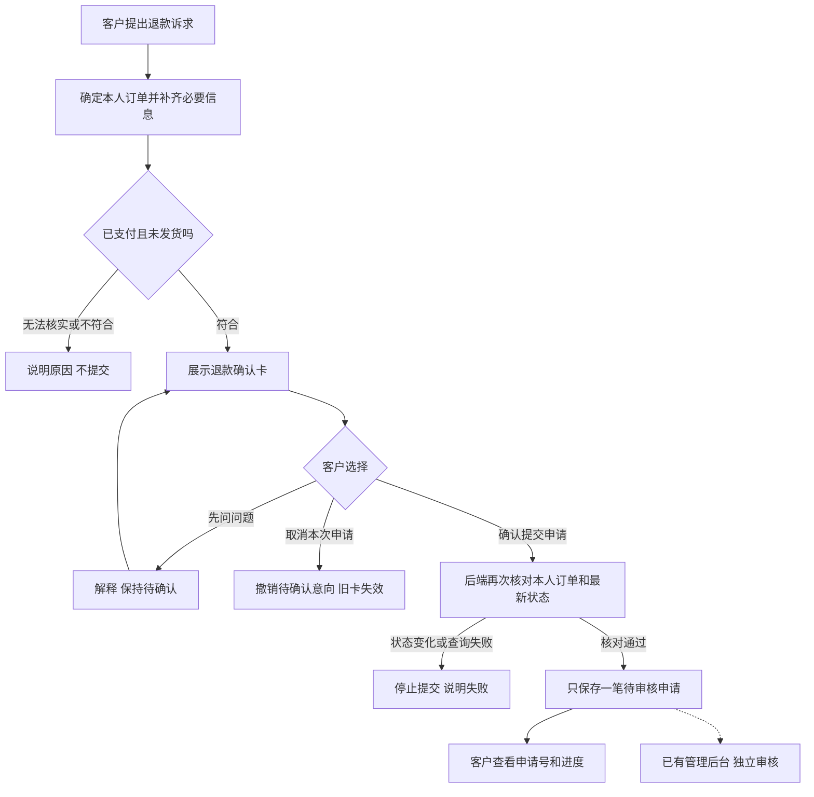

# 缺口一：提交申请与审核分开的产品设计计划

日期：2026-10-07；2026-10-09 更新。状态：**缺口一按已批准的首版范围收尾。** 申请提交与独立审核已分开，隔离验收通过；用户已报告手测清单完成。后续订单终态修复与七天退货扩展另见GAP-002/003，不倒改本计划的原始范围。实际证据及限制见 [GAP-001](../../03-评测与问题/项目评测记录.md#gap-0012026-10-08商城确认提交待审核) 和 [用户手测反馈](../../03-评测与问题/项目评测记录.md#manual-0012026-10-09-用户确认手测完成)。

## 先给判断

建议采用最小方案：**商城客户提交申请，已有管理后台负责审核；调试台继续模拟审核。**

不用新建审核员系统，也不用增加 Agent。商城确认后，把申请保存到现有本地演示数据库，并显示“待审核”。调试台的模拟批准不与这笔业务申请或余额联动。

本次先做到“申请正确提交、可查询、待独立审核”。已有管理员审核功能保留，自动审核、余额入账和支付渠道退款不纳入本次改造与执行验收。

## 1. 三个入口分别做什么

| 入口 | 操作者做什么 | 结果 |
|---|---|---|
| 商城客服 | 提出诉求、核对申请、提交或取消 | 本人申请进入待审核，不能自行批准 |
| 管理后台 | 管理员登录后查看并处理申请 | 审核与客户提交分开；复用已有能力 |
| 评测工作台 | 同一操作者模拟客户和审核员 | 只演示流程，不改变商城申请或余额 |

工作台的按钮明确写“模拟批准”“模拟拒绝”“模拟要求补充信息”。保留现有模拟方式，不为了演示新增审核员登录。

## 2. 首版只支持什么

- 已登录客户自己的订单。
- 已支付、尚未发货的整单退款申请。
- 退款范围为整单，金额从订单的可信实付记录读取；不能从模型回复提取金额。
- 缺少退款原因时，只补问原因；订单或原因已有明确资料时不重复追问。
- 已发货、未支付或无法确认资格时，说明原因并停止本次提交。

部分退款、换货、补偿及复杂取消订单流程暂不扩展。已有其他商城功能不随本次重写。

2026-10-08 用户确认：**首版不做已发货或已签收后的七天无理由退货申请提交与审核，即使符合退货条件也不纳入本次。** 已有退货政策咨询和资格判断保留，但不能据此表示已提交退货申请。

## 3. 客户看到的流程

虚线后的管理员处理是已有能力，不表示本次会触发审核或余额入账。客户确认不能调用调试台的模拟审批入口。

## 4. 确认卡怎样设计

确认卡标题：**确认提交退款申请**。

| 展示内容 | 规则 |
|---|---|
| 订单 | 显示本次选定的订单和商品摘要 |
| 范围 | 整单退款 |
| 金额 | 后端核实的实付金额；缺少可信金额就先核实 |
| 原因 | 客户明确提供，可在提交前修改 |
| 状态 | 等待本人确认，尚未提交 |

提示：“确认后将提交申请，等待审核。提交不代表退款成功。”

两个按钮：**确认提交申请**、**取消本次申请**。

取消按钮不再写“暂不提交”，避免客户分不清暂缓与撤销。点击取消后，后端撤销待确认意向，回复“本次申请已取消，未提交”，并禁用旧卡。

提交成功后，卡片显示“已提交，待审核”和申请号，禁用提交按钮。只在数据库已保存记录后显示成功。提交失败时说明原因，不能显示“已受理”。

客户只确认一次；审核员在后台的决定是另一种职责，不是再要求客户点头。

## 5. 几条必须一致的产品规则

| 情况 | 行为 |
|---|---|
| 只询问金额或规则 | 只回答问题，保留待确认申请，不自动提交 |
| 重复点击、重试或换会话申请同一笔待处理退款 | 不新增重复申请；返回已有记录或明确提示 |
| 改订单、原因或金额依据变化 | 旧卡失效，生成新卡，重新确认 |
| 确认前订单已经发货 | 拒绝提交未发货退款申请 |
| 最新订单查询失败 | 保持未提交，提示重试；不用旧快照放行 |
| 确认过期或服务重启使待确认状态丢失 | 旧卡不可用，重新核对并展示新卡 |
| 查询已提交申请 | 按本人业务记录显示状态，不从聊天文字推断 |

询问金额时必须保持未提交状态。不能因继续聊天而丢失意向，也不能重新生成一份未变更的确认卡要求客户重复确认。

已提交申请保存到现有数据库，可在会话结束后查询。首版不新增一套持久聊天或审批平台；待确认草稿重启后可安全失效。

## 6. 修改范围

| 修改面 | 计划 |
|---|---|
| 商城确认卡 | 统一提交/取消动作，显示完整申请内容和处理状态 |
| Java 客服网关 | 客户提交不再转换成 approved；取消由后端处理 |
| 申请登记 | 复用现有售后申请服务，补未发货资格与必要防重校验 |
| 订单与状态 | 确认前重新读可信事实；保存待审核记录，再回复申请号 |
| 客服进度查询 | 能正确显示已有 PENDING_REVIEW、NEED_MORE_INFO 等业务状态 |
| 调试台 | 明确模拟按钮和结果文案，不接商城业务入账 |

现有申请服务并未完整限制退款只能发生在未发货订单，因此不能直接接线后宣布符合本方案。未发货规则应只作用于本次客服申请路径，不改变其他既有售后类型。

不会靠给客户补“管理员角色”解决 Python 必填字段问题。商城提交与工作台审批恢复在职责上分开。

代码入口依据：

- [商城确认按钮](../../../ecommerce-backend/frontend/src/shop/App.tsx#L1053)。
- [Java 客服网关](../../../ecommerce-backend/src/main/java/com/teachdemo/ecommerce/customer_service/CustomerServiceGatewayService.java#L121)。
- [现有申请创建](../../../ecommerce-backend/src/main/java/com/teachdemo/ecommerce/order/ShopService.java#L316)。
- [现有管理员审核](../../../ecommerce-backend/src/main/java/com/teachdemo/ecommerce/aftersale/AdminAfterSaleService.java#L94)。
- [调试台模拟审核](../../../frontend/src/hooks/useAgentChat.ts#L346)。

注意：现有管理员批准可能改变本地演示余额。本次只验收创建待审核申请、后台可见和客户可查，不点击批准，不触发余额入账或外部资金动作。

## 7. 怎么验收

1. 正常申请：核对一次后只保存一笔待审核记录。
2. 取消：数据库没有新申请，旧卡不能再次提交。
3. 只问金额：得到金额说明，申请仍未提交。
4. 修改申请：旧卡失效，新卡内容正确。
5. 重复提交：申请数量不增加。
6. 状态变化或接口失败：不提交，不虚报成功。
7. 权限隔离：客户无法处理别人订单，也不能批准申请。
8. 会话结束后：本人能查询已提交申请，后台能看到同一记录。
9. 调试台：仍能演示模拟批准/拒绝，商城申请与余额不受影响。

验收同时核对页面、请求和数据库状态。用隔离合成数据运行，不把“按钮能点”当成整个流程通过。真实模型质量评测不混入接口与业务规则检查。

## 已批准的决定

2026-10-08 用户确认并授权实施：商城申请进入已有后台待审核；首版限定整单未发货退款；工作台保持独立模拟。已发货、已签收后的七天无理由退货申请明确不纳入首版。

实施与验收范围以 GAP-001 为准。本计划不替代完整的生产安全验收。
