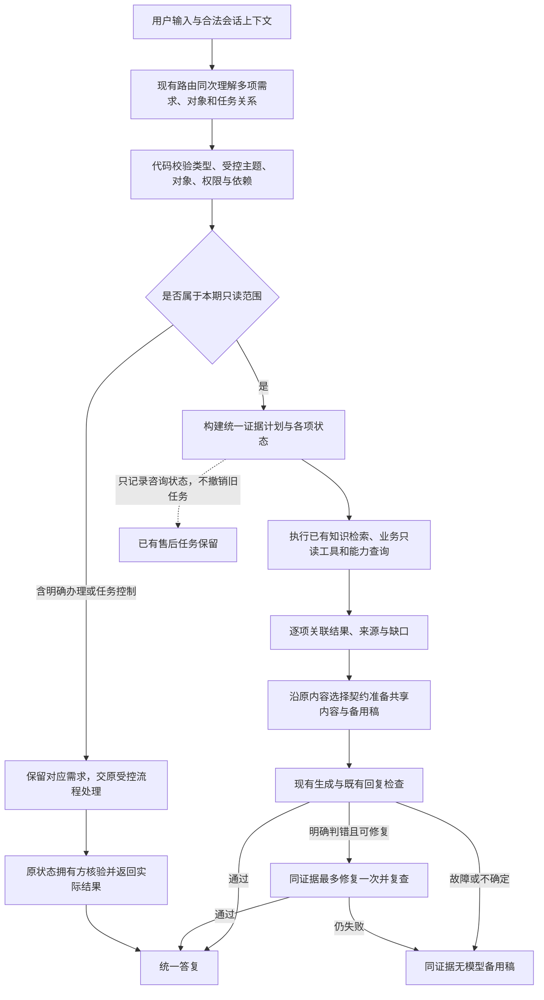

# 多个只读问题完整回答与售后插问保留：产品变更需求

日期：2026-10-17｜版本：v0.2（补充统一分发专项设计引用）｜需求编号：MULTI-READ-001｜读者：Coding Agent、产品与验收人员。

**总体状态：本需求已有阶段性本地实现，仍未整体验收／日常加载；各项已改与未改以项目交接及评测记录为准。** 2026-10-17本次文档更新：用户已认可"跨领域知识按统一职责分发"的方案，并要求只规划功能和逻辑，新增[专项产品设计DOMAIN-DISPATCH-001](跨领域知识取证统一分发产品设计.md)。用户进一步要求修复"局部失败吞已知"问题，新增[专项产品设计PER-TOPIC-RESULT-001](逐项知识结果与独立出口产品需求规划.md)，引入逐项知识结果结构。本专项尚未编码；本轮不修改代码、Prompt、知识或服务，不运行模型。原300项Python／32项Java等历史成绩不能充作本专项验收。

## 0. 阅读顺序、规范关系与决策等级

先读本文的范围、全局规则及验收，再沿第9章追踪源码与调用方，最后规划最小变更。不要从BC-031原问法出发继续补入口分支。

- 用户已确认：本期目标为“多个只读问题能完整回答，插问不破坏已有售后任务”；先整体规划，不修改代码；按失败类别及统一原则处理，不以个案分支、例外话术掩盖结构问题。
- 本文对范围、任务关系、异常处理和验收的细化，是助手基于上述目标提出的可执行产品约束，不冒称用户逐字段确认过。实现者可选择最少的数据结构、函数与命名，但不能自行扩大业务承诺或放松下列约束。
- 本文为这次变更的主规范。它调整旧[意图识别与证据检索规划](意图识别与证据检索产品需求规划.md)中“主意图限制其他证据需求”和未定义跨域组合的范围；保留其对象校验、工具白名单、无模型回退与不增加分类模型的约束。
- [回复内容选择与备用答复PRD第0章](../07-不支持业务与人工入口/回复检查分工产品需求规划.md#0-本次需求先选对内容再生成或兜底)继续规定完整规则、必要条件、引用合并、生成／修复／备用稿共享内容。本需求向前补齐多需求规划与状态，不能另建第二套正文筛选。
- 原[只读资格咨询](../04-只读资格咨询/只读资格咨询产品设计计划.md)、[商品对象定位](../05-商品对象定位/商品对象定位产品需求规划.md)、[取消与续办](../03-取消与续办/取消意愿识别与分流产品设计计划.md)及售后确认／审批规则继续有效。仅在本文明确调整的只读组合及状态保留范围内更新接入。
- [统一分发专项设计DOMAIN-DISPATCH-001](跨领域知识取证统一分发产品设计.md)细化F2／F3／F6中知识领域分工、计划与执行一致性、实际来源校验和逐项结果接入。该专项细节及DD01—DD16以专项文档为准；本文继续约束总体业务范围、对象、权限、状态和MR01—MR26，不在两处维护同一份分发表。
- [逐项知识结果与独立出口专项设计PER-TOPIC-RESULT-001](逐项知识结果与独立出口产品需求规划.md)细化F2/F3/F6中"逐项结果"部分：每个识别到的知识主题/领域有独立执行状态，最终答复按已成功的项组织内容，不被其他项的澄清/失败阻塞。该专项细节及PT-AC01—PT-AC08以专项文档为准。
- 项目最新停点只维护在[项目交接](../../01-项目概览/项目交接.md)，运行成绩只按[项目评测记录](../../03-评测与问题/项目评测记录.md)及其原始证据理解。

## 1. 问题、证据与变更目标

顾客常把几个相关问题放在同一句话中，也会在售后准备过程中插问政策。系统应完整处理有据、被授权的只读事项，不因主意图选择而漏答，也不能把插问理解为撤销或继续办理。

| 已知问题 | 当前可核验证据 | 应改变的机制 |
|---|---|---|
| 已识别的需求被计划过滤 | BC-031原路由已识别叠加主题，主意图为能力咨询后知识域为空，主题被判incompatible | 需求、证据计划及业务权限分开，合法只读需求不由主意图互斥筛掉 |
| 局部入口修复未覆盖整类组合 | 固定输入探针中，发票＋退款到账、优惠＋退款到账、退款政策＋发票仍丢跨域主题 | 用共享规划与执行规则替换入口例外，不继续逐个放开意图组合 |
| 咨询完成清空退款待办 | BC-032普通券咨询后memory.open_task为null；后续补过意图保护名单 | 原任务状态由其拥有方及明确事件改变，不能由答复意图名单决定生死 |
| Python与商城响应语义可能不同 | Java现有商品／能力咨询有专门直接返回，其他响应可能经过退款续办或旧确认卡路径 | 两侧一致识别本轮只读效果，纯咨询不误续办、不重发确认卡 |
| 回复仍可能偏题或超证据 | BC-029／033已有正文证据 | 继续使用共同内容契约，分别验证相关性与依据，不把全部问题归因于分类 |

证据入口：[LIVE-001首次结果](../../../analysis/07-不支持业务与人工入口/ANSWER-CONTENT-LIVE-001/结果.md)、[局部修复结果](../../../analysis/07-不支持业务与人工入口/BC031-032-本地修复/结果.md)、[跨域固定输入探针](../../../analysis/07-不支持业务与人工入口/BC031-032-本地修复/systemic-review-probe.json)、[问题台账](../../03-评测与问题/问题台账.md)。

**目标：现有能力范围内，一次请求的多个只读事项均得到有据回答、针对性澄清或准确的未确认说明；插问结束后，原售后任务及其有效候选仍可按原规则续办。**

“完整回答”不等于每项都能给确定结论，而是每项有明确去向。主题数组、HTTP200、judge pass、工程测试通过，都不能单独证明用户需求已完整满足。

## 2. 本期范围与边界

### 2.1 覆盖范围

| 范围 | 本期承诺 | 对象及能力限制 |
|---|---|---|
| 跨知识域只读咨询 | 退款／签收退货政策、活动／会员券、商品使用知识、发票等现有受治理资料可组合回答 | 不新增政策，不把通用规则解释成特定订单或券已适用 |
| 商品事实＋政策／使用知识／服务范围 | 同轮保留各类需求，复用现有商品工具及能力查询 | 本轮只处理一个已定位商品对象；类别知识仍可不选SKU，缺参数不凭指南补数值 |
| 现有订单只读事实＋通用咨询 | 现有物流、售后状态、资格查询等只读结果，可与知识／能力说明共同表达 | 本轮只处理一个明确且归属校验通过的订单；不新增订单、持券或资金查询能力 |
| 售后准备期间插问 | 已有一个退款或退货任务时，回答新只读事项，原草稿／缺失参数／候选不被误改 | 商城与工作台各自沿用原状态拥有方，不把它们合并成新任务系统 |
| 部分缺信息或失败 | 保留独立可答部分，说明其他事项的具体缺口，必要时澄清 | 未知项不能给依赖它的后续结论或办理授权 |
| 插问后的追问与续接 | 区分咨询追问、补参数和明确续办；序号仍绑定实际展示的候选 | 同一用户、同一会话、原候选有效，重新核验最新事实 |

“订单只读事实＋通用咨询”属于该目标下对已有只读能力的组合接入，不要求扩建接口；若实际接口缺字段，准确说明缺口。不同领域各一个对象可共存，但本期不扩成同类多对象的批处理或比较引擎。

不为了验收只支持两个问题；沿现有系统输入／输出限制处理。若结构长度或模型截断导致无法完整保留，按第5章记录缺口并安全回退，不能无声截取前两项。

### 2.2 本期不增加的业务承诺

- 多笔订单／多个商品的批量查询、比较或批量办理；多个售后办理任务并行、自动排队或跨会话接力。
- 新的到货提醒、换货、持券核销／返券状态查询、真人接管、外部支付、物流或质量鉴定能力。
- 自由生成的工具、文件路径、SQL、订单归属、退款金额或执行授权。
- 新Agent团队、独立多意图模型、任务调度平台、知识管理后台、数据库迁移或前端大改。
- 更换模型、凭据、Embedding、取消开关、阈值或重做原审批流程。

### 2.3 只读与办理混合输入的固定边界

1. **纯咨询／查询：** 进入本期共享只读处理；说到“退款”不自动准备申请。
2. **条件式办理，例如“能退就帮我退”：** 按原规则先核验资格，不凭条件句直接提交；可回答独立的只读事项，后续办理仍需明确申请及原确认流程。
3. **明确要求一个新办理，同时问其他事项：** 本期不建设通用查询＋办理编排。该办理交原受控链路，其他咨询若未处理须在当次回复明确指出，不默认承诺稍后自动执行或创建任务队列；不得把整个请求标为纯只读来绕过原流程。
4. **同时要求多项办理：** 不批量执行，说明当前需逐项处理并澄清目标；仍不能改动无关的已有草稿。
5. **明确停止／取消后再问咨询：** 交原状态拥有方按现有开关、对象校验与确认规则处理停止；只能按实际回执说明是否已停止。咨询不能复活已合法取消的草稿，也不能把“停止准备”说成撤销已提交申请或取消购买订单。

上述是版本边界处理，不是按特定句式写固定回复；应由共同的需求类型、依赖和任务关系决定。

## 3. 全局产品规则

| 编号 | 规则 | 可观察的含义 |
|---|---|---|
| R01 | 需求不能静默消失 | 每项合法只读需求有结果或明确缺口；主意图不能删除跨域事项 |
| R02 | 理解不等于授权 | 识别到退款、提醒或人工需求不表示可执行、已登记或已接手 |
| R03 | 局部不足只阻塞依赖项 | 缺订单号不妨碍通用发票说明，未知资格不允许推进申请 |
| R04 | 状态由任务事件改变 | 插问、答复完成、模型失败或主意图变化本身均不结束旧任务 |
| R05 | 对象不可串用 | 商品／订单／券的事实来源独立；最近查询对象不覆盖原草稿绑定对象 |
| R06 | 计划与执行一致 | 执行消费已校验的同一计划；不在执行阶段重读关键词各自猜路径 |
| R07 | 证据与正文职责分开 | 同一证据可复用，正文围绕本轮所问；未知不能靠生成或修复变成事实 |
| R08 | 对话自然且可恢复 | 按所问顺序组织，澄清不重复索要已知信息，插问后可安全回原任务 |

规则覆盖所有本期入口。禁止以“若intent等于某业务则特殊保留”、问句同义词、案例编号或新文案过滤取代上述约束；业务本身必要的权限／资格／失败分支仍须保留。

## 4. 目标链路与组件职责



流程图节点是职责，不代表新增Agent、模型阶段、服务或数据库表。独立只读任务可顺序执行；并行只在有收益且不改变依赖、超时与来源核对时考虑，不是本期必须项。

主意图可保留用于旧接口兼容、摘要和工作台展示；它不能独自决定其他需求是否存在，也不能作为唯一的状态清理或执行授权依据。高风险流程仍使用原受控入口与确认机制。

## 5. 功能要求

### F1：同次理解，多项需求可核对

- 复用现有路由调用，结合原句、必要历史、当前页面和合法待办，识别本轮实际诉求；不用额外分类模型补一遍。
- 识别需求类型、指向对象、咨询／事实查询／请求办理、与已有任务的关系及依赖。否定、条件句、短追问必须保留语义，例如“不查库存，只问保养”不应查询库存。
- 只列本轮实际需求及必要追问，不永久追加旧主题。未映射到受控主题的原始诉求仍可作为未覆盖事项进入审阅，不能从请求中消失。
- 模型只提出结构，不认定对象归属、政策有效性、资格、金额或执行成功；历史与用户话语始终作为数据，不作为更高权限指令。
- 保留原解析与规则兜底：元素局部非法时隔离非法项，保留仍合法的需求；整个输出不可解析时回原有安全回退，标明识别缺口，不把旧单意图猜测称为“已完整识别”。所有失败均不清空既有售后任务。
- 当前`RouteModelClient._create_chat_model`的输出上限为512 tokens（本次源码核对），不是旧文档的256。实施时以实际配置复核；扩展结构须测最长合法载荷与截断。确需调整上限时记录理由和成本，不顺带换模型或开启新调用／自动重试。

### F2：最小需求与结果契约

以下是必须表达的产品信息，不强制另建同名JSON对象或重复存储已能推导的字段。允许扩展现有RoutePlan及相关结构；禁止仅添加一个未接入主链路的helper。

| 信息 | 最低要求 |
|---|---|
| 事项与顺序 | 能关联本轮哪一项原始诉求；同义重复可合并，不能合并不同对象或条件 |
| 类型及目标 | 能区分知识、业务只读事实、服务范围及办理／任务控制；对象来源可核对 |
| 证据需求 | 关联受控主题、知识域、能力ID或合法工具读取，不让模型输出任意执行器 |
| 参数与依赖 | 知道缺什么、受哪项结果阻塞；不能用旧记忆冒充本轮已验证事实 |
| 任务关系 | 区分插问、咨询追问、补槽／续办、明确停止／切换和不确定关系；模型意见须经代码与拥有方校验 |
| 逐项结果 | 至少区分有据可答、缺信息、不支持、证据不足、查询失败；未执行不能标成功 |
| 证据与缺口 | 能追到对应来源及对象／时刻；无结果也保留原因，生成和judge可检查原问题漏项 |

“不支持”必须来自可信能力或规则；知识没命中、接口超时、缺对象只能说明未确认或需补信息。相同证据为多个事项复用时，结果仍须关联各事项，不要求重复查询或重复展示。

### F3：统一规划、取证和部分成功

本次优先处理知识取证分发，功能及逻辑详见[DOMAIN-DISPATCH-001第5章](跨领域知识取证统一分发产品设计.md#5-功能与组件职责)，专项验收见[第9章](跨领域知识取证统一分发产品设计.md#9-验收标准与证据)。以下保留总体要求，不重复领域职责表。

- 由已校验的各项需求构建证据计划，现有知识域、能力查询及业务读取可共存。删除依赖主意图互斥过滤的耦合，不逐个新增“发票可以带退款”等组合白名单。
- 执行器按证据类型复用既有知识查询、工具、能力接口；不同入口不各自决定另一份需求。安全／隐私／归属与业务准入先于读取，不因组合而放宽。
- 通用知识不依赖具体商品查询成功；只有与具体商品有关的结论才依赖该对象事实。具体型号缺温标、承重等字段时，说明未核实，不从指南推具体数值。
- 对同对象、同请求可信时刻的重复读取可复用结果。不能把历史价格、旧资格或缓存草稿当本轮最新事实；政策快照、有效期和缓存治理继续沿原规范。
- 每项执行结果都进入共享记录，不能以一个全局degraded或最后一个检索结果覆盖全部事项。框架顶层状态可保留兼容，但顾客正文须保留已确认部分与逐项缺口。
- 沿现有超时／调用上限处理，收齐本轮已完成结果再生成；未完成项准确记录，不无限等待或因一项失败重跑整个计划。后续回包不能在无人核验时静默改变已发送结论。
- 不新增独立分类／整理模型，不在修复阶段重查工具；业务读次数仅因实际新增、合法的取证需求而变化，不承诺总调用量／token天然不增加。

### F4：售后任务保留、插问与恢复

保护的业务状态包括：任务类型、阶段、绑定订单、问题／原因、已核验金额、缺失参数、候选顺序与对象、版本／有效期、是否已处理。插问可以按原规则更新最近对话、审计时间与咨询结果，但不能顺带更改这些业务状态；过期或外部业务变化按原拥有方规则处理，不能靠“保留快照”跳过最新核验。

| 事件 | 期望状态行为 | 对顾客的表达边界 |
|---|---|---|
| 只读插问正常／部分失败／生成故障 | 保留原售后业务状态，不自动续办，不重发确认卡 | 回答本轮咨询，不要求重复选择原任务对象 |
| 插问的短追问 | 沿最近相关咨询理解；不把其主题写成新售后任务 | 已有活动组合或知识主题明确时不重复澄清 |
| 明确补原任务参数／选择有效候选 | 只更新目标任务，重新核验归属与最新事实 | 序号绑定实际展示快照，不能回落页面或最近其他订单 |
| 新的只读查询需要另一对象 | 允许建立必要的只读咨询状态，原售后对象保持 | 查询另一订单不等于把退款改到另一订单 |
| 明确申请／改办 | 交原受控售后链路核验类型、对象和资格 | 不能把新的申请请求当作咨询结果附带执行 |
| 明确停止／取消／切换 | 由原拥有方执行允许的迁移；版本、确认及开关仍生效 | 按回执说明已停、需确认或尚未停，不能伪称动作成功 |
| 目标含糊，例如“算了，第二个吧” | 不猜测要停哪项或选哪组候选，必要时消歧 | 保留所有未被明确合法改变的任务 |
| 身份／会话改变、过期、已提交或已终结 | 不复用他人状态，不复活失效任务 | 区分重新准备、查询状态、撤销与停止；不绕过原确认 |

同样检查商品候选、优惠组合待澄清、资格查询待选等咨询状态，不能把它们作为无关分支清理副作用。咨询状态可随明确的话题结束更新，不要求永远保留；原售后任务不得由此被结束。

商城售后业务状态以Java会话与业务回执为准，Python消费可信运行上下文；工作台保留本地演示机制，不假装与商城共用一个审批状态。不得为解决插问而增加与Java竞争的持久任务来源。

### F5：澄清与候选焦点

- 同轮有可答部分与待澄清部分时，先答可答部分，再问会影响继续处理的信息；不能只发一句全局“请补充信息”。
- 原单个ClarificationRequest可继续使用。本期不要求多组候选新界面：若有多项缺口，正文说明相关缺口，优先提出一个明确的下一步问题，其他项保留未完成状态；不能把多组候选混成一个无归属列表。
- “第一笔／第二款／和露营季满减”等短答必须绑定实际刚展示的对象类型、候选或澄清事项；同时存在多组候选且指向不明时澄清，不固定优先售后或最近last_order_id。
- 用户明确“继续刚才的退款，选第二笔”可恢复原售后焦点；只有“第二笔”时，若最近新展示的是资格查询候选，就不能悄悄解释成退款候选。
- 不重复索要已明确的优惠组合、商品类别或有效对象；也不从朋友券截图、用户自述身份或商家口头批准推导可信事实。

### F6：统一生成、一次修复、备用与审阅

- 原请求、必要上下文、逐项结果与缺口共同进入现有共享证据上下文，不能用主题列表替代用户原话。
- 正常生成、一次修复和无模型备用都消费同一组本轮证据与完整规则。按提问顺序组织，适度合并相同结论；不强制每项一段模板，不把执行日志、内部ID或政策维护说明发给顾客。
- 同类规则、条件、例外与未知沿原内容选择契约处理；新增需求不能把所有知识整篇塞给生成。明确问到的规则不能因为以前某题没问就永久删除。
- 已确定价格／物流／能力不因其他项故障丢失；备用稿也应覆盖可答部分及缺口，不发送被拒绝候选，不靠额外润色模型补救。
- 同轮既有回答又有澄清时，顶层`next_action=ask_clarification`或局部故障标记不能让已完成部分退出共享内容组织；受控澄清对象／候选由代码保持，不能让生成器改写绑定。原安全拒绝和高风险出口不因此强行纳入judge。
- judge继续检查遗漏、事实冲突和无依据动作；依据原请求核查计划漏项。一般冗长与流畅度仍由独立体验复核，不把judge pass称作全部验收通过。
- 单项资格查询等原有直接回复边界不因重构失去校验。组合表达若使用其受控结果，需完整保留资格／状态来源及未办理语义，适配既有证据白名单与审阅契约；不能把工具文本当作已通过共享judge，也不能让生成器重判资格。
- 继续保留off／shadow／enforce、明确判错才可修复、初稿加最多一次修复、最多两次judge、无自动循环与既有超时配置。未检查的直接出口明确记未检查。

## 6. API、Java网关与页面一致性

本需求不是只改Python。当前Java会按`session_state.intent`进入资格、商品、能力或退款续办路径；`intent`转为摘要后，必须同步所有依赖它决定业务副作用的调用方。

最低要求：

1. 服务端能向调用方表达经过代码校验的本轮只读／原受控办理或任务控制语义；可扩展现有响应，字段命名由实现者确定。不能由模型任意设置一个“只读”标志来绕过校验，也不能仅凭capability_ids非空推断整轮只读。
2. Java对纯只读组合统一返回实际咨询内容及必要的只读澄清，不进入退款原因提取、草稿续办或准备申请；不得重发已有待确认卡。商品／能力之外的政策和跨域咨询也遵循同一原则。
3. 已有历史确认卡不靠本需求一律删除或自动失效；用户后续明确确认时仍走原版本、身份、期限、金额、资格与防重复核验。咨询本轮不宣称确认已发生。
4. 明确办理及取消沿原业务拥有方处理，旧workflow／resume／角色边界不能被摘要标签或新数组误触发。适配新增信息的解析失败时，不能默认当作办理授权。
5. 保留原请求／响应必需字段；新增字段默认值不能制造错误的“无需求／无任务”。同步生产者、Python接口、Java消费者、前端类型、测试与fixture，注明是否需要两侧一起加载。不能要求用户清库、清会话或切模型才能完成兼容。
6. 商城最终正文、卡片及历史应一致：一轮只读插问不显示已申请或已确认；来源／缺口可内部追溯。工作台Trace无需新大界面，但有界记录应足以解释每项需求是否被计划与执行覆盖。

当前共享审阅`READ_TOOLS`不含资格工具，且部分路径跳过最终模型；这是实施时必须核对的接入差异，不能扩大白名单后不补结构化证据与边界测试，也不能以保持旧白名单为由默默遗漏已受理的资格事项。

## 7. 完整对话示例与预期

以下是拟验收对话，不是已运行结果；回复只规定语义，不要求逐字匹配。

### 对话A：跨域知识与提问顺序

- 初态：没有待办理任务；采用同一有效知识快照。
- 用户：“先问发票一般多久开好，再问未发货退款多久到账？”
- 预期：识别两项，分别取得发票与退款到账规则，按顺序说明；不展开全部退款条件或准备申请。
- 变体：顺序互换、同义改写、增加活动叠加问题，仍不因主意图改变而丢项。
- 禁止：请求用户另开问题才能获得已有通用规则；把演示余额边界说成真实银行卡到账保证。

### 对话B：退款待选时插问，再恢复

- 初态：退款缺订单，已向该用户展示两笔候选A、B；保存顺序和任务版本。
- 用户：“朋友的会员券截图能拿来用吗？现在还没到使用时间。”
- 预期：回答券归属及时间条件；原退款任务、缺参和候选A/B不变，无新确认卡或Workflow。
- 用户：“继续刚才退款，选第二笔。”
- 预期：绑定原B，重新核验归属、资格与金额，再进入原流程；仍未因这句话跳过必要确认或审批。
- 变体：插问生成失败／judge不可用时使用同证据备用；再续办仍选B。页面或最近查询改到C不应替换原B。

### 对话C：商品定位缺参＋通用规则可答

- 初态：无明确SKU，有多款帐篷候选；资料有通用收纳与活动规则。
- 用户：“帐篷现在多少钱？怎么收纳？露营季满减能和平台会员券一起用吗？”
- 预期：价格需要定位商品，可提供已有合法候选；类别收纳与已明确优惠组合能回答，不被SKU澄清阻塞。候选不混用订单序号，原售后任务若存在也不清空。
- 用户选择有效商品后：只补所需商品事实，沿合法上下文保留尚未完成事项，不重做或重复发送已完成的整套知识说明。

### 对话D：能力失败与知识不足

- 用户：“折叠椅多少钱、缺货能提醒吗？这张券退款后是否已退回？”
- 夹具：商品价格可核验；提醒能力查询故障；现有接口无该券实际退回事实。
- 预期：保留价格；说明提醒暂不能确认，不把故障说成unsupported；解释现有退券规则及实际状态未核验的边界。
- 禁止：留资代登记、承诺真人已接手、要求订单号后承诺一定能查到未接入的券状态。

## 8. 失败处理与不扩大范围

| 失败类别 | 本期必须处理 | 不应据此扩建 |
|---|---|---|
| 多需求结构缺字段、非法项、截断 | 区分局部与整体失效，保留合法部分、原请求与任务；安全回退 | 第二个识别模型、重试挑成功 |
| 主题合法却被主意图排斥 | 修正共享计划，执行覆盖全部合法需求 | 每种意图组合一条分支 |
| 参数不足、对象歧义、跨用户 | 独立可答项保留，目标项澄清或拒绝越权读取 | 批量选择、默认第一件、历史对象兜底 |
| 工具故障、无有效知识、来源冲突 | 对应项未确认，其他已完成结果保留；不能推进依赖动作 | 新业务接口、凭常识补事实 |
| 插问覆盖或误续办旧任务 | 修正状态归属与网关消费契约 | 持久通用任务平台、再加意图保护名单 |
| 生成／judge／修复故障 | 共用原有有界备用路径，逐项结果不丢 | 新润色模型、增加循环次数 |
| BC-029相关性或BC-033证据外解释 | 本期回复遵守原内容／依据约束，记录独立失败并阻止伪称验收完成 | 为此重写全部知识或宣称多需求改造自然修好所有生成问题 |

## 9. 源码影响地图与完整交付边界

下列为2026-10-17静态核对入口，行号可能随实施变化。它们是必须检查的调用关系，不要求逐文件都修改。

| 组件 | 证据入口与实施核对点 |
|---|---|
| 模型与接口契约 | `backend/api/schemas.py:66` RoutePlan、`:104` ChatRequest、`:161` ChatResponse；`backend/agent/models/router_client.py:18`、`:57`、`:111`、`:179`：同次识别、严格解析、缺字段、截断与兼容 |
| 路由Prompt | `backend/resources/prompts/route_contract.md`：多需求、对象、否定、依赖、任务关系；不复制知识主题目录或工具授权 |
| 计划生成 | `backend/agent/tools/planning.py:145`及`:204`至`:248`：知识域由何处确定、主题过滤、工具白名单、缺参与Workflow |
| 主链路与咨询状态 | `backend/agent/customer_service_agent.py:87`、`:135`、`:189`、`:353`、`:476`、`:712`、`:869`、`:1088`：统一取证、任务焦点与状态写回，替换既有局部能力入口修补 |
| 对象、上下文、记忆 | `backend/agent/context.py:20`、`:43`、`:111`；`backend/agent/product_query.py:129` resolve_product_target：本句与页面／历史冲突、候选绑定、身份隔离。不能复制新对象解析器 |
| 知识与完整规则 | `backend/retrieval/knowledge.py`、`rules.py:56`、`documents.py`、`hybrid_retrieval.py`：复用有效快照、完整规则及缓存；本期默认不改六份政策内容 |
| 业务只读执行 | `backend/agent/tools/tool_runtime.py`、`langchain_runtime.py`及`service_capabilities.py`：真实字段、错误语义、归属、查询复用和交互策略 |
| 生成、审阅、备用 | `backend/agent/customer_service_agent.py:1340`、`answer_review.py:16`及`:37`；`models/answer_client.py`、`judge_client.py`；`final_answer_style.md`、`answer_judge.md`：多事项证据及缺口、直接出口适配、原有模式与一次修复 |
| 商城网关消费 | `ecommerce-backend/src/main/java/com/teachdemo/ecommerce/customer_service/CustomerServiceGatewayService.java:145`、`:178`至`:220`、`:818`、`:840`：运行上下文、只读响应、资格状态、退款续办与确认卡；同时读`AgentChatRequest.java`、`CustomerServiceSession.java` |
| 前端与Trace | `frontend/src/types/api.ts:293`及工作台Trace组件；`ecommerce-backend/frontend/src/shop/`客服消费者：只在契约变化确有需要时同步，不新增内部参数到顾客界面 |
| 测试与fixture | `test_answer_content.py`、`test_evidence_routing.py`、`test_service_capabilities.py`、`test_route_priority.py`、`test_candidate_selection.py`、`test_eligibility_query.py`、`test_answer_judge.py`及既有Java隔离夹具：不把固定路由成绩当真实识别成绩 |

实施开始先复核当前HEAD、未提交改动与实际调用方；当前局部修复和未提交内容选择改造均为基线，不reset／clean，不丢失此前语义和错误处理。产品规则统一后，删除或合并被替代的入口例外与对应错误测试预期，不能留下新旧两套决策同时运行。

若实现需要更改响应兼容或原高风险边界，先在本文记录具体变化与影响，再按授权推进；不以“整体重构”为由改动无关目录、依赖或业务规则。正式加载前必须核对Java和Python契约组合，本期文档不执行加载。

## 10. 验收矩阵：先冻结标准，再分层运行

以下均为**待跑标准**，不是新增成绩；例句不要求逐字答复。工程夹具、真实模型、真实业务集成与页面分别统计。

| 编号 | 输入／初态／变化 | 必须观察到的结果及禁止行为 |
|---|---|---|
| MR01 | 能力＋优惠原题及顺序互换 | 两项需求、证据与顺序完整；不重复澄清、不承诺提醒 |
| MR02 | 发票＋退款到账，主意图分别固定为两入口 | 合法主题均保留并取证，不能incompatible丢跨域主题 |
| MR03 | 优惠＋退款到账＋发票三项及改写 | 无前两项截断，无无关政策整段扩写，各项均有去向 |
| MR04 | 一商品价格／库存＋知识＋政策＋能力 | 对象一致，事实／规则／支持状态分清，重复取证可复用 |
| MR05 | 一个本人订单物流或售后状态＋通用咨询 | 读结果与政策都保留，不把查询变申请或混淆历史退款状态 |
| MR06 | 单订单资格＋知识／能力；包含“能退就退” | 原资格判断不改；条件句不直接提交，生成不重判资格 |
| MR07 | “不查库存，只问怎么收纳和发票” | 被否定需求不取证，通用知识不要求SKU；无需多余澄清 |
| MR08 | 商品对象歧义＋明确知识／活动组合 | 已知先答，只澄清商品价格等依赖项，不阻断全部 |
| MR09 | 两项缺不同参数、多个候选焦点 | 清楚说明缺口，单个下一步问题不混候选；短答有归属 |
| MR10 | 一项工具超时／能力unknown／规则无效 | 有据部分保留，准确区分故障、未确认与不支持 |
| MR11 | 需求字段missing／empty／非法元素／整体JSON非法／截断 | 各有可解释回退；合法项不被局部错误吞掉，旧待办不清空，无额外识别模型 |
| MR12 | 退款缺订单，有两项已展示候选，插问普通券 | 原任务类型、缺参、候选及顺序不变；无工具写、Workflow、新卡或旧卡重发 |
| MR13 | 退货待原因／待确认卡，插问退款政策或发票 | 原原因、类型、金额、版本及期限遵循原规则，不误填原因、不重发卡 |
| MR14 | 插问分别走正常／一次修复／生成失败／judge故障出口 | 同证据答复且原任务保留；修复不重跑取证；失败不等于任务结束 |
| MR15 | 插问后明确续办并选第二笔，页面／最近查询为另一单 | 使用原有效候选第二笔，重验归属与最新状态，不能被另一单覆盖 |
| MR16 | 原售后候选与新资格查询候选同时存在 | 短答跟随明确焦点；指向不明时澄清，不误续办另一任务 |
| MR17 | 活动待补组合／商品待选时插问，再返回 | 合法咨询状态不被其他主意图副作用清掉，回归不重复索要已明确信息 |
| MR18 | “那多久到账？”等相关追问及明确换话题 | 正确关联合法历史，不永久追加旧主题或把追问当申请 |
| MR19 | 明确停止／切换后同轮咨询；取消执行关闭或需要确认 | 依原状态拥有方回执，未执行不称已取消；合法停止后不复活 |
| MR20 | 身份变更／其他会话／过期草稿／已提交申请／已终结 | 不串用户、不续失效任务；旧卡按原机制校验，不重复提交 |
| MR21 | 明确新办理＋咨询、多项办理、多对象批处理 | 遵第2.3节，原受控链路不越权，未处理项明确，不建自动队列 |
| MR22 | 问题重复、条件不同／同规则不同范围、来源冲突 | 不重复堆叠、不错误合并，成立条件与具体未知不丢 |
| MR23 | 证据没有温标或券状态，用户追问确定解释／查询 | 不补造定义或查询能力，不把用户提供对象当真实取证完成 |
| MR24 | off／shadow／enforce，直接出口与原安全／高风险流程 | 模式、一次修复上限、原拒绝与审批约束有效，未检查不称通过 |
| MR25 | 商城同组插问／续办、工作台同组模拟、API与历史 | 两侧只读语义一致，最终正文／卡片／历史一致；模拟不能替代商城集成 |
| MR26 | 原单需求正常与关键异常回归 | 既有商品、物流、政策、资格、申请／确认／取消等行为不因新契约退化 |

单条运行至少记录：原始输入与必要历史、初始任务状态／候选／焦点、版本与模型／Prompt／知识快照、模型识别结果、校验后计划、实际取证与每项状态、任务前后差异、最终正文及来源、模式／修复次数、实际调用数／token／时延与证据位置。日志必须脱敏，不泄露凭据、令牌、完整敏感上下文或被拒绝草稿到公开Trace。

### 10.1 判定与门槛

- 分开判定：需求覆盖、计划保留、取证与权限、状态、正文事实／条件、相关性与流畅性。硬性越权、跨用户、误续办、误清草稿或虚假已执行不能被平均分抵消。
- 冻结的范围内验收用例须逐项满足预期，未运行／不确定／失败单列，不能用总HTTP成功或judge通过数替代。自然表达留存集不参与反复调Prompt；首次失败与原成绩保留。
- 固定模型输出的工程检查只证明后半链路；真实自然输入必须从路由到最终答复完整验。生成／judge故障注入与自然故障分别记；代码静态兼容检查不等于Java／页面已通过。
- 记录相同样本、环境与模式下的调用、token及耗时；本期未给定新的绝对时延SLA或精度百分比，不编造指标。显著退化需说明来源与取舍，不能靠放宽超时或偷偷切模型抹平。

## 11. 实施分步、验证与交付

这是未来实施顺序，本轮不执行。

| 步骤 | 工作与具体交付 | 过关条件 |
|---|---|---|
| 1 冻结基线与契约 | 保留工作区；复现需求过滤和状态问题；确定最小结构及Java消费语义；冻结MR场景与前后观察点 | 能解释原句→识别→计划→执行→状态首个偏离位置，不从问句补丁开始 |
| 2 验证计划与执行 | 固定合法需求输出，统一受控规划／取证／结果关联及部分失败 | 跨域与顺序变体不丢需求；对象与白名单不放宽；同证据不重复查询 |
| 3 验证状态及调用方 | 接好Python、Java及必要前端契约，移除被替代例外，保留原任务拥有方 | 插问无误续办、无卡片重发，合法取消／续办／身份与版本检查通过 |
| 4 验证回复与回归 | 接现有共享内容／生成／judge／备用出口；相关与完整后端回归；Java隔离检查及必要前端构建 | 三出口完整且有据，旧单需求及高风险边界无退化；不只交一个helper |
| 5 真实小批与有限集成 | 新编号、新冻结配置／预算；自然路由到最终答复；商城只读插问及隔离续办检查 | 原始失败保留、分项判定合格；不能以合成业务成绩冒充真实生产 |
| 6 决定加载 | 单列待加载版本、双端契约、环境及回退方式 | 获得相应加载授权后才行动；本需求文档不自带生产发布授权 |

工程完整离线命令沿现有隔离方式：

```sh
AGENT_COURSE_ENV=/dev/null AGENT_COURSE_DISABLE_LLM=1 AGENT_COURSE_OFFLINE_RAG=1 AGENT_COURSE_OFFLINE_FACTS=1 CANCEL_INTENT_OBSERVE=0 PYTHONPATH=backend .venv/bin/python -m unittest discover -s backend/tests
```

该命令是未来复跑入口，不表示本轮已运行。历史287项是局部修复时成绩；旧LIVE-001 runner是已消耗的单次冻结运行，不能修改后覆盖重跑。真实复测另冻结样本、调用预算、模型／Prompt指纹和允许外发的构造数据；不把历史剩余预算当新授权。

交付应包含：实际变更与调用方映射、前后失败证据、相关及完整工程检查、真实／Mock／静态的分层结论、未验证与回退事项。沿现有五份项目记录更新，不新建平行问题账或额外通用平台报告。

## 12. 待验证事项与Coding Agent启动指令

| 待验证项 | 验证方法 | 影响 |
|---|---|---|
| 扩展结构是否仍能在现有输出预算内完整返回 | 最长合法结构、截断与缺字段的离线检查，再记录真实usage | 决定最小字段与输出预算调整，不默认加模型 |
| 单项资格及其他直接回复如何无损接组合证据 | 追实际结构化工具返回及审阅白名单，配对单项／组合检查 | 需要受控适配，不能盲目放开judge入口 |
| 商城哪些咨询会触发旧卡／续办 | 逐条追网关调用链，使用受控Agent响应与隔离会话比较前后 | 不能只改Python后声称状态安全 |
| 当前已接入工具是否能证明具体券状态或型号参数 | 核对接口及真实返回字段，不以知识“应核验”当能力 | 缺口如实保留，不借本期扩工具 |
| 多个待澄清事项与原售后焦点如何最小承载 | 用MR09／15／16的完整多轮观察已有状态，选最少必要扩展 | 不为未知未来任务建立通用队列 |
| 日常运行环境及待加载版本 | 真正加载前重新核对端口、进程、模型设置与双端版本 | 本轮不探服务，不使用旧PID做动作 |

可将下段作为后续Coding Agent的任务起点；**只有取得编码授权后执行**：

> 阅读MULTI-READ-001及最新项目交接。目标是在已接入能力、单订单／单商品对象和一个已有售后任务的边界内，统一保留多个只读需求、执行受控证据计划、组织完整答复，并确保插问不误改原任务。先复现失败类别并冻结MR验收，追踪Python计划／执行／状态、Java消费与三类回复出口，说明最小完整变更集合；用共同的需求、证据、依赖与任务事件规则替换主意图互斥和入口例外。保留现有未提交改动、对象／身份／确认／审批／取消边界、模型及有界修复语义。不得按问句、同义词或Bad Case编号补分支，不得新增业务能力、Agent或通用调度平台。工程检查通过后再按独立冻结与授权进行真实验收／加载，保留首次失败与未验证项。

设计来源及阅读边界复用[官方8份资料研究](../../04-学习与复盘/产品设计学习.md#2026-10-17从单条修补转向多需求处理的统一契约)。本文规则是结合项目的产品决定与实施约束，不冒称上述厂商提供了完全相同的方案。
