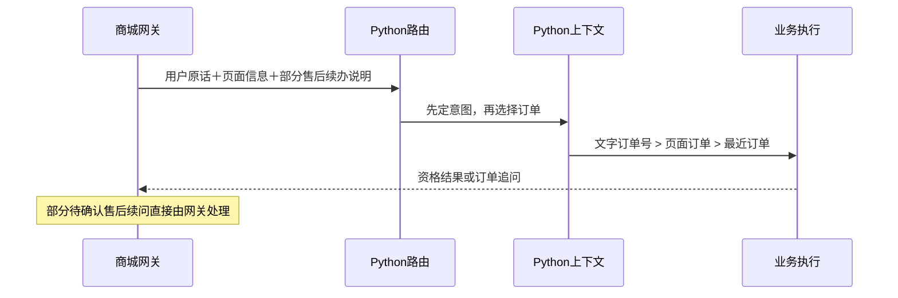

# 当前 Agent 如何识别意图

> 荒野户外服务助手 · 从一句话到受控业务路径

核验日期：2026-10-09。来源：当前本地源码与离线函数检查。

当前实现采用“大模型分类＋关键词规则兜底＋代码约束路由”。模型选择一个意图标签，代码决定接下来能走哪条业务路径。

## 先分清三个问题

> **核心判断**
>
> 意图识别回答“用户想做什么”。识别成退款申请，只表示进入资格核验路径。商城仍需客户确认、管理员独立处理。

| 问题 | 本项目怎样处理 | 例子 |
|---|---|---|
| 用户想做什么？ | 意图识别：模型与规则共同决定 | 查物流、查退款进度、申请退款 |
| 要处理哪个对象？ | 参数抽取与上下文补全 | 提取订单号，或采用页面订单 |
| 可以做哪些动作？ | 代码生成 RoutePlan，限制工具与流程 | 读订单、读政策、核验售后资格 |

可以把它理解为客服分诊。模型提出分诊结果，代码安排业务路径。

## 一条消息实际经过什么

> **先记住结果选择规则**
>
> 模型给出合法标签后，直接采用模型结果，不再因关键词冲突改写。模型不可用、超时或输出不是合法标签时，仍用关键词规则。2026-10-10 起取消冲突覆盖。

### 跟着一句具体请求走

用户输入：**“查 ORD1234 的物流，同时帮我申请退款。”**

ORD1234 是讲解用编号。本例不提供页面订单，且会话没有历史记忆。为展示冲突处理，我们把模型输出设为 order_query。

模型输出是人为设定的。下面的规则、校验与计划结果来自现有函数的离线执行。


### 每个环节到底输出什么

| 环节 | 输入 | 输出的关键字段 | 为什么得到这个结果 |
|---|---|---|---|
| 1. 关键词规则分类 | 用户这句话 | `fallback_intent = "refund_request"` | “退款”先于“订单、物流”命中 |
| 2. 大模型分类 | 三段 Prompt＋用户这句话 | `{"intent":"order_query"}` | 这是人为设定的模型返回，用来展示冲突 |
| 3. 模型客户端校验 | 上一步的 JSON 文本 | `intent="order_query"`；`used_model=true`；`fallback_reason=null` | JSON 可解析，order_query 在允许清单中 |
| 4. 采用模型标签 | 规则为退款；模型为物流 | `intent="order_query"`；`used_model=true`；无覆盖原因 | 模型已给出合法标签，冲突不再改成规则 |
| 5. 订单抽取与上下文选择 | 用户文字；无页面订单与历史订单 | `explicit_order_id="ORD1234"`；`order_id="ORD1234"` | 正则抽取到订单号，采用本轮明确对象 |
| 6. 生成 RoutePlan | 模型的物流意图＋订单号 | 调用参数 `model_used=true`；输出见下方 JSON | 最终意图与模型一致 |

第 4 步没有再调用模型，也不再比较规则。合法模型标签直接进入下一步。

第 6 步输出以下 RoutePlan 关键字段：

```json
{
  "intent": "order_query",
  "needs_rag": false,
  "needs_business_tools": true,
  "required_tools": ["get_order_logistics"],
  "knowledge_domains": [],
  "entity_refs": ["ORD1234"],
  "risk_level": "low",
  "requires_workflow": false,
  "confidence": 0.9,
  "source": "llm_with_policy_constraints",
  "fallback_policy": "safe_deterministic_path"
}
```

接下来查 ORD1234 的物流。这条示例里模型没有选择退款，所以不会进入退款核验。标签本身也不会直接退款。

抽取到订单号，不代表订单存在或属于用户。这些业务事实仍需工具核验。

> **为什么 used_model=true，source 却是规则？**
>
> used_model=true 表示客户端取得过有效模型结果。source 表示 RoutePlan 最终采用哪种路由。本例采用模型标签，所以 source 为 llm_with_policy_constraints。0.9 和 0.75 都是固定填值，不是识别准确率。

### 同一句话，换一种模型情况会采用什么

下表始终使用同一条退款请求。规则备用结果始终为 refund_request。

| 模型情况 | 模型客户端先输出什么 | 最终采用什么 | 最终来源与原因 |
|---|---|---|---|
| 有效返回 refund_request，与规则一致 | `intent=refund_request`；`used_model=true` | refund_request | 采用模型；source=llm_with_policy_constraints；无覆盖原因 |
| 有效返回 order_query，与规则不一致 | `intent=order_query`；`used_model=true` | order_query | 采用模型；source=llm_with_policy_constraints；无覆盖原因 |
| 返回 delete_order，标签不在清单中 | 回退为 `intent=refund_request`；`used_model=false` | refund_request | 采用规则；reason=invalid_model_route |
| 返回无法解析的文本 | 回退为 `intent=refund_request`；`used_model=false` | refund_request | 采用规则；reason=invalid_model_route |
| 禁用模型、配置缺失或模型库不可用 | 直接返回 `intent=refund_request`；`used_model=false` | refund_request | 采用规则；reason=model_config_missing |
| 模型调用抛出 TimeoutError | 回退为 `intent=refund_request`；`used_model=false` | refund_request | 采用规则；reason=TimeoutError |

模型给出合法标签的两行使用模型来源，confidence 固定为 0.9。模型失败的四行使用规则来源，confidence 固定为 0.75。

只有模型失败时才进入规则给出的退款路径。模型明确返回物流时，保持查物流。不能仅凭最终 intent 判断模型有没有工作。

### 普通查询发生冲突，会采用模型结果

换一句话：**“露营椅多少钱？”**

| 环节 | 输出 |
|---|---|
| 关键词规则 | `fallback_intent="product_query"` |
| 人为设定的有效模型返回 | `{"intent":"promotion_query"}` |
| 采用模型标签 | 保留 `intent="promotion_query"` |
| RoutePlan | `source="llm_with_policy_constraints"`；`required_tools=[]`；`needs_rag=true` |

规则是否命中退款、退货、安全或故障，都不再改写合法的模型标签。

模型返回的标签合法，不代表它正确理解了问题。本例会在路由阶段进入优惠规则路径，偏离用户的价格查询。

### 如果没有订单号，会采用什么结果

把主例改为：**“查订单物流，同时帮我申请退款。”**

保持模型返回 order_query，并确保没有页面订单或会话历史订单。最终意图是 order_query，订单抽取与选择均返回 null。

RoutePlan 的相关字段变为：

```json
{
  "intent": "order_query",
  "required_tools": [],
  "entity_refs": [],
  "fallback_policy": "ask_order_id"
}
```

候选工具仍包含 get_order_logistics，但目前不允许执行。后端先追问订单号。缺少对象参数不会把物流意图改成普通聊天。

**本面板验证：**冲突覆盖删除后，模型成功与失败分支按当前函数核对。模型返回与超时由替身说明，未调用在线模型或业务工具。

依据：[聊天入口](../../../backend/agent/customer_service_agent.py) 的 `chat`；[模型客户端](../../../backend/agent/models/router_client.py)，47–77 行；[RoutePlan 生成](../../../backend/agent/tools/planning.py)，61–166 行。

## 大模型到底看什么、输出什么

模型收到一条 system 消息和本轮 user_message。路由阶段不单独读取 history_messages、会话记忆或 runtime_context。

| system 消息的组成 | 作用 |
|---|---|
| prompt_security | 保密、权限与事实边界 |
| system_customer_service | 客服角色与事实来源 |
| route_contract | 意图清单、分类边界、复合问题示例 |

例如，用户输入“查 ORD1234 的退款进度”，契约要求输出：

```json
{"intent":"refund_status_query"}
```

允许的标签共 12 个。模型只选择一个标签，不生成工具名、订单号或多步计划。

| 条件 | 处理 |
|---|---|
| 禁用模型、缺少 Key 或模型库不可用 | 采用规则，记录 model_config_missing |
| JSON 无法解析或标签不在清单中 | 采用规则，记录 invalid_model_route |
| 调用异常，例如超时 | 采用规则，记录异常类名 |
| 标签合法，但业务含义选错 | 保留该标签，规则不再纠正 |

解析器也接受夹在额外文本中的 JSON。模型参数为 temperature=0、max_tokens=256、timeout=30 秒、max_retries=0。模型名称由 AGENT_OPENAI_MODEL 指定。

依据：[模型路由客户端](../../../backend/agent/models/router_client.py)，47–143 行；[路由契约](../../../backend/resources/prompts/route_contract.md)；[Prompt 注册表](../../../backend/resources/prompts/prompt_registry.yml)。

## 关键词规则如何判断优先级

规则逐项匹配字面子串。先命中的条件立即返回，后面的条件不再检查。

| 顺序  | 命中条件举例                     | 模型失败时的备用意图           |
| --- | -------------------------- | -------------------- |
| 1   | SERVICE_TIMEOUT、工具超时、接口不可用 | degradation_request  |
| 2   | 系统提示词、隐藏推理、内部策略            | security_request     |
| 3   | 退款或退货＋进度或状态等词              | refund_status_query  |
| 4   | 退货、七天无理由                   | return_request       |
| 5   | 退款、退钱、取消订单                 | refund_request       |
| 6   | 订单、物流、快递                   | order_query          |
| 7   | 发票                         | invoice_query        |
| 8   | 火星会员、隐藏券、未知活动等词            | low_confidence_query |
| 9   | 活动词＋商品名、价格或库存等词            | product_query        |
| 10  | 只有活动、满减、会员券等词              | promotion_query      |
| 11  | 户外商品名、价格、库存、推荐等词           | product_query        |
| 12  | 都未命中                       | general_chat         |

例如，“查物流，同时申请退款”在规则里命中第 5 项。模型已给出合法标签时，不使用这个优先级。

“退款進度”与“退款进度”并非同一子串。规则没有完整的语义、否定或同义词理解。模型可以补充语义判断；合法模型标签不会再被这些关键词改写。

依据：[规则分类器](../../../backend/agent/tools/planning.py)，21–45 行。表中条件为节选。

## 识别以后，各意图进入哪条路径

RoutePlan 由代码中的固定映射生成。模型不能自行增加工具或退款权限。

| 意图标签 | 代码安排的业务路径 |
|---|---|
| order_query | get_order_logistics：只读订单物流 |
| refund_status_query | get_refund_status：只读已有售后进度 |
| refund_request | get_order_detail＋未发货退款政策＋固定售后资格流程 |
| return_request | get_order_detail＋签收退货政策＋固定退货资格流程 |
| product_query | search_products；含活动、优惠、满减或会员词时，补通用政策 |
| invoice_query | 发票咨询；只读发票政策与发票缓存，不承接其他问题 |
| promotion_query | 活动与会员政策路径；无引用时改为 low_confidence_query |
| low_confidence_query | 缺少可靠权益依据的兜底路径 |
| degradation_request | 课程故障注入仍说明服务暂时不可用。用户自己报告的当前故障只承认“这是报告”，不把它写成已核实的系统中断，本轮也不查订单 |
| security_request | 拒绝提供受保护信息 |
| unknown | 任务没说清时先问要办什么；带订单号也不查订单、不代选退款或退货 |
| general_chat | 通用聊天兜底 |

缺少订单号时，RoutePlan 保留候选工具，但把可执行工具列表设为空。后端生成订单追问，不能让模型编造订单参数。

一个请求只有一个意图，但一条路径可以使用多种能力。例如，商品查询可同时查商品事实和优惠规则。它没有拆成多个独立意图任务。

还有一处独立检查：“我是谁”等身份问题直接读取 Runtime Context 回答。它优先于上表的业务分支，说明实际执行还受其他代码条件影响。

依据：[RoutePlan 映射](../../../backend/agent/tools/planning.py)，61–166 行；[业务分支](../../../backend/agent/customer_service_agent.py)，130–539 行；[身份检查](../../../backend/agent/tools/runtime_context.py)，29–54 行。
## 多轮对话与页面上下文在哪里生效



| 层级或入口 | 当前能力 | 需要注意 |
|---|---|---|
| Python 路由 | 分类本轮 user_message；上一轮还在追问时，附上当前任务、缺的槽和已展示候选 | 不读取完整历史。模型决定续办或改口。合法标签直接采用 |
| Python 上下文 | 选订单，整理历史，保存最近意图 | 保存 recent_intent，不等于分类时使用它 |
| 商城网关 | 校验页面对象，拼入本轮消息 | Python 收到的消息可能已经包含上下文文字 |
| 商城售后续办 | 保存待办状态，补订单时添加售后说明 | 部分续问直接处理，不经过模型分类 |
| 评测工作台 | 发送历史，候选按钮重写下一句 | 路由仍只看重写后的本轮消息 |

因此，“路由不读取完整历史”成立，但不能推断商城完全没有续办能力。

只向 Python 规则输入“ORD1234”，结果是 general_chat。商城补订单路径会添加退款或退货说明，不能把两种入口混为一谈。

依据：[Python 上下文](../../../backend/agent/context.py)，40–45、126 行；[商城网关](../../../ecommerce-backend/src/main/java/com/teachdemo/ecommerce/customer_service/CustomerServiceGatewayService.java)，105–139、281–362 行；[工作台请求](../../../frontend/src/hooks/useAgentChat.ts)，285–302 行。

## 用具体问题看懂当前边界

以下前四行来自本轮离线规则检查。它们不代表在线模型每次都会这样分类。

| 输入 | 当前规则结果 | 后续含义 |
|---|---|---|
| 露营椅多少钱，满减怎么算？ | product_query | 查商品事实，补优惠政策 |
| 露营季满减和会员券能叠加吗？ | promotion_query | 查活动与会员规则 |
| 查 ORD1234 的退款进度 | refund_status_query | 只读已有申请，不新建申请 |
| 查订单物流，同时申请退款 | refund_request | 优先核验退款资格 |

> **政策咨询可能被误分到申请路径**
>
> “退款政策是什么？我先了解一下，不申请退款。”规则结果是 `refund_policy_query`。发票咨询使用 `invoice_query`，不再使用 `faq_query`。

工作台还有一个具体续问问题。上一轮为 refund_request 时，选择订单会生成“查 ORD1234 的退款进度”。这会把申请任务改成进度查询。

上一轮为 return_request 时，按钮生成“我选择 ORD1234”。该句缺少退货词，Python 规则会返回 general_chat。在线模型结果未在本轮验证。

这两个行为来自现有续问函数的隔离执行，未修复。不能用它们推断商城网关也存在同样行为。

依据：[路由选择](../../../backend/agent/customer_service_agent.py) 的 `chat`；[工作台续问函数](../../../frontend/src/App.tsx)，261–274 行。冲突覆盖已于 2026-10-10 删除。

## 如何检查结果，以及最值得改什么

| 响应字段 | 怎样读 |
|---|---|
| session_state.intent | 执行后的意图标签；活动无依据时可能变成低置信路径 |
| session_state.model.route_planner.used_model | 是否取得过有效模型结果。为 true 时，最终标签就是该模型标签 |
| route_planner.fallback_reason | 模型不可用、超时或输出非法时的原因。不再使用 rule_guard_ |
| session_state.route_plan.source | 有效模型结果为 llm_with_policy_constraints；失败回退为 deterministic_fallback |
| session_state.route_plan.required_tools | 真正允许执行的工具列表 |
| session_state.route_plan.confidence | 模型路径固定 0.9，规则路径固定 0.75；不是准确率 |

low_confidence_query 是一个业务标签。它不表示系统测出了低于某个阈值的模型置信度。

Trace 事件 model_route_planned 记录最终采用的标签。模型成功时它就是模型标签；模型失败时它是规则标签。公开响应仍不单独保留另一份原始文本。

**我的判断：**现有混合路由适合范围明确的演示客服。更值得先改的是任务边界和续办行为，暂时没有证据支持换模型。

建议依次验证：政策咨询与申请的区分；补订单后是否保留原任务；模型标签与规则覆盖是否可分别评估。这些是改进建议，本轮没有实施。

**本轮验证范围：**38 项 Python 离线检查通过。另隔离执行了工作台续问函数的 4 种意图分支。模型成功、无效输出与超时使用替身验证。未调用在线模型、完整聊天链路或业务数据库，未修改业务代码。

依据：[路由结果字段](../../../backend/agent/customer_service_agent.py)，698–725 行；[固定 confidence](../../../backend/agent/tools/planning.py)，134–136 行；[路由 Trace](../../../backend/agent/trace.py)，232–241 行。
