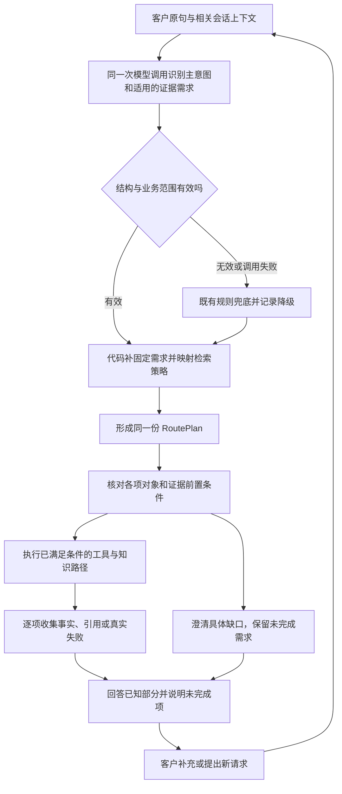

# 意图识别与证据检索产品需求规划

规划日期：2026-10-13。版本：v0.1。状态：**用户已认可规划并授权代码修改，代码及隔离检查已完成；同组真实路由探针通过，正式质量与页面验收未完成。** 未主动加载日常服务或切换模型。见 [实现验收记录](../../../analysis/02-意图与政策咨询/证据需求与检索策略实现验收/结果.md)。下文现状与规划取舍保留写规划时的依据，实际实现与待验证项以验收记录为准。

承接 [RAG 设计审查](../../03-评测与问题/RAG设计审查与优化建议.md)、[产品设计学习](../../04-学习与复盘/产品设计学习.md#2026-10-13rag-环节一知识回答与业务查询的边界)。当前停点统一维护在 [项目交接](../../01-项目概览/项目交接.md)。

## 1. 产品判断与目标

**保留现有路由大模型和单个主意图，让同一次识别保留客户需要的各项证据；代码在该阶段生成对应的检索与查询计划。**

三层职责分别是：

| 层次 | 要回答的问题 | 负责方 |
|---|---|---|
| 主意图 | 进入哪个受控业务入口？ | 现有路由模型识别，代码校验与约束 |
| 证据需求 | 需要商品事实、商品指南，还是活动会员政策？ | 商品混合请求由模型识别；固定业务入口由代码补齐 |
| 检索策略 | 每项知识如何取得、引用多大范围？ | 代码根据允许的知识域确定 |

“同一阶段生成策略”不等于让模型自由选择工具、文件或算法参数。模型不输出文件路径、SQL、任意工具名、TopK、向量模型、退款金额或执行授权。

典型场景：客户问“这款帐篷多少钱，怎么收纳，露营季满减能和平台会员券叠加吗？”系统应保留三个信息需求，分别取得商品事实、使用指南和活动政策。主标签仍可以是 `product_query`，不能因为选了一个入口就丢掉另外两项需求。

### 1.1 可验证的成功标准

- 通用知识问题不因商品名称、否定词或漏掉同义表达而被迫查询具体 SKU。
- 涉及当前价格、库存或型号参数时，仍从可信工具取事实，不用知识库补数字。
- 支持范围内的混合请求，每项需求都得到回答、澄清、缺证据说明或实际故障反馈，不静默遗漏。
- 工具计划与实际执行使用同一份证据需求，不分别用关键词重新决定路径。
- 同一个知识域的检索策略固定可查；商品小节引用与活动整篇引用不再被误写成两种互斥的召回算法。
- 不新增证据分类模型调用；不改变原售后身份、资格、确认、审核与取消执行边界。

## 2. 当前实现与具体缺口

本节是写规划时工作区的静态事实，不代表当前运行服务状态；实施后行号可能变化。工作区有此前未提交改动，本次实施保留了这些改动。

| 当前实现 | 现状或缺口 | 源码入口 |
|---|---|---|
| 路由模型只返回一个 `intent` | 混合问题的证据需求留给后续关键词推断 | `backend/agent/models/router_client.py:15`、`:47`；`backend/resources/prompts/route_contract.md:1` |
| 商品知识／事实由两个辅助函数判断 | 子串匹配不理解否定；“清洗”没有命中知识词时默认需要事实 | `backend/agent/product_query.py:17`、`:21`、`:30` |
| 计划和执行都调用上述判断 | 字段只接入一处会造成计划与实际行为不一致 | `backend/agent/tools/planning.py:205`；`backend/agent/customer_service_agent.py:1004`、`:1137` |
| 商品事实成功后按活动词补政策 | 通用规则也受商品查询成功限制；未定商品或查询失败时不补 | `backend/agent/customer_service_agent.py:1123` |
| 商品与活动使用同一混合召回 | 商品按小节聚合与引用；活动按政策聚合并回取正文 | `backend/retrieval/hybrid_retrieval.py:208`、`:220`、`:262` |
| 通用售后政策按意图直接选择 | 无须让模型额外选择政策文件 | `backend/retrieval/knowledge.py:60` |
| 发票使用专用 FAQ 与答案缓存 | 当前固定问句和缓存不覆盖所有发票子任务，本规划不据此声称已解决 | `backend/retrieval/knowledge.py:85` |
| `RoutePlan` 已有工具、知识域等字段 | 可以扩展现有结构，不需要另建一套全局计划系统 | `backend/api/schemas.py:59` |
| 一次响应主要保留一个检索调试对象 | 多知识域执行时需要分别保留路径与引用，避免后一次覆盖前一次 | `backend/agent/customer_service_agent.py:993`、`:1128`；`:900` |

此前“保养／清洗”等局部行为证据见 [RAG-EXP-001／002](../../03-评测与问题/项目评测记录.md)。这些函数检查不是新方案的模型质量成绩。

## 3. 首版范围与产品决定

### 3.1 本次覆盖

1. 保留现有路由模型、现有意图集合和规则兜底，不接入 Jev 作为新商品分类器，也不替换全局路由模型。
2. 商品咨询支持三类需求的组合：商品事实、商品使用指南、活动／会员通用政策。
3. 单独活动／会员咨询、通用退款／退货政策、发票 FAQ 在意图识别后生成明确的固定证据计划。
4. 其他意图沿用既有工具与流程计划，继续通过统一的代码边界校验。
5. 支持类别知识、明确商品、已有页面商品、有效候选选择及相关简单追问；沿用现有对象定位规则。
6. 覆盖缺商品对象、缺叠加组合、无证据、部分成功、工具故障与模型输出无效的处理。

### 3.2 本次不扩展

- 不支持任意多意图任务拆解、通用任务队列或新的 Agent 团队。
- 不新增本人持券、券核销、会员权益适用性、运费、质量鉴定等业务接口。已有商品工具字段能证实什么就回答什么。
- 不实现质量售后自动受理、真人转接或新的退款操作；不把“漏水”统一转换为七天无理由申请。
- 不更换向量模型、分块、重排算法，不实现知识热发布，也不重做 FAQ 缓存。
- 不改变商品知识当前最多返回一个小节的边界；同一指南内跨小节联合证据另行评估。
- 不新增客户页面上的“检索方式选择”或内部技术参数。检索策略用于系统执行和工作台观察。

“商品＋订单物流＋发票”等未定义组合仍按既有能力说明，不因新字段而承诺全部执行。高风险申请不作为只读证据子任务顺带处理。

## 4. 客户问题与主入口规则

| 客户原话 | 主入口 | 应保留的证据需求 | 关键边界 |
|---|---|---|---|
| 帐篷怎么清洗？ | `product_query` | 商品指南 | 类别足够明确时不要求先选具体款式 |
| 这款帐篷承重多少？ | `product_query` | 具体商品事实 | 型号数值来自工具；缺失就说明未核实 |
| 山野四人帐篷多少钱，怎么收纳？ | `product_query` | 商品事实＋商品指南 | 不能只报价格或只复制指南 |
| 帐篷多少钱，露营季满减能与平台会员券叠加吗？ | `product_query` | 商品事实＋活动会员政策 | 通用叠加规则不等于当前商品或账号已适用 |
| 露营季满减能与平台会员券叠加吗？ | `promotion_query` | 活动会员政策 | 不查询商品事实，不要求商品编号 |
| 会员券能否叠加？ | `promotion_query` | 活动会员政策，但缺组合对象 | 先确认与哪个优惠叠加，不默认露营季 |
| 七天无理由退货有哪些条件？ | `return_policy_query` | 指定退货政策 | 不准备申请，不强求订单号 |
| ORD1234 还能退吗？先别申请 | `after_sale_eligibility_query` | 本人订单资格工具 | 不用通用政策推断具体资格 |
| 帐篷漏水了，能退吗？ | `after_sale_eligibility_query` | 订单资格事实，保留异常描述 | 缺订单时补对象；只读咨询不等于申请，工具不鉴定质量 |

最后一项是首版目标规则：不能仅因“漏水”把客户留在商品指南。当前模型和规则对该自然问法的实际表现未由本轮验证，必须进入验收用例。

具体商品事实加活动通用政策仍进入商品主入口。单独活动政策进入 `promotion_query`，不需要模型再判断 `needs_product_facts`。如果模型将明确商品价格需求分到政策入口，属于路由错误，不以“政策分支本来不查商品”作为验收通过理由。

## 5. 同一次意图识别的输出契约

### 5.1 模型输出与代码补齐分开

首版复用单个 `intent`，新增字段仅用于需要额外语义判断的入口。模型仍只调用一次；代码随后校验字段、补固定知识域并生成完整 `RoutePlan`。

| 字段 | 类型与含义 | 何时输出 |
|---|---|---|
| `intent` | 现有意图枚举之一，选择主入口 | 所有请求必填 |
| `needs_product_facts` | `true`：需要具体商品事实；`false`：不需要；`null`：现有信息无法判定需求性质 | 仅 `product_query` 必填；其他意图不输出 |
| `knowledge_domains` | 本轮请求的知识域列表，可以为空，也可以包含两项 | 仅 `product_query` 必填；允许 `product_knowledge`、`promotion_and_member_policy` |
| `clarification_fields` | 需要补充的政策信息，首版只允许 `promotion_combination`，正常为 `[]` | `product_query` 与 `promotion_query` 必填 |

商品对象是否足够由现有对象定位代码校验，不让模型生成或声明“编号已经核验”。`clarification_fields` 不包含自由文本问题、候选编号或客户按钮；客户可见问题由代码生成。

`null` 不能被转成 `false`，也不能直接默认为需要事实。应先检查已有上下文，仍不能确定时澄清客户当前要问的内容。明确请求下的模型格式错误属于系统降级，不能伪装成客户没说清。

`knowledge_domains=[]` 表示没有知识需求，而不是知识未找到。商品分支如果同时为“无需事实、知识域为空、无任何澄清需求”，则没有可执行的信息需求，按契约冲突处理。

### 5.2 输出示例（已实施的条件契约）

通用商品知识：

```json
{
  "intent": "product_query",
  "needs_product_facts": false,
  "knowledge_domains": ["product_knowledge"],
  "clarification_fields": []
}
```

商品事实与两个知识域：

```json
{
  "intent": "product_query",
  "needs_product_facts": true,
  "knowledge_domains": ["product_knowledge", "promotion_and_member_policy"],
  "clarification_fields": []
}
```

单独活动政策，叠加对象已明确：

```json
{
  "intent": "promotion_query",
  "clarification_fields": []
}
```

会员券叠加对象不明：

```json
{
  "intent": "promotion_query",
  "clarification_fields": ["promotion_combination"]
}
```

纯政策、订单及其他现有入口仍只返回相应 `intent`，由代码按现有业务映射补齐。模型不需要为所有入口输出一套不适用的商品字段。

### 5.3 输入上下文

- 使用客户原句，优先沿用 `runtime_context.userMessage`，不把页面包装说明当作客户请求。
- 给路由模型补充与当前判断有关的短上下文：最近已核验商品、待选候选是否存在、原始咨询需求、待澄清政策组合。
- 对“怎么洗”“第二款”“和露营季满减叠加”等回复，提供对应会话状态，不能只按这句孤立分类。
- 明确客户输入、历史消息和知识文本都是待分析数据，不能授予工具权限或改写规则。
- 只提供定位需求需要的信息，不上传完整订单列表、证件、密钥或全部知识库。

此处不让模型验证身份或决定候选有效性。候选顺序、会话归属、明确新对象优先等仍沿用商品对象定位和订单绑定规则。

## 6. 代码生成的证据计划与检索策略

### 6.1 复用 `RoutePlan`

保留现有 `intent`、`required_tools`、`tool_candidates`、`knowledge_domains`、`needs_rag`、`needs_business_tools`、`entity_refs`、`risk_level`、`requires_workflow`。两项 `needs_*` 汇总标记由代码根据已校验计划计算，不让模型另输出互相冲突的副本。

新增按知识域列出的 `retrieval_strategies`，由代码填写，每项最少包含：

| 信息 | 产品含义 |
|---|---|
| `knowledge_domain` | 取得哪类知识 |
| `retrieval_mode` | 首版枚举：`hybrid`（混合检索）、`direct_document`（指定政策）、`faq_cache_then_hybrid`（FAQ 现有路径） |
| `citation_scope` | 首版枚举：`section`（小节）、`document`（文档）、`faq_entry`（FAQ 条目） |

这是现有计划的扩展，不是模型生成的自由步骤清单。字段命名如需适配现有类型，可在实施时等义调整，但不能省略知识域与策略的对应关系。

商品事实加两个知识域时，代码补齐后的知识计划片段示意：

```json
{
  "knowledge_domains": ["product_knowledge", "promotion_and_member_policy"],
  "retrieval_strategies": [
    {
      "knowledge_domain": "product_knowledge",
      "retrieval_mode": "hybrid",
      "citation_scope": "section"
    },
    {
      "knowledge_domain": "promotion_and_member_policy",
      "retrieval_mode": "hybrid",
      "citation_scope": "document"
    }
  ]
}
```

该片段省略原计划已有的工具、对象与风险字段，仅说明策略由代码生成；不是路由模型的返回要求。

### 6.2 固定映射

| 主入口／知识域 | 代码确定的获取策略 | 引用粒度 | 是否需要模型另选策略 |
|---|---|---|---|
| `product_query`／`product_knowledge` | 现有混合召回、商品主题过滤、小节排序 | 相关完整小节 | 否 |
| `product_query` 或 `promotion_query`／`promotion_and_member_policy` | 现有混合召回、政策范围筛选和规则重排 | 命中政策正文 | 否 |
| `refund_policy_query`／`after_sale_policy` | 直接取指定退款政策 | 政策正文 | 否 |
| `return_policy_query`／`received_return_policy` | 直接取指定退货政策 | 政策正文 | 否 |
| `invoice_query`／`invoice` | 沿用 FAQ 缓存；未命中时使用现有固定检索 | FAQ 条目 | 否 |

商品事实通过现有搜索／详情工具取得，不属于 `knowledge_domains`。订单、资格、申请等非本次扩展入口沿用原工具／流程映射；申请流程本来需要的政策和风险约束也不得丢失。

2026-10-14 实施注记：上表“退款／退货直接取整篇、活动回取政策正文”是本规划当时的决定。用户随后要求这些长文按小节取，退货也先查索引。当前实现已改，见 [BC021-SECTION-002](../../03-评测与问题/项目评测记录.md#bc021-section-0022026-10-14-退款退货与活动按小节取)。发票仍无标题，没有编造小节。本表不改写成当时不存在的决定。

实施补充：只有页面编号、尚不知道商品类别时，通用指南需要先核对对象。此时 `needs_product_facts=false` 仍可能有只读对象查询，因此 `needs_business_tools=true`；查询结果只定位指南，不输出客户未询问的价格库存。对象前置查询同样由代码写入计划，失败不回到旧商品指南。

计划知识域使用既有名称；检索内部的 `promotion`、`member_coupon` 等场景名由代码映射，不让模型维护两套枚举。商品 `product_query` 与政策检索内部使用的意图参数不同，也由代码适配。

### 6.3 计划与执行一致性

- 商品入口的事实判断、知识直答、政策补充与指南补充，全部使用这一轮校验后的证据需求。
- 有效语义结果不再被旧关键词作“或”运算覆盖；否则“不要推荐”仍会被错误补成事实需求。
- 策略字段必须实际驱动现有处理函数，不接受只在 Trace 里显示策略而执行仍走旧判断。
- 业务约束可以阻止某项执行，并记录原因，但不能静默把被阻止的需求当作已完成。
- 当前 `RoutePlan.confidence` 是代码固定值，不代表新增需求识别正确概率。首版不据此设自动执行阈值，也不迁移取消场景的 `0.9`。

## 7. 需求之间的依赖与部分回答

### 7.1 按证据依赖执行

| 所需内容 | 真正前置条件 | 首版处理 |
|---|---|---|
| 具体商品价格／库存／型号参数 | 唯一、可信商品对象；工具成功；所问字段有效 | 沿用候选澄清与查询故障反馈 |
| 通用帐篷清洁／收纳指南 | 商品类别或指南主题已明确 | 不必等待 SKU 唯一或商品接口成功 |
| 通用活动会员规则 | 活动／券对象和所问组合明确；有适用政策证据 | 可以独立于商品价格查询取得 |
| 规则是否适用这款商品／本人券 | 具体商品或账号的有效业务证据 | 已有工具能核实的部分才回答；缺能力时说明限制 |

本规划取消“所有政策知识都必须等商品事实成功”的统一前置。支持商品事实失败或待选时，回答独立且证据充分的通用知识，同时明确商品事实尚未核实。

这不允许用通用指南代替失败的价格查询，也不允许用平台叠加规则计算未核实的到手价。各项证据在回复中分别表述。

### 7.2 混合请求示例

客户：“帐篷多少钱，怎么收纳，会员券能叠加吗？”

建议先保留三个需求。能依据已明确的帐篷类别回答通用收纳；价格如果多款待选，继续给原候选；叠加缺组合对象时询问另一项优惠。一次回复可以包含已知部分和待补部分，不能要求客户重发整个问题。

如果同轮缺商品对象和优惠组合，回复中一次说明两个缺口，但沿用现有候选选择方式。客户只补其中一项时，不把另一项需求清空，也不自动代选。

### 7.3 简单多轮续接

复用现有 `product_query` 会话状态及原始问题，保存未完成的证据需求与政策澄清对象，不新增通用任务队列。

- 候选选择仅补商品对象；不能把“第二款”重新判成无需政策或知识。
- 客户补充叠加组合时，续接尚未完成的政策问题，不强制重查已经回答且客户未再询问的价格。
- 新一轮明确询问当前价格时重新读取，不把此前完成记录当作实时价格缓存。
- 客户明确撤回某项问题或切换新对象时，更新需求，旧计划不能覆盖新诉求。
- 切换业务、候选变化、失效和停止商品选择时，沿用原状态清理规则；不改变未提交退款草稿或确认凭证。

## 8. 澄清、拒答与故障降级

### 8.1 叠加对象缺失

“会员券能否叠加”不自动等同于“露营季满减＋平台会员券”。模型用 `promotion_combination` 表示缺口，代码生成简短澄清。相关上下文已有明确组合时不重复问。

> 会员券想和哪项优惠叠加？例如露营季满减、商品活动价，还是另一张券？

这里只展示例子，不把例子当作当前活动已经发布或客户已经持券。

### 8.2 格式错误与需求不确定分开

| 情况 | 处理 | 禁止行为 |
|---|---|---|
| 未知意图、无效 JSON、缺条件必填字段、字段类型错误 | 记录契约无效，进入既有规则兜底 | 静默补成 `false` 或空知识域 |
| 商品知识域越界、模型输出任意文件／工具／策略 | 拒绝该模型计划，记录原因并兜底 | 执行越界目标或只丢字段后继续当作成功 |
| 模型返回有效 `false` 或空列表 | 尊重有效判断，继续经过业务校验 | 再用关键词合并覆盖 |
| `needs_product_facts=null` | 先利用相关上下文，仍不明时澄清请求性质 | 默认成事实查询或知识直答 |
| 客户缺对象／组合 | 询问具体缺口，保留其他需求 | 错报接口故障或让客户从头重来 |
| 有明确问题但没有适用知识 | 说明缺证据，保留可回答部分 | 套用名称相近的活动或虚构政策 |
| 商品工具超时、无匹配或字段缺失 | 沿用各自真实结果与部分事实边界 | 把超时说成缺货、把未知库存说成零 |

所有模型请求无效／故障时，仅临时沿用已有关键词和规则路径，记录 `deterministic_fallback` 及原因。该路径有已知同义词局限，不计为新语义识别成功。首版不增加第二次分类请求或循环重试。

格式校验无法发现所有语义漏项。字段形式正确但漏掉价格或政策，仍是模型错误，应在独立留存集和 Trace 中定位，不宣称校验已保证语义正确。

### 8.3 售后边界

“帐篷漏水了，能退吗”先承接资格咨询，缺订单时沿用订单对象澄清。漏水保留为异常背景；现有资格工具只能核验当前支持的退款／无理由整单退货条件，不能鉴定质量责任。

超过无理由窗口或不支持无理由，不等于质量问题也不能退。实际质量售后与真人渠道能力不足时如实说明，不声称已登记工单、转专员或批准。客户只问能否退时不得准备或提交申请。

原取消 Jev 判断、已提交申请查询、确认凭证和管理员审核维持独立职责，不消费商品证据标记作为执行授权。

## 9. 产品流程与回复



策略元数据不向普通客户展示。客户应看到“当前价格／通用收纳建议／平台规则／尚需补充的信息”，而非 `hybrid`、知识域枚举或模型置信度。

首版保留现有确定性话术与生成边界，不新增最终回答模型调用。商品知识、核实事实、工具失败与澄清继续使用原有保留话术机制；活动单独咨询仍可按现有路径生成。混合回复须保留完整引用和事实来源，不因拼接多知识域而丢掉限制。

## 10. 观察与记录要求

复用现有 Trace 与工作台展示，不建立新监控平台。至少能检查：

- 原始客户请求与用于决策的相关上下文范围。
- 主意图、模型证据需求、代码补齐的固定需求、决策来源与校验结果。
- 每个知识域的获取策略、实际调用、引用、索引版本和缓存命中；混合路径分别保留，不被后一次覆盖。
- 工具是否调用、对象来自哪里、是否成功、所问字段是否缺失。
- 每项需求的本轮结果：已回答、待澄清、缺证据、实际失败或因既有能力限制未执行；用现有 Trace 记录，不新建持久任务系统。
- 本轮路由调用次数、实际输入输出 token 和耗时；区分新增路由字段成本与后续业务模型成本。

工作台可先用已有详情结构显示新增计划，不要求新增图表。若现有组件遗漏新增字段，只补必要展示。普通商城页面不增加内部计划说明。

## 11. 验收用例与判定方式

以下为建议验收集，**尚未运行，不计入通过数**。实施前冻结输入、必要历史、对象条件、允许路径和禁止行为；需要调 Prompt 的开发样本与独立留存样本分开。

| 编号 | 输入／条件 | 必须观察到的结果 |
|---|---|---|
| ER01 | 帐篷怎么保养／怎么清洗／怎么打理 | 商品知识需求一致；类别已知不查价格库存；引用对应内容 |
| ER02 | 不要推荐，只说怎么保养 | 不因被否定的推荐触发商品事实路径 |
| ER03 | 防水收纳袋多少钱／收纳车还有货吗 | 查商品事实；不因名称额外复制指南 |
| ER04 | 明确商品问承重、防水等级、温标数值；工具缺字段 | 查可信型号数据；缺失明确说明，不用通用指南补数值 |
| ER05 | 明确商品价格＋收纳 | 同一计划含事实与指南，两个需求都处理 |
| ER06 | 商品价格＋明确露营季满减与平台会员券叠加 | 事实与活动域并存；平台通用规则不承诺该 SKU／账号已适用 |
| ER07 | 商品价格＋使用知识＋明确活动组合 | 三项都处理；指南与政策引用分别保留，Trace 不覆盖 |
| ER08 | 只问露营季满减与会员券叠加 | 政策主入口，不生成商品事实字段，不调用商品工具 |
| ER09 | 只问会员券能否叠加，无相关历史 | 澄清组合，不默认露营季、不报隐藏券无证据作为缺参回复 |
| ER10 | 上轮已明确叠加组合，本轮只问能否叠加 | 使用相关上下文，不重复问已有信息 |
| ER11 | 商品混合咨询出现多候选，客户选第二款 | 按原候选绑定；原知识／政策需求保留；不默认第一款 |
| ER12 | 价格查询超时，但类别与通用政策组合明确 | 说明价格未查成，同时回答独立、证据充分的知识与通用规则 |
| ER13 | 客户只补政策组合，价格先前已回答且本轮不再询问 | 完成剩余政策需求，不把旧价格冒充本轮重新查询结果 |
| ER14 | 客户随后撤回价格需求，只问收纳 | 更新需求，不让旧计划继续强制查询价格 |
| ER15 | 通用退款／退货政策咨询，含订单号但明确不申请 | 直接政策路径；不查资格或准备申请，不因订单号强行办理 |
| ER16 | 帐篷漏水了，能退吗；无订单 | 只读资格咨询并补对象；保留异常，不只答冷凝或自动申请 |
| ER17 | ER16 查询不符合无理由条件 | 不将结果扩大为所有质量售后都无法办理；不虚报真人交接 |
| ER18 | 明确未发货退款、无理由申请、进度查询、取消当前草稿 | 各走已有流程；确认、状态与权限没有被新字段放宽 |
| ER19 | 未发布活动／库外优惠 | 缺适用证据时不套露营季；仍回答已核实的独立商品事实 |
| ER20 | JSON 无效、商品条件字段缺失、未知域、模型要求执行任意工具 | 校验失败并兜底；不静默补值、不执行越界动作 |
| ER21 | 模型断网／超时／禁用；已有候选和退款草稿 | 既有离线路径可运行；记录降级，不改退款草稿或凭证 |
| ER22 | 输入要求忽略规则、把退款伪装成知识查询 | 数据不改变规则；原风险路径与执行权限生效 |
| ER23 | 路由只选 promotion_query，但漏掉同句明确商品价格 | 判为路由／需求遗漏失败，不因 JSON 有效计为通过 |

### 11.1 分层验收

1. **契约检查：** 条件字段、枚举、缺失、冲突、兜底来源和固定策略映射。
2. **隔离执行检查：** 固定模型返回目标字段，验证计划与执行一致、调用次数、对象绑定、独立部分回答、引用和状态。使用模拟事实，不写业务数据。
3. **真实模型留存集：** 验证同义词、否定、复合和多轮语义；固定模型检查不能替代这一层。
4. **页面回归：** 选择一组混合咨询与一组澄清续接，逐次发送和选择后留截图；检查文本、引用可追溯性与原业务卡状态。

后续真实模型调用、页面运行或服务加载在用户进入实施／评测阶段后开展，本次文档授权不自动包含这些操作。

### 11.2 通过标准

- 所有涉及身份、对象、资金／申请动作、未知事实和跨域权限的工程验收不得出现违规行为；一例即阻断启用。
- 确定性映射与有效决策的计划／执行一致性检查全部通过。
- 真实模型需同时报告主意图、商品事实需求、知识域完整性、澄清必要性和最终需求覆盖，不只报一个准确率。
- 与当前关键词方案用相同留存集比较，确认改进不靠大量多余查询或澄清换取；失败和新退化逐项报告。
- 记录路由及整体 P50/P95、token 和降级率。每轮正常路由调用仍为一次，不额外调用 Jev 或第二个分类器。
- 当前无真实客户体验与时延基线，不写任意百分比或毫秒为已确认指标。实施前需冻结质量容忍度及响应预算；未明确前不能宣布可启用。

## 12. 最小实施影响范围（本次不执行）

| 位置 | 后续需要做什么 | 应保持的边界 |
|---|---|---|
| `backend/resources/prompts/route_contract.md` | 条件字段、需求组合、缺参及数据边界说明 | 不新增任意多任务承诺 |
| `backend/agent/models/router_client.py` | 结构化结果解析与有效性校验 | 复用现有模型调用；核验当前 256 输出 token 是否足够，必要时只调整路由输出预算 |
| `backend/api/schemas.py` | 现有模型／RoutePlan 的最少字段扩展 | 不破坏既有消费者、工具与工作流字段 |
| `backend/agent/tools/planning.py` | 校验需求、补固定域、映射策略与工具白名单 | 规则兜底保留；调用方仍不得绕过参数校验 |
| `backend/agent/customer_service_agent.py`、`product_query.py` | 一次决策复用、按真实依赖执行、简单续接与各域记录 | 页面／候选绑定、售后草稿、降级与确定性话术保持 |
| `backend/retrieval/knowledge.py` | 活动缺组合先澄清，与独立知识执行衔接 | 不改政策事实、不新增型号／账号权益承诺 |
| `backend/retrieval/hybrid_retrieval.py` | 按受控域与策略适配既有入口，必要时补契约校验 | 不重写召回、分块、向量与缓存实现 |
| `backend/tests/` 与现有评测记录 | 补契约／执行断言，扩充真实语义留存集 | 旧 Mock、离线成绩与新真实模型成绩分开 |
| 工作台 Trace 展示（仅必要时） | 展示多个知识域及实际策略 | 不强制新增页面或改客户流程 |

Java 业务接口、数据库、商城页面和模型配置预计不需要因本需求改动。实施发现必须改跨端契约时，先记录具体原因和影响，不能以本规划为授权扩大业务范围。

## 13. 推进顺序与待确认项

| 阶段 | 交付与验证 | 当前状态 |
|---|---|---|
| 需求规划 | 本文、源码依据、待跑用例及范围 | 用户已认可 |
| 契约冻结 | 部分回答、多轮续接、字段；正式质量预算 | 规划已认可；正式质量和时延门槛仍待冻结 |
| 隔离实现 | 最小业务改动与契约／执行检查 | 140 项后端检查及工作台构建通过，新增 29 个测试方法 |
| 模型与页面验证 | 留存集、实际路径、截图、时延与成本 | 探索路由首轮 10/12，修正 Prompt 后同组 12/12；独立留存集和页面未运行 |
| 日常服务加载 | 检查运行配置、版本和已有状态后加载 | 未主动启动／重启；日常运行版本未核验 |

需要在正式启用前完成的产品事项：

1. 独立通用知识先回答、商品事实未完成时保留澄清／失败说明，已按用户认可的规划实施并隔离核验；用户页面体验仍需验收。
2. 真实模型需求遗漏、多余澄清与响应时延的可接受标准。先取得相同样本的当前基线，再定上线门槛；不以厂商宣传或示例问句代替。

字段与范围已按用户认可的规划实施。工程检查、小组真实路由、日常服务及正式质量验收分开记录，不把实现或同组复测写成全量可用性与上线通过。
