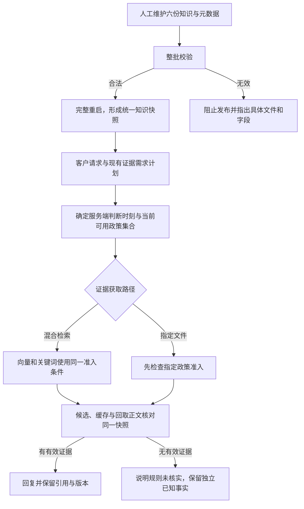

# 政策元数据 MVP 产品需求规划

日期：2026-10-14。版本：v0.2。状态：**已实施并按用户授权加载日常服务；18项确定性场景、160项隔离检查及有限真实链路核验完成。** 六条真实咨询的主链路／已知事实通过，补货提醒越界话术BC-020待改进，不宣称整体质量全通过。见[日常结果](../../../analysis/02-意图与政策咨询/政策元数据日常加载验收/结果.md)与[实施结果](../../../analysis/02-意图与政策咨询/政策元数据实现验收/结果.md)。下文是规划基准，原“待运行／不执行／未发布”措辞保留其制定时点，不作为最新状态。

承接 [意图与证据检索规划](意图识别与证据检索产品需求规划.md)、[RAG 审查](../../03-评测与问题/RAG设计审查与优化建议.md) 和 [知识来源学习](../../04-学习与复盘/产品设计学习.md#2026-10-14rag-环节二知识来源与适用范围)。当前停点见 [项目交接](../../01-项目概览/项目交接.md)。

## 1. 产品判断与首版目标

**首版只用 5 个核心治理字段，把“身份、版本、发布状态、生效期”真正接进 RAG。** 复用原有标题和知识域，暂不设计完整来源审批平台或复杂适用范围结构。

需要保证：未发布、已撤回、尚未生效或已过期的材料，不作为当前有效政策进入回答；无论走混合检索、指定文件，还是缓存路径，都遵循同一准入规则。回答和 Trace 能追踪所用政策及版本。

“政策可作为当前候选”与“这位客户可以享受权益”分开。元数据只管本项目知识材料的使用资格；商品参与情况、本人持券、订单资格仍需工具证据，不能由 `published` 状态或检索分数证明。

### 1.1 为何只选这 5 个字段

| 核心字段 | 已有情况 | MVP 的价值 |
|---|---|---|
| `policy_id` | 六份知识已有 | 同一政策有稳定身份，关联引用与版本 |
| `version` | 五份已有，发票缺失 | 知道引用的是哪次修订，识别发布变更 |
| `publication_status` | 新增 | 明确草稿、发布、撤回，替代“文件存在即可使用” |
| `effective_from` | 新增 | 明确何时开始允许使用 |
| `effective_to` | 新增 | 明确截止时间，阻止过期缓存继续回答 |

主要新增三项治理字段，发票另补已有版本字段。`title`、`scene_key`、现有评分与检索阶段仍保留兼容，但不扩大为新的治理字段。

不新增 `is_valid`：是否当前可用由状态和时间计算。`content_status: demo_knowledge` 可继续说明演示素材性质，不能充当发布状态。

## 2. 当前问题与源码依据

| 环节 | 当前事实 | 本需求要改变什么 |
|---|---|---|
| 加载 | YAML 解析后 Citation 只透传政策 ID、场景和可选版本 | 解析与校验五项字段，并透传引用元数据 |
| 索引 | 五份文件建混合索引，签收退货另走指定政策 | 全部六份纳入统一治理；不强行把退货加入向量索引 |
| 检索 | 向量与关键词已有域过滤；缓存命中直接返回 | 在原域约束上加状态与时间过滤，缓存同样检查 |
| 指定文件 | 通用售后直接使用模块级政策对象 | 指定文件也过准入，不能绕过新规则 |
| 引用 | 商品按小节引用，政策多为整篇 | 保留现有粒度，展示政策身份、版本和有效期 |
| 引用缓存 | 文件名 LRU；政策对象在模块加载时创建 | 缓存只保留快照内容，不缓存“永远有效”的结论 |
| 检索缓存 | 键含索引指纹、意图、TopK、Query | 再加入当前可用政策集合，处理时间边界 |
| 发票答案缓存 | 固定 `faq:invoice_issue`，共用最终答案 | MVP 停用发票最终答案缓存，防止绕过准入 |
| 索引 reset | 只清索引与检索缓存 | 不当作完整知识发布；首版统一采用进程重启 |

证据：`backend/retrieval/documents.py:17`、`:36`；`hybrid_retrieval.py:130`、`:195`、`:310`；`knowledge.py:14`、`:60`、`:85`；`customer_service_agent.py:798`。

以上是静态核对，不是本轮运行观察。前一环节新增的证据需求和策略计划继续复用。

## 3. 字段与时间规则

### 3.1 五项字段的最小契约

| 字段 | 类型与要求 | 缺失／无效时 |
|---|---|---|
| `policy_id` | 非空稳定字符串；一个发布批次内只允许一份相同 ID | 阻止该批次发布，不猜 ID |
| `version` | 非空字符串，保留原格式；不依靠字符串大小自动选新版本 | 阻止发布，不从文件时间补版本 |
| `publication_status` | 仅 `draft`、`published`、`withdrawn` | 阻止发布，不默认已发布 |
| `effective_from` | 已发布材料必须有带时区的 ISO 8601 时间；草稿／撤回可以为 `null` | 已发布但未知开始时间，阻止发布 |
| `effective_to` | 显式时间或 `null`；非空时必须晚于开始时间 | 不省略；类型或时间关系错误时阻止发布 |

五个键都必须出现。`effective_to: null` 的业务含义是**已确认没有固定截止时间，直到撤回或下一次发布替换**；不代表“还不知道截止时间”。截止未知的材料先保持草稿，不编造有效期。

正文或上述治理信息发生变化，必须更新 `version`。修改状态、有效期也属于发布变更。发布记录至少保留文件指纹和版本，能检查“版本不变、内容变了”的情况；首版人工保留发布清单，不新建版本数据库。

### 3.2 当前有效性

每轮使用服务端获取的同一个判断时刻 `t_eval`，统一转换为上海时区。客户输入的“今天”或自行指定时间不能改写系统准入时间。

政策当前可用必须同时满足：

1. 元数据合法，属于成功加载的知识快照。
2. `publication_status = published`。
3. `effective_from <= t_eval`。
4. `effective_to` 为 `null`，或 `t_eval < effective_to`。
5. 符合原有知识域、主题和政策类别约束。

采用开始时间包含、截止时间不包含的区间。例如，“到10月31日结束”须由维护者明确填成11月1日00:00（上海时间）。不让模型决定日期边界。

MVP 只解释当前时点的通用政策，不新增历史版本查询。订单购买时的可退快照、实际提交时的资格核验仍由业务系统负责。`t_eval` 也不锁定优惠或退款权益，交易执行应按原业务规则重新核验。

### 3.3 元数据示例（虚构时间，仅示意）

下面保留原标题和知识域，展示五项字段；日期不代表现有露营季活动真的在此期间生效。

```yaml
policy_id: promotion_camping_season_stack_rule
title: 荒野户外露营季活动规则
scene_key: promotion
version: "demo-example-1"
publication_status: published
effective_from: "2026-10-01T00:00:00+08:00"
effective_to: "2026-11-01T00:00:00+08:00"
```

现有 `score`、`retrieval_stage` 等字段按原契约保留，示例省略它们。分数不参与发布、时间或权益资格判断。

### 3.4 现有六份材料的有效期（用户已确认）

2026-10-14，用户明确：“审阅结束了。现有政策文件没有有效期，统一定为 有效期开始时间是2025年1月1日，有效期结束时间是2027年12月31日。”本项目现有六份治理材料统一采用该日期，包括商品指南与发票说明；这是用户为本演示项目设定的材料有效期，不是外部商家活动真实性证明。

- `effective_from: "2025-01-01T00:00:00+08:00"`。
- `effective_to: "2028-01-01T00:00:00+08:00"`：按截止不包含规则覆盖完整的2027年12月31日。
- 本次六份材料版本统一为 `2026-10-14.1`；正文、政策 ID 和知识域保留。

日期已写入材料；发布状态尚未填写，加载、检索及缓存的有效期执行逻辑尚未实现。不把“审阅结束”扩展为其他取舍逐项批准或运行服务重启授权。上方虚构示例仅作格式说明，不用于此次迁移。

后续实施补记：用户明确要求按本规划改代码，六份演示材料设为本项目 `published`，版本提高为 `2026-10-14.2`，准入逻辑与隔离验收已完成。日期和正文保留；日常服务未重启。上述日期写入记录保留原时点。

## 4. 首版范围与明确取舍

### 4.1 覆盖

- 当前六份知识文件，包括发票条款、商品指南、两份售后政策和活动会员政策。
- 五项治理信息从 Markdown 到内存文档、片段、Citation 的继承。
- 混合召回、指定政策读取、申请路径引用及检索缓存的统一准入。
- 显式完整重启发布、加载一致性核对与人工回滚记录。
- 政策不可用时的明确反馈，以及对独立商品事实回答的保留。

商品指南也接受统一准入，`published` 仅表示被本项目知识库采纳；不会将通用参考变成型号说明书或真实商家的质量保证。

### 4.2 暂不覆盖

- 新增来源 URL、审核人、修改时间、复核周期等治理字段：现有 README 与正文继续保留来源说明，维护者人工确认。
- 活动 ID、SKU、地域、会员等级等复杂 `scope` 字段，以及通用规则条件表达式。
- 一份文件内不同条款拥有不同有效期：首版要求整份文件治理条件一致，需要不同生效期时拆成独立材料。
- 自动热更新、发布后台、自动审批、数据库版本历史或跨进程即时同步。
- 发票 FAQ 条目化、子任务选择及重新启用答案缓存。
- 修改分块、向量、排序算法或新增模型调用。

原有政策类别过滤继续有效，但未知活动实体被相近政策替代的问题，不能仅靠本次五项字段解决。本需求不声称完成所有适用范围治理。

## 5. 加载与知识快照

### 5.1 加载先校验，使用时再判时间

首版按现有明确文件集合读取六份材料，先校验格式、字段、时间关系与 ID 唯一性，再形成一份完整快照。不得先启用部分文件、再让其他文件沿用旧对象。

- 草稿和撤回材料可以保留在快照登记信息中，供诊断，但不进入回答候选。
- 元数据合法的已发布材料可进入混合索引，即使尚未到开始时间或已经过期。当前是否可用在每轮请求过滤，避免时间变化必须重建索引。
- 没有已发布材料是正常的“暂无可用知识”状态，不能因此虚构政策，也不应把独立商品工具的成功读取说成失败。
- 纯解析不判断当前有效性；文件名 LRU、模块级对象只能缓存本快照内容，后续使用前仍要检查。

校验失败不能启用新批次或宣称知识已更新。首版发布前先离线检查；启动加载仍需相同校验。若新进程无法形成完整知识快照，不能提供半套新旧政策混合的 RAG；恢复方式按第9节人工处理。

### 5.2 复用统一快照指纹

复用现有内容哈希思路，将**全部六份原文与元数据**纳入统一知识版本指纹；原来未进入混合索引的签收退货也必须参与。索引涉及的分块和 embedding 配置继续参与版本身份。

统一指纹由系统生成，不要求维护者多填第六个字段。知识文档版本与快照指纹是两件事：前者标记单条政策修订，后者标记本次完整加载内容。可沿用当前 `index.version` 的机制，实施时确保指定文件与检索路径也使用同一身份。

不把磁盘刚修改的正文与旧索引／旧模块政策混用。只编辑文件不是完成发布，首版需要完整重启加载。

## 6. 在 RAG 工作流中的准入位置



### 6.1 混合检索

在当前 `allowed(document)` 原域和主题判断上叠加统一发布／时间判定。

- 向量搜索在召回前携带过滤，不先全库取 TopK 再剔除过期政策。
- 关键词遍历使用相同条件，不能从另一条召回路把草稿、撤回或过期内容带回来。
- 分块继承政策 ID、版本、发布状态和生效期；商品小节同时保留原小节身份和正文。
- 回取整篇政策或商品小节时，使用同一快照的正文和版本，再确认准入，不能从磁盘临时读新正文搭配旧块。
- 同域无合格政策时返回“无可用证据”，不放宽域、不采用过期的第二选择、不靠模型补政策。

### 6.2 指定文件与申请路径引用

`refund_policy_query`、`return_policy_query` 和发票路径不能因为没有向量召回就跳过准入。模块级 `REFUND_POLICY`、`RETURN_POLICY`、`INVOICE_FAQ` 使用前都需同样判断。

申请编排中附加政策引用的地方也必须校验；被阻断的政策正文不提供给回答模型，也不算有效 Citation。保持实际工具资格、客户确认及执行权限的原规则，不把本需求变成新的退款审批逻辑。

### 6.3 不可用原因与反馈

至少区分：`draft`、`withdrawn`、`not_yet_effective`、`expired`、`metadata_invalid` 与没有对应政策。原因用于 Trace 和维护诊断，不向客户倾倒字段名。

客户可见示例：“目前没有核实到可用于回答的有效活动规则，不能据此承诺优惠。”不把政策过期说成客户的券过期，也不声称已转接真人。

有独立商品事实时照常回答该事实，活动结论明确保留未知。若整段生成回答依赖被阻断政策，回到受控缺证据表述，不尝试仅删除引用标签后保留原承诺。

## 7. 引用与展示

保留当前 Citation 的来源、标题、正文片段和相关性分数。`Citation.metadata` 增加并继承五项核心治理信息，商品引用仍保留 section／chunk 信息，不改变当前引用粒度。

- 引用里的政策 ID 和版本必须与实际索引／回取正文一致。
- 不给失效政策生成“有效引用”；工作台可以在阻断事件里展示其身份和原因。
- 工作台应能看到版本、发布状态、生效区间、实际判断时刻与快照版本。判断时刻是请求记录，不是新增人工字段。
- 普通商城不要求新增引用卡或技术参数，客户只需知道是否有依据及结论范围。
- 政策版本和期限只说明材料使用条件，不代表当前商品、账号或订单已经满足权益条件。

## 8. 四类缓存如何处理

### 8.1 文件解析与模块对象缓存

允许缓存已加载快照的正文与元数据，不缓存“当前可用”的永久布尔结果。时间每轮重新判断；磁盘变更只在成功发布重启后生效。

现有 `load_knowledge_citation` LRU、模块级政策对象、内存索引必须属于同一快照。首版通过完整进程重启统一刷新，不对外提供“仅清索引就完成发布”的入口。

内部索引 reset 只能从已加载快照重建，不得在仍持有旧模块对象时重新读取磁盘新正文。隔离测试要改变材料时，显式创建完整新测试快照；不能以清某一个缓存模拟完整发布。

### 8.2 检索结果缓存

保留现有键中的知识版本、意图、TopK 和归一 Query，增加**本轮当前可用政策集合签名**，由代码按允许政策 ID／版本生成。

这个签名是自动生成值，不增加 Markdown 字段。某政策到期或开始生效时，集合改变，同题不再使用原结果；包括此前“无结果”的缓存，避免新政策生效后仍拒答。

缓存命中也核对每条 Citation 的快照、版本、状态和生效期。不合格则弃用该结果，按当前集合重新获取；不要只验证签名后绕过引用校验。

MVP 不引入固定 TTL 系统。时间边界依靠每轮准入和集合身份，发布变化依靠统一快照。旧时间集合结果可以在集合变化时清除，不要求为六份语料建设通用缓存淘汰平台。

每轮以固定 `t_eval` 解释证据时点，同一轮所有需求使用同一时刻。该时点不承诺后续交易仍适用；新请求必须重新取服务端时间。

### 8.3 发票最终答案缓存

**MVP 停用 `faq:invoice_issue` 的最终答案读取与写入。** 发票路径每轮先检查政策准入，再沿用当前证据获取；底层检索缓存仍可使用。

理由：当前缓存按全局固定键保存生成答案，没有实际问题与政策版本隔离。它会绕过新准入，也不适合直接给多种发票问题复用。为支持这个旧缓存再添加复杂键和答案校验，比首版停用更大。

只停用发票这一项，不清理其他会话、商品候选、退款草稿或业务状态。停用答案缓存不代表已解决发票问题覆盖；固定问句、问答条目与重开等规则仍是后续项。

以后恢复 FAQ 缓存时，至少按条目、政策版本和影响答案的条件隔离，并再次检查有效性；本次不提前实现。

### 8.4 发布时的一致失效

成功完整重启后，文件解析缓存、模块对象、混合索引与检索结果均重新建立。发票旧最终答案不再消费。不能出现“新索引＋旧 Citation＋旧答案”的组合。

如果部署为多个进程，必须全部加载同一快照后才称发布完成。MVP 不解决多进程在线即时切换，允许发布期间短暂不可用，不承诺零停机。

## 9. 人工发布、迁移与回滚

### 9.1 发布流程

1. 人工确认材料在演示知识库中的身份、版本、状态与生效区间。
2. 保留上一批文件和发布清单，填写新字段并提高发生变更的版本。
3. 离线校验全部六份，确认无缺字段、重复 ID 或版本冲突。
4. 在用户进入发布阶段并授权后完整重启，不把编辑文件等同于发布。
5. 核对健康信息／Trace 的统一快照版本及六份治理材料，再验证直取和混合两种路径。

“已撤回”编辑写入磁盘但尚未加载时，正在运行的快照不会即时变化；首版撤回发布也需要完整重启。若业务要求即时撤回，超出本 MVP，需要单独设计。

### 9.2 首次迁移

- 六份文件都要填齐，发票补政策版本。不能根据文件名、版本日期或正文出现的“24小时／七天”推断政策生效日期。
- `publication_status=published` 表示维护者确认可被本项目采用，不代表真实商家审核。
- 已确认常设规则可明确填无固定截止时间；日期未知的材料保持草稿，不自动补“今天生效”。
- 不在缺字段时静默沿用旧准入。先完成材料确认与迁移，再启用执行规则；本轮不修改现有素材。

### 9.3 失败和回滚

校验失败时不启用新批次，并指出文件与字段；不得对外称发布成功。保留旧进程未停之前的已加载快照并不等于完成新发布。

回滚由维护者明确选择已保存的旧批次，完整重启并核对版本。回滚后仍做当前时间过滤，已过期旧政策不会重新变有效。对明确撤回的政策，不能为了恢复服务未经确认重新发布旧版；没有可采用的恢复批次时，说明知识暂不可用。

本需求不新增自动降回旧政策、回滚按钮或状态数据库，也不撤销已经发生的业务操作。

## 10. 验收用例（待实施后运行）

以下为首版建议用例，不是实际通过结果。隔离测试使用固定时钟、虚构日期和模拟事实，既有活动日期不得为凑用例而修改。

| 编号 | 条件 | 必须观察到的结果 |
|---|---|---|
| PM01 | 六份元数据合法，已发布且当前有效 | 加载、片段、引用五项字段一致；指定退货也纳入快照身份 |
| PM02 | 缺状态、版本为空、无时区时间、结束不晚于开始、重复政策 ID | 阻止整批发布，明确错误，不默认生效 |
| PM03 | 草稿和撤回材料文本与问题高度相关 | 向量、关键词、指定文件均不把它们作为有效依据 |
| PM04 | 当前时间早于开始、恰等于开始、恰等于截止 | 分别阻断、允许、阻断，边界一致 |
| PM05 | 已确认无固定截止，结束为 null | 开始后允许，撤回后阻断；缺结束键不等于 null |
| PM06 | 同题缓存先命中，随后跨过截止 | 重新判断并弃用旧结果；答案不保留过期优惠承诺 |
| PM07 | 同题曾无结果，随后一份已发布未来政策到开始时间 | 当前集合变化，重新召回，不继续复用旧空结果 |
| PM08 | 缓存伪造为旧版本、错误快照或失效 Citation | 命中后校验失败，不直接返回 |
| PM09 | 通用售后直取及申请路径附加的政策过期 | 不交给模型、不输出有效 Citation；原业务事实／执行校验未被元数据放宽 |
| PM10 | 发票此前已有 `faq:invoice_issue` 缓存，当前政策过期 | 不读取或写入旧最终答案，给缺有效依据反馈 |
| PM11 | 发票有效，连续咨询时间与下载入口 | 每轮政策准入和引用可追踪；不声称本需求已完成所有 FAQ 子任务 |
| PM12 | 商品价格已核实，活动政策不可用 | 保留价格；活动结论未知，不用旧政策算到手价 |
| PM13 | 发布新版本，只改正文／元数据后完整重启 | 指纹变化，所有缓存与直取对象同批重建，新引用版本一致 |
| PM14 | 正文变了但沿用原版本，或只做索引 reset | 发布校验／流程判定不通过，不能标成完整发布 |
| PM15 | 只修改未进混合索引的签收退货文件 | 统一快照身份仍变化，直取不遗留旧引用 |
| PM16 | 回滚旧批次，旧政策已经过期或已明确撤回 | 时间过滤仍生效；撤回不被自动恢复 |
| PM17 | 所有材料均非已发布，或当前均无有效政策 | 正常给无可用知识，不幻觉、不污染独立工具结果 |
| PM18 | 已有商品候选与未提交退款卡，知识状态变更后咨询 | 候选绑定、草稿和凭证没有被缓存失效操作清除 |

### 10.1 验证顺序与成功标准

- 先做字段校验和固定时钟工程检查，再做隔离 RAG／指定政策／缓存路径，不需要为时间比较额外调用模型。
- 观察实际候选、工具、Citation、版本、缓存身份和回复，不仅检查 YAML 中存在字段。
- 上述确定性约束必须全部通过；任何失效政策绕过缓存／直取进入答案，不能启用。
- 发布验证至少一条混合查询、一条指定政策与一次到期缓存复查；涉及页面时逐轮截图。
- 真实模型的主体误识别、规则解释和完整 FAQ 质量不以本组工程检查代替。

无需宣称大规模性能增益；六份材料的请求时间过滤不应新增远程调用。实际耗时在实施检查中记录。

## 11. 实施影响范围（本次不执行）

| 位置 | 后续最少改动 | 保持不变 |
|---|---|---|
| `backend/resources/knowledge/*.md` | 六份补齐五项治理信息，发票补版本 | 正文规则和真实生效日期不得编造 |
| `backend/retrieval/documents.py` | 字段校验、元数据透传与只解析的缓存语义 | 路径限制与安全 YAML 解析 |
| `backend/retrieval/hybrid_retrieval.py` | 统一指纹覆盖六份，片段继承、两路前置过滤、时间集合缓存身份 | 原分块、向量、排序与 TopK 合同 |
| `backend/retrieval/knowledge.py` | 指定文件／发票准入，停用发票最终答案读取 | 无对应依据不编规则 |
| `backend/agent/customer_service_agent.py` | 申请路径引用校验，取消发票最终答案写入，保留部分事实反馈 | 现有证据需求、业务工具与高风险流程 |
| `backend/api/routes.py` 与现有 Trace | 启动统一校验，展示快照与阻断原因 | 不新增热更新／发布接口 |
| 现有工作台及测试 | 必要的元数据展示；条件、缓存、直取和旧状态回归 | 普通商城无需新页面；旧成绩不复用为本方案成绩 |

已有文件名／常量引用也要纳入核对，不能只改混合检索入口。Java、数据库、模型配置和取消执行开关不属于本需求。

## 12. 推进与待确认内容

本次交付为字段精简与流程规划。后续顺序：确认字段和业务日期 → 冻结用例 → 隔离实现／检查 → 发布核验。未获实施与加载授权前不执行后续阶段。

本文推荐的取舍需要在实施前确认：

1. 首版只治理当前时点，不建立历史政策库与复杂 scope。
2. 发布采用完整重启，接受短暂不可用；编辑文件或仅 reset 不算发布。
3. 发票最终答案缓存先停用，FAQ 条目化作为后续独立改造。
4. 当前六份材料的有效期已由用户统一确定，见 §3.4；材料发布状态仍需确认。后续新增材料的日期未知时保留草稿。

方法依据：[OpenAI 属性过滤](https://developers.openai.com/api/docs/guides/retrieval)、[xAI 元数据](https://docs.x.ai/developers/files/collections/metadata)、[LangChain 元数据过滤](https://docs.langchain.com/oss/python/integrations/vectorstores)。这些资料提供技术机制，五字段取舍、时间语义和重启发布流程是结合本项目提出的设计，不是供应商统一标准。
