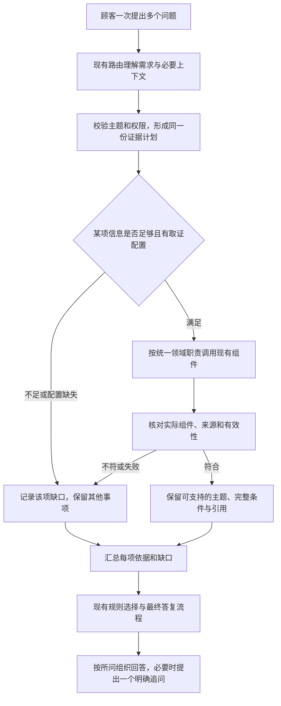

# 跨领域知识取证统一分发：产品设计

日期：2026-10-17｜版本：v0.1｜需求编号：DOMAIN-DISPATCH-001｜面向：产品、开发与验收。

**状态：用户已认可统一分发方案，并授权本轮编写功能与逻辑设计；本专项尚未编码、未验收、未加载日常服务。** 本文中的目标流程和验收标准是待实现要求，不是当前能力或新成绩。

## 0. 这次要改变什么

顾客一次问几件事时，系统应分别到正确资料中找依据，再组织成一份完整、自然的答复。**同一类资料始终由同一套规则安排查询，不能因为顾客先问发票、退款或优惠，就改变后面问题的取证方式。**

“取证器”在本文中指负责查询某类资料、返回依据和缺口的现有组件，不代表新增Agent。主问题用于理解上下文和兼容现有接口；它不能重新决定其他问题去哪里查。

本文细化[主需求MULTI-READ-001](多个只读问题与售后插问产品变更需求.md)的F2／F3／F6。共享的对象、权限、售后状态、确认与审批边界仍遵主需求；本次领域职责、分发、一致性校验与专项验收以本文为准。具体字段名、函数与文件拆分由开发选择，不要求照表新增数据结构或通用框架。

## 1. 用户问题、已知事实与根因

### 1.1 顾客遇到的情况

顾客问：“发票多久开好？露营季满减和平台会员券能叠加吗？”系统已识别两个问题，计划也包含发票与优惠，但优惠部分实际去查退货政策。最终可能只答发票，或者说优惠依据未确认。顾客无法区分资料缺失与系统查错了地方。

这是一类“计划与执行不一致”的问题，不能靠为这句话增加专用分支、换一段兜底话术或放宽证据准入解决。

### 1.2 已确认到哪一步

2026-10-17固定合法路由、使用离线知识及业务夹具，三个组合误分发，一个对照正确：

| 顾客问题组合 | 计划需要的资料 | 实际查询 |
|---|---|---|
| 发票＋优惠叠加 | 发票、活动／会员券 | 发票、退货政策 |
| 退款到账＋帐篷养护 | 未发货退款政策、商品知识 | 未发货退款政策、优惠 |
| 优惠叠加＋帐篷养护 | 活动／会员券、商品知识 | 活动／会员券、退货政策 |
| 到货提醒能力＋帐篷养护（对照） | 能力目录、商品知识 | 商品知识组件选择正确；能力沿原独立接口 |

证据为[DOMAIN-DISPATCH-DESIGN-001](../../../analysis/02-意图与政策咨询/跨域取证分发方案核验/probe-results.json)。这些是定向机制诊断，路由、生成与业务使用夹具；不是自然模型正确率或真实商城验收。生成故障注入只用于观察备用出口。

### 1.3 源码确认的根因

| 原因 | 可验证事实与位置 | 造成的结果 |
|---|---|---|
| 分发决定散落在各入口 | 发票入口`customer_service_agent.py:393—408`、退款／退货政策入口`:426—443`、优惠入口`:483—491`、能力入口`:828—838`、商品知识循环`:1359—1387`各自选组件 | 同一知识领域从不同入口进入，使用不同取证方式 |
| 默认分支把未列举领域认成另一领域 | 发票的“其他”默认售后，退款政策的“其他”默认优惠 | 新增组合没有明确报缺口，反而查了另一类资料 |
| 计划标签没有约束实际来源 | `customer_service_agent.py:411—416`等位置按目标领域记录引用，并以引用非空判断answered | 写着优惠领域完成，不代表实际查过优惠资料 |
| 下层会根据收到的类型限制资料 | `hybrid_retrieval.py:118—132`按调用意图确定资料类别；`knowledge.py:58—76`等继续限定政策 | 上层分发错后，后续检索无法自动恢复正确领域 |

原作者为何采用这些拆分，没有独立设计依据，本轮不推测。当前资料准入会防止任意未取证领域进入正文（`rules.py:56—71`）；本需求保留它，不能用直接放行全库规则掩盖分发错误。

## 2. 目标、范围与相邻问题

### 2.1 产品目标

1. 每项已确认的知识需求都有正确的取证安排，不随主入口或提问顺序改变资料范围。
2. 目标领域、实际组件、实际来源可以对应核对；查错地方不能算完成。
3. 返回依据、缺信息和失败按事项分别保留，最终答复覆盖可答部分及具体缺口。
4. 原单领域行为、只读权限、业务对象及售后状态保持正确；不以提升覆盖率换取越权或误办理。

### 2.2 本次覆盖

| 场景 | 本次要求 |
|---|---|
| 五类现有知识的单项或组合咨询 | 退款政策、签收退货政策、发票、活动／会员券、商品使用知识采用共同分发规则 |
| 商品事实＋知识、订单只读查询＋知识、能力咨询＋知识 | 知识部分执行同一契约；事实、资格、能力仍由各自既有组件核验，不让知识查询替代业务查询 |
| 售后办理期间的只读插问 | 查询本轮资料；原退款／退货任务、候选、原因、版本等遵BC-032已建立的状态规则 |
| 局部缺参数、无依据或执行失败 | 保留独立已知项；只要求补会改变该项结论的信息，准确表达未确认 |

识别到但未进入计划的知识领域，属于执行前完整性约束；本次须接齐这一约束，不能只实现一个没有调用者的共享组件。主需求关于单订单／单商品对象、一个售后任务及明确办理混合请求的边界不变，不扩为批处理或通用多任务平台。

### 2.3 与相邻问题的关系

| 问题 | 本次处理责任与验收边界 |
|---|---|
| 有效知识主题未进入计划（BC-031相关） | 接入共享分发前，核对主题所需领域已进计划；保留业务对象与工具权限约束。未识别主题仍是理解缺口，不能记为分发成功 |
| 已在计划但调用错组件（本次核心） | 统一领域职责、所有相关调用者及实际来源校验，必须完成 |
| 资料查到却被全局澄清／降级吞掉（BC-034） | 新结果必须接入共享答复，不能由单个知识结果结束整轮；专项场景须验证已知部分保留。BC-034整体仍需独立复测，不因本需求通过自动关闭 |
| 单域无证据降级判断错误（BC-035） | 原正常与无证据单域行为列入回归；沿用共享结果消费时有直接影响的逻辑须保持正确，其他发现继续独立记录 |
| 无关内容、证据外解释（BC-029／033） | 保留既有内容选择及事实边界，不宣称统一分发自然解决全部生成质量问题 |
| 插问状态与自然语义（BC-032） | 原状态工程回归须保留；其真实模型／页面验收沿独立交接，不用本次检索成绩替代 |

本次不新增业务接口、知识内容、领域、独立分类／整理模型、Agent、后台配置系统或持久任务队列，不改变原确认、审批和自动取消开关。自然表达若持续漏识别，按其独立原因处理，不默认增加一次模型调用。

## 3. 全局原则

| 编号 | 原则 | 产品含义 |
|---|---|---|
| DP01 | 一份领域职责 | 所有入口引用同一套“领域→取证方式→合法来源”规则，新增领域不能靠逐入口补分支 |
| DP02 | 计划决定执行 | 执行只消费已校验计划；主意图、正文关键词和模型临时建议不另建第二套分发 |
| DP03 | 成功必须有对应依据 | 调用成功、非空引用或日志领域名都不足以证明所问已获支持 |
| DP04 | 局部缺口局部处理 | 缺订单／商品／优惠组合或某项故障，只阻塞依赖它的结论 |
| DP05 | 查询、适用、办理分开 | 通用规则不证明本单可退、本券可用，更不表示已经提交或执行 |
| DP06 | 同证据贯穿三个出口 | 正常生成、一次修复、无模型备用共享有效依据和缺口，修复阶段不重跑业务查询 |

这些规则约束所有本次支持的入口；不新增问句、Bad Case编号或意图组合白名单。领域本身必要的权限、参数和有效性判断继续保留。

## 4. 用户请求的目标流程

图中是逻辑职责，不表示新增模型阶段、服务或数据库。执行顺序沿现有方式即可，不要求为本次改成并行。纯知识咨询的完成、失败或澄清，不改变原售后任务。

## 5. 功能与组件职责

### D1：明确本轮知识需求，检查计划完整性

复用现有一次路由及受控主题目录；保留合法的原始问题、顺序、主题与所需领域。每个有效主题都能在计划中找到对应知识领域，同领域多个主题可以合并取证，但仍分别检查覆盖情况。

现有单领域安全回退继续可用；未识别或非法主题须保留缺口，不自由生成领域／组件／文件路径，也不将旧猜测结果声称为完整需求。安全拒绝与高风险办理仍走原受控入口。

商品、订单、能力及知识的参数依赖分开。例如“这款帐篷多少钱？发票多久能开？”里，未选定商品只影响价格；发票资料可独立查询。历史对象、页面商品与业务归属继续使用原解析和校验，不能另加默认对象。

### D2：统一领域职责及合法资料范围

下表规定产品职责，不强制一行对应一个新函数。应复用现有组件；分发规则只有一个维护处，各入口不得另设默认映射。

| 知识领域 | 负责查什么 | 复用的现有组件 | 允许的底层资料类别 |
|---|---|---|---|
| 未发货退款政策（after_sale_policy） | 退款范围、条件、流程、到账边界 | policy_query_result的退款方式 | after_sale_refund |
| 签收退货政策（received_return_policy） | 七天无理由范围、条件、流程 | policy_query_result的退货方式 | after_sale_return |
| 发票（invoice） | 开具、查看与下载规则 | invoice_faq_result | invoice |
| 活动／会员券（promotion_and_member_policy） | 活动、券归属、使用条件和组合规则 | promotion_policy_result | promotion、member_coupon |
| 商品知识（product_knowledge） | 通用选购、使用、清洁、收纳与排查 | product_knowledge_result | product_knowledge |

上层领域名与下层资料类别不是同一层级，应按表中的对应关系校验，不能逐字比较名称，也不能只相信组件自报的标签。必要条件与完整规则依赖继续沿原内容契约处理，缺条件的结论不能放行。

未知领域或缺少组件配置属于本项取证配置错误，不默认改查退货／优惠，不把它解释成“业务不支持”。只有可信业务能力证据才能得出不支持结论。

### D3：所有相关入口执行同一份契约

发票、退款／退货政策、优惠、商品和能力咨询中的知识需求，都按D2分发；现有订单只读查询组合知识时，知识部分也遵相同规则。工具、能力、办理流程的职责不合并到知识分发中。

组件可以接收本次合法问题、所属主题及已有必要上下文，但不能再按主意图决定另一领域去哪里查。优惠组合需要澄清、商品类别不明等局部判断保留；由调用方按照实际局部结果更新自身咨询状态，不让知识组件清理售后。

同请求、同有效快照、同领域且相同参数的需求可复用一次结果。不同优惠条件、不同对象不能强行合并。沿现有调用上限、超时和缓存机制处理，不新增全计划自动重试，不承诺跨领域查询次数天然与单问题相同。

### D4：每项结果能核对目标、执行和来源

至少需要表达下列信息；若现有结构已能推导，不重复存储，不要求新建对外接口字段。

| 信息 | 必须回答的问题 |
|---|---|
| 目标 | 对应顾客哪项问题、哪些主题和哪个知识领域？ |
| 执行 | 实际交给哪个组件，执行了还是因缺参未执行，是否失败？ |
| 来源 | 资料实际属于哪个类别、版本／快照、适用范围和有效时刻？ |
| 支持程度 | 能支持哪些问题及必要条件，哪些尚不能确认？ |
| 下一步 | 缺什么信息、需要顾客补充什么；是否可以独立回答其他项？ |

来源核验沿现有发布、生效时间、快照、适用范围及污染检查。**组件或返回资料与目标领域不符时，结果记为该项契约失败，不作为该项已核实证据进入生成；不得改标签伪装成成功。** 其他独立领域的有效结果保留。

执行正确但没有足够证据，记为证据不足；缺参数未执行，记为待补信息；执行故障，记为查询失败。知识组件返回的“建议动作”仅属于该项，不能直接覆盖整轮结果。日志应同时区分计划领域、实际组件、实际来源与覆盖情况，不能只打印目标领域。

### D5：汇总结果，保持答复完整与自然

核验后结果接入现有完整规则选择与最终答复流程；沿用同次路由给出的提问顺序。必要条件和未知边界不可省略，也不把多个组件的内部答复原样串成几段重复说明。

- 全部有据：按所问顺序回答，可以合并重复条件，不带未问领域整段资料。
- 部分缺信息：先回答独立可答项，再问一个最有助于继续的问题；其他缺口仍保留，候选类型及焦点不混用。
- 部分失败／无证据：保留已知项，准确说明哪项尚未核实；不把知识不足说成缺货、资格不符或业务不支持。
- 全部无法确认：说明实际缺口与现有可用下一步，不生成确定政策、未接入渠道或代办承诺。

正常生成、一次修复与备用消费同一份有效结果；未通过核验的引用不能在任何出口重新出现。生成失败不重查业务工具，备用也须保留可答部分。原模式与一次修复上限不变，不另加内容整理模型。

对顾客不展示内部组件名、领域ID、配置错误、Trace或原始异常；内部审计保留原因。措辞应直接回应所问，避免每个小问题都重复通用免责声明；必要的适用限制仍须说明。

### D6：保持业务和会话边界

查询通用退款政策不核验本人的订单资格；未通过对象归属不能查订单事实；知识正文不能生成办理授权。明确新申请、停止、切换及条件式办理沿主需求第2.3节和原拥有方处理。

插问、澄清、失败、最终答复完成均不自动清掉售后任务、不误填退款原因、不重发旧确认卡。当前商品或查询焦点可按原规则更新，原售后绑定订单、候选与版本不能被最近查询对象覆盖。

## 6. 异常与结果处理

| 情况 | 系统逻辑 | 顾客应获得什么 |
|---|---|---|
| 有效主题未进入计划 | 暴露计划缺项，补齐受控领域后执行；无法补齐则保留该项未确认 | 不把明确已问内容静默丢掉 |
| 未知主题／领域或分发配置缺失 | 隔离非法项，记录具体缺口；无默认“其他领域”取证 | 回答有效项，缺项准确说明暂未核实 |
| 商品类别、订单、优惠组合不足 | 只阻塞实际依赖项，独立知识继续取证 | 可答部分及一个清楚的补充问题 |
| 实际组件或来源领域错误 | 标该项契约失败，拒绝该项证据，保留其他领域 | 不把不相干资料当所问结论 |
| 未发布、撤回、过期、来源冲突、规则条件不齐 | 原知识治理和完整规则准入继续生效 | 对应结论未确认，必要条件不凭空补齐 |
| 一项超时或执行故障 | 不重跑全计划，不覆盖其他已完成结果 | 指出未核实部分，保留已知回答 |
| 模型输出无效、生成／judge／修复故障 | 原安全回退及有界备用；不把缺口改成事实 | 有据内容与边界仍一致 |
| 有效事实／能力与知识结论可能被误混 | 各用原来源与权限，核验适用性 | 区分价格库存、通用规则、资格和执行状态 |

既有安全拒绝若要求终止整轮，仍沿原规则；“保留独立结果”不能成为继续执行被禁止读取的理由。

## 7. 产品场景与预期对话

以下说明行为和答复组织，不是逐字输出模板。具体规则须来自当次有效证据，不能把演示数值当所有商家的承诺。

### 场景A：发票与优惠组合，互换问题顺序

顾客：“发票多久开好？露营季满减和平台会员券能叠加吗？”

系统分别查发票及活动／会员券，检查来源，再回答两项。例如先说明演示发票通常在订单完成后24小时内开具，再按有效规则说明叠加结论及本人归属、时间、门槛和组合限制；不引入退货政策。

顾客把优惠放在前面时，允许答复顺序改变，但发票和优惠仍使用相同组件与合法资料范围。不能因主问题改变而丢另一项。

### 场景B：已有退款，插问商品养护

初态：原退款待选订单A／B，候选顺序与版本已保存。顾客：“先问一下，帐篷怎么清洗收纳？”

系统查商品使用知识并回答。原退款仍待选A／B；不把这句话当作退款原因，不把商品知识交优惠组件，也不为了通用养护强制查具体SKU。之后的续办仍按原候选和业务规则处理。

### 场景C：优惠缺信息，发票独立可答

顾客：“会员券能和优惠叠加吗？另外发票多久开好？”

优惠组合尚未明确，发票资料已核实。系统先答发票，再询问会员券想与哪项优惠组合；不能只发“请补充优惠信息”而丢掉发票答案。优惠等待顾客补充，发票不重复查询。

### 场景D：错误来源或资料撤回

计划为退款政策＋商品养护，但商品知识结果被注入活动资料；或商品知识在当前快照已撤回。系统不使用该项资料解释帐篷养护，仍可回答已核实的退款政策，并说明养护部分尚未核实。不能用常识生成一段养护说明掩盖本轮取证失败。

## 8. 影响范围及完整交付边界

下表是实施时要核对的调用关系，不要求逐个文件都修改。行号以2026-10-17诊断为参考，实际开发按函数定位。

| 位置 | 必须考虑的影响 |
|---|---|
| backend/agent/tools/planning.py：build_route_plan | 受控主题、知识领域、执行策略完整且一致；工具与Workflow权限不因知识需求扩大 |
| backend/retrieval/knowledge.py及现有领域查询函数 | 单一领域职责与共同调用契约；保留每类原参数、准入、错误与缓存语义 |
| backend/agent/customer_service_agent.py及_run_product_query | 接齐所有相关调用者，移除被替代的重复分发；对象准备、咨询状态与最终动作各由原组件负责 |
| backend/retrieval/hybrid_retrieval.py、documents.py、rules.py | 下层资料类别与上层领域对应可核对；原有效性和完整规则准入继续工作 |
| backend/agent/answer_review.py与现有三个回复出口 | 本轮有效证据、逐项缺口和提问顺序一致；没有新出口绕过核验 |
| 原测试及隔离夹具 | 用实际组件、来源、覆盖和副作用断言；单领域及BC-032回归不退化 |
| Java网关与前端消费者 | 本需求不预设新增外部字段或页面；若动作／澄清语义因接入改变，验证组合回复可显示且不误续办，不凭内部单测宣称已联调 |

旧入口的必要行为须迁移或复用，不能只添加共享函数却仍由旧分支做决定。实现方式取最小完整变更，不顺手重写所有知识、业务图、记忆或UI。

## 9. 验收标准与证据

### 9.1 覆盖矩阵

下列均为待跑标准，尚无本专项实现成绩。先冻结输入／初态与预期，再比较前后；例句可以改写，不依赖案例编号进入产品逻辑。

| 编号 | 验收范围 | 必须成立 |
|---|---|---|
| DD01 | 五个知识领域分别单独咨询 | 各用指定组件及合法资料；原正常答案与无证据行为保留 |
| DD02 | 五领域全部10种两两组合，各交换问题顺序 | 每项安排正确，顺序改变只影响表达顺序，不改变分发；同一领域不因入口换组件 |
| DD03 | 三领域代表组：发票＋优惠＋退款、商品知识＋发票＋退货 | 三项都有结果或具体缺口，不截成前两项；不要求无限对象批处理 |
| DD04 | 语义合理的不同主入口固定输出：发票、退款政策、退货政策、优惠、商品、能力 | 同领域调用与资料范围一致；对象和权限限制仍有效 |
| DD05 | 同领域多个主题、重复主题、不同条件 | 可复用取证但按主题检查覆盖；不同条件不错误合并 |
| DD06 | 有效主题缺领域／缺策略、未知领域或非法字段 | 计划缺口可见；合法项保留；不默认改查其他资料或自由工具 |
| DD07 | 注入错误组件、错领域引用及正确组件返回错资料 | 对应项失败且错误依据不进入三个出口；其他有效项保留 |
| DD08 | 有引用但不支持所问、必要条件缺失 | 不以非空引用判可答，不凭其他片段或常识补结论 |
| DD09 | 未发布、撤回、时间边界、来源冲突、快照或适用范围不一致 | 原治理继续拦截，单域及组合都不能误用 |
| DD10 | 商品／订单缺对象或优惠组合待澄清，同时有独立发票等问题 | 已知先答，只澄清依赖项；短答及候选仍归正确事项 |
| DD11 | 单项无依据、超时、异常；其他项正常 | 已完成结果不被覆盖，故障与不支持分开，不重跑全计划 |
| DD12 | 商品事实／订单只读／能力结果＋知识 | 原事实和能力来源保留，知识不替代具体资格或新增工具权限 |
| DD13 | 正常生成、一次修复、生成故障／judge故障备用 | 使用同一组已核验证据和缺口；修复不重查业务工具，拒绝的引用不复活 |
| DD14 | 原退款／退货待选、待补、待确认时插问，后续续办／取消／过期 | 原业务状态及焦点规则不退化，无误续办、新申请、旧卡重发或取消后复活 |
| DD15 | 正文覆盖、顺序、条件与流畅性 | 所问逐项有去向，无无关整段资料、内部ID、重复模板或无依据确定结论 |
| DD16 | 工作台与商城的相关组合回复 | 同一证据含义一致，正文／澄清能展示，网关不把知识插问当办理；真实集成独立留证 |

DD02共有10种无序领域配对、交换问题顺序后20个输入方向；这不是20个业务成功率样本。固定主入口检查、三领域组、异常注入和真实自然表达分别统计，不能把交叉维度含糊合成一个“全部通过”。

### 9.2 分层判定

1. **结构与组件检查：** 受控领域职责完整、调用者只消费同一契约，记录计划／组件／实际来源／覆盖；不能只断言HTTP200或正文关键词。
2. **隔离链路检查：** 从固定合法路由经计划、真实离线检索、规则选择到三个出口，验证本次错误与相邻正常／异常；保留旧失败。
3. **真实模型小批：** 从自然原话开始，不手填模型结果；冻结模型、Prompt、知识版本、模式、预算及必要历史，分别评理解、取证和表达。付费或真实服务动作不由本轮文档授权。
4. **商城／页面验证：** 按实际影响另验消费者和副作用，隔离数据；不能用Python夹具替代Java、历史与页面证据。

用例逐项标通过／失败／未运行／无法判定。错来源、越权、误办理、误清草稿、虚报已执行均为不合格，不能被平均分抵消。每条保留计划、实际组件、资料来源／有效时刻、结果与缺口、最终正文、状态差异和真实调用量；敏感内容及凭据脱敏。

本次不编造生产准确率或绝对时延SLA；比较相同样本下的查询数、模型调用、token及耗时，出现退化时解释代价，不能靠默默放宽超时或切模型消除记录。

## 10. 实施顺序与交付判定

| 阶段 | 未来工作 | 完成标志 |
|---|---|---|
| 1 冻结基线 | 记录当前工作区及已有状态改动，复现本条错误，冻结DD样本和领域职责 | 可找到首个计划／执行偏差，未覆盖旧证据 |
| 2 统一计划与分发 | 接齐单一契约、相关入口及实际来源校验 | 五领域及组合调用正确，未知领域不静默落错组件 |
| 3 接齐结果消费 | 有效依据、逐项缺口和三个回复出口连通 | 部分失败不吞独立已知项，原语义和状态回归通过 |
| 4 验证完整体验 | 工程、隔离、真实模型、必要消费者验证分别记录 | 冻结范围逐项满足；未跑层次明确，仍未自动加载服务 |

本专项代码完成须包含共享规则及全部相关调用者、必要测试和记录，不能以“新增函数”或“目标原句不再失败”作为终点。专项验收通过不自动等于MULTI-READ-001全部完成，也不自动关闭BC-029／033／034／035或BC-032真实验收。

**本轮交付到文档为止。** 开发前仍需核对实际版本、调用方和既有改动；实现应保留已有工作区，不reset／clean，不顺带修改模型、知识、业务权限或日常服务。

## 11. 文档、证据与当前状态

- 上位功能范围：[多个只读问题与售后插问产品变更需求](多个只读问题与售后插问产品变更需求.md)。
- 已确认原因、讨论与取舍：[产品设计学习](../../04-学习与复盘/产品设计学习.md#2026-10-17跨领域取证分发查什么由领域决定入口只负责提出需求)。
- 本轮诊断输入／实际调用／答复：[DOMAIN-DISPATCH-DESIGN-001](../../../analysis/02-意图与政策咨询/跨域取证分发方案核验/probe-results.json)。
- 运行分类与历史成绩：[项目评测记录](../../03-评测与问题/项目评测记录.md)。
- 按问题持续跟踪：[问题台账](../../03-评测与问题/问题台账.md#bc-031能力咨询作为主意图时丢掉已识别的政策主题)。
- 唯一当前停点、环境及下一步：[项目交接](../../01-项目概览/项目交接.md#唯一当前停点)。

本轮只写设计并做文档静态核验。已知缺陷由已有诊断支持；DD01—DD16均待实施后运行。原工程300项、Java32项及原真实验收成绩属于各自时点，不挪作本专项新成绩。
