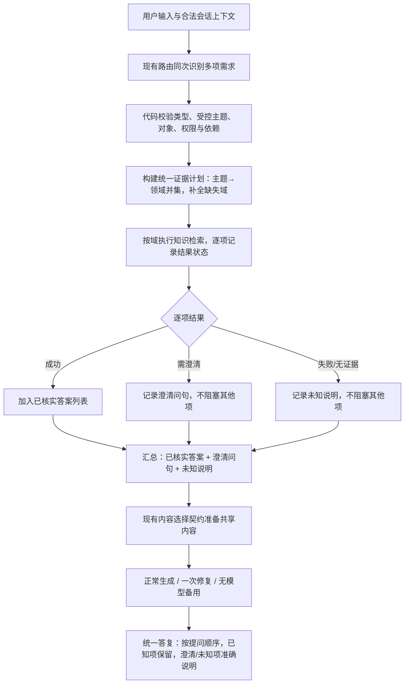

# 逐项知识结果与独立出口：产品需求规划

日期：2026-10-17｜版本：v0.1｜需求编号：PER-TOPIC-RESULT-001｜读者：Coding Agent、产品与验收人员。

**状态：用户已认可问题方向，要求先形成产品需求规划供 Coding Agent 参考；本专项尚未编码、未验收、未加载日常服务。** 本文中的目标流程和验收标准是待实现要求，不是当前能力或新成绩。

---

## 0. 这次要改变什么

顾客一次问几件事时，系统应**分别处理每件事**，已查到的答案不被其他事项的澄清、失败或降级吞掉。当前的问题是：一个事项需要澄清或失败时，整轮回复被该事项"劫持"，其他已核实的内容丢失。

"逐项结果"在本文中指：每个识别到的知识主题/领域有自己的执行状态和结果，最终答复按"已成功的项"组织内容，不被其他项的局部状态阻塞。不新增 Agent、不新增模型调用、不改变业务边界。

本文细化[主需求 MULTI-READ-001](多个只读问题与售后插问产品变更需求.md)的 F2/F3/F6 中"逐项结果"部分，与[统一分发专项 DOMAIN-DISPATCH-001](跨领域知识取证统一分发产品设计.md)的 D4/D5 衔接。共享的对象、权限、售后状态、确认与审批边界仍遵主需求。

---

## 1. 用户问题、已知事实与根因

### 1.1 顾客遇到的情况

| 场景 | 顾客输入 | 系统已查到 | 顾客实际看到 | 应该看到 |
|------|---------|-----------|-------------|---------|
| 一项需澄清，吞掉已知项 | "会员券能和优惠叠加吗？另外发票多久开好？" | 发票规则已查到（24小时开具） | 只有优惠澄清问句："会员券想和哪项优惠叠加？" | 发票答案（24小时）+ 优惠澄清问句 |
| 一项无规则，全局降级 | "火星会员有什么优惠？发票多久开好？" | 发票规则已查到（24小时开具） | 只有"建议转人工客服进一步核实" | 发票答案 + 优惠未知说明 |
| 商品入口保留主题但没查询 | "帐篷怎么清洗？发票多久开好？" | 商品知识已查到（帐篷养护） | 商品答案正常，但说"关于发票，本轮未取得完整规则" | 商品答案 + 发票答案（24小时） |

### 1.2 已确认的根因（源码位置）

| 层 | 根因 | 源码位置 | 造成的结果 |
|---|------|---------|-----------|
| **计划层** | 商品入口的 `fixed_route` 保留了 `invoice_issue` 主题，但 `knowledge_domains` 只写 `["product_knowledge"]`，计划阶段没有把发票域并入执行 | `planning.py:222-231`（product_query 分支） | 发票主题保留在 `inquiry_topics`，但从未进入 `retrieval_strategies`，发票没有被查询 |
| **执行层** | 知识检索按域循环执行，但结果只累积到共享 `citations`/`knowledge_results`，没有逐项状态记录 | `customer_service_agent.py:748-801` | 一项失败或澄清时，无法区分"哪项成功、哪项失败" |
| **出口层** | 首域（promotion）的 `next_action` 被设为全局 `ask_clarification` 或触发 `low_confidence` 降级，整轮跳过模型生成 | `customer_service_agent.py:438-449`（首域全局状态），`:1394-1396`（skip_reason 判断） | 已查到的发票引用还在 `citations` 里，但没人消费，最终答复只含澄清或降级 |
| **内容选择层** | `select_rules` 输出 `selected_rules` + `gaps`，但没有一个结构说"invoice_issue=已成功，promotion_stacking=待澄清" | `rules.py:56-142` | 生成/备用出口拿到的只是"整轮能不能答"的布尔判断，无法按项组织内容 |

### 1.3 为什么这是结构问题，不是个案

- 三个场景（澄清吞已知、无规则吞已知、商品入口漏查询）的根因是同一层：**缺少"逐项结果"结构**。
- 如果为每个场景加分支（如"如果 intent=promotion 且 topics 含 invoice 则保留发票"），只会把问题从一个入口转移到另一个入口，无法覆盖未来新增的组合。
- 正确做法是：让**每个主题/领域独立记录状态**，出口按"已成功的项"消费，这是全局原则，不是特例。

---

## 2. 目标、范围与相邻问题

### 2.1 产品目标

1. 每个识别到的知识主题/领域有独立的执行状态和结果（成功/澄清/失败/无证据）。
2. 最终答复（正常生成、一次修复、无模型备用）都按"已成功的项"组织内容，不被其他项的局部状态阻塞。
3. 计划阶段自动补全主题所需的知识域，不因入口不同而漏查。
4. 原单领域行为、只读权限、业务对象及售后状态保持正确；不以提升覆盖率换取越权或误办理。

### 2.2 本次覆盖

| 场景 | 本次要求 |
|------|---------|
| 多领域知识组合（发票+优惠、退款+商品知识等） | 各项独立查询、独立记录状态，答复保留已知项 |
| 一项需澄清 + 一项已知 | 已知项保留作答，澄清项单独问，不吞掉已知项 |
| 一项无规则/失败 + 一项已知 | 已知项保留作答，失败项准确说明未知，不全局降级 |
| 商品入口跨域（商品知识 + 发票/退款等） | 主题保留时自动补全域并真正查询 |
| 生成故障/超时 | 备用稿同样保留已知项，不只发澄清或降级 |

### 2.3 与相邻问题的关系

| 问题 | 本次处理责任与验收边界 |
|------|----------------------|
| BC-031（跨领域用错取证器） | 统一分发已修复，本文不重复；但"计划补全域"与统一分发协同，确保主题保留时域也进入计划 |
| BC-032（插问清空退款待办） | 状态保留已修复，本文不重复；逐项结果不影响售后任务状态 |
| BC-034（局部失败吞已知） | **本文核心修复目标**；通过逐项结果结构解决 |
| BC-035（单域政策判断恒假） | 独立问题，本文不直接修复；但逐项结果结构为后续修复提供基础 |
| BC-029/033（无关内容、证据外解释） | 保留既有内容选择约束，不宣称本文自然解决全部生成质量问题 |

### 2.4 本次不增加的业务承诺

- 不新增业务接口、知识内容、领域、独立分类/整理模型、Agent、后台配置系统或持久任务队列。
- 不改变原确认、审批和自动取消开关。
- 不扩成批处理或通用多任务平台。
- 自然表达若持续漏识别，按其独立原因处理，不默认增加一次模型调用。

---

## 3. 全局原则

| 编号 | 原则 | 产品含义 |
|------|------|---------|
| PT01 | 一项一果 | 每个识别到的知识主题/领域是一个独立结果项，有自己的状态 |
| PT02 | 局部不阻塞全局 | 一项需澄清或失败，只阻塞该项，不阻塞其他项的答复 |
| PT03 | 计划补全域 | 主题在 `inquiry_topics` 中时，其所需知识域自动进入 `knowledge_domains` 和 `retrieval_strategies` |
| PT04 | 出口消费逐项结果 | 正常生成、一次修复、无模型备用都按"已成功的项"组织内容，澄清/失败项单独说明 |
| PT05 | 同证据贯穿三出口 | 正常生成、一次修复、无模型备用共享同一组逐项结果，不重复查询 |
| PT06 | 状态与正文分离 | 售后任务状态、咨询焦点等业务状态不受逐项结果影响，仍由原拥有方管理 |

---

## 4. 目标链路与组件职责



流程图节点是职责，不代表新增 Agent、模型阶段、服务或数据库表。

---

## 5. 功能要求

### F1：计划补全域（修复"保留主题没查询"）

- 从 `inquiry_topics` 反推所有知识域，与 `knowledge_domains` 取并集。
- 商品入口的 `invoice_issue` 主题 → 自动补 `invoice` 域和检索策略。
- 不再依赖各入口自行维护域列表；所有只读入口按同一规则补全域。
- 未识别主题仍是理解缺口，不能记为分发成功。

**改动位置：** `planning.py` 的 `build_route_plan`，在现有 `knowledge_domains` 确定后，增加从 `topics` 到 `topic_catalog()` 的并集补全。

### F2：逐项结果结构（核心新增）

**新增数据结构（放在 `customer_service_agent.py` 或独立模块，由实现者选择）：**

```python
@dataclass
class TopicResult:
    topic: str           # 如 "invoice_issue", "promotion_stacking"
    domain: str          # 如 "invoice", "promotion_and_member_policy"
    status: str          # "answered" | "clarify" | "failed" | "unavailable"
    citations: list      # 该主题已取得的引用
    answer_text: str     # 该主题的已核实答案（如发票 24 小时）
    gap_reason: str      # 如 "topic_unconfirmed:promotion_stacking"
```

**执行逻辑：**
- 每个 `inquiry_topic` 独立走检索 → 独立记录 `TopicResult`。
- 一项 `clarify` 只阻塞该项，不影响其他项进入生成。
- 一项 `failed` 只该项降级，其他项正常作答。

**改动位置：** `customer_service_agent.py` 的知识检索循环（`:748-801`），在按域循环时同时按主题记录结果。

### F3：出口消费逐项结果（修复"澄清/失败吞已知"）

**改 `select_rules` / `build_review_context`：**
- 输入从"整轮 citations + gaps"改为 `per_topic_results`（或等价结构）。
- 输出明确："invoice_issue=answered, promotion_stacking=clarify"。
- 生成/备用稿按 `answered` 项组织内容，`clarify` 项只加澄清问句，`failed` 项说明未知。
- **整轮出口不再由首域 `next_action` 一票否决**；`next_action` 仍保留用于兼容，但不让它决定其他已核实项是否进入答复。

**改动位置：**
- `rules.py` 的 `select_rules`：返回结构增加逐项状态。
- `customer_service_agent.py` 的 `_compose_final_answer`：skip 判断从"整轮 `next_action`"改为"逐项结果中是否有可答项"。

### F4：生成与备用共享逐项结果

- 正常生成、一次修复、无模型备用都消费同一组 `per_topic_results`。
- 生成故障时，备用稿同样保留已知项，不只发澄清或降级。
- 不新增独立分类/整理模型，不在修复阶段重查工具。

---

## 6. 异常与结果处理

| 情况 | 系统逻辑 | 顾客应获得什么 |
|------|---------|-------------|
| 一项成功，一项需澄清 | 成功项保留作答，澄清项单独问 | 已核实答案 + 一个明确的澄清问句 |
| 一项成功，一项无规则/失败 | 成功项保留作答，失败项准确说明未知 | 已核实答案 + "关于 X，本轮未取得有效规则" |
| 两项都成功 | 按提问顺序回答，可合并重复条件 | 两项都答 |
| 两项都需澄清 | 优先提出一个最有助于继续的问题，其他项保留未完成状态 | 一个澄清问句 + 说明其他项待处理 |
| 两项都失败 | 说明实际缺口与现有可用下一步 | 不生成确定政策，不编造规则 |
| 生成故障/超时 | 备用稿保留已知项，不只发澄清或降级 | 已核实答案 + 澄清/未知说明 |

---

## 7. 产品场景与预期对话

以下说明行为和答复组织，不是逐字输出模板。

### 对话 A：优惠需澄清 + 发票已知

- 用户："会员券能和优惠叠加吗？另外发票多久开好？"
- 系统状态：发票规则已查到（24小时开具），优惠组合需澄清（`promotion_combination`）。
- 预期：先答发票（"电子发票通常在订单完成后 24 小时内开具..."），再问优惠澄清（"会员券想和哪项优惠叠加？例如露营季满减、商品活动价，还是另一张券？"）。
- 禁止：只发澄清问句，吞掉发票答案。

### 对话 B：优惠无规则 + 发票已知

- 用户："火星会员有什么优惠？发票多久开好？"
- 系统状态：发票规则已查到，优惠无已发布规则。
- 预期：先答发票，再说明优惠未知（"没有检索到已发布的可信活动或会员规则，建议以活动页和结算页展示为准"）。
- 禁止：全局降级到"建议转人工"，吞掉发票答案。

### 对话 C：商品知识 + 发票（商品入口跨域）

- 用户："帐篷怎么清洗？发票多久开好？"
- 系统状态：商品知识已查到（帐篷养护），发票域已自动补入计划并查到规则。
- 预期：先答商品知识（帐篷清洗收纳），再答发票（24小时开具）。
- 禁止：说"关于发票，本轮未取得完整规则"。

---

## 8. 验收矩阵

以下均为**待跑标准**，不是新增成绩。

| 编号 | 输入/初态 | 必须观察到的结果及禁止行为 |
|------|----------|---------------------------|
| PT-AC01 | 固定路由：promotion_query + topics=[promotion_stacking, invoice_issue] + clarification_fields=[promotion_combination] | 发票答案保留（含"24小时"），优惠澄清问句保留，不吞掉发票 |
| PT-AC02 | 固定路由：promotion_query + topics=[coupon_conditions, invoice_issue] + 优惠无规则 | 发票答案保留，优惠未知说明保留，不全局降级到转人工 |
| PT-AC03 | 固定路由：product_query + topics=[tent_care, invoice_issue] | 商品答案保留，发票答案保留（含"24小时"），不说"发票未取得规则" |
| PT-AC04 | 固定路由：invoice_query + topics=[invoice_issue, refund_arrival] | 发票答案保留，退款到账答案保留，两项都答 |
| PT-AC05 | PT-AC01 场景 + 生成故障注入 | 备用稿保留发票答案和优惠澄清，不只发澄清 |
| PT-AC06 | 售后待办（退款缺订单）+ 插问"会员券能和优惠叠加吗？另外发票多久开好？" | 原退款待办不变，发票答案保留，优惠澄清保留 |
| PT-AC07 | 单域对照：invoice_query + topics=[invoice_issue] | 单域行为与修复前一致，不退化 |
| PT-AC08 | 单域对照：promotion_query + topics=[promotion_stacking] + 无澄清字段 | 单域行为与修复前一致，不退化 |

**判定门槛：**
- 逐项满足预期；未运行/不确定/失败单列。
- 硬性吞已知（应保留的答案丢失）不能被平均分抵消。
- 固定模型输出的工程检查只证明后半链路；真实自然输入必须从路由到最终答复完整验。

---

## 9. 源码影响地图

| 组件 | 证据入口与实施核对点 |
|------|---------------------|
| 计划生成 | `backend/agent/tools/planning.py:145-276`：知识域由何处确定、主题过滤；增加从 `topics` 到 `topic_catalog()` 的并集补全 |
| 主链路与知识检索 | `backend/agent/customer_service_agent.py:748-801`：按域循环检索；增加按主题记录 `TopicResult` |
| 内容选择与出口 | `backend/retrieval/rules.py:56-142`：`select_rules` 返回结构增加逐项状态；`customer_service_agent.py:1360-1480`：`_compose_final_answer` 的 skip 判断改为消费逐项结果 |
| 生成与备用 | `customer_service_agent.py:1441-1550`：正常生成、一次修复、无模型备用共享逐项结果 |
| 测试与 fixture | `test_answer_content.py`、`test_evidence_routing.py`：新增 PT-AC01-08 的固定路由用例；既有单域回归不退化 |

实施开始先复核当前 HEAD、未提交改动与实际调用方；当前局部修复和未提交内容选择改造均为基线，不 reset/clean，不丢失此前语义和错误处理。产品规则统一后，删除或合并被替代的入口例外与对应错误测试预期，不能留下新旧两套决策同时运行。

---

## 10. 实施分步、验证与交付

| 步骤 | 工作与具体交付 | 过关条件 |
|------|---------------|---------|
| 1 冻结基线与契约 | 保留工作区；复现 PT-AC01-03 失败；确定最小结构 | 能解释原句→识别→计划→执行→出口首个偏离位置 |
| 2 计划补全域 | 修改 `planning.py`，补全主题所需域 | PT-AC03 计划含 `invoice` 域 |
| 3 逐项结果结构 | 新增 `TopicResult`，修改检索循环 | PT-AC01/02/04 能区分"哪项成功、哪项失败" |
| 4 出口消费逐项结果 | 修改 `select_rules` / `_compose_final_answer` | PT-AC01-05 已知项保留，澄清/失败项不阻塞 |
| 5 回归与完整检查 | 完整后端回归 + Java 隔离检查 | 原单域行为、售后状态、权限边界无退化 |
| 6 真实小批与有限集成 | 新编号、新冻结配置/预算；自然路由到最终答复 | 原始失败保留、分项判定合格 |

工程完整离线命令沿现有隔离方式：

```sh
AGENT_COURSE_ENV=/dev/null AGENT_COURSE_DISABLE_LLM=1 AGENT_COURSE_OFFLINE_RAG=1 AGENT_COURSE_OFFLINE_FACTS=1 CANCEL_INTENT_OBSERVE=0 PYTHONPATH=backend .venv/bin/python -m unittest discover -s backend/tests
```

交付应包含：实际变更与调用方映射、前后失败证据、相关及完整工程检查、真实/Mock/静态的分层结论、未验证与回退事项。沿现有五份项目记录更新，不新建平行问题账。

---

## 11. 待验证事项与 Coding Agent 启动指令

| 待验证项 | 验证方法 | 影响 |
|---------|---------|------|
| 扩展结构是否仍能在现有输出预算内完整返回 | 最长合法结构、截断与缺字段的离线检查 | 决定最小字段与输出预算调整 |
| 单项资格及其他直接回复如何无损接组合证据 | 追实际结构化工具返回及审阅白名单 | 需要受控适配，不能盲目放开 judge 入口 |
| 商城哪些咨询会触发旧卡/续办 | 逐条追网关调用链 | 不能只改 Python 后声称状态安全 |
| 多个待澄清事项与原售后焦点如何最小承载 | 用 MR09/15/16 的完整多轮观察 | 不为未知未来任务建立通用队列 |

可将下段作为后续 Coding Agent 的任务起点；**只有取得编码授权后执行**：

> 阅读 MULTI-READ-001、DOMAIN-DISPATCH-001 及最新项目交接。目标是让多个只读知识咨询的每一项有独立结果状态，最终答复按已成功的项组织内容，不被其他项的澄清/失败阻塞。先复现 PT-AC01-03 失败并冻结验收，追踪 Python 计划/执行/出口链路，说明最小完整变更集合；用共同的逐项结果结构替换首域全局 next_action 和入口例外。保留现有未提交改动、对象/身份/确认/审批/取消边界、模型及有界修复语义。不得按问句、同义词或 Bad Case 编号补分支，不得新增业务能力、Agent 或通用调度平台。工程检查通过后再按独立冻结与授权进行真实验收/加载，保留首次失败与未验证项。
