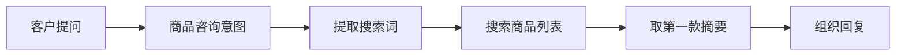
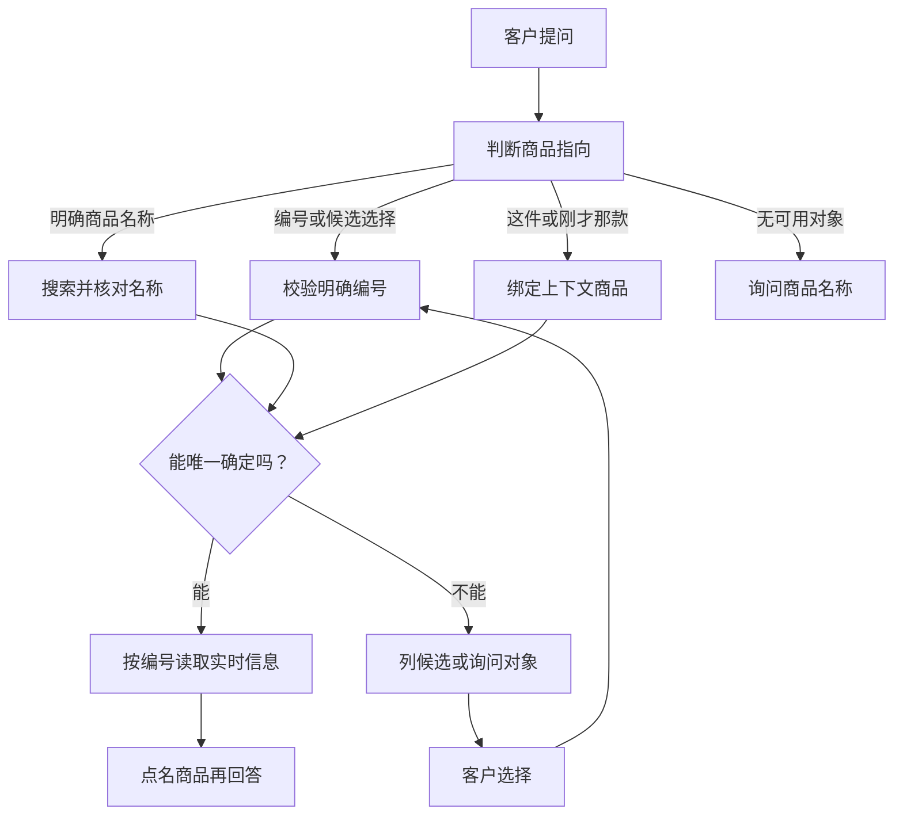

# 商品对象定位：现状与 MVP 设计

> 2026-10-12｜下文保留设计前现状与已认可方案。代码已实现、通过定向隔离验证并加载日常Java／Python；用户手测待反馈。见[实现记录](../../../analysis/05-商品对象定位/商品对象定位实现验收/结果.md)和[手测清单](../../03-评测与问题/商品对象定位手测清单.md)。HTML版保留为设计时快照。

先确定客户问的是哪件商品，再查询它的实时信息。保留 product_query 意图；大模型理解表达，代码绑定商品编号，商品接口提供价格和库存。

## 当前系统怎样工作

页面已有“咨询这件商品”入口，并会传入商品编号。Java 会校验该商品存在，再把编号传给 Python。但商品工具仍按关键词搜索，没有按这个编号查询。

已有商品咨询标签和实时查询工具，可以继续使用。问题在于：找到了相关商品，就被当作已经确定客户问的那一款。

## 问题在哪里

| 情况 | 当前代码行为 | 客户可能遇到的问题 |
|---|---|---|
| 问“轻量露营折叠椅多少钱” | 搜索词缩成“折叠椅” | “轻量”被丢掉，可能答另一款 |
| 在详情页问“这件有货吗” | 编号传入，但工具仍搜关键词 | 可能找不到，而非查页面这件 |
| 搜索匹配多款 | 摘要取第一款，不列候选 | 默认替客户选了一款 |
| 追问“刚才那款呢” | 记忆只有商品名，没有编号和商品候选绑定 | 连续指代缺少确定规则 |

以上是源码可见风险，不代表每次真实对话都会失败。

## 为什么会出现

1. 搜索词提取过粗，只保留类别词，丢掉款式名称。
2. 工具把搜索结果直接变成第一款的回答。
3. 页面编号、会话商品和候选选择没有统一绑定规则。

模型工具参数已有关键词一致性检查。但比较的是粗类别，无法区分同类商品。

补一句“不要答错商品”的提示词不够。传给回答模型的摘要已经只剩第一款。

## 建议流程

明确名称优先按客户说的查，不被页面商品覆盖。客户说“换看另一款”时直接切换；指向发生冲突且意思不明确时才澄清。

“这件”使用当前传入的商品页面上下文。“刚才那款”使用本会话最近明确选定的商品。两种说法分别解析，不把所有指代都套同一个优先级。

多款命中先检查是否有唯一准确名称匹配。仍不唯一才列少量候选。选择绑定本会话已展示的商品编号；越界或失效的选择不能回落到第一款。

## 代码、大模型和页面各改什么

| 层面 | 最小修改 | 职责 |
|---|---|---|
| Python 商品工具 | 分开搜索候选与按编号读详情，移除默认取第一款 | 唯一对象确定后才生成价格、库存摘要 |
| Python 会话上下文 | 保存选定商品编号及待选择候选，不缓存价格库存供追问使用 | “第二款”绑定已展示候选；追问重新读取实时信息 |
| Java 网关 | 复用已校验的页面编号，明确其为咨询入口上下文 | 不再仅依赖拼接进用户文本的编号 |
| 大模型提示词与工具参数 | 保留完整款名，识别指代；只能使用页面或工具已有编号 | 理解客户表达，不编编号，不替客户猜选 |
| 前端 | 复用咨询入口，澄清先用编号文字列表 | 暂不新增商品选择卡片 |
| Java 商品服务 | 复用已有搜索与单商品 GET 接口 | 提供实时商品事实，无需新增意图或商品 API |

保留 product_query 意图。对象是否明确属于同一个咨询任务的不同阶段，不需要新增意图标签。复用现有模型调用，不为定位另增一轮模型。

已有大模型工具路径与代码兜底路径，都必须遵守同一套对象绑定规则。回答应点明商品名称，价格与库存来自同一商品编号。

## 客户会怎样体验

| 客户输入 | 建议行为 |
|---|---|
| 商品详情页：“这件还有货吗？” | 查询页面关联编号，点名该商品并答库存 |
| “轻量露营折叠椅多少钱？” | 保留完整名称，唯一匹配后查询该款 |
| “折叠椅多少钱？”命中多款 | 列出少量款式，让客户选择 |
| “第二款” | 使用刚展示列表中第二款的编号，再查实时信息 |
| “刚才那款还有库存吗？” | 最近选定对象唯一时复用编号，库存重新查 |
| 页面是椅子：“我要问野餐垫” | 按野餐垫查，不让页面椅子覆盖明确表达 |

商品名称来自项目现有初始化资料。表中回复是设计预期，不是新一轮真实模型测试结果。

## 首版取舍与成功标准

先覆盖详情页指向、完整商品名、多结果澄清、候选选择和最近一款的简单追问。通过标准是对象编号正确、同类商品不混价、多结果不默选第一款。

不扩展推荐排序、商品比较、跨会话记忆、复杂描述如“刚才最便宜的那个”，也不引入 SKU 规格模型。现有业务单位是商品编号。

查询失败不得绑定新商品或猜价格库存。失败反馈的完整设计仍放在下一项；统计搜索结果数量前，必须确认查询成功。

后续只做少量关键链路检查，通过即停止。本轮没有改业务代码、调用在线模型或重新核验运行服务。

## 核验依据

本次阅读当前源码，并单独执行现有搜索词提取函数。输入“轻量露营折叠椅多少钱？”实际得到“折叠椅”。没有导入业务执行链，也没有网络请求。

2026-10-07 的 DESIGN-001 隔离检查已记录：搜索返回两款帐篷时，摘要只取第一款，没有候选。该记录是历史证据，本轮源码仍存在相同取首项路径。

源码位置：backend/agent/ecommerce_client.py 的 product_query_keyword；backend/agent/tools/tool_runtime.py 的 search_products；backend/agent/context.py 的 update_memory；Java CustomerServiceGatewayService 的 buildRuntimeContext；ProductController 的按编号 GET。

具体源码：

- [搜索词提取与商品搜索](../../../backend/agent/ecommerce_client.py#L157)
- [取第一款摘要](../../../backend/agent/tools/tool_runtime.py#L155)
- [会话商品记忆](../../../backend/agent/context.py#L132)
- [商城页面编号传递](../../../ecommerce-backend/src/main/java/com/teachdemo/ecommerce/customer_service/CustomerServiceGatewayService.java#L304)
- [已有商品详情接口](../../../ecommerce-backend/src/main/java/com/teachdemo/ecommerce/catalog/ProductController.java#L46)
- [历史 DESIGN-001 检查](../../03-评测与问题/项目评测记录.md#design-0012026-10-07-三份材料与源码设计核验)
