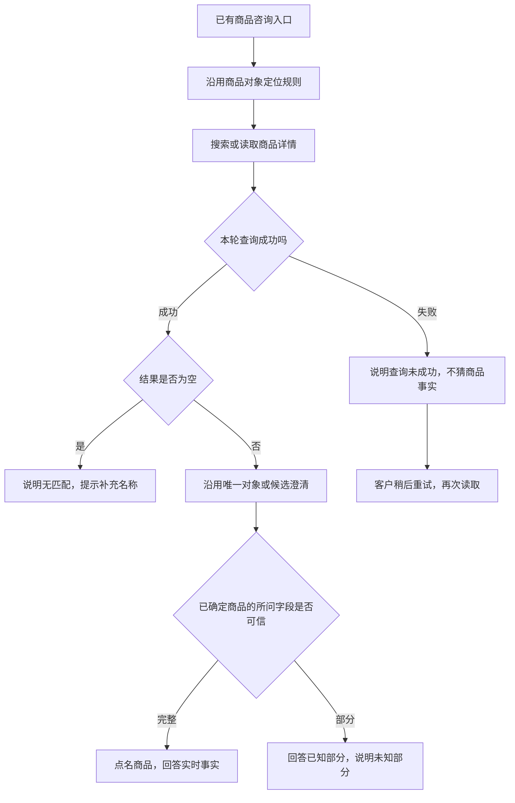

# 工具故障反馈：现状与产品需求规划

日期：2026-10-12。状态：规划完成后已实现，定向验收见 [结果](../../../analysis/06-工具故障反馈/工具故障反馈实现验收/结果.md)。当前停点只维护在 [项目交接](../../01-项目概览/项目交接.md)。下文第 1–6 节是写规划时读到的现状。

用户已说明商品对象定位由另一位 Agent 修改，本项跳过该优化，承接[优先级清单](../../01-项目概览/项目缺口盘点与推进优先级.md)中的第三项。下列现状来自写规划时读到的工作区版本。

## 1. 要解决的问题

**客户需要知道这次是“没找到商品”“确实没库存”，还是“查询没有成功”，才能决定补充条件还是稍后重试。** 查不到事实时不能把未知说成缺货；只查到部分事实时，只回答已核实的部分。

这不是新增业务意图，也不是让大模型更准确地猜故障。实际查询结果由工具判断，模型和页面按结果表达。

本次先覆盖商品搜索与单商品详情查询。订单、物流、售后工具的全面错误治理暂缓；已有资格查询、退款流程、取消执行开关保持既有行为。

## 2. 最新状态与起始版本核验

本轮结束前检测到另一位 Agent 正在更新共享工作区。最新静态读取已看到：商品搜索用 `None` 表示失败、空列表表示零匹配；工具已给这两种情况不同文案，并新增按编号详情读取。本项直接复用，不再重做这部分。此处只核对源码变化，未执行对方完整实现或验收。

最新仍需处理的重点：`_product_summary` 直接拼接可能缺失的价格库存；正常零匹配仍记成工具错误；详情读取把部分无效返回当成 `not_found`；商品工具故障与编排降级状态还需对齐。以对方代码稳定后的定向检查为准，不能在并行更新期间宣称集成已通过。核对记录见[更新后源码观察](../../../analysis/06-工具故障反馈/工具故障反馈设计核验/latest-source-observation.json)。

下表保留本轮起始版本的核验：使用当时现有函数、替换 HTTP 读取做 3 个局部检查，结果见[原始记录](../../../analysis/06-工具故障反馈/工具故障反馈设计核验/current.json)，含源码指纹。在线模型调用、真实业务 HTTP 调用及数据库写入均为 0；不是真实服务故障测试或完整 Agent 验收，也不是更新后的成绩。

| 构造条件 | 当前工具输出 | 问题 |
|---|---|---|
| 搜索成功，结果为空 | `error / product_not_found`，没有查询到匹配商品 | 正常无匹配被记成工具错误，来源还标为不可用 |
| HTTP 读取超时 | 同样输出 `error / product_not_found` | 客户可能被要求换关键词，无法知道本轮查询没成功 |
| 单商品价格已返回，库存为 null | `success`，标价199元、库存 None 件 | 缺失字段被直接当成可展示事实 |

起始版本原因：`products_from_ecommerce` 捕获异常后返回与零结果相同的空列表；`search_products` 无法恢复区别。更新后前两者的结果区分已补，摘要字段核对仍待处理。

编排层已有 `degraded` 和跳过最终回答模型的路径，但商品工具错误不一定同步设置该状态。已有 `degradation_request` 处理客户报告故障或显式演示，不等于系统自动识别了真实商品接口失败。

## 3. 首版产品规则

| 结果 | 客户应看到的内容 | 下一步 | 不应说什么 |
|---|---|---|---|
| 查询成功、正常无匹配 | 没找到符合条件的商品 | 补充名称或款式 | 接口坏了、商品缺货 |
| 查询成功、商品库存为0 | 点名商品，说明当前无库存 | 客户自行决定是否继续咨询 | 查询失败、商品不存在 |
| 读取超时或其他查询失败 | 这次商品信息查询没有成功，暂时无法核实 | 稍后重试，不强迫改关键词 | 商品不存在、缺货、整个系统已停机 |
| 对象已核实，只有部分所问字段可用 | 回答已核实字段，点明未核实部分 | 未知部分可以稍后重查 | 库存 None、旧价格、猜测的活动价 |

单商品不存在／已下架的业务结果沿用商品对象定位规则，不因缺失而查另一款。详情接口404只有在接口契约确认代表该商品不存在时才作此解释；搜索接口异常或未知404不推断所有匹配商品不存在。

“查询失败”只说明这次读取的结果，不承诺具体恢复时间，也不声称已建工单、已转真人或已经修复。

### 3.1 部分事实的回答边界

- 商品编号、名称已核实，价格可信而库存缺失：可以报该商品价格，并说库存暂未核实。
- 库存可信而价格缺失：可以报库存，并说价格暂未核实。
- 商品身份无法核实或返回结构完全不符：本轮不能报价格库存，按读取失败处理。
- 缺少、null或类型不符合业务契约的字段都不能展示为事实；数值0不是缺失。库存负数等无效值也不能当作有效事实。
- 普通标价与活动价分别表述；活动信息缺失不等于确认没有优惠，通用知识库不能补出该商品当前活动。
- 已有记忆或页面价格不代替本轮实时读取；不得在接口失败后用离线演示镜像冒充日常商品事实。

字段是否有效在工具层按现有业务类型判断，不让大模型决定数字是否可信，不新增通用数据质量平台。

## 4. 产品流程

本轮只修改查询返回后的反馈，商品选择顺序、候选快照及指代规则由商品对象定位实现提供，不在这里重做。

失败后不自动重复查询、不循环调用模型、不切换其他商品或默认采用第一款。客户再次发起查询时重新读取；对象和原始问题的保存沿用商品对象定位状态，不另建一份重试任务。

## 5. 最小实现契约

### 5.1 商品读取必须保留成功／失败区别

实施时优先复用另一位 Agent 已增加的结果结构。本规划不要求固定类名或再建一套 DTO，但商品读取至少要区分：

| 信息 | 最少要求 |
|---|---|
| 是否成功完成查询 | 明确为成功或失败，空列表不能同时代表两者 |
| 成功数据 | 搜索列表或单商品对象，允许成功列表为空 |
| 失败类别 | 可区分超时与其他读取失败；结构错误属于读取失败 |
| 来源 | 业务接口或显式离线演练，不能把成功零结果标成接口不可用 |
| 缺失字段 | 已确定商品哪些所问字段尚不能核实 |

HTTP成功但业务响应 `success=false`、JSON解析失败或结构不符，均不能进入“成功零结果”。不要把公共 `ecommerce_get` 的行为大范围改写，影响订单与售后；优先在商品读取边界补必要契约。

### 5.2 工具记录与回复必须一致

复用已有 `ToolCallTrace`、Hook、Trace 和编排降级字段：

- 正常空搜索：工具 `status=success`，业务结果无匹配；可以 `next_action=ask_clarification`，但不是服务故障，不计入工具失败。
- 多款待选：工具成功、对象待澄清，继续由商品对象定位处理；不是故障。
- 查询失败：工具 `status=error`，记录真实类别，不再统一写 `product_not_found`；编排同步 `degraded=true` 和对应原因。
- 部分事实：读取成功，记录缺失字段；摘要不包含未经核实的字段。不要为了标注部分信息增加新的顶层意图或通用状态机。
- 库存0：读取成功、事实有效；不存在工具故障或未知库存。

最终摘要只使用工具核实的内容。故障、无匹配和未知字段的话术优先由代码生成，利用现有跳过最终回答模型的路径；不让模型把超时改写成缺货。部分回答若仍经过模型，只提供已核实事实及明确的缺失字段约束。

客户说“页面报错／接口不可用”仍是客户报告，并非已经核实的服务中断；保留已有这项边界。不要为真实工具失败强制把客户意图改成 `degradation_request`，任务仍是 `product_query`。

### 5.3 会话与页面不新增副作用

失败不写入新商品选择，不使用旧查询事实回答。若对象编号已明确，可以保留该指向供客户再查；不能借失败改绑定另一款。

商品读取失败、部分回答及无匹配回复沿用商品对象定位的只读返回路径。它们不触发退款续接，也不改变旧草稿或确认卡活动凭证。已有的 Java 全链路兜底保持有效，不新增按钮或单独的故障页面。

## 6. 与另一位 Agent 的并行衔接

两项可以并行设计，但商品读取代码并非互不相关。实施前先读取商品对象定位最终差异，不覆盖其接口、候选解析或现有检查。

| 责任 | 商品对象定位 | 工具故障反馈 |
|---|---|---|
| 确定商品编号 | 负责 | 复用，不重做 |
| 搜索／详情读取 | 提供对象查询入口及最少成功／失败区别 | 补齐错误类别、缺失字段和反馈一致性 |
| 候选与简单追问 | 负责 | 不改变候选规则，不建重复状态 |
| 商城只读返回、旧退款卡 | 提供商品专用返回边界 | 让失败和部分结果也覆盖该边界 |
| 验收 | 对象是否选对 | 查询结果是否被如实表达 |

若前项已经实现“正常空结果与读取失败分别返回”，本项直接复用；不能为了本规划再加第二个商品读取结果结构。两个阶段各自的测试成绩分别保存，不把对象检查通过写成故障反馈也已通过。

## 7. 修改位置与顺序

1. **商品客户端：**核对最新 `backend/agent/ecommerce_client.py`，保持正常空数据、读取失败和详情业务结果的区别。
2. **工具摘要：**在 `tools/tool_runtime.py` 的商品工具及前项新函数中处理失败、零结果和缺失字段；只输出可信值。
3. **Agent编排：**在 `customer_service_agent.py` 同步故障标记及最终话术约束，覆盖现有 LangChain 工具执行与代码兜底。不要只修一种调用路径。
4. **相关契约：**检查 `tools/langchain_runtime.py`、Hook、Prompt及现有商品返回标记是否适配；结构无需变化时不改。
5. **验证：**增加下节少量定向检查和必要的商城页面核验；通过即停止。

不新增模型、意图、依赖、后台监控、自动重试、熔断系统或完整告警平台。Java／前端原则上复用商品对象定位改动，只有失败回复遗漏该边界时做最小补齐。

## 8. 定向验收与停止条件

仅冻结以下6组，不扩展全量模型评测。使用隔离 HTTP 替身和合成商品，不向日常服务注入故障。

| 编号 | 输入／条件 | 必须观察到的结果 |
|---|---|---|
| F01 | 同一问句，搜索成功返回空列表 | 回复无匹配并提示补名称；工具成功，非服务降级 |
| F02 | 同一问句，分别注入读取超时和HTTP服务错误 | 回复本次查询未成功，建议重试；非商品不存在／缺货；工具与降级记录一致 |
| F03 | 成功返回同一商品，库存0 | 正确说明当前无库存；不报故障或未知库存 |
| F04 | 商品身份有效，分别缺库存、缺价格，以及标价0 | 只回答已知部分，点明未知字段；0保留为有效数值；不输出None或旧值 |
| F05 | HTTP成功但业务失败、JSON／结构错误 | 按读取失败处理，不能伪装成成功无匹配 |
| F06 | 已有商品指向及未提交退款卡，商品读取失败后再次查询恢复 | 失败不改变退款草稿或卡；恢复后仍查原对象，读到新事实，不使用失败前旧值 |

F02和F04至少在模型工具路径与无模型兜底各核验一次，避免只改摘要而遗漏编排。使用固定模型故意返回“缺货”等错误说法时，最终回复不能覆盖真实的读取失败结论。

如果 Java／前端没有新增改动，复用前项已有的只读返回验证，仅追加一条“商品查询失败→恢复”页面链路；每次操作后截图。不要逐组重复浏览器测试，也不把固定模型检查当成真实模型效果。

交付实际输入、回复、工具结果和故障类别。通过后停止，不为通用订单错误、模型故障或复杂组合咨询扩大本轮范围。记录放在 `analysis/06-工具故障反馈/工具故障反馈实现验收/`，本轮 `设计核验` 不计入修改后验收。

### 当前停点

以下是写规划时的停点，已被实现和定向验收取代，不要再当成待办。当时完成了源码分析、3个局部现状核验及产品规划，尚未改业务代码。商品对象定位和这项验收的当前状态以 [项目交接](../../01-项目概览/项目交接.md) 为准。
