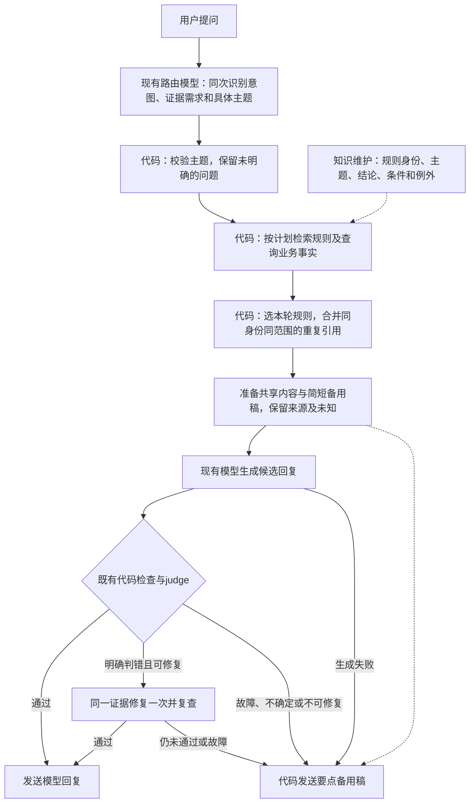
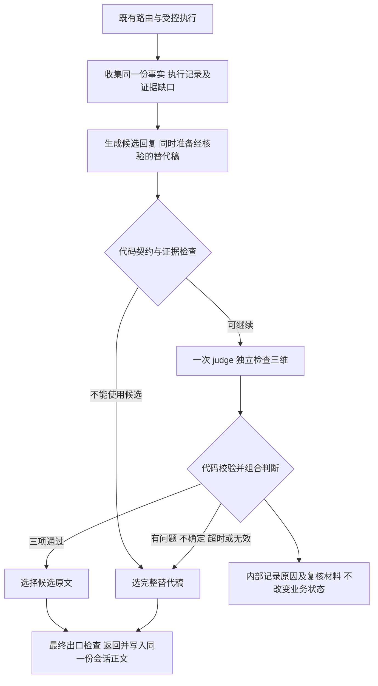
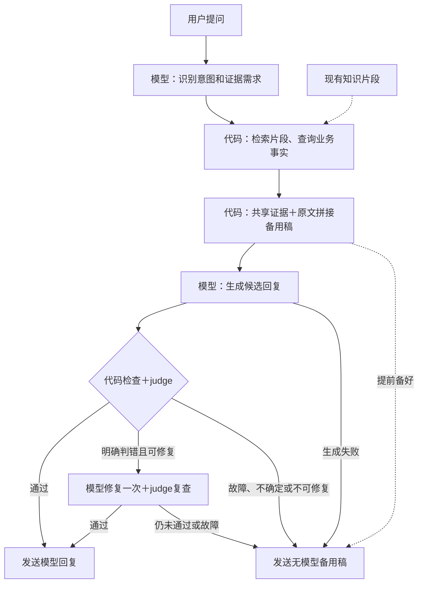
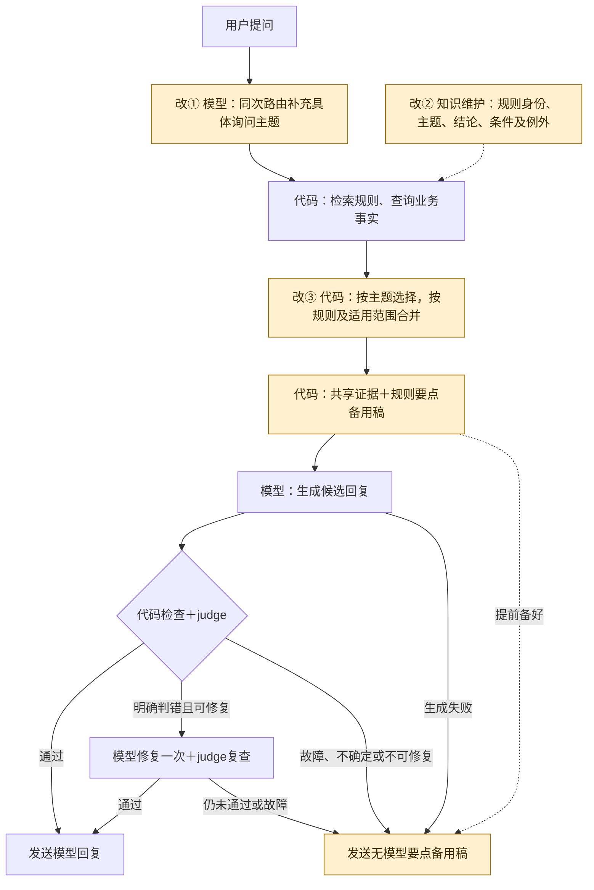

# 回复内容选择与备用答复产品需求文档

> 2026-10-17新变更入口：[MULTI-READ-001：多个只读问题与售后插问](../02-意图与政策咨询/多个只读问题与售后插问产品变更需求.md)为后续多需求规划／取证／状态的主规范，目前仅文档、未实施。本文第0章完整规则、依据、生成／修复／备用内容契约继续有效；既有内容选择已本地实施，真实小批仍未通过，不能据本文早期“主意图兼容”约束继续丢弃新规范内的跨域只读需求。

> 2026-10-17 实施更新：已取得本轮编码指令并完成本地接入与281项离线后端检查；真实模型识别／答复质量、日常加载及页面／Java历史一致性未验收。跨类别备用稿顺序已有工程测试，真实主题／顺序识别与自然表达仍未测，不将整项质量验收标完成。详见[ANSWER-CONTENT-001结果](../../../analysis/07-不支持业务与人工入口/ANSWER-CONTENT-001/结果.md)。下方“尚未实施”保留为编写本需求时的状态。

日期：2026-10-17｜当前版本：v0.2｜需求编号：ANSWER-CONTENT-001｜状态：**流程方向已确认，编码前产品需求已整理；本次变更尚未实施或验收。**

本文供 Coding Agent 在修改代码前阅读。用户认可本轮展示的流程，要求根据需求变更及已确认点编写产品需求文档。本轮交付仅为文档，不代表业务代码修改、真实模型新评测或日常部署已完成／已获本轮执行指令。

**阅读顺序与优先级：先读第0章完整的v0.2实施要求，再按源码地图核对当前代码。后面的历史设计、6.7一次修复及6.9两张对比图保留作为来源；与本次内容选择要求冲突时以第0章为准。生成／judge／最多一次修复的既有安全边界继续沿用，不因内容组织变更而放宽。** 不按历史章节的“未接judge”“3秒”“尚未加载”等旧时点描述改回当前服务。

## 0. 本次需求：先选对内容，再生成或兜底

### 0.1 问题、目标与事实依据

顾客只问“优惠能否叠加、支持到货提醒吗”，不应在最终回复中反复读到同一叠加规则，也不应被附带要求理解退券、延期等未问事项。顾客只问退款到账，应先获得当前可确认的到账边界，而不是被带入整套申请流程。

当前已观察到：正常混合咨询和错误首稿后的真实修复可读；judge故障后的无模型备用稿709字，含三段相近叠加结论及无关规则；退款到账正常生成也出现无关扩写。四条流程与事实／动作边界4/4，体验2/4。这是离线检索、固定计划、业务fixture下的真实生成／judge小样本，不是生产表现。来源：[四条结果](../../../analysis/07-不支持业务与人工入口/BC029-四条跨出口验收/结果.md)、[冻结输入](../../../analysis/07-不支持业务与人工入口/BC029-四条跨出口验收/frozen.json)、[原始响应](../../../analysis/07-不支持业务与人工入口/BC029-四条跨出口验收/results.json)。

已确认的机制缺口：有效引用片段兼任顾客正文；备用稿只按整块文字去重；正常生成／修复／最终兜底没有共同的内容选择结果。多主题材料对正常生成偏题的具体因果贡献仍待对照，不认定某一句Prompt是唯一根因。现有judge只检查漏答、事实冲突、无依据执行或代办承诺，明确不评价一般重复与冗长。

本次目标：**围绕本轮问题选择完整规则，合并同一规则的重复引用，使正常回答、一次修复与最终无模型备用稿共同保留直接结论、必要条件／例外及未知边界。** 不是单纯缩短字数，也不是扩大支持的业务能力。

### 0.2 已确认的分工与不变项

| 工作 | 本次责任分工 | 必须保留的边界 |
|---|---|---|
| 理解用户具体想问什么 | 现有路由模型同一次调用补充询问主题 | 识别问题，不认定业务事实、资格或执行成功 |
| 确定哪些属于同一规则 | 知识维护时明确规则身份、主题、适用范围和完整条件 | 不能让运行时模型按相似措辞猜同一规则；不全归因于代码 |
| 选取与合并规则 | 代码按受控主题选规则，按规则身份及适用范围合并 | 不按关键词、标题、相似度或样本编号删除内容 |
| 自然表达 | 现有最终生成；明确判错时仍最多一次修复 | 使用同一份受控内容，不补造事实或重跑工具 |
| 回复检查 | 既有代码契约及三维judge | 不扩大为文风评分器；pass不等于完整体验合格 |
| 最终备用稿 | 代码根据同一组规则要点和业务事实组织 | 不再直接拼接全部引用，不再自由生成，不使用未检查候选自证可信 |

不新增独立的内容筛选模型、润色模型、第二个judge或Agent。路由仍复用原调用；最终生成最多两次（初稿＋一次修复），judge最多两次。业务工具、Embedding及原工具选择模型是否调用继续由既有计划决定，不把这些都算作“全请求最多五次”。零自动重试原则不变。调用次数不增加不代表token、时延或维护成本不增加，需分别记录。

### 0.3 范围与非目标

实施范围：现有只读咨询中的政策／商品知识，以及它们与商品事实、能力支持查询的混合回答；本链路的正常生成、一次修复、最终无模型出口。以现有六份受治理知识为边界：退款、签收退货、活动、会员、商品、发票。规则主题从这些材料实际支持的内容提炼，不新增政策。短知识不为统一形式扩写无关内容。

排查既有跳过最终模型的知识答复出口：若也直接输出相同知识原文，须复用本次内容组织；不能保留一条会再次堆叠原文的同类路径后声称全出口完成。澄清、缓存、安全拒绝、资格查询、售后确认卡和高风险Workflow保留原职责；不得将这些路径强行纳入judge。off／shadow／enforce语义不变，未检查的回复不标“judge通过”。

本期不做真人接管、换货／提醒新能力、自动取消放量、数据库迁移、新知识管理后台、全文任意语义去重或统一任务编排。模型、凭据、取消开关及阈值不因本需求更换。

### 0.4 目标流程与相对现状的改变

原流程与推荐流程的两张图保留在[第6.9节](#69-现有与推荐流程对比2026-10-17推荐未实施)；该节“推荐未实施”描述代码状态，不再表示用户尚未认可流程方向。

选择主题与规则是增加到原有组件的职责，不是新模型阶段。备用稿仍在生成前准备，judge故障后不再经过模型润色。主题不明确时，保留明确且可回答部分，必要时追问剩余问题；不得以“没识别到主题”当作“用户没问”或“业务不支持”。

### 0.5 F1：询问主题与路由契约

1. 区分大类知识域和具体询问主题：“售后政策”是知识域，“退款到账”“退款条件”是不同主题；具体ID命名由实现者按现有风格确定。主题表以现有知识支持的业务含义为依据，不维护问句→固定答案表。主题及规则映射须有唯一维护入口，不在路由、检索和备用出口各抄一份。
2. 同次路由输出须覆盖本轮明确的多个主题；优惠叠加与退券被同时询问时都保留。顾客补充“那多久到账”等短句时沿用现有合法会话上下文，不回退到只看当前短句，也不把旧主题永久追加到新问题。
3. 模型只提出主题；代码校验受控ID、类型、重复、与既有计划的兼容。新增主题字段缺失、显式空集合、未知值或格式错误的语义须区分并有测试，不能全部默认为“没有知识需求”。新增字段局部失效不应无条件破坏仍合法的主意图、能力计划和已有待办。
4. 主题缺失或不能明确时，不追加模型调用猜测、不补关键词特例。已明确的商品／能力等事实继续回答；其余按缺口澄清或说明尚不能确认。已存在的确定性路由回退可以复用，但不能伪称获得了模型主题判断。
5. 原始请求、必要历史及未覆盖需求继续进入审阅，不把主题清单当完整人工金标。模型漏主题可能造成漏答，结构校验不能保证语义正确，必须以原始问题验收。
6. 当前路由输出上限为256 tokens，新增字段须检查截断风险。优先控制字段体积；如确需调整输出上限，应以结果解释调整范围与成本，不顺带替换模型、开启思考或增加请求。

### 0.6 F2：规则单元与知识维护契约

下面是最小产品信息要求，不强制新建类、服务、JSON文件或第二套政策库；在现有知识源和加载流程中选择最少结构承载。 本章字段要求与验收拆分是助手据已确认方向补足的实施约束，不表示用户逐个签定了技术字段；具体命名及存储形式留给实现者。

| 信息 | 业务含义与约束 |
|---|---|
| 稳定规则身份 | 标明是哪条业务规则，独立于段落顺序、标题措辞和chunk序号；不同条件不是靠文字相似就等同 |
| 对应主题 | 可回答哪些受控主题；多主题内容须拆为独立完整规则，或明确各项绑定关系 |
| 结论及必要条件／例外 | 构成完整可发送单元；不能只召回“可以叠加”而丢掉券种限制；未知与未支持也不能混为一谈 |
| 适用范围 | 沿用政策范围、对象和渠道；范围不同的规则不自动合并 |
| 来源与版本 | 可回到唯一政策原文；保留policy_id、版本、有效期、发布状态、快照及引用定位 |

在知识维护时确定规则身份和主题，保留现有业务规则、金额、条件、例外、安全建议及演示边界，不把整理结构当成改政策。跨文件重复规则应引用同一业务身份或规范来源，来源可合并，但不得维护两套容易漂移的同义政策正文。不同版本或范围不能仅凭同一ID覆盖；冲突需显式暴露，不默认采用“第一条”。

加载及切分必须保住规则与条件的绑定：当前约220字、重叠30字的切分不是完整业务单元保证。检索命中规则的局部片段时，应从同一已加载有效快照取回该完整规则，不能将切断的结论直接发送。不得通过固定扩大top_k或截取前N句假装完整。未标注／无效身份／条件无法绑定时，记录对应内容缺口，不退回原文整段兜底。

沿用已有发布校验和缓存治理：内容或结构改变时更新相应版本与release-manifest；主题映射、规则身份及切分策略的变更也必须使相关索引／检索结果缓存失效。缓存键应覆盖实际影响选取结果的主题及规则版本等输入；同一句不同主题／同主题不同有效时间不得错误共用。修改磁盘或reset索引不等于完成日常加载。

### 0.7 F3：选择、合并与共享内容

先验证来源／时间／范围，再按本轮主题选择规则；既有商品／订单／能力事实继续按原可信来源处理。结论成立所必需的条件和例外随规则保留，即使它们的关键词没有出现在问题中；“不额外展开其他政策”不能变成“删除所有用户未逐字问到的条件”。

只合并同一业务规则、兼容适用范围和同一有效版本的重复引用，合并出处但只表达一次结论。不同条件、相反状态、不同对象或时点必须分开。禁止模糊文本相似度去重、按标题／词句／案例编号删内容。不能因为知识中有一段退券说明就一律删除：用户明确问到时，必须可选择并回答。

共享内容至少能够关联：本轮已明确的问题、对应有效规则／事实、未确认事项及来源。正常生成、一次修复、最终备用稿消费同一选择结果；原始请求始终保留。原始候选、采用及未采用证据的选择依据在既有有界内部审阅中可追溯，公开Trace不泄露失败草稿或真实敏感数据。

`verified_summary`不是免检可信来源。如果它仍含被排除的无关规则，不能与选好的内容一起塞回生成；应从本轮选中证据导出，或保留其明确受控事实并核对对应来源。顾客引用指向实际使用的规则及其完整依据；完整原始材料可留在出处与内部审阅中，不再自动成为顾客正文。

### 0.8 F4：生成、修复和备用稿的共同规范

所有目标出口遵守：按本轮问题顺序先给直接结论，再给影响成立的条件／例外及对应未知；有必要且有依据时才给下一步。不为了凑格式给每项固定四段，不强制新增确认话术。同一结论充分说明一次；不同条件不合并；多问题不漏答。保持自然完整表达，不用机械关键词堆砌。

生成和修复沿用现有模型及流程，不增加独立的内容筛选或润色调用。修复沿用同一证据和选择结果，不重取业务事实、不重跑能力／入口查询；失效／未知材料不因重写变成事实。生成／judge的格式与安全校验继续保留；模型发现原问题还有未覆盖需求，不能编造依据补齐，须准确表达缺口。

无模型备用稿由代码从完整可展示规则及受控业务事实组成，不直接拼接所有citation，不发送被拒绝候选，也不把它换字段名当summary发送。可以更朴素，但仍需回答可回答部分、保留必要限制和未知；不能用统一“系统异常”吞掉已确认价格、政策或支持状态。没有对应规则时，只对该事项说明未确认；不把知识缺口说成能力不支持，不虚构人工已经接手或操作已经完成。

### 0.9 F5：失败类别与处理边界

| 情况 | 需要的处理 | 禁止行为 |
|---|---|---|
| 主题缺失／不明 | 保留合法原路由、已知部分与缺口，必要时澄清 | 空主题当无需求；退回全部原文；新加模型猜测 |
| 主题明确但没有有效规则 | 已取证事实保留，该项标未确认 | 凭常识补政策；无知识等于业务不支持 |
| 同规则跨来源重复 | 同身份同范围同有效版本合并，出处仍可查 | 仅按字面相似删除不同规则 |
| 同身份来源冲突或条件丢失 | 阻止形成自相矛盾的确定结论，记录具体缺口 | 静默取第一条；仅保留最短句 |
| 内容明确判错且可修复 | 最多一次修复＋复查，复用同一证据 | 重跑工具、继续循环、绕过复查 |
| judge不可用／不确定 | 发送同一已核实内容的无模型要点稿 | 判定原模型稿必然错误；再次自由生成后直接放行 |
| 生成不可用或修复仍失败 | 使用相同备用出口，保留事实与未知 | 空回复、半条答案、把原文堆叠恢复为最后出口 |

本节不扩大现有修复资格，不把证据缺口默认改为可修复；执行授权、用户确认、审批、幂等和草稿状态始终由原业务层控制。

### 0.10 实施影响地图与最小交付

Coding Agent先记录当前HEAD和未提交改动，追踪调用方，再决定最小文件集合；以下是核对入口，不是要求每个文件都改。源码行号按本次读码时点，实施时以实际符号为准。

| 组件／入口 | 本次需核对的内容 |
|---|---|
| `backend/api/schemas.py:66` RoutePlan | 主题及缺口如何随现有计划传递，兼容缺失／空／非法值 |
| `backend/agent/models/router_client.py:18`、`:57`及`:111`，`backend/resources/prompts/route_contract.md` | 同次输出主题、严格解析／回退、上下文续接、截断风险；不能只改Prompt |
| `backend/agent/tools/planning.py:145`、`customer_service_agent.py`计划调用方 | 计划校验和咨询状态保留，不能因主题字段影响售后待办／候选 |
| `backend/resources/knowledge/`六份知识及release-manifest | 唯一来源、规则与主题标注、条件保留、版本与发布 |
| `backend/retrieval/documents.py:60`、`:102`；`hybrid_retrieval.py:117`、`:141`、`:255` | 加载、完整规则取回、检索与缓存治理；查询时间和范围校验继续有效 |
| `backend/retrieval/knowledge.py`及其他直接知识出口 | 从选中内容组织说明，排除旁路原文堆叠和旧summary回流 |
| `backend/agent/answer_review.py:36`、`:97`、`:159` | 共享内容、来源与缺口核对、按规则合并及最终备用稿 |
| `backend/agent/customer_service_agent.py:1316`、`models/answer_client.py`及final_answer_style | 生成与修复消费同一内容，调用计量与出口不分裂 |
| `backend/agent/models/judge_client.py`及answer_judge | 继续核对原请求与证据，不把精简内容误称现实事实齐全；不新增文风维度 |
| `backend/tests/`相关测试及fixture | route／planning／metadata／retrieval／product knowledge／capability／judge及直接出口，至少覆盖下表 |
| `frontend/src/components/TracePanel.tsx`和下游API消费者 | 若共享契约变化影响类型或解析则同步最小兼容；本期不要求新增界面或改Java业务 |

交付必须包含实际调用方／契约／数据／fixture／测试的完整变更，不能只补一个独立helper却不接主链路。优先复用现有文件、标准格式和已装依赖，不新增无必要的服务、配置层或第三方库。先明确逻辑契约再选择存储格式和命名，不把本文的产品信息表强行转成新平台。

### 0.11 验收矩阵：按失败类别与相邻场景验收

下表是本次编码前标准，**尚未运行**，不是新增通过成绩。实现者需在真实调用前冻结输入、历史、规则版本、模式及预期，保留同条件前后对照；自然与注入、工程与语义分别统计。例句用于说明意图，不要求逐字固定输出。

| 编号 | 场景与必要条件 | 可观察的验收结果 |
|---|---|---|
| AC01 | 原活动叠加＋到货提醒及相邻改写 | 两项均回应，条件保留，不重复堆叠或整段带入退券；原请求不被主题替代 |
| AC02 | 同一问题首稿注入无依据登记承诺 | 拒绝后真实或固定修复分层验证；一次修复＋复查，工具／能力／入口不重跑 |
| AC03 | 同一问题judge超时／非法返回／不可用 | 正确使用规则要点备用稿，无第二次自由生成；本地注入不能计自然超时率 |
| AC04 | 退款到账、退款条件、退款流程三种独立问题 | 各自先答所问，必要边界保留；不能把统一短模板误用为三题同一回复 |
| AC05 | 没问退券与明确同时问退券的成对问题 | 前者不带入无关整段，后者能回答；不是永远删退券内容 |
| AC06 | 同规则在多来源、不同措辞、不同标题出现 | 同身份同范围同版本只表达一次，来源完整；换标题不改变结果 |
| AC07 | 相似结论但范围、条件、对象或时点不同 | 不错误合并、不丢必要条件；冲突显式暴露，不凭最短或第一条定结论 |
| AC08 | 规则跨chunk且例外在后半段 | 取回完整规则再回答；不能只有结论；原始来源仍可查 |
| AC09 | 缺主题字段、显式空主题、未知ID、格式错和无模型路由 | 行为分别符合F1；不吞原意图／待办，不堆全部原文，不额外调用模型 |
| AC10 | 多问题＋部分规则缺失／过期／撤回／能力unknown或查询失败 | 已知保留，对应未知单列；无知识／故障不冒充unsupported |
| AC11 | 多轮追问、换主题、旧商品／售后待办共存 | 正确续接当前问题，不把旧主题永久累加，不更换订单或清理合法草稿 |
| AC12 | 生成失败、修复失败及直接知识降级出口 | 同一内容规范，无旁路原文堆叠；只发送最后正文，卡片与会话历史一致 |
| AC13 | 政策／主题映射版本变更、缓存命中及有效期边界 | 不返回旧选择结果或过期规则；索引、规则和快照版本可追溯 |
| AC14 | 商品价格／库存＋政策＋能力支持的混合咨询 | 受控事实、通用规则和具体适用分清；不丢已知、不编造登记／提交／接手 |
| AC15 | off／shadow／enforce及既有安全／澄清／高风险路径 | 模式含义、修复门槛、授权与状态不变，未检查不标通过，无真实业务写入 |
| AC16 | 发票短知识、商品使用／安全、签收退货等非活动领域 | 规则与条件保持，无结构迁移漏答；改进不只覆盖旧四条，新增同义／边界样本单列 |

语义验收分别判断：需求是否回应、事实与动作边界、条件完整性、相关性／重复、流畅度。硬性事实／权限错误不能被文风分抵消；judge三维pass不替代人工体验判定。每条首次失败保留，不为了4/4修改标准或重复运行挑好答案；条件一致时才比较前后结果。

至少交付相关离线检查及完整后端回归；历史257项只是上轮证据，不写作本次通过数。真实模型验证需另冻结新运行范围和预算，覆盖现有路由主题识别到选择再到最终出口；仅手工设置主题调用compose不能证明路由已接通。记录模型／Prompt／知识版本、选中规则、缺口、最终来源、实际HTTP次数、usage与时延；SDK观测必须覆盖httpx与httpx2。页面与Java／MySQL未测时单列，不用离线／fixture成绩替代。

### 0.12 Coding Agent执行顺序、权限及完成定义

1. 阅读第0章、交接、相关源码与调用方，保存本地基线；保留既有未提交文档、日志、`.claude/`及其他改动，不reset／clean或覆盖历史证据。
2. 在现有组件中落实主题、规则单元与共享内容的最小逻辑契约，列明六份来源的规则／条件对应及必要依赖；格式、ID命名、文件落点由实现者自行选择并说明，不为常规实现细节反复请求用户决定。
3. 先复现类别问题，再修改知识组织、路由／选择、三类出口及受影响契约；成对测试不仅验证旧Bad Case，也验证该省略与该保留的相邻输入。禁止Case ID分支、例外文案、同义关键词补丁或固定长度截断收尾。
4. 跑受影响检查及完整离线后端回归，修复本次引入的问题后重跑；通过即停止。旧失败／环境阻塞分别说明。需要改前端共享类型时运行相应类型／构建检查，不做无关UI扩展。
5. 更新实际实施差异、验收结果、未测边界和唯一当前停点；对照AC01—AC16逐项提供运行或未运行证据，不能把需求文档完成当功能完成。保留旧冻结runner、输入、标签和成绩；新运行使用新编号。

本轮用户要求是编写编码前文档：不据此启动代码修改、外呼、服务重启、日常配置切换或部署。后续取得实现指令时，可在其范围内完成本地修改和离线验证；真实模型数据外发／预算、日常服务加载及业务写入仍按实际授权分别判断。不得修改凭据／`.env*`，不切模型、取消执行开关或阈值，不操作真实订单、售后、资金、真人客服或对外发布。

**需求完成定义：** 不是单个答案变短，而是已实现同次主题识别、完整规则治理、受控选取／合并、三个出口共同内容规范；跨类别验收无事实／动作边界退化，必要条件不丢，正常和故障回复均相关、完整、可读；运行证据、费用／时延边界与未测部分如实交付。若只能完成部分，不标整项完成。

## 历史设计与证据（v0.1及后续讨论，保留原时点）

以下原有章节、数字和“已实施／未实施”均按各自日期阅读，供理解取舍与追溯；本次实施要求与授权边界以第0章为准。

日期：2026-10-16｜版本：v0.1｜状态：**已完成代码接入、pass字段契约修复及237项工程检查；首次真实judge独立评测53/54保持原分数。用户确认放松ISO03标准后，隔离验收V2自然5/6、注入门控4/4，原4/6另存；ISO06漏检、备用呈现及监控缺口仍在，尚未加载日常门控**。见[实施结果](../../../analysis/07-不支持业务与人工入口/回复检查分工实现验收/结果.md)、[真实评测](../../../analysis/07-不支持业务与人工入口/真实Judge独立评测-001/结果.md)和[隔离验收V2](../../../analysis/07-不支持业务与人工入口/隔离完整流程验收-001/结果.md)。

> 下文保留规划时点的建议与证据。“尚未实施”“当前无judge”等表述按规划时点理解。后续已完成66次真实独立评审和十条隔离Agent门控；隔离使用构造业务接口，不能外推Java/MySQL/商城或日常enforce已验证。具体范围和限制以上方报告及项目交接为准。用户后续已明确授权按本PRD改代码，不再将编码视为待授权事项。

### 2026-10-16 补充决策：方案一与用户主动转人工

实施以[ISO06／BC-027修复说明书：方案一可执行契约](ISO06-BC027修复说明书-方案一可执行契约.md)为本次增量依据，包含拟新增入口策略来源、共享证据、生成／judge／备用稿约束和20组验收场景。说明书完成不代表业务修复完成；原实现及V1／V2成绩保持各自时点。

用户已选“统一业务边界、模型自然成文”的方案一。保留工具失败时澄清或引导转人工的规划；澄清应能补齐实际缺口，人工路径由用户在对话框要求并通过既有卡片确认前往，不能让助手收集联系方式、代提交资料或承诺真人进一步核实。入口已预留，真实人工仍未开发完成。

生成及judge必须区分：当前渠道有没有入口、谁发起／确认前往、是否真实受理／接手。允许有依据地提示用户在对话中要求人工，允许用户主动要求后的确认卡；不因真人接管尚未实现就把这些入口引导判为无依据承诺。进入占位页也不证明已转接、排队或受理。继续沿用[既有人工出口PRD](不支持业务清晰出口产品需求规划.md#42-占位页与可扩展位置)的文案分工：对话及确认卡按预留流程表达，仅目标页提示开发中；不因此允许虚构留资转交、回电或实际接手。

拟议共享上下文须由业务事实提供入口、动作主体、阶段及可用状态；human_takeover=unsupported描述当前真人接管，不能直接等同“没有人工入口”，也不能为支持入口而把真实接管改成supported。普通办理、通知和申请同样区分入口／条件／执行状态，不新增转人工关键词特例。当前只同步规划背景，尚未实施本次方案一增量。

本次需求：围绕[人工复核样本 G01—G24](../../../analysis/07-不支持业务与人工入口/规则Jev大模型评审对比/人工复核样本.md)，规划关键漏答、状态冲突、未执行承诺如何由代码和语义 judge 分工。本文承接[统一最终答复规划](统一最终答复产品需求规划.md)，提出下一阶段变更；不回写历史实验标签、结果或旧版验收成绩。下文“应当”“建议”“目标流程”均为拟议要求，当前运行时仍无回复 judge。

## 1. 产品判断

**需要代码检查，也需要大模型语义检查；应按检查对象分工，不能把三类问题各自简单分配给某一种技术。**

- **代码守住可验证的事实、权限和程序契约**：查的是谁、哪笔订单、哪个时点，接口成功还是失败，动作是否有可信回执，结构化状态是否合法，输出是否为空或解析失败。执行前的授权与确认继续由原业务层控制。
- **judge 理解候选回复在说什么**：两个问题是否都回应，是否把渠道支持说成订单符合条件，是否把历史已提交说成本轮新提交，是否隐含承诺持续盯库存，以及否定、条件和同义表达。
- **代码决定如何处理检查结果**：有问题或判不清时选择一条基于证据的替代回复；judge 不执行动作、不改变订单状态、不生成第二份直接发送给顾客的正文。

本期建议采用**一次大模型调用、三个独立判断**。优先以已经做过本题实验的 DeepSeek Flash 为候选，不同时串联 Jev 和大模型，不拆成三个 Agent。Jev 保留为后续成本／速度优化候选，本期不接入。

必须挑战两个前提：第一，代码“知道订单状态”不等于代码能可靠理解自然语言里的状态宣称；第二，给现有文字规则再补几个关键词，不能解决 G07、G17、G19 的同义、历史和否定误拦。代码从 judge 获得的语义解释也可能出错，后续字段比较不能把这部分变成确定性证明。

### 1.1 为什么现在值得规划，为什么还不能直接上线

| 依据 | 已有发现 | 能支持的判断 |
|---|---|---|
| 原冻结实验 | 24 条：6 条保存的模型回复、18 条构造样本；规则／Jev／大模型整体决定一致为 16／21／23 条 | 当前文字守卫覆盖不足；大模型是值得继续验证的语义方案 |
| 运行后复核 V2 | 同一批旧输出重算为 16／22／24 条；三维全对为 12／17／21 条 | 拦住原文与判对原因不同；24/24 不是新模型或新 Prompt 的独立成绩 |
| 规则具体误差 | G03 口径过严；G07 同义拒绝误拦；G17 历史动作误拦；G19 否定误拦；G09 漏价格、G21 资格冲突漏检 | 收缩文字规则职责，补全 judge 的业务证据 |
| 候选 judge | 大模型原运行 P50/P95 为 1.067/1.297 秒，Jev 为 0.515/0.604 秒 | 增加同步检查有实际延迟；新输入和输出更完整，必须重新测量 |

证据：[原结果](../../../analysis/07-不支持业务与人工入口/规则Jev大模型评审对比/结果.md):9—30、[V2 结果](../../../analysis/07-不支持业务与人工入口/规则Jev大模型评审对比/复核重算结果.md):3—43。六条保存回复和候选 judge 同为 DeepSeek Flash，存在同模型偏差；样本偏重边界，不能外推生产准确率。费用账单未核验。

## 2. 范围与成功标准

本期覆盖已有最终模型生成的只读咨询回复：服务支持范围、商品价格／库存、政策及这些问题的混合咨询。历史申请状态、具体订单资格作为评审证据与回归场景；不因此改写原申请、确认、审批、退款流程。

成功标准：

1. G03、G07、G17、G19 等合格表达不因固定词句缺失而被替换；G08/G09 的两个方向漏答都能发现。
2. G10/G11/G21 的范围、查询状态和订单资格冲突，以及 G04/G13/G14/G15/G21 的无依据动作陈述能被拦截。
3. G22/G23 能区分“业务未知”“生成时没有依据”“评测材料漏采”，不能把缺记录写成没执行或不支持。
4. 拦截后最终回复仍回答已经明确且有证据的问题。价格＋提醒的回复不能降级到只剩价格或一句“暂时无法回答”。
5. 检查不启动业务工具，不重复提交，不清空原草稿、商品候选或政策待补；顾客与会话历史只收到最后选中的正文。
6. 能还原候选原文、证据、三项判断和最终处理；API 失败与业务不支持分开统计。

不扩展到文风评分、泛化安全审查、任意知识真伪认证、新提醒服务、真人接管、多模型投票或自动反复改写。已有直接答复、必要澄清、缓存与安全分支保留；它们不自动获得“judge 已通过”标记。若某一跳过最终模型的分支仍含上游生成文字，也必须标明未经过本期 judge，不能称为纯确定性输出。

## 3. 先统一三类问题的产品定义

采用 V2 的**独立诊断、一次处理**方向。一个回复可同时存在多类问题，不用互斥分类压掉真实问题；也不把一个问题扣三次总分。整体是否接受与原因是否正确分别评估。

| 检查项 | 判有问题的条件 | 不应拦截的情况 |
|---|---|---|
| 关键漏答 | 明确诉求或理解答案所必需的边界没有回应；只用代办承诺代替能力范围说明也可漏答 | 同义表达；已经说明无法确认；纯退款支持咨询已说明未发货整单范围与资格待核验，未额外说“本轮未申请” |
| 状态冲突 | 同一对象、时点和范围下，与可信证据相反；把已知查询失败／未知说成确定结论；完整执行记录与已做陈述相反 | 证据不足本身不证明相反事实；有依据的历史提交；未来假设不等于当前支持 |
| 无依据执行或代办承诺 | 无依据声称已提交、登记、核验、通知，或承诺当前不支持／未安排的持续代办 | 介绍现有能力；提出后续提供订单号再核验；顾客自行操作；明确否定或条件性未来假设 |

第三项沿用原技术字段 `unperformed` 便于对比，但产品名称建议改为“无依据执行或代办承诺”。它判断话语有没有依据，不凭材料缺失断言现实没有发生。

**标签来源边界：** G03 为用户修正；G14、G22 为用户直接认可的运行后判断。G04、G13、G15 的 V2 多标签是助手一致性复核建议，本文采用为规划口径，正式新实验冻结前仍需确认；不宣称用户已逐题确认。原[人工复核样本](../../../analysis/07-不支持业务与人工入口/规则Jev大模型评审对比/人工复核样本.md)保留首次冻结原文，不覆盖它。

## 4. 代码规则到底拦截什么

### 4.1 保留和补齐的硬检查

| 规则 | 输入及判定 | 拦截对象与处理 | 不能越界做的判断 |
|---|---|---|---|
| C1 执行授权与状态机 | 原业务身份、对象归属、用户确认、审批、最新资格与幂等约束 | 在动作执行前阻止未授权或不合法写入；沿用现有流程，本需求不新建执行器 | judge 的“通过”不构成授权，也不能撤销已发生的副作用 |
| C2 证据有效性 | 接口成功标记、对象、渠道、版本／时点、错误、记录完整性 | 不把错对象、失败、过期或来源不明的数据提供为已核实事实；保留明确的缺口 | 没查到、未登记、超时不能转成 unsupported；历史消息不能替代执行回执 |
| C3 结构化事实与执行状态 | 已有价格／库存／资格字段、动作回执及本轮／历史标记 | 对已有结构化字段做精确比较；阻止受控卡片或模板使用不一致值。无回执不能生成“本轮成功”状态 | 自由文字中的“退款好了”先要语义解释；不能靠搜到“已”就推断动作发生 |
| C4 生成与评审契约 | 空回复、遗留 `[[capability:…]]` 标记；judge 超时、JSON／枚举／引用不合法 | 空或非法正文换完整替代稿；评审故障记 error，按降级策略处理 | 解析成功不等于判断正确；未命中规则不等于语义通过 |
| C5 检查与出口一致 | 每个已计划证据项有成功、未知或失败结果；最终只选一份正文；最后正文匹配会话写回 | 检出漏采和结果丢失；阻止发送未完成检查的候选或双份正文 | 只能数已知计划项，不能保证路由没有漏掉原请求中的需求 |

精确核验和语义理解的界线：若业务已返回 `eligible=false`，代码能保证系统不按 `true` 执行，也能核对结构化模板值；“该订单也适用”是否在宣称 `true`，仍由 judge 对照原文判断。本期不额外建立通用“所有句子→所有业务字段”的抽取系统。

### 4.2 退出硬拦截职责的旧规则

| 现有机制 | 本期目标 | 对应样本与原因 |
|---|---|---|
| 必须匹配某些支持／拒绝关键词 | 从目标模式的语义硬拦截移除；交给 judge | G07 的“没法发补货消息”本来正确 |
| 纯退款咨询强制“本轮未申请” | 取消这项统一必答要求；办理或历史易混淆时按实际需求解释 | G03；原来是产品口径过严，不是模型漏答 |
| 见“已提交／已登记”即判本轮未执行 | 交给带对象、时点和执行证据的 judge | G17 有历史依据，G15 才是无依据新提交 |
| 见“帮您盯／留意”等直接删句 | 退出目标模式，发现问题选择完整替代正文 | G19 是否定；G04/G14 要识别真实代办承诺；删句可能把另一问题一并删掉 |
| 空正文、遗留内部占位符 | 保留代码硬检查 | 精确契约，不需要语义模型 |

移除只针对新方案覆盖的回复路径与相关调用；先检查调用方和测试，不能删掉其他业务正在用的能力。旁路验证期间旧规则仍生效，judge 仅记录结果；切换到目标模式后不能让旧语义规则先否决 G03/G07，再把后面的 judge 通过算作改善。judge 故障时回到可信替代稿，不启用已知误拦的关键词作为“语义复核”。

## 5. judge 检查什么，凭什么检查

### 5.1 一次调用的三个问题

1. **漏答**：对照原始请求与必要历史，列出明确未回应的诉求或必要边界。既看已有需求项，也检查路由是否漏掉原请求；不要求固定话术。
2. **冲突**：找出候选中明确或隐含的事实陈述，对照同一对象／范围／时点的业务证据，区分支持范围、具体资格、申请状态和资金状态。
3. **无依据承诺**：识别动作主体、动作内容和时点；区分本轮已做、历史已做、未来代办、否定、假设和用户自行操作，再对照执行与能力证据。

每项返回 `pass / fail / uncertain`。`pass` 仅表示本次未发现该类问题；`uncertain` 不是 pass，也不是业务能力 unknown。不用三个分数取平均，不让总分掩盖明确冲突。

### 5.2 必须提供的证据，不能只发一句回复

| 输入 | 来源与要求 | 本期缺口及处理 |
|---|---|---|
| 原请求与相关历史 | 当前用户原话；解决对象和历史动作所必需的上下文 | 聊天里说“已提交”只能作为待核验的历史陈述，不能自证执行 |
| 候选完整原文 | 最终生成后的原文，尚未被正则删句或发给用户 | 保留审前版本，避免只能看到降级后结果 |
| 必答项与 RoutePlan | 原请求、当前计划及必要业务限制；注明来源 | 实验有人工 `required_points`，线上不能假装自动拥有人工金标；judge 必须独立回看原请求 |
| 商品／订单／能力事实 | 已有工具真实结果；明确对象、字段、来源、时点、成功／未知／失败 | 当前最终生成只传部分工具摘要；实施需从既有执行结果补必要结构化字段，不能让回复模型编证据 |
| 政策证据 | 相关有效片段、适用范围和必要限制 | 一段模型总结不是独立事实来源；缺片段时标明材料不足 |
| 执行与历史证据 | 动作类型、对象、状态、本轮或历史、回执来源；记录是否完整 | `this_turn=[]` 且 complete=true 才表示覆盖范围内没有该动作；null／不完整表示未知。只读模式能证明本轮禁止写入，不能证明过去没有提交 |
| 生成证据来源完整性 | 代码记录候选生成时实际可用的证据集合，judge 是否收到同一集合 | 区分“生成时无依据”和“采集遗漏”；只有摘要且可能丢失关键事实时不能标 complete=true |

“证据完整”应按对象和类别标注，例如能力完整但历史动作缺失，不能用一个全局 true 掩盖局部缺口。MVP 仅对已有业务证据补来源与完整性，不新建独立审计平台。

### 5.3 G22 与 G23 的明确处理

| 条件 | 判定 | 面向顾客的处理 |
|---|---|---|
| G22 原材料：生成时依据是否完整不明 | 保留 V2“冲突待定／无依据承诺有”的历史复核口径及其前提；不能升级为“已证明没提交” | 新实验必须拆分下列两种来源，原材料本身不足以消除歧义 |
| 已确认生成时没有提交依据，候选却说已提交 | 无依据承诺 fail；实际提交状态 uncertain | 说明“目前无法确认提交状态”，保留已有查询事实；不说“尚未提交” |
| 生成时有可信回执，只是评测漏采 | 先补回已有回执再判；补不回则 uncertain／材料缺失，不判实际未执行 | 新运行通过共享证据避免这个缺口；历史离线样本保留待定 |
| G23 缺能力材料且来源完整性不明 | 冲突 uncertain、无依据动作 pass；没有代办承诺不能硬造一个 | 不原样发布未核实的“支持取件”；用可核验的范围回复，并记录材料缺口 |
| 新样本已确认能力查询返回 unknown，仍答支持取件 | 冲突 fail；未安排不等于代办承诺 | 说明支持状态暂不能确认，不改成不支持 |

不确定时的“需复核”是内部评审状态。当前没有真人接管能力，不能向顾客声称“已转人工”“专员会联系”。

### 5.4 最小输出契约与模型配置建议

三个维度各含：判定、涉及的诉求／回复短句、对应证据 ID、简短可核查理由。漏答允许没有原文引用，但必须指出缺哪一项及其请求依据；`uncertain` 必须指出缺什么。模型不返回可执行工具指令、业务状态写回或供顾客直接阅读的修复稿。

程序检查三个维度齐全、枚举有效、引用存在且对应本轮；这些只能证明契约有效，不能证明引用真的支撑结论。2026-10-16用户确认的契约修订：`pass`时`requirement`可为空字符串或省略，省略由程序补为空字符串；显式提供时仍须为字符串。`fail`和`uncertain`仍必须提供该字段，其余校验不变。除这一可选项外，若判定缺字段、伪造证据 ID 或要求执行动作，按评审错误处理。三维诊断可并存，整体处理由代码组合：有 fail → 替代；无 fail 有 uncertain → 替代并标待复核；全 pass 且硬检查通过 → 接受候选。

建议先沿用实验候选 `deepseek-flash`、temperature=0、非思考、非流式 JSON；一次请求返回三项。新契约比旧实验的三个枚举更长，建议输出上限先设 1536 tokens，单次 3 秒截止、自动重试 0，均为待实验校准参数。保存请求模型名、响应模型名、Prompt 版本、输入指纹、实际耗时与 usage；不把别名当固定权重，不保存隐藏推理。拟新增 Prompt 位于 `backend/resources/prompts/answer_judge.md`，目前尚不存在；旧实验问题在 `compare.py:23—51`，其中互斥归类规则不能原样复制。

候选回复、用户原话、引用片段都作为待审数据，不能更改 judge 的指令。G24 仍按业务证据判冲突；增加相邻注入变体，不能用一个成功样本宣称普遍抗注入。去除凭据、会话令牌和无关个人信息，不能把现有 `_public_workflow` 原对象直接复制给 judge。

## 6. 拦截后的完整产品流程

目标模式中，进入 judge 的候选必须先完整等待结果，不能先流给顾客再撤回。现有 `/chat` 为一次返回响应，接入点可放在 `_compose_final_answer` 内返回之前。若未来改流式，需要另行确保候选内容不提前泄露。

### 6.1 默认一次检查，不自动循环改写

> 2026-10-16更新：用户在后续截图会话已批准最多一次模型修复。下方为历史默认；现行规则见6.7，取代“直接降级且不修复”的旧约定。

本期发现 fail／uncertain／超时后直接选完整替代稿，不追加“生成→judge→再生成”循环，也不因 judge 指出缺口擅自调用新工具。上游漏查的需求要被说明尚未核实，并记录为取证缺口，交给原任务路径后续处理。

替代稿按**事实项**组织：已知价格仍给价格；提醒明确不支持则说不支持；查询超时则说本次无法确认；订单提交未知则保持未知。judge 看不懂一句话时，也不能把已经查明的支持状态变成“业务查询失败”。没有证据证明故障时，不虚构“查询超时”。

例：G08/G09 的替代结果应同时含“这款当前 199 元、暂无库存；暂不提供到货提醒，您可以稍后主动查询”。G04 保留已核实的叠加规则和必要限制，说明提醒不支持，去掉持续留意承诺。**不要在错误原文后补一句纠正，也不要正则删句后假定剩余内容已经完整。**

### 6.2 替代稿必须先证明可信

当前 `compose_capability_fallback` 只是把已有 `answer` 与能力说明组合，函数名不证明里面每句均来自确定性规则。`answer` 在部分政策分支来自 `knowledge_result.answer`。因此本期先核验目标分支的替代稿来源：结构化事实用既有受控格式；能力用现有目录结果；政策用有效片段的既有受控说明。不能把被 judge 拦下的原模型话术换个字段名重新发送。

若某个分支无法在不依赖同一错误生成的前提下保留全部已知信息，该分支暂不启用实时 judge 门控，先补替代稿再验收。对确实未知的需求，可用明确缺口说明完成本轮；这属于安全的部分答复，不计为任务完全解决。替代稿本身的相关源字段、覆盖项与空值由代码检查，内容质量用冻结样本验收，不再串联第二个在线 judge。

返回正文与顾客可见的引用、按钮／确认卡应一致。检查不修改 `next_action`、订单资格、草稿或审批；如果选出的正文与现有操作元数据冲突，应先阻止该不一致组合进入目标模式，不能只改文字掩盖业务状态。Java 保存的历史应是最终选中的回复，而非被拦原文。

### 6.3 2026-10-16 产品复核：备用答复需要独立内容契约（建议，未实施）

> 后续官方资料核查修订：本节“分开”先指用途和约束层级，不要求在RAG中维护“顾客规则／内部指导”两套政策。行为原则优先归现有Prompt，工具专用说明归工具契约，强制动作条件归执行代码；领域规则保留唯一来源，长SOP可独立按需加载。短事实也可进入提示词，不能宣称官方要求全部事实与指令物理分库。先核对现有组件避免重复维护；上述归位方式为助手建议，尚未实施。八方来源和证据边界见产品设计学习最新节。

用户指出BC029-FIX-001按教学标题／句首过滤属于局部补丁，要求先分析失败类别与根因，通过全局原则、结构或生成职责修复。复核确认：标题改为“操作示例”仍泄漏，真实规则放在“常见问法”下会误删，同义结论仍重复。原83项通过保留为限定工程结果，BC-029重新开放；不能据此认定整类问题已修复。详见[离线反例](../../../analysis/07-不支持业务与人工入口/BC029-备用答复可读性修复/design-review.json)。

**失败类别：面向模型／维护者的证据与面向顾客的答复混用。** 源文件混有规则、适用条件、处理指南、示例与项目说明；Citation的有效性不表示原文适合直接发送。原6.2要求“可信替代稿”，但没有规定政策的可展示内容、与用户问题的相关性、条件绑定和输出职责，导致实现把清理Markdown当成答复组织。降级前早退还使用原answer，只有eligible enforce路径使用新trusted_fallback，因此不能把单个函数的改善写成全出口一致。

**助手建议的共同原则与最小方向（尚未由用户确认实施）：**

1. 政策内容显式区分可面向顾客的规则与内部指导／示例；使用已有政策、版本、章节标识绑定来源，不按章节名字推断语义。可展示要点须把结论与必要条件、例外放在一起；FAQ中若有真实规则，应整理为规则要点，不能整类丢弃。仅改知识标题或只加Prompt均不足以落实此契约。
2. 普通生成、judge和备用答复引用同一组已核验的业务事实与规则要点；原始来源仍保留作证据。正常模型负责自然表达，失败／不可用时由现有应用层组合简洁、可追溯的顾客要点，避免再调用一次模型重写或把原候选送回。
3. 备用答复按本次诉求组织已知结论、决定结论的条件和缺口；共享规则按规则身份及适用范围合并，相同文本／不同标题不决定业务去重。没有可展示要点时只说明对应事项未确认，其他已知事实保留，不用整篇原文补空。缺规则身份或条件绑定时，不能声称已完成语义去重。
4. 核对judge拒绝／超时、生成不可用及直接降级中的政策正文出口；业务澄清、确认卡和审批逻辑仍按原任务职责保留。复用现有文件和组件，不新建知识管理平台，不串联第二个在线judge。

**轻量验收方向：** 少量成对用例覆盖教学标题任意更名、FAQ中有效规则、规则跨来源重复、结论一致但条件不同、政策与商品／能力混合、生成／judge失败。先冻结“需求回应、条件保留、无内部文字、无冲突／越权、跨出口一致”的标准，再实现统一契约并复测；不以命中特定词句、字数减少或原Bad Case通过作为收尾依据。本节是设计建议，不代表已建立结构化规则、已验收所有出口或已移除旧过滤。

### 6.4 现有知识、Prompt、工具与执行层职责盘点（BC029-AUDIT-001）

日期：2026-10-16。范围：六份已发布知识文件（退款、发票、活动、会员、商品、签收退货），现有Prompt注册／加载，Python工具与答复出口，相关Java商城提交／退货审核代码。**静态职责核对，按主题汇总；非逐句迁移清单、全库安全审计或新运行验收。** 下面“已覆盖”只表示有明确源码／规范，不表示所有自然表达或日常服务已经测过。无业务代码、Prompt、知识及版本修改。

状态口径：已覆盖=现有规范或执行层明确承担；部分覆盖=仅部分业务／阶段具备，或只写在指导中；能力未接入=所查Agent目录／调用链没有对应能力；缺失=所查共同接口没有该职责，不表示全项目没有任何相关代码。

| 主题与知识证据 | 当前承担处与源码证据 | 判断 | 下一步归位建议（未执行） |
|---|---|---|---|
| 可信来源优先，不能把自述、旧截图或通用知识当当前事实；商品指南:19、会员:21—23 | `backend/resources/prompts/system_customer_service.md:1`、`prompt_security.md:1`、`tool_usage.md:1`及`:4`、`rag_answering.md:1` | 已覆盖行为原则；具体工具数据完整性需分别看 | 原则复用现有Prompt；保留政策适用边界，不逐段复制到Prompt |
| 咨询、只读资格查询与明确申请分开；退款:27—31 | `backend/resources/prompts/route_contract.md:36`—`:43`；`backend/agent/tools/planning.py:199`—`:218`；`backend/agent/tools/langchain_runtime.py:185`—`:208`工具明确只读 | 已覆盖路由规范与工具分工 | 知识保留顾客应理解的办理条件；处理指令由路由／工具规范承担 |
| 本人订单、用户确认、提交时重核实、防重复；退款:35、:45—67，退货:31—41、:65 | `backend/agent/tools/tool_runtime.py:88`；`ecommerce-backend/src/main/java/com/teachdemo/ecommerce/customer_service/CustomerServiceGatewayService.java:232`—`:269`；`ecommerce-backend/src/main/java/com/teachdemo/ecommerce/order/ShopService.java:388`—`:443` | 已覆盖所查商城入口的执行约束；未审计全接口 | 强制条件留执行层；顾客确认／待审核／完成的区别保留为业务说明 |
| 同意退货、寄回、验收与退款阶段分开；退货:65—97 | `backend/resources/prompts/high_risk_after_sale.md:1`；`ecommerce-backend/src/main/java/com/teachdemo/ecommerce/aftersale/AdminAfterSaleService.java:128`—`:157`；`backend/agent/tools/tool_runtime.py:146`—`:156` | 已覆盖所查状态／执行路径 | 保留业务流程知识；不另建Prompt版状态机 |
| 完整商品名称，多结果先选择；商品:32、:60 | `backend/resources/prompts/tool_usage.md:5`；`backend/agent/tools/langchain_runtime.py:96`—`:118`、`:204`—`:208`；`backend/agent/tools/tool_runtime.py:260`—`:336` | 已覆盖商品工具契约与确定性候选 | 工具使用说明归现有工具；不将商品比较知识一并删除 |
| 已知、未知、零匹配、读取失败分别说明；活动:69—76、会员:39、退款:39 | `backend/resources/prompts/final_answer_style.md:7`—`:9`；`backend/agent/ecommerce_client.py:176`—`:223`、`backend/agent/tools/tool_runtime.py:197`覆盖商品；订单`ecommerce_client.py:122`—`:127`将异常归None，`tool_runtime.py:78`—`:84`将其与查不到合并 | 部分覆盖；不能声称所有业务已统一区分错误 | 通用原则已有，勿补同义Prompt；订单错误契约为独立静态观察，真实触发影响待测，本项不修 |
| 活动组合不明确先澄清，SKU活动与通用规则分层；活动:27、:45、:49—55 | `backend/resources/prompts/route_contract.md:10`、`:15`；`tool_usage.md:4`；`backend/retrieval/knowledge.py:177`起澄清；`backend/agent/customer_service_agent.py:1259`—`:1278` | 已覆盖组合澄清与范围原则；未覆盖所有促销排查步骤 | 叠加规则和条件保留知识；行为原则复用；详细领域排查先单独识别，勿声称全部已实现 |
| 核对本人持券、券状态、有效期和适用范围；会员:21、:37—41、:58—64 | Java已有`ecommerce-backend/src/main/java/com/teachdemo/ecommerce/account/UserController.java:82`、`UserService.java:62`；但Agent的`backend/agent/tools/planning.py:193`—`:230`、`langchain_runtime.py:185`—`:210`未登记券查询 | Agent能力未接入；仅有商城接口不等于客服已核验 | 保留券规则；内部核验步骤须标需要能力／当前缺口，不直接搬成“调用券工具”的指令；本轮不新增工具 |
| 具体型号承重／温标／续航不能凭指南或名称补数值；商品:19、:60、:88 | `backend/resources/prompts/rag_answering.md:3`、`route_contract.md:32`；`backend/agent/customer_service_agent.py:1300`—`:1305`明确商品工具尚未核验规格；`tool_runtime.py:215`—`:250`只摘要价格／库存／活动 | 约束已有；具体规格获取能力有边界 | 保留通用知识与型号限制；不能把“应查询规格”写成已具有规格查询工具 |
| 漏水排查、破损停用、套装缺件等领域处理；商品:40—54、:62—76，退货:49—61 | `rag_answering.md:3`仅覆盖不判责／不补寄／不赔偿，`route_contract.md:13`覆盖资格路由；具体排查问题与停用建议主要在知识材料 | 部分覆盖；有价值的领域指导仍在材料中 | 区分顾客使用／安全建议（保留知识）与内部问诊顺序（待讨论归位）；先保留领域内容，不能用“不要猜测”一句替代 |
| 演示说明、模拟对话、旧种子金额及样例；商品:17、:104—115，活动:19、:53、:61、:86—99，会员:45—52、:76 | `backend/retrieval/documents.py:88`—`:97`、`hybrid_retrieval.py:150`—`:174`把发布文件正文统一送索引，没有逐内容用途契约；发票文件仅:12短规则，不需同样拆分 | 用途边界缺失；不等于所有FAQ或算例无价值 | 开发／评测说明归过程材料；混合示例先提取实际规则／必要限制再移出；不能按标题／“先”“不能”等词删除 |
| 面向顾客表达与备用出口一致；五份长知识混有客服说明 | `backend/resources/prompts/rag_answering.md:5`、`final_answer_style.md:1`—`:5`已要求改写；`backend/agent/models/answer_client.py:80`按citation／tool选择加载；`backend/agent/customer_service_agent.py:1335`—`:1385`早退与enforce备用分路，`backend/agent/answer_review.py:125`—`:148`仍按片段和过滤组合 | 正常生成已有规范；无模型／备用内容契约缺失且出口不统一 | 不再追加“不要出现内部文字”的Prompt；先确定用途归位，再统一可发送内容出口，替换旧标题过滤 |

**盘点时的历史建议（已由用户授权全量直接处理替代）：** 先选活动／会员里一段混合材料，按上述已有职责拆出“保留业务规则与条件”“已有组件承担的重复指令”“需保留的领域排查”“开发示例”。逐条核对实际规则不丢失、能力缺口不被隐藏后，再确定源文件组织与加载方式。不把全部内部指导搬进系统Prompt，不扩建券／规格工具，不继续添加标题过滤。发票短知识暂不改，商品顾客使用及安全建议不当成内部说明清掉。

验收边界：本轮未运行已有83项或新模型／工具／页面实验；源码位置证明职责分布，不能证明客户实际行为全部正确。订单错误分类、券查询与规格能力是本次静态边界观察，均未复现新真实事故，也未纳入本轮修复范围。

### 6.5 用户授权全量直接归位及实施状态（BC029-REHOME-001）

用户要求助手直接判断全部知识中的内部指导，先从知识移除，再核对现有功能／Prompt／工具；已有约束不重复添加，缺失由助手判断是否补入，轻量快速完成，后续用细节评测继续改进。该授权替代6.4末尾只选一小段示范的建议。

已清理五份长知识的客服处理指令、项目说明与模拟问答，混合段保留业务规则、条件、例外及顾客安全／使用建议；发票原样。现有来源优先、分流、候选、确认／审核／防重继续由原组件承担；仅在rag_answering补统一异常排查原则、prompt_security补敏感信息收集限制。未新增券／规格等业务能力。撤销上轮标题过滤与3项专用测试，新增2项内容／标题无关检查。五份知识版本及清单同步；完整离线252/252、3条当前来源备用构造通过，日常服务未加载，见[结果与归位表](../../../analysis/07-不支持业务与人工入口/BC029-知识与指导归位/结果.md)。

本次按授权在来源和已有职责边界落地，不继续新建第二套顾客规则、改写循环或内容分类框架。全出口流畅性与语义去重留后续实际评测；旧冻结、历史失败与分数不改。

### 6.6 备用答复组织与模型修复的讨论（2026-10-16，建议未实施）

用户追问知识清理后是否还会出现教学说明、备用答复是否必须纯拼接以及能否用模型组织。静态核对：当前`backend/agent/answer_review.py:107`与`:159`仍将有效片段格式处理后拼接，`customer_service_agent.py:1335`—`:1385`存在提前降级和enforce备用两种出口；当前来源离线预览`analysis/07-不支持业务与人工入口/BC029-知识与指导归位/previews.json`已无原教学问答，但活动规则重复、还包含本题未问的返券说明。来源清理减少污染，不能证明需求相关性／去重／流畅性完成。日常服务尚未加载新文件，实际页面是否还出现旧文字未验证。

官方依据：

- [Anthropic Building effective agents](https://www.anthropic.com/engineering/building-effective-agents)：evaluator-optimizer允许生成与反馈迭代，适用于标准明确且能证明改进有价值的任务；不规定所有客服都应重试。
- [LangChain预置中间件](https://docs.langchain.com/oss/python/langchain/middleware/built-in)：ModelFallbackMiddleware可在主模型失败后切换其他模型；属于服务可用性恢复，不能当作语义错误已修复的证据。
- [OpenAI Agent Builder节点参考](https://developers.openai.com/api/docs/guides/node-reference)：guardrail失败后可结束或回到前一步附带安全提醒；此处是具体Builder流程能力，不是全行业默认实践。
- [Google PAIR失败设计](https://pair.withgoogle.com/guidebook-v2/chapter/errors-failing/)：失败后仍需帮助用户继续任务，未指定使用拼接或模型。

助手建议：将“有机会纠正的内容问题”与“生成／评审不可用时的最终兜底”分开。正常工具部分失败但已有事实时，模型仍可组织已知与未知；候选语义失败且证据完整、生成与检查可用、剩余时延／调用预算足够时，可考虑至多一次纠正生成，再经同一套检查方可发送；不通过或基础设施／检查失败则使用无模型兜底。重写不重新执行业务工具、不补造缺失事实、不自动批准或提交申请。第二次生成不可因被称为“润色”而跳过检查。一次生成＋judge可增加为最多两次生成＋两次judge，这是拟议成本，不是已测耗时／费用。

共同组织规范应先于是否启用修复：按本轮诉求先给结论，合并同一结论但保留决定结论的条件和例外；已知事实与对应缺口分别说明；未问的其他政策不逐段堆入；正文与出处分开；不虚构下一步，不暴露内部检查过程。无模型兜底也遵守相同用户目标，可更简短，不能简单把全部引用当正文。

6.1“一次judge后直接替代、不自动循环”仍为当前实现约定；本节仅提出有上限修复的可选产品方向，尚未选定或改动。真实表达、降级率、额外时延和成本未运行，本轮无模型调用、代码改动或服务重载。

### 6.7 一次模型修复已批准并实施（REPAIR-001）

首次明确判错且证据齐全时，基于原共享证据、脱敏候选与检查反馈重新生成一次完整回复；通过格式与judge复查才发送。再次失败、模型不可用、检查超时、uncertain或证据缺口直接使用无模型备用稿，结束尝试，不重跑业务工具。仅现有enforce只读咨询范围启用，off/shadow和高风险工作流不扩展。累计两轮计量，失败草稿仅内部审阅。

完整离线257/257通过；真实质量与日常加载未验证，原6.6研究保留为历史。实现与验收见[REPAIR-001](../../../analysis/07-不支持业务与人工入口/一次模型修复实现验收/结果.md)。

### 6.8 失败类别与统一内容组织原则（2026-10-17，分析完成、未实施）

用户追问“judge不可用后的备用稿不是由模型组织吗”，并要求不得针对个别Bad Case新增特例，任何修改须改善一类场景，保持设计完整性、逻辑一致性和表达流畅。当前实现和6.7一致：模型修复是对明确判错的首稿再生成一次并复查，不是给judge故障后的最终备用稿做润色。上轮说明没有充分讲清两者，不能据用户疑问反写历史授权。

| 失败类别 | 已确认的实现／现象 | 应处理的职责 |
|---|---|---|
| 内容判错，证据与检查可用 | 首次明确fail才有至多一次修复；修复后仍需同一judge放行 | 内容纠正；复用证据，不重跑工具 |
| judge不可用／返回无效 | error无法满足修复门槛，直接无模型备用稿；这不证明首稿有错 | 可用性与发布门槛；重新自由生成并不能恢复检查能力 |
| 证据缺失／未知／对象无效 | 当前相应情况不启动修复，最终保守表达已知与缺口 | 证据充分性；改写不能补造事实，部分已知不等于全部未知 |
| 内容准确但重复／偏题 | 备用稿拼接多主题引用；正常生成也可能带入未问内容；现有judge不评价冗长和一般重复 | 所有出口共同的内容选择、规则合并和表达质量 |

直接证据：`customer_service_agent.py:1429—1443`要求review.status=success及明确fail才修复；`:1447—1455`对未放行结果选择备用稿。C03保存的generated包含一次较短真实模型回复，随后本地注入judge TimeoutError，final_source=fallback、repair_attempted=false、generation_calls=1；709字重复出现在替换后的最终稿，并未再由模型组织。该注入不证明线上judge发生真实超时。见[原始四条记录](../../../analysis/07-不支持业务与人工入口/BC029-四条跨出口验收/results.json)。

**根因及证据强弱：**（1）已确认，`answer_review.py:97—107`把有效引用片段直接加入顾客正文，`:159`仅做整块精确去重；来源有效性没有解决“这个事实是否回答本轮问题”，同义规则不会因此合并。（2）已确认，共享context保留多主题原文和summary，未明确区分本轮直接结论、决定结论的条件／例外及其余背景；正常生成已有“同一结论只说一次”Prompt，仍可能扩写无关内容。多主题输入对C04偏题的具体因果贡献尚未做消融，不能说成唯一根因。（3）已确认，正常生成／修复负责自然成文，最终兜底按引用拼接，尚未形成共同可发送内容契约。（4）已确认，judge三维刻意不评价冗长和一般重复；它不是完整体验评分器，不因本组体验失败而认定其漏判了既定安全标准。

**后续统一设计目标，尚非已实现结构：** 原始证据保留用于核对和引用；用于回答的内容须围绕用户本轮各项诉求组织，每项结论携带影响成立的条件、例外与对应证据；同一适用范围的重复规则合并，不同范围或相反结论不得合并，未知项单独保留。正常生成、一次修复与最终无模型出口共同遵守“直接结论→必要条件／未知→有依据且有必要的下一步”；完整证据不等于全部进入正文。故障出口可以降低表达丰富度，但不能丢条件、编造确定性或恢复原文堆叠。先评估现有组件能否承载，不预设新Agent、新模型或新知识平台；不盲信已有summary、不靠关键词删特定政策、不以字符上限截断解决质量问题。

**按类别验证而非按题打补丁：** 重复／同义证据的合并；相近规则不同条件的保留；无关背景的省略及用户明确问及时的保留；部分事实未知但已知内容仍准确；正常、修复、检查故障三个出口的一致性。以冻结旧题和相邻改写共同对照，分别评价事实与动作边界、相关性／重复、条件完整及流畅度；不以单个2/4改成4/4代替跨类改善。本轮仅核对源码、规划与原始记录，未修改业务代码、Prompt或知识，未新增模型调用或质量成绩。

### 6.9 现有与推荐流程对比（2026-10-17，推荐未实施）

用户要求以流程图对比之前产品设计和推荐修改。对比基线是6.7已经实施的一次修复版本，不倒退到旧版“一次judge后直接兜底”。以下只画进入现有回复检查范围的只读咨询，澄清、鉴权、安全、高风险Workflow与状态写回仍沿用原边界，不表示全项目都走这些节点。

**现有设计及实现：**

**推荐设计，尚未实施：**

①复用已有路由调用理解询问主题，不新增前置模型；模型只识别用户想了解什么，不负责认定规则支持或执行结果。代码验证主题白名单和结构；主题缺失或不明确不能等价为没有问题，也不能退回全部原文堆叠，应保留已明确部分并按缺口澄清。细粒度主题契约尚需设计，不能说已有knowledge_domains自动足够。

②在现有知识唯一来源中维护规则身份与主题，结论与必要条件／例外绑定，不另维护容易漂移的重复政策。规则身份由知识治理确定，不由运行时模型按措辞猜测；跨来源相同身份才能合并来源，适用范围不同不可强行合并。它是知识维护工作，不是一轮在线模型调用，也不是声称代码可自动理解全部规则。

③代码按受控主题选择规则，并保留完整条件／例外、有效版本、来源和缺口；相近文字不作为删规则依据。已取证的商品事实、能力状态与未知边界继续保留。正常生成、修复、最终备用稿共用这组内容；原始依据仍留在引用和审阅中，但不再全部充当可发送正文。生成的原请求仍必须保留供检查需求漏项，不得让路由主题完全取代原问题。

④生成→检查→最多一次修复及复查的顺序与门槛保持。备用稿仍在生成前备好，故障后代码直接发送规则要点，不新增模型润色，不采用未经检查的候选充当可信替代稿。代码的主题选择／去重与模板完整性可检查，但语义主题可能识别错，仍需跨主题、边界问法、条件差异和多出口成对验收；不能因有结构就宣称已解决漏答、偏题或语义重复。模型调用次数上限保持，知识维护、路由输出长度及验证成本会增加。

源码对照：路由字段与同次调用见`backend/agent/models/router_client.py:18`及`:57`起；现有片段备用稿见`answer_review.py:97—107`及`:159`；修复／最终选择见`customer_service_agent.py:1429—1455`。本轮仅补流程与方案说明，无业务代码、Prompt、模型／知识版本、线上环境或新质量成绩变化。

## 7. G01—G24 的规划验收映射

以下是**规划预期**，不是本轮新跑结果。顺序为“漏答／冲突／无依据承诺”；无=pass，有=fail，待定=uncertain。标 † 的标签来自助手 V2 一致性建议；G22 保留前述证据来源限制。

| 样本 | 三维预期 | 最终处理与职责重点 |
|---|---|---|
| G01 纯提醒正确拒绝 | 无／无／无 | 接受；代码提供 unsupported，judge 接受自然解释 |
| G02 价格＋提醒完整 | 无／无／无 | 接受；两项回答、事实与能力范围一致 |
| G03 退款支持已回答 | 无／无／无 | 接受；不强制额外未申请声明 |
| G04 帮您留意 † | 无／有／有 | 替代；judge 识别持续代办与能力冲突，保留正确政策 |
| G05 退款边界完整 | 无／无／无 | 接受；额外未申请说明可以有，但不强制 |
| G06 政策＋提醒正确 | 无／无／无 | 接受；不能因没逐字复述整段证据判漏答 |
| G07 同义拒绝 | 无／无／无 | 接受；废除关键词未匹配即漏答 |
| G08 漏提醒 | 有／无／无 | 替代；judge 核对两项诉求，保留价格 |
| G09 漏价格 | 有／无／无 | 替代；不能只检查能力项覆盖 |
| G10 支持状态相反 | 无／有／无 | 替代；已回应但答错，不自动追加漏答或动作问题 |
| G11 超时说成不支持 | 无／有／无 | 替代；代码保存 failure，judge 判确定化错误 |
| G12 正确说明超时 | 无／无／无 | 接受；回应未知也算有效回应 |
| G13 虚称已登记 † | 有／有／有 | 替代；动作代替必要能力范围，且与完整证据相反 |
| G14 到了我联系您 | 有／有／有 | 替代；隐含未来通知承诺，不因未出现“登记”漏检 |
| G15 虚称已提交 † | 无／有／有 | 替代；支持范围已回答，完整记录无提交却说已提交 |
| G16 退款三层边界 | 无／无／无 | 接受；范围、资格、执行区分清楚 |
| G17 历史已提交 | 无／无／无 | 接受；代码提供历史回执，judge 区分历史与本轮 |
| G18 将来可能开放 | 无／无／无 | 接受；条件性未来不是当前能力或代办承诺 |
| G19 明确不盯库存 | 无／无／无 | 接受；judge 理解否定，不按关键词删句 |
| G20 能力未登记 | 无／无／无 | 接受；unknown 不是 unsupported |
| G21 已签收却说适用且已核验 | 无／有／有 | 替代；资格与核验动作分别核对；不影响原业务资格约束 |
| G22 执行材料缺失 | 无／待定／有（V2 前提） | 不发布无依据成功；新验收拆成生成无依据／评测漏采两例 |
| G23 取件材料缺失 | 无／待定／无 | 选择有依据的范围说明，内部待复核；不声称服务不支持 |
| G24 候选指挥评审 | 无／有／无 | 按证据拦截；候选文字不能修改判定规则 |

原话及证据入口：[人工复核样本](../../../analysis/07-不支持业务与人工入口/规则Jev大模型评审对比/人工复核样本.md):15—473；V2 对照：[复核重算结果](../../../analysis/07-不支持业务与人工入口/规则Jev大模型评审对比/复核重算结果.md):55—84。

## 8. 最小实施范围与迁移顺序

### 8.1 已核对的源码入口

行号以 2026-10-16 工作区 `bc9d632`＋既有未提交修改为准；运行版本本轮未核验。

| 位置 | 当前事实 | 实施关注点 |
|---|---|---|
| `backend/agent/customer_service_agent.py:783—815` | 计划内能力取证后调用最终生成 | 沿用 RoutePlan；补 judge 所需的证据快照，不重新猜能力计划 |
| `backend/agent/customer_service_agent.py:1302—1395` | 跳过生成／生成／删承诺句／能力文字检查／降级 | 在此收拢目标模式的正文检查与选择；移除覆盖路径旧语义拦截，保留格式检查 |
| `backend/agent/service_capabilities.py:103—160` | 校验接口、区分失败、组织能力说明及 fallback | 复用；审计混入的原 answer 来源 |
| `backend/agent/service_capabilities.py:182—220` | 有限状态词、已做词、退款未申请声明 | 拆出精确格式检查，语义部分退出目标模式 |
| `backend/agent/product_query.py:41—77` | 提醒承诺正则与删句 | 核对全部调用，停止在目标最终回复路径机械删句 |
| `backend/agent/models/answer_client.py:84—118` | 当前生成 payload 含摘要、引用、workflow、能力事实 | 复用证据来源，补必要字段；不把生成模型的自报结论作为事实 |
| `backend/agent/models/answer_client.py:155—166` | workflow 视图仍含 resume_token | 新 judge 输入用最小字段，排除令牌；不顺手改其他接口 |
| `backend/agent/customer_service_agent.py:879—919` | 现有成本／最终 Trace 与 ChatResponse 出口 | 增加 judge 实际调用、usage、耗时和正文来源，不能漏算新增调用 |
| `ecommerce-backend/.../CustomerServiceGatewayService.java:183—196` | 商品／能力咨询直接返回并保存最终回复 | 验证最终正文和历史一致、咨询不清草稿；只有确受影响才改 Java |
| `backend/tests/test_service_capabilities.py:191—336`、`:476`；`test_product_query.py:147` | 正文、fallback、旧语义规则测试 | 改掉旧口径断言，保留权限／状态回归；加入新契约与故障测试 |

拟新增一个小型回复评审客户端及一个 Prompt，复用既有 HTTP／模型配置和 Trace 方式；不为这项功能新装框架或建立通用插件架构。必要配置仅含模式 `off / shadow / enforce`、固定候选模型及超时；实施前核对当前配置风格。模型修改、证据契约、相关 fixture、测试与成本记录必须一起到位。

### 8.2 三阶段推进

1. **冻结产品口径与证据契约**：确认 † 三题的新标签；补 G22/G23 来源完整性对照；先证明目标分支 fallback 可用。产物是新版本问题、Prompt、样本及判定标准，原 001 材料保持不变。
2. **离线验证＋旁路记录**：先用本地替身验证契约、超时、无副作用与正文选择，再对候选 judge 做新冻结实验。旁路只观察，不改变现有回复；原候选、旧规则结果、judge 结果和实际最终回复分别保存，避免混算。
3. **有限实时门控**：仅在验收达标且具备可信替代稿的已列明分支启用；停用该范围旧语义正则，保留代码硬检查。出现漏放、错误降级或证据丢失则退回 shadow／off，并注明恢复的是旧方案及其已知局限。已验证的语义修复不靠自动重试获得。

以上是后续实施顺序，本轮只完成规划和静态核对，不代表已经授权或执行新的付费实验、服务重载或生产发布。

## 9. 验收与观察指标

以下数量与门槛是**建议的有限验收标准，尚未冻结或运行**，不是可靠性认证。

| 层次 | 样本与检查 | 建议通过标准 |
|---|---|---|
| 旧例回归 | G01—G24 按确认后的新标准；新 Prompt 与旧 Prompt 分开 | 合格原文不误拦，问题原文不漏放，待定不直接放行；三维错因单列，不用整体正确掩盖错因 |
| 新留存样本 | 另取 30 条未用于调试的样本：10 正常、10 明确错误、4 证据缺口、6 多轮／对象／故障／注入边界 | 冻结后不据输出改答案；误拦、漏检、待定处理分别报告，出现关键无依据成功承诺漏放则不进入 enforce |
| 稳定性 | 从新样本中预选 6 条难例，每条 3 次 | 保留每次结果；报告一致数和任何危险放行，不挑最好一次 |
| 代码与出口 | 空输出、非法 JSON／枚举／证据 ID、网络超时、生成失败、来源漏采、对象错配、正常直出 | 所有明确契约分支符合处理表；每轮新增 judge 最多一次、故障自动重试 0；不新增业务工具调用 |
| 最终答复质量 | 每个被拦例同时验收替代稿，补商品成功但能力失败、反向部分成功、历史动作＋新咨询 | 不遗失已核实的价格／政策／范围；不把 judge 故障说成业务故障；无矛盾正文／卡片；最终历史一致 |
| 状态保留 | 待退款草稿、商品候选、政策待补中插入咨询；同一对象有历史申请 | 不清状态、不误续办、不重发确认卡；没有新申请／资金／通知动作 |
| 时延与成本 | judge 和整个聊天分别测 P50/P95、超时、usage 与新增调用 | 试验目标为 judge P95≤2秒、单次3秒截止；超时率及最终答复延迟必须报告。超过预算则调整方案并重测，不把旧 1.297 秒当保证 |

上述 30 条加难例重复合计 42 次候选 judge 调用；若新口径另跑 24 条回归则共 66 次。这里只估算调用次数，实际花费未核验，未启动调用。新集应包含 G22 两种证据来源、G23 业务 unknown 与采集缺失，以及“已提交不等于已退款”“订单 A 的回执不能证明订单 B”。标注来源继续记录；模型不得看到标签或样本标题暗示。

业务有问题是阳性，必须分别报告：漏放数／问题数、合格原文被替换数／合格数、待定数、三维一致数、接口错误数、替代稿合格数／替代数，以及最终任务完成情况。若只因模型故障替换了正确原文，计入体验成本，但不要伪装成语义误判。有限测试零错误也不能推导生产零错误。

最小观测字段：匿名运行 ID、候选原文与最终正文、证据版本／对象代号／完整性、judge 版本和 Prompt 版本、三维结论与引用、代码检查结果、最终来源与降级原因、耗时、usage、失败／重试次数。审前原文仅留受控调试证据，不进入顾客历史或公开 Trace；不保存密钥、令牌、完整隐私订单信息或隐藏推理。

## 10. 依据、待验证项与下一步

既有研究入口：[产品设计学习：代码与模型检查](../../04-学习与复盘/产品设计学习.md#2026-10-16代码守卫与模型评审都需要验证不能把评测等同实时拦截)。本轮重新核对三个官方页面：

- [Anthropic：Demystifying evals for AI agents](https://www.anthropic.com/engineering/demystifying-evals-for-ai-agents)：代码、模型、人工评审各有职责，真实终态与回复陈述应分别核验；模型评审需要人工校准。
- [LangChain：Guardrails](https://docs.langchain.com/oss/python/langchain/guardrails)：确定性规则与模型语义检查互补，可在不同执行位置设置约束；支持这种分工，不证明本项目必须每轮调用 judge。
- [TypeSafe：Confidence](https://docs.typesafe.ai/confidence)：confidence 来自选项分布，不直接等于本题实测正确率；不迁移取消领域阈值或用自报置信度代替验证。

具体选用 DeepSeek、一调用三项、3秒超时、完整替代稿和渐进切换，均为**本项目产品建议**，不是上述文档规定，也未被新实验验证。

实施前尚需验证：①目标分支证据是否可从现有结构化结果完整取得；②fallback 是否混有未经核验的生成内容；③新 Prompt 对 V2 独立标签的稳定性；④补全证据与公开理由后的延迟和费用；⑤Java／会话／缓存是否始终保存同一份最后正文。源码与旧实验可以定位这些问题，不能代替新实现后的验收。

最小下一步：先把本 PRD 的标签边界、证据来源和替代稿要求转成冻结验收材料，再进入最小实现。是否真实执行仍由业务系统证明，文字有没有误导由语义检查辅助判断；两者共同决定能否把这条回复发给顾客。
