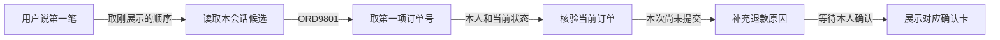

# M06：第一笔为什么现在能选对

> 从看懂退款，到确定订单，再到核验和确认

本次修复增加了代码规则，没有修改提示词。
规则从本会话刚展示的列表中取订单号。
模型继续判断用户想办什么事。

## 先把问题拆开

| 系统要回答的问题 | 原来做到什么 | 本次改变 |
|---|---|---|
| 用户想办什么事？ | 模型知道仍在办退款 | 保留原有模型判断 |
| 用户选的是哪笔？ | 已保存候选，但选单代码未读取它 | 把序号对应到候选订单号 |
| 这笔是否能办退款？ | 已有归属、状态和支付核验 | 继续使用原有核验 |

模型只输出意图标签，例如“退款”。
知道要退款，仍然需要确定具体订单。

## 原来为什么卡住

下面使用隔离复现中的合成订单 ORD9801、ORD9802。

| 对话步骤 | 系统实际做了什么 |
|---|---|
| 用户说“帮我退款” | 展示 ORD9801、ORD9802，并保存这个顺序 |
| 用户说“第一笔” | 模型判断用户仍在办退款 |
| 程序选择订单 | 只查本句订单号、页面订单或最近订单 |
| 这些地方都没给出订单 | 再次追问选哪笔，没有查询 ORD9801 |

旧系统已经保存了列表。
它也把候选顺序交给模型判断意图。
断点在后面：选单代码没有读取这份列表。
因此，单改意图提示词无法补上这个断点。

## 现在的规则怎么接上

| 系统保存的对应关系 | 用户选择 | 程序取得的订单号 |
|---|---|---|
| 1 → ORD9801，2 → ORD9802 | 第一笔 | ORD9801 |
| 1 → ORD9801，2 → ORD9802 | 第二笔 / 第2笔 | ORD9802 |
| 列表只有两笔 | 第三笔 | 没有有效订单，重新澄清 |

这份列表属于当前用户、当前会话。
后来的订单排序变化不会改变这次选择。
无候选或序号越界时，不回退到旧订单。

## 为什么还要保留用户原句

商城原来会把页面信息拼在用户消息后面。
例如，用户说“第一笔”，页面还附带 ORD9802。
程序可能把页面订单号当成用户指定的订单号。

| 信息 | 原来如何传递 | 现在如何处理 |
|---|---|---|
| 用户原句“第一笔” | 和页面文字合在一起 | 另外保存原句，供选单代码读取 |
| 页面附带 ORD9802 | 出现在合并消息里 | 保留作背景，不能覆盖本次序号选择 |

本次修改覆盖 Python 上下文、聊天入口和 Java 网关。
没有新增意图标签，也没有修改模型提示词。
旧版已复现的是重复追问，没有记录错退资金。

## 每一层负责什么

| 参与者 | 负责的问题 | 本例中的输出 |
|---|---|---|
| 大模型 | 用户现在要办什么事？ | 退款意图 |
| 选单代码 | 用户选择列表里的哪一项？ | ORD9801 |
| 业务后端 | 是否本人订单，状态和实付是否允许？ | 核验结果、缺少信息或确认卡 |
| 用户 | 是否提交这笔申请？ | 明确确认后才提交 |

退款意图配上 ORD9801 后，代码安排订单查询和售后检查。
这一步在程序中叫 RoutePlan，即本轮执行安排。
“选中了订单”与“批准退款”仍是两个步骤。

若用户改问另一笔物流，模型仍可切换任务。
序号规则只负责选对象，不强行保留退款意图。

## 从中能学到的产品设计思路

这些是从本次修复总结的设计判断。

| 设计问题 | 本次选择 | 对用户的价值 |
|---|---|---|
| 用户根据什么选择？ | 绑定刚展示的列表顺序 | 看到第一项，就能选中第一项 |
| 多轮对话该记住什么？ | 任务、缺少信息、已展示候选 | 短回复能接上前一轮 |
| 哪些判断适合确定规则？ | 已有顺序的序号对应 | 同一选择不会随机落到别的订单 |
| 多个上下文冲突时听谁？ | 明确序号选择优先于页面旧订单 | 页面背景不能替用户作决定 |
| 选不到时如何处理？ | 重问，不猜测、不回退旧订单 | 避免对错误对象继续办理 |
| 选中后是否直接执行？ | 再核验，展示确认卡，等待确认 | 订单变化或错误选择仍可被阻止 |

最先需要判断的是，链路断在哪一步。
先区分意图、对象、资格和提交，再选择修复方法。
本次断在对象对应，因此采用代码规则。

## 怎样证明做对，以及还没覆盖什么

验收需要检查实际订单号，而不只检查“退款”标签。

| 检查 | 证据与结果 |
|---|---|
| 第一笔、第二笔、排序变化 | 离线检查核对实际选中的订单号 |
| 越界、换用户、换会话 | 离线检查确认不能借用旧候选 |
| 页面干扰、改问物流、状态变化 | 离线或隔离对话检查对应边界 |
| 完整商城对话 | 隔离环境6组12轮通过 |
| 日常浏览器入口 | 第一笔、第二笔共2组6轮通过 |
| 生成确认卡但未提交 | 对话前后8张业务表行哈希一致 |

日常验收另经用户授权准备了两笔199元订单。
它们扣了398元演示余额，属于样本准备写入。
之后的对话没有继续改变余额或新增售后。

当前识别“第一笔”“第二笔”“第2笔”等纯序号。
中文序号支持一至十，可带已有允许的句末标点。
“第一单”“刚才便宜的那个”没有在本次加入规则。
候选保存在进程内，服务重启后需要重新展示列表。
本次说明不代表任意自然语言指代都已解决。

依据：backend/agent/context.py 第41行；backend/agent/customer_service_agent.py 第64行及第689行。
依据：CustomerServiceGatewayService.java 第132行及第247行；项目评测记录 M06-001、M06-002。
