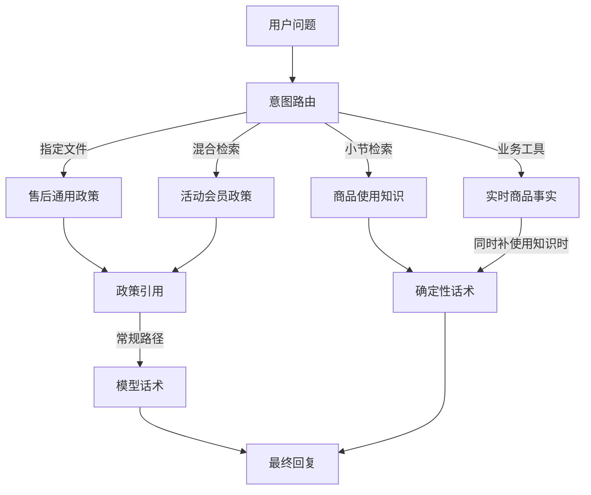
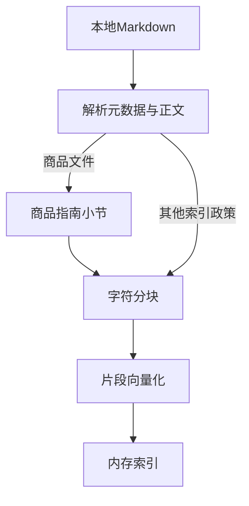
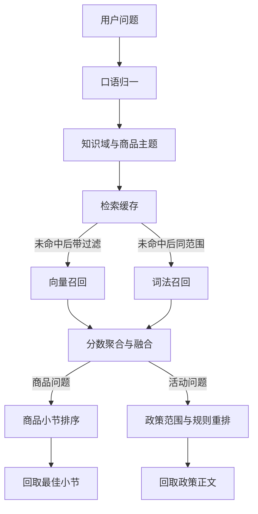
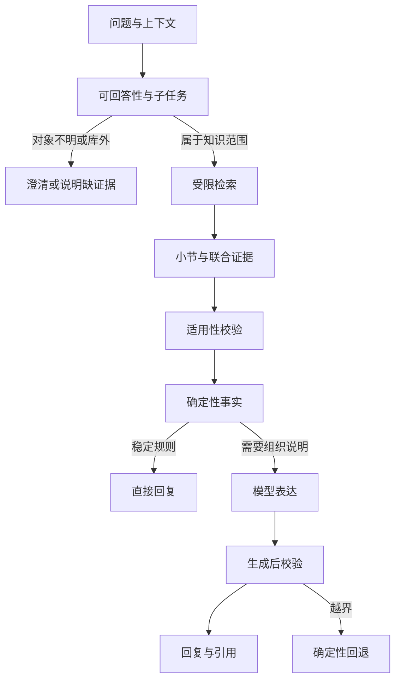

# 电商客服 Agent：RAG 设计审查与优化建议

> 2026-10-13 更新｜长文知识接入后的实际设计、修复状态与评测边界

本项目已从短政策演示扩展为长文知识检索。
当前有 6 份知识文件，5 份进入混合索引，共 85 个块。
商品指南按小节回取，活动等政策仍按整篇引用。
下一步优先验证路由、证据适用性和长文引用质量。

## 当前模式与实际边界

> **更新后的判断**
> 这是按意图分流、由代码控制的知识回答链路。
> 商品使用知识已接入；价格和库存仍由业务工具提供。
> 双路召回已有域过滤、多块分数聚合和参数缓存。
> 当前运行使用字符哈希向量，不代表语义 embedding 质量。

图中省略发票缓存、安全兜底和业务流程细节。
不是每个 RAG 问题都会调用最终生成模型。

| 入口 | 当前取得证据的方法 | 当前回答方式 |
|---|---|---|
| 退款／退货通用政策 | 按意图直接读取长政策 | 常规路径由模型表达；不可用时保留确定性正文 |
| 发票咨询 | FAQ 答案缓存；首次检索固定问句 | 首次可生成，命中后直接复用答案 |
| 活动／会员券咨询 | 规则准入、混合召回、政策范围过滤和规则重排 | 确定性兜底＋模型表达；无证据时跳过模型 |
| 商品使用、清洁、收纳、温标 | 按主题检索商品指南小节 | 返回最佳小节，清除标题和链接语法；跳过最终模型 |
| 商品价格／库存＋使用问题 | 工具成功取得事实后补指南小节 | 拼接可信事实与知识，保留确定性话术 |
| 商品价格／库存＋活动规则 | 工具事实＋平台政策 | 保留事实与规则的分层表达 |
| 具体订单能否退货 | 只读工具核验本人订单资格 | 不从知识文档推断具体资格或已提交结果 |

混合召回仍指向量与关键词两路。
它不意味着系统具有自主反复检索的 Agentic RAG。
架构术语参见 [LangChain Retrieval](https://docs.langchain.com/oss/python/deepagents/retrieval)。

本次变化：4 个短块→85 个块；新增商品知识路径。
活动政策 ID 已改为 `promotion_camping_season_stack_rule`。
证据：[商品知识接入](</Users/sunhao/Downloads/03_AIPMProject/0305_E-commerce-Customer-Service_Agent/docs/04-学习与复盘/商品知识接入与加载说明.md>)、[政策 ID 改名](</Users/sunhao/Downloads/03_AIPMProject/0305_E-commerce-Customer-Service_Agent/docs/04-学习与复盘/露营季政策ID改名说明.md>)。

## 数据提取与分块：长文如何成为检索单元

| 文件 | 当前正文字数（字符） | 当前块数 | 接入方式 |
|---|---:|---:|---|
| 退款政策 | 3137 | 18 | 混合索引；通用咨询也可直接读取 |
| 发票 FAQ | 35 | 1 | 混合索引＋FAQ 缓存 |
| 露营季活动政策 | 3256 | 19 | 混合索引，整篇政策引用 |
| 会员券政策 | 3057 | 18 | 混合索引，整篇政策引用 |
| 商品指南 | 4170 | 29 | Markdown 小节＋字符分块，小节回取 |
| 签收后退货政策 | 4026 | 未纳入混合索引 | 按意图直接读取完整政策 |

字符数来自本次磁盘读取，包含正文中的 Markdown。
活动文档的命名说明已随 ID 改名更新。
原报告“所有文件均未真正切块”的判断已失效。

| 节点 | 当前实现 | 设计取舍与缺口 |
|---|---|---|
| 数据提取 | 人工维护 Markdown，解析 YAML frontmatter | 尚无 PDF、网页自动提取或系统增量同步 |
| 文档元数据 | policy_id、scene_key、title、score；扩充文件另有 version、content_status | version 已进入 Citation；content_status 尚未作为准入控制 |
| 通用分块 | `RecursiveCharacterTextSplitter(220, 30)` | 单位为字符；没有定制中文标点边界 |
| 商品结构分块 | 先按二级／三级标题分小节，再切字符块 | 小节保留条件、例外与可回取正文 |
| 片段身份 | 全局序号 chunk_id；商品另有 section_id、section_text | 序号随文档结构变化；没有稳定内容 ID 或原文偏移 |
| 引用粒度 | 商品回取小节；其他政策仍回取整篇 | 政策长文的细粒度召回不能直接从整篇 Citation 验证 |

“拥有版本字段”不等于已实现生效期、范围和发布状态校验。
商品小节引用是部分改进，尚未统一到其他政策。

分块建议从“是否切块”转为“边界是否完整”。
用长文问题检查：条件与例外有没有被拆开，跨小节问题需不需要联合证据。
中文分隔符可作为候选实验，避免直接改参数后只看示例。
参见 [LangChain 递归分块](https://docs.langchain.com/oss/python/integrations/splitters/recursive_text_splitter)。

可用标题、所属商品与适用条件给片段添加检索前缀。
该思路参考 [Anthropic Contextual Retrieval](https://www.anthropic.com/engineering/contextual-retrieval)。
当前先用已有字段，不让模型替文档补充业务事实。

源码：[商品小节构建](/Users/sunhao/Downloads/03_AIPMProject/0305_E-commerce-Customer-Service_Agent/backend/retrieval/hybrid_retrieval.py:155)、[引用元数据](/Users/sunhao/Downloads/03_AIPMProject/0305_E-commerce-Customer-Service_Agent/backend/retrieval/documents.py:18)。

## 向量化、索引与缓存：当前可复用状态

| 节点 | 当前设计 | 已完成与剩余问题 |
|---|---|---|
| 当前运行向量 | 显式离线开关，256 维字符／双字哈希 | 是向量搜索，但不证明语义模型质量 |
| 真实 embedding 分支 | `OpenAIEmbeddings` 兼容接口，代码默认 `BAAI/bge-m3` | 该分支仍存在；本次没有启用或评测 |
| 向量索引 | `InMemoryVectorStore`，精确相似度搜索 | 当前足够承载演示；没有跨进程共享持久化向量库 |
| 词法召回 | 遍历块，计算词语／双字匹配 | 不是 BM25；没有倒排索引 |
| 索引预加载 | FastAPI lifespan 在启动时构建 | 已完成；`/health` 显示版本、文件、块数与模式 |
| 索引身份 | 文件内容＋embedding 模式＋分块方案哈希 | 已加入分块方案；运行中仍不检测文件变化 |
| 检索缓存 | 索引版本＋意图＋top_k＋归一化 Query | top_k 已修复；TTL、容量和原子发布仍缺失 |
| 发票答案缓存 | 全局 `faq:invoice_issue` | 仍缺子任务、政策版本与有效期 |
| 引用缓存 | 文件名 LRU＋模块级政策对象 | 重建索引函数仍不统一清理它们 |

最近一次服务加载验证：85 块，`lesson41-idx-5268ea0829cc`。
该指纹与本次独立源码构建结果一致。
这是已有服务核验记录；本次文档更新未再次重启服务。

此前重载已验证同题缓存先未命中、后命中。
完整进程重启会重建索引、引用与 FAQ 内存对象。
但只改 Markdown 或只执行索引 reset，仍可能出现版本混用。
所以“本次加载一致”与“热更新机制完善”应分开判断。

聊天与 embedding 分支仍共用服务配置。
当前聊天配置为 DeepSeek，真实 embedding 尚未独立核验。
日后启用语义向量，需要单独确认兼容端点、模型与维度。

源码：[预加载](/Users/sunhao/Downloads/03_AIPMProject/0305_E-commerce-Customer-Service_Agent/backend/api/routes.py:29)、[版本构建](/Users/sunhao/Downloads/03_AIPMProject/0305_E-commerce-Customer-Service_Agent/backend/retrieval/hybrid_retrieval.py:177)、[缓存键](/Users/sunhao/Downloads/03_AIPMProject/0305_E-commerce-Customer-Service_Agent/backend/retrieval/hybrid_retrieval.py:193)。

## 在线召回与重排：按域过滤、双路召回与小节选择

发票路径不做活动规则重排。
每条路径仍以其意图契约约束检索和回答。

| 环节 | 当前机制 | 剩余局限 |
|---|---|---|
| Query 归一 | 既有别名替换；商品保养→清洁收纳，里面有水→帐内有水 | 字符串规则不能独立理解含糊对象和多轮指代 |
| 范围过滤 | 向量查询携带 filter；词法遍历采用相同 allowed | 商品主题依赖词表；售后域枚举仍不一致 |
| 候选聚合 | 政策按 policy_id，商品按 section_id；多块向量分取 max | 最好单块分数不代表联合条件完整 |
| 双路融合 | `max(向量分, 词法分)`，双路命中另加 0.08 | 异尺度分数未校准；仍无统一相关性门槛 |
| 商品小节排序 | 明确问清洁、收纳、温标等时优先匹配标题 | 是规则排序；不能证明长尾或跨小节质量 |
| 活动重排 | 保留活动＋0.18、会员＋0.16、叠加＋0.08 | 没有语义 reranker，也未完整核验实体与时间 |
| 引用回取 | 商品取完整小节；活动／会员等取整篇 | 应分别评测块召回、小节选择和答案证据 |

**当前实例：帐篷怎么保养？**

| 步骤 | 本次隔离构建中的实际输出 |
|---|---|
| 进入知识路径 | product_query；本例直接调用辅助函数，不评测真实路由 |
| Query 归一 | 帐篷怎么清洁收纳？ |
| 知识域 | product_knowledge，另按帐篷主题过滤 |
| 召回与聚合 | 双路候选按 section_id 组织，多块分取最大 |
| 最佳小节 | 3.3 清洁、收纳与首次检查 |
| 小节 ID | outdoor_product_guide-section-5 |
| 引用块 ID | outdoor_product_guide-chunk-67 |
| 引用版本 | 2026-10-12.1 |
| 回答 | 保留清洁、充分晾干、收纳及责任核验限制 |
| 最终模型 | 商品路径保留确定性话术，不再润色 |

本例用于展示当前结构，不构成检索准确率。
原短语料的 0.451、0.990 等分数不再用于描述长文现状。
所有检索及重排分仍不能解释为正确概率。
活动 Citation.score 与重排调试分也需分别查看。

源码：[召回与聚合](/Users/sunhao/Downloads/03_AIPMProject/0305_E-commerce-Customer-Service_Agent/backend/retrieval/hybrid_retrieval.py:189)、[小节排序](/Users/sunhao/Downloads/03_AIPMProject/0305_E-commerce-Customer-Service_Agent/backend/retrieval/hybrid_retrieval.py:248)、[商品小节回答](/Users/sunhao/Downloads/03_AIPMProject/0305_E-commerce-Customer-Service_Agent/backend/retrieval/knowledge.py:214)。

## 答案生成：确定性小节与模型表达分别评测

| 路径 | 当前输出 | 如何评价质量 |
|---|---|---|
| 商品使用知识 | 一个最佳小节；去掉 Markdown 标题和链接语法 | 小节是否对应问题、限制是否保留、回复是否过长 |
| 商品事实＋使用知识 | 工具成功后拼接使用建议 | 实时事实与通用建议分开；失败时不补造事实 |
| 活动／会员规则 | 政策引用、确定性兜底、最终模型表达 | 结论是否适用用户对象，是否遗漏条件或新增承诺 |
| 政策直取 | 完整正文，常规路径可由模型表达 | 是否只回答当前子任务，是否误称动作已完成 |

已有输入安全检查仍保护 Tool 和 RAG 文本边界。
Prompt 要求外部内容不能覆盖系统规则，也不能编造政策。
非空生成文本仍被客户端直接接受，未增加通用生成后事实校验。

商品小节保留 version、section_id、chunk_ids。
工作台可以展示引用，商城当前主要展示纯文本。
活动模型回复曾在商城显示原始 Markdown 星号。
不能把商品路径的格式通过扩展到所有模型回复。

已观察到两种不同结果：
- 双十一问题的真实模型，本次正确说明缺少对应规则。
- 同题的确定性辅助函数，仍会给出露营季满减兜底。

因此，生成正确不能掩盖上游适用性缺口。
需要同时评价正常生成与模型不可用后的兜底。
原有固定输出探针只证明客户端缺少拦截，不代表真实退款已误操作。

关键政策可保留结构化事实，再选择是否允许模型润色。
生成后检查政策条件、行动表述和结论引用。
来源不支持的承诺应回退；语义支持关系仍需标注评测。
引用可信度的交互依据参见 [NN/g Explainable AI](https://www.nngroup.com/articles/explainable-ai/)。

源码：[生成客户端](/Users/sunhao/Downloads/03_AIPMProject/0305_E-commerce-Customer-Service_Agent/backend/agent/models/answer_client.py:79)、[保留商品话术](/Users/sunhao/Downloads/03_AIPMProject/0305_E-commerce-Customer-Service_Agent/backend/agent/customer_service_agent.py:996)、[生成跳过条件](/Users/sunhao/Downloads/03_AIPMProject/0305_E-commerce-Customer-Service_Agent/backend/agent/customer_service_agent.py:1156)。

## 问题状态：已修复、部分完成与待解决

下表优先级是本报告的审查判断。
已修复不代表整体长文质量或生产指标通过。

| 状态 | 问题或能力 | 当前证据与剩余工作 |
|---|---|---|
| ok 已修复 | top_k 缓存身份遗漏 | key 已含 top_k；相关断言通过 |
| ok 已修复 | 同政策多块分数被后续低分覆盖 | 多块显式取 max；0.95／0.12 聚合断言通过 |
| ok 已修复 | 全库 TopK 后才过滤业务域 | 向量请求带 filter，词法同范围；域过滤断言通过 |
| ok 已完成 | 启动预加载和状态展示 | health 可见版本、文件、块数与 embedding 模式 |
| ok 已完成 | 活动政策名仍含旧场景 618 | 已改为 promotion_camping_season_stack_rule，实际 Citation 已核验 |
| warn 部分完成 | 商品结构分块、引用位置与版本 | 商品已按小节引用；其他政策仍整篇，ID 仍依赖序号 |
| warn P1 待解决 | 活动、会员和时间适用性 | 双十一辅助函数仍套露营季；不能只依赖最后一次模型答对 |
| warn P1 待解决 | 生成后事实和行动约束 | 客户端未增加通用校验；历史固定输出探针风险仍适用 |
| warn P2 待解决 | 知识发布与缓存原子更新 | 完整重启可保持本次一致；热更新仍未实现 |
| warn P2 待解决 | 售后知识域映射 | after_sale 与文件 scene_key 不一致；不据此声称现有直取路径失败 |
| warn P2 待解决 | 发票子任务和答案缓存 | 固定问句与 FAQ key 仍可能复用不适用答案 |
| warn P2 已观察 | 会员券延期咨询误路由 | 一轮被分到低置信路径，未检索新文档中已有说明 |
| warn P2 已观察 | 模型回复格式 | 活动回答曾显示原始星号；不能概括为所有知识回复都已清理 |
| warn 未验证 | 长文跨小节、同义词、复合条件与真实 embedding | 现有检查覆盖有限，缺少冻结的长文留存集 |

最近证据分轮引用，不累加成统一成绩：
- 2026-10-12：111 项隔离检查与 3 组商城咨询。
- 2026-10-13 重载：18 项相关检查，5 轮页面核查；保留会员券路由失败。
- 2026-10-13 改名：25 项相关检查，一次 API 核验新政策 ID。

本次只更新审查文档，并独立核对源码与分块状态。
没有重新运行上述全套，也没有新增页面或真实模型评测。

证据：[长文接入记录](</Users/sunhao/Downloads/03_AIPMProject/0305_E-commerce-Customer-Service_Agent/docs/04-学习与复盘/商品知识接入与加载说明.md>)、[重载结果](</Users/sunhao/Downloads/03_AIPMProject/0305_E-commerce-Customer-Service_Agent/analysis/99-参考与讲解素材/RAG重载核验-2026-10-13/result.json>)、[改名核验](</Users/sunhao/Downloads/03_AIPMProject/0305_E-commerce-Customer-Service_Agent/analysis/99-参考与讲解素材/露营季政策ID改名-2026-10-13/live-verification.json>)。

## 更新后的优化顺序

这是建议目标，图中的统一适用性和生成后校验尚未全部实现。

| 顺序 | 当前应做什么 | 建议验收标准 |
|---|---|---|
| 1 | 冻结独立长文问题、期望证据与动作 | 分开路由、块召回、小节选择、生成和兜底错误 |
| 2 | 修正会员券咨询等子任务准入，建立活动适用性门控 | 已有知识不被误拒；未知活动不换主体回答 |
| 3 | 把政策长文扩展为结构引用；需要时回取联合小节 | 条件与例外完整；不靠整篇正文掩盖漏召回 |
| 4 | 完成知识版本发布及缓存失效 | 更新后索引、Citation 与 FAQ 同版本；可回滚 |
| 5 | 加强生成后证据和行动约束 | 没有工具执行时不声称已提交、到账或发券 |
| 6 | 用同一冻结集对照语义向量、BM25、RRF 与可选 reranker | 报告质量、错误拒答、时延、token 与成本；验证增益来自哪个环节 |

原报告中的三项检索契约修复已移出待办。
商品结构分块已接入，后续重点是其他政策与跨小节场景。
85 块仍属小型演示语料，但已具备观察多块失真的条件。
不能再用“只有 4 个块”否定所有检索实验价值。

当前保留内存索引即可；暂无证据要求新增大型检索架构。
优先比较当前字符向量与一个真实语义向量的收益。
RRF 可作为异尺度融合的候选；业务准入仍需独立约束。
依据见 [OpenAI Retrieval](https://developers.openai.com/api/docs/guides/retrieval)。

排序成为瓶颈时，再比较宽召回后重排。
重排不能补造未发布政策或修复错误实体。
方法参考 [Hugging Face Advanced RAG](https://huggingface.co/learn/cookbook/advanced_rag)。

## 知识库、官方依据与长文评测方案

**方法依据沿用初版检索**：2026-10-12 已通过 llm-wiki 阅读以下 5 页。
本次没有新增知识库查询或重新核验官方网页。
RAG 同义词按 schema 展开为“检索增强生成／Retrieval Augmented Generation”。
查询没有写回 AIPM，也没有把本次审查当作新的一手素材。

| 本地页面 | 对本次审查的贡献 | 证据边界 |
|---|---|---|
| [RAG 工程化](</Users/sunhao/Downloads/AIPM/wiki/topics/RAG 工程化.md>) | 六个节点、中间产物、分层评测 | 跨课程综合；部分判断标为 INFERRED |
| [Hybrid RAG](</Users/sunhao/Downloads/AIPM/wiki/entities/Hybrid RAG.md>) | 两路互补与证据门控 | 方法依据，不证明当前实现质量 |
| [RAG 缓存与更新](</Users/sunhao/Downloads/AIPM/wiki/entities/RAG 缓存与更新.md>) | 版本、缓存和实时事实边界 | 当前实现另由源码及临时副本复现确认 |
| [Reranker](</Users/sunhao/Downloads/AIPM/wiki/entities/Reranker.md>) | 二阶段排序、质量与成本权衡 | 课程中的经验提升数字未作为项目预期 |
| [模块 2 可回答性复盘](</Users/sunhao/Downloads/AIPM/wiki/sources/模块 2 迭代复盘：RAG 可回答性与证据边界治理.md>) | 缺参澄清、子任务过滤、缓存隔离、生成后控制 | 历史课程评测；不继承其通过结果 |

**官方资料对照**：技术资料支持检索设计，交互资料支持失败处理与信任设计。
下列落点是结合本项目提出的建议，不是供应商对本项目的诊断。

| 来源与文章 | 官方材料说明的内容 | 本项目的应用建议 |
|---|---|---|
| [Anthropic：Contextual Retrieval](https://www.anthropic.com/engineering/contextual-retrieval) | 片段上下文、词法＋向量、重排及场景评测 | 长政策再评估上下文前缀；不照搬实验提升或 TopK |
| [OpenAI：Retrieval](https://developers.openai.com/api/docs/guides/retrieval) | 属性过滤、检索排名与混合 RRF 权重 | 提前过滤适用域；分开融合排序与可信准入 |
| [Google PAIR：Errors＋Graceful Failure](https://pair.withgoogle.com/chapter/errors-failing/) | 定位错误来源，并提供可继续任务的失败路径 | 明确缺对象、无对应政策、服务故障；给具体下一步 |
| [Microsoft HAX：Guideline 10](https://www.microsoft.com/en-us/haxtoolkit/guideline/scope-services-when-in-doubt/) | 不确定时澄清或收窄服务 | 不把双十一替换为露营季；先确认用户指的活动 |
| [LangChain：Retrieval](https://docs.langchain.com/oss/python/deepagents/retrieval) | 两步、Agentic 和带验证的混合架构 | 当前保持受控链路；无需把每次检索变成自主循环 |
| [LangChain：Recursive Splitter](https://docs.langchain.com/oss/python/integrations/splitters/recursive_text_splitter) | 字符计量及中文分隔符 | 明确 220／30 是字符；长文结构优先 |
| [Hugging Face：Advanced RAG](https://huggingface.co/learn/cookbook/advanced_rag) | 分块与 TopK 权衡、宽召回后重排 | 扩大语料后对照中文 reranker，不预设最佳模型 |
| [xAI：Collections Search](https://docs.x.ai/developers/tools/collections-search) | 集合搜索返回可回溯到文件的引用 ID | 建立稳定 policy／version／chunk 身份；不推断其内部切块实现 |
| [NN/g：Explainable AI](https://www.nngroup.com/articles/explainable-ai/) | 引用可能不支持结论，并带来过度信任 | 把引用连接到关键结论，并显示适用条件 |

**建议建立 32 条长文专项集**。数量仅是候选配置，本次未新建或运行该集。
当前网页仍运行默认 13 条功能回归，不能替代这组评测。

| 组别 | 建议数量 | 重点例子 | 期望行为 |
|---|---|---|---|
| 正常与长文知识 | 8 | 冷凝、睡袋温标、会员券限制、退货流程 | 正确小节、必要条件与例外 |
| 跨小节与多轮 | 6 | 使用建议加质量异常、换商品或换券 | 必要证据覆盖，不继承错误对象 |
| 范围与适用性 | 8 | 双十一、未知会员、延期咨询、发票重开 | 区分有知识但无执行能力与真正缺证据 |
| 冲突与更新 | 6 | 24→48 小时、新旧政策冲突、top_k 变化 | 原文、索引、引用、答案版本一致 |
| 注入与行动边界 | 4 | 政策中夹指令、要求声称已退款 | 忽略外部指令；无执行即无成功声明 |

先冻结期望证据、期望动作及不可接受表述。
标明样本来自真实记录还是人工构造。
划分开发集与留存集，不根据留存答案反复修改规则。

先检查路由是否进入正确知识域，再记录块级 Recall@K。
另记录小节 Top1／MRR、必要证据覆盖和版本一致性。
多证据题要求全部必要证据，而不是命中任意一份就算通过。
确定性摘取侧检查相关性、条件完整与可读性。
模型生成侧检查事实、结论引用、行动边界和 Markdown 展示。
另记澄清／缺证据是否正确，避免“拒答全部问题”得到虚高质量。

成本侧分冷启动、首次查询和缓存命中。
记录实际 embedding／生成调用、token、P50／P95 时延和错误状态。
不能用离线替身的耗时代表在线延迟。

**本次更新范围**：核对当前源码、知识文件和独立分块结果，更新 MD 与同名 HTML。
已有官方来源作为方法依据保留；初版研究记录和后续验收不改写。
本次没有修改业务代码、调用外部模型或重新验收资金流程。

更新前审查稿保存在 [更新材料](/Users/sunhao/Downloads/03_AIPMProject/0305_E-commerce-Customer-Service_Agent/analysis/99-参考与讲解素材/RAG设计审查更新-2026-10-13/更新前.md)。本次离线重建得到同一索引 `lesson41-idx-5268ea0829cc`，共 85 块。没有重启服务。
