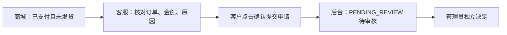

# 本地手测：商城退款提交与管理员审核

**2026-10-09 状态更新：下文固定订单 A 已由你审核通过，余额已恢复100,000；本次修复后订单/支付均已退款、履约已取消。A 可以检查完成状态，不能再当作待发货成功样本。重测提交流程请新建并支付订单，并替换下文所有 A 编号。**

2026-10-09。当前本地服务已包含未发货整单退款和签收七天无理由退货退款。下面原用例保留未发货回归；新的完整退货手测见文末“七天无理由退货退款手测”。运输中仍不能直接退款，需要人工处理拦截。

## 入口与账号

| 入口 | 地址 | 登录方式 |
|---|---|---|
| 商城，主要测试入口 | http://127.0.0.1:5174/ | `zhangsan / 123456` |
| 管理后台，查看与独立审批 | http://127.0.0.1:5174/admin/ | `admin / admin123456` |
| 评测工作台，观察模拟流程 | http://127.0.0.1:5173/ | 选择张三 / U1001 |
| Agent / Java 健康检查 | http://127.0.0.1:8000/health / http://127.0.0.1:8081/actuator/health | 无需登录 |

**商城用普通窗口，后台用无痕窗口或另一浏览器。** 同一浏览器的普通标签页共享登录 Cookie，登录管理员会影响商城的用户身份。关闭客服抽屉不会开启新会话；要测试新的客户会话，刷新商城页面后重新打开客服。多轮案例中不要刷新。

已启用 DeepSeek 聊天模型；订单事实来自本地演示 MySQL，政策向量仍使用本地简化实现。聊天会调用外部模型并消耗额度，不要点击“运行全部评测”来代替手测。

## 测试数据

历史订单 A：**`SO20261009061332122-26971b7b`**，张三的户外野餐垫 ×1，实付 **199 元**，现已由你批准退款。本次修正后订单/支付已退款、履约已取消。启动阶段的确认卡/取消记录仍保留为当时证据；现在重新测提交，应另建并支付一笔 A，把新编号记下来。

原支付后张三余额为99,801；你审核通过后已恢复为 **100,000 元**。此后若你继续下单支付，余额会减少；比较“提交退款前后”时，以你刚支付完的余额为基准。

扩展测试再准备 B、C 两笔订单：商城“商品” → 打开户外野餐垫详情 → 数量 1 → **立即购买**。B 点击**确认支付**；C 停在支付页，不支付。把两个订单号记下来。A 用于正常提交与防重，B 用于取消、修改原因和发货状态变化，C 用于未支付拦截。

| 数据 | 当前用途 |
|---|---|
| A：上述已准备的 199 元订单 | 正常提交、后台可见、重复提交；最后可选审批 |
| B：你新建并支付的订单 | 缺原因、追问、改原因、取消；最后测试发货变化 |
| C：你新建但不支付的订单 | 未支付拦截 |
| `SO20260602103000009-a1000009` | 张三已发货订单，验证不能按本次流程提交 |
| `SO20260422081500002-a1000002` | 李四订单；张三询问时应被拦截 |
| `SO20260601090000008-a1000008` | 历史待发货样例，缺可信支付流水，不作为退款成功样本 |

老样例的“PAID”文字不能代替支付流水。遇到历史订单被拦截时，先用 A 或新建支付订单测试，不修改数据库字段来绕过校验。

## 先跑一条完整路径，约 10 分钟



以下 `<A订单号>` 替换为新建支付订单编号。

1. 商城登录张三，进入“我的订单” → 找到 A → **详情** → **联系荒野客服**。
2. 输入下面这句。应出现确认卡，写明 A 的订单号、户外野餐垫、整单退款、199 元、买错了和“尚未提交”。此时后台按 A 的订单号查询，应该还没有申请。

   ```text
   <A订单号> 我要申请退款，原因：买错了
   ```

3. 点击**确认提交申请**。卡片应变成**已提交，待审核**，显示业务申请号，旧按钮不可继续操作。不能说“已批准”“已退款到账”。记下申请号。
4. 后台无痕窗口登录 → 左侧**售后审批** → 在“订单号”填 A → **查询** → 点击该行。应只有 **1 笔**申请，类型 `REFUND`，状态 `PENDING_REVIEW`，金额 199，原因买错了，暂时没有管理员审批记录。
5. 商城点击右上角“张三” → **账户余额**，比较提交前后：余额应不变，不新增 `REFUND` 流水。刷新商城后再问：

   ```text
   请查一下 <A订单号> 的退款进度
   ```

   应答复真实申请号及“待审核”，后台仍然只有那 1 笔申请。

**先到这里就能验收本次核心改动。** 暂时保留 A 的待审核状态，方便后面的防重测试；管理员按钮放到最后测试。

## 再测边界，约 15—25 分钟

下面 `<B订单号>`、`<C订单号>` 必须替换成你记录的完整编号。T02—T05 连续在同一会话测试 B；其他案例按说明刷新。

| 编号 / 场景 | 问题与操作路径 | 应看到的结果 |
|---|---|---|
| T02 缺少原因 | 刷新商城，在首页点“咨询客服”；输入 `<B订单号> 我要退款`，先不补原因 | 追问退款原因，不能出现可直接提交的确认卡；后台 B 无申请 |
| T03 补原因并继续提问 | 接着输入 `原因：买错了`，出卡后输入 `能退多少钱？审核是什么流程？` | 卡片金额与 B 实付一致；提问不代表同意提交；后台无申请，只有最新卡可操作 |
| T04 改变原因 | 接着输入 `原因：行程取消` | 最新卡改成行程取消；旧卡按钮不可操作；金额和订单不变 |
| T05 取消 | 最新卡点**取消本次申请**；核对后台 | 提示已取消、未提交；旧卡不能重新提交；后台 B 无申请，余额不变 |
| T06 防止重复申请 | A 仍待审核时，刷新商城后再次输入 A 的完整退款问题；如果出卡再确认一次 | 应提示已有申请或返回原申请号；后台 A 始终只有 1 笔待处理申请；余额不变 |
| T07 未支付 | 刷新后输入 `<C订单号> 我要退款，原因：买错了` | 提示未支付/不符合条件；没有可提交的退款卡，也没有退款申请 |
| T08 已发货及首版排除项 | 刷新后输入 `SO20260602103000009-a1000009 已发货，我认为符合七天无理由，请直接提交退货退款，原因：不想要了` | 可以解释规则与当前范围；不能通过本次未发货退款流程创建申请，不能显示成功申请号 |
| T09 他人订单 | 张三在首页客服输入 `SO20260422081500002-a1000002 我要退款，原因：买错了` | 拒绝访问/提示无权处理；不能泄露李四的订单详情或创建申请 |
| T10 确认前订单已发货 | 按下面步骤操作 B 的新确认卡 | 后端重新读最新状态，拒绝提交；后台 B 无申请，旧卡失效 |

T10 的操作步骤：

1. B 取消后刷新商城，再发 `<B订单号> 我要退款，原因：买错了`，停在确认卡，**先不确认**。
2. 后台 → **订单管理** → 按 B 的订单号查询 → 点击该行。在右侧把“订单状态”和“履约状态”都改为 `SHIPPED`；“物流单号”填 `MANUAL-TEST-B` → **保存允许字段**。只改 B，A 保持待审核。
3. 返回商城，点击刚才的**确认提交申请**。应提示当前不符合已支付未发货退款条件/本次未提交；后台“售后审批”按 B 查询仍没有申请。
4. B 已变成已发货，不再作为正常退款样本。不要只把状态文字改回去继续测成功路径，发货时间等事实也会被校验；需要时新建支付订单。

## 最后可选：你亲自测试管理员审核

本轮启动检查没有替你执行审批。测试 A 前，先完成防重并记下当前余额。这几种结果需分不同申请测试，选一种即可；已经通过/驳回的申请不能再用来测试另一终态。

| 管理员操作 | 操作路径 | 客户侧应看到的业务结果 |
|---|---|---|
| 驳回 | 售后审批 → A 的申请 → 填审批意见“手测驳回” → **驳回** → 确认 | 状态 `REJECTED`、有管理员审批记录；余额不变；询问退款进度应为未通过 |
| 要求补充材料 | 填意见“请说明退款原因” → **补充材料** → 确认 | 状态 `NEED_MORE_INFO`、有审批记录；余额不变；查询应为待补充材料。这里只验状态，首版没有新增材料上传流程 |
| 通过 | 确认“审批金额”为 199 → 填意见“手测通过” → **通过** → 确认 | 状态 `APPROVED`、记录审核人 admin；本地模拟余额增加 199，新增关联申请号的 `REFUND` 流水；查询应为已通过；订单列表/详情均为已退款，支付已退款、履约已取消，已退款筛选可找到；切回商城窗口会刷新 |

管理员“通过”会实际修改**本地演示余额**；它不代表银行卡或外部支付平台到账。不要把工作台的“模拟批准”当成这个后台操作。

## 可选：观察工作台，约 3 分钟

打开 http://127.0.0.1:5173/，选择张三，输入 A 的完整订单号和退款问题；查看“工具调用”“Reasoning”和右侧**模拟人工审核**。只有当前仍满足资格、尚未终结的订单适合模拟。

工作台点击“模拟批准/模拟拒绝”只演示 Python 流程，不应改变商城售后申请或余额。工作台的旧快照回退、角色/终态问题仍有已知记录；本次商城修复不等于这些模拟流程问题已修复。

## 怎么记录发现的问题

记录“用例编号、订单号、完整提问顺序、点击了什么、期望、实际、截图、后台申请号/状态”。例如：`T05 / B / 点击取消 / 预期无申请 / 实际后台出现 PENDING_REVIEW`。不要只记录模型话术，优先核对后台记录、数量和余额。

本次自动检查已通过：最新 Maven 打包、页面/健康、买家与后台登录、新订单支付流水、实际商城确认卡、取消不写售后且余额不变，以及无订单信息的真实模型路由/回答。正式确认提交、管理员审批和以上完整手测清单仍留给你执行。证据见 [启动结果](../../analysis/90-项目改造与运行/2026-10-09-手测前启动验证/result.json)、[模型检查](../../analysis/90-项目改造与运行/2026-10-09-手测前启动验证/model-check.json) 和 [实际确认卡](../../analysis/90-项目改造与运行/2026-10-09-手测前启动验证/实际确认卡.png)。

---

## 历史测试记录（2026-10-07，当时版本）

下面保留此前启动检查，按钮文字和源码状态属于当时版本；本次操作按上面的新清单执行。

### 当时的物流查询与模拟退款审核

2026-10-07。打开 http://127.0.0.1:5173/，选择“张三 / U1001”。Python Agent 在 http://127.0.0.1:8000/health；两个服务已启动并保持运行。

当前已启用真实 DeepSeek 聊天模型（deepseek-flash），Embedding 仍为本地简化向量。Java/MySQL 提供独立演示库业务事实，镜像回退关闭。每次聊天可能产生多次模型请求并消耗 API 额度；先试下方一条物流查询。工作台三步审批记录是此前模型关闭时的结果，当前真实模型只验证了物流查询。

## 第一步：查询物流

输入并点击“发送给 Agent”：

```text
请帮我查一下 SO20260602103000009-a1000009 的物流
```

预期：回复该订单已发货、物流状态为“运输中”。可打开“工具调用”查看执行记录；不得声称确定的送达时间。

## 第二步：申请另一笔订单的退款

在同一用户会话中输入：

```text
SO20260601090000008-a1000008 还没发货，我想申请退款
```

预期：回复可以进入未发货退款申请判断，但资金动作需要人工审批；右侧出现“待审核 · 模拟售后申请”与“批准 / 拒绝 / 补充信息”按钮。此时尚未完成退款。

## 第三步：模拟批准

点击右侧“批准”。

预期：回复“售后审核员已批准模拟退款申请，系统记录审批通过；本演示环境不执行真实资金退款。”恢复响应 status 为 completed。完成的是模拟流程记录，不是资金到账。

## 本次启动核验

已在隔离浏览器实际完成以上三步：三个 HTTP 请求均为 200，恢复状态为 completed，无页面脚本错误，没有拦截或替换 API 响应。使用另一浏览器上下文测试，不向你正在打开的页面预填聊天记录。

证据：`../analysis/90-项目改造与运行/工作台启动验证/result.json`、`../analysis/90-项目改造与运行/工作台启动验证/待审核预览.png`。复跑检查需保持两个服务运行：

```bash
.venv/bin/python analysis/90-项目改造与运行/工作台启动验证/check_workbench.py
```

若切换为李四等其他用户，请勿继续用张三的订单号作“成功路径”用例。新增演示用户接口虽已具备 Java 服务，但本用例不覆盖新增用户。


## 商城实际链路测试（2026-10-07）

打开 http://127.0.0.1:5174/，使用 `zhangsan / 123456` 登录。应看到荒野户外卡通商城和 17 件在售商品，露营折叠椅标价 599 元、库存 520。

点击“咨询客服”，输入：

```text
请帮我查一下 SO20260602103000009-a1000009 的物流
```

预期：回复已发货、物流运输中。该链路已经实际通过“浏览器 → Java 登录身份/数据库 → Python Agent → 返回商城”，未拦截 API，未使用商品 fixture；工具直接查询另一个数据库订单确认 fact_source=business_api。

后台 http://127.0.0.1:5174/admin/，演示管理员 `admin / admin123456`，可读取包含下架商品在内的 18 件商品。以上只验证登录、商品与客服查询；不要把商城“确认提交申请”、支付或下单记为已通过。模拟退款审批仍建议先用工作台三步测试。


## 七天无理由退货退款手测（2026-10-09新增）

当前 Java8081、Agent8000 和商城/后台5174已更新。自动化使用隔离 H2 和模型替身；下面由你在本地演示库验证真实模型交互，不涉及外部资金、快递或仓库。请新建订单，不使用已退款199元订单，也不要把过期历史样例日期改成今天。

1. 商城张三账号新买一件支持七天无理由的商品，完成余额支付，记下订单号、实付和支付后余额。后台在“订单管理”按该号查询，将订单状态/履约状态先设 `SHIPPED`，填写模拟原物流号；再设 `DELIVERED`，系统记录当前签收时间。这是本地模拟签收，不代表真实物流证明。
2. 商城订单详情 → 联系荒野客服，输入 `<订单号> 我要七天无理由退货`。确认卡应列出本人订单、商品、整单实付、保持商品配件赠品完好，以及“同意退货后寄回，实际收到且验收通过才退款”。无需额外退货原因；确认前后台没有新申请。
3. 点击“确认提交申请”。后台应有一笔 `RETURN / PENDING_REVIEW`，商城显示待审核，余额不变。新会话再次提交应返回同一笔待处理申请。可以单独用另一订单验证取消不会建立申请。
4. 后台“售后审批”打开该申请，先不填地址，应无法同意；填退回地址、联系人和电话，再点击“同意退货”。使用明确标注“本地测试，请勿寄送”的模拟地址，勿寄实物。应进入 `WAITING_RETURN`，余额仍不变。商城刷新或切回窗口后能看到同样的地址；后台尚不能确认退款。
5. 商城填写模拟快递公司和退回单号，点击“提交退回物流”。进入 `RETURN_IN_TRANSIT`，后台显示同样的物流，余额仍不变。后台“确认验收并退款”在未勾选收货验收通过时不可点。
6. 可先填“模拟配件缺失，待人工核验”并点“验收未通过”，状态为 `RETURN_INSPECTION_FAILED`，商城显示原因，余额不变。随后填写模拟人工核验完成的意见，勾选“已实际收到商品且验收通过”，再点击“确认验收并退款”。这一步仅模拟人工确认，不声称真实收货。
7. 应新增一笔金额等于整单实付的 `REFUND`，余额恢复该金额；售后/订单/支付已退款，履约已退回，原物流与签收历史保留。列表、详情、售后记录显示一致。刷新后台无重复资金按钮，重复请求也不能第二次入账。

退款到模拟余额，真实商品不要寄送。若失败，记录订单号、申请号、问题原文、角色/操作顺序、当前状态及报错；不要手动改支付流水、可退标记或数据库状态绕过校验。其他售后、部分退货、运费和库存恢复不在本轮范围。证据与隔离复跑见 [七天退货验证](../../analysis/01-售后申请与审核/七天退货验证/README.md)。
