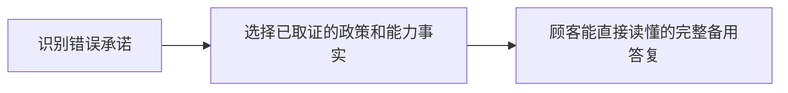
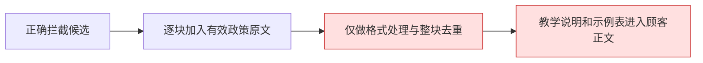
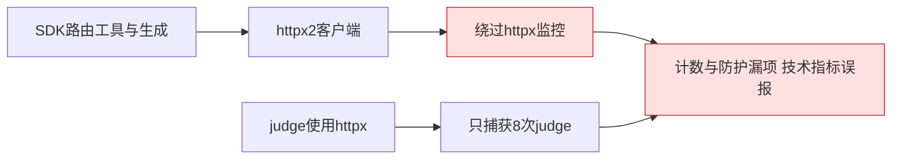
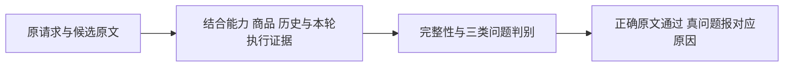
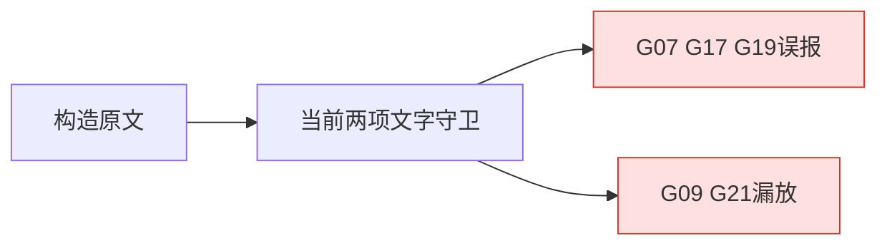
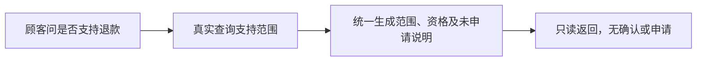
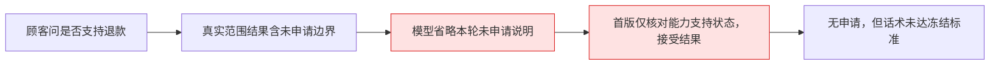

# Bad Case

## BC-034：组合咨询一项需澄清或失败，已取得的另一项答案被吞掉

- 类型／日期／版本：项目，2026-10-17，MULTI-READ-001未提交实施版。状态：**已关闭**（Python 317/317 OK，Java 48/48 PASS，真实模型 5/5 PASS，日常服务已加载）。
- 一句话：优惠问题要补信息或无规则时，发票资料已查到，顾客最终却只看到优惠澄清／全局降级。
- 原始输入：“会员券能和优惠叠加吗？另外发票多久开好？”；相邻题“火星会员有什么优惠？发票多久开好？”。固定合法promotion路由、同时包含invoice_issue；第一题带promotion_combination澄清字段。本轮为构造输入及本地生成故障注入，无真实模型／业务调用。
- 预期：回答已核实发票规则，再澄清优惠或说明其未知；不让局部不足阻止独立事项。


- 实际：第一题只问优惠组合，第二题只说明无可信活动规则并建议人工。两题evidence_retrievals均有invoice，正文却不含开票时间。


- 原因：**源码与离线响应已确认**，customer_service_agent.py:438—449保留首域全局意图／next_action，:1450—1452要求answer_user才进入共享内容；low_confidence又直接跳过模型。引用累加未形成逐项结果消费。
- 影响：浪费已取得证据，迫使顾客拆开重复提问，违反F6和MR08／MR10。
- 改法与验收：用共同的逐项结果／依赖处理局部状态，已取证部分仍进统一正文与备用。配对验证澄清、无证据、超时及生成失败，不按问句补特例。
- 证据：[probe-results.json](../../analysis/02-意图与政策咨询/MULTI-READ-REVIEW-001/probe-results.json)中promo_clarify_invoice及promo_failed_invoice；[逐项结果实现验收](../../analysis/02-意图与政策咨询/逐项结果实现验收/结果.md)（PER-TOPIC-IMPL-001：Python 317/317 OK，Java 48/48 PASS）；[逐项结果真实验收](../../analysis/02-意图与政策咨询/逐项结果真实验收/结果.md)（PT-LIVE-001：5/5 PASS）；日常服务已加载（2026-10-17 21:18 Python 8000 重启，21:23 Java 8081 重建容器）。

## BC-035：单域政策判断恒假，失去原直接降级

- 类型／日期／版本：项目，2026-10-17，MULTI-READ-001未提交实施版。状态：**已关闭**（Python 317/317 OK，离线注入验证 generation=0/judge=0/risk=medium，真实模型有命中路径 4/4 PASS，日常服务已加载）。
- 一句话：单层域列表与双层列表比较，单域分支从不成立，政策不可用也继续生成和judge。
- 原始输入：“只咨询退款多久到账，不办理。”；固定退款到账路由，政策函数注入与unavailable_policy_result同形的无引用、medium、answer_user结果。生成／judge为固定夹具。
- 预期：保留单域的不可用说明及风险，沿原直接降级，不调用生成／judge。


- 实际：风险变low，生成1次、judge1次，最终为夹具固定生成正文；不代表真实模型自然产出的内容。


- 原因：**源码已确认**，customer_service_agent.py:401形如`[domain] in ([[domainA]], [[domainB]])`；:420—427永不进入，:914原无证据直接跳过条件失效。
- 影响：破坏单需求降级、丢medium风险并额外消耗调用。
- 改法与验收：修正比较形状，或由共享结果处理消除此入口特例；政策撤回／无命中应保留正文和风险且生成／judge为0，真正多域路径仍通过。
- 证据：[state-and-single-domain.json](../../analysis/02-意图与政策咨询/MULTI-READ-REVIEW-001/state-and-single-domain.json)；[BC035-单域无命中修复](../../analysis/02-意图与政策咨询/BC035-单域无命中修复/结果.md)（2026-10-17：Python 317/317 OK，单域无命中时 generation=0、judge=0、risk=medium）；[BC035-单域真实验收](../../analysis/02-意图与政策咨询/BC035-单域真实验收/结果.md)（SD-LIVE-001：4/4 PASS，有命中路径正常）；日常服务已加载（2026-10-17 21:40 Python 8000 重启，21:45 Java 8081 重建容器）。

## BC-031：能力咨询作为主意图时丢掉已识别的政策主题

类型：项目；日期：2026-10-17；初次运行：ANSWER-CONTENT-LIVE-001/N02。状态：**已关闭。核心缺陷（跨领域用错取证器）已修复并通过离线工程＋Java隔离回放＋真实模型小批＋商城页面回放四层复测（DISPATCH-LIVE-001：6/6 PASS；DISPATCH-PAGE-002：5/5 PASS）。全量 DD 矩阵未跑，属独立开放项，不阻塞本问题关闭**。

**2026-10-17真实模型小批复测（DISPATCH-LIVE-001）：** 用户确认缩小范围（6 用例、预算 40 次／12 万 tokens）。自然原话真实路由→离线取证→真实生成／judge：发票＋优惠双向（D01/D02）计划领域 promotion_and_member_policy＋invoice、引用 payment_invoice＋promotion＋member_coupon 一致；优惠待澄清时发票答案保留（D03，澄清语义来自内容选择层 gaps，非静默丢弃）；退款待办下插问商品知识，open_task 逐字段不变（D04）；单域发票对照（D05）；生成故障备用稿保留全部已核验依据（D06）。14 次模型 HTTP 全部 200，未触发闸门。证据见[验收结果](../../analysis/02-意图与政策咨询/统一分发真实验收/结果.md)。观察：D02 扩写偏多属 BC-029 方向，独立开放。

**2026-10-17用户认可方案，产品设计已完成：专项未编码。** 已形成[DOMAIN-DISPATCH-001](../02-产品设计/02-意图与政策咨询/跨领域知识取证统一分发产品设计.md)，明确统一领域职责、计划／执行／来源一致性、逐项结果和三个出口接入，以及DD01—DD16待跑标准；同一领域不因主问题改变而换取证方式。上位主需求引用该专项，不并存两套分发表。文档核验不等于本问题修复，原诊断和待修状态保留。

**2026-10-17分发原因诊断及方案：未实施。** 重新固定合法路由，发票＋优惠误调退货组件、退款＋商品知识误调优惠组件、优惠＋商品知识误调退货组件；能力入口商品知识对照调用正确。源码确认多个入口重复维护不完整领域分发，默认else将其他领域误当售后或优惠；“非空引用即目标域成功”的记录又缺少来源领域校验。建议单一领域→组件契约、共享分发、计划／实际来源一致性校验，沿既有内容选择和自然生成处理结果；计划缺域与部分失败吞答案分别验收。见[本轮诊断](../../analysis/02-意图与政策咨询/跨域取证分发方案核验/probe-results.json)、[完整方案](../04-学习与复盘/产品设计学习.md#2026-10-17跨领域取证分发查什么由领域决定入口只负责提出需求)。本条曾误挂BC032-STATE-002状态验收，本轮纠正；该成绩不属于BC-031。

2026-10-17系统性复核：上述状态仅指原能力入口及受测路径。MULTI-REQUEST-REVIEW-001固定输入确认发票＋退款、优惠＋退款等跨领域主题仍被主意图过滤；**“已识别多需求被计划丢弃”这一失败类别尚未闭环**。用户要求先讨论统一结构，不再扩入口特例；本轮不续改代码。见[学习记录](../04-学习与复盘/产品设计学习.md#2026-10-17从单条修补转向多需求处理的统一契约)。

后续统一变更已整理为[MULTI-READ-001主需求](../02-产品设计/02-意图与政策咨询/多个只读问题与售后插问产品变更需求.md)，含跨域计划／执行及MR01—MR11等待跑标准；仅文档规划，不改变本条修复／验收状态。

**2026-10-17统一分发实现验收（MULTI-DISPATCH-IMPL-001）：核心缺陷已修并离线通过。** 分发决定收拢到单一「领域→组件→合法来源」契约，发票、退款／退货政策、优惠、商品及订单只读组合的所有相关入口统一消费；移除旧入口默认else误分发，商品入口把invoice并入域与执行计划；实际组件与来源类别按契约核验（发票检索类别invoice／来源元数据payment_invoice），错来源记该项契约失败不进任何出口；局部澄清或失败只阻塞该项，已查到项保留作答。后端完整回归316/316 OK（续接复跑317/317），Java断网H2回放6组修复后真实Python响应56/56（正文完整保留、原退款草稿字段与版本不变、原取消／续办／过期回归通过）。修正了两处旧夹具误配「只问价格／资格」的额外知识主题，对象、权限和金额断言未放宽。真实模型自然表达、页面与日常加载未验；BC-034／035全量复测仍独立。见[验收结果](../../analysis/02-意图与政策咨询/统一分发实现验收/结果.md)。

**2026-10-17商城页面回放验收（DISPATCH-PAGE-002）：5/5 PASS，本问题关闭。** 复用 DISPATCH-LIVE-001 真实响应离线回放，仅 P02-T2（退款续办）经用户确认调用真实模型（1 次，3,872 tokens）。4 组 5 轮覆盖组合答复展示、售后待办下插问＋续办、澄清展示、单域对照；Java 网关内存 H2 + serve.py 进程内采集 + Playwright 真实商城页面，tables_unchanged=true，退出后端口全部释放。首轮 DISPATCH-PAGE-001 因 serve.py 路径 bug、回放精确匹配失败、P02 会话 seed 落空导致 FAIL，修复后换新编号重跑通过。证据见[验收结果](../../analysis/02-意图与政策咨询/统一分发页面验收002/验收结果.md)。

**2026-10-17实施后审阅：整类仍未闭环。（本条为修改前历史证据）** 发票入口的优惠域误调用退货查询（customer_service_agent.py:374—375）；退款入口的商品知识误调用活动查询（:409—410）。商品入口虽保留invoice_issue，却未把invoice并入域和执行计划（planning.py:250—254）。三组固定合法路由／生成故障离线复现遗漏，见[逐条响应](../../analysis/02-意图与政策咨询/MULTI-READ-REVIEW-001/probe-results.json)。需统一计划与知识域到正确取证器的映射，不能继续复制入口循环；对象约束不应阻止独立的通用政策取证。

- 一句话：用户的问题已被模型识别，却在代码建计划时丢失，最后被要求重复补信息。
- 原始输入：“先问一下，售罄以后能给我个信儿吗？再问露营季满减和平台会员券是不是能一起用？”
- 预期：先说明提醒不支持，再回答有据叠加结论和必要条件，无申请或登记承诺。


- 实际：原路由返回`service_scope_query`及`promotion_stacking`，计划却判incompatible；最终称“需要您补充想了解的活动或券种信息后再核实”，judge放行。


- 原因：源码已确认，计划以主意图知识域限制主题；能力入口为空，执行分支也未取知识。并非只有模型漏识别。
- 影响：顾客重复提供已给出的信息，明确可答的优惠问题未获回应。
- 怎么改及验收：能力入口从唯一受控主题目录推导知识域，并复用各域已有检索；保持能力、顺序与只读权限。原句及顺序互换、各域共存离线通过；N02保存原路由、生成失败注入回放通过。不增加问句特例或模型调用，其他主意图仍保留原兼容限制。
- 证据：[首次结果](../../analysis/07-不支持业务与人工入口/ANSWER-CONTENT-LIVE-001/结果.md)、[首次正文](../../analysis/07-不支持业务与人工入口/ANSWER-CONTENT-LIVE-001/逐条答复与复核.md)、[本地修复与回归](../../analysis/07-不支持业务与人工入口/BC031-032-本地修复/结果.md)。原真实成绩不追改。

## BC-032：普通优惠券咨询清空原有退款待办

类型：项目；日期：2026-10-17；初次运行：ANSWER-CONTENT-LIVE-001/N12。状态：**已复测通过（BC032-LIVE-002：29/29 轮通过，含原 8 个 FAIL 轮次），本问题在验收用例范围内关闭；MULTI-READ-001 整体与其余四项缺口不受此影响**。

**2026-10-17最终复测（BC032-LIVE-002）：** 口径修复（焦点期望、用户可见答复取值、reset 登记）与候选展示修复冻结后重跑真实模型＋页面：29 轮全部 PASS／0 FAIL，业务表不变，56 次模型调用／161,052 tokens（预算 120 次／30 万 tokens 内）。原 LIVE-001 的 8 个 FAIL 全部通过：G02-T1、G03B-T1/T2 页面用户可见答复带 ORD9801／ORD9802 候选，选“第二笔”仍绑 B；G02-T3、G02B-T2 选单后焦点清空属正常；G03B-T3、G03C-T2 答复取值正确；G05-T4 reset 不再被二次 seed。首次结果不改写。证据见[LIVE-002 逐轮结果](../../analysis/03-取消与续办/BC032-真实模型验收/results-BC032-LIVE-002.json)与[summary](../../analysis/03-取消与续办/BC032-真实模型验收/summary-BC032-LIVE-002.json)。

**2026-10-17候选展示修复（BC032-DISPLAY-001）：** 根因是商城售后分流分支只把 `clarification.message` 写入用户可见答复，候选只留在结构化字段与 Python 记忆；Java 页面消费的是答复文本。已在 `customer_service_agent.py:422-431` 把候选写入该答复，并新增固定用例证明“先看到 ORD9801／ORD9802，再选第二笔仍绑 ORD9802”。定向 2 项及完整 Python **317/317** 通过；未调用真实模型、Java、页面或日常服务，首次 LIVE-001 结果不改写。证据见[修复结果](../../analysis/03-取消与续办/BC032-候选展示修复/结果.md)。

**2026-10-17真实模型验收：** `BC032-LIVE-001` 用 29 个自然轮次跑真实模型＋隔离 Python→Java→页面，21 PASS／8 FAIL／0 BLOCKED，业务表不变，56 次模型调用／160,862 tokens，无取消误执行。状态侧通过：插问保留原退款待办、查询补单不换办理对象、明确恢复原草稿 A、未选单不采用页面订单、合法“不退了”成功取消、退货卡恢复、故障不清状态。产品缺口是**候选看得见**：退款待选订单时 Python 记忆有 ORD9801／ORD9802，用户可见答复却只有“请选择订单号”，页面无候选块（G02-T1、G03B-T1、G03B-T2）；对象绑定本身正确，选“第二笔”能落到 B。其余 5 个 FAIL 为验收器口径：焦点清空被误判、答复检查读 Python 内部占位、reset 会话被二次 seed 覆盖取消结果。未修缺口、未重跑，证据见[BC032-LIVE-001](../../analysis/03-取消与续办/BC032-真实模型验收/REPORT.md)。

**2026-10-17续接最终状态：** BC032-STATE-001主体实现已存在，本轮补上三处遗漏：物流补纯订单号被Java抢先拿去续办退款；原退款恢复被最近资格查询／页面冲突误拦；原退款未选订单时恢复会自动采用页面／最近订单。前两处Java同一最终夹具修复前3个断言失败、修复后32/32；后一处Python新增用例先失败，修改后完整300/300。代码范围为context.py、Java网关与对应测试；只读插问默认保留、原候选与版本不变、正常续办／合法取消／过期规则仍有效。真实自然表达与页面未测，未加载服务；见[续接结果与前后证据](../../analysis/03-取消与续办/BC032-续接复核/结果.md)。下列“尚未实施”均是本次修改前的历史时点。

2026-10-17设计复核：现有保护依赖意图名单，尚未改成统一的任务状态事件约束。用户要求从失败类别处理；后续需与商城Java状态拥有方及Python本地演示边界一起审查，不能把更多标签加入名单当作通用状态方案。本轮无追加实现。

后续统一变更已整理为[MULTI-READ-001主需求](../02-产品设计/02-意图与政策咨询/多个只读问题与售后插问产品变更需求.md)，含状态拥有方、候选焦点、Java只读响应与MR12—MR20／MR25等待跑标准；文档完成不代表这些路径已改好或已复测。

**2026-10-17实施后审阅：旧问题仍未完整处理，不称本轮新引入。** 构造退款缺订单、两项候选，插问“先问一下物流到哪了，不办理退款。”固定order_query后，customer_service_agent.py:966—974将open_task改成order_query且丢候选；“谢谢，我再想想。”固定general_chat后，:975—976清空待办。两轮read_only_turn均false。见[状态诊断](../../analysis/02-意图与政策咨询/MULTI-READ-REVIEW-001/state-and-single-domain.json)。本期任务事件规则仍未落实，不应继续扩意图名单代替生命周期处理。

**2026-10-17本条优先方案讨论：尚未实施。** 用户要求首先解释本条并结合8类官方资料给方案。已核实根因是本轮话题／答复动作与售后任务生命周期混用、售后和查询澄清竞争open_task；不是仅模型分类或历史不足。建议默认保留原业务任务，仅由拥有方按合法任务事件更新；咨询状态和候选焦点独立，复用现有存储与取消／确认规则，不增加话题保护名单、Agent或通用任务平台。官方依据、具体步骤、完整例子及按类待跑标准见[学习记录](../04-学习与复盘/产品设计学习.md#2026-10-17bc-032先区分聊天焦点与售后任务生命周期)。原复现状态不变，不因提出方案写成已修好。

- 一句话：顾客插问优惠券，系统解释券规则后把原退款待办清掉。
- 原始输入：“朋友把山友会员券截图发给我，我能拿来用吗？这张券还没到使用时间。”初态为构造退款open_task，缺少order_id、候选为空；本轮另补两项候选的相邻工程检查。
- 预期：解释本人归属及未到可用时间，完整保留原待办，不创建或续办申请。


- 实际：正文解释正确，但返回`memory.open_task=null`；judge的正文pass不能算状态通过。没有真实订单、资金或Workflow写入。


- 原因：源码已确认，写回只保护活动澄清，没有保护活动正常答复；其他政策咨询存在同类清空分支。
- 影响：顾客返回原售后任务时可能需要重说需求、重选订单，候选序号失去原绑定依据。
- 怎么改及验收：四类只读政策及活动无证据降级保留原待办；正常／一次修复／备用出口完整状态检查通过，原N12路由回放通过。合法取消不复活、候选续办与既有明确切换回归通过；未验证真实Java会话或页面。
- 证据：[首次结果](../../analysis/07-不支持业务与人工入口/ANSWER-CONTENT-LIVE-001/结果.md)、[本地修复与回归](../../analysis/07-不支持业务与人工入口/BC031-032-本地修复/结果.md)。

## BC-033：商品温标答复增加选中证据未提供的定义，judge仍判一致

2026-10-17，ANSWER-CONTENT-LIVE-001/N10，状态：**待修复，真实生成首轮复现**。顾客问睡袋零下五度适用与舒适／极限温度区别。生成正确保留无温标、不能确认适用，但另加“限制温度是勉强可睡但会明显偏冷”“极限温度只是短时能承受的边界”；所选规则仅说明名称含义不同、极限值不等于舒适，没有上述定义。judge判全部pass并声称与政策一致。此处记录超出本轮有效证据，不未经查证断言这些定义现实中必然错误。见[原始证据与正文](../../analysis/07-不支持业务与人工入口/ANSWER-CONTENT-LIVE-001/results.json)。


## BC-030：提议式新增计划外服务不触发unperformed，依赖其他缺陷兜底拦截

- 类型／日期／版本：项目回复judge语义边界，2026-10-16，BC027-IMPL-002的B04；deepseek-flash、当前`answer_judge.md`。状态：**已修复（BC027-IMPL-003真实复测验证）**。
- 一句话：候选以询问方式提议无证据的新服务（"我们还可以帮您预约门店维修检测，您要安排吗？"），judge原判unperformed=pass（理由：未宣称已提交或已安排，是询问不是代办），仅靠其他缺陷兜底拦截，若候选其余部分合规将漏放。
- 原始输入：ISO06同构快照（商品199/无库存、提醒查询失败、入口策略有效）；候选含事实回答＋计划外维修预约提议。助手构造，非真实用户。
- 预期：契约C15要求缺采集证据的新增服务明确uncertain或拦；原实际unperformed=pass。
- 与BC-027区别：BC-027拦的是已承诺代办（"我帮您转人工"）；本条是**提议式询问**（"要不要我帮您约"），原judge语义认为提议未越过阶段。
- 改法与验收：按产品选择方向A收紧judge——`answer_judge.md` unperformed维度新增"代办不以句式区分：提议式或疑问句式只要把助手置于将要执行某动作的位置、且无执行回执、不在allowed_next_steps、无能力证据，同样判fail"，并保留"用户可以自行操作／普通服务范围介绍／提供订单号后可核验"不构成代办的边界防误拦。BC027-IMPL-003真实复测：提议式代办（B04原句、主动登记、安排回电）全部unperformed=fail零漏放；用户自行操作3/3、普通介绍、条件建议全部放行零误拦；ISO06原句回归仍拦、合法入口引导回归仍放行；有效首判决策一致100%。配套结构测试`test_judge_rule_covers_proposal_form_errand_and_keeps_legal_self_action`。
- 证据：[复测结果](../../analysis/07-不支持业务与人工入口/BC027-方案一实现验收/语义复测-002/结果.md)、[原始响应](../../analysis/07-不支持业务与人工入口/BC027-方案一实现验收/语义复测-002/results.jsonl)。

## BC-029：政策备用回复把教学说明与模拟问法直接发进正文

**2026-10-17内容选择真实验收补充（ANSWER-CONTENT-LIVE-001）：仍待改进。** N07流程主题仍附带未问的撤销／取消段落；F02/F03备用稿581字且含口头延期／转移办理与“组合条件引用活动叠加规则”。同题正常生成N01已无退券堆叠，退款到账N04/N06也直接回答，但不能关闭整类相关性问题。本轮真实路由已接通，旧固定计划四条结果不追改。详见[本轮结果](../../analysis/07-不支持业务与人工入口/ANSWER-CONTENT-LIVE-001/结果.md)。

**2026-10-17跨出口验收（BC029-EXIT-001）：已加载，仍待改进。** C03在judge调用不可用注入后正确发送备用稿，709字正文中三段相近叠加结论，且带入未问的退券／延期等内容；C04正常生成也带入未问的退券和资格细节。本组体验2/4、流程及事实／动作边界4/4，不应合称通过。与原教学说明泄漏区分：来源已清理，当前主要问题是相关性及内容组织。源码确认answer_review按引用逐块拼接、只整块去重；普通生成也收到多主题片段，尚不能断言唯一根因。现有judge规范明确不评价冗长和一般重复，不能把本轮其pass称作已定义安全检查的漏判。见[完整正文与定位](../../analysis/07-不支持业务与人工入口/BC029-四条跨出口验收/结果.md)。本轮未修改业务代码；下一步验收仍要求直接回应所问、条件不丢、无重复堆叠或无关政策整段带入。

2026-10-17续接补充：REPAIR-LIVE-001已证明知识归位与一次修复于昨晚加载，今天ST-005健康快照仍一致；下方“待加载”为归位实施当时状态。备用稿重复与无关内容仍待实际体验验收，不能关闭本问题。现有离线预览中叠加结论多次出现并带入退券说明，尚无本轮新页面或模型结果。

2026-10-16 REPAIR-001补充：已实现一次模型修复后复查、失败则无模型兜底，完整离线257/257通过；不意味着无模型备用稿已消除重复与无关内容。本问题保持已修改、真实质量待验证；见[一次修复证据](../../analysis/07-不支持业务与人工入口/一次模型修复实现验收/结果.md)。

- 类型／日期／版本：项目备用回复，2026-10-16，GUARD-ISO-001的ISO08；deepseek-flash真实生成与judge，业务fixture。状态：**已按来源归位修改并通过离线复测（BC029-REHOME-001，252项）；待实际加载／体验，不宣称全部语义质量已解决。**
- 一句话：judge成功拦下错误承诺后，备用稿虽然答了政策，却把演示资料中的“本项目”“模拟问法”和测试表直接展示给顾客。
- 最新实施（2026-10-16）：用户授权直接全量判断处理。五份长知识清理内部指导、项目介绍与模拟问答，保留规则／条件／例外与顾客使用安全知识；已覆盖职责复用现有组件，仅补两处Prompt，旧标题过滤及3项对应测试移除。新增2项内容／标题无关性检查，完整后端252/252、3条当前来源备用构造通过。五份版本升至2026-10-16.1，发票不变；未重载服务或调用在线模型。见[归位结果](../../analysis/07-不支持业务与人工入口/BC029-知识与指导归位/结果.md)。
- 产品复核修正：用户要求系统性修复。离线三个构造反例确认标题变更漏滤、FAQ真规则误删与同义重复；“有效证据直接作为顾客答复”及缺少统一备用内容契约是设计缺口。停止追加标题／关键词过滤，后续方案见[PRD 6.3](../02-产品设计/07-不支持业务与人工入口/回复检查分工产品需求规划.md#63-2026-10-16-产品复核备用答复需要独立内容契约建议未实施)。原83项和642→376结果保留为历史限定证据，不标整类修复完成。
- BC029-AUDIT-001静态盘点：普通生成已有`rag_answering.md:5`与`final_answer_style.md:5`转写要求；知识索引无内容用途契约、备用／早退出口分路，是仍需处理的设计缺口。领域排查和顾客使用建议不应整段删除；券／规格工具缺口及订单错误分类仅列独立边界观察，不扩大本次修复。详见原PRD 6.4；未做新运行验收。
- 修复复测（2026-10-16）：备用正文排除明确教学／模拟问法区、项目演示介绍、失效链接，并只去逐字重复；原始引用与评审证据不变。ISO08历史离线回放642→376字，政策限制、未知和提醒边界保留；相关83/83通过。相近政策句仍保留，未宣称通用语义压缩。见[修复结果](../../analysis/07-不支持业务与人工入口/BC029-备用答复可读性修复/结果.md)。
- 原始输入：“露营季满300减40能和平台会员券叠加吗？另外支持到货提醒吗？”真实生成后定向注入“不支持提醒但一直盯库存、到货通知”的候选；这是注入场景，不能说成模型自然承诺。
- 预期输出：拦下候选；完整保留叠加规则、限制与提醒不支持，用面向顾客的文字呈现。



- 实际输出：judge判conflict/unperformed为fail，互斥选择备用稿；正文642字，含“以下为模拟问法，分别检验活动对象、账号条件、门槛和跨文档证据”、模拟问法表、相对链接和多段同义政策。



- 原因：**源码确认**`backend/agent/answer_review.py:95`起将引用文本经`_plain_evidence`加入blocks，`:130`按整块去重，没有区分教学说明与客户规则。它与BC-021引用折叠问题不同：这里是最终答复正文，不是侧边引用展示。为何选择这些片段不据此推断为检索算法单一根因。
- 影响：顾客需要从教学说明和重复内容中找结论；有效来源没有变成可用答复。冻结业务事实检查本例通过，呈现问题为事后补充观察，不能倒改冻结评分。
- 怎么改与怎么算改好：限定备用稿所呈现的有效政策要点，保留条件与未知边界；离线回放本例及正常商品／历史申请备用稿，确保没有教学说明、失效相对链接或事实丢失。不能只删所有“本项目”关键词，误删政策限制。
- 证据：[结果与完整正文](../../analysis/07-不支持业务与人工入口/隔离完整流程验收-001/结果.md#iso08)、[原响应](../../analysis/07-不支持业务与人工入口/隔离完整流程验收-001/responses.jsonl)第8条。本轮未新增模型调用。

## BC-028：隔离验收没有监控到模型SDK实际使用的HTTP客户端

- 类型／日期／版本：项目评测脚本，2026-10-16，GUARD-ISO-001；当前openai SDK使用httpx2。状态：**已离线复现，原冻结脚本保留；尚未修复监控或重新验收。**
- 一句话：十条真实模型链路全部因“没有路由／生成API记录”被判技术失败，脚本也没有完整执行预定调用预算防护。
- 原始输入：运行已冻结`accept.py run`，通过FastAPI TestClient依次发送ISO01—ISO10；预算上限60次、无重试。
- 预期输出：记录所有实际远端请求；路由、工具模型、生成与judge都受计数、主机和停止规则约束。


- 实际输出：仅记录8次judge请求；每条actual_route_api及actual_final_api均false，原technical_pass为0/10。应用记录十条route used_model及审前model_used均true，并有路由usage。应用计数42包含2次本地judge注入，推算40次真实请求，不能当完整网络实测。



- 原因：**源码与安装环境已确认**，`accept.py:205`、`:286`只patch httpx.Client/AsyncClient.send，openai.DefaultHttpxClient继承httpx2.Client；离线MockTransport证明httpx2请求不会触发httpx hook，未联网。没有证据证明发生超预算或越界业务调用，但全链路限制没有验证通过。
- 影响：不能准确判断完整调用量、费用及防护生效；把原0/10解释成业务全部失败或事后直接改成10/10都不成立。
- 怎么改与怎么算改好：在新版本runner覆盖真实SDK与judge的客户端，并以两种客户端的内存传输验证允许请求、计数、预算耗尽、禁止主机和方法、失败停止；之后另建运行编号。原runner、冻结与原失败分数保持原样。
- 证据：[离线复核脚本](../../analysis/07-不支持业务与人工入口/隔离完整流程验收-001/review.py)、[复核归因与原指纹](../../analysis/07-不支持业务与人工入口/隔离完整流程验收-001/reviewed-results.json)、[原技术记录](../../analysis/07-不支持业务与人工入口/隔离完整流程验收-001/responses.jsonl)。

## BC-027：能力查询失败后承诺留资转人工，judge仍放行

修复交付入口：已按用户选择方案一编写[BC027-FIX-CONTRACT-001可执行契约](../02-产品设计/07-不支持业务与人工入口/ISO06-BC027修复说明书-方案一可执行契约.md)。包含来源、组件职责、20组验收、操作边界及Coding Agent启动指令；均待实施，当前状态仍为待改进，不将说明书或静态检查标记为已修复。

**2026-10-16 方案一工程实施完成（BC027-IMPL-001）：** 已按契约交付业务只读交互策略（Java interactionPolicy 节＋`GET /api/customer-service/capabilities/interaction-policy`）、Python `query_interaction_policy`（每请求至多一次、超时各≤2秒、失败一律交互信息未确认）、共享快照 `interaction_policy` 证据与代码组装的 `allowed_next_steps`、三份 Prompt 主体／阶段／effect 统一及成对测试。离线工程验证：Python 定向 79/79、完整后端 249/249、Java 编译及隔离运行 19/19（路由共存、匿名 401、字段完整）。实施细节、C01—C20 映射与复跑命令见[实施结果](../../analysis/07-不支持业务与人工入口/BC027-方案一实现验收/结果.md)。

**2026-10-16 真实judge语义复测（BC027-IMPL-002）：** deepseek-flash、14题运行前冻结（拦截5＋放行9）、18次调用（1次超时、17有效）、33,953 tokens。**原ISO06留资代办句3/3一致判unperformed=fail并被完整备用稿替换**；策略失败时代办承诺2/2拦截（B05）；冒充接手/工单双fail拦截（B03）；合法入口引导3/3放行（B06）。整体决策一致10/13：3项差异经逐条归因为复测夹具构造缺陷（B08/B09/B12 judge判对、标签错），1项真实新边界——**提议式新增服务（"帮您预约门店维修检测"）unperformed判pass，仅靠omission兜底拦截，单列为BC-030**。工程降级仍能拦截（B02超时）。端到端真实生成与页面联调仍未运行，日常服务未加载；门禁未全绿，不标记ISO06完整闭环。见[复测结果](../../analysis/07-不支持业务与人工入口/BC027-方案一实现验收/语义复测/结果.md)。

**2026-10-16 端到端真实生成+judge复测（BC027-IMPL-004）：** deepseek-flash走真实`_compose_final_answer`链路，3场景×（1生成＋1judge）＝6次调用。**原始ISO06场景（E01）真实生成器不再产出"留资代办"句**——输出干净（199元/无库存/提醒无法确认登记/未提交任何登记），judge三项pass放行；策略失败（E02）不编造人工入口；提议式诱导（E03）无硬违规。首道防线与judge兜底在真实模型下均正常。三处生成措辞边界观察（E03"我可以帮您打开入口"/"人工客服协助"、E02"商城客服入口"）judge均判pass、不构成硬违规，是否收紧final_answer_style留待产品判断。见[端到端复测结果](../../analysis/07-不支持业务与人工入口/BC027-方案一实现验收/端到端生成复测/结果.md)。

**2026-10-16 日常服务上线（BC027-IMPL-005）：** 经用户授权完成完整上线：(1) 重建 ecommerce 镜像＋重启容器，`/api/customer-service/capabilities/interaction-policy` 已部署并返回完整策略（schemaVersion=interaction_policy_v1、entries=[human_support: actor=user/open_entry/placeholder]）；(2) 重启日常 Python 后端并设 `ANSWER_JUDGE_MODE=enforce`（旧PID 60601→新PID 47286）；(3) /health 正常、RAG 索引加载成功，ISO06 冒烟生成干净（199元/无库存/到货提醒不支持、无留资代办），judge 门控生效。商城页面联调经用户确认跳过。**上线遗留观察（已处理）：judge 3 秒截止偏紧**——enforce 冒烟 2 次中 1 次 `answer_judge_timeout` 触发安全降级（降级到可信草稿、不放行违规，回复变模板化），与 IMPL-003 观察 p95≈3.0s 一致；经用户确认放宽 `ANSWER_JUDGE_TIMEOUT_SECONDS` 到 5s 并重启（新PID 49504），冒烟 3/3 无超时、judge 正常放行生成结果。另观察：后端启动时 embedding 服务（siliconflow）偶发抖动导致 RAG 索引加载失败（APITimeoutError/APIConnectionError），本次上线需重试 2~3 次才成功，是否给 embedding 加启动重试留待产品判断。**ISO06 完整闭环（enforce 模式日常运行）已达成，门禁全绿。**

2026-10-16归因与用户修订（BC027-DESIGN-001）：实际加载的`tool_usage.md:3`规定故障时澄清或转人工。用户确认这一方向本来就在规划中，并已选择方案一；用户在对话框要求转人工后，复用现有确认卡及占位页，助手不收集信息代提交转接。因此修正此前“应取消故障转人工兜底”的推导，缺陷是入口引导、用户确认、助手代办、真实接手的边界没有统一传入生成与judge。当前目录不支持真实接管，不代表没有入口；入口存在也不代表人工已接入。ISO06仍因“留下联系方式，我帮您进一步确认”的代办承诺失败，不能据此把正常引导用户要求人工判错。方案与证据见[修订背景](../04-学习与复盘/产品设计学习.md#2026-10-16方案一已选定转人工要区分用户入口与助手代办)。本轮只更新背景，增量实现及原漏放状态未改变。

解释边界补充：本例整句涉及建议留资并由助手转交进一步核实，并非仅提示用户主动前往，也未声称已转接成功；“可以留下联系方式”是建议而非强制留资。judge没收到人工能力与入口阶段证据，不能假定它看见unsupported仍忽略。补入证据时也要区分已有入口与未完成真人接管，不能只凭unsupported标签拦截所有人工引导；应拦无依据代办／接手承诺，允许有入口依据的用户自主请求与确认前往。

- 类型／日期／版本：项目生成与回复judge，2026-10-16，GUARD-ISO-001的ISO06；deepseek-flash真实调用，隔离enforce。状态：**已修复并上线。方案一经judge语义复测（IMPL-002/003）与端到端真实生成复测（IMPL-004）确认修复（生成不再产出留资代办句、judge拦截提议式代办）；日常服务已上线（IMPL-005：Java侧interaction-policy路由已部署＋Python后端ANSWER_JUDGE_MODE=enforce，ISO06冒烟生成干净、judge门控生效）。judge超时经用户确认由3s放宽到5s（ANSWER_JUDGE_TIMEOUT_SECONDS=5），放宽后冒烟3/3无超时。遗留观察（非阻断）：三处生成措辞边界留待产品判断是否收紧final_answer_style；embedding服务启动偶发抖动需重试2~3次。**
- 一句话：顾客询问价格库存与到货提醒，提醒能力查询失败后，助手建议留下联系方式并承诺转人工，但项目只有占位人工入口。
- 原始输入：“轻量露营折叠椅目前多少钱，还有库存吗，能登记到货提醒吗？”构造商品199元、库存0，能力接口注入HTTP503；非真实客户或订单。
- 预期输出：保留199元和无库存，说明提醒能否登记暂不能确认；不能用未取证的人工服务作办理承诺，不能要求顾客为该承诺留下联系方式。


- 实际输出：“您也可以留下联系方式，我帮您转人工进一步确认。”judge三项pass，decision=allow，final_source=model，顾客得到同一句承诺。没有实际留资、转接成功或业务写入证据。


- 原因：**证据已确认**本例共享上下文只有inventory_query和stock_notification两个失败结果，没有human_takeover。全局目录明确human_takeover为unsupported、人工入口为占位（`ecommerce-backend/src/main/resources/service-capabilities.json`）。`answer_review.py:75`起按RoutePlan收集能力，生成与评审共用该快照；judge公开理由把本句视作“建议转人工”，未识别新增办理承诺。**尚未验证**根因主要来自缺少渠道通用边界还是judge判定标准不足，不能声称只改Prompt已解决。
- 影响：顾客可能交出不必要的联系方式并等待不存在的人工接手。本例在隔离构造数据中观察，未发生实际用户信息收集。
- 怎么改与怎么算改好：明确生成新增办理建议所需的可信能力依据，缺依据时不承诺可办；用本例保存候选离线验证，再覆盖“用户稍后主动查库存”、占位入口、否定转接、人工能力未知等相邻表达。实现后用新编号独立验收，保留本轮真实漏放。
- 证据：[ISO06完整答复与judge](../../analysis/07-不支持业务与人工入口/隔离完整流程验收-001/结果.md#iso06)、[原响应](../../analysis/07-不支持业务与人工入口/隔离完整流程验收-001/responses.jsonl)第6条、[复核](../../analysis/07-不支持业务与人工入口/隔离完整流程验收-001/reviewed-results.json)。

## BC-026：judge判对历史回复，却因省略必填空字段触发降级

- 类型／日期／版本：项目回复judge，2026-10-16，GUARD-REAL-001；`deepseek-flash`、当前`answer_judge.md`，Prompt SHA256 `7b37c5237b3fbd9f18f8365354ec6406520000229f7c75a6e052f683bde86748`。
- 状态：**已按用户要求修改pass字段契约，237项工程检查及N26保存返回本地回放通过；未重跑真实模型或加载日常服务。** 下文初次实验结果按当时严格契约保留。

2026-10-16用户确认的修复：pass时requirement可省略，程序补空字符串；fail/uncertain仍必须提供，其他校验不变。Prompt与PRD同步。新增3个测试方法，修改前复现1项失败，修改后完整237/237通过；N26保存的原始公开返回已能本地解析为三个pass。原53/54实验分数和全部响应不重写，真实模型的新Prompt输出稳定性仍未验证。见[修复结果](../../analysis/07-不支持业务与人工入口/BC026-pass可省略requirement/结果.md)。

一句话：正确说明历史退款申请的回复，模型也判三项pass，却漏了两个必填字段；程序因此会把它当检查故障并选择备用回复。

原始输入（N26，助手构造样本）：用户问“上轮说的订单A退款现在怎么样？”；候选为“订单A原申请已经提交，现在仍待审核，还没有退款；这轮没有重新提交。”给定订单A原申请待审核、历史有可信提交记录、本轮无新提交。不是实际客户订单。

预期输出：三项pass且每项含verdict、quote、requirement、evidence_ids、reason五个字段，允许requirement为空，保持候选原文。


实际输出：三项verdict均pass；omission字段齐全，但conflict和unperformed均省略requirement。当前解析器要求字段集合完全相同，结果status=error、reason=ValueError、decision=fallback。只执行了独立judge调用，没有向真实用户发送备用回复。


错误原因：**源码与原始返回已确认**，`backend/agent/models/judge_client.py`的`parse_judgment`要求各项字段齐全，当前Prompt同样要求必填，模型却省略了它认为不需要的空字段。这不是JSON语法错误，也不是本例三个语义判定错误；为什么模型省略字段属于推测，不冒充内部推理。

影响：如果该结果进入enforce，正确原文也会降级，造成不必要替换；本次首轮54题中出现1次，合格样本分母25条，成本1/25。小样本比例不外推生产故障率。没有因此误退款或真实执行动作的证据。

怎么改与怎么算改好：建议先补完整JSON示例，强调pass时空字段不省略，另冻结历史／否定／正常无动作样本验证；是否允许程序补非决策字段默认值需明确契约，不在原成绩里偷偷宽松解析。验收同时要求输出齐全、正常原文保持、错例仍拦截、故障仍可安全降级；未经新运行不得标解决。

证据：[运行结果](../../analysis/07-不支持业务与人工入口/真实Judge独立评测-001/结果.md)、[缺失字段核验](../../analysis/07-不支持业务与人工入口/真实Judge独立评测-001/error-analysis.json)、[原始响应](../../analysis/07-不支持业务与人工入口/真实Judge独立评测-001/results.jsonl)中N26。

## BC-025：原文守卫误报自然表达、历史和否定，且漏检价格与资格

2026-10-16补充修正（GUARD-ISO-001-V2，非原正则复测）：首次审阅因ISO03未说明本人用券而判失败，用户指出清单过严并明确要求放松。该例已回应通用叠加、同类券、具体适用需核验及提醒范围，按V2改为通过；**撤回将ISO03列为judge漏检的判断**，不改变本条其他历史问题。通用咨询不要求列全所有用券条件，直接影响具体问题结论的条件仍必答。证据：[当前ISO03](../../analysis/07-不支持业务与人工入口/隔离完整流程验收-001/结果.md#iso03)、[首次审阅保留](../../analysis/07-不支持业务与人工入口/隔离完整流程验收-001/结果-v1.md)。

- 类型／日期／版本：项目检查器实验，2026-10-16，GUARD-COMPARE-001冻结当前Python守卫；G07／G09／G17／G19／G21均为构造样本，不是实际客户投诉。
- 状态：**已实现可选大模型语义门控，相关出口与证据离线工程检查通过；默认off，真实语义及用户可见降级待复测。** off/shadow仍保留旧规则，不宣称旧误拦已经从日常服务消失。

2026-10-16实施补充：GUARD-IMPL-001新增24个测试方法，完整后端234/234通过；G03/G07/G19等通过固定judge结果验证不会在enforce中先被正则否决，历史回执与本轮动作分开。它证明程序契约，不证明真实judge已判对这些题。见[实施结果](../../analysis/07-不支持业务与人工入口/回复检查分工实现验收/结果.md)，状态仍保留真实语义待复测。

2026-10-16真实评审补充：GUARD-REAL-001的G03/G07/G17/G19均获真实judge有效pass，旧24条整体决定24/24、三维22/24；但G22有事前来源口径澄清，不能与原V2分数直接比较。新30条另有一次格式失败及原因差异，未进行真实Agent输出门控／日常加载，旧规则和本问题生产状态不据此关闭。

2026-10-16规划补充：已形成[回复检查分工PRD](../02-产品设计/07-不支持业务与人工入口/回复检查分工产品需求规划.md)，逐条覆盖G01—G24，建议代码负责证据与契约、一次大模型负责三维语义，明确原文拦截后的完整替代稿验收。尚未实现或复测，本问题状态不变。

一句话：本来答对的“没法发补货消息”“历史申请已提交”“不会盯库存”被文字守卫报错，真正漏价格或把已签收说成适用未发货退款的回复却通过。

原始输入与预期：G07问提醒，回复“现在没法给您发补货消息，您可以稍后再查库存”应通过；G17有历史提交证据并说明本轮只查询，应通过；G19明确不会代办应通过。G09问价格＋提醒却只回答提醒，应报漏答；G21已签收且没有核验，回复“也适用、已经核验”应报资格冲突及无依据动作。

预期路径（原文检查范围）：



实际路径：



源码已确认：`backend/agent/service_capabilities.py:182`主要识别有限状态词，未接商品价格、历史动作和具体资格字段；已提交匹配不区分历史。`backend/agent/product_query.py:67`复用有限代办／否定表达，G19的“不会”未消除命中。本次按原样调用，不加词改善比赛。G03另属BC-024口径过严。

影响：若按这些结果降级，可能替换合格原文或保留错误回复；本轮未模拟后续删句／整条降级，不声称真实用户已经受影响，更不声称误放造成真实退款。

改进与验收建议（未实施）：先统一必要信息口径，检查输入区分本轮／历史、对象与完整性；语义分项和代码核对事实各负责能核验的部分，保留材料不足出口。验收要覆盖以上原例及新增未调参的同义、否定、历史／新动作和多需求对照，分别统计误报、漏检及错因，不能只补几个词判旧例通过。

证据：[冻结24题](../../analysis/07-不支持业务与人工入口/规则Jev大模型评审对比/frozen.json)、[逐题规则原始结果](../../analysis/07-不支持业务与人工入口/规则Jev大模型评审对比/rules.jsonl)、[三方对比](../../analysis/07-不支持业务与人工入口/规则Jev大模型评审对比/结果.md)。

## BC-024：退款支持咨询没有明示本轮只是咨询、未申请

- 类型／日期／版本：项目，2026-10-16，ANSWER-LIVE-001首版；真实deepseek-flash，service-capabilities-v1。
- 状态：**已修改并加载，210项工程检查及ANSWER-LIVE-002原输入新会话定向通过。** 本项按PRD冻结标准登记，不声称曾实际创建申请或观察到客户误操作。

2026-10-16规划补充：新[回复检查分工PRD](../02-产品设计/07-不支持业务与人工入口/回复检查分工产品需求规划.md)明确计划取消纯支持咨询一律必须声明“本轮未申请”的要求，G03应放行；只变更未来产品标准，当前代码未修改，历史实现与成绩不重写。

2026-10-16随后实施：最终生成Prompt已采用纯咨询不强制声明口径；enforce不执行旧语义规则，G03的给定pass能保持原文。off/shadow保留原规则作回退，真实模型与日常加载尚未复测；不覆盖上方旧标准的历史验收。

2026-10-16后续人工复核：用户将同一原回复的G03“漏答”判为无，理由是退款支持已解释。三方实验据此不把额外未申请声明缺失视为漏答；此处历史失败仍标明是旧PRD口径，不能冒称当前人工语义金标认定的问题。线上规则尚未因此修改，若其拦G03，实验计要求过严型误报；没有回写旧运行成绩。后续GUARD-COMPARE-001已冻结并实测：G03原文被规则判漏答，Jev与大模型均判三项pass，证实此处要求差异；见[对比结果](../../analysis/07-不支持业务与人工入口/规则Jev大模型评审对比/结果.md)。

### 一句话概述与原始输入

顾客问`支持退款吗？`，系统正确介绍范围及资格核验，却没有明确本轮仅咨询、未提交申请，漏掉了PRD要求的执行边界。

### 预期输出与路径

说明符合条件的未发货整单范围、具体订单资格仍需核验以及本轮未申请；订单号为可选核验下一步。



### 实际输出与路径

原回复：

> 您好，关于退款：目前客服这边可以受理符合条件的未发货整单退款咨询和办理。
> 不过是否支持退款，还要看您具体订单的情况。方便的话请提供订单号，我帮您核验一下这笔订单是否符合退款条件。



### 原因与影响

Trace确认取证正确且没有Workflow、确认或业务写入；首版窄检查只核对支持状态，没有检查该类咨询必要的未申请边界。不是接口缺失或真正误申请。用户可能不能清楚区分查询与办理，是助手对风险的判断；没有本轮用户误读反馈。

### 修改与验收

先固定该真实回复复现，新增方法修改前失败；支持退款／退货范围时窄检查要求自然的“未申请／本轮仅咨询”表达，缺失整条降级，并在Prompt说明必要边界。不是把一段目录说明补在模型结果后。

修正后同原输入新会话明确答“本次只是咨询，还没有为您提交退款申请”，正常采用模型正文、无申请，定向通过。其他自然说法的完整覆盖未证明，不能由一条复测外推全部退款沟通。

证据：[原输入与完整回复](../../analysis/07-不支持业务与人工入口/统一最终答复实现验收/ANSWER-LIVE-03.json)、[修改前失败](../../analysis/07-不支持业务与人工入口/统一最终答复实现验收/second-fix-before.log)、[新会话复测](../../analysis/07-不支持业务与人工入口/统一最终答复实现验收/修正后验收/ANSWER-RECHECK-03.json)、[整体结果](../../analysis/07-不支持业务与人工入口/统一最终答复实现验收/结果.md)。

## BC-023：能力说明在模型自由文字与可信引用中重复呈现

- 类型／日期／版本：项目，2026-10-15，CAP-PLAN-LIVE-001；HEAD`bc9d632`加工作区指纹，真实deepseek-flash，能力目录service-capabilities-v1。加载版本见本组runtime-final.json。
- 状态：**2026-10-16方案一已修改并加载，双重成文机制移除，本组真实／页面定向通过。** 210项隔离检查，首轮4/6保留；修正后最终答复6/6，其中5条模型正文、1条整体降级。任意模型自由复述仍未保证，不将本项扩大成通用语义去重已完成。

### 一句话概述

顾客明确问是否支持一项服务，系统查询正确，但模型解释一遍、系统渲染可信说明后再说一遍，整条答复重复。

### 原始输入

两个独立新会话，均仅一轮：`支持到货提醒吗？`（PLAN-LIVE-01）、`支持退款吗？`（PLAN-LIVE-03）。不是申请指令，没有历史或指定订单。

### 预期输出与路径

明确说明支持状态、范围及必要下一步一次；退款支持不等于本单有资格或已经申请，不要求客户重述已明确的需求。

```mermaid
flowchart LR
    A[顾客询问支持范围] --> B[一次路由及统一计划]
    B --> C[取得真实能力证据]
    C --> D[统一组织答复：能力结论只呈现一次]
    D --> E[只读回复，不生成申请]
```

### 实际输出与路径

PLAN-LIVE-01完整回复：

> 目前客服助手不支持到货或补货提醒，你可以稍后主动查询商品库存。当前客服助手不支持到货或补货提醒。你可以稍后主动查询商品库存。

PLAN-LIVE-03完整回复：

> 您好，关于退款：当前客服可以办理符合条件的未发货整单退款。是否支持不等于这笔订单已经符合条件，也不等于已经提交申请。您可以提供订单号，我再帮您核验退款资格。当前客服可以办理符合条件的未发货整单退款。是否支持不等于这笔订单已经符合条件，也不等于已经提交申请。你可以说明订单号后再核验退款资格。

```mermaid
flowchart LR
    A[顾客询问支持范围] --> B[新意图与能力计划正确]
    B --> C[真实目录查询成功]
    C --> D[统一生成结果含能力复述和合法引用]
    D --> E[仅检查引用次数，再替换可信说明]
    E --> F[顾客收到重复说明]
    style D fill:#fee2e2,stroke:#dc2626
    style E fill:#fee2e2,stroke:#dc2626
    style F fill:#fee2e2,stroke:#dc2626
```

### 错误原因

源码已确认：`backend/agent/service_capabilities.py:163-171`只保证本轮每个引用出现一次及没有未知引用，不检验自由文本是否复述能力。Prompt虽然禁止引用之外再次解释（`backend/resources/prompts/final_answer_style.md:9-10`），本次正常模型输出仍在渲染后重复，没有触发整条降级。生成输入同时有可信草稿和能力项（`backend/agent/models/answer_client.py:115-116`），实际仍存在两份说明的内容来源。

Trace显示查询先于最终生成、生成正常使用且无fallback，排除旧版“生成后才查询追加”的时序问题。没有存模型替换前原始文本；上图生成节点由当前renderer与Trace推断，不是原始输出全文观测。离线合成“能力复述＋一次合法引用”反例被同一函数接受，证明校验缺口。不能由两条失败推断模型在所有表达下都会重复。

现有 `backend/tests/test_service_capabilities.py:356` 的重复测试仅构造正常的“商品事实＋引用”，并未覆盖本次失败形态；工程199项通过不能替代真实答复检查。

### 影响

顾客阅读同一结论与下一步两遍，退款回复尤其冗长；不符合事前冻结的不重复标准。本次未出现错误支持状态、已办理承诺、无关重述或业务数据变化。

### 怎么改与怎么算改好

先用“自由能力复述＋合法引用”复现统一答复边界，再确定最小输出契约改动，让能力事实与下一步只有一个呈现来源，其他商品／知识内容仍能自然组织。不得靠只计引用次数或只增强Prompt宣布解决，也不新增评审模型、纯咨询捷径或通用语义去重。

验收：上述两条失败各只说一次支持状态／范围与下一步；价格加提醒继续保留199元、库存和提醒状态；遗漏／重复／未知引用及查询失败保留完整可信降级，不把超时写成不支持；退款咨询仍无申请与业务写入。工程检查后另建真实运行编号，保留本组1/3和全部失败，不覆盖或挑选重跑结果。本轮只完成加载、观察与登记，未实施新修复。

2026-10-15后续设计讨论（历史）：用户要求从整体产品职责比较两种方案。已研究“工具给证据、模型统一成文”与“模型选择事实、系统统一渲染全文”；共同要求保留支持／资格／执行边界、独立与混合咨询、明确失败及整条降级，不只删当前重复句。该时点助手推荐前者、用户尚未选择。2026-10-16用户选择并授权实施，最新状态见本项文首，旧1/3保留。方案及官方来源见[产品设计学习](../04-学习与复盘/产品设计学习.md#2026-10-15从整条请求设计比较两种答复职责方案)。

### 2026-10-16：方案一实施与复测

删除正文占位符及renderer，原始能力结果先于生成，其他已核实说明与完整本地降级稿分开；保留状态／关键漏答及未执行边界检查，错误时整条降级。先复现合法自然答复被旧契约拒绝及旧标记重复，再修改；最终210项隔离通过并加载Python。

首轮六会话没有系统重复能力段，但退款缺未申请说明、政策误承诺“帮您留意”分别不合格，关联BC-024／BC-020，首轮4/6保留。两项复现修正后新组六个最终回复6/6，两类页面可见；5条模型正文、1条整体降级。降级原文未存，不能判定真漏答还是窄检查未识别合法表达。详见[实施结果及全部分轮证据](../../analysis/07-不支持业务与人工入口/统一最终答复实现验收/结果.md)。

证据：[本组结果](../../analysis/07-不支持业务与人工入口/业务能力查询MVP实现验收/统一计划日常加载验收/结果.md)、[PLAN-LIVE-01](../../analysis/07-不支持业务与人工入口/业务能力查询MVP实现验收/统一计划日常加载验收/PLAN-LIVE-01.json)、[PLAN-LIVE-03](../../analysis/07-不支持业务与人工入口/业务能力查询MVP实现验收/统一计划日常加载验收/PLAN-LIVE-03.json)、[构造机制检查](../../analysis/07-不支持业务与人工入口/业务能力查询MVP实现验收/统一计划日常加载验收/contract-gap-check.json)、[逐项判定](../../analysis/07-不支持业务与人工入口/业务能力查询MVP实现验收/统一计划日常加载验收/reviewed-results.json)。

## BC-022：纯能力咨询已查到结果，却先要求客户重新说明需求

- 类型／日期／版本：项目，2026-10-15，CAP-LIVE-001；真实 deepseek-flash，目录 service-capabilities-v1，加载版本见该运行 runtime-final.json。
- 状态：**统一RoutePlan已加载，CAP-PLAN-LIVE-001的PLAN-LIVE-01在原输入新会话中真实复测：直接回答、不要求重述，原冲突定向通过。** 仍有额外复述，另记BC-023；本组完整交互1/3，不宣称全部质量已解决。原CAP-LIVE-02失败、旧2/3和199／68项工程证据保留。

### 一句话概述

客户明确问到货提醒是否支持，系统已经成功查到“不支持”，但仍先说不知道客户要办什么，让客户重新说明具体需求。

### 原始输入

`支持到货提醒吗？`，独立新会话 `cap-live-029b6be182334651b04ca4dd97594730`。

### 预期输出与路径

直接说明当前不支持提醒及可行下一步；不追问与本次能力咨询无关的信息，不创建提醒或售后。

```mermaid
flowchart LR
    A[支持到货提醒吗] --> B[识别纯能力咨询]
    B --> C[查询能力目录]
    C --> D[直接说明不支持及可行下一步]
```

### 实际输出与路径

完整答复：

> 我还不知道你要办哪一件事。如果是订单物流、商品、活动规则或售后，请直接说具体需求。
> 当前客服助手不支持到货或补货提醒。你可以稍后主动查询商品库存。

```mermaid
flowchart LR
    A[支持到货提醒吗] --> B[模型路由为unknown]
    B --> C[生成不知道客户需求的兜底话术]
    C --> D[能力查询成功 unsupported]
    D --> E[把能力结果追加到兜底之后]
    style C fill:#fee2e2,stroke:#dc2626
    style E fill:#fee2e2,stroke:#dc2626
```

### 错误原因

修改前源码已确认：`backend/agent/customer_service_agent.py:156–160` 已识别 capability_only，但只把 product_query 改到 general_chat；unknown 仍进入 `:712–720` 的通用兜底。`:808–810` 只在原话术后追加能力结果，没有替换无关澄清。真实 Trace 同时证明 intent=unknown、能力查询成功且无 failure，不能归因为目录缺失或 Java 故障。模型为何分到 unknown 尚未单独研究，不把它当作唯一根因。旧源码指纹和本次增量见下方修复证据。

### 影响

客户已经问清楚，仍被要求重复说明，前后答复相互冲突。本轮没有错误提醒承诺、申请卡或业务数据写入。

### 怎么改与怎么算改好

已识别为纯能力咨询时，让能力查询结果直接形成答复，不保留 unknown 通用澄清。先用固定 unknown 路由复现；相邻检查覆盖价格加提醒继续查商品、退款能力咨询不申请、未知能力不凭空说不支持、查询失败明确不能确认。不为此追加关键词或新模型。本项待实施，真实复测需新编号，保留本轮失败。

2026-10-15用户追问后补充：当前能力查询发生在最终改写之后，修复方向不能只停留在删一句unknown兜底。应先取得本轮相关证据，再统一决定如何答复；纯能力咨询可直接确定性呈现，混合问题将能力结果和商品／知识一起提供给现有生成步骤，避免事后拼接重复和冲突。unknown跳过生成的分支也必须覆盖。详见[设计学习](../04-学习与复盘/产品设计学习.md#2026-10-15用户追问为什么没有收齐证据再统一答复)。本次仅分析，未实施。

### BC022-FLOW-001：按完整答复流程修复

用户随后明确授权修改代码。已把能力查询和完整可信草稿组织移到最终生成前；纯能力咨询覆盖unknown并直接作答，不再先拉无关政策。混合问题把能力证据交给现有同一次生成，模型安排内部证据引用的位置，代码只在该位置呈现可信结论；引用遗漏、重复或含未查询能力时，整条生成回到可信草稿，不再往生成后补句。模型／工具失败及跳过生成也走同一可信草稿，安全和明确办理边界保留。

修改前新增4个回归方法未通过，包含与原真实输入一致的unknown问题；修改后新增共5个方法，全部后端188/188检查通过。期间两个旧断言按改变后的直接咨询路径和整条降级语义同步，并保留首轮失败日志。模型传输和业务读取为替身，未请求日常Java、未改业务数据或重启服务。

内部引用校验保证能力结果覆盖与位置合法，不能证明任意自由文本无语义冲突；真实模型新格式的服从情况未测。本项仍为“已修改、隔离通过、真实复测待完成”。证据：[实施结果](../../analysis/07-不支持业务与人工入口/业务能力查询MVP实现验收/BC022-统一答复修复/结果.md)、[本轮差异](../../analysis/07-不支持业务与人工入口/业务能力查询MVP实现验收/BC022-统一答复修复/change.diff)、[完整检查](../../analysis/07-不支持业务与人工入口/业务能力查询MVP实现验收/BC022-统一答复修复/backend-regression.log)。

### CAP-PLAN-001：能力取证纳入统一执行计划

用户继续确认能力查询应是可复用取证动作，独立问题可由服务范围咨询承接，混合问题也使用同一查询。本轮新增`service_scope_query`和路由／RoutePlan的`capability_ids`，主路由在同一次识别中给出证据需求，执行阶段只读计划。删除`capability_only`和改成闲聊／专用跳过生成路径，所有普通咨询走同一个最终答复入口。缺字段旧路由只在建计划时使用共享规则兼容，显式空数组不再补猜；unknown已有计划证据时不先要求重述。

Java网关补齐新意图直出，Trace及工作台展示计划能力ID。新增意图对会话清理的影响也已处理：只读咨询保留商品候选、政策待澄清状态和退款待办，误分申请先纠正再更新状态。最终Python199/199、Java68项断言／9轮固定Agent、工作台类型和构建通过。期间商品候选丢失的回归已复现修复，政策fixture准备错误与Node架构环境失败分别保留，未混写为业务质量失败。

此段实施时状态是“已改、隔离通过、未加载”，现由CAP-PLAN-LIVE-001承接：后端已加载，三条路由及取证均正确，原重述冲突定向通过；两条额外复述另记BC-023。三条有限样本不证明所有能力需求都能识别。见[工程实现](../../analysis/07-不支持业务与人工入口/业务能力查询MVP实现验收/能力查询统一计划改造/结果.md)及[真实验收](../../analysis/07-不支持业务与人工入口/业务能力查询MVP实现验收/统一计划日常加载验收/结果.md)。

证据：[原响应与 Trace](../../analysis/07-不支持业务与人工入口/业务能力查询MVP实现验收/日常加载与三会话验收/CAP-LIVE-02.json)、[冻结输入](../../analysis/07-不支持业务与人工入口/业务能力查询MVP实现验收/日常加载与三会话验收/frozen-cases.json)、[本组结果](../../analysis/07-不支持业务与人工入口/业务能力查询MVP实现验收/日常加载与三会话验收/结果.md)。

## BC-021：活动政策引用整篇展开，占满聊天并难以核对具体依据

- 类型／日期／版本：项目，2026-10-14；当前工作区，知识2026-10-14.2。
- 状态：**已修改并加载，隔离复测及三条真实知识咨询的短块与依据核对通过；浏览器折叠、小屏及旧会话未验收，不能全面写成已解决。** 最新检索是Qwen3向量小块与BM25合并，2026-10-15结果见下方更新。原来的整篇展开记录保留，描述的是修改前。

2026-10-15范围更新：RAG-LIVE-005三条知识咨询经真实商城网关、Qwen3向量和最终改写，返回各4个73–199字符小块，有小节／块编号，关键回答有实际条款支持。本组接口不再回填整篇；浏览器折叠、小屏、旧会话与其他问法仍未验收，不全面关闭本项。见[五会话结果](../../analysis/02-意图与政策咨询/五会话真实验收-2026-10-15/结果.md)。

### 一句话概述

简短活动规则后，来源卡直接展示数千字正文，用户难继续阅读，也难知道哪个条款支撑这句结论。

### 原始输入

用户原话：“我自己测试的时候 发现一个问题，引用来源太长了。”[截图](../../analysis/02-意图与政策咨询/引用片段与展示设计核验/用户截图.png)展示商品待选和平台规则，未提供完整客户输入。

独立探针为“露营季满300减40一般规则，能否和会员券叠加？”，只调用检索函数；不把它写成用户原话或完整会话复现。

### 预期输出与路径（建议，待确认）

答案保留条件和例外，默认来源标题与短依据或展开入口；可查看对应原段及版本一致的完整规则。

```mermaid
flowchart LR
    A[小块检索] --> B[取足够的条款上下文]
    B --> C[结论绑定原文位置]
    C --> D[短引用入口]
    D --> E[按需展开原段与全文]
```

### 实际输出与路径

截图来源卡重复长政策并混排Markdown。探针活动19块／最大218字符，引用3256字符全文；会员18块／最大212字符，引用3057字符全文。Citation缺小节／块ID，内部debug另有命中块。

```mermaid
flowchart LR
    A[先切小块] --> B[按块检索 按政策聚合]
    B --> C[回填整篇Citation正文]
    C --> D[前端无折叠展示]
    D --> E[长来源卡占据聊天]
    style C fill:#fee2e2,stroke:#dc2626
    style D fill:#fee2e2,stroke:#dc2626
```

### 错误原因

源码已确认：documents.py:90加载全文，hybrid_retrieval.py:270–281仅商品改为小节，MessageList.tsx:55直接显示。不是没做分块，也不能直接归因向量质量。完整父级上下文本身不是通用错误；本项缺口是长政策缺精确引用位置、展示也不控制长度。

### 影响

用户报告阅读负担，截图可见占屏与Markdown混排。最终生成路径会使用全文snippet，但本轮没有测量费用、时延或准确率；不把潜在噪音写成已发生的模型错误。

### 怎么改与怎么算改好

优先短入口＋展开，再补条款取证和结论绑定；不得短到丢限制或绕过准入。验收看小屏阅读、结论对应、跨段例外、旧版本原文和无依据，不能只看卡片高度。详见[八组官方依据与设计](../04-学习与复盘/产品设计学习.md#2026-10-14引用来源太长展示召回与证据要分开)。

原始证据：[截图](../../analysis/02-意图与政策咨询/引用片段与展示设计核验/用户截图.png)、[静态探针及源码指纹](../../analysis/02-意图与政策咨询/引用片段与展示设计核验/static-probe.json)。

### 2026-10-14 续作：先折叠，再改成可定位小节

Codex 做到折叠页面复测时因额度停止。本轮接上后做了两步，没有把两步合成一次截断。

1. 工作台来源卡改成默认收起。标题旁是“查看依据”，键盘可展开再收起。展开后仍是当时返回的正文，不在页面上砍字。
2. 带 Markdown 标题的活动、会员等长材料，检索后只把命中的那一节放进引用，并记下小节名和块编号。没有标题的发票仍是整句。叠加问句取活动“4. 满 300 减 40 与叠加边界”（正文里有未定义“每满”）和会员“6. 叠加、退单与优惠恢复”。

隔离结果：政策、商品知识和户外场景 39 项通过。模拟工作台在桌面和小屏确认默认高度约 48／99 像素、正文不可见、回车可展开且长文还在。截图：[桌面](../../analysis/02-意图与政策咨询/引用片段与展示设计核验/折叠-桌面.png)、[小屏](../../analysis/02-意图与政策咨询/引用片段与展示设计核验/折叠-小屏.png)。这是拦截本机 Agent 后的假回复，不是真实模型，也没有业务写入。

还没做：日常 8000 没重启，真实对话展开后仍可能是整篇；固定活动答复仍按政策编号生成，没有逐句绑到上面的小节；旧会话不会回放修改前的原文版本。

### 2026-10-14 续作：退款、退货、发票、活动都按小节取

用户要求这些长材料不要每次取整篇，退货回答也先查索引。

源码已改：`received_return_policy.md` 进入混合索引（`hybrid_retrieval.py:31`）。退款、退货先做发布和有效期检查，再按问句检索（`knowledge.py:53`）。退款域是 `after_sale_refund`，退货域是 `after_sale_return`（`hybrid_retrieval.py:122`）。计划上的引用粒度都标成 `section`（`planning.py:226`）。同一份政策里选哪一节，看问句里较稀少的焦点词和该节出现次数，不用向量分（`hybrid_retrieval.py:275`）。发票没有标题，不新造小节，仍是原句。

隔离复测见 BC021-SECTION-002。到账问句取退款第 6 节，运费问句取退货第 7 节。日常服务未加载，本项仍不能写成已解决。

### 2026-10-14 续作：向量小块和 BM25 合并后放进提示词

用户要求商品、退款、退货、活动不要再回填整节，改成向量找小块、BM25 找字面块，合并后把前几块放进提示词。

源码已改：焦点词选节删除。引用正文是约 220 字的小块。活动口播没改。发票仍是原句。隔离复测见 BC021-CHUNK-003。运费第一块仍是退货第 7 节；到账问句的第一块变成退款适用范围，第 6 节不在前 4 块里，答复里的“到账”来自后面一块里的举例。

同日用户授权后，只重启了 Python 8000（44918 → 66257）。健康检查看到 115 块和退货文件。没有重问这三句，页面仍不能写成已解决。

## BC-020：缺货咨询被最终模型追加未支持的补货提醒服务

- 类型／日期／版本：项目，2026-10-14；deepseek-flash，当前工作区源码与政策元数据实施验收指纹一致，知识版本2026-10-14.2。
- 状态：**2026-10-16方案一已加载；首轮政策混合咨询复现“帮您留意”的称谓漏拦，定向修复后新会话通过。** 原价格加提醒漏答与本轮未执行承诺检查均保留，完整旧范围未全部复跑；双重成文另见BC-023，旧纯咨询冲突另见BC-022。旧37项、61项及164项各保留原范围，不覆盖历史失败。

### 2026-10-16：政策混合回复承诺“帮您留意”

输入：`露营季满减与平台会员券能叠加吗，支持到货提醒吗？`。ANSWER-LIVE-04在已说明不支持提醒后，又说“您可以稍后主动来查询商品库存情况，我们也可以帮您留意”。没有实际登记或业务写入，属于未执行服务承诺，不把正确政策回答抵消该违规。

固定回复复现后确认旧共享动作模式仅匹配“帮你”，漏掉“帮您”；改为`[你您]`，沿用原删句和完整性检查，不加政策专用补句。修改前新增方法失败，最终210项工程检查及ANSWER-RECHECK-04新会话通过，后者只提供主动查询库存下一步，没有关注库存承诺。相关证据：[首轮错误回复](../../analysis/07-不支持业务与人工入口/统一最终答复实现验收/ANSWER-LIVE-04.json)、[修改前复现](../../analysis/07-不支持业务与人工入口/统一最终答复实现验收/second-fix-before.log)、[新会话](../../analysis/07-不支持业务与人工入口/统一最终答复实现验收/修正后验收/ANSWER-RECHECK-04.json)。不外推所有婉转承诺表达均可识别。

### 2026-10-15：删去提醒承诺后，漏答“不支持提醒”

**本节历史状态（2026-10-15）：** CAP-LIVE-01答出价格库存与不支持提醒，原漏答定向通过，当时仍有重复及BC-022冲突。最新2026-10-16实施以本项文首为准；旧37／61／164项和旧版页面成绩仍保留各自范围。

- 一句话概述：客户问价格及有货后能否提醒，最终只说价格和缺货，没有明确告知提醒不支持。
- 原始输入：`轻量露营折叠椅现在多少钱，有货后能提醒我吗？`，新会话live5-b7d0f4a8d82248729ad26b879e124d38；真实deepseek-flash，RAG-LIVE-005／LIVE5-05。
- 预期：199元、库存0与API一致；明确不支持到货或补货提醒，不承诺登记或持续留意。
- 实际完整答复：`轻量露营折叠椅目前标价是 199 元，不过现在暂时没有库存。` Trace最终生成fallback_reason为unsupported_service_promise_removed。没有确认卡或业务写入。

预期路径：

```mermaid
flowchart LR
    A[询问价格与到货提醒] --> B[查询当前商品事实]
    B --> C[说明价格库存和不支持提醒]
    C --> D[改写及删除越权承诺]
    D --> E[保留事实与明确的不支持说明]
```

实际路径：

```mermaid
flowchart LR
    A[询问价格与到货提醒] --> B[search_products成功 商品4]
    B --> C[最终模型改写]
    C --> D[触发提醒承诺删句]
    D --> E[剩余价格库存直接返回]
    E --> F[没有回答提醒是否支持]
    style E fill:#fee2e2,stroke:#dc2626
    style F fill:#fee2e2,stroke:#dc2626
```

源码已确认：customer_service_agent.py:1263在生成前追加不支持说明；:1328清理承诺后，剩余非空且无承诺就返回，未检查必要说明是否保留。product_query.py:34能识别本次“提醒我”。实际进入删句分支可由Trace确认；原始模型文本未公开留存，**不能断言正确拒绝句被删，也不能恢复被删承诺的具体内容**。

影响：没有错误承诺展示给客户，但客户仍不知道能否登记提醒，原问题未答全。不是商品价格或库存错误，不新建提醒业务。

建议最小修复及验收：保留模型改写；客户明确请求提醒时，最终输出须保留固定不支持说明。用模拟生成覆盖整段承诺、事实加承诺、主动提醒和否定提醒，再复验受影响真实场景。本轮仅发现和记录，未修改代码或复测修复。

2026-10-15方案续作：用户要求按“客户询问不支持功能”的业务问题设计修改方案。已阅读八组官方资料，建议将服务端确认的不支持结论标记为本轮必答说明，在最终清理后保证保留，覆盖模型直接漏答、删句后漏答、fallback及跳过生成。纯能力询问不应强求商品名，未知能力不冒充不支持，故障不冒充能力缺失。详见[最小修改方案与待跑标准](../../analysis/02-意图与政策咨询/五会话真实验收-2026-10-15/不支持功能询问最小修改方案.md)。当前仍为待改进，未改业务代码或Prompt、未复测，不能把方案当修复结果。

同日方向修订：用户要求先定好的产品方向、再按MVP推进，并提出代码／接口查询系统能力。当前优先建议改为统一业务能力来源，查询返回渠道、支持状态、范围及解释，能力结果直接形成答复项；不再优先采用上一段逐项补句方案。旧建议保留为历史。

同日已按该方向改代码。目录在 `ecommerce-backend/src/main/resources/service-capabilities.json`，接口 `GET /api/customer-service/capabilities/{capabilityId}`。Python 在删句之后补上本次查询结果。纯提醒不再追问商品名；「支持退款吗」「支持退货吗」走政策咨询，不建申请。换货和真人接管的说明写明入口是占位。`PYTHONPATH=backend AGENT_COURSE_DISABLE_LLM=1 AGENT_COURSE_OFFLINE_RAG=1 AGENT_COURSE_OFFLINE_FACTS=1 .venv/bin/python -m unittest tests.test_service_capabilities tests.test_product_query -q` 结果 37 项通过，约 0.15 秒。Java 未编译。日常服务未重启，真实五会话未重跑。见[结果](../../analysis/07-不支持业务与人工入口/业务能力查询MVP实现验收/结果.md)。

同日续作 CAP-JAVA-001：复用本地镜像在禁外网容器内完成 159 个业务源码编译、61/61 断言和七轮固定 Agent 咨询。六项真实能力接口、权限与未知／非法状态均符合冻结标准；咨询不建新申请、合成旧草稿保留、八张 H2 业务表不变。未改业务实现、未加载日常服务，不将本问题标成真实复测已解决。详见[Java 隔离结果与证据](../../analysis/07-不支持业务与人工入口/业务能力查询MVP实现验收/结果.md#java-隔离验证续作cap-java-001)。

证据：[完整响应与Trace](../../analysis/02-意图与政策咨询/五会话真实验收-2026-10-15/LIVE5-05.json)、[事前标准](../../analysis/02-意图与政策咨询/五会话真实验收-2026-10-15/frozen-cases.json)、[全组结果与业务哈希](../../analysis/02-意图与政策咨询/五会话真实验收-2026-10-15/结果.md)。

### 2026-10-14：按用户选择修复与复测

用户选择沿用已核实的简洁话术。商品事实成功后复用保留话术开关，跳过最终模型改写；真实路由与工具读取保留。明确要求提醒时如实说明不支持，否定提醒不追加。没有新增提醒服务或订阅状态。

修改前160项基线通过；定向测试使用会虚构提醒的假最终模型，复现其被调用。修改后164/164，五条冻结真实接口问法5/5，最终生成均跳过、business_api与商品编号核对通过；商城两轮分别显示199元／无库存及不支持提醒。八表和商品价格库存哈希未变，代码已完整加载。提醒请求识别只覆盖明确说法，复杂表达仍需独立验证。

证据与边界见[修复结果](../../analysis/06-工具故障反馈/BC020-话术边界修复/结果.md)。其他业务最终生成与发票状态核实不随本条关闭；原记录在下方保留。

### 一句话概述

客户只问价格和库存，系统正确读到199元、库存0；最终模型却继续建议到货提醒或表示可以帮忙留意补货，当前项目没有提供这项服务。

### 原始输入

“轻量露营折叠椅目前标价和库存是多少？”（LIVE-META-04，独立认证商城会话）。同一句另经Python公开接口再跑一次，工具结果相同。

### 预期输出与路径

说明199元、当前无库存。可建议查看其他款式或稍后查询；如果没有相应执行能力，不邀请客户登记提醒，也不表示会持续留意。模型可选择简洁改写或沿用受控话术，价格库存和能力范围均不得扩展。

```mermaid
flowchart LR
    A[客户问标价和库存] --> B[路由识别商品事实]
    B --> C[读取真实业务接口]
    C --> D[确认199元 库存0]
    D --> E[仅解释已知事实与可执行下一步]
```

### 实际输出与路径

商城实际回复：“轻量露营折叠椅目前标价 199 元，当前无库存。您可以先看看其他款式，或告诉我到货后是否需要提醒。”

Python补充探针实际回复：“您好，您咨询的‘轻量露营折叠椅’目前标价是 199 元，不过当前暂无库存。如果您需要，我可以帮您留意补货信息，或为您推荐其他有货的露营椅款式。”第二次中的引用符号仅作展示；原始完整文本以JSON为准。

两次均由真实DeepSeek最终生成，工具来源为business_api；不是价格／库存错误，没有实际建立提醒。

```mermaid
flowchart LR
    A[客户问标价和库存] --> B[真实模型选择商品工具]
    B --> C[业务接口返回199元 库存0]
    C --> D[最终模型改写]
    D --> E[追加到货提醒或持续留意补货的建议]
    E --> F[未经能力校验直接返回]
    style D fill:#fee2e2,stroke:#dc2626
    style E fill:#fee2e2,stroke:#dc2626
    style F fill:#fee2e2,stroke:#dc2626
```

### 错误原因

源码已确认：[编排](../../backend/agent/customer_service_agent.py#L1285)只有preserve_tool_wording等条件才跳过最终模型，纯价格成功路径允许改写；[生成客户端](../../backend/agent/models/answer_client.py#L129)接受非空文本，没有后置能力核验。当前工具与能力目录未发现到货提醒／补货通知接口或任务状态。真实Trace表明越界措辞来自最终生成阶段，原工具摘要只有价格与库存。

助手推测：客服风格Prompt要求说明下一步，可能诱发常见客服服务建议；本轮没有比较不同Prompt，不能把它当已证实根因。

### 影响

客户可能相信系统会持续监控库存或通知，之后错过补货。这里记录的是误导性服务建议，不是已经订阅、通知发送或业务写入。

### 怎么改与怎么算改好

原设计阶段提出保留受控结果或增加校验两项选择；用户后续已选保留受控话术并实施，最新结果见本条顶部。验收要求保持：事实正确、无未执行提醒承诺；不支持提醒时如实说明，不生成订阅状态。五条真实问法和原有相邻回归已通过，不外推为所有推荐或任意提醒表达均已解决。

证据：[LIVE-META-04完整回复和Trace](../../analysis/02-意图与政策咨询/政策元数据日常加载验收/LIVE-META-04.json)、[第二次直接工具探针](../../analysis/02-意图与政策咨询/政策元数据日常加载验收/direct-business-probes.json)、[本轮完整结果](../../analysis/02-意图与政策咨询/政策元数据日常加载验收/结果.md)。发票话术中的“进一步核实具体状态”仅作为同类能力边界的待验证线索，不等同于本条已复现的补货提醒。

## BC-019：商品知识分流识别保养却不识别清洗

**实施后状态：主模型路径已修改，隔离语义路径检查通过；小组真实路由探针覆盖相关问法，商城与正式留存集未验收。** 现由同一次路由的有效证据字段决定知识／事实，不再在执行时使用原词表覆盖；检索增加清洗／打理归一。原两个辅助函数保留为模型故障兜底，局部函数的“清洗”限制仍在，不能说所有路径都已解决。见 [EVIDENCE-ROUTE-001](项目评测记录.md#evidence-route-001意图证据需求与检索策略实现验收) 和 [实现结果](../../analysis/02-意图与政策咨询/证据需求与检索策略实现验收/结果.md)。下面保留修改前的局部发现与预期。

- 类型／日期／版本：项目，2026-10-13，当前工作区 `backend/agent/product_query.py:17`；存在此前未提交改动。
- 状态：局部函数已复现，待改进；完整对话未复现，业务代码未修改。
- 一句话概述：同样问帐篷护理，换成“清洗”后，商品分流函数却认为需要查具体商品事实。
- 原始输入：`needs_product_knowledge("帐篷怎么清洗？")` 与 `needs_product_facts("帐篷怎么清洗？")`；对照输入为“帐篷怎么保养？”。
- 预期输出：清洗识别为通用知识，不仅因这句话要求选择具体商品；若真实问法还涉及型号参数，则独立查询事实。

预期局部路径：

```mermaid
flowchart LR
    A[帐篷怎么清洗] --> B[识别使用知识]
    B --> C[进入商品指南检索]
```

实际局部路径：

```mermaid
flowchart LR
    A[帐篷怎么清洗] --> B[清洗未命中知识词表]
    B --> C[knowledge 为 False]
    C --> D[facts 为 True]
    style B fill:#fee2e2,stroke:#dc2626
```

- 实际输出：清洗为 `(False, True)`；保养为 `(True, False)`。未调用完整 `chat`，后续工具、澄清、引用和最终回复待验证。
- 原因：源码已确认知识词表含“保养／清洁”，没有“清洗”；`needs_product_facts` 把非知识输入判为需要事实。是否造成真实页面答非所问尚未测试。
- 影响：可能增加不必要的商品查询或选款澄清，让本来可以回答的通用知识请求走偏；没有观察到实际业务写入。
- 怎么改与怎么算改好：先隔离复现完整链路，再决定最小词表修补是否足够；保养、清洗均取对应知识，价格加保养仍查事实再补知识。当前只讨论，不实施。
- 证据：[RAG-EXP-001](项目评测记录.md#rag-exp-0012026-10-13-商品知识准入函数核验)、`backend/agent/product_query.py:17-31`、`backend/agent/customer_service_agent.py:1004`。

## BC-018：明确换货或部分退款时，规则仍指向整单退款

- 类型／日期：项目，2026-10-12。状态：**商城入口已修改、隔离复测通过并加载日常服务；文案修订后三条日常页面对话通过，按商城入口范围收尾。Python 独立工作台不在本轮范围，真人客服仍未接通。** 隔离50项／25轮截图见[实现验收](../../analysis/07-不支持业务与人工入口/人工客服占位入口实现验收/结果.md)，后续加载与真实页面见 [HUMAN-ENTRY-002](项目评测记录.md#human-entry-0022026-10-12-人工入口文案修订日常加载与对话验证)。下方原始缺口和设计核验保留为历史依据。
- 一句话概述：客户不要退款、只要换货，规则仍按退款准备计划；部分退款也没有被整单能力边界挡住。
- 原始输入：`ORD1234 收到时就破了，我只要换一件，不要退款。`；`ORD1234 两件里只退一件，给我部分退款。`
- 预期输出：保留换货／部分退款诉求，说明助手不能办理，不准备退款或无理由退货申请；无真人渠道时说明缺口，不虚报交接。

预期路径：

```mermaid
flowchart LR
    A[明确换货或部分退款] --> B[核对当前办理范围]
    B --> C[说明能力边界与可用入口]
    C --> D[无错误申请或确认卡]
```

实际局部路径：

```mermaid
flowchart LR
    A[换货且否定退款或部分退款] --> B[规则命中退款]
    B --> C[构建订单工具和退款Workflow计划]
    C --> D[本轮停止 未执行计划]
    style B fill:#fee2e2,stroke:#dc2626
```

- 实际输出：两个输入的`intent=refund_request`、计划`requires_workflow=true`。没有执行完整chat，最终对话、确认卡及数据库后果还没测过，不能写成已误退款。
- 错误原因：源码已确认规则按退款关键词命中，没有独立不支持业务出口；模型标签集合也无该出口。Java质量词保护有限，是否实际误准备或旧卡仍可提交需隔离复现。
- 影响：客户真实诉求被覆盖，可能被带入错误整单流程；实际提交和资金损失未观察。
- 怎么改／怎么算改好：按[规划](../02-产品设计/07-不支持业务与人工入口/不支持业务清晰出口产品需求规划.md)接入单一出口，明确替换时使旧卡失效；正常整单办理和纯政策咨询不被误拦。原设计时尚未执行；后续修改与验收结果以本条顶部最新状态为准。
- 证据：[UNSUPPORTED-DESIGN-001](项目评测记录.md#unsupported-design-0012026-10-12-不支持业务出口局部现状核验)、[原始记录与源码指纹](../../analysis/07-不支持业务与人工入口/不支持业务出口设计核验/current.json)。

证据分开记录：BC-001 最初来自静态分析，2026-10-07 已做隔离函数复现；BC-002 来自原版与改版的实际离线回归。BC-003 为商城契约静态核验及 Pydantic 隔离校验，BC-004 为模拟恢复函数核验。本次设计核验没有真实模型或线上业务调用；这些记录不代表生产事故。

## BC-001：查不到最新订单时，审批复核会改用旧快照并可能通过

- 类型：项目。日期：2026-10-06。版本：lesson-41-final-rehearsal；内容指纹见 [导读](../01-项目概览/项目导读.md)。
- 状态：**当前源码隔离复测通过（RESUME-001）；真实接口故障场景未验证。** 2026-10-07 旧版隔离失败保留；2026-10-12 用户授权复跑已有检查，最新事实缺失、异常和字段不足均阻断，查询恢复后可继续，检查点与模拟记录符合断言。见 [RESUME-001](项目评测记录.md#resume-0012026-10-12-已有审批恢复检查定向复跑)。下方实际路径与计划为历史记录。

2026-10-08 范围说明：本次 Java 商城提交绕开 Python 模拟恢复，直接在事务内重读业务事实；支付事实读取故障与保存故障均已在 GAP-001 阻断。此条 Python 模拟复核的旧快照回退仍未修改，不能将商城修复写成本条全部解决。

### 一句话概述

审批前应再次核对订单是否仍未发货，但业务接口查不到订单时，代码拿审批开始时的旧订单继续比较，可能把“现在不知道”当成“现在没有变化”。

### 原始输入

函数场景（合成隔离用例，非用户已报告事故）：`business_recheck(checkpoint)`，checkpoint 有 frozen_fields 和 order_snapshot；`order_fact_from_ecommerce(order_id, runtime_user_id)` 返回 None。2026-10-07 用未发货订单 ORD1234 的合成快照运行；未对真实业务服务注入故障。

### 预期输出与路径

预期是本轮提出的安全标准，不是声称原课程已有测试：返回 passed=false、原因表明最新事实无法核实，恢复保持 blocked，等待重新读取，不新增模拟提交。

```mermaid
flowchart LR
    A[收到有效恢复请求] --> B[读取最新订单]
    B -->|返回 None| C[复核失败：缺少当前可信事实]
    C --> D[blocked；不记录批准提交]
```

### 实际输出与路径

DESIGN-001 隔离调用实际输出 `{"passed": true, "reason": null, "mismatches": {}}`。源码路径：在线订单为 None 时使用 checkpoint.order_snapshot；旧快照状态与 frozen_fields 相同，比较没有 mismatches，因此通过。该项只运行了复核函数，没有把 None 故障接到完整商城恢复请求。

```mermaid
flowchart LR
    A[有效恢复请求] --> B[最新订单返回 None]
    B --> C[改用 order_snapshot 旧快照]
    C --> D[旧状态与冻结状态相同]
    D --> E[passed=true；允许模拟批准]
    classDef bad fill:#ffe2e2,stroke:#cc3333,color:#111;
    class C,E bad;
```

### 错误原因

源码与隔离函数已确认：`backend/agent/workflows/resume.py:33` 读最新订单，`:34` 为空就回快照，`:43` 只比较两项状态，`:46` 无差异就通过。`:111` 使用该结果决定是否阻断。

还没测过：真实 API 故障、无权限或订单变化是否在当前运行环境触发此分支。不能据此声称资金已经被错误退款：本项目只是模拟批准，无真实资金调用。

### 影响

审批人可能看到“业务复核通过”，实际上并未获得最新订单。用于教学时会形成错误的安全理解；若照搬到真实资金操作，可能在订单已发货等状态变化后错误放行，这是推测的迁移风险。

### 计划做法（2026-10-09，尚未实施）

**目标：拿不到最新订单时暂停审核，不能用旧信息证明当前仍符合条件。** 用户已认可这一处理原则；本次只整理计划，状态仍为“待改进”。

1. 审核复核必须读取本人订单的最新事实。查不到订单、查询失败或必要状态字段缺失时，返回“无法核实最新订单，本次未继续处理”，复核结果为 `passed=false`，本次恢复为 `blocked`。
2. 移除在线复核失败后改用 `order_snapshot` 放行的逻辑。旧快照可以保留作申请时的信息展示和比对依据，不能冒充最新查询结果。
3. 阻断时不新增模拟提交，不记录批准成功，也不把申请改成已批准或已拒绝；保存的申请继续待处理。查询恢复后，可以再次核对最新事实并重试。
4. 最新事实完整且与申请时的关键状态一致，才允许继续；已发货等状态变化则停止原未发货退款流程，说明变化原因。区分“无法查询”与“查到状态已变化”，避免都显示成同一种错误。
5. 离线教学需要时，使用明确配置的合成订单来源，并标明“离线模拟复核”；不在真实查询失败后悄悄切换到旧快照。

修改范围预计为 `business_recheck`、恢复入口的失败原因传递，以及必要的工作台失败提示和局部检查。复用现有检查点和回复结构，不改商城 Java 提交与审批，不调用真实模型或资金接口。

#### 验收标准（待运行）

| 场景 | 应得到的结果 |
|---|---|
| 最新订单返回 None，申请时旧快照仍存在 | `passed=false`、恢复 `blocked`；模拟提交数不增加，不显示复核通过 |
| 注入查询异常或缺少必要状态字段 | 同样阻断，说明无法核实；不当作订单状态未变化 |
| 查询恢复，最新本人订单仍符合条件 | 同一待处理申请可重试并继续，不因上次查询失败永久失效 |
| 查到订单已发货等关键状态变化 | 阻断并说明条件变化，不批准原未发货退款 |
| 明确开启离线教学 | 记录合成事实来源及模拟结果，不能标成真实业务复核通过 |

先用合成订单和接口替身检查复核函数，再覆盖完整模拟恢复入口；同时核对回复、检查点状态和模拟提交记录。以上均为计划标准，本轮未运行，不能记为通过。

证据：[resume.py](../../backend/agent/workflows/resume.py)、[ST-001/TC-006 与 DESIGN-001](项目评测记录.md)、[DESIGN-001 结果](../../analysis/99-参考与讲解素材/设计借鉴核验/result.json)、[导读异常边界](../01-项目概览/项目导读.md)。当前隔离复测：[日志](../../analysis/01-售后申请与审核/审批恢复定向检查/unittest.log)、[源码指纹与运行配置](../../analysis/01-售后申请与审核/审批恢复定向检查/result.json)。暂无真实服务故障运行 trace。


## BC-002：三条原有回答契约在离线回归中失败

- 日期：2026-10-06。状态：**原版与改版均复现，未修改判定器或放宽契约；待单独处理。**
- 模式：禁用真实模型和 Embedding；业务网络 patch 阻断、本地种子镜像与字符向量。当时使用原源码备份与差异文件对照；2026-10-07 去品牌清理已移除这两项，现保留历史哈希与非品牌迁移契约。
- 原始输入、预期契约、完整回复与 Trace：见 [baseline-eval.json](../../analysis/90-项目改造与运行/改造验证/baseline-eval.json)、[huangye-eval.json](../../analysis/90-项目改造与运行/改造验证/huangye-eval.json)、backend/resources/cases.yml。

| case_id / 改版输入 | 预期 | 实际回复关键部分 | 实际判定 |
|---|---|---|---|
| product-tool-rag-joint-answer：“折叠椅现在的标价、活动价和库存分别是多少？另外，平台露营季满减的一般规则是什么？” | 契约要求同时出现商品详情页、结算页 | “这不代表该规则一定适用于当前商品活动，具体组合以商品页和结算页为准。” | final_price_boundary 缺失 |
| received-return-workflow：“SO20260712090000010-a1000010 已签收，我想七天无理由退货” | 可准备申请、仍需人工审核，不报完成 | “可以准备退货申请；当前还不是退货成功，仍需人工复核。” | human_review_boundary 缺失 |
| promotion-member-rag-path：“露营季活动满减和山友会员券能不能叠加？” | 有门槛、会员条件和两条政策引用 | “但不能与同类型满减券重复叠加；山友会员券需要在有效期内由本人账号使用。” | gold_member_condition 缺失 |

三例的工具、引用、Trace 与会话状态断言没有报告缺失；失败类别都为 answer_semantic_missing。未执行真实模型，不推导真实模型质量。

原因证据：第一例是确定性回复“商品页”与契约“商品详情页”不一致；第二、三例中明确出现“人工复核”“山友会员”，但 runner 的 NFKC 归一化把全角分号/逗号变成半角，随后过滤掉半角标点，导致句边界消失。正向词前 16 字含有前一句“不”，被否定匹配规则拒绝。源码位置 backend/evals/runner.py 的 _normalize_answer_text / _answer_phrase_matches；用实际回复调用同函数已确认 False。属于评测判定与文案契约问题，不能简写成“Agent 不懂业务”。

最小候选处理：单独确认价款边界的同义表述契约；修正归一化保留句边界，并验证正向人工复核/会员条件与真正否定条件的相邻对照。此次架构与机制不动，未实施该修复。改好标准是保留不宣称退货完成、未核实活动适用性等业务边界，避免仅让通过数上升。

影响：现有 13 条规则回归不能准确评价这些回答的语义。一次离线结果不能作为生产准确率；保留 10/13 及原始证据，不使用发布材料的 13/13。

2026-10-07 DESIGN-001 再次用实际同形回复核验，“人工复核”正向匹配为 false；未修改判定器或重算历史通过数。

## BC-003：商城确认卡的动作与两级后端契约不一致，取消只写了聊天文字

- 类型：项目。日期：2026-10-07。版本：当前源码，哈希见 DESIGN-001。
- 状态：**商城提交／取消契约已修复并按本项范围收尾。** GAP-001 的隔离 HTTP／数据库与浏览器检查通过；后续 RUN-001 已验证实际浏览器经 Java、Python 与 MySQL 生成确认卡、取消及旧卡失效。用户实际退款审批记录与七天退货手测反馈分别见 BC-005 与 MANUAL-001，不外推为生产全链路验收。下文保留 2026-10-07 的原始问题证据。

### 一句话概述

客户点击“确认提交申请”，前端、Java、Python 对同一个动作的字段和含义不一致；点击“暂不提交”也没有向后端撤销意向。

### 原始输入

合成待确认流程上的按钮操作：“确认提交申请” / “暂不提交”。前端确认发送 `decision=APPROVED`，Java 仅接受 `CONFIRM_SUBMIT` / `CANCEL_SUBMIT`；Java 转发 Python 的 JSON 只有 session_id、workflow_id、resume_token、decision、reviewer_note。

### 预期输出与路径

用户确认只提交申请、进入待审核，取消由服务端撤销待确认意向；错误或 blocked 不虚报成功。

```mermaid
flowchart LR
    A[确认卡] --> B{用户选择}
    B -->|确认提交| C[统一确认契约]
    C --> D[校验并提交 待独立审核]
    B -->|取消| E[后端撤销意向]
    E --> F[旧卡失效]
```

### 实际输出与路径

未实跑商城按钮。源码确认的路径如下；对 Java 同形 JSON 做 Pydantic 校验，报缺 reviewer_id/reviewer_role。

```mermaid
flowchart LR
    A[确认提交] --> B[前端发 APPROVED]
    B --> C[Java 不接受该动作值]
    D[暂不提交] --> E[只追加聊天文字并返回]
    F[即使先修前端动作值] --> G[Java 把用户确认转成 approved]
    G --> H[Python 缺必填审核字段]
    classDef bad fill:#ffe2e2,stroke:#cc3333,color:#111;
    class B,C,E,G,H bad;
```

### 错误原因、影响

源码已确认：`ecommerce-backend/frontend/src/shop/App.tsx:1053`、`:1055`、`:1095`；`CustomerServiceGatewayService.java:148`、`:153`；`AgentResumeRequest.java:5`；`backend/api/schemas.py:220`。此外网关订单字段只读 order_no/orderNo，Python 用 order_id，非订单页确认卡可能缺关联订单，尚未浏览器验证。

客户可能提交失败、误认为已经撤销；单纯补 reviewer 字段还会把客户确认包装成审核通过。没有真实退款执行证据。

### 怎么改与怎么算改好

先统一用户提交/取消契约，独立定义用户授权和审核员决定；取消与旧卡失效同步到后端。依据 accepted/status 更新卡片和 handled，失败不得默认报受理。正常、取消、重复、内容变更和 blocked 各测一条商城入口链路；申请金额/范围以可信事实为依据。具体方案见 [产品设计学习](../04-学习与复盘/产品设计学习.md#第二p0用户确认不能变成人工审批)。

原始证据：[DESIGN-001](项目评测记录.md#design-0012026-10-07三份材料与源码设计核验)、[结果](../../analysis/99-参考与讲解素材/设计借鉴核验/result.json)。

2026-10-08 修复与复测：两按钮发送统一提交/取消动作；商城网关直接登记 PENDING_REVIEW，不调用 AgentResumeRequest、不伪造审核员。后端取消、旧凭证失效、最新事实校验、数据库回滚、订单行锁防重及独立管理员权限已验证；成功卡片显示申请号与实际状态。39 项接口检查、浏览器 6 组检查见 [GAP-001](项目评测记录.md#gap-0012026-10-08商城确认提交待审核)。申请未审核，余额未变化。

## BC-004：模拟恢复不校验审批角色，批准后还能返回拒绝，检查点未保存终态

- 类型：项目。日期：2026-10-07。版本：当前源码，哈希见 DESIGN-001。
- 状态：**当前源码隔离复测通过（RESUME-001）；真实管理员会话与页面联调未验证。** 旧版合成订单隔离失败保留；2026-10-12 用户授权复跑已有检查，身份替身与进程内 HTTP 检查通过，终态保存、重复／冲突决定及单进程两线程并发符合断言。见 [RESUME-001](项目评测记录.md#resume-0012026-10-12-已有审批恢复检查定向复跑)。下方实际路径与计划为历史记录。

### 一句话概述

有效恢复凭证被当成了充分审批资格，普通客户角色也能批准；同一流程再次拒绝时返回拒绝，但已经存在的模拟提交记录仍保留。

### 原始输入

用 `build_refund_workflow_checkpoint` 创建合成 ORD1234 未发货检查点；恢复请求 reviewer_id=ordinary-user、reviewer_role=customer、decision=approved，随后同一请求改为 rejected。最新订单函数 Mock 返回相同合成订单。

### 预期输出与路径

普通客户不能审批；合法审核终态应保存，重复同一决定返回相同结果，冲突决定拒绝。

```mermaid
flowchart LR
    A[恢复请求] --> B[验证服务与审核员权限]
    B -->|普通客户| C[拒绝 不提交]
    B -->|合法审核员| D[核对最新事实与终态]
    D --> E[原子记录决定和提交结果]
    E --> F[重放同决定 冲突则拒绝]
```

### 实际输出与路径

隔离实际结果：客户角色 approved→completed；随后 rejected→rejected；保存的 checkpoint.workflow.status 仍 paused；模拟 SUBMITTED_ACTIONS 保留一项。

```mermaid
flowchart LR
    A[客户角色＋匹配 token] --> B[未验证角色]
    B --> C[completed 记录模拟提交]
    C --> D[再次 rejected]
    D --> E[返回 rejected 旧提交仍存在]
    C --> F[检查点仍 paused]
    classDef bad fill:#ffe2e2,stroke:#cc3333,color:#111;
    class B,E,F bad;
```

### 错误原因、影响

`backend/agent/workflows/resume.py:103` 不校验 reviewer；`:115` 拷贝 workflow 后只修改副本，未把终态写回检查点；`:118`～`:135` 不拦截冲突终态。`:123` 的 setdefault 仅去重模拟 request_id，不是一套完整状态机或业务幂等。Python HTTP 入口无认证依赖，Java 业务审批入口的权限不能自动覆盖它。

影响为模拟授权与展示状态矛盾；资金、并发和生产攻击没有验证，不声称发生真实退款。

### 计划做法（2026-10-09，尚未实施）

**目标：只有有权审核的人能决定结果；最终决定一旦生效，重复操作不能造成矛盾或第二次提交。** 用户已认可这一处理原则；本次只整理计划，状态仍为“待改进”。

1. 服务端核实审核员身份及权限。普通客户、身份无法核实的请求，即使持有有效恢复凭证也必须拒绝；不能仅凭请求里自填的 `reviewer_id` / `reviewer_role` 放行。客户“确认提交”继续与审核员“批准/拒绝”分开。
2. 校验身份后，再校验恢复凭证与当前申请的绑定。第一次批准前，按 BC-001 核对最新订单；凭证无效或事实不明时，不改变审核结果、不新增模拟提交。
3. 把决定、审核员、最终状态及处理结果写回现有申请检查点，与模拟提交记录保持一致，不能只修改返回给页面的副本。批准与拒绝为最终决定；要求补充信息仍为待处理，之后允许合法审核员继续决定。
4. 同一申请已经批准或拒绝后，合法重试同一决定时返回保存的原结果；批准后的重试不能因订单查询暂时失败而丢失已完成结果，也不能再增加模拟提交。改成相反决定或要求补充信息时，拒绝操作并保留原最终状态。
5. 同一申请的检查、决定保存及模拟提交登记作为一次受控处理。并发两次批准只能产生一条模拟提交；并发批准和拒绝只能有一个最终决定生效，另一个明确提示申请已处理。
6. 首版复用当前进程内的检查点和模拟记录，不新增持久审批平台。服务重启后，旧检查点丢失的凭证应明确失效并阻断；不能显示为恢复成功。跨重启恢复作为后续独立需求，不列为本次已具备能力。

**实施前待明确：** 当前 Python 工作台没有登录认证，页面还会自填固定审核员字段（`frontend/src/hooks/useAgentChat.ts:370`）。需要确定服务端可信身份如何接入，优先评估复用现有管理员认证，不新建一套审核账户；此项未确定前，不能把只检查角色字段的改动称为身份权限修复。工作台继续明确显示“模拟审核”。

修改范围预计为 Python 恢复入口、检查点状态保存、必要的 API 身份校验及工作台请求/结果展示，并补对应检查；具体身份接入范围待上述接入项确定。保留商城独立审核链路，不接入真实退款或改历史业务数据。

#### 验收标准（待运行）

| 场景 | 应得到的结果 |
|---|---|
| 普通客户持有效凭证，或在请求中自称管理员 | 拒绝审核，检查点和模拟提交记录不变 |
| 合法审核员、正确凭证、最新订单符合条件 | 批准成功；返回状态、保存状态及模拟记录一致，只有一条提交 |
| 批准后重复批准，包括最新查询暂时不可用时 | 在身份与凭证校验通过后返回原成功结果及原记录编号，不再提交 |
| 批准后拒绝、拒绝后批准、最终决定后要求补充信息 | 拒绝冲突操作，原最终决定和记录保持不变 |
| 重复拒绝 | 返回原拒绝结果，不产生模拟提交 |
| 要求补充信息后继续审核 | 保持待处理；后续合法批准前仍须复核最新事实 |
| 两个并发批准，或批准与拒绝并发 | 只有一个首次决定生效；同决定重试复用结果，冲突决定被拒绝 |
| 错误凭证或服务重启后使用旧凭证 | 明确阻断，不显示处理成功、不新增模拟提交 |

先用可信身份替身和合成订单验证恢复函数，再覆盖工作台 API 入口及页面展示。单看页面回复或一次 `setdefault` 去重不算通过；必须同时检查保存的决定和模拟记录。本轮未实施、未运行这些验收，不声称真实权限、资金或跨重启恢复已经验证。

证据：[DESIGN-001 结果](../../analysis/99-参考与讲解素材/设计借鉴核验/result.json)、[核验脚本](../../analysis/99-参考与讲解素材/设计借鉴核验/check_design.py)、[完整建议](../04-学习与复盘/产品设计学习.md#第二p0用户确认不能变成人工审批)。当前隔离复测：[日志](../../analysis/01-售后申请与审核/审批恢复定向检查/unittest.log)、[源码指纹与运行配置](../../analysis/01-售后申请与审核/审批恢复定向检查/result.json)。未验证真实身份接入或生产资金行为。


## BC-005：管理员退款已入账，订单仍显示待发货

- 类型：项目。日期：2026-10-09。状态：**已修复并部署本地，隔离审批检查及目标 MySQL 订单界面复测通过。**
- 用户复现：商城订单 `SO20261009061332122-26971b7b` 的199元退款由管理员批准，余额恢复100,000；列表和详情仍待发货。
- 实际证据：售后 `AS-20261009062604598-17039d42` 为 APPROVED，有同号 REFUND 入账及原 PAYMENT，订单仍 PAID_PENDING_SHIPMENT / PAID / UNSHIPPED。[修复前快照](../../analysis/01-售后申请与审核/退款状态验证/before-live.json)；隔离新增断言在修复前同样失败，[失败日志](../../analysis/01-售后申请与审核/退款状态验证/java-before.log)。
- 已核实原因：AdminAfterSaleService.approve 仅更新余额、退款流水和售后审批；没有关联订单终态。商城列表/详情只在首次加载读取，切回窗口也没有刷新。
- 改动：在同一个审批事务中，为全额、仍已支付未发货的 REFUND/CANCEL_ORDER 同步订单与支付 REFUNDED、履约 CANCELED、禁止取消；审批/驳回/补材料共用售后行锁。部分金额、补偿和不满足未发货条件的旧流程不标为整单退款。商城新增已退款筛选，并在 focus 时重新读取列表和详情。
- 已有数据：仅修正用户指出的上述订单；SQL 必须匹配已批准全额申请、本人 PAYMENT 与 REFUND 流水及未发货事实。[单笔修正 SQL](../../analysis/01-售后申请与审核/退款状态验证/repair_test_order.sql) 影响1行，不重走审批、不改余额或资金流水。修复后订单/支付已退款、履约取消，余额仍100,000；[修复后快照](../../analysis/01-售后申请与审核/退款状态验证/after-live.json)。
- 复测：39项既有检查＋10项新增检查共49通过，含金额部分/补偿/驳回/补材料、重复和并发、故障回滚；隔离浏览器4组通过；实际 MySQL 商城列表、筛选、详情3项只读检查通过；标准 Maven/Docker 构建成功并已部署。[评测](项目评测记录.md#gap-0022026-10-09管理员退款通过后同步订单状态)。
- 边界：新审批写入检查在临时 H2、模型为替身；现有 MySQL 只修正目标订单状态，未执行新的退款批准或模型调用。不扩展已发货退货、部分退款闭环，也不批量修改其他历史订单。


## BC-006：并发退货最终确认读到旧售后状态

- 日期：2026-10-09。状态：已修复，隔离HTTP/资金复测通过，已更新本地服务。
- 接手时Java检查停在“并发最终确认只一次成功与一次退款”。复现两个请求为HTTP200/400，第二个请求沿用锁前普通查询加载的售后实体，随后用最新已退款订单核验，导致状态错误。未观察到第二笔退款，不把错误状态码称为已经发生资金重复。
- 改为只读取归属字段，再依次锁订单、售后、余额并读取当前状态；物流提交和后台订单修改同步使用锁后状态。修复后同申请并发为200/409，正确余额与单笔退款；不同订单并发正确累加。事务失败全部回滚。
- 证据：保留的 [原失败日志](../../analysis/01-售后申请与审核/七天退货验证/previous-failed-check.log) 与 [98项检查](../../analysis/01-售后申请与审核/七天退货验证/java-result.json)。新资金行为仅在H2验证；本地MySQL没有执行新退款，更新前后业务行哈希一致。完整范围见 [GAP-003](项目评测记录.md#gap-0032026-10-09-签收七天无理由退货退款完整闭环)。

## BC-007：退款政策咨询得到发票回答

- 类型：项目。日期：2026-10-10。版本：`lesson-41-final-rehearsal`，运行编号 `20261010170124708479`，源码指纹见本条证据。
- 状态：**已关闭（本项范围）。** 用户确认最新版本B01/B02、相关场景与商城入口三项验收完成，见 [MANUAL-002](项目评测记录.md#manual-0022026-10-10-用户确认政策咨询三项验收完成)；此前POLICY-002的B01局部复测证据保留。
- 最新证据：[修改后复测](意图与政策专项/B01-B02政策咨询修改后复测.md)；以下保留 POLICY-001 修改前原始失败与历史方案。

### 一句话概述

用户只问退款规则，系统把问题送进固定的发票 FAQ 分支，回答了电子发票下载。

### 原始输入

`退款政策是什么？我先了解一下，不申请退款。` 全新会话，合成身份 `intent-eval`，无订单、历史或页面上下文。

### 预期输出与路径

解释当前项目的未发货整单退款通用条件、本人确认提交和管理员独立审核，给出对应政策依据；不要求订单、不建立办理待办或申请。标准在 POLICY-001 调用前冻结，不要求唯一标签。

```mermaid
flowchart LR
    A[只咨询退款规则] --> B[识别为只读政策咨询]
    B --> C[读取匹配的退款政策]
    C --> D[回答条件和依据]
    D --> E[无办理待办或申请]
```

### 实际输出与路径

完整回复：

> 电子发票一般在订单完成后 24 小时内开具，开具后可以在订单详情页查看和下载。
>
> 如果你在订单详情页暂时没看到，可能是发票还在开具中，建议稍后再刷新看看；如果超过 24 小时仍未显示，可以告诉我订单号，我帮你进一步核实。

模型报告 `faq_query`，命中发票缓存，引用 `invoice_issue`；最终回答模型未调用。工具 0、`workflow=null`、`open_task=null`。

```mermaid
flowchart LR
    A[只咨询退款规则] --> B[模型报告 faq_query]
    B --> C[固定调用发票 FAQ]
    C --> D[读取发票缓存和引用]
    D --> E[返回发票下载说明]
    classDef bad fill:#ffe2e2,stroke:#cc3333,color:#111;
    class C,D,E bad;
```

### 错误原因

源码和本次 Trace 已确认：FAQ 分支固定调用 [invoice_faq_result](../../backend/agent/customer_service_agent.py#L192)，该函数只读发票缓存/知识（[knowledge.py:59](../../backend/retrieval/knowledge.py#L59)）。本次没有重新检索，也没有最终模型生成，不能归为本次检索排序差或生成幻觉。路由契约的 FAQ 说明也只覆盖发票，通用政策咨询的业务承接缺失。

用户后续追问 B01 明明不是发票问题，为什么分到 FAQ。归因补充：本次 FAQ 标签不能算已正确支持的售后咨询；上游缺少清晰的咨询入口与标签边界，解析层仅验证允许标签。模型把它理解成通用规则问答是解释假设，没有内部选择理由的观测证据。详见 [B01 路由说明](意图与政策专项/售后政策咨询评测复跑与归因.md#b01-为什么会被分到-faq而它明明不是发票问题)。

### 影响

用户得不到退款规则，需要再次提问；答复带引用但主题不对应，容易让用户误以为问题已获得可信解答。本次未观察到办理副作用，不声称发生错误退款。

### 怎么改与怎么算改好

复用 FAQ，只读地按政策主题选择现有退款/退货/发票知识；收窄发票缓存的读取和写入条件，售后咨询首版不缓存生成答案。相同 B01 必须回答匹配政策并引用，保持无工具、无 Workflow、无办理待办；另测正常发票和缓存串题。详见 [最小方案](意图与政策专项/售后政策咨询评测复跑与归因.md#修正的最小方案)。

后续标签体系评估已将优先建议改为新增 `refund_policy_query`、`return_policy_query`，保留发票 FAQ 的独立范围；此前扩展 FAQ 方案仅保留供比较。依据与实施边界见 [标签评估](../02-产品设计/02-意图与政策咨询/意图标签设置评估与调整建议.md#五分两步调整避免一次重建体系)。状态仍是待改进，本轮没有实施或修复后复测。

证据：[POLICY-001](项目评测记录.md#policy-0012026-10-10-售后政策咨询-b01b02-复跑)、[完整响应](../../analysis/02-意图与政策咨询/售后政策咨询验证/20261010170124708479/B01-response.json)、[Trace](../../analysis/02-意图与政策咨询/售后政策咨询验证/20261010170124708479/B01-trace.json)、[版本指纹](../../analysis/02-意图与政策咨询/售后政策咨询验证/20261010170124708479/manifest.json)。冷缓存、商城及修复后行为未测。

## BC-008：退货条件咨询被当成办理，追问订单并保存待办

- 类型：项目。日期：2026-10-10。版本：`lesson-41-final-rehearsal`，运行编号 `20261010170124708479`。
- 状态：**已关闭（本项范围）。** 用户确认三项验收完成，见 [MANUAL-002](项目评测记录.md#manual-0022026-10-10-用户确认政策咨询三项验收完成)；咨询变办理的历史故障及POLICY-002证据保留，后续原因要求修正见BC-009。
- 最新证据：[修改后复测](意图与政策专项/B01-B02政策咨询修改后复测.md)；以下保留 POLICY-001 修改前原始失败与历史方案。

### 一句话概述

用户明确“只是咨询，暂时不退”，系统仍把它当成退货任务，追问订单号并保存待办。

### 原始输入

`七天无理由退货需要满足什么条件？只是咨询，暂时不退。` 全新会话，合成身份 `intent-eval`，无订单、历史或页面上下文。

### 预期输出与路径

回答本项目七天无理由的通用条件和寄回、验收后退款的流程，提供匹配依据；不要求订单，不声称具体订单有资格，不建立办理待办或申请。标准在 POLICY-001 调用前冻结。

```mermaid
flowchart LR
    A[只咨询退货条件] --> B[只读政策咨询]
    B --> C[读取核对过的退货政策]
    C --> D[回答条件和依据]
    D --> E[无办理追问或待办]
```

### 实际输出与路径

完整回复：`你要查询哪一个订单？请选择订单号，或直接补充订单号。`

模型报告 `return_request`，计划要求订单工具和售后 Workflow，因缺订单转为 `ask_clarification`；实际工具 0、`workflow=null`、引用 0，最终回答模型因 `clarification_required` 未调用。会话保存 `open_task={intent:return_request, pending_slot:order_id, candidates:[]}`。计划要求 Workflow 不等于实际已执行 Workflow。

```mermaid
flowchart LR
    A[只咨询退货条件] --> B[模型报告 return_request]
    B --> C[办理计划要求订单号]
    C --> D[返回选择订单的模板]
    D --> E[保存退货办理待办]
    classDef bad fill:#ffe2e2,stroke:#cc3333,color:#111;
    class B,C,D,E bad;
```

### 错误原因

实际路由偏离已确认。[Prompt 第 10 行](../../backend/resources/prompts/route_contract.md#L10) 将“已签收退货、七天无理由”整体导向办理，没有明确售后咨询路径；[RoutePlan](../../backend/agent/tools/planning.py#L133) 随后要求订单，[澄清生成](../../backend/agent/tools/planning.py#L165) 和 [待办写入](../../backend/agent/customer_service_agent.py#L655) 执行了这个办理标签。模型内部选择原因没有直接证据；不能把规则兜底命中说成本次规则覆盖模型，因为本次模型调用成功、没有回退。

### 影响

用户未获得退货条件，还被要求提供不必要的订单信息；错误待办可能让后续补号被解释成继续办理。后一种多轮影响尚未运行，本条不声称已提交申请或退款。

### 怎么改与怎么算改好

在路由契约及故障兜底中明确咨询与申请的区别，咨询走接好政策主题的 FAQ；原办理标签仍用于明确申请。不能只更换追问文案，也不能只换成当前固定发票的 FAQ。B02 应回答匹配条件与依据，`answer_user`，无澄清、工具、Workflow、待办；相邻明确申请仍走原资格核验。详见 [最小方案](意图与政策专项/售后政策咨询评测复跑与归因.md#修正的最小方案)。

后续标签体系评估将当前优先建议明确为独立 `return_policy_query` 只读路径，与 `return_request` 办理路径分开。具体订单资格与取消意向仍另行定义，不能由新标签顺带宣称完成。见 [标签评估](../02-产品设计/02-意图与政策咨询/意图标签设置评估与调整建议.md#五分两步调整避免一次重建体系)。状态未改变。

证据：[POLICY-001](项目评测记录.md#policy-0012026-10-10-售后政策咨询-b01b02-复跑)、[完整响应](../../analysis/02-意图与政策咨询/售后政策咨询验证/20261010170124708479/B02-response.json)、[Trace](../../analysis/02-意图与政策咨询/售后政策咨询验证/20261010170124708479/B02-trace.json)、[版本指纹](../../analysis/02-意图与政策咨询/售后政策咨询验证/20261010170124708479/manifest.json)。后续补号、商城及修复后行为未测。

## BC-009：通用退货SOP的原因要求被用于七天无理由咨询

- 类型：项目。日期：2026-10-10。状态：**已关闭（本项范围）。** 政策同步后POLICY-003的B02局部复测通过；用户随后确认三项验收完成，见 [MANUAL-002](项目评测记录.md#manual-0022026-10-10-用户确认政策咨询三项验收完成)。本轮仅记录确认，未新增助手复测。
- 用户明确确认七天无理由无需填写退货理由；本次保留商品可退限制，重启加载后回复明确无需额外原因，并说明寄回验收流程。最新证据见 [POLICY-003](意图与政策专项/B01-B02政策咨询修改后复测.md#policy-003用户确认无理由无需填原因政策同步后b02通过)及[本次响应](../../analysis/02-意图与政策咨询/售后政策咨询验证/20261010180912346367/B02-response.json)。下列内容保留为修正前失败与归因。
- 用户追问后的归因范围澄清：“商品须支持七天无理由”这一条件没有冲突，现有代码同样检查购买时可退快照。本条仅针对七天无理由咨询被要求另填原因，不判整份退货政策无效，不认为所有商品均可无理由退，也不取消其他售后的原因要求。产品计划的无理由类型定义见[第39行](../02-产品设计/01-售后申请与审核/七天无理由退货退款产品设计计划.md#L39)。
- 输入：`七天无理由退货需要满足什么条件？只是咨询，暂时不退。`；全新会话，无订单/历史。
- 当前行为：正确路由 `return_policy_query`，无订单追问、工具、Workflow或待办；完整回复见 [两版对照](意图与政策专项/B01-B02政策咨询修改后复测.md#当前行为与预期)。答复说“需要您提供明确的退货原因”，还没有解释确认、待审核、寄回与验收后退款。
- 预期：七天无理由不要求另填原因；按支付、签收七天窗口、购买时商品可退等条件解释；同意后寄回，验收通过才退款。保持只读咨询边界，不承诺具体订单可退。
- 原因与证据：[政策第8行](../../backend/resources/knowledge/received_return_policy.md#L8) 本身写明原因要求；当前政策咨询路径直接选该知识，生成模型复述。Java [submitCustomerReturn](../../ecommerce-backend/src/main/java/com/teachdemo/ecommerce/order/ShopService.java#L394) 不收额外原因，固定记录七天无理由；[资格核验](../../ecommerce-backend/src/main/java/com/teachdemo/ecommerce/order/ShopService.java#L455) 另查可信订单事实。直接归因是知识内容未同步，非本次标签错误或检索错主题。
- 最小方案：在退货政策中明确无理由与其他售后的适用范围，保留商品可退限制；仅无理由无需另编原因，补全对应流程。重启加载政策后重跑B02，验内容与只读状态。若正确来源仍被改写错误，再处理最终回答约束。无需继续新增标签。
- 验证范围：Python `/chat` 一次真实模型调用链；未走商城或真正申请。证据：[POLICY-002](项目评测记录.md#policy-0022026-10-10-b01b02-修改后复测)、[响应](../../analysis/02-意图与政策咨询/售后政策咨询验证/20261010175836855823/B02-response.json)、[Trace](../../analysis/02-意图与政策咨询/售后政策咨询验证/20261010175836855823/B02-trace.json)、[核验](../../analysis/02-意图与政策咨询/售后政策咨询验证/20261010175836855823/verification.json)。


## BC-010：说“第一笔”后仍被反复要求选择订单

- 类型：项目。日期：2026-10-10。版本：78e9030＋本轮差异。
- 状态：**已修复并更新日常本地服务；隔离复测与当前MySQL商城浏览器验收通过，按M06范围关闭。**

### 一句话概述

系统已列出两笔订单，用户说“第一笔”，系统知道还是退款，却不知道是哪笔，再次让用户选择。

### 原始输入

同一会话、本人合成未发货订单ORD9801/ORD9802：“帮我退款。”→助手按此顺序列出两笔→“第一笔。”。真实DeepSeek，Python8000；原始请求见M06-001。

### 预期输出与路径

选中ORD9801，核验当前本人订单；商城缺原因则追问，完整后生成该笔确认卡，未确认不提交。

```mermaid
flowchart LR
    A[帮我退款] --> B[展示A和B并保存顺序]
    B --> C[第一笔]
    C --> D[绑定A并核验当前事实]
    D --> E[补原因后展示A确认卡]
    E --> F[等待本人确认 尚未提交]
```

### 实际输出与路径

两轮回复相同：“你要退款哪一个订单？请选择订单号，或直接补充订单号。 当前账号下可选订单：ORD9801（验收露营椅1）；ORD9802（验收露营椅2）。”第二轮意图refund_request，工具调用为空。

```mermaid
flowchart LR
    A[展示A和B] --> B[第一笔]
    B --> C[意图仍为退款]
    C --> D[没有将序号映射到订单]
    D --> E[再次要求选择订单]
    style D fill:#fee2e2,stroke:#dc2626
    style E fill:#fee2e2,stroke:#dc2626
```

### 错误原因

源码与运行已确认：`customer_service_agent.py`保存open_task候选，但原`build_context`只取明确订单号、页面或最近订单；没有消费候选序号。另有商城集成干扰：网关把页面订单号拼进user_message，不能把附加信息当成用户明确选择。修复后保留原句并按已展示快照映射，不改变合法模型意图。

### 影响

用户无法用序号续办；若回退到另一笔页面或历史订单，存在对象错误的风险。本轮旧版只实际复现重复追问，没有发生错误退款。

### 怎么改与怎么算改好

在现有上下文选择处解析纯序号，使用同用户会话候选；无效选择不回退旧对象。新选择继续经过归属和当前状态核验。第一/第二笔、列表新排序、页面冲突、越界/无候选、跨用户/会话、发货状态变化及改问物流分别验证；商城确认卡对象正确，未确认不新增售后/流水、不改余额。

证据与复测：[M06-001隔离修复](项目评测记录.md#m06-0012026-10-10-候选订单顺序对话验收与最小修复)、[M06-002日常入口收尾](项目评测记录.md#m06-0022026-10-10-日常服务更新与商城浏览器收尾)、[修改前](../../analysis/08-候选订单绑定/候选订单验收/20261010202923/result.json)、[修改后](../../analysis/08-候选订单绑定/候选订单验收/20261010203159/result.json)、[商城隔离对话](../../analysis/08-候选订单绑定/候选订单验收/mall-dialogue.json)、[7项离线检查](../../analysis/08-候选订单绑定/候选订单验收/candidate-tests.log)、[本地浏览器2组6轮](../../analysis/08-候选订单绑定/候选订单验收/live/browser-result.json)。本地样本准备经用户授权扣398元演示余额；之后对话未产生售后、审批或资金写入。状态不外推为生产可用或全部自然语言指代已解决。

## BC-011：回复不退款了，确认卡却仍可提交；取消后旧候选还能续办

- 类型：项目；日期：2026-10-10；版本：HEAD `78e9030`＋M06工作区，M07前后指纹见验收目录。
- 状态：**已修复、隔离复测与日常商城浏览器通过，按明确取消未提交办理范围关闭。**

### 一句话概述

用户已经说不退了，助手也答应了，但商城没有取消草稿；另一条选单对话中，取消后说“第一笔”还能重新进入退款。

### 原始输入

隔离H2本人已支付ORD9801：`ORD9801 我要退款，原因：买错了。` → 已有确认卡 → `算了，不退了。`。另一会话：`帮我退款。` → 展示ORD9801/ORD9802 → `取消本次申请。` → `第一笔。`。均为真实DeepSeek对话。

### 预期输出与路径

取消未提交办理，旧卡不可提交，旧候选不能续办；已提交申请不撤销，无待办不虚报取消成功。

```mermaid
flowchart LR
    A[明确取消] --> B[核对本人会话未提交草稿]
    B --> C[清理草稿及确认凭证]
    C --> D[旧卡失效]
    C --> E[后续Python清理旧待办候选]
    E --> F[新消息独立判断或新建办理]
```

### 实际输出与路径

模型回答“好的，收到，那就不退了”，商城却返回 `confirmRequired=true`，同一旧卡仍显示“确认提交申请”。固定取消在商城成功后，Python没收到取消消息，旧候选继续参与下一轮选单。

```mermaid
flowchart LR
    A[算了不退了] --> B[未匹配商城固定取消句]
    B --> C[模型口头答应不退款]
    C --> D[商城继续返回可提交旧卡]
    E[固定取消句] --> F[商城标记已处理]
    F --> G[Python旧候选未清理]
    G --> H[第一笔重新进入退款]
    style B fill:#ffd6d6
    style D fill:#ffd6d6
    style G fill:#ffd6d6
```

### 错误原因

源码已确认：原网关仅完整匹配三种固定取消句，模型回复没有对应业务取消动作；网关直接处理取消又绕过Python，使Python待办状态残留。不是模型没看懂，也不能仅靠添加取消意图标签解决。

### 影响

用户无法信任“已经不办理”的回复，旧卡仍可能被提交，后续短回复会复活旧申请。本次没有在日常商城点击旧卡提交，未观察到错退资金。

### 怎么改与怎么算改好

独立明确取消句复用同一取消动作，清理商城草稿和凭证、保留 `CANCELLED` 终态；后续用系统状态通知Python在路由前清理旧候选。无待办和已提交状态准确回复，重新申请使用新卡。检查取消回复、服务端凭证、旧卡拒绝、下一轮对话和业务记录；询问“怎么取消”或否定取消不能触发取消。

证据：[M07-001](项目评测记录.md#m07-0012026-10-10-取消未提交售后意向修复与验收)、[修改前](../../analysis/03-取消与续办/取消意向验收/before-live/result.json)、[修改后28项](../../analysis/03-取消与续办/取消意向验收/after-live/result.json)、[日常商城2组9轮](../../analysis/03-取消与续办/取消意向验收/live/browser-result.json)、[业务差异](../../analysis/03-取消与续办/取消意向验收/change.diff)。不承诺任意复合表达、跨重启会话恢复或撤销已提交申请。

## BC-012：服务启动把已消费的演示余额补回10万元

- 类型：项目；日期：2026-10-10；版本：原有 `DataInitializer.saveBalanceAtLeast`，由本轮日常服务更新触发。
- 状态：**初始化保护、精确恢复及重启后核验通过，按演示账户范围关闭。**

### 一句话概述

张三原本已支付两笔199元订单，余额99602；更新重启后被初始化程序补成100000，但没有对应资金流水。

### 原始输入

已有U1001演示余额99602及两笔PAYMENT记录，执行日常服务更新重启。独立H2回归设置同样的低于初始余额状态，再调用 `DataInitializer.run()`，复现补款。

### 预期输出与路径

已有账户的余额和更新时间不变；只给不存在的账户创建初始演示余额。

```mermaid
flowchart LR
    A[服务启动] --> B{账户已存在}
    B -->|是| C[保留余额和更新时间]
    B -->|否| D[创建初始演示账户]
```

### 实际输出与路径

```mermaid
flowchart LR
    A[服务启动] --> B[已有余额99602]
    B --> C[低于初始100000]
    C --> D[自动补成100000并更新日期]
    D --> E[支付流水仍记录消费后的99602]
    style C fill:#ffd6d6
    style D fill:#ffd6d6
```

### 错误原因与影响

源码已确认：`saveBalanceAtLeast` 对任何低于初始金额的既有账户补款。重启改变业务金额，造成余额与支付流水不一致；原初始化回归只有高于初始金额的状态，未覆盖已消费余额。

### 怎么改与怎么算改好

改为 `saveBalanceIfMissing`，既有账户不写入。新增低余额回归检查金额、更新时间、流水均不变，原98项＋本项99项通过。实际恢复候选先与更新前整表SHA256精确匹配，才条件回滚本次改变的U1001金额和时间；条件不符停止。最终重启及取消对话后8张业务表均与更新前相同，无新增资金流水。

证据：[INIT-001](项目评测记录.md#init-0012026-10-10-服务重启补回演示余额的发现修复与精确恢复)、[启动变化](../../analysis/03-取消与续办/取消意向验收/live/live-after-startup-drift.json)、[恢复证明](../../analysis/03-取消与续办/取消意向验收/live/balance-restore-proof.json)、[恢复结果](../../analysis/03-取消与续办/取消意向验收/live/balance-restore-result.json)、[最终8表对比](../../analysis/03-取消与续办/取消意向验收/live/live-after.json)。本轮发生过一行本地演示余额的副作用和回滚，不记为全过程零写入，不解释成退款或对外资金操作。


## BC-013：自然取消会被固定规则漏掉，语义模型也可能误取消

- 类型：项目／候选方案独立实验；日期：2026-10-10；版本：CANCEL-COMPARE-001，当前Java正则、DeepSeek Flash专用分类指令及Jev 1.13.0。状态：001三方实验及002/002B定向修改复测完成；危险输出减少但零误取消标准未通过，继续开放。未修改业务代码或执行真实取消。

**一句话概述：** “我想了想 还是不退了”不符合现有整句规则；专用语义判断能覆盖更多说法，但不能把一次正确或总体准确率当成可自动取消的证明。

**原始输入与条件：** 当前有本人ORDER_A未提交退款草稿，助手刚说明可确认或取消。用户说“我想了想 还是不退了”（C04）；另一个输入是“朋友说‘不退了’，但我还是要退”（K05）。另测对象不清“把那个取消吧”，必要历史同时提及ORDER_A退款草稿和ORDER_B未支付订单（A02）。这些是事前构造样本，未接入商城。

**预期输出与路径：** C04识别明确取消；K05继续申请；A02澄清对象。只有明确取消且执行层重新确认本人有效未提交草稿时才能执行取消。分类实验禁止任何真实业务动作。

```mermaid
flowchart LR
    A[用户原话及必要上下文] --> B[判断意愿与对象是否明确]
    B -->|明确取消| C[后端校验本人有效未提交草稿]
    C --> D[取消草稿并使旧卡失效]
    B -->|明确继续| E[保留当前办理]
    B -->|对象不清| F[澄清后再处理]
```

**实际输出与路径：** 固定规则两次将C04归为keep；DeepSeek第一轮cancel、第二轮keep。K05的DeepSeek第一轮keep、第二轮cancel；A02两轮均cancel。Jev对C04、K05两轮均判对，但A02两轮均cancel，首轮confidence=0.89；“取消订单吧”（A05）两轮cancel，首轮confidence=0.91。Jev错误集中在需澄清/复合类；两个模型未经门控都未达到直接接管要求。运行仅记录分类结果，下图“如果直接接管”是风险预测，未发生真实取消。

```mermaid
flowchart LR
    A[C04自然取消] --> B[整句规则不匹配]
    B --> C[实验记录keep：漏识别]
    D[K05继续办理或A02对象不清] --> E[DeepSeek部分轮次输出cancel]
    E --> F[如果直接接管：可能误取消]
    classDef bad fill:#ffe0e0,stroke:#d33,color:#900
    class B,C,E,F bad
```

**原因：** 源码已确认规则使用整句matches，固定表达之外没有语义判断。DeepSeek候选指令已经明确区分三类，仍有边界错误和重复不一致；模型为什么在某轮错判尚不能仅凭输出确定，不归因为已确认的提示词缺陷。概率或confidence即使较高也不是业务正确的保证。

**影响：** 漏取消可能保留用户以为已取消的卡；误取消则可能终止用户仍想继续的申请。此处影响为产品风险分析，不是此次实验实际业务损失。

**怎么改与怎么算改好：** 三方案冻结比较已完成并保留所有失败；下一步建议拆开判断取消意愿和当前草稿对象，后续调参用独立样本，不能把同一批反复调到通过称为泛化效果。选定模型后还要验旧卡失效、下一轮候选不复活、无草稿和已提交不被错误执行。未把任何候选接入当前业务。

**证据：** [冻结样本](../../analysis/03-取消与续办/取消语义对比/frozen.json)、[逐条结果](../../analysis/03-取消与续办/取消语义对比/结果.md)、[原始模型回复](../../analysis/03-取消与续办/取消语义对比/deepseek.jsonl)、[评测记录](项目评测记录.md#cancel-compare-0012026-10-10-固定规则deepseek与jev取消判断对比三方完成)。BC-011仍只在原固定句修复范围关闭，不据此认为自然语义问题已解决。

### 2026-10-11 定向修改复测

同日003/003B分流实验：初版DeepSeek也误认A05为当前售后，2次Mock误取消；另有复合确认丢任务及犹豫错问对象。修正版对象不足必须问清、确认保留任务、犹豫优先并细化复核Prompt；另12条24次预期分流、误取消0。旧54次重放误取消0，但3次复合仍待确认，不算原自动成功。按钮/任务仅Mock，真实接入和高分同错未解决，保持开放。见 [CANCEL-ROUTE-003](项目评测记录.md#cancel-route-0032026-10-11-取消按原因分流与复核实验)。

同日置信度诊断：A05对象分0.49/0.46、N18决定分0.45/0.43，低分可以拦截；N10错误决定仍达0.82。事后门槛0.85虽拦住现有错误，也让8次正确候选需复核，未独立验收，不关闭问题。见 [诊断](../../analysis/03-取消与续办/取消语义定向修复/confidence-diagnostic.json)。

问题拆成decision、target、extra_task并由代码组合，英语版细化订单/售后与省略/条件边界，不改变001标签。旧30条Jev危险cancel从12降到A4、B2；新20条两轮从原12降到A8、B4，明确取消12/12保持，但B仍将N10“假如商品降价我可能留下，不过现在继续退”、N18“要是退货运费得自己承担，那就别退了”两轮判cancel。旧A05“取消订单吧”仍两轮误判。对象和决定仍能出错，不能关闭问题或自动接入。

测试器DeepSeek嵌套枚举的TypeError已修复，原失败及修复重跑保留；结构截断与语义失败分开，详细运行与费用限制见 [CANCEL-COMPARE-002](项目评测记录.md#cancel-compare-0022026-10-11-jev澄清与复合请求定向修改及复测)、[报告](../../analysis/03-取消与续办/取消语义定向修复/结果.md)。只使用合成输入和模型API，没有真实草稿取消、旧卡或数据库验收。

### 2026-10-11 首版闭环补验

冻结16句两轮真实模型32次符合事前允许的分支，误取消0；真实低分句在页面通过原卡按钮完成取消。语义指令及测试下限0.9未调整，复合请求只保留或澄清对象。该结果仅覆盖新样本；高分同错、自然改口低分及真实模型未触发冲突卡仍保留，BC-013不关闭。见 [取消闭环验收](../../analysis/03-取消与续办/取消闭环验收/结果.md)。

## BC-014：冲突卡点保留后，草稿还在但提交入口消失

状态：2026-10-11已最小修复并在隔离浏览器复测；后续已加载本地日常服务，执行开关关闭，见 [加载记录](../../analysis/03-取消与续办/取消功能本地加载验收/结果.md)。

输入与路径：本人退款已有未提交确认卡 → 固定模型产生决定冲突 → 页面点击「保留当前办理」。预期是保留草稿并能继续操作，原冲突凭证失效。实际草稿仍为CONFIRM_SUBMIT，但KEEP分支清空resumeToken并只回纯文本，页面所有历史卡失效，没有可点击的提交确认卡。

根因：`CustomerServiceGatewayService.resumeConflict`未在保留后恢复已具备提交信息的确认入口。修复仅增加5行：当前草稿为CONFIRM_SUBMIT时生成新提交凭证并复用pendingRefundResponse；选单/补原因仍只保留，不增加提交按钮。原冲突卡不能用新提交凭证继续操作。

验收：实际浏览器新卡可用、凭证与服务端草稿一致、旧冲突卡重复KEEP为403；选择保留不新增售后或资金流水。另覆盖冲突卡不能提交、取消后旧卡409、版本变化后旧卡失效、选单/补原因不能提前提交。真实模型未触发冲突卡，因此这个修复的冲突按钮证据来自固定模型。见 [修复前证据](../../analysis/03-取消与续办/取消闭环验收/before-fix/result-scripted.json)、[本轮差异](../../analysis/03-取消与续办/取消闭环验收/change.diff)、[最终页面结果](../../analysis/03-取消与续办/取消闭环验收/result-scripted.json)。

## BC-015：还没确定退款订单或说明原因时，低分回复指向不存在的取消按钮

状态：2026-10-11已最小修复、隔离复测并加载本地日常服务；随后获得用户授权，两个缺信息场景的取消／保留共4组真实模型页面流程完成，29项检查通过，按本项按钮出口范围收尾。执行开关测试后恢复关闭，BC-013 的语义可靠性风险仍开放，见 [加载与后续真实验收](../../analysis/03-取消与续办/取消功能本地加载验收/结果.md)。

场景：客户说「帮我退款」，还没确定系统列出的哪笔订单；或已指定ORD9801退款，却还没提供退款原因。随后说「我想了想，还是不退了」，固定模型决定分0.41，复核也同意停止，但分数未达到0.9。预期保留办理并给客户可点击的取消出口。实际回复提示点击「取消本次申请」，页面却没有该按钮。两项缺按钮检查在修改前均失败，其余业务表检查通过。

根因：网关的低分分支只对已有提交确认卡重发卡片，缺订单/原因时返回纯文本。只替换一行，复用现有保留/取消选择卡；已有提交卡、模型问题、下限与前端不变。

验收：固定模型实际页面/接口及业务表检查63/63，包含两个场景的取消、保留后补信息、旧卡重复操作拒绝、内容变化后的旧卡失效、不能提前提交、取消后旧待办清除，以及原24项回归。8张业务表未变，Python取消专项15/15。此次没有新增真实模型调用，不将按钮通过当作识别效果。见 [修改前结果](../../analysis/03-取消与续办/低分取消出口验收/before-fix/result-scripted.json)、[修改差异](../../analysis/03-取消与续办/低分取消出口验收/change.diff)、[最终结果](../../analysis/03-取消与续办/低分取消出口验收/结果.md)。

## BC-016：客户说明取消的是当前退款后，决定仍低分却没有取消按钮

状态：2026-10-11已最小修复、加载本地服务，4组真实页面复测通过，执行开关已关闭。

场景：客户还没选退款订单，或还没说明退款原因，说「我想了想，还是不退了」。Jev对象分低于0.9，系统先追问取消的是购买订单还是退款办理。客户回复「刚才这次退款申请」后，原决定仍低于0.9，系统只回「对象已记为当前售后……办理先留着」，没有保留/取消按钮。

根因：网关只对score_low重发卡，解析对象回复产生的object_noted/below_threshold未复用同一出口。修复：该明确当前退款且仍低分的分支也走原保留/取消卡，并清理已经完成的对象等待，不改变门槛或自动取消条件。已有提交卡沿用原卡。

验证：修改前4组均缺按钮；最终4组真实对话均先追问对象，再由客户明确当前办理并显示卡片，不自动取消。29项页面/接口检查通过，包含保留/取消及旧请求拒绝。见 [修改前](../../analysis/03-取消与续办/取消功能本地加载验收/明确对象后缺出口-修改前/result-live.json)、[最小差异](../../analysis/03-取消与续办/取消功能本地加载验收/object-exit-change.diff)、[逐轮截图](../../analysis/03-取消与续办/取消功能本地加载验收/对话记录与截图.md)。不作为独立模型准确率样本，BC-013仍开放。

## BC-017：客户点保留后补订单或原因，模型仍追问继续还是取消

2026-10-11后续复现与范围补充：新的「是否停止本次尚未提交的退款申请」流程中，保留后补完整订单号仍被判为stop/current，决定分0.30，重复出现停止卡。加强按钮对话记录不足以保证续办。本次在等待选单且无未决确认/对象澄清时，纯完整订单号直接复用Java原订单核验与准备流程，仅增加6行；固定模型故意误判订单号，修改前13项中4项失败，修改后13/13；本地真实页面6/6，补订单后正常询问退款原因，再次主动取消仍受理。8张MySQL业务表未变，代码已加载、双端执行恢复关闭。该次只关闭「完整订单号被重复停止确认拦住」的范围，不扩为所有补原因/自然语言/序号场景均已复测。见 [本轮证据](../../analysis/03-取消与续办/保留后补订单续办验收/结果.md)。下方此前状态与成绩保留各自时间和范围。

状态：2026-10-11已最小修复并在真实页面复测，加载本地服务，执行开关关闭。

场景：客户已经点击「保留当前办理」，随后补充已有订单号或「原因：买错了」。预期继续原办理；实际Jev判为决定不明确，网关回「你决定继续还是取消后再操作」，没有处理补充信息。草稿未被取消。

根因：按钮决定没有写入模型读取的最近对话；模型仍看到此前停止/澄清对话，没有客户最新的明确继续选择。修复：通过身份、凭证与版本校验后，调用已有rememberTurn记录保留按钮决定，不修改模型问题或关键词。

验证：两个保留场景真实复测均可补信息继续；缺订单时补订单后进入询问原因，缺原因时补原因后生成正常提交卡，测试最后点取消，不提交。取消两组同时回归通过，8张MySQL表未变。该失败阶段另有两项KEEP响应字段被错当草稿阶段的测试断言问题，不与实际两项续办失败混算。见 [失败结果](../../analysis/03-取消与续办/取消功能本地加载验收/补出口后保留续办受阻/result-live.json)、[最终结果](../../analysis/03-取消与续办/取消功能本地加载验收/result-live.json)、[报告](../../analysis/03-取消与续办/取消功能本地加载验收/结果.md)。
