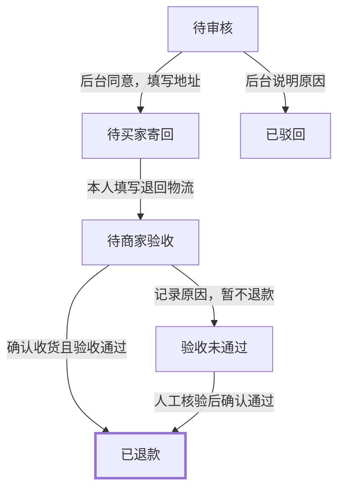
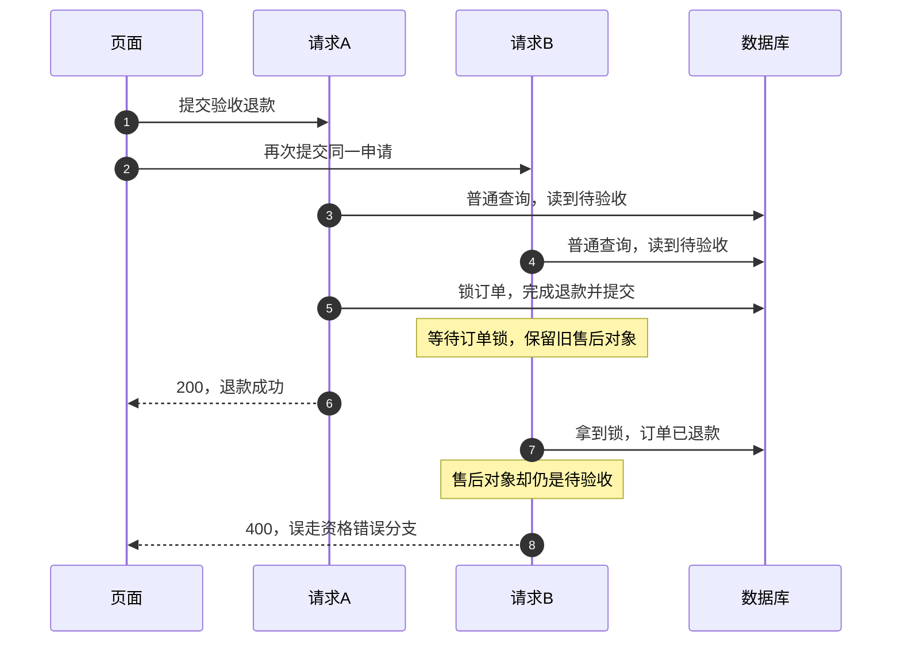
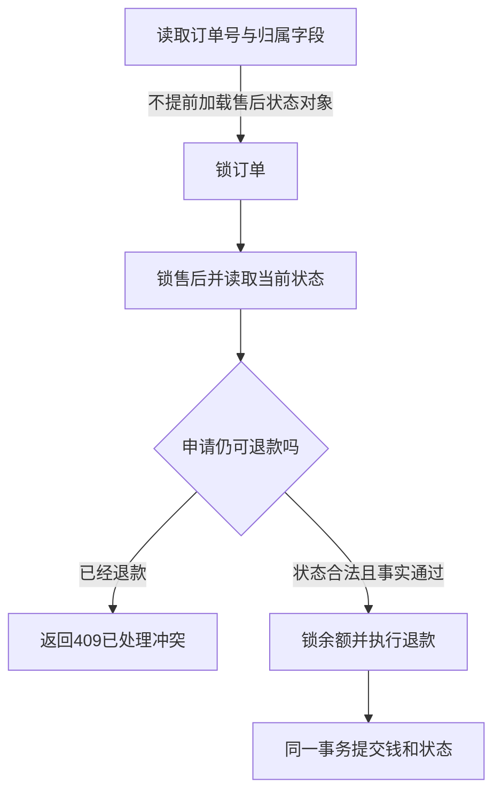

# 七天无理由退货退款：产品设计与问题复盘

> 从角色分工、状态规则到并发验收｜2026-10-09

本次把已签收退货拆成独立的申请、初审和验收退款。我们沿用原商城与后台能力，补齐执行边界和验收。

## 为什么要拆开三种决定

> **核心判断**
>
> 客户确认只表达申请意愿。后台初审只同意买家寄回商品。后台确认收货且验收通过后，系统才退款。

此前已有未发货退款与独立后台审核。接手时，退货接口和页面已部分接通。本次扩展这些能力，并修复未通过的检查。

| 参与者 | 本次职责 | 权限边界 |
|---|---|---|
| 客户 | 核对订单与金额、确认申请、填写退回物流 | 只能处理本人订单，不能审批 |
| 客服 Agent | 查询事实、准备确认卡、说明进度 | 不能批准退款，也不能判断实物完好 |
| 后台审核员 | 同意或驳回退货、确认收货验收 | 身份来自管理员登录，初审不能退钱 |
| 业务服务 | 核验资格、保存状态、执行退款 | 以支付流水和业务记录为依据 |

客户和审核员属于两种权限角色。这里复用同一个客服 Agent 和独立后台服务。

## 流程怎样贴近现实

| 状态 | 可执行动作 | 资金变化 |
|---|---|---|
| PENDING_REVIEW／待审核 | 同意并填写地址，或说明原因驳回 | 余额不变 |
| WAITING_RETURN／待买家寄回 | 本人填写快递公司与单号 | 余额不变 |
| RETURN_IN_TRANSIT／待商家验收 | 人工确认验收通过，或记录异常 | 通过后一次退款 |
| RETURN_INSPECTION_FAILED／验收未通过 | 展示原因，等待人工核验 | 核验通过前不退款 |
| REFUNDED／已退款 | 查看结果与处理记录 | 禁止再次入账 |
| REJECTED／已驳回 | 查看驳回原因 | 余额不变 |

买家提供单号后，系统仍等待商家收货验收。退款完成时，订单和支付显示已退款。履约显示已退回，并保留原发货与物流历史。

首版由审核员兼管收货验收。勾选收货是人工声明，尚未接入仓库或物流证明。

依据：[产品计划](../02-产品设计/01-售后申请与审核/七天无理由退货退款产品设计计划.md)。

## 资格规则：减少误判，也保留恢复路径

| 设计决定 | 解决的问题 |
|---|---|
| 自动受理本人已支付、已签收的整单申请 | 运输中转人工处理拦截，避免提前退款 |
| 上海日期下，签收次日起算七天 | 统一日期口径；签收当日也可申请 |
| 按首次有效提交判断期限 | 买家不因后台审核延迟失去本流程资格 |
| 检查真实支付流水，冻结整单实付金额 | 客户或模型不能编金额，审核员不能改成部分退款 |
| 使用购买时的可退属性 | 商品现在改了政策，也不能覆盖购买时的事实 |
| 无理由作为申请类型，无需另编原因 | 减少无用追问；质量问题等其他售后保留原义 |
| 缺事实、过期或不支持时转人工核验 | 明确本流程的边界，保留其他售后处理机会 |

**项目规则示例：**10月1日签收，10月8日结束前提交有效。10月10日才审核，原有效申请仍可继续。

后台初审读取提交时的资格记录。最终退款还会核对支付、当前状态和冻结金额。

## 并发旧状态：背景与原因

页面重复点击、网络重试或多人审核，可能产生重叠请求。隔离测试让两个请求同时确认验收退款。

旧实现先普通查询售后实体，再锁订单与售后行。ORM 会缓存本事务读过的 Java 对象。再次加锁查询时，可能复用这个旧对象。

数据库行锁负责让写操作排队。**拿到锁，不保证原对象已经刷新。**

第二个请求看到的是一组矛盾事实：售后对象仍待验收，订单却已退款。它随后误走资格校验失败分支。

**修复前观察：200／400，未观察到第二笔退款。**

本次缺陷是重复处理的状态判断与返回结果错误。

证据：[原失败日志](../../analysis/01-售后申请与审核/七天退货验证/previous-failed-check.log)、[问题记录 BC-006](../03-评测与问题/问题台账.md#bc-006并发退货最终确认读到旧售后状态)。

## 产品规则如何落到工程修复

先定义产品要保证的结果，再选择执行层措施。产品设计确定验收合同，工程实现负责兑现它。

| 产品必须保证什么 | 执行层怎样保证 |
|---|---|
| 同一申请最多退款一次 | 加锁后读取当前状态，再决定能否退款 |
| 重复处理返回已处理结果 | 已退款后返回409冲突，不误报资格不足 |
| 不同订单退款到同一账户时，金额正确累加 | 锁定余额行，基于最新余额计算 |
| 钱、流水、售后与订单状态同时生效 | 放进同一个事务，任何保存失败都回滚 |
| 多条写入路径按一致顺序拿锁 | 统一订单、售后、余额顺序，降低交叉等待风险 |

先查归属字段，服务就能找到要锁的订单。此时不把售后状态读入对象缓存。随后锁定并读取售后实体，按当前状态判断。

按钮禁重复负责减少误操作。服务端仍检查角色、状态与重复入账。

**修复后：同一申请并发返回200／409，只入账一次。**

不同订单的并发退款，也能正确累加余额。

源码：[锁后状态读取与退款事务](../../ecommerce-backend/src/main/java/com/teachdemo/ecommerce/aftersale/AdminAfterSaleService.java)、[归属字段查询](../../ecommerce-backend/src/main/java/com/teachdemo/ecommerce/aftersale/AfterSaleRequestRepository.java)。

## 修改时还遇到了哪些问题

| 问题与背景 | 产品设计与修改 | 观察到的结果 |
|---|---|---|
| 旧草稿接口还能创建REFUND记录 | 已发货退款统一受退货验收门槛约束 | 旧入口无法绕过；未新增退款流水 |
| 无理由流程仍追问退货原因 | 将无理由固定为申请类型，保留其他售后原义 | 无需额外原因；质量问题不变成无理由 |
| 改订单、取消后，旧确认卡可能被复用 | 确认凭证绑定订单与内容，变化后失效 | 旧卡被拦截，取消不建立申请 |
| 启动代码重建七笔历史样例明细 | 购买快照保持原值，只补缺失记录 | 再次初始化保留快照，余额不变 |
| 审核发生在七天之后 | 期限按有效提交判断，不按审核当日判断 | 隔离延后审核案例仍能完成退款 |
| 查询退货进度可能走申请流程 | 查询只读已有记录，覆盖各退货状态 | 读到真实进度，不启动新申请流程 |

购买快照问题与退货资格直接相关。旧初始化删除明细后，会用当前商品属性重建。因此本次移除删除重建动作，保留首次初始化能力。

两个测试环境问题也单独处理。前端构建使用匹配本机架构的现有 Node。浏览器等待页面数据就绪后，再检查详情。

这些处理没有改业务响应，也没有放宽业务断言。

依据：[实现与验收记录](../../analysis/01-售后申请与审核/七天退货验证/README.md)。

## 结果怎样，证据能说明到哪一步

| 验证 | 本次结果 | 证据范围 |
|---|---|---|
| Java业务检查 | 98项通过，155个源文件编译 | 隔离H2、真实HTTP／认证／事务，模型为替身 |
| Python检查 | 15项通过 | 禁用模型与业务网络，检查类型、边界和进度 |
| 双角色页面 | 7组通过 | 页面连接隔离Java服务，覆盖零入账初审与验收退款 |
| 构建打包 | 前端与Docker／Maven成功 | 打包成功；业务断言由前述检查单独验证 |
| 本地服务更新 | Java与Python已更新 | 新路由、历史状态与登录读取核验通过 |
| 已有数据保护 | 8张业务表原字段行哈希一致 | 更新未重写已有订单、余额、流水和审批 |

验收重点包括：初审零入账、权限隔离、金额篡改拦截。还包括并发防重、异常恢复和失败整体回滚。未发货退款的49项既有检查也保留。

本次没有调用在线模型。当前MySQL未新增申请、审批或退款。新资金行为在隔离H2中验证。

以上结果说明本地实现通过这些检查。它们不能直接代表线上成功率或真实收货能力。

证据：[Java结果](../../analysis/01-售后申请与审核/七天退货验证/java-result.json)、[Python记录](../../analysis/01-售后申请与审核/七天退货验证/python-check.log)、[页面结果](../../analysis/01-售后申请与审核/七天退货验证/ui-result.json)、[更新后数据对比](../../analysis/01-售后申请与审核/七天退货验证/live-after.json)。

## 可复用的产品设计方法

- 给每个动作写清角色、前置状态和所需事实。
- 把资金变化绑定到收货验收通过的业务事实。
- 在提交时保存期限、实付与购买资格依据。
- 定义重复、并发、失败和人工恢复的可见结果。
- 用流水与状态验收，不能只看成功文案。

> **本轮边界**
>
> 审核员仍兼管收货验收。尚未实现独立仓库角色、真实物流、运费和库存恢复。部分退货与工作台原有模拟审批问题也未扩展。

后续用新建支付订单验证真实模型交互。按照[手测步骤](../03-评测与问题/本地测试用例.md#七天无理由退货退款手测2026-10-09新增)，模拟发货与签收，再走双角色流程。页面中的七天规则属于本项目实现范围。
