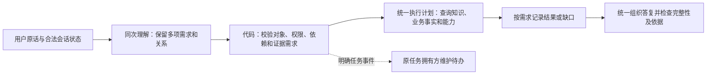
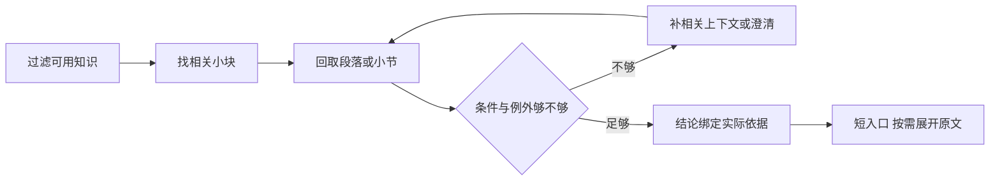
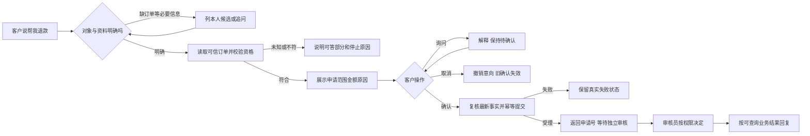

# 产品设计学习

## 2026-10-17：统一分发真实小批——三层都过了，但“通过”要一层一层给

DISPATCH-LIVE-001 用 6 条自然原话跑真实路由＋离线取证＋真实生成／judge，6/6 PASS、14 次模型调用（预算 40 次的一半不到）。这轮最有价值的验证点有两个：

1. **顺序互换不改分发**。D01/D02 把发票和优惠的问句顺序对调，路由给出的主题集合相同，计划领域都是 promotion_and_member_policy＋invoice，引用来源五组完全一致。旧实现里“从哪个入口进来决定查什么”的失效模式，在真实模型下没有再出现——这正是统一契约要消除的东西：分发正确性不应依赖问句顺序。
2. **澄清不等于丢弃**。D03（会员券能和优惠叠加吗？另外发票多久开好？）是最容易退化的场景：旧代码里全局澄清会把已查到的发票答案一起吞掉。这次 audit 里 content_selection 明确显示 `selected_rules=["invoice_issue"]`、`gaps=["topic_unconfirmed:promotion_stacking"]`，最终答复＝发票答案＋一个优惠澄清问句。澄清语义留在了内容选择层，可核对、可追溯，而不是静默丢项。

D04 也值得一提：初态是带 ORD9801／ORD9802 候选的退款待办，插问“帐篷怎么清洗收纳”后 open_task 逐字段不变——BC-032 的状态规则和统一分发的知识取证在同一轮里互不干扰，两个专项的边界守住了。

判定时的自我约束：judge 的 allow 没有作为判 PASS 的依据，三轴是取证正确／结果完整／业务状态保留。D03 的 judge 走的是 not_reviewed（澄清轮不评审），如果拿 judge 当标准，这条要么漏判要么误判。另外 D02 的答复扩写偏多（带出“朋友券截图不转让”等无关细节），这是 BC-029 的生成层问题，取证正确不掩盖表达问题，分层记录。

证据见[DISPATCH-LIVE-001](../../analysis/02-意图与政策咨询/统一分发真实验收/结果.md)。

## 2026-10-17：统一分发实现落地——错取证器修好了，但“工程通过”离“用户听到正确答案”还差两层

Codex 按 DOMAIN-DISPATCH-001 完成了核心实现，中途因额度中断，本轮续接做收尾核验。设计的三件事都落了地：

1. **分发收拢一处**：五类知识领域到取证组件、合法来源的映射只有一个维护处，发票、退款／退货政策、优惠、商品及订单只读组合的所有入口统一消费；旧入口各自的默认 else（把未列举领域误当售后或优惠）被移除。这印证了诊断时的判断：逐入口补分支永远补不齐，必须让“领域职责”成为唯一事实源。
2. **成功必须有对应依据**：实际组件与返回资料的来源类别按契约核验（例如发票检索类别叫 `invoice`，来源元数据叫 `payment_invoice_policy`，实现按实际对应关系校验而非名称逐字比对）。错来源记该项契约失败、不进三个出口——“非空引用即成功”这条旧捷径被堵上了。
3. **局部失败局部处理**：一项需澄清或失败不再吞掉已查到的另一项答案（BC-034 在本专项范围内的部分）。

回归过程本身也有教学价值：首轮 308 项中 28 failures，暴露的是新契约与旧断言的冲突，而不是契约本身错了；其中两处旧夹具把“只问价格／资格”的输入配上了额外知识主题——**夹具的错误期望会让正确的实现看起来是错的**，修正的是夹具，对象、权限和金额断言没有放宽。最终后端 316/316（续接复跑 317/317），Java 断网回放 6 组真实 Python 响应 56/56：正文完整保留、原退款草稿字段与版本不变、不重发确认卡。

但要明确边界：离线工程层＋Java 消费回放通过，只证明“分发与消费契约正确”；真实模型能否从自然问句走到正确计划、商城页面能否自然展示组合答复，都还没验。BC-031 状态改为“核心缺陷已修、待真实验收”，不能写成已解决。

证据见[验收结果](../../analysis/02-意图与政策咨询/统一分发实现验收/结果.md)。

## 2026-10-17：BC-032真实验收——状态保住了，候选没让用户看见

`BC032-LIVE-001` 用 29 个自然轮次同时跑真实模型、隔离 Python→Java 和浏览器页面。状态侧的核心结论成立：插问、客套、查询补单、故障都没有清掉原退款待办；明确“继续刚才退款”能从页面 C、最近资格查询 D 中恢复原草稿 A；未选单时也不会拿页面订单代选；G05-T3 的“不退了”确实走了 Java 明确取消，G05-T5 没有把未执行说成已停止。真实模型在“关系是提案、执行看回执”这条上没有再犯本轮要验的错。

但 29 轮里有 8 个 FAIL，不能直接写成“产品失败率 8/29”。其中 3 轮是同一个展示缺口：退款待选订单时，Python 记忆里已有 ORD9801／ORD9802，用户看到的却只有“你要退款哪一个订单？请选择订单号”，没有候选列表。对照物流查询会列出“当前账号下可选订单”，说明不是状态没存，而是退款澄清分支没有把候选带到答复。**内部状态正确不等于用户能完成选择**；候选、焦点、回执都要以用户可见结果验收。

随后按这个判断做了最小修复：商城售后分流分支原本只输出 `clarification.message`，候选放在结构化字段里，但当前商城页面只消费答复文本；现在该分支把候选值和可读提示一起写入答复（`customer_service_agent.py:422-431`）。我补的固定用例先看到红灯，再验证同一会话“继续刚才退款 → 看到 A/B → 第二笔 → 绑定 ORD9802”。完整 Python 后端 317/317 通过；这仍不是真实模型或页面复测，BC-032 不能因此关闭。证据见[BC032-DISPLAY-001](../../analysis/03-取消与续办/BC032-候选展示修复/结果.md)。

另外 5 轮暴露的是验收器自身：选单后焦点清空被当成失败；答复检查读了 Python 内部占位而不是 Java 用户可见答复；`reset` 会话在下一轮被二次 seed，覆盖了上一轮已成功的取消。这提醒我：真实验收也要先证明“失败是产品的”，再归因。先保留首次结果，再分别修展示、修口径，不能把用例改到通过。

证据见[BC032-LIVE-001](../../analysis/03-取消与续办/BC032-真实模型验收/REPORT.md)；工程背景见[BC032-STATE-002](../../analysis/03-取消与续办/BC032-续接复核/结果.md)。

## 2026-10-17：将已认可的跨领域统一分发方案写成产品设计

用户明确认可上轮修改方案，要求先写该需求变更的产品设计文档，只规划功能与逻辑、不改代码。本轮新增[DOMAIN-DISPATCH-001](../02-产品设计/02-意图与政策咨询/跨领域知识取证统一分发产品设计.md)，以原诊断为依据，把统一领域职责、计划完整性、实际来源校验和逐项结果接入写成产品要求。上位MULTI-READ-001保留总体范围与状态规则，引用专项设计，不复制第二套分发表；同时更正其“整体尚未实施”的旧状态，避免与已存在的阶段性代码混淆。

方案取舍：保留五类现有组件，职责集中维护，主问题不再重新决定其他领域去哪里查；取证成功、证据充分和业务支持分开判断；缺参数或错误来源只影响依赖项。接齐最终答复属于完整交付，不能用组件调用正确替代顾客所问已获回应。字段和函数形式留给实现者选择，不预设新框架、外部接口、并行或模型。

专项设DD01—DD16待跑标准，覆盖五领域、10种两两配对及顺序互换、三领域组、真实来源、异常、三个出口与状态回归。BC-034等相邻问题分别验收，专项通过不自动关闭它们；代码未改，真实语义与页面尚未验证。用户本轮反馈为认可方案，未补写其学习感受。文档检查与源码指纹证据见[DOMAIN-DISPATCH-PRD-001](../03-评测与问题/项目评测记录.md#domain-dispatch-prd-001统一分发产品设计文档核验2026-10-17)。

## 2026-10-17：跨领域取证分发——查什么由领域决定，入口只负责提出需求

用户要求继续处理“跨领域用了错误取证器”，先用通俗中文解释失败类别、根因和修改方案，禁止对个别Bad Case补分支或例外文案。本轮为源码分析及离线诊断，尚未实施方案。BC-032真实验收另有交接，本轮不执行。

### 已确认的失败类别与原因

这属于“证据计划与执行不一致”：路由和计划已经保留了目标领域，执行入口却再次按主意图决定查哪种资料。不是本轮固定路由漏识别，也不是知识库必然缺资料；尚不能据此断言真实模型识别所有组合都正确。

`customer_service_agent.py:393—408`：发票入口只专门处理发票，其余领域统统送入退款／退货查询，非退款默认退货；`:426—443`：退款／退货政策入口把非售后、非发票的领域统统交活动查询；`:483—491`：优惠入口把非发票的新增领域默认交售后查询。同一商品知识从能力咨询入口`:828—838`却能正确交`product_knowledge_result`。商品入口`:1359—1387`又维护另一套有限分发。

所以直接根因是多处重复且不完整的“领域→组件”规则，以及把“未逐项列出的领域”默认认作另一个领域。底层检索还会依所传意图过滤资料（`hybrid_retrieval.py:118—132`），上层叫它“查商品”，实际传活动意图，就只能去活动／会员资料中找。后续内容选择保持资料准入，不会把任意未取证领域直接放进答案（`rules.py:56—71`），于是出现“系统资料里有，但本轮没真正去查”的缺口。

另一处结构缺口是把“有引用”当成该领域成功：例如发票入口`:411—416`用计划领域记录返回引用，却不核对返回资料实际领域。日志中的领域标签正确，不能证明对应资料已经取到。核验应对齐受控领域与底层资料类别的合法对应，而非简单要求两个不同层级的名称逐字相同。

### 本轮诊断与相邻问题边界

使用原ContentPipelineTest，固定合法路由、离线知识、业务fixture，生成故障注入使备用稿可观察；包装既有函数记录真实调用，并未更换取证结果。三个错误组合与一个对照：

| 输入 | 计划 | 实际调用（本轮复现） |
|---|---|---|
| 发票多久开好＋露营季满减和平台会员券叠加 | 发票＋优惠 | 发票查询＋退货政策查询 |
| 退款多久到账＋帐篷清洁收纳 | 退款政策＋商品知识 | 退款政策查询＋优惠查询 |
| 优惠叠加＋帐篷清洗 | 优惠＋商品知识 | 优惠查询＋退货政策查询 |
| 到货提醒能力＋帐篷清洗（对照） | 能力查询＋商品知识 | 商品知识正确交商品知识组件 |

完整输入、固定路由、实际调用、底层范围及最终答复见[DOMAIN-DISPATCH-DESIGN-001](../../analysis/02-意图与政策咨询/跨域取证分发方案核验/probe-results.json)。这是4组定向机制诊断，不是自然对话4条通过率；没有真实模型／业务调用，也未重跑完整回归。

须分别验收三层：①有效主题没进入计划（相邻计划完整性问题）；②已在计划但调用错组件（本条）；③已取得证据却被全轮澄清／降级吞掉（BC-034）。本条不能靠重写最终回答或放宽资料准入解决，更不能把三层混称模型不够聪明。BC-035单域判断也另有明确代码缺陷，不因本次提出方案而关闭。

### 推荐修改方案（待实施）

核心原则：**每个知识领域只有一处规定取证方式；所有入口消费同一个已校验计划，结果须证明来自正确资料。** 复用原路由、领域组件、知识治理和回复链路，删除各入口重复的分发决定，不增加第二次分类模型、Agent或任务平台。

1. **把职责固定成一张表。** 业务入口只说明本次需要哪些证据；共享执行入口根据领域调用现有组件。下表是唯一分发契约，不能出现“其他领域一律按退货／优惠处理”的默认行为。缺少配置应记为该项取证配置错误，不能编造成其他业务不支持。

| 计划知识领域 | 既有组件 | 允许的底层资料类别 |
|---|---|---|
| after_sale_policy：未发货退款政策 | policy_query_result＋固定退款参数 | after_sale_refund |
| received_return_policy：签收退货政策 | policy_query_result＋固定退货参数 | after_sale_return |
| invoice：发票 | invoice_faq_result | invoice |
| promotion_and_member_policy：活动与会员券 | promotion_policy_result | promotion、member_coupon |
| product_knowledge：商品使用知识 | product_knowledge_result | product_knowledge |

在`retrieval/knowledge.py`附近归属这份组件契约即可，不预先增加插件系统或通用框架。规划与调用者只引用同一份支持领域约束；既有底层场景过滤可以保留，经表中对应关系核对。

2. **让计划成为唯一执行依据。** 基于现有受控主题目录`rules.topic_catalog`，检查每个有效主题所需领域均进入计划，且每个计划领域都有组件；复用`planning.py`的计划结构与检索方式。商品事实、订单事实、资格与办理权限保持原校验，不把通用知识域扩展成工具授权。商品类别等参数由已有上下文解析提供，欠缺时仅标该项待补，不强迫发票等独立知识依赖商品选定。

3. **统一执行并核对结果。** 发票、优惠、退款政策、退货政策、能力咨询和商品咨询的知识取证接入同一分发入口；不在旧入口继续保留第二套兜底映射。商品参数准备与自身会话状态仍按原拥有方处理。沿现有KnowledgePathResult记录目标领域、实际组件、引用与局部状态（有依据／待补信息／无依据／失败），逐项保留；用实际来源元数据及受控目录核验领域、发布／生效／快照等约束。错领域即该项取证失败，不因有引用就算成功，也不借机放松select_rules准入。

4. **沿用一套答复内容。** 将核验后的依据交现有完整规则选择与生成／一次修复／备用出口，按用户所问顺序组织自然答复。取证组件提供依据与该项缺口，不各自决定整轮结束或直接拼成几份答复。某项需要澄清时，整体回复应保留独立已知项并提出具体问题；这是与BC-034衔接的结果消费约束，其代码修复及验收须单独报告，不能凭分发修好就登记已完成。

### 修改范围、验证标准与未证明事项

预期生产改动主要到`retrieval/knowledge.py`的共享契约／调度、`tools/planning.py`的一致性检查、`customer_service_agent.py`及其商品知识调用方；回复组件复用现有契约，只有接入需要时改调用参数，不另起正文筛选器。测试需覆盖调用者和旧单领域行为。Java仅因Python内部知识分发而不应新增业务写入逻辑；若逐项结果改变外部动作语义，再独立核验网关消费。

待跑验收：五个领域各自取证、所有两两组合并互换主入口／问题顺序、抽查三领域组合；同一领域的组件和资料范围不因入口改变。断言实际组件与引用来源，不能只看HTTP200、非空引用或答复关键词。注入未知领域、错领域引用、知识撤回／过期、单项失败／澄清，要求错误可见且不借其他资料补结论；正常生成、修复、备用引用同一批有效规则。原BC-032状态及只读／对象／确认边界回归必须保留。

本轮源码指纹未变，模型调用0、日常加载0；方案尚未实施，所有上述验收均为未来标准。只修几个else不足以证明整类改善，实施后须用覆盖矩阵及自然小批验收分别证明组件一致性和回复体验。用户本轮表达的是对系统性修复的约束，未代填其理解程度或学习感受。

## 2026-10-17：BC-032续接复核——保留待办还要约束恢复目标

用户说明CodexB在额度耗尽前未收尾，要求从现有工作继续。源码与结果确认主体修改已存在，遗漏包含交接未写回，以及原工程用例没覆盖的三个边界；不能仅凭“代码已写／298项通过”宣布这一类状态问题结束。

本轮沿真实业务顺序构造“退款缺订单→插问物流→补订单号”，发现Java在Python判断当前焦点之前已把订单号送入退款续办；这说明状态写回保护正确，也可能被调用方前置捷径绕过。恢复场景又发现两种对象问题：Java把原任务恢复误当新申请校验，Python在原任务未选订单时用页面订单代选。分别移除抢先续办、限定有效原草稿的恢复规则，以及要求原待选任务继续选单。证据入口为`context.py:128`及`CustomerServiceGatewayService.java:134`、`:208`、`:217`。

形成的判断（助手分析）：任务保留与安全恢复需要一起验证。纯参数须看当前实际焦点；明确恢复已绑定对象须看原草稿；“继续”不能替顾客决定尚未选择的对象。模型关系标签也不能跳过业务拥有方的对象与有效期校验。本轮没有新增Agent、模型、持久化或通用任务管理层。

新增失败及修复结果见[BC032-STATE-002](../03-评测与问题/项目评测记录.md#bc032-state-002额度中断续接与状态边界补齐2026-10-17)：完整Python300项、Java隔离32项通过，固定夹具不等同自然语义质量。用户未表达学习感受，本轮不代填；真实模型自然表达、页面和日常加载仍未验。

## 2026-10-17：BC-032按拥有方和明确事件实施

用户授权按刚讨论的方案修改代码。本轮以原失败及新增生命周期用例开始，分开售后open_task、一般订单查询状态和澄清焦点；替换“意图在名单内则保留，否则覆盖／清空”的写回规则，只有目标组件在合法进展时更新自己的状态。原任务没有事件时默认不写；后台售后与当前查询可同时存在，不新增通用多任务平台。

同次路由增加task_relation，负责理解插问／续办／停止关系但不直接执行；关系失效、模型故障或矛盾结果不授权破坏原任务。候选选择需跟随实际焦点，明确恢复绑定原快照，不能被最近资格查询或页面对象覆盖。Java接齐控制请求与只读语义：无办理计划的插问不进入退款原因提取，不重发原确认卡；人工入口也不自动清草稿。控制请求仍按原拥有方的取消、版本与过期机制处理，不启用新的自动取消能力。

完整回归暴露两类旧预期：商城fixture没提供实际拥有方的待办快照、安全拒绝后要求撤回商品候选。按新契约补齐前者、修正后者并保留对象断言；另修复兼容字段、序号焦点与对象覆盖问题，未更改其余四个审阅问题。最终Python298项、Java断网H2的21项通过，见[BC032-STATE-001](../03-评测与问题/项目评测记录.md#bc032-state-001插问保留与任务状态修复2026-10-17)。这些是工程及隔离证据，真实模型自然关系识别、页面与日常加载未验；不替用户编写实际体验或学习感受。

## 2026-10-17：BC-032先区分聊天焦点与售后任务生命周期

用户要求按Bad Case逐项处理，首先解释插问覆盖／清空退款待办的原因，结合8类官方网站提出通俗修改方案；反对逐问句、意图名单或例外文案补丁。本轮为源码复核、官方资料核查和方案讨论，不改代码，不顺带实施其他四个发现。

### 原因与证据边界

沿既有MULTI-READ-REVIEW-001证据：固定正确的order_query路由仍把退款open_task替换成物流待澄清，固定general_chat仍清空原退款任务，故不能把直接原因归为模型分类错、上下文窗口小或未传历史。

源码确认：`backend/agent/customer_service_agent.py:966`至`:976`把任何未被保护名单覆盖的ask_clarification写进唯一open_task，其他情况直接置None；本轮意图、下一步答复动作被错误用于决定已有任务生死。会话里的open_task同时承载售后准备与一般查询待澄清，造成槽位竞争；`context.py:43`至`:59`又从该槽位解释候选序号，所以覆盖后会影响后续续办。`update_memory:111`只更新最近已核验事实等信息，不是此处直接清空的根因。`customer_service_agent.py:99`至`:112`说明现有原任务／查询状态已经被加载，并非完全没给模型上下文。

商城另以Java的`pendingAction`／草稿版本等为拥有方，Python的本地诊断不能直接等同于商城真实草稿已被清空。Java通过`CustomerServiceGatewayService.java:145`至`:153`传afterSaleOpenTask／afterSaleQuery，`:200`消费read_only_turn；当前该字段依赖意图名单，不能代替跨两侧一致的任务变更语义。已有取消观察默认关闭、Java取消执行有开关（`cancellation.py:644`、网关`:398`），方案不能借此开启取消执行或另加一轮模型。

### 官方依据：原文事实与项目推导分开

核查日期：2026-10-17。资料未提供本项目退款状态的现成实现；以下借鉴是助手综合推导，不称为厂商一致规范，不迁移SDK、模型或数据到这些平台。

| 官方来源 | 原文可确认内容 | 本项目借鉴及限制 |
|---|---|---|
| [Anthropic：Effective context engineering](https://www.anthropic.com/engineering/effective-context-engineering-for-ai-agents) | 用结构化笔记等方式保留长期任务进度与依赖，并在后续提供必要上下文 | 原任务事实显式保留，不靠每轮自由重推；结构化记忆本身仍不能阻止代码错误清空 |
| [OpenAI：Results and state](https://developers.openai.com/api/docs/guides/agents/results) | 区分最终答复、历史、继续处理与审批中断的可恢复状态 | 本轮答复结束不表示业务任务结束；会话历史与可恢复任务不是一个概念 |
| [LangChain：Graph API的State／Reducers](https://docs.langchain.com/oss/python/langgraph/graph-api) | 节点可提交局部状态更新；未更新字段保留；覆盖与合并有明确规则 | 只更新本轮有合法依据改变的目标字段，未产生任务事件时不写原任务；不要求迁移成LangGraph |
| [Google PAIR：Feedback + Control](https://pair.withgoogle.com/chapter/feedback-controls/) | 平衡自动化与用户控制，允许用户编辑、退出或重置 | 原任务停止／切换应来自用户控制及原业务校验，不能从客套话或新话题暗推 |
| [Microsoft HAX：Remember recent interactions](https://www.microsoft.com/en-us/haxtoolkit/guideline/remember-recent-interactions/) | 维持短期记忆，让用户高效引用前面的交互 | 插问后可继续“刚才退款的第二笔”，不强迫重说；若焦点冲突仍需消歧 |
| [Hugging Face：smolagents Agents](https://huggingface.co/docs/smolagents/reference/agents) | run的reset参数明确控制延续／重置，memory记录任务与动作步骤 | 延续与清理应有显式语义，而非每个新意图默认重置；框架memory不保证业务草稿安全 |
| [xAI：Multi-turn Conversations](https://docs.x.ai/developers/model-capabilities/text/comparison) | previous_response_id延续已存对话，与客户端重传历史区分 | 对话链路连续不等于业务草稿生命周期正确，应用仍负责状态权限与拥有方 |
| [NN/G：3款生成式聊天工具的日记研究](https://www.nngroup.com/articles/generative-ai-diary/) | 上下文被遗忘或忽略会导致答复无关、任务繁琐，建议考虑完整对话上下文 | 用完整插问→续办对话验收，而非只看插问答得对。该研究是2023年观察，不能作为当前模型准确率证据 |

### 建议方案：默认保留，显式事件才改任务

规则：**当前在聊什么可以改变；尚未结束的售后任务只有其拥有方在收到合法事件后才改变。** 该规则覆盖插问、客套话、陌生主题、模型失败和查询故障，不为每类话题追加保留名单。

1. 分开保存三类信息：原售后任务、当前只读咨询所需状态、当前澄清／候选焦点。优先复用已有product_query、promotion_query、eligibility_query与Java草稿；一般订单查询待澄清不能再覆盖售后open_task。必要时仅补最小查询状态／焦点标识，不建设多任务队列或新数据库。
2. 同次理解要能提出本句与原任务的关系：插问／无关聊天、补参数／明确续办、请求停止／切换、不确定。关系是提案，不是模型可直接改状态的指令；字段缺失、模型失败或关系不明时默认不破坏旧任务。纯订单号／候选序号沿已有可信焦点解析，不能用关键词猜原任务已被撤销。
3. 代码在现有业务处理完成后，根据被校验的事件提出局部更新：新建或补原售后信息、真实提交回执、合法取消回执、原规则判定的过期等。没有事件就不更新原售后业务字段；查询完成、答案生成完成或next_action变化不是售后终止事件。
4. 统一状态更新入口落实对象、用户／会话、拥有方、阶段及已有版本／期限检查；模型只解释诉求，工具和业务层提供事实。商城仅由Java更新实际草稿，Python消费回执；工作台沿原本地演示状态，不能另建与Java竞争的真相来源。旧intent保留／清空名单被这套规则替代，而不是再并存一套。
5. 新查询需要补订单时，可以展示其自己的候选并改变本轮焦点，原售后候选保持；“继续刚才退款，选第二笔”回原退款候选，“第二笔”若指向不明确则消歧。last_order_id可以按已核验事实更新，但不能改掉售后绑定订单。
6. 回复从实际状态和回执得出。普通咨询回答本题，不每轮机械提醒有待办或重发确认卡；“谢谢，我再想想”可简短回应，保留有效待办。“不退了”仍走原取消规则，未执行不说已取消；已提交、过期或身份改变时不能复活旧申请。恢复任务时重新核验最新事实及原确认／审批边界。

这里的“默认保留”针对业务任务字段，不是冻结整个会话；聊天历史、咨询结果与审计信息仍可正常更新，也不覆盖原有期限与外部状态变化。

### 例子与按类验收建议（待跑）

初态：退款待选A／B。插问“物流怎么查”可建立自己的查询澄清，但退款仍待选A／B；“谢谢，我再想想”不结束退款；随后明确“继续刚才退款，第二笔”仍指向原B并重验。若用户先在新查询中看见另一组候选，只说“第二笔”不得偷偷套到退款。若明确请求停止，由原渠道处理后仅依据真实结果修改。

未来至少验证：①退款／退货的待订单、待原因、待确认阶段×不同只读话题和客套话，原任务业务字段保持；②同类意图既有插问也有明确续办，不能只靠intent决定变化；③模型不可用／查询失败／生成失败仍保留；④合法补槽、提交、停止与切换仍可生效，停止未执行不得虚报；⑤新咨询候选与原候选并存、序号／页面冲突不串对象；⑥过期、已提交、已终结与跨用户不复活。先固定关系与回执验证代码，再另冻结真实自然表达验证理解。原离线失败保留，未运行不标通过。

最小影响范围是任务状态写回及其读者：customer_service_agent、context／候选解析、现有路由契约和Java网关／会话消费、相关测试。是否需要新增最小字段由实施时调用链确定；不顺带修取证分发、部分回答或单域判断，不扩大取消能力。当前方案尚未实施，不记为用户已逐项批准具体结构；本轮未新增运行成绩。

## 2026-10-17：逐域循环不等于统一执行

用户报告代码修改完成，要求审阅。先对比PRD时期源码指纹，确认本次增量只有两个Python生产文件、一个测试文件和Java网关；完整离线288项通过后，从域分发、部分成功、商品入口、原任务保护和单域失败构造相邻诊断。

源码与离线结果确认：发票入口把优惠域交给退货查询，退款入口把商品知识交给活动查询；优惠首域的next_action／low_confidence控制全局出口，已查到发票也未回答；商品入口保留发票主题却不补域。原退款待办在插问物流或闲聊时仍被覆盖／清空，此旧问题不因新增只读字段而消失。单域政策的嵌套列表比较又使原无证据直接降级失效。

助手判断：统一应体现在共同的证据规划、类型分发、逐项结果消费及任务状态规则，不能仅复制循环进更多主意图分支。按类别修复并验证相邻正常、局部失败与单需求回归，避免每题另补规则。详见[MULTI-READ-REVIEW-001](../03-评测与问题/项目评测记录.md#multi-read-review-001实施后代码审阅与相邻离线复现2026-10-17)。本轮只审阅、诊断和留档，不改实现；真实模型、商城页面及新Java运行未验，不代写用户学习感受。

## 2026-10-17：将已确认的收敛范围写成Coding Agent变更需求

用户认可“多个只读问题完整回答、插问不破坏已有售后任务”，要求面向Coding Agent先规划整体需求，不修改代码。本轮形成[主需求MULTI-READ-001](../02-产品设计/02-意图与政策咨询/多个只读问题与售后插问产品变更需求.md)，复用旧意图与证据规划、内容选择及取消／资格／商品规则；新增文档作为本次变更主规范，旧文保留证据并指向新入口，不在不同主题分别维护新规则。

源码核对补足两点：路由当前输出上限已为512，不能照旧规划写256；Java会按单个intent分流，商品／能力已有纯咨询返回，但其余响应可能经过退款续办及卡片路径，因此要同步两侧消费语义。共享审阅READ_TOOLS尚不含资格工具，单项直接出口需受控适配，不能只扩大白名单或只改路由字段。证据入口与26组待跑验收均在主需求第9—10章。

规划明确区分纯只读组合、条件式办理、明确新办理混合咨询和合法取消；任务状态由原拥有方与事件管理，咨询可以更新对话但不能覆盖草稿对象、候选或阶段。多缺参沿现有单个澄清结构确定焦点，不为未来任务增加通用队列。上述细化是助手基于已确认目标整理的产品约束，不表示用户逐字段决定实现。

本轮未改源码、Prompt、知识或服务，不运行工程／模型／页面测试；验收矩阵是事前规划，历史287项不当成新成绩。用户的实际反馈是认可收敛总结，无额外学习感受代写。静态文档核验归档为MULTI-READ-PRD-001。

## 2026-10-17：把多需求改造收敛为有边界的版本

用户认为这是较大的需求变更，询问如何收敛。助手建议将本期目标限定为“多个只读问题完整回答，插问不破坏已有售后任务”，范围尚未获用户确认；不把前轮统一设计建议当作已批准实施。

候选范围：现有受控知识域之间的混合咨询、现有单个明确商品对象的事实与政策／能力组合、已有一个售后待办期间插问及之后续办。通用知识不新增SKU前置条件。多订单／多商品批处理、多个办理任务并行、新业务工具及新增Agent不纳入本期。咨询混合办理须识别办理诉求，按原资格／确认／审批边界处理并交代未完成事项；本期不承诺通用的查询与办理混合自动执行。

拟先冻结四类产品规则：需求不因主意图静默消失；缺参数／失败只影响依赖项；只读插问默认不改变原办理任务，明确停止／切换走原拥有方校验；最终回复按所问统一组织并保留依据。状态保留检查需同时覆盖退款草稿、商品候选、政策澄清与资格待选，不能只保护退款open_task。BC-029规则相关性与BC-033证据外解释保留独立归因，不借本次扩大成知识重写工程。

收敛顺序建议：先用少量完整对话确定产品边界及预期，再写最小变更契约；固定模型已识别需求的输出，验证计划／执行／状态不丢失；工程检查通过后用另行冻结的真实自然表达评测识别和最终体验。每步不通过即返回对应层定位，不按失败问句补丁。验收分开看需求覆盖、执行／权限、会话状态与正文体验，同时保留单需求回归。复用原路由、检索、工具、回复检查与Java售后状态拥有方，只有证据证明现有结构不能承载时再增加字段或组件。本轮仅讨论与记录，无代码或服务变更。

## 2026-10-17：从单条修补转向多需求处理的统一契约

用户明确要求：不按个别Bad Case增加特例；先归纳失败类别和根因，通过全局原则、结构约束、组件规范或生成策略提升一类场景表现，并保持设计完整、逻辑一致、表达流畅。用户提出参考官方资料讨论多意图识别。本轮只做源码核对、官方资料研究及固定输入结构探针，没有继续修改代码／Prompt／知识或加载服务。

**判断与自我修正：** 应讨论多需求理解、规划、执行、状态和回复的全链路。BC-031首轮模型已识别主题，直接原因是计划丢失；只优化分类模型不能修好。上一轮补的service_scope_query知识域与取证分支虽然通过目标工程回归，却未解除其他主意图对跨域知识的过滤，不能视为整类失败已解决。BC-032扩大意图保护名单也仍依赖标签，不能替代明确的任务状态归属规则。

源码证据：`backend/api/schemas.py`的RoutePlan同时承载单个intent、多项主题／知识域／能力／工具；`backend/agent/tools/planning.py:204`至`:248`按intent先给域再过滤主题，仅能力入口补了按主题导域；`backend/agent/customer_service_agent.py:712`为能力入口取证，`:879`至`:898`按intent名单保护或清空open_task。商品候选与政策澄清也仍在`:135`至`:168`按标签更新。这里分析耦合，不将所有分支一概认定为错误。

### 已核验的失败类别

| 类别 | 当前证据与边界 | 适合的修复层 |
|---|---|---|
| 理解时漏诉求／误读否定、条件、对象 | 属于需要验收的类别；不能把BC-031归因到此 | 同次路由的多需求结构、原句及上下文、留存集评测 |
| 识别后被计划过滤／执行未覆盖 | BC-031及本轮跨域结构探针已确认 | 需求与证据计划独立于互斥主意图；共享执行入口 |
| 插问咨询覆盖原任务 | BC-032原真实隔离会话已复现；局部保护已有离线回归 | 以任务ID、主体与明确事件约束状态迁移，默认不改无关任务 |
| 正文带无关内容、证据外解释 | BC-029／033有已保存正文；并非同一个分类问题 | 完整规则粒度、证据约束、统一生成／修复／备用契约 |

固定输入探针MULTI-REQUEST-REVIEW-001：能力＋优惠主题现保留；发票＋退款到账、优惠＋退款到账、退款政策＋发票均丢第二领域主题并标incompatible。是构造RoutePlan的静态观察，不是自然输入模型准确率或新增真实对话。见[探针原始记录](../../analysis/07-不支持业务与人工入口/BC031-032-本地修复/systemic-review-probe.json)。

### 官方来源与可借鉴边界

核查日期：2026-10-17。下表“可借鉴”是助手结合项目的推导，不称为厂商共同规定。本次找到的是分类接口、工程编排和交互指南三种材料，不能混称为统一的多意图识别算法。

| 官方材料 | 原文支持什么 | 可借鉴与限制 |
|---|---|---|
| [Anthropic：Building effective agents](https://www.anthropic.com/engineering/building-effective-agents) | 区分routing、独立子任务拆分及orchestrator-workers；复杂度应由收益证明 | 分类分流不自动等于保留多个任务；可拆分后汇总，无须先上多Agent。2024架构文章，页面也提示工具生态已变化，不照抄旧接口。 |
| [OpenAI：Building agents](https://developers.openai.com/tracks/building-agents) | 区分模型、工具、状态与编排；结构化输出供程序消费；多Agent不是默认选择 | 同次输出可校验的需求结构，代码负责执行约束；结构正确不保证理解正确。 |
| [LangChain：Router](https://docs.langchain.com/oss/python/langchain/multi-agent/router) | router可分解查询并分发零到多个专门执行者，再合成答复；多轮需上下文管理 | 路由并非必须只选一个；可借鉴分发／汇总和会话归属，不意味着本项目需要新增Agent。 |
| [Hugging Face：Zero-shot classification](https://huggingface.co/docs/inference-providers/tasks/zero-shot-classification) | multi_label允许多个候选标签独立成立 | 支持多标签思想，但标签不能表达“哪笔订单、只是咨询还是办理、先查后办”等关系；不是端到端对话方案。 |
| [Google PAIR：Errors + Graceful Failure](https://pair.withgoogle.com/chapter/errors-failing/) | 从用户体验识别系统／上下文等错误，定位来源并提供前进路径 | 分开诊断漏识别、错计划、状态丢失与偏题；不能用一个总成功率掩盖失败。属于交互与诊断原则。 |
| [Microsoft HAX：Scope services when in doubt](https://www.microsoft.com/en-us/haxtoolkit/guideline/scope-services-when-in-doubt/) | 目标不确定时澄清或缩小服务范围，行动前消歧 | 对不确定的办理项停止或澄清；不让一个缺参数项吞掉已明确的其他咨询。后一句是项目推导。 |
| [xAI：Function Calling](https://docs.x.ai/developers/tools/function-calling) | 单次响应可能包含多项工具调用，应用应处理全部结果再继续 | 完整消费执行计划，不能只取第一项；支持多工具不证明已经完整识别诉求，应用仍需决定依赖与权限。 |
| [NN/G：The User Experience of Chatbots](https://www.nngroup.com/articles/chatbots/) | 研究记录重复索要账号／地址、不能跨任务保留上下文等问题，建议保留信息并允许流程跳转 | 插问不应迫使顾客重来；这是2018年聊天机器人UX研究，不能当作当前LLM算法效果证据。 |

### 拟讨论的统一设计，尚未实施

建议首先定义“一次用户请求中的多项需求”，不直接把intent改成数组后逐个运行原分支。每项至少能说明：用户问什么、对象是谁、是在咨询／查询／请求办理，及是否依赖别项、需要澄清；每项结果能回到对应需求。具体字段和实现规模待设计，不立即新增通用任务引擎。

六条设计约束：①合法只读需求不因主意图而静默消失，每项有结果或具体缺口；②多项咨询不产生办理授权；③缺参数／失败只阻塞依赖它的事项，禁止使用未知结果推进后续动作；④同一证据可复用，独立只读项是否并行由成本与收益决定，不预设全并行；⑤插问、闲聊、知识查询本身不表示撤回旧任务，状态改变需匹配明确任务事件；⑥生成／修复／备用共用本轮证据，按用户问题顺序连贯表达，不逐个拼接“子Agent答复”。

商城售后草稿仍以Java为拥有方，Python消费可信运行状态；工作台的本地演示状态分别处理，不新建与Java竞争的持久任务来源。合法取消、身份隔离、金额／资格最新核验、确认与审批仍是执行约束，不能被“多意图”绕过。主意图可以保留为兼容或摘要字段，但不再独自决定其他合法需求是否存在。以上为建议，未改现有契约。

验收应按失败类别成组覆盖：跨领域两项及三项、提问顺序互换、否定一项、条件式办理、多对象、插问后续办、部分无证据／超时、不支持项、明确取消及合法切换；同时保留单需求回归和未参与调试的自然表达。分别衡量需求覆盖、计划保留、取证完整、越权／误清状态、正文依据与流畅性；287项历史工程成绩不能替代此类验收。用户尚未对具体新契约或实现作出选择，本轮不记为已批准改造。

## 2026-10-17：识别出需求以后，还要验证取证计划与状态写回

用户要求读取最新卡点并继续解决代码问题。本轮从N02／N12原轨迹续接，先修复需求被代码过滤与只读咨询清待办。源码确认：能力入口知识域为空，导致模型已识别主题被判不兼容；普通政策答复则落入清空open_task分支。两个问题都不能只靠补路由Prompt或judge解决。

助手判断：主意图控制执行权限，能力与知识分别表示证据需求；能力咨询允许由已校验主题补知识域，仍不授权订单／商品工具或业务写入。一次政策答复完成，不表示原售后准备已经完成或被撤回，待办生命周期应由原任务的续办、切换、完成与合法取消负责。保留其他主意图原有兼容约束，没有展开为通用多任务系统。

源码入口为`backend/agent/tools/planning.py:243`与`backend/agent/customer_service_agent.py:712`、`:887`；工程运行见[BC031-032-FIX-001](../03-评测与问题/项目评测记录.md#bc031-032-fix-001需求与待办保留的离线修复回归2026-10-17)。287项离线检查和保存原路由回放只能证明相应代码路径，不证明新的真实答复体验。用户尚未表达本轮修复体验或学习感受。

## 2026-10-17：把已讨论方向整理为编码前产品需求

用户认为当前展示的流程可用，要求根据需求变更及已确认点书写供Agent改代码前参考的PRD。本轮复用原回复检查分工文档，将[当前v0.2实施要求](../02-产品设计/07-不支持业务与人工入口/回复检查分工产品需求规划.md#0-本次需求先选对内容再生成或兜底)放在前部，旧规划、成绩和两张流程图保留为历史。没有把文档请求扩大为编码、模型调用或日常部署授权。

进一步核对源码发现当前路由严格解析且输出上限256 tokens，原文按小节及约220字切块，索引／检索缓存和唯一知识快照已有治理。因此PRD补足新增字段兼容与截断风险、命中片段后完整规则取回、主题／版本参与缓存失效、summary不得重新带回已排除内容，以及同一规则不同条件不能误合并；它们是从既有机制推导的实施约束，不冒称新增功能已实现。AC01—AC16覆盖旧失败和相邻领域／故障／模式，均为待跑标准，不登记为通过。用户的学习感受未作代写。

## 2026-10-17：把推荐改动放回完整流程比较

用户连续追问内容选择由代码还是模型承担，随后要求对照流程图。推荐方案已明确为：现有路由同次补充询问主题；知识维护确定规则身份、主题和完整条件；代码按受控主题选择、按身份与适用范围合并；正常生成／修复／无模型备用共用内容。知识治理不等同纯代码优化，模型主题识别也不等于语义正确。没有新增独立模型步骤，但路由输出、知识维护和验证成本增加。具体主题及规则契约尚未实施或验证。

[PRD6.9](../02-产品设计/07-不支持业务与人工入口/回复检查分工产品需求规划.md#69-现有与推荐流程对比2026-10-17推荐未实施)保存现有与推荐两图；对比基线是已实施的一次修复版本，生成、judge及修复次序不变。差异在生成前准备什么内容，以及最终备用稿由什么组成。用户本轮要求方案展示，不记为已批准实施；无新运行或用户学习感受记录。

## 2026-10-17：模型修复不等于检查故障后的模型润色

用户追问judge不可用后的备用稿是否仍由模型组织，并明确反对个案分支、例外文案和局部补丁，要求先按失败类别分析根因。核对PRD6.7、修复实现和C03原始候选：现有修复仅在judge成功返回明确fail且证据足够时触发；检查不可用直接无模型兜底。C03先有一条较短模型稿，未获检查放行后被709字拼接稿替换，没有第二次生成。助手此前未充分解释这个分工，不能把用户理解差异当成已批准扩大故障后生成策略。

助手分析将内容判错、检查不可用、证据不足与准确但重复／偏题分开。已确认的根因是有效引用同时承担顾客正文、仅整块去重，以及正常／修复／最终兜底缺少共同内容组织契约；多主题输入对正常生成偏题的因果贡献还需对照验证。judge现有职责不含一般重复／冗长，不能因此认定其既定检查漏判。完整分类、证据等级、统一设计目标与按类验证见[PRD6.8](../02-产品设计/07-不支持业务与人工入口/回复检查分工产品需求规划.md#68-失败类别与统一内容组织原则2026-10-17分析完成未实施)。本轮分析不涉及新增分支、改Prompt或再次调用模型，也不代写用户已认可具体实现方案。

## 2026-10-17：judge通过与顾客读起来合格是两个标准

用户同意继续四条验收。BC029-EXIT-001实际观察：混合政策正常答复及首稿错误后的真实修复清楚可用；judge不可用后回到709字备用稿，三段相近叠加结论及退券等无关内容仍在。正常退款到账回复也在说明时限后展开资格和退券内容，表明答复相关性问题不只发生于备用出口。四条的流程和事实／动作边界通过，体验仅2/4，完整结果见[验收记录](../../analysis/07-不支持业务与人工入口/BC029-四条跨出口验收/结果.md)。这是固定计划／业务fixture和离线检索下的真实生成／judge，不是页面或日常全链路表现。

源码确认备用稿按引用逐块拼接、仅整块去重；普通生成也接收多主题片段。现有final_answer_style已要求同一结论只充分说明一次，answer_judge明确不评价冗长和一般重复。因此本轮不把judge pass误写成体验通过，也不凭单次生成认定某句Prompt是唯一根因。下一改进应让可发送内容围绕用户所问组织，同时保留影响结论的条件与未知，原始依据继续可查；不能为了短而删业务限制、靠重试掩盖备用出口，或盲信未经独立核对的summary。本轮只完成验收与定位，未实现业务修复；用户未表达的新理解与感受不代写。

## 2026-10-17：功能走通之后，下一步验证顾客最终读到什么

用户要求读取最新断点与进度、梳理下一步。本轮复用交接、评测、问题台账与原始结果，静态核对`customer_service_agent.py:1408—1455`的一次修复及最终兜底、`answer_review.py:36`起的证据组织。已实现、工程检查通过、真实定向走通和日常加载是不同进度：现有7次成功请求只覆盖3条快速测试，其中真正由模型生成修复稿仅一例，不能当成自然修复率或整体性能结论。

助手判断：当前价值最高的是小范围检查跨出口的答复质量。知识归位后的`BC029-知识与指导归位/previews.json`活动备用稿仍有三段相近叠加结论，并夹带未问的退券内容；这是已保存的离线构造观察，不是今天新观察到的页面失败。一次模型修复能改善部分首稿，但judge不可用或证据缺口时仍会直达备用稿，因此不能以修复功能走通代替备用稿验收。建议按诉求相关性、条件完整性和无依据承诺共同判断，而非只追求缩短字数，也不恢复按标题过滤。

已有快速测试runner覆盖httpx/httpx2，可作为新小组测试的复用起点；旧BC-028不应成为必须重建评测平台的前置任务，也不能直接标已解决。四个入口与知识快照的当前只读核验见[ST-005](../03-评测与问题/项目评测记录.md#st-0052026-10-17-续接与服务只读核验)；唯一停点、建议范围与验证方式仍维护在[交接](../01-项目概览/项目交接.md#唯一当前停点)。本轮未修改业务代码、发起新对话、运行真实评测或编写用户学习感受。

## 2026-10-16：一次修复已观察到真实模型走通

用户要求真实模型快速测试。定向观察表明，judge能识别“已登记并主动通知”的无依据承诺，模型基于原证据修复为不支持登记的准确回复；第二次仍判错时走无模型兜底。这里只证明一条真实修复和流程分支走通，不能推断整体可靠性。正常样本3.8秒，真实修复样本5.1秒，但后者省略首次真实生成，不能直接用两者估算修复开销。见[原始证据与边界](../../analysis/07-不支持业务与人工入口/一次模型修复实现验收/真实快速测试/结果.md)。

## 2026-10-16：明确判错时给模型一次修复机会

用户截图先询问“通过模型组织还是无模型兜底”，随后认可最多一次模型修复方案。当前实现先使用同一份已核实材料纠正完整回复，再检查；未通过才发送无模型备用稿。产品取舍是正常回复无额外调用，仅被拒绝回复增加生成与检查成本。缺证据不能通过重写补事实，因此此类情况直接兜底。源码入口为 customer_service_agent.py 的 _compose_final_answer、answer_client.py 的 compose_answer；生成沿用原模型与温度0.2，普通LangChain调用/推理OpenAI兼容调用、原Prompt片段加修复约束，不新增业务工具。离线测试验证控制流程，无法证明自然表达改善；详见[REPAIR-001证据](../../analysis/07-不支持业务与人工入口/一次模型修复实现验收/结果.md)。

## 2026-10-16：备用答复可用模型组织，但恢复与最终兜底要分清

用户询问清理知识后是否仍会出现教学说明，并要求讨论备用答复缺少组织规范以及官方设计是否纯拼接。本轮检查当前源码及上轮保存的离线预览：原教学说明已从当前来源移除，但活动备用稿重复叠加规则，并带入未问的返券内容；日常服务尚未加载，不能据此保证当前页面消失。根因仍包括按引用组织而非按用户诉求组织。

实际打开Anthropic evaluator-optimizer、LangChain ModelFallbackMiddleware、OpenAI Builder guardrails节点和Google PAIR失败设计官方页面。它们支持反馈纠正、切换模型和失败后继续任务的不同机制，没有证明“主流默认纯拼接”或“所有备用答复都应再调模型”。助手建议按失败类别考虑一次有上限的纠正生成并重新检查，生成／检查不可用时保留无模型最后出口；不能让润色绕过检查。具体来源、成本边界与共同组织规范已补入[原PRD 6.6](../02-产品设计/07-不支持业务与人工入口/回复检查分工产品需求规划.md#66-备用答复组织与模型修复的讨论2026-10-16建议未实施)。方案尚未选定，现有一次judge不循环的实现未改，无新模型／测试／部署结果，不代写用户认可。

## 2026-10-16：直接全量归位，复用已有约束并撤销局部过滤

用户明确授予较高决策权，要求不再挑一小段示范：直接移除知识中的内部指导，对照已有功能／Prompt／工具，已有不再处理，缺失再判断是否补入；保持轻量，细节交后续评测。执行BC029-REHOME-001：清理五份长知识，发票不变；混合段保留业务条件和例外，顾客的使用方法与停用／寄回等操作建议继续留在知识中。通用分流、事实来源与审批职责复用原组件，只补异常排查和敏感信息收集两处指导。没有为核券／规格缺口扩建工具，也不把“应核验”改写成已取得结果。

同时删除上轮标题／句首过滤和三项对应测试，使用已有格式处理；来源清理代替运行时猜测文章用途。五份知识与清单版本同步。新增两项契约检查，完整离线252/252，当前知识的三条备用构造通过，详见[归位结果](../../analysis/07-不支持业务与人工入口/BC029-知识与指导归位/结果.md)。这证明归位后的受测路径保持契约，不证明真实生成、全部出口流畅性或语义去重。日常服务未加载；没有新增用户学习感受。

## 2026-10-16：先盘点已有职责，避免重复搬迁内部指导

用户同意先检查。BC029-AUDIT-001对六份知识、Prompt加载、工具、答复出口与相关商城提交／审核代码按主题静态对照，详表写入[原PRD 6.4](../02-产品设计/07-不支持业务与人工入口/回复检查分工产品需求规划.md#64-现有知识prompt工具与执行层职责盘点bc029-audit-001)，未另建报告或改业务代码。

主要判断：来源优先级、咨询与办理分开、确认／审批边界、多商品候选与不猜未知已有组件承担；普通生成也已有把内部说明转成顾客话术的要求，不能据此继续加同义Prompt。缺口在材料用途没有明确标记、内部与业务内容混合入索引，以及无模型／备用出口没有统一可发送内容契约。券与规格核验属于当前Agent能力边界，不能把知识中的“应核验”误当已有工具；商品故障排查、安全停用建议有实际内容，不能随“内部指导”一并丢弃。订单读取错误区分仅部分覆盖，单独注明静态观察，不扩为本轮修复。

特别修正：指导顾客“清洁后充分晾干再收纳”属于可回答的使用知识；指导系统“先问天气／位置，再判断可能原因”属于内部排查。句式是否含“先”“不能”、标题是否为FAQ均不能作为归位依据。下一步只取活动／会员的一段混合内容做人工分类与保留核对，再决定表示和加载方式。未新增用户学习感受、模型调用或运行通过数。

## 2026-10-16：官方资料核查，内部指导应按职责归位

用户询问Anthropic、OpenAI、Google PAIR、Microsoft HAX、LangChain、Hugging Face、xAI和NNGroup是否同时维护业务规则／内部指导，以及内部指导是否应在提示词或工具中。本轮实际搜索并打开八个一方页面。资料支持的是同时管理知识与行为等不同上下文，不证明各公司内部实际维护流程，也未要求维护两套重复政策。PAIR／HAX主要支持呈现原则，不能用作提示词与数据库的强制架构规范。

官方来源与可支持事实：

- [Anthropic：区分系统指令、工具、例子及动态上下文；提示词避免脆弱if-else堆砌](https://www.anthropic.com/engineering/effective-context-engineering-for-ai-agents)。
- [OpenAI：instructions规定行为，context提供额外领域资料，RAG是获取相关上下文的方法](https://developers.openai.com/api/docs/guides/prompt-engineering)。
- [LangChain：Model context区分system prompt、messages、tools与response format](https://docs.langchain.com/oss/python/langchain/context-engineering)。
- [Hugging Face：工具含描述、可调用实现、输入和可选输出类型，模型提出调用，应用执行](https://huggingface.co/learn/agents-course/unit1/tools)。
- [xAI语音Agent指南：简短业务事实可直接放提示词，长文档放知识库；工具说明与实际schema一致。范围仅此语音指南](https://docs.x.ai/developers/model-capabilities/audio/speech-to-speech/prompting-guide)。
- [Google PAIR：解释关注影响理解、信任和决策的部分，不必解释所有内部细节](https://pair.withgoogle.com/guidebook-v2/chapter/explainability-trust/)。
- [Microsoft HAX G4：展示与用户当前任务和环境相关的信息，未规定RAG／提示词存储架构](https://www.microsoft.com/en-us/haxtoolkit/guideline/show-contextually-relevant-information/)。
- [NNGroup Context Architecture：区分instructions、知识、skills、tools、memory，强调来源权威和信息结构](https://www.nngroup.com/articles/context-architecture/)。

助手对本项目的推导：行为与表达原则归提示词；工具专用说明归工具契约；身份／资格／提交等强制规则归业务执行与Workflow；政策内容保留唯一权威来源，问答按需使用；教学／评测说明留开发材料。长领域SOP也可作为单独按需加载指导，不能据此声称所有内部材料都必须变成系统提示词。短且稳定的事实可进入提示词，逻辑分工不等于必须物理分库。应先盘点现有提示词、工具与代码是否已有约束，避免迁移重复维护；不先建设第二套“顾客规则库”。这些属于方案建议，未执行知识迁移、代码／Prompt改造、模型评测或服务加载。

## 2026-10-16：先讨论分开的理由，再设计分法

用户要求逐步推进：先确定为什么要把顾客可用规则与内部指导分开，再讨论怎么分。本轮仅核对现有知识，尚未修改知识内容、字段或业务代码，也不把理由视为用户已确认。

助手判断：两类内容承担不同职责。规则说明业务允许什么、适用条件与例外；指导说明系统如何确认对象、查询和处理缺口。混用时会把工作要求当作已核实结论，或把面向客服的操作说明直接发给顾客，尤其在无模型备用出口缺少改写时。分开的目的在于让证据、执行指引与展示内容各得其用，并保持规则与条件相连；不意味着内部指导无用或保密，不意味着先决定拆文件／拆库，也不意味着分开后自动解决相关性、重复和真实性。

实例：`backend/resources/knowledge/promotion_policy.md:27`是确认活动和商品的指导，`:49`含叠加规则及未知边界；`member_coupon_policy.md:81—85`在同一FAQ内混有有效账号限制与核验指导，不能按FAQ标题整段排除。`received_return_policy.md:65`说明用户确认、审核与资金结果的区别，属于必要业务边界，应保留在可用规则中。下一步应先拿一小段材料逐句判断用途和必须保留的条件，再决定表示方式；当前尚未开始分类或迁移。

## 2026-10-16：轻量修复也必须覆盖失败类别

用户指出上次过滤只对教学说明／模拟问法做定向修改，要求从产品设计缺陷出发。本轮承认前次将限定83项检查与字数减少当成收尾依据不充分。静态追踪确认知识片段兼任内部指导、证据与备用正文；PRD 6.2要求可信但未给政策展示契约。三个构造离线反例证明标题更名漏滤、FAQ真实规则误删、同义重复仍在，见[反例](../../analysis/07-不支持业务与人工入口/BC029-备用答复可读性修复/design-review.json)。

助手建议：先定义可展示规则及条件／例外与证据的绑定，再让正常生成、judge和无模型备用回复消费同一业务内容；按规则身份与适用范围管理重复。通过少量跨类别与跨出口成对用例收尾，避免扩大为新知识平台或增加模型重试。具体建议写入[原PRD 6.3](../02-产品设计/07-不支持业务与人工入口/回复检查分工产品需求规划.md#63-2026-10-16-产品复核备用答复需要独立内容契约建议未实施)，尚未实施或由用户确认。BC-029重新开放；前次源码保留在工作区，日常服务未加载。

## 2026-10-16：备用稿先去教学内容，保持轻量收尾

用户明确要求先修备用答复可读性，希望接下来步骤轻量、快速通过，避免继续长期停留。本轮从ISO08保存的四条引用追踪到`backend/agent/answer_review.py`：备用正文直接拼接知识片段，使示例表与文件说明进入回复。仅在备用正文出口清理明确教学区、演示介绍与失效链接，并逐字去重；保留原始引用给生成／judge，业务表格与有效限制继续保留。未增加模型或依赖。

取舍：相近政策句仍保留，不用模糊相似度删去可能不同的条件；这次以顾客不再看到教学内容、关键事实不丢失为收尾标准。历史回放和83项定向检查见[BC029-FIX-001](../../analysis/07-不支持业务与人工入口/BC029-备用答复可读性修复/结果.md)。未新增用户理解或体验反馈，日常服务本轮未加载。

## 2026-10-16：把方案一整理为Coding Agent可执行契约

用户要求给ISO06／BC-027编写修复说明书供Coding Agent使用。本轮只交付[BC027-FIX-CONTRACT-001](../02-产品设计/07-不支持业务与人工入口/ISO06-BC027修复说明书-方案一可执行契约.md)，未实施修复。契约冻结本次边界：保留用户主动人工入口，不把入口可用等同真实接管；以业务维护的小型只读交互策略补来源，生成、一次judge及备用稿共享主体／阶段／允许效果，不给ISO06加特判。

为避免“方案正确但来源无法落地”，契约明确目前没有交互策略接口，拟在现有业务能力资源与Controller中增加，而不是从任意runtime_context取一个自称trusted的状态。商城策略只能证明目标入口，不能让独立Python工作台冒称本页已有卡片。新增结构、Prompt、Java及20组成对场景均为待实现要求，不写作现有事实或已测通过；固定judge替身与真实语义效果必须分开验收。用户未表达的新学习感受不代写。

## 2026-10-16：方案一已选定，转人工要区分用户入口与助手代办

用户明确选择方案一，并纠正背景：工具失败时可澄清或转人工属于既有规划；转人工由用户在对话框中要求，不是助手收集信息、替用户提交转接。入口已预留，真人功能尚未开发完成。因此保留故障后的澄清／人工出口目标，修正此前将“未接通真人”概括成“不应引导转人工”的判断。

该背景与旧规划及源码一致：[人工出口PRD](../02-产品设计/07-不支持业务与人工入口/不支持业务清晰出口产品需求规划.md#42-占位页与可扩展位置)规定对话和确认卡按预留人工流程设计，仅目标页提示开发中；Java网关`CustomerServiceGatewayService.java:119—125`处理用户主动要求人工，`:762—770`提供HUMAN_SUPPORT确认卡。商城`App.tsx:1204—1208`由用户选择导航，`:1109—1114`明确当前没有真实转接、登记服务请求或提交售后。这里只核对源码，不代表本轮页面或服务联调通过。

**方案一的修订规范：**

| 阶段／行为 | 当前事实与允许表达 | 不应推断的结果 |
|---|---|---|
| 工具失败后澄清 | 仅当用户补充信息能解决当前缺口时澄清；保留已查到的事实 | 接口故障不能一律追问用户 |
| 引导用户要求人工 | 当前渠道有该入口时，可告知用户能在对话框要求转人工，复用既有确认卡与导航 | 不是助手收集资料、自动提交或安排人工 |
| 用户主动要求并确认前往 | 展示入口／确认卡，按现有交互前往目标页 | 打开页面不等于真人接手、排队成功或工单受理 |
| 真人接管与后续处理 | 当前仍在规划／开发，沿用目标页说明开发中 | 不能承诺已转交、人工会回电或继续核实 |

不能只给“转人工”一个笼统支持状态：入口可用与真人接管未实现可同时成立。当前目录human_takeover=unsupported描述真实接管，不能据此屏蔽已有用户入口，也不能因入口存在就改成真人支持。拟议共享证据应表达动作主体、阶段、当前渠道与可用状态；这些事实由业务入口与能力契约提供，不在Prompt另存一套支持表。Python独立工作台不能自动继承商城导航能力。

ISO06仍按无依据办理承诺待修，但原因表述收窄：“留下联系方式，我帮您转人工进一步确认”暗示助手收集信息并代办后续核实，超出当前用户主动入口；正常的“如需人工，可在对话中提出”及用户主动要求后的确认卡不应被误拦。judge应检查谁发起、是否需要用户确认、处在哪个阶段、是否有真实受理证据，而不是匹配“转人工”字样。沿用旧文案分工，不在本轮擅自把所有对话和卡片改成开发中提示。

本轮已将背景与边界同步到方案、PRD、问题和交接记录；方案一由推荐变为用户已选定。尚未实施其共享证据／生成／judge改造，未接入真人或改动业务代码、Prompt、模型配置，未新增远端调用。后续验收须同时覆盖工具失败引导、用户主动转人工、确认／暂不前往、占位页、代办留资与虚称受理、无入口渠道、已有售后草稿保留；不能只用ISO06删一句话验收。

## 2026-10-16：ISO06应修复下一步建议的业务约束，而非增加转人工特例

用户要求先按失败类别及根因给出两个系统性方案，不以单个Bad Case增加分支、例外文案或局部补丁。本节保留BC027-DESIGN-001分析时点；用户随后已选择方案一并补充上方转人工背景，最新口径以上方修订为准。尚未实施业务代码或Prompt改造。

**判断：失败类别是“部分查询成功时，回复新增了没有业务依据的办理路径”。** 商品价格库存正确，提醒能力查询失败也被正确表达为未知；错误在自行承诺留资转人工。不能简单归为意图分类错、RAG没召回或没有执行转接工具，也不能通过真正新增人工功能来掩盖错答。

已确认的三处机制缺口：

1. **生成规范缺少入口与代办的边界。** `backend/resources/prompts/tool_usage.md:3`明确写“工具失败、参数缺失或订单归属校验失败时，应澄清或转人工”；`final_answer_style.md:7`要求不补本轮证据没有的服务。ISO06确认两者均实际加载、指纹与冻结一致。用户后续确认故障转人工是规划中的合法出口，故不能直接认定该方向与产品目标冲突。实际缺陷是没有区分引导用户提出转人工、展示并确认入口、助手提交资料、真人接手等阶段。目录human_takeover=unsupported只描述真人接管，不否认预留入口存在。此前“应删除转人工兜底”的推导已修正；具体规则对输出的因果贡献仍未做对照实验。
2. **回答范围与办理建议范围未统一。** `answer_review.py:75—94`收集的能力受RoutePlan.capability_ids限制。本例计划库存和提醒，没有人工；按原请求取证本身合理，问题是最终生成仍可添加计划外服务。共享同一个证据快照只保证生成／评审看见相同材料，不能证明每项新增办理建议均有依据。单项能力接口目前只有`/{capabilityId}`（Java `ServiceCapabilityController.java:15`），不存在现成全渠道能力快照接口，不把拟议快照写成已有能力。
3. **检查规范不足。** `answer_judge.md:7`重点列“已做”与“持续代办”，没有同样明确要求核验“一次性的未来办理建议”。ISO06公开理由将转人工当建议而判pass，是已观察漏放；本例没有人工能力证据，不能声称judge看到了unsupported仍忽略。三项全pass时，现有出口按约定接受候选（`customer_service_agent.py:1401—1408`），出口执行不是本例首个错误。全局目录没错，主要问题在其边界没有完整约束表达。

**两个方案共同的规范：** 回复只回答必要诉求，允许自然概括条件，保留ISO03修订；每项“客服可办什么”须有当前渠道能力及适用范围依据，“已经做了”须有执行结果，“已经安排后续代办”须有真实安排记录，三者不互代。“提供订单号后可查询”可依据已支持的只读能力有条件建议，不要求先完成查询；缺材料只能保持未知，不说业务不支持。澄清必须确实能补齐问题，不能对所有接口故障都追问用户；没有可靠下一步时允许直接说明缺口。不得为不存在的用途建议收集联系方式。业务授权仍在执行层校验，回复计划不执行动作。

**方案一：统一可办理边界，保留模型自然成文（用户已选定，采用上方修订）。**

- 从已取得的可信工具、当前渠道能力、政策及已有确认状态，组装统一的“本轮可建议下一步”数据，说明动作、主体、前提、支持范围和证据来源。它是可建议办理步骤的边界，不是新增待执行任务；未列入的服务不被模型当作可办理，不代表它在现实必然不支持。能力目录仍由业务端维护，Prompt不另存各服务支持状态；不默认每轮逐项请求整个目录。
- 在所有生成提示中保留故障后澄清或人工出口的规划，统一限定其动作主体及阶段：可引导用户在对话框要求人工，按已有卡片确认前往；不能变成助手留资代办、直接提交或承诺真人跟进。部分成功保留已知，缺口如实说明，仅建议当前渠道有依据的下一步；允许没有下一步。生成整条自然回复，普通解释和用户自行操作建议也不得虚构入口或保证结果。
- 现有一次judge对全部办理陈述核对同一份边界，覆盖已完成、支持咨询、即时或未来代办、条件建议、用户自行操作、否定与假设。发现模型新增无来源服务，不能因不是已执行／不是持续任务就自动pass；来源确实完整却无依据可判无依据办理承诺，若只是采集缺失则uncertain。受控备用稿也使用同一事实与下一步边界，不在末尾另拼一份服务承诺。
- 范围：共享上下文、生成Prompt组合、现有judge、备用稿及相应测试；能力来源有实质缺口时才调整业务契约。保持现有路由和执行授权，不新增Agent、第二个judge或循环改写。
- 取舍：保留自然、连贯的混合政策答复，改造范围较小；最终文字仍自由生成，是否隐含承诺仍依赖语义检查，不能承诺代码级零漏检。

**方案二：把整条答复改为引用事实与已允许步骤的表达计划，由应用统一呈现。**

- 业务端提供与方案一相同的事实及步骤依据；模型只选择证据、排列回答顺序和选择可用步骤，不自由创造服务或执行状态。应用校验引用对象、支持范围、前提与真实执行记录，未知引用／越范围步骤不可作为服务承诺进入正文。
- 整条回复由统一呈现组件组织为“直接回答—必要条件—可选下一步”。正常与降级共用组件；动作短句只能来自业务定义的有效步骤，不另加可自由宣称办理能力的正文。若仅增加结构化步骤字段，却保留任意自由正文，ISO06仍会从正文绕过，不能称作结构修复。
- 政策同样要从有来源、面向顾客的解释单元组织，不直接拼接教学资料或所有知识片段。自然度通过句式组合、顺序和过渡控制；政策解释复杂时内容单元的维护成本更高。不能为了看似自然再加一次不受限模型改写，否则重新引入相同缺口。
- 范围：最终模型输出契约、解析与代码校验、统一呈现、备用稿、引用／下一步元数据及相应测试；实施时确认Java正文与历史仍保存同一份最终结果。它是展示结构，绝不直接触发真实动作。
- 取舍：可精确保证未知步骤不能被组件渲染为可办理服务，比方案一控制更强；但模型仍可能选择错事实、漏诉求，政策表达单元需维护，改造大且表达灵活性较低。不能把JSON合法当全部语义正确。

**决策与验证：** 用户已选方案一；转人工采用上方“用户入口与真人接管分层”的修订。方案二保留为对照，不实施。不得给human_takeover加单例例外或往所有计划硬塞人工查询；能力和入口的主体／阶段规范应通用于通知、申请及其他流程。实际收益尚未验证。

验证先保留原素材并修BC-028的观测覆盖，再设计未参与调参的新样本，覆盖商品／订单／物流／优惠等任务中的成功、部分失败、未知及未支持替代服务，覆盖用户主动入口、确认前往、助手代办、未来通知、已做声明、合法条件查询、用户自行操作、否定与假设。分别检查非法建议漏放、合法建议误拦、已知内容保留、自然度与调用耗时。对照ISO03不能重新变成清单式强制披露；无远端调用的固定judge测试只能验证结构，不证明新语义标准有效。下一步按已选方案一及修订背景细化实现和冻结验收，不将本次分析记成修复通过。

## 2026-10-16：检查器能拦错误候选，还需要核对自然答复与备用正文

后续用户反馈与修正：用户明确指出ISO03清单太严，要求放松。助手接受这一纠正：通用叠加咨询只需回答主要结论、关键叠加限制、具体资格待核验及提醒范围，不应因未逐项复述所有用券条件而替换整条回复。只有朋友券、具体账号或保证适用等问题涉及的决定性条件才必须说明。已按V2重算ISO03为通过，撤回该例的judge漏检指控，首次分数另存；不是模型能力改善。ISO06仍是无依据办理承诺，不能因放宽答复完整性而放行。

本轮承接用户授权的十条隔离完整流程验收，从CodexB真实会话及原始文件确认十条已运行，只缺复核与交接，没有重新调用模型。目标是顾客咨询价格、优惠和服务范围时，既能得到有依据的答复，也不会被引导去不存在的人工服务。

观察：注入漏提醒、持续盯库存承诺、judge超时和空JSON时，门控都正确选择完整备用稿；但自然生成在能力查询失败时说“留下联系方式，我帮您转人工”，judge仍放行。源码证据表明生成和judge共用仅按RoutePlan取得的能力（`backend/agent/answer_review.py:75`、`:123`）；本例没有human_takeover结果。全局目录明确真人接管不支持（`ecommerce-backend/src/main/resources/service-capabilities.json`的`human_takeover`）。**助手判断：检查共享证据能减少口径差异，却不能保证证据覆盖模型自己新增的办理建议。** 未取证不能被说成可办；需要区分能力取证缺口与judge语义漏检，不能仅归为“Prompt不够严格”。

首次曾因ISO03未提本人用券而判失败；这一完整性要求经用户反馈已修正，不能把“没有复述全部政策”直接当作“漏掉决定性条件”。政策备用稿则仍有独立问题：把教学示例和重复政策原文直接作为正文。其来源在`backend/agent/answer_review.py:95—105`及`:130`：有效引用逐块加入blocks，`_plain_evidence`去部分格式，最后只按整块文字去重。**助手判断：来源有效只证明有依据，无法替代“哪些内容适合直接发给顾客”的表达职责；也不应增加第二个在线judge来掩盖备用稿问题。**

验收自身也存在限制：SDK实际走httpx2，脚本只监控httpx，导致模型调用计数漏项。离线内存传输复现后，保留原技术0/10，另报告应用轨迹与助手语义复核，不改历史分数。业务进展、回答质量和观测完整性应分开判断；原始响应存在时，续接先补审阅，比重复花费调用更有价值。具体结论与原文见[GUARD-ISO-001结果](../../analysis/07-不支持业务与人工入口/隔离完整流程验收-001/结果.md)及评测记录。用户尚未对本轮新发现表达理解或认可，不代写学习感受。

## 2026-10-16：pass的空说明字段不应无意义地触发降级

用户先追问N26为何预期三个pass，随后明确要求修改pass时requirement的必填约束。区分两层：客服回复语义正确，与judge输出能否被程序接受。pass时没有必须解释的违规或证据缺口，空字段不承载决策信息；因此只对pass缺失requirement补空，保持fail/uncertain和其他校验严格，避免为了容错放宽真实问题的证据要求。

新增用例先复现error/fallback，再修改共享解析器及Prompt；完整237项通过，N26原始返回本地回放通过。这是接口契约修复，不是模型新成绩。原真实评测失败和53/54统计保持不变；本轮没有新增模型调用或服务加载，见[修复记录](../../analysis/07-不支持业务与人工入口/BC026-pass可省略requirement/结果.md)。

## 2026-10-16：真实judge能拦住问题，仍可能因格式让正确回复降级

用户选择真实judge独立评测这一步。已按当前客户端、Prompt和3秒截止真实运行66次：旧24、新30、预选6条各增加2次重复；不启动Agent或业务系统。首轮整体处理53/54，三维全一致48/54。新增标签为助手预标，G22的来源歧义在运行前单独说明，不把结果称为新独立人工准确率。完整[报告](../../analysis/07-不支持业务与人工入口/真实Judge独立评测-001/结果.md)和GUARD-REAL-001评测记录保留协议与原始证据。

实际观察：明确问题没有被直接放行，证据不足能保留待定；N21生成时无回执和N22仅评测漏采分别判fail与uncertain，说明来源完整性字段在这些限定样本中有作用。6条难例三次标签一致，但不足以证明整体稳定或普遍抗注入。

新的体验成本来自N26：候选与模型三项pass均无语义问题，却因两个维度漏了必填空字段，被程序判error／fallback。不能把格式错误丢掉后报告53/53，也不应为了分数好看临时放宽契约。G04/G15/N19/N30虽然已拦住，仍漏报状态冲突；N15则将已回应但答错也算漏答。三个检查的产品定义和输出契约都要用真实调用验证，不能靠单元测试或“要求JSON”推定可靠。

助手建议先补完整输出示例、每维必须独立核验的要求，并用新冻结样本复测。P95约2.254秒高于2秒目标，且尚未包括完整聊天路径；暂不直接启用日常enforce。本轮只新增实验材料和记录，没有改业务代码、Prompt、配置或加载服务；用户未表达的新认可或学习感受不代写。

## 2026-10-16：代码接入后，检查器正确与模型判断正确仍是两项验收

用户要求按回复检查分工PRD修改代码。本轮实现一次三维judge、共享证据、可信替代稿、off/shadow/enforce及诊断计量；默认off，234项离线后端检查通过。完整范围见[GUARD-IMPL-001](../../analysis/07-不支持业务与人工入口/回复检查分工实现验收/结果.md)。

源码核对修正了规划阶段的一项不确定性：当前`KnowledgePathResult.answer`由规则或检索片段组织，没有在知识模块内再调用模型；它有可追溯来源，但活动简述仍可能省略必要限制。目标门控的替代稿因此使用有效片段与受控工具事实，并补相应适用边界；无效政策不能只从正文删除，还要从最终引用删除。

另一个取舍是旁路与门控不能混同：shadow为了保持原生成输入，不宣称拥有生成时全部证据；enforce才让生成和judge共享同一份快照。判无依据时必须看这个来源标记。已有完整历史申请与本轮无写动作分别记录，不能用当前空列表否认过去发生过申请。

替身检查证明分支会按给定评审结果正确处理，不证明judge能理解G01—G24；真实语义、时延、费用和页面仍待单独验收。审阅记录只在内存保留最近100条，足够本次开发观察，不能冒充生产审计能力。用户未表达的新认可或学习感受不代写，当前停点仍只在交接。

## 2026-10-16：回复检查按事实与语义分工，拦截之后仍要完成有效答复

用户要求基于最新断点、此前调研与人工复核案例，形成代码规则与大模型judge的产品规划。本轮读取最新V2与G01—G24，静态追踪取证、最终生成、旧文字守卫、降级及Java返回／历史写回；重新核对Anthropic、LangChain和TypeSafe三处官方资料。没有运行新的模型实验或修改业务代码。

助手建议：保留代码的执行授权、对象时点、证据和输出契约检查；同义、否定、历史动作、隐含代办及关键漏答交给一次大模型调用的三项独立判断。G03说明先改过严产品口径；G07/G17/G19说明不能靠不断补词解决语义；G08/G09说明只检查能力项会漏掉另一诉求。Jev暂不串联，理由是现有本题实验支持优先验证大模型，且第二次串行判断尚无明确收益。

关键缺口：当前`answer_client.py:95—118`主要提供工具摘要等信息，不能冒充实验人工构造的完整执行证据；`customer_service_agent.py:1322`的fallback会带入既有answer，部分answer来自`knowledge_result.answer`，函数名不证明来源可信。先补证据和核验替代稿，再接judge；否则会把漏采当没执行，或把错误生成原样作为降级稿送出。

产品口径采用V2独立诊断、一次处理方向，明确G04/G13/G15仍是助手建议，G22要分生成时无依据与评测漏采；不覆盖历史标签或把24/24当上线成绩。失败、不确定、超时均需保留已核实事实；内部待复核不等于已转真人。具体案例分工、完整流程、参数建议及未冻结验收见[回复检查分工PRD](../02-产品设计/07-不支持业务与人工入口/回复检查分工产品需求规划.md)。

本轮形成的是助手产品判断，未记录用户尚未表达的认可或学习感受；静态核对范围见GUARD-PRD-001，最新停点只在项目交接。

## 2026-10-16：复核新标签要分来源，也要区分重算与公平重跑

用户认可G14／G22后要求最新分数。助手复核原24题，关联G04承诺留意、G13虚称已登记、G15虚称已提交按独立诊断新增状态冲突或必要能力边界漏答；G23材料不足待定保留。5题标签改动中2题用户直接认可、3题助手一致性判断，未把混合标签当全部人工再次确认。

原输出重算V2整体为规则16/24、Jev22/24、大模型24/24；三维全对却为12/24、17/24、21/24。只改用户两题的对照三维为15/24、16/24、23/24。并列来源可防止把助手的新判断包装成用户金标。详见[复核结果](../../analysis/07-不支持业务与人工入口/规则Jev大模型评审对比/复核重算结果.md)。

这里测的是旧输出对新标签的适配，模型没有变强，也没收到新规则。大模型对G04／G15未同时报状态冲突符合旧Prompt不重复归类要求，不能简单归成能力失误。以后若验证新产品口径，应确认标签、问题与证据来源，再用新增样本测试；不拿这次运行后24/24上线。G22的真实事实与答复依据、评测漏采与生成无依据仍需显式区分。

本次只新增本地标签版本、重算脚本及报告；原冻结、原始响应、旧统计及生产均保留，远端调用0。旧记录中的“未复核”“误判”按历史时点理解，最新停点在交接。

## 2026-10-16：用户认可G14和G22，标签不一致不能直接等同模型错误

用户反馈原话：“我认为G14和G22大模型判断的没什么问题”。助手修正：先前把与冻结口径不一致一概叫作误判，说得过于绝对。G14按三个独立诊断可以同时漏正确边界、与不支持能力冲突并承诺代办；去重应在整体决策、计分和补救说明中处理，不必强迫语义分类互斥。该选择也影响G13等题，不能只为两题修改口径。

G22要分别问“现实到底有没有提交”和“答复有没有依据”。记录不足无法证明现实未提交，但如果客服答复时没有可信结果，还断言已提交，答复本身可报错。若仅评测器漏采记录，而原客服确有结果，不能把采集缺口算模型无依据。现有fixture未充分区分这两类证据来源，分类名“未执行承诺”也容易把真假与依据混淆。G23没有取件支持材料的答复同样需一致审视，不能把所有材料不足都机械判fail。

已记录[原话及模型标签](../../analysis/07-不支持业务与人工入口/规则Jev大模型评审对比/post-run-review.json)。原48次模型结果、冻结标签、Prompt及旧统计保持不变；整组修订评分尚未做，原23/24及21/24只能称原口径一致性，不是最新复核错误率。本次没有新增远端调用或生产改动。

## 2026-10-16：三方跑完后，总体拦住不等于三类原因判对

用户审核完成后，按候选版本4冻结72项人复核标签，再用相同输入比较当前文字规则、Jev1.13.0及DeepSeek Flash judge，远端48次调用。最终处理决定一致为16/24、21/24、23/24，三项原因全对却为15/24、15/24、21/24。详见[GUARD-COMPARE-001](../03-评测与问题/项目评测记录.md#guard-compare-0012026-10-16-中文回复三方评审实验)及[完整结果](../../analysis/07-不支持业务与人工入口/规则Jev大模型评审对比/结果.md)。

助手判断：Jev有价值但本轮并未证明能独立替代规则／大模型。它漏放了实际回复里“不支持提醒，却可以帮您留意”的承诺；也常把一个错误重复算作漏答、冲突与未执行。大模型本组较好，同样有原因重复。若只按“有没有拦住”评分，会高估解释和选择补救动作的可靠性；评测需同时看最后处理和三项原因。

关键反例是G22：执行记录null、证据不完整，人工判待定，两个模型却判未执行错误。模型遵从“缺记录不代表没执行”的Prompt没有保证。产品上应区分“查询确认没有动作”与“记录没拿到”，把依赖缺失证据的检查送复核；不要把检查器的不确定改写成业务不支持、资格不符或整题拒绝。代码能处理明确字段，自由回复含义仍要验证。

G03再次说明判定口径先于检查技术：规则报错源于旧PRD强制未申请声明，两个模型按新版人标放行。不能为显得更安全不断加必答句，又把合格回复当漏答；先确定顾客需要知道什么，再选判断者。历史、否定及订单资格的例子则暴露现有文字守卫覆盖有限，见[BC-025](../03-评测与问题/问题台账.md#bc-025原文守卫误报自然表达历史和否定且漏检价格与资格)。

后续建议是先统一纯咨询与办理边界、证据完整性、三类错误的归属，再试更窄的Jev单项问题／代码事实核对及大模型复杂语义旁路人审。本轮未接入任何judge、改线上守卫、设置信心阈值或扩大实验；单轮24条及同模型偏好限制保留。没有把本次成绩当作生产准确率。

## 2026-10-16：用户修正G03，不能把规则偏好当成漏答金标

用户人工复核明确指出：“G03 漏答 是没有的，因为是否支持退款已经做出了解释”。已将G03漏答改无，保留该维度的可信人工反馈；该条修正时其他题尚未确认，随后用户审核完成、整组已冻结并运行，见上方结果。相同口径下，G15支持范围和资格已经回应，不再因未说明未申请而标漏答，仍保留无依据已提交的未执行标签。

助手判断修订：原候选把代码按旧PRD强制的未申请声明混入顾客的实际提问，不合理地把已回答的支持咨询算作漏答。新实验按原诉求判断漏答；未执行承诺独立检查。线上规则不先改，比较时如它拦住G03，应记口径／要求过严造成的误报，而不简单称作正则没理解中文。旧冻结验收成绩保留原口径，本次没有回填旧运行或据此修改业务。

同时补齐G04／G06当前会员政策中已给出的有效期、本人账号和非自动覆盖定向／品类券事实，避免评审材料遗漏；标签、原回复不因此变动。此处记录审核前候选版本4准备，模型调用0；后续整组确认及48次远端结果见上方。见[复核样本](../../analysis/07-不支持业务与人工入口/规则Jev大模型评审对比/人工复核样本.md)。

## 2026-10-16：三方对比的审核前准备（历史）

用户授权以同一批人工标注的中文回复测试规则、Jev和大模型judge，并选择自己复核助手整理的候选标签。已准备24条（6条保存模型回复、18条构造），三个维度及理由公开；候选标签不算人标，具体逐题复核尚未完成。

独立脚本复用现有文字守卫，固定jev-1.13.0与当前deepseek-flash，两个模型只收到原话、事实和待审回复，不看到标签、理由或场景名称。三维输出、API错误、保守复核、误报／漏检和耗时分别统计；不为比赛改规则，不比较整体Agent权限或业务执行。准备前校正G21“已核验”也属于无依据动作，未参考模型结果。已完成脚本离线自检及编译、凭据存在性检查，模型调用0。

取舍及标注来源见[实验说明](../../analysis/07-不支持业务与人工入口/规则Jev大模型评审对比/实验说明.md)，[候选样本](../../analysis/07-不支持业务与人工入口/规则Jev大模型评审对比/人工复核样本.md)当时等待用户确认／修改。此处保留准备时点，后续已确认并运行；当前停点只维护于交接。

## 2026-10-16：Jev可以作为有限判别型judge候选，能力要按任务验证

用户询问judge能否使用Jev决策模型替代大模型，并识别关键漏答、状态冲突和未执行承诺。本轮核对TypeSafe官方文档及当前取消接入源码，未修改业务、调用Jev／大模型、做新评测或重载服务。下面是可行性与设计建议，不是已验证识别效果。

### 官方能力及版本边界

[Primitives](https://docs.typesafe.ai/primitives)定义Choice、Score、Noul：输入同一份state，可在一个请求内分别判断多个问题；官方要求每问聚焦一次明确判断，复杂多因素分开并由代码组合。由此可把Jev当判别型评审组件，judge是职责，不限定必须是生成式大模型。固定枚举可减少输出解析失败，不保证语义分类正确。

[Models](https://docs.typesafe.ai/models)当前列jev-1.14.0和jev-1.13.0；1.14自2026-10-14可用，页面的jev-latest仍映射1.13、jev-preview映射1.14。项目`backend/agent/cancellation.py:22`默认1.13.0，本轮未核验运行时覆盖值或换版本。模型页明确英文当前最好，中文／CJK需用自己的内容验证，不能据上下文长度或产品名断言中文质量。

[1.13已知限制](https://docs.typesafe.ai/model-jaggedness/jev-1.13)列出字面理解、复杂否定／多跳、无关长上下文、注入、选项顺序及数值／时间比较问题，建议算数和日期比较交给代码。它是1.13的已知限制，不据此断言1.14表现相同或已经修好。[Confidence](https://docs.typesafe.ai/confidence)是按选项分布计算的分数，不等于本项目实测正确率；不能把取消领域0.9直接迁移到回复评审。固定模型版本、问题和阈值后仍要验证误拦、漏检及代价。

### 三类检查的候选拆法

| 目标 | 可交给Jev的有限判断 | 仍由程序或更完整评测负责 |
|---|---|---|
| 关键漏答 | 针对一项已经明确的需求，问回复是否明确回应：已回应／未回应／不确定。 | 不能默认Jev从任意复杂请求自动列全所有需求；必须同时看原请求，保留路由漏需求问题。 |
| 状态冲突 | 针对一项能力，判断回复宣称支持／不支持／无法确认／未提及／不确定，或判这项断言是否与给定证据一致。 | 代码对照实际接口；金额、期限计算及精确条件仍用代码；跨长文政策例外或多订单指代需专项测试或更强推理复核。 |
| 未执行承诺 | 针对一个动作，判断回复是否宣称本轮已完成、承诺代办、只介绍能力、未提及或不确定。 | 代码按真实执行结果、对象和时点核对；已有申请的历史状态不能误判为本轮新提交，授权和执行仍在工具前约束。 |

示意：顾客问价格和提醒，证据是199元／无库存／提醒unsupported，候选回复只有“199元，无库存”。给Jev明确的原请求、候选回复、相关证据，单独问“回复是否回答到货提醒的支持范围？”；若判未回应，程序选择完整可信回复。这是拟议流程，并未运行。不要只问“这条回复有没有任何问题”，把需求拆解、事实核验、动作状态和复杂推理混在一个Choice里。

问题ID本身不会传给模型，完整任务要写在instructions；选项互斥并提供不确定出口，不把判不清变成业务事实unknown。相关状态、必要历史和本轮执行证据进入state，不传无关全文或凭据。Jev输出结论，程序组合决策；模型自己不能授权、退款或修改事实。

### 与已有项目证据的关系

现有`cancellation.py:74`一请求三个Choice，`:251`的HTTP函数及解析器硬编码取消判别；它说明技术接入已有，不是通用回复judge，不能原样复用这三个问题／解析契约。此前[取消定向实验](../../analysis/03-取消与续办/取消语义定向修复/结果.md)仍有条件及对象判断错误，不能移植为本题准确率，也不能凭旧时延断言Jev一定比本地大模型快。速度、成本和中文效果都需同条件测量。

助手建议：先把Jev列为有限语义审查候选，在同一批人工标注的中文回复上比较现有规则、固定版本Jev和大模型judge，分开看三类错误、Unknown、误拦／漏检及耗时／费用。Jev适合的明确判断可由它承担；复杂或不确定情况可选受控回复、人工或大模型复核，而非默认所有回复再串行调用两种模型。用户当前只是咨询可行性，尚未授权新judge实现／付费实验；当前最终答复仍无judge。

## 2026-10-16：代码守卫与模型评审都需要验证，不能把评测等同实时拦截

用户要求查阅八类官方资料，了解关键漏答、状态冲突、未执行承诺通常由代码还是judge模型检查，以及是否存在语义漏检和错误保守。本轮仅资料研究及留档，未改业务代码、调用项目模型或重新核验服务。现有210项及两组六会话成绩保持原范围。

### 实际阅读的官方依据

| 官方来源 | 直接相关内容与适用边界 |
|---|---|
| [Anthropic工程博客：Demystifying evals for AI agents](https://www.anthropic.com/engineering/demystifying-evals-for-ai-agents) | 分代码、模型与人工grader；代码对合法表达变化可能脆弱，模型grader非确定且需要人工校准。建议能确定核验则用代码，必要语义用LLM、人工补充；可验证任务终态和通信质量分别判断。这是评测方法，不证明每轮线上回复都必须串行judge。 |
| [OpenAI：Developing Hallucination Guardrails](https://developers.openai.com/cookbook/examples/developing_hallucination_guardrails)与[Evaluation best practices](https://developers.openai.com/api/docs/guides/evaluation-best-practices) | 提供模型输出检查示例，按政策、知识和对话判断；示例测precision／recall。最佳实践要求自动评分对齐人工，指出位置／篇幅偏差。示例成绩不能继承为本项目准确率，也不能从自评分当作正确概率。 |
| [LangChain：Guardrails](https://docs.langchain.com/oss/python/langchain/guardrails) | 明确区分正则／关键词／显式检查与LLM／分类器的语义检查，前者可能漏细微违规，后者更慢更贵。支持调用前后、工具周边及最终回复出口检查，敏感工具可在执行前暂停审批。文档示例非本项目已接入能力。 |
| [Hugging Face：Using LLM-as-a-judge](https://huggingface.co/learn/cookbook/en/llm_judge) | 先建立人工标注，再比较judge与人；人工分歧提示标准不清，参考答案及拆分标准有帮助，judge与人工一致性不是天然100%。教程的小样本规模和结果不是通用认证阈值。 |
| [xAI：Reasoning Effort Evals](https://docs.x.ai/cookbook/examples/reasoning-effort-evals) | 评测示例先代码检查有明确答案的字段，再judge自由文本；对成对比较交换答案顺序并隐藏候选身份以减位置偏差。属于评测harness，不据此推断Grok产品默认实时judge架构。 |
| [Google PAIR：Errors + Graceful Failure](https://pair.withgoogle.com/guidebook-v2/chapter/errors-failing/) | 从用户任务、期望及系统误差设计失败体验，模型可能产生false positive，要求可恢复而不把错误责任推给用户；没有为这三类客服检查指定唯一技术实现。 |
| [Microsoft HAX：Scope services when in doubt](https://www.microsoft.com/en-us/haxtoolkit/guideline/scope-services-when-in-doubt/) | 对目标或服务不确定时澄清／缩小范围／降级，例如不确定联系人时先问，不直接打错电话。不能把“检查器不理解一句话”当作“业务接口没查到结果”，也不是所有疑问一律拒绝的规定。 |
| [NN/G：AI Chatbots Discourage Error Checking](https://www.nngroup.com/articles/ai-chatbots-discourage-error-checking/) | 用户核验整个输出有认知成本，修改后仍需再核验，不应把可靠性责任仅交给“AI可能出错”的提示。文章讨论交互与核验负担，不提供某种guardrail准确率或后端架构。 |

### 按检查对象分工，而不是按三个名称统一选一种技术

助手据上述资料对本项目的判断：

- **漏答**：代码能确认计划里的查询是否执行，但“顾客有两个问题，回复是否真正回答两项”是语义判断。judge至少应看到原请求、必要历史、实际工具／知识结果及候选回复，不能只看回复或仅看已经识别的计划；否则路由遗漏的需求也会跟着遗漏。
- **状态冲突**：支持状态、订单状态、金额、执行凭证等明确字段适合代码逐项核对；从自然文字识别它宣称什么则仍需语义识别。判断“支持退款”是否被错写为“该单有资格”，要看对象和范围，不能仅搜“支持”。
- **未执行承诺**：动作能否执行，授权、身份、确认和状态机应在工具／写入前由应用约束；是否实际完成还要核对执行回执或实际状态。“已经退款”和“只是准备申请”在自由文字中的含义可由judge对照证据辅助检查，但不能让judge决定权限，也不能等回复后检查才阻止一项已经发生的写入。

离线评测在开发／变更时分析样本；线上抽样审阅可在回复发出后监测；运行时输出guardrail在展示前拦截。名称“online evaluator”不证明能阻止该轮回复。本期系统仍是展示前的有限代码检查，未部署语义judge。

### 两种检查都会漏检和误拦

规则可能漏掉隐含承诺、条件／否定／指代，也可能把合法同义表达判成缺项；模型judge能覆盖更多语义，但仍会缺上下文、误读标准、漏看证据、偏好冗长／顺序、同类模型共享盲点或不稳定。人工标准也要先澄清，不能把不同人的主观分歧自动当业务真值。

示意：回复“现在没法给您发补货消息”可能是正确拒绝，但有限规则未识别而拦掉；“东西到了我联系您”可能构成未执行通知承诺，但规则或judge把它当礼貌而放行。两者只是构造例子，不是本轮实际误判证据。此前ANSWER-RECHECK-05只有整体降级后的回复，生成前原文未保存，因此仍不能确认该次是真漏答或误拦。

以“有问题”为阳性时，需分开观察：有问题回复中被放行的比例（漏检），正确回复中被拦的比例（误拦），以及拦下的回复中真正有问题的比例、无法判定比例、最终任务质量和时延／成本。不能用安全检测率一个数字抵消大量正确回复被挡。

### 对项目的后续建议，尚未实施

先让现有降级原因可核验，在已有授权的数据范围内保存能区分“真实漏答／状态冲突／表达未识别”的必要、脱敏证据；不追加隐藏推理或凭据日志。冻结含正确同义、真漏答、范围／资格、历史状态、否定、未执行与未知／失败的样本，由人工按明确标准标注。

在同一批标注上比较现有规则和候选judge，分别判漏答、事实冲突、执行承诺，并给缺证据时的Unknown出口。先用离线／不影响用户的审阅观察错例与开销，再据价值决定是否让部分语义检查进入回复出口。动作权限及真实状态始终由执行层保障。judge的不确定不等于能力unknown，保守降级也应保留已经查到的事实，不能把有效支持状态错说成查不到。

用户本轮只要求研究，没有授权新judge实施或改验收口径；不把官方参考当本项目实验通过，不修改已冻结PRD。当前进度与后续选择只维护在交接。

## 2026-10-16：方案一落地，正文和降级稿分开管理

用户授权按PRD改代码。正常路径保留原RoutePlan及真实取证，把能力原始结果和其他已核实说明交给现有最终模型；程序不再安排或渲染能力占位符。完整降级稿留在本地，模型失败、旧格式或有限内容检查发现问题时互斥选择整条替代回复。关键入口为`customer_service_agent.py:783`／`:1322`、`answer_client.py:116`及`service_capabilities.py:182`。没有新增路由、评审模型或模板引擎。

先用3个新方法复现旧机制，4条断言失败；首轮工程通过后真实六条只有4条完整通过：一条没有明示只咨询、未申请，一条说可以“帮您留意”，旧守卫只认“你”。均保留完整失败并用2个方法再次复现，之后在共享动作防护兼容称谓，并让退款／退货支持查询保留未申请边界。另一次工程失败显示“未发货”不能当作“未提交”的否定，已缩窄绑定；避免仅靠没有真实业务写入就忽视错误话术。

最终210项离线检查通过，新六会话最终回复6/6、两类页面通过；5条使用模型正文，1条因能力检查整体降级。那条生成前原文未保存，尚不能区分模型漏答与合法表达未被窄规则识别。自然语言语义重复仍可能发生，测试明确保留此限度，没有写成自动去重已解决所有表达。运行与失败详情见[实施结果](../../analysis/07-不支持业务与人工入口/统一最终答复实现验收/结果.md)及ANSWER-LIVE-001／002；用户未提供本轮理解或感受反馈，不代写。

助手判断：方案一把正常成文的归属理顺，但系统仍需维护可验证边界。窄检查可以拦住已知错误，也可能保守拒绝合法回复；下一次质量工作先让降级原因可核验，再冻结独立表达样本和可接受的降级范围，而不是继续堆关键词。当前停点只在项目交接维护。

## 2026-10-16：方案一确定，先冻结整体答复职责再编码

用户明确选择方案一，并要求产出供Agent改代码前使用的产品需求文档。已形成[ANSWER-UNIFY-001](../02-产品设计/07-不支持业务与人工入口/统一最终答复产品需求规划.md)，本轮只修改文档，未编码、运行模型或重载服务。

助手判断：工具负责证据、模型负责正常咨询的完整表达，必须与系统的校验／降级及执行权限一起设计。不能把删除占位符变成放弃漏答保护，也不能为了统一而强制资格、故障、必要澄清等受控分支调用模型。已核对生成payload、渲染调用方、现有未执行动作防护及测试，将输入证据、互斥正文选择、窄内容检查和18类跨任务验收写进PRD；同义表达接受、已知仅价格漏答整体降级，以及支持／资格／执行三层区分均明确。

本轮未验证新实现或用户理解反馈。PRD的运行时自动检查与语义评测边界仍需实施Agent据实际方案报告，不能写成任意自然文字保证；旧CAP-PLAN-LIVE-001的1/3和BC-023待改进状态保持。过程核对见ANSWER-PRD-001，当前停点只维护于项目交接。

## 2026-10-15：从整条请求设计比较两种答复职责方案

用户要求给出两种处理方案，从整体产品设计考虑，不能只补当前重复BadCase，并可参考八类官方来源。本轮为官方资料研究与当前源码静态核对，未修改业务代码／Prompt、运行模型或重新核验服务。BC-023仍待改进，CAP-PLAN-LIVE-001的1/3不改变。

### 官方依据与适用边界

查阅时间：2026-10-15。下表是实际阅读的官方页面及与本题直接相关的内容；没有找到这些材料共同规定的“工具调用与模型生成重复”统一标准。尤其不能把LangChain的多个结构化输出错误，当作自然语言同义复述的检测能力。两种方案及重复定义为助手结合项目提出的设计判断。

| 来源与实际页面 | 可支持的原则 | 不据此声称 |
|---|---|---|
| [Anthropic：Writing effective tools for agents](https://www.anthropic.com/engineering/writing-tools-for-agents) | 工具是确定性系统与非确定性Agent的契约，应有清晰职责、有效上下文、明确输入输出及真实任务评测。 | 官方要求所有工具只返回JSON，或指定某种去重算法。 |
| [OpenAI：Function calling](https://developers.openai.com/api/docs/guides/function-calling) | 应用执行工具并返回结果，模型基于工具结果继续生成最终答复。 | 工具成功必然意味着最终答复正确完整。 |
| [OpenAI：Structured outputs](https://developers.openai.com/api/docs/guides/structured-outputs) | 可约束输出结构；官方同时明确结构化输出仍可能出错。 | Schema合规能保证没有事实错误或自然语言重复。 |
| [Google PAIR：Explainability + Trust](https://pair.withgoogle.com/guidebook-v2/chapter/explainability-trust/) | 围绕整个产品体验校准信任，让用户理解能力、限制及数据依据。 | 越多解释越可靠，或每次都应该展开内部实现。 |
| [Microsoft HAX：Make clear what the system can do](https://www.microsoft.com/en-us/haxtoolkit/guideline/make-clear-what-the-system-can-do/) | 明确系统支持的任务和领域，避免错误期待。 | 咨询支持状态意味着当前订单符合资格或动作已执行。 |
| [LangChain：Structured output](https://docs.langchain.com/oss/python/langchain/structured-output) | 结构化结果可解析校验，处理格式／多份结构化输出错误。 | 能自动判断所有文字是否语义重复。 |
| [Hugging Face：How do multi-step agents work?](https://huggingface.co/docs/smolagents/conceptual_guides/react) | 工具动作结果进入Agent记录，成为后续推理和答复依据。 | 这些中间记录都要当作最终话术展示。 |
| [xAI：Function Calling](https://docs.x.ai/developers/tools/function-calling) | 模型提出调用，应用执行，返回结果供模型继续作答。 | 本项目应切换模型或引入另一个评审Agent。 |
| [NN/G：Less Chat, More Answer](https://www.nngroup.com/articles/less-chat-more-answer/) | 优先直接回答，必要限制保留，额外详情按需提供；不能帮助时明确说明。 | 为简短而删掉用户已询问的需求或关键资格边界。 |

### 先界定任务、事实与重复

业务任务是顾客一次询问商品、政策、支持范围或本人订单情况后，得到有依据、完整且有可行下一步的一条回复。支持状态、当前资格与申请执行状态是不同事实，不可互相代替。失败代价包含漏答、误承诺、错误资格说明以及让顾客多读／重复说明；实际写入仍受原确认和审批约束。

整体职责维持：理解全部本轮需求 → 现有RoutePlan → 工具／知识／能力取证 → 组织一次最终答复或明确降级 → Java网关及页面呈现 → 会话状态写回。取证阶段决定“事实是什么”，答复阶段决定“怎样让顾客理解”，业务执行层决定“可以做什么、实际上做到了哪一步”。来源事实保持单一，不要求所有内容都采用同一种语言模板。

重复分三层：①同一对象和参数的查询已成功、没有新条件或刷新理由，却再次执行，是可能冗余的工具调用；②同一对象、同一时点的同一结论或下一步在最终答复出现两遍，没有新增必要信息，是呈现重复；③聊天正文与卡片重复同样内容，要看第二处是否带来核对／确认价值。BC-023观测为②，现有Trace未显示重复能力查询。查询商品库存和查询提醒支持范围是不同需求；“支持退款”和“该单是否符合退款资格”也是不同结论，都不能当重复删除。

当前边界缺口除占位符之外还包括：`backend/agent/models/answer_client.py:115-116`同时交给模型完整草稿和能力项；`backend/agent/service_capabilities.py:163-171`只验证引用次数；`backend/resources/prompts/final_answer_style.md:5`硬编码不支持提醒，同时Java能力目录维护支持状态。后者是静态观察的多处维护风险，并非本次运行已经出现状态冲突。两个方案都应由本轮目录结果提供当前支持事实，Prompt只约束表达和执行，避免能力上线后旧提示仍独立说不支持。

### 方案一：工具给证据，模型负责整条最终回复

同一条取证链路完成后，把商品事实、政策证据、能力状态／范围／可行下一步、缺口与实际执行状态提供给现有最终模型。模型用自己的话组织完整回复；删除正文中的能力占位符插入机制，系统不再对正常模型回复追加或替换另一份能力说明。完整可信草稿可以作为证据或失败候选，但正常路径只有模型成文被展示；失败时选择完整可信降级稿，不能“生成结果＋缺失部分补句”并存。内部证据ID保留在Trace／引用元数据，不能因移除正文占位符而丢掉来源可追溯性。

示意回复：“轻量露营折叠椅目前199元，暂时无库存。当前不支持到货提醒，你可以稍后再查库存。”是否应该展示每项内容由本轮需求和证据决定，不固定每次都加提醒或退款边界。纯咨询与混合咨询共用该职责，不另设纯能力跳过生成捷径。

优势：商品、政策、多轮及混合问题容易连贯表达，与用户此前恢复最终模型改写的选择一致（本文件保存的2026-10-15用户决策记录）。改动集中在最终生成输入、引用渲染及相关测试，业务工具／Java授权及申请确认流程无须随之重写。风险：能消除两份内容生产机制造成的自动重复，仍无法保证模型自己不啰嗦、遗漏或改变事实；可明确提取的金额／状态做针对性核对，自由文字的证据一致性和重复要用任务评测验证，不能把Prompt或格式当完全语义保证。不默认新增串行评审模型。

### 方案二：模型选择事实与顺序，系统统一生成最终文字

取证链路不变；现有最终模型改为输出“呈现哪些已查询事实、怎样分组排序、选哪个已允许下一步”的结构，不输出可任意复述业务事实的自由正文。系统只接受本轮已存在的证据ID，核对所需回答项、失败说明及资格／未执行限制，通过统一模板／解释单元生成整条reply。内部可以按“先商品价格库存，后提醒支持范围”组织；外部仍是一条自然中文回复，不把JSON或调试字段展示给顾客。

同一事实统一映射到一个展示单元，代码按事实ID去重，不按关键词“退款”“库存”删句。事实身份至少区分业务对象及断言内容，冲突结果先处理，不能把两份来源盲目取第一份。纯能力、商品加能力、政策加能力都使用同一生成机制。需要追问时，选择已允许的澄清类型并绑定缺失对象；格式错误、未知ID、缺少必须回答项或模型故障，整条使用代码按已核实证据生成的降级结果。

优势：本轮合法内容的选择、覆盖及重复ID更易检查，金额、状态和关键边界文字不经模型自由改写。代价：需要维护商品、订单、政策、失败与下一步的表达单元，复杂政策要准备可理解的结构化解释，不能简单拼接长篇政策或把受控事实变成僵硬模板。如果仍允许自由正文重复事实，该方案会退回现有问题；JSON结构合规也不保证模型选对证据或顺序。当前DeepSeek渠道能否支持所需结构约束尚未实测，不能据OpenAI文档假定支持；可复用Pydantic解析，但必须如实区分解析校验与供应商严格输出。

### 推荐及整体验收

助手建议当前优先方案一，理由是已有工具／知识证据与统一最终模型，用户此前明确恢复自然改写；目标是灵活的客服咨询，尚无本轮“关键文字必须逐字受控”的要求。方案二适合把有限业务范围、固定回复一致性与硬字段可控性放在语言灵活性之前时选择。两者都保持支持、资格、执行三层界定，实际申请与确认卡仍归执行层；方案一不把这些权限让给模型，方案二不因此获得所有语义正确性保证。

共同验收不能只有两条BadCase：覆盖纯提醒、价格加提醒、政策加能力、退款支持与指定订单资格、支持／不支持／未知／超时、对话已有待办及正文／卡片重复。记录需求是否答全、同一结论是否复述、事实与证据是否一致、未知和失败是否被区分、是否误宣称动作完成、业务状态是否变化，同时测时延／模型调用／降级比例。保留正常样本和未参与调试的表达；重复按“是否新增必要信息”审阅，不强制固定句子。

本轮仅提出两种候选及推荐，用户尚未选择，未实施或新增真实通过数。方案讨论关联BC-023，当前停点及下一步只在项目交接维护；完整原始运行证据仍引用CAP-PLAN-LIVE-001。

## 2026-10-15：引用出现一次，不代表能力说明只说一次

用户要求接续截图中断的加载与验收。先核对中断目录及实时服务，发现Java已替换、Python仍旧；完成Python重载后，复用三条冻结问题进行真实咨询。CAP-PLAN-LIVE-001的路由、计划与能力取证均正确，但纯提醒和退款能力咨询重复说明，完整交互仅1/3。没有替用户记录学习感受；本节判断来自助手源码追踪和实际输出。

业务上，顾客问“支持到货提醒吗”，只需得到一次明确的支持状态及下一步。当前生成模型先用自己的话解释，又输出系统要求的能力引用；系统把引用换成可信说明后，顾客看到两份同义答复。退款范围和资格边界也重复。价格加提醒这条能把商品事实与能力说明各呈现一次，说明本组证据没有支持“统一取证流程无效”或“所有混合问题都失败”的结论。

源码事实：查询在统一生成前完成（`backend/agent/customer_service_agent.py:785-816`）；生成输入同时包含可信fallback_answer和capability_results（`backend/agent/models/answer_client.py:115-116`）。Prompt已禁止引用外重复解释（`backend/resources/prompts/final_answer_style.md:9-10`），renderer只检查引用恰好一次再替换（`backend/agent/service_capabilities.py:163-171`），无法验证其他文字是否重复事实。现有重复测试也只构造正确的“商品事实＋引用”（`backend/tests/test_service_capabilities.py:356`），没有覆盖“能力复述＋引用”。两个离线反例证明该校验缺口；在线替换前原文未存，不声称恢复原文。

助手判断：取证职责已经比旧版清晰，但同一能力说明仍有模型自由表达与代码可信渲染两个内容来源。只补Prompt不能把规则变成保证；下一次最小改动应解决统一答复中的内容归属和可验证输出约束，保留混合问题、查询失败、资格与未执行边界，避免回到纯咨询单独绕过生成或通用语义去重。具体方案仍需先用本次失败形态复现后选择，本轮没有实施新修复。

真实运行及两条失败分别归[CAP-PLAN-LIVE-001](../03-评测与问题/项目评测记录.md#cap-plan-live-0012026-10-15-统一计划加载与三会话真实验收)与[BC-023](../03-评测与问题/问题台账.md#bc-023能力说明在模型自由文字与可信引用中重复呈现)。旧BC-022无关重述冲突在原输入的新会话中定向通过，不能抵消新重复；当前停点只维护于交接。

## 2026-10-15：能力查询成为计划中的取证动作

用户明确授权按“能力查询作为可复用取证动作，独立询问由服务范围咨询承接，混合询问也能调用同一查询”的方向改代码。本轮复用RoutePlan，不新增第二个规划器或模型：`service_scope_query`表达业务诉求，`capability_ids`表达待查询证据；两者不一一绑定。商品或政策主意图也可带同样的能力ID。

源码实现：现有路由在同一次生成中返回能力需求；建计划时校验／补齐需求，执行只遍历`route_plan.capability_ids`，不再读用户原话决定查询。显式空数组是计划依据；缺字段旧路由在建计划阶段用共享规则兼容。服务范围咨询不再改称闲聊，也不按纯能力跳过生成，所有普通咨询走同一个最终答复函数；保留现有可信草稿及内部引用覆盖。能力接口仍由代码按计划调用，不为了形式统一强制多一次工具模型选择。

新意图不只是增加枚举：Java网关要认识它，会话清理也必须把只读咨询视作插问。期中商品候选丢失被定向复现，随后补齐商品选择／政策待补／退款待办保留，并把模型误分申请的纠正放在状态更新前。说明检查整体流程需要看调用方和状态副作用，不能仅看最终回复文本。Trace和工作台也展示计划能力ID，便于核对计划和实际执行。

结果归CAP-PLAN-001：199项Python、68项Java隔离断言和工作台构建通过。Node架构失败用现有arm64运行时解决，没有安装依赖。未重启日常后端、调用在线模型或写业务数据。真实模型能否识别各类表达、显式空计划是否漏需求、内部引用是否经常降级均未实测；工程检查不替代完整答复质量验收。见[本轮实现与证据](../../analysis/07-不支持业务与人工入口/业务能力查询MVP实现验收/能力查询统一计划改造/结果.md)，当前停点只维护在交接。

## 2026-10-15：谁决定调用，与谁实际执行要分开看

用户继续询问能力接口、物流工具究竟由代码、模型还是Workflow调用。本轮静态追踪，不运行服务、模型或新测试。

能力查询目前由代码规则抽取ID，再由主编排直接调用HTTP函数，未交给LangChain模型选择，也不在售后图中（`customer_service_agent.py:158`及`:790`，`service_capabilities.py:114`）。物流正常路径先由主意图和代码生成RoutePlan，order_query只允许get_order_logistics（`tools/planning.py:188`）；LangChain模型在白名单中产生tool_calls，由框架执行Python函数，订单参数与受控计划不一致即阻止（`tools/langchain_runtime.py:77`及`:211–232`）。物流包装器内部“查订单→校验→返回物流”的顺序为代码固定，不是模型自由规划（`:135–154`）。模型未执行工具时，主流程有代码兜底；拿到订单却尚无物流结果时，主流程也会补调用（`customer_service_agent.py:556`及`:591–597`）。

事实边界：`tools/tool_runtime.py:103–112`的get_order_logistics只是把已有订单里的物流状态格式化，不独立请求外部快递轨迹；订单事实优先来自受控runtime_context，否则读取Java订单API（同文件`:77`，`ecommerce_client.py:122`）。不能把工具名或“实时”标签当成接入物流公司的证明。Python售后StateGraph是固定资格／政策／审批暂停节点，普通物流咨询不进入这些图；商城申请、管理员审核与资金写入仍由Java业务流程控制，不与Python教学模拟图混用。

助手解释：模型选择调用、代码直接调用、固定Workflow节点调用都最终由代码执行，差别是选择权、参数来源和顺序归谁。通用化宜统一计划、工具契约、权限和结果结构，不必强制所有读取都让模型再选一次；物流只有一个允许工具时，模型选择自由度本来就很小。该解释不改变此前已改未加载的状态。

## 2026-10-15：能力咨询意图与能力查询动作属于不同层次

用户询问单独能力查询属于什么意图，还是只是一个工具。本轮静态核对Intent、ModelRouteResult、RoutePlan、工具注册与Java网关，没有改业务代码或运行测试。

当前事实：`api/schemas.py:20–36`没有独立capability_query意图；最新未加载修复在`customer_service_agent.py:158–164`把识别出的纯能力咨询改为general_chat。能力ID由独立规则函数识别，`:790–805`由代码直接调用`query_service_capability`查询Java接口，未纳入RoutePlan字段，也未注册为LangChain模型可选工具。Java返回的CAPABILITY_QUERY是商城响应的pendingAction值（`CustomerServiceGatewayService.java:191–193`），不是Python Intent，不应混用。

助手解释与建议：从业务语义看，“想了解客服是否支持某项服务”是一种咨询诉求；从执行看，“读取服务支持状态”是获取证据的只读动作，两者不是二选一。后续可以用服务范围咨询意图承接独立问题，但混合商品咨询也应能在证据计划中调用同一个能力查询，不能把一个接口与一个主意图一一绑定。是否新增该意图仍是设计选择，当前尚未实现；统一证据与答复流程也不以新增意图或必须由模型function calling调用接口为前提。

## 2026-10-15：统一答复流程不应依赖纯能力问题特判

用户继续质疑：“为什么纯能力咨询直接回答，会不会针对这一特殊情况做了过多的if else,不能设计为通用的流程吗”。本轮只核对源码和讨论设计，没有修改业务代码、运行新测试或加载服务。

源码事实：本次修复在`customer_service_agent.py:158–164`识别capability_only并改写为general_chat，在`:823`跳过最终模型；`service_capabilities.py:93`另有纯能力判定，涉及商品词、订单号、事实词和提醒表达。证据先查询及完整降级已改善，但“纯能力直出”仍是按业务类别决定输出路径的特判，强制general_chat也不准确表达能力咨询的任务含义。不能从188项工程检查通过推导出架构已经合理。

助手判断：直接呈现固定事实可以作为通用的成本／时延优化，但不是修复BC-022所必需。更一致的方案是复用现有RoutePlan表达本轮证据需求及动作边界，把能力ID纳入计划，统一收集工具／知识／能力的结果、失败和具体缺口，再由同一个答复入口组织完整或部分答复及必要澄清。只有一项能力证据，与有商品加能力两项证据，共用同一路径；不再把已识别任务改称闲聊，也不按“纯能力”决定跳过生成。若以后需要直接输出，按通用答复策略选择，不再新增业务专用快捷路径。

通用流程仍需保留安全拒绝、必填信息、申请授权和失败恢复等代码约束。统一组织对客户说的话不等于统一执行所有业务；不为单条问题新建任意任务编排引擎或多Agent。当前建议先把“证据取得与答复决策”贯通，而非把if换成配置表掩盖原分支。以上为设计复审建议，尚未实施；当前代码仍为BC022-FLOW-001已改未加载，188项旧工程成绩保留。

## 2026-10-15：先检查流程职责，再确定最小修复范围

用户明确要求按此前决定修改BC-022，并补充：“以后不要仅修复一个点，要从全局流程出发，考虑流程设计的合理性。”这作为后续本项目的工作原则：先追踪输入、证据取得、决定、答复、降级和副作用的职责与时序，确认设计合理，再决定相关的最小完整改动；不把“最小修改”解释为只处理眼前一句话，也不因此顺带重构全仓库。

本轮沿相关调用方核对后，把能力查询从生成后移到生成前，并事先组织包含相关证据的可信草稿。纯能力咨询能覆盖unknown并直接回答；混合问题把工具／知识和能力交给现有一次生成，通过内部引用在模型安排的位置呈现可信结论。引用遗漏、重复或不属于本轮时，整条回到可信草稿，不保留错误生成再补句。跳过生成、查询失败和现有客户端降级使用同一份完整草稿，安全和办理边界不被纯咨询覆盖。

取舍是让代码守住能力事实、模型组织整体表达，未增加评审模型或新Agent。内部引用不是给客户看的字段，验证它也不等于通用语义评审；模型在引用外另行复述仍可能重复，真实格式遵循率尚未测量。后续验收必须看完整答复和Trace，不能只看引用出现。

已先复现、后修改，新增5个回归方法，全部后端188项隔离检查通过，见[BC022-FLOW-001](../03-评测与问题/项目评测记录.md#bc022-flow-0012026-10-15-证据先收集答复统一组织的代码修复)。本轮未重启服务、调用真实模型或写业务数据；不代写用户学习感受。代码状态和最小下一步只维护在交接。

## 2026-10-15：用户追问为什么没有收齐证据再统一答复

用户原话：“不应该是最后收集各类证据后，统一进行恢复吗，为啥会出现前后语义打架的情况呢”。结合上下文理解其讨论的是统一回复；本轮只解释和静态核对，不修改业务代码或重新运行模型。

源码事实：主路由返回unknown，但`:156–157`的能力识别已得到本轮相关能力。`:712–720`仍生成“不知道需求”的代码模板；`_compose_final_answer`在`:1335–1336`因unknown跳过最终模型；直到`:808–810`才查能力并追加文本。因此不是同一个最终模型看齐证据后自相矛盾，而是不同阶段分别决定了部分客户回复，没有共同处理矛盾。`service_capabilities.py:150–159`只按完整字符串避免重复，不能判断语义重复。当前最终模型输入见`models/answer_client.py:82–115`，没有这次稍后才取得的能力查询结果。

此前将能力结果放在改写后，是为了防止已知支持状态再次被模型漏答；这保住单项结论，但没有同时完成统一答复职责。Python测试用规则fallback作为路由替身，纯提醒用例只排除商品追问，未冻结unknown加能力已知时不得要求重新说明的标准（`backend/tests/test_service_capabilities.py:109–143`）。不以接口或某个短语出现证明最终语义合格。

助手判断修订：仅删unknown那句可修当前表现，却不足以解决混合问题的重复和证据取得时序。设计上先收集商品事实、知识、能力结果和具体缺口，再由统一答复阶段决定回答／必要澄清；纯能力咨询可直接确定性呈现，混合问题由模型在同一上下文中组织，故障降级也遵守同一边界。主路由unknown不等于所有需求都未知。把能力字段加入Prompt本身也不能证明不会遗漏，仍需检查本次已识别需求覆盖及未承诺动作。以上为本轮建议，尚未获本轮代码实施指令，也未实施或复测；当前停点只维护在交接。

## 2026-10-15：查询结果正确，仍要检查整条回复是否一致

用户在 Java 隔离验证通过后要求“下一步吧”。本轮完成日常 Java／Python 加载和三条真实会话，结果归 CAP-LIVE-001；不改业务代码，不补跑或覆盖旧失败。预检发现旧交接的 OFFLINE_RAG=1 已过时，实际为0及Qwen3语义向量，按现场保留。MySQL 未重启，加载与咨询前后业务数据未变。

原价格加提醒漏答已在新会话答全，但模型已经说明不支持后，目录又补了一次，说明按完整字符串去重不等于语义去重。纯提醒则出现更直接的问题：能力识别和接口均成功，模型主意图是unknown，系统先要求客户说明需求，再追加不支持；所以不能只看service_capability_queried成功就判交互通过。这也是此前固定Agent／Java测试无法覆盖的真实Python分支，已记BC-022。

助手判断：可信能力结果应决定纯咨询的直接答复，不能只做任何基础话术后的追加项。下一步先修纯咨询与unknown兜底的冲突；混合商品事实和明确办理仍保持原职责。不为这条问题搭新模型评审或扩大能力目录。完整交互2/3是助手对本组实际回复的审阅，不是生产准确率或用户手测反馈；详细证据见[本轮结果](../../analysis/07-不支持业务与人工入口/业务能力查询MVP实现验收/日常加载与三会话验收/结果.md)。

## 2026-10-15：能力接口要验证权限和业务副作用

用户要求先补 Java 隔离验证。复用已有容器 JDK 和依赖，源码只读、外网关闭，用真实 Java HTTP 与内存 H2 验证；没有修改业务实现或加载日常服务。结果归 CAP-JAVA-001：159 个业务源码编译、61 项断言通过。固定 Agent 刻意把纯能力咨询错分为退款，网关仍只返回咨询结果，没有准备申请；已有合成草稿的凭证和版本保留，八张业务表哈希一致。

助手判断：这里验证的是“咨询不等于申请”在 Java 执行层成立，以及能力查询确实受权限保护，不能只用 Python 假接口测试替代。固定 Agent 能隔离网关行为，却不能证明真实模型能识别所有表达，也没验证 Python 消费真实 Java 接口。ADMIN 对此接口为 403 符合当前 USER／AGENT_SERVICE 配置，不据此扩大权限。运行与限制见[CAP-JAVA-001](../03-评测与问题/项目评测记录.md#cap-java-0012026-10-15-业务能力-java-隔离验证)，最新停点只看交接。

## 2026-10-15：续接时区分代码完成与用户可见修复

用户本轮要求了解断点、进度和下一步。助手读取最新交接、能力查询实施结果及 RAG-LIVE-005 原始验收记录，再核对目录、调用与网关分支；未运行测试、模型、业务请求或重启服务。项目导读与四类过程记录齐全，沿用现有文件。

静态事实：Java 从版本化目录读取支持状态（`ServiceCapabilityCatalog.java:38–77`），Python 在最终生成之后查询并追加相关结果（`backend/agent/customer_service_agent.py:808–821`），商城网关有独立咨询出口（`CustomerServiceGatewayService.java:191–197`）。这说明修复路径已写进代码，不能证明接口能运行或商城已生效。37/37 来自此前隔离检查；真实验收仍是 RAG-LIVE-005 的业务 4/5。

助手判断：下一步先补 Java 编译与接口验证，再做有授权的有限加载验收，暂不增加新能力。原失败应同时答对当前价格库存和提醒支持状态；纯能力咨询不应追问商品，退款能力咨询不应创建申请。需要保留的限制是两端仍分别按明确问法识别能力，单一支持状态来源不等于统一的语义理解。详细运行引用[实施结果](../../analysis/07-不支持业务与人工入口/业务能力查询MVP实现验收/结果.md)和[五会话结果](../../analysis/02-意图与政策咨询/五会话真实验收-2026-10-15/结果.md)；唯一当前停点仍在[项目交接](../01-项目概览/项目交接.md#唯一当前停点)。

## 2026-10-15：能力查询 MVP 已落地，日常服务未加载

用户已认可统一业务能力查询，并授权改代码。实现把支持状态放在 Java 目录 `service-capabilities.json`，Python 用服务令牌调用 `GET /api/customer-service/capabilities/{capabilityId}`，在最终改写和承诺删句之后补上本次结果。生成前那句固定提醒说明已去掉。

目录按现有代码定了六项：库存查询支持；到货提醒、换货办理、真人接管不支持，后两项写明人工入口只是占位；退款和退货咨询支持，但说明不等于这笔订单有资格或已经提交。未登记返回 unknown。超时和错误返回查询失败，不写成不支持。

隔离检查 37 项通过。Java 没编译，五个真实会话没重跑，8000 和 8081 没重启。只加载 Python 不够，因为现在的 Java 还没有这个接口，失败时会说暂时不能确认。记录见[结果](../../analysis/07-不支持业务与人工入口/业务能力查询MVP实现验收/结果.md)。

## 2026-10-15：先确定产品方向，再按MVP划范围

用户明确纠正后续设计方式：已知、明确规则应考虑由代码或接口返回系统是否支持某项功能；后续产品设计不应先追求最小修改，而应从好的产品设计和Anthropic等官方实践判断正确方向，再按MVP推进具体功能。

助手接受：上一版优先补required_notice，解决了症状，但没有先确定业务支持状态的维护者与统一查询方式。当前方向修订为统一业务能力来源与查询契约，代码给出可信状态，能力结果直接形成答复项，模型继续理解和表达其他内容。接口提供事实、回复呈现事实仍是两个环节；不能把接口成功等同于答复完整。

本轮核查现有Python `/capabilities`和MCPCatalog，二者不等于完整的客户业务支持清单；Java对换货等有独立不支持出口。新增阅读Anthropic工具设计文章，其建议是围绕任务设计有意义的工具、返回相关上下文，不能据此认为机械包装任意接口就是合理产品。HTTP查询适用于跨Java／Python共享，同进程时函数同样可以承担。

方案应区分助手渠道不支持、业务系统不支持、能力未知与本次接口失败；是否支持也不代替本人订单资格或执行结果。新方向和候选契约在[方案修订](../../analysis/02-意图与政策咨询/五会话真实验收-2026-10-15/不支持功能询问最小修改方案.md#产品设计方向修订统一业务能力查询直接呈现可信结果)。旧补句建议保留为历史。这段写于实施之前；随后的落地见文首一节。

## 2026-10-15：客户问不支持的功能，不能用沉默代替回答

用户纠正问题定位：当前讨论是面对客户询问不支持的功能如何答复，不是只防范模型主动添加服务。用户要求参考Anthropic、OpenAI、Google PAIR、Microsoft HAX、LangChain、Hugging Face、xAI、NN/g官方资料，形成最小修改方案。

本轮实际阅读八组官方正文并核对生成、删句与测试。产品上将本条定位为能力咨询漏答；Trace曾触发承诺删除不改变这一定义。已确认不支持、支持但查询失败、能力未知要分别表达；不能从缺工具或查询无结果推导为不支持。NN/g的缺货例子建议补货通知，本项目没有这项功能，只采用可行下一步原则，不照搬示例。

助手建议用现有代码的能力结论生成一条内部必答说明，传给最终模型；模型继续自然表达，最终在承诺清理后确认该说明仍在，也覆盖没有承诺却直接遗漏、fallback和跳过生成的路径。只把本次已有规则的提醒能力接入，不建立全业务注册中心。现有测试分别覆盖“客户问提醒＋模型整段承诺”和“只问价格＋模型事实加承诺”，没有覆盖实际失败的组合。

官方来源、取舍、代码触达范围与待跑验收见[不支持功能询问最小修改方案](../../analysis/02-意图与政策咨询/五会话真实验收-2026-10-15/不支持功能询问最小修改方案.md)。本轮仅研究和静态核对，未修改Prompt或业务代码、未调用项目模型、未启动新测试或重启服务；用户尚未选择或授权本方案实施。

## 2026-10-15：真实验收要同时检查“不乱承诺”和“有没有答全”

用户授权五个新会话的有限真实咨询验收，执行前冻结输入和业务标准。沿真实商城网关、模型与公开Trace核对，结果见RAG-LIVE-005；本轮不改业务代码、不追加失败重试，也不代写用户的理解反馈。

已有疑点得到两项澄清：退款问题不必强制取第6节，第1节中演示余额不能外推外部渠道时限的原文也足以支持“暂不能承诺”；但只看回复含“到账”二字仍不足以判定。三条知识咨询实际回传小块，不代表浏览器的折叠与小屏已验收。

新观察是客户同时问价格和到货提醒时，价格库存正确、越权承诺被检查触发，但最终只剩商品事实，没有明确说不支持提醒。源码在customer_service_agent.py:1263先补说明，:1328删去未完成动作承诺后只检查剩余文本是否仍有承诺，没有确认原问题是否答全。公开Trace未保存删句前原文，无法断言正确拒绝句被删。

助手判断：删除错误内容和给出完整答复是两项要求。可以保留模型改写，同时让已经由产品能力确定的“不支持”结论在最终回复中保留，不必退回所有商品回复禁用生成，也不为通过测试新建提醒服务。建议及证据归BC-020，本轮未实施修复。

## 2026-10-14：引用来源太长——展示、召回与证据要分开

### 判断与当前事实

用户提供长引用截图，要求阅读八组官方资料并回溯召回粒度。**建议默认短引用入口，按需查看原段和完整规则；后台先找相关片段，再补足条件与例外。** 下面前半是当时的研究和建议。同日用户要求按“先折叠、再改成可定位证据”继续后，已改源码并做隔离复测，见文末续作；固定答复仍按政策编号生成。

本轮浏览官方资料、静态追踪代码，并在独立离线进程读取检索结果；没有改业务代码、调用模型、访问业务接口或重启服务。截图没有完整客户输入，不能把探针问句冒充用户原话。

| 环节 | 已确认行为与证据 | 问题 |
|---|---|---|
| 加载 | documents.py:90把整个body放入Citation.snippet | 字段名叫片段，内容可为全文 |
| 分块 | hybrid_retrieval.py:161按220字符、重叠30字符切块，商品先按标题分小节 | 不是没有分块；字符数不等于token参数 |
| 召回与回取 | 同文件:219按块检索，:270–281仅商品覆盖snippet为小节 | 活动／会员按policy_id汇总后回填全文 |
| 展示 | MessageList.tsx:55直接显示snippet；TracePanel.tsx:613也显示正文 | 长来源卡没有按需展开，原Markdown挤在一起 |
| 活动回答 | knowledge.py:301按policy_id组合固定话术 | 仅缩短引用不够，必须证明具体条款支持具体结论 |
| 模型输入 | answer_client.py:106将snippet交给最终生成 | 使用该生成路径时全文进入上下文；截图中的商品组合路径保留受控答复，不称其一定把全文交给最终模型 |

离线探针“露营季满300减40一般规则，能否和会员券叠加？”只调用检索函数：活动19块、最大单块218字符，但引用3256字符；会员18块、最大212字符，但引用3057字符。两条引用均等于全文，没有section_id或chunk_ids，命中块记录另在debug中。原始数据及源码指纹见[静态核验](../../analysis/02-意图与政策咨询/引用片段与展示设计核验/static-probe.json)，新问题BC-021。

### 八组官方依据与项目推导

技术教程提供实现机制，交互指南提供阅读和信任原则；没有八家共同的“引用字数标准”，也没有“永远禁止全文回取”的统一规则。阅读日期2026-10-14。

| 官方来源 | 原文可确认的原则 | 本项目建议 |
|---|---|---|
| [Anthropic：Contextual Retrieval](https://www.anthropic.com/engineering/contextual-retrieval) | 小块可能丢上下文，可补片段所属背景 | 保留政策／主题／条件，不靠展示全文补救 |
| [OpenAI：Retrieval](https://developers.openai.com/api/docs/guides/retrieval)／[File search](https://developers.openai.com/api/docs/guides/tools-file-search) | 相关块与来源可取得；回答中的文件注解和搜索结果分开 | 分开引用入口与检索证据 |
| [Google PAIR：Explainability + Trust](https://pair.withgoogle.com/chapter/explainability-trust/) | 解释重要信息，可结合部分解释与渐进展开 | 用户先看本次依据，再按需看细节 |
| [Microsoft HAX：Local explanations](https://www.microsoft.com/en-us/haxtoolkit/pattern/g11-a-local-explanations/) | 为某个具体动作／决定提供可访问解释 | 解释这句结论，不塞整个处理过程 |
| [LangChain：ParentDocumentRetriever官方源码](https://raw.githubusercontent.com/langchain-ai/langchain/master/libs/langchain/langchain_classic/retrievers/parent_document_retriever.py) | 小块检索后可取父级，父级可以是大块或全文 | 优先关联小节，按证据需要扩展 |
| [Hugging Face：RAG source highlighting](https://huggingface.co/learn/cookbook/structured_generation) | 示例抽取短原文片段并高亮来源 | 保留原文位置；结构化格式不保证依据正确 |
| [xAI：Collections Search](https://docs.x.ai/developers/tools/collections-search) | 引用可定位具体文档，返回工具信息 | 文档身份是起点，还需条款位置 |
| [NN/g：Progressive Disclosure](https://www.nngroup.com/articles/progressive-disclosure/)／[AI information seeking](https://www.nngroup.com/articles/ai-search-infoseeking/) | 重要内容先显示；用户会困惑哪句结论对应哪个来源 | 明确展开入口与结论关联 |

LangChain类参考页抓取兼容失败，已核对官方仓库实现注释；xAI额外cookbook全文未打开，不采用其未核实细节。ui-ux-pro-max仅补充长内容展开／换行的交互检查，不替代官方依据，不新建主题或设计系统。

### 引用应该怎样呈现

推荐三层（本项目建议）：

| 层次 | 内容 | 必须守住的边界 |
|---|---|---|
| 默认 | 来源标题＋“查看依据”；有可定位摘录时可加短预览 | 关键限定仍在答案中，不藏在展开后 |
| 查看依据 | 对应完整原段、条款标题，突出本次所用句子 | 不把模型摘要冒充原文，不裁掉否定或例外 |
| 查看完整规则 | 独立阅读区，定位对应条款，显示材料版本 | 同一版本与权限；旧会话不能悄悄换成新正文 |

示意答复，不证明当前客户优惠资格：

> 找到两款折叠椅，请先选要咨询哪款。  
> 平台通用规则：符合活动条件时，满300减40可与平台会员券叠加；同类满减券不能重复使用。[1]  
> 具体商品和本人券是否适用仍需核验。  
> 依据：[1] 露营季活动规则·满减与叠加条件　查看依据

展开应显示实际采用的原段，例如活动政策第4节；不是把上面的示意答复当原文。该节还说明没有定义“每满300减40”，相关问题必须保留这个限制。

- 默认短预览可先以约2行作布局目标，不作为硬截字标准。没有相关摘录时只显示标题，不把全文第一段伪装成命中片段。
- “查看依据”原卡展开；“查看完整规则”独立阅读。可键盘操作和收起，移动端不依赖悬停。
- 保留段落／列表，安全呈现Markdown。普通对话不显示文件路径、块ID或相似度分；工作台调试区保留这些信息，分数不是正确率。
- 展开后说明材料是项目演示知识；知识采用区间不等于现实活动周期。
- 展开状态不改变模型证据、版本或缓存。只用CSS藏全文不能称为检索已精简。

### 应该只召回片段吗

需要分开：**搜索小块、回答证据、展示预览、完整来源**。搜索找到小块，回答取足以支持结论的段落／小节；展示可以更短，原始文档留作追溯。

短文只有一条完整规则时，整篇就是合理证据。跨条款依赖时可以扩大上下文，必要时全文分析也合理，需比较成本和质量。当前活动／会员长文混合多个主题，建议按条款或小节取证，避免默认回填全篇；不能将父级扩展的设计一概判错。

后续实现方向，未执行：将商品小节机制复用于长政策，保留政策ID／版本／时间／标题／原文位置及实际命中块；按小节聚合，必要时合并多段，继续同一快照和准入。叠加结论必须取得叠加条款，不能只因policy_id出现就套固定答复。

指定政策不必强制向量搜索：短发票可保留完整单条规则；长售后需结合具体问题选择条款，当前仅传intent的接口不足以区分条件、运费和流程。预览文本不能替代回答所需证据，也不默认加一次模型摘要调用。

### 次序与验收建议

先改默认长卡为短入口＋展开；再补条款取证与结论绑定。以下是建议用例，尚未运行：

| 场景 | 应有结果 |
|---|---|
| 商品待选＋通用政策 | 选款任务清楚，来源不撑满聊天 |
| 活动叠加 | 对应叠加条款和限制，不引用售后整篇背书 |
| 满600是否减80 | 保留未定义“每满”，不自行推算 |
| 活动与会员复合问题 | 每句结论能定位一条或多条依据 |
| 例外跨段 | 补例外或说明缺依据，不因短预览遗漏否定 |
| 草稿／过期／无依据 | 不生成权益承诺，不用全文绕过准入 |
| 旧会话查看原文 | 同原版本，或明确不可查看，不自动替换 |
| 展开／收起／键盘／小屏 | 可操作，焦点和阅读位置合理，无强制悬停 |

具体展示层级与片段接口仍待用户确认；不把本轮研究写成已实施改造。

### 2026-10-14 续作：两步分开做

用户要求继续处理 BC-021，并明确先让引用可折叠，再改成可定位的证据片段。Codex 已把工作台卡片改成原生折叠，复测时额度用尽；当时卡片仍然偏高，是因为测试把“不可见”误判成样式，后来又打到了正在运行的本机 Agent。

助手判断：折叠只解决占屏。如果展开后仍是整篇，用户还是不知道哪一节支撑这句话。所以第二步复用商品指南已有的小节回取，不另做摘要模型，也不改准入和快照。同一政策的若干小节里，分差不超过 0.06 时优先标题里含有问句业务词的那一节，否则仍取最高分。这样总述节不会压过“满 300 减 40 与叠加边界”。这个 0.06 是当前材料上的窄规则，标题碰巧带词时仍可能选错。

活动答复函数没有改。它看到两个政策编号就说可以叠加。引用现在能指向第 4 节和第 6 节，但答复句子还不是从这两节逐句摘出来的。指定退货、退款继续整篇读取，因为那条路径不经过混合检索。

工作台调试区补了条款名。普通对话仍不展示文件路径以外的检索分数。运行见 BC021-FOLD-001。用户没有另外表达理解变化。

### 2026-10-14 续作：退款和退货也改按小节取

用户接着要求发票、未发货退款、签收退货、活动会员都按小节取，退货回答先查索引。理由是这些材料多已是多节长文，每次取整篇既不相关，也把全文送给模型和引用卡。

此前活动、会员的引用已经是一节，但选节看向量分和 0.06 标题窗口。退款文件虽在索引里，回答却走 `designated_policy_result` 读整篇。退货文件只在六份治理材料里，不在混合索引里，回答按文件名读取。发票是一句，没有 `##`。

本轮把签收退货放进索引，退款和退货先做准入，再用问句检索。没有命中就不拿整篇充数。顾客看到的退款、退货答复改成这一节去掉标题后的正文，所以答复本身变短，不只是引用变短。活动答复函数仍按政策编号生成固定话术，引用才是第 4 节和第 6 节。

0.06 窗口在退款、退货上选错节：离线字符向量会把“退款政策是什么”带到进度节，而“什么时候到账”又被“未发货”留在总述节。选节改为只在这一份政策内部比较。问句里有焦点词时，取得分政策里较少出现的那个词，再取该词出现最多的一节；没有焦点词时用小节内词面 IDF。向量分不参与选节。这是手写词表，没覆盖的问法会退回词面，可能再选偏。升级路径是分词后的 BM25，不是把窗口再放宽。

发票没有改短。文件只有“电子发票通常在订单完成后 24 小时内开具，可在订单详情页查看和下载。”给它编标题不会少掉任何字。规划 6.2 仍写退款、退货直接取整篇，那是当时的决定；实现已按用户这句要求改掉，规划表没有改写成新的产品决定。

“七天无理由需要什么条件”目前落到退货第 1 节。文首规则写着“七天窗口”，分流表用的是“签收窗口”。现有回归只检查前四个字还在，不能证明第 1 节就是最好的条件说明。运行见 BC021-SECTION-002。用户没有另外表达理解变化。

### 2026-10-14 续问：主流召回交的是小块，不是整篇

用户理解主流做法是用向量直接拿回最相关的一节，而不是最相关的一篇。对照官方文档后的判断：检索单位确实通常是小块或段落，交回整篇不是这些检索文档的默认做法；但“只用向量、并且单位正好是 Markdown 的一节”说得过满。

Anthropic 工程博客把知识切成通常不超过几百 token 的小块，向量和 BM25 各取一批，合并后把前若干块放进提示词。知识库小于约 20 万 token 时，也可以不检索、整库放进提示词。OpenAI 检索文档写明文件入向量库时自动切块；默认 800 token、重叠 400；搜索返回相关小块、分数和来源文件，并可把向量与关键词做融合。LangChain 的 ParentDocumentRetriever 用小块搜索，返回的父级可以是整篇，也可以是更大的一块；官方说明整篇太大时就返回较大块。Hugging Face 的 RAG 文档写的是取出相关 passage 再生成。xAI Collections 按块做向量，并可把标题塞进每个块。Google PAIR、Microsoft HAX 的 18 条人机指南、Nielsen Norman Group 都不规定检索算法；NN/g 只建议引用尽量链到支撑原句的那一段。

本项目商品路径已接近“小块命中后回取那一节”。退款、退货、活动仍先按政策归堆，再忽略向量分、用焦点词选节。这是离线字符向量选错节之后的补丁，不是上述检索文档的默认设计。用户没有另外表达理解变化。

### 2026-10-14 续作：两路小块合并后放进提示词

用户要求商品咨询、退款、退货、活动都改成 Anthropic 这种做法：向量命中小块，BM25 找字面对上的块，两路合并后把最靠前的若干块放进提示词。没有要求给每块再生成一句背景说明。

源码已按这个单位改掉。`retrieve_knowledge` 不再把命中块扩成整节，也不再用焦点词选节。向量和 BM25 各取最多 20 块，用倒数排名融合（k=60）排序；名次分一样时，字面更靠前的块在前。最终仍只留原来的若干块：商品 3 块，其他默认 4 块。每块原文就是引用的 snippet，模型开启时由 `answer_client.py` 放进提示词。模型关闭时，退款、退货和商品的确定性答复改成这些块去掉标题后的拼接，所以离线检查看到的是同一批证据。活动口播仍按政策编号生成，没有改。发票没有标题，仍是那一句。计划里的 `citation_scope` 仍写着 `section`，检索交回的单位已经是小块，这两处现在不一致。

隔离结果见 BC021-CHUNK-003。运费问句的第一块仍是退货第 7 节。七天条件的答复里仍有“七天窗口”。叠加问句的前几块里同时有活动规则和会员规则，其中一块含“每满”。保养问句的第一块仍是商品 3.3，答复含“晾干”。

有两处没有被字面算法扳回旧结论，这次没有再写词表去改：

- “未发货退款什么时候到账？”的第一块是退款第 1 节“适用范围与项目边界”，这块正文没有“到账”。第 2 节里有举例“大概什么时候到账”，所以拼接后的答复仍能看到这四个字。真正写到账口径的第 6 节没有进前 4 块。离线用的是字符向量，会把带“未发货、退款”的总述块抬高。
- “怎么收纳？”的第一块可以是 3.1 商品介绍，因为正文里有“收纳袋”。3.3 清洁收纳仍在后面的块里，答复含“晾干”。

写完上面这段时，日常 Python 8000 还没有重启。交接里当时的进程开着 `OFFLINE_RAG=1`。

用户随后说“授权重启一下”。只重启了这个进程，Java 和 MySQL 没动。那次新进程仍是字符向量、真实模型和取消执行关闭。健康检查确认索引从 85 块变成 115 块，退货文件已在索引里。还没有用新会话重问叠加、到账和运费，所以还不能说页面上的长引用已经消失。用户没有另外表达理解变化。

用户接着要求改用硅基流动的 `Qwen/Qwen3-Embedding-8B`，并在 `.env.model.local` 填好单独的检索密钥。密钥填好后只又重启了 Python（66257 → 69234），`AGENT_COURSE_OFFLINE_RAG=0`。健康检查里的向量已是 `openai_compatible_embedding:Qwen/Qwen3-Embedding-8B`，索引换成 `lesson41-idx-37f6dea438a5`，仍是 115 块。聊天模型没改。这次同样没有重问那三句，页面问题仍不能写成已解决。

## 2026-10-14：RAG 环节二——知识来源与适用范围

### BC-020：用执行路径守住回复的能力边界

用户要求先修复BC20，并选择沿用已核实的简洁话术，不扩展能力或承诺不存在的服务。本轮将成功商品事实答复标记为保留，复用原有最终模型跳过机制；提醒请求只追加固定的不支持说明。模型仍可理解需求和选择只读工具，输出不再把正确事实交给最终模型添加后续服务。

2026-10-15 用户改了这个决定，并选择方案 2：最终改写加回来。模型可以表示不知道，也不许补造本轮没有的数字、时效或服务。温度保持 0.2。到货提醒这类未完成动作只删那一句，其余留下；整句都是越权承诺时才退回已核实话术。商品知识回复也重新交给模型改写成对顾客说的话。字段没核实和接口超时仍不改写。2026-10-15 只重启了 Python（69234 → 91954），新进程已加载。还没有用新会话重问。

助手判断：这里应约束生成发生的位置，而不只写一句Prompt禁令。工具事实和不支持动作都已由代码确定时，再自由改写只增加越界机会。代价是该类回复表达变化减少；这是用户已选的取舍，不代写为用户的理解反馈。

164项检查、五条真实模型／业务接口复测及商城两轮通过，见BC020-FIX-001与[结果](../../analysis/06-工具故障反馈/BC020-话术边界修复/结果.md)。只读业务摘要不变，日常服务已加载。原话术问题按商品范围关闭；明确提醒词规则、通用推荐和其他业务生成路径的局限仍保留。

### 日常加载：字段生效不等于模型话术全部合格

用户要求加载日常服务并验证真实模型与业务接口，随后在中断后要求继续。本轮保留模型和业务读取配置，完整重启Agent加载六份知识；六条已认证商城咨询真实调用DeepSeek，商品事实与Java API一致。另有两条公开工具来源探针、一次日常工作台核验和恢复环境后的烟雾检查。运行编号RAG-META-LIVE-001，详细输入／回复／Trace见[结果](../../analysis/02-意图与政策咨询/政策元数据日常加载验收/结果.md)。

助手修正：不能仅用tool_finished计工具路径。商品工具Agent路径在Hook和成本中记录完成，纯价格成功路径还允许最终生成；原脚本的3条失败来自这些错误假设。保留原判定，再附事后解析校正；客户结果标准没有因为实现方便而放宽。

真实问题出现在生成后的服务范围：价格199元、库存0正确，但模型追加到货提醒或留意补货，当前项目没有这项能力。模型能读对事实，不代表下一步建议也可执行。BC-020按问题登记，尚未修复。发票输出中额外表示可以核实具体状态，本轮没有相应接口证明，作为能力待验证线索保留。

续接时运行环境已停止，恢复现有容器／数据卷及日常入口后，八表和商品哈希仍与加载前一致。当前加载状态已由最新健康记录证实，不使用旧PID推断。用户未表达新的理解反馈，不代写学习感受。下步优先收敛最终模型的能力承诺；不为让测试通过而自动建设提醒业务。

### 实施：字段必须成为执行规则

用户明确要求按元数据规划修改代码。本轮把六份由用户确定有效期的演示材料设为本项目 `published`，版本提高至 `2026-10-14.2`，不把它解释为真实商家发布。所有知识入口消费同一批次，同一轮用服务端固定时刻；状态与时间由代码判断，模型不判断准入。售后指定引用也检查，失效材料不进入最终模型；业务资格和用户授权仍由原工具与流程控制。

助手判断：只有前置过滤不足以完成需求。候选、缓存和指定文件都可能重新引入旧依据，因此要同时绑定快照和当前可用政策集合。索引reset保留快照、完整重启才发布，减少热更新的结构成本，但人工撤回也必须重启。整批字段校验失败时新进程启动失败；正常无有效政策则给缺依据反馈，保留独立事实。

发票停用最终答案缓存后，还需同步计划与成本显示，避免页面继续声称走缓存。兜底直接取当前政策正文，避免新引用配旧硬编码答案；固定问句和FAQ子任务选择仍未扩充。没有已发布材料时无需Embedding，空知识是正常状态。

160项隔离检查、工作台构建、两类实际隔离页面与HTTP记录通过，详见RAG-META-IMPL-001与[实现证据](../../analysis/02-意图与政策咨询/政策元数据实现验收/结果.md)。用户尚未提供本轮体验反馈，不代写理解感受。日常服务未加载，真实语义解释质量不由确定性测试证明。

### 审阅后的有效期决定

用户明确表示审阅结束，并将现有政策有效期统一设为2025年1月1日至2027年12月31日。六份治理材料已写入对应字段；按原规划截止不包含的语义，结束值是上海时间2028年1月1日00:00，覆盖完整的12月31日。材料版本更新为 `2026-10-14.1`，正文保留。该日期是用户为演示项目作出的决定，不推断外部真实活动时间。

本轮只落实日期及版本，不代填发布状态或其他决策。字段写入与执行规则生效分开：当前加载器没有统一透传与过滤有效期，未实现准入、运行模型或重启服务。六份日期、原有加载兼容性及正文一致性核对见 RAG-META-DATE-001；18项实施验收仍待运行。

### 规划交付：五字段政策元数据 MVP

用户要求元数据字段相对少，并重点规划加载、检索过滤、引用和缓存失效。已写 [政策元数据 MVP 产品需求规划](../02-产品设计/02-意图与政策咨询/政策元数据MVP产品需求规划.md)，v0.1，尚未实现。

助手选择五项核心治理字段：已有 policy_id、version，加 publication_status、effective_from、effective_to；标题和知识域继续复用。有效性按状态与服务端时刻计算，不新增 is_valid；未知开始／截止不能自动当长期有效。复杂 scope、来源责任字段、历史版本库和 FAQ 条目化暂缓，既有对象与权益校验继续负责。

MVP 统一治理六份文件，指纹含未进混合索引的签收退货；引用、小节、两路召回、指定政策与申请路径都需同一准入。索引可保留元数据合法的已发布未来／过期材料，每轮过滤当前候选。检索缓存新增当前可用政策集合身份并校验引用，处理开始与截止边界。内部 reset 不能重新读新磁盘同时保留旧模块对象。

发布采用人工完整重启，允许短暂不可用，编辑或 reset 不等于发布。发票最终答案缓存建议先停用，保留底层检索缓存，不在本需求扩充未知发票规则。上述为助手推荐取舍，用户未逐项批准。本轮只写文档与导航／交接，未改知识、业务代码或配置，18项用例待运行。文档结构核验见 RAG-META-PLAN-001。

### 续问：知识元数据与发票问答格式

用户提出政策是否有效、有效期和版本，并要求参考八个机构官方材料确定元数据；同时指出发票文件只有一条说明，没有问答对。本轮完成官方资料查询和源码核对，不修改知识文件或业务代码。

**助手判断：** 有效性由来源资格、发布状态、适用时间、对象／条件和版本冲突共同决定，不建议只存一个可手工改动的 is_valid。发布时间、文档更新时间和政策生效期不同；历史订单也不能无条件套最新政策。未知有效期不能直接解释为永久有效，演示材料不能自动标成真实商家已发布政策。

针对本项目的元数据建议（字段名为建议，不是八家共同标准）：

| 目的 | 建议字段与使用方式 |
|---|---|
| 身份与知识域 | 保留 policy_id、title、scene_key；同一政策多版本共享稳定身份 |
| 来源与责任 | source_kind、source_ref、owner；区分演示政策、外部通用参考、模拟例子，保留原来源而非仅本地文件名 |
| 发布准入 | publication_status：草稿、已发布、已撤回等；与现有 demo_knowledge 素材说明分开 |
| 版本 | version；必要时说明替代关系，不把版本排序当作适用性判断 |
| 生效期 | effective_from、effective_to、timezone；明确时间依据是当前查询还是订单购买／其他业务事件 |
| 适用范围 | scope：按实际规则注明活动、商品／品类、会员等级等；具体持券和订单状态仍查工具 |
| 维护 | updated_at、reviewed_at；用于维护和追溯，不充当生效时间 |
| 引用位置 | section_id／faq_id／chunk_id 与原文位置；处理时生成并关联政策身份和版本 |

同一长文存在不同主体或有效期时，使用条款／小节级覆盖，不把整份会员文档都标成同一等级。首版不要求将所有例外和业务条件自动结构化；条件原文仍需完整保留。字段必须进入加载器、片段继承、检索过滤、引用与缓存失效链路，不能只补 YAML。具体截止语义、时间基准、审批职责及哪些字段必填，进入实现前还要冻结。

官方依据与边界：

| 来源 | 本次可直接采用的依据 | 不从原文推导的结论 |
|---|---|---|
| [Anthropic Contextual Retrieval](https://www.anthropic.com/engineering/contextual-retrieval) | 片段应保留所属对象与时间等上下文 | 没有规定电商政策的发布／生效字段 |
| [OpenAI Retrieval](https://developers.openai.com/api/docs/guides/retrieval) | 文件属性可在语义检索前按范围、日期等过滤 | 不能照搬一个 date 字段代表所有政策时间 |
| [Google PAIR Data Collection](https://pair.withgoogle.com/chapter/data-collection/) | 记录来源、刷新频率、变更历史及推荐用途 | 讨论主要是数据集治理，不是本项目 RAG 必填 schema |
| [Microsoft HAX Local Explanations](https://www.microsoft.com/en-us/haxtoolkit/pattern/g11-a-local-explanations/) | 为具体系统决策提供可理解解释 | 不直接规定 RAG 元数据；本项目可用来源、版本、适用理由支持解释 |
| [LangChain Vector Stores](https://docs.langchain.com/oss/python/integrations/vectorstores) | Document 保留元数据；按 source、date 等过滤 | 框架不替业务判断哪条规则有效 |
| [Hugging Face Advanced RAG](https://huggingface.co/learn/cookbook/advanced_rag) | 教程保留 source 与 start_index | 原文位置不证明政策已发布或当前有效 |
| [xAI Collection Metadata](https://docs.x.ai/developers/files/collections/metadata) | 结构化属性、过滤、必填／唯一字段及上下文注入 | 平台能力不等于本项目已配置并执行准入 |
| [NN/g FAQ UX](https://www.nngroup.com/articles/faq-ux-deconstructed/) | FAQ 围绕用户问题组织问答，并随实际问题变化更新 | RAG 并不要求所有知识统一改成 FAQ |

发票现状：`payment_invoice_policy.md:8` 的正文确实只有一条开具时间与查看／下载说明；标题虽写 FAQ，但正文是政策条款。建议仅重组已有内容为两个演示问答：“电子发票通常多久开具？”→“通常订单完成后24小时内”；“在哪里查看和下载？”→“订单详情页”。不凭空补公司抬头、重开、红冲、税号或到账等业务规则，也不把演示问句声称为真实高频客户问题。

更重要的源码缺口：`invoice_faq_result` 只接收 session_id，不接收本轮问题（`knowledge.py:85`）；首次检索固定开具时间问句（`:99`），全部命中共用 `faq:invoice_issue`（`:87`），编排层写入同一个最终答案缓存（`customer_service_agent.py:798`）。改成问答对仍不足以解决子任务混用。若以后实现，应按实际问题选条目，faq_id 关联来源与政策版本，缓存按条目及版本／适用条件隔离，未覆盖问题说明缺证据，具体发票状态必须另有可信接口支持。当前只静态确认机制，未复现完整缓存错答。

下一步先定最小的发布／生效／范围字段与未知处理，再决定发票是否按两个已有条目改写及相应查询缓存改造。本轮未产生实施授权。证据等级见 RAG-SOURCE-002。

用户明确要求进入下一环节。本轮先静态阅读知识库说明、六份文件的元数据、商品与活动正文、Citation 加载器及政策过滤代码，未改业务代码、查询模型、运行页面或核验服务。第一环节的最新实现与工程成绩按 EVIDENCE-ROUTE-001 阅读；正式留存集、页面与运行版本仍有未验证边界，不将继续学习写成第一环节完整验收通过。

**助手判断：** 文件进入知识库，只说明它被纳入回答材料。还要区分材料由谁维护、支持哪类结论，以及当前问题是否满足对象、时间和条件。来源可信与适用当前问题是两项判断。

源码与文件事实：本地六份 Markdown 为演示项目知识，五份带 `version: 2026-10-12.1` 与 `content_status: demo_knowledge`，发票 FAQ 无这两个字段。商品名、券结构和活动会场来自项目目录／种子；客服例子和排查素材为模拟编写。REI、deuter 链接只支持少量通用使用知识，不能成为荒野户外型号性能、质量责任或退货权益的依据。来源说明见 `backend/resources/knowledge/README.md:3`、`:19`、`:22`，商品范围见 `product_knowledge.md:12`。

当前 Citation 只透传 policy_id、scene_key 和可选 version（`backend/retrieval/documents.py:36`），没有把 content_status 作为准入字段。政策入口已有缺叠加对象澄清、少数未知权益关键词阻断和 policy_id 范围过滤（`backend/retrieval/knowledge.py:126`、`:240`），但不是完整的来源审核、发布状态、实体和生效期门控。本轮搜索相关执行代码未发现 content_status、有效期或发布人字段的统一校验，不能据此声称所有时间业务规则都不存在——订单日期与工具资格是另一路。

讨论例子：客户问双十一叠加，不能用露营季政策回答；客户问今天优惠可用，文件版本更新时间不能证明活动正在生效；客户报告漏水，通用冷凝知识只能提示可能原因，不能直接判定商品正常或客户责任。前三项为产品判定示例，本轮未运行对应对话。

本环节先按五个问题审查一条知识：来源与维护者；能支持的结论类型；适用主体；生效时间；适用条件。先将“模拟政策、通用参考、说明样例、具体业务事实”分清，不自动建设发布平台或修改所有元数据。静态证据见 RAG-SOURCE-001，用户尚未表达对具体来源治理方案的选择。

## 2026-10-13：RAG 环节一——知识回答与业务查询的边界

### 实施收尾：同一次路由生成证据需求，代码决定获取方式

用户认可产品规划后授权代码修改，中途暂停执行后又明确要求继续。本次保留现有模型，严格校验商品／活动的条件字段，扩展 RoutePlan 固定策略映射；商品执行只消费同一计划，故障时才走原关键词。先定位主入口，再按需求取得事实与各知识域，未新增 Jev 或自由任务规划。

独立知识可先答，具体商品事实仍按候选／可信工具校验。补商品和补优惠组合可分开完成，已回答的价格不因政策回复而重查。新增多域引用与策略记录、路由实际 usage 和耗时、历史脱敏与未核实参数说明。纯政策不查商品，取消、资格、申请与审核边界维持原职责。

工程基线 111 项，通过后新增 29 个测试方法，最终全量 140 项通过；工作台 TypeScript／Vite 构建通过。两份旧检查按已认可的独立知识先答行为调整，原有对象和事实断言保留。真实 deepseek-flash 路由探针首轮 10/12、澄清 Prompt 后同组 12/12，首轮失败和网络失败分别保存。不是独立留存集或全链路质量成绩。具体结果、调用数据与剩余边界见 [实现验收](../../analysis/02-意图与政策咨询/证据需求与检索策略实现验收/结果.md) 和 EVIDENCE-ROUTE-001。

没有执行真实商品／订单业务请求或资金、售后动作，没有主动重启／部署日常服务；运行版本、商城页面、正式留存集及预算仍待核验。用户未提供本次页面体验反馈，不代写其理解感受。

### 规划交付：意图识别、证据需求与检索策略

用户认可在意图识别阶段增加证据需求与检索策略的产品方向，明确要求生成产品需求规划、不生成代码。已写入 [意图识别与证据检索产品需求规划](../02-产品设计/02-意图与政策咨询/意图识别与证据检索产品需求规划.md)，版本 v0.1，未实现。

规划保留现有路由模型与单主意图：商品入口由同一次调用识别商品事实需求和知识域；固定政策入口由代码补齐；策略按域由代码映射。模型不自由选择工具、文件、参数或执行权限。独立指南／通用政策可在商品查询尚未完成时回答，各项仍保留事实与适用范围边界。

新增 `clarification_fields` 只表达叠加对象缺口；商品对象澄清继续复用原规则。多轮保留原需求，计划与执行共享结果，多个知识域引用分别留痕。单独活动入口不要求商品事实字段。仅将总方向视为已获认可，具体字段、部分回答规则及模型验收预算仍为规划建议，未代写用户逐项批准。

本轮只写文档及导航／交接，未改业务代码、调用模型、构建索引或重启服务。23 项建议用例尚未运行；文档结构核验见 RAG-PLAN-001。

### 续问：检索方法为什么不同，复合问题为何只有一个意图

用户指出图中“商品小节搜索／活动会员混合搜索／售后指定文件”让其困惑，并询问“帐篷多少钱，会员券能否叠加？”是否同时属于商品咨询和活动政策。此前助手沿用了图中的并列措辞，本轮根据源码纠正这一概念层次。

**源码已确认：** 商品指南同样调用 `retrieve_knowledge`（`knowledge.py:215`），与活动使用同一混合召回实现（`hybrid_retrieval.py:208` 向量、`:220` 关键词）。差异是候选分组与引用粒度：商品按 section_id 聚合并回取 section_text（`:215`、`:262`），活动按 policy_id 聚合，保留政策正文；通用退款／退货意图直接选择政策对象（`knowledge.py:60`）。所以“小节”描述组织／引用粒度，“混合”描述召回方法，“指定文件”描述证据已定位时的获取方式，不能看成三个互斥的算法。

**意图与任务：** 当前接口及路由结果只存单个 intent，route_contract.md:1、:7、:28 规定商品价格加活动问题优先 product_query。该分支成功取得单商品事实后，通过活动词触发 `promotion_policy_result`（`customer_service_agent.py:1123`），既有 RoutePlan 也可列多个知识域（`tools/planning.py:205`）。事实未查成或仍在候选澄清时不会补政策。属于“单主意图＋代码预设组合需求”，不是一个意图就只能做一个动作，也不是通用多意图拆解。

**助手建议（未实施）：** 先分清主入口、证据需求与检索策略。可以保留单主意图，由模型输出限定知识域及事实需求，再由代码映射检索策略与顺序。模型不要决定“用混合还是小节”，也不要自由生成工具或文件名。仅把 intent 变成数组仍不表达各子任务对象、依赖、失败与完成情况；当前范围不必为多意图标签重建编排。

“会员券能否叠加”尚未说与什么叠加。新方案应在需要时询问组合，不自动套露营季满减；当前活动范围函数仅问会员时保留会员政策，含“叠加”且引用不足两份会阻断（`knowledge.py:135`、`:149`、`:233`）。本轮只静态分析，没有复跑该完整对话或把建议澄清写成当前已实现。

静态证据记录见 RAG-STRUCT-001。可视化说明见 [主意图、证据与检索方式](/Users/sunhao/.codex/visualizations/2026/10/13/01a13346-b7df-7193-bb5a-7e4dfe32ffbc/RAG主意图-证据需求-检索方式.md)。

### 续问：用 Jev 替代商品关键词分流的可行性

用户仅要求评估，未授权本轮实现、调用付费模型或切换服务。助手判断：技术可行、任务形式适配，中文分流质量与相对收益尚未验证；值得隔离对照，不宜直接全面替换。

现有接入证据：`backend/agent/cancellation.py:74` 一次请求三个 Choice；`:251` HTTP 调用 `https://api.typesafe.ai/v1/systemone`、默认 `jev-1.13.0`、30 秒超时、不重试；`:103` 校验枚举和 confidence。该调用和解析硬编码取消问题，不能直接拿取消函数当通用商品客户端。取消领域历史真实样例存在低分与确认路径（见取消实现交接），不能作为商品分流已达标的证据。

影响范围：两组 helper 除商品执行分支（`customer_service_agent.py:1004`、`:1137`）外，还参与工具与知识域计划（`tools/planning.py:206`、`:208`），以及全局规则兜底（同文件`:98`）。替代时应每轮只做一次商品决策，计划与执行使用同一结果，保留离线／模型故障兜底，不能把两个重复调用的布尔函数直接变成网络请求。页面／候选绑定、身份校验、工具结果、金额和日期规则仍由原代码负责。

建议最小决策契约：分别问“是否请求通用使用知识”和“是否请求具体商品数据／型号参数／推荐比较”，每项 Choice 使用 `yes/no/uncertain`，在一个请求里完成。可同时为 yes，不设知识／事实互斥二选一。输入使用客户原句及相关短上下文，明确用户文本是待判断数据。售后诉求仍归原全局路由；两个商品判断不负责判断能否退或授权提交。若实测第一层仍吞掉售后，可另评估单独售后检测，不在本轮默认扩大为全局路由重构。

官方核验（2026-10-13）：[Models](https://docs.typesafe.ai/models) 仍列 `jev-1.13.0`，输入价 $0.042／百万 token、输出免费，英文最佳、CJK 质量需本地验证；[Primitives](https://docs.typesafe.ai/primitives) 支持原子多问与固定选项；[Confidence](https://docs.typesafe.ai/confidence) 表示概率分布集中度，不等于选中项概率或本项目正确率；[1.13 已知限制](https://docs.typesafe.ai/model-jaggedness/jev-1.13) 承认字面理解、干扰、注入和选项顺序影响。70–500ms 来自[发布博客](https://typesafe.ai/blog/introducing-system-one-models-and-jev)的供应商测量，不作为本地实测时延。1000 个输入 token／请求时 API 费用示例为 $0.000042／次，不含其他模型、重试和基础设施。

产品取舍：Jev 比关键词多一次网络调用，潜在收益是同义表达、否定与多轮理解；当前已有路由模型，扩充现有结构化结果携带两个判断也是较少新增调用的候选，仍需验证质量。建议对照关键词、Jev 与扩充既有路由结果，分别观察分流、遗漏子任务、多余查询／澄清、P50/P95 时延、降级率和实际 usage 成本。选项、阈值在开发集调整，独立留存集评估；不用取消阈值 0.9 直接门控商品判断。

本轮静态核验与既有记录复阅见 RAG-FEAS-001。没有新增商品 Jev 真实调用或模型成绩。完整说明见 [Jev 可行性评估](/Users/sunhao/.codex/visualizations/2026/10/13/01a13346-b7df-7193-bb5a-7e4dfe32ffbc/Jev替代商品关键词分流-可行性评估.md)。

### 续问：关键词如何分流，漏水退货应先做什么

用户要求列出商品知识与事实分流的全部关键词，并搜索 Anthropic、OpenAI、Google PAIR、Microsoft HAX、LangChain、Hugging Face、xAI、NN/g 官方材料，讨论“帐篷漏水了，能退吗？”的处理顺序。

源码核对：两个布尔函数只做子串匹配，不调用模型或 embedding；事实分流是“未命中知识词，或命中事实词”，不是必须识别出具体事实需求。商品名称中的六个短语会先从知识判断文本移除，事实词仍匹配原句。承重、重量、容量、续航同时出现在两组中；“防水等级”也因包含“防水”命中两路。完整商品对象定位另用页面上下文、历史候选及可能的名称抽取，不能把整个商品流程说成只有关键词。六个局部函数行为见 RAG-EXP-002。

**助手修正：** 上轮“先排查还是先核验”的二选一过粗。客户明确问能否退，应先承接退货咨询并核验可取得的订单事实；漏水保留为异常描述，最少的原因澄清服务于判断后续路径，不把完整排查设为查询退货的强制前置。语句不等于提交授权，也不能把“漏水”直接定为质量问题。客户只问漏水原因时才优先排查。

本项目 `ShopService.java:357` 的资格工具只覆盖未发货整单退款与签收后七天无理由整单退货，不支持完整质量鉴定或质量售后资格判断。`received_return_policy.md:51` 与 `:58` 明确区分漏水核验与无理由退货；“无理由不符合”不能扩大为“质量问题也不能退”。真人支持仍为占位，不宣称已转接或已登记工单。

已检索并阅读八个机构的主来源。PAIR 与 NN/g 支持围绕用户任务、减少无关流程；HAX 支持关键歧义澄清并避免过度中断；Anthropic 支持通用咨询、退款与技术支持分流；OpenAI 客服示例、Hugging Face 和 xAI 支持使用检索／API 数据回答事实问题；LangChain 的教学例子先收集保修信息再分类故障。没有文章直接证明本项目帐篷退货的最优顺序，推荐属于结合项目的产品推断，未做客户研究或 A/B 测试。来源、关键词完整表及建议对话见 [本轮说明](/Users/sunhao/.codex/visualizations/2026/10/13/01a13346-b7df-7193-bb5a-7e4dfe32ffbc/RAG环节01续-关键词与漏水退货.md)。

用户希望阅读 [RAG 审查文档](../03-评测与问题/RAG设计审查与优化建议.md)，结合项目源码，一个环节一个环节探索。本轮只展开准入边界；用户尚未表达对具体方案的判断，不代写理解或感受。

**助手判断：** 先确定客户需要通用解释还是本人／具体商品的事实，才有依据讨论检索质量。知识库可以解释帐篷保养、通用退货规则，不能凭文档确认某笔订单能退、某张券可用或申请已提交。

源码事实：意图层由路由模型优先、规则兜底（`backend/agent/customer_service_agent.py:91`、`backend/agent/models/router_client.py:47`）。进入商品咨询后，代码再次区分知识与商品事实（`backend/agent/product_query.py:17`）；纯知识且商品类别已知可直接检索小节（`backend/agent/customer_service_agent.py:1004`），事实与知识混合时成功查到商品后才补指南（同文件`:1137`）。具体订单资格走只读工具（同文件`:301`）。政策咨询直接取文档，不准备申请（`backend/retrieval/knowledge.py:60`）。

局部运行：同义问法“保养／清洗”得到不同分流结果，见 [RAG-EXP-001](../03-评测与问题/项目评测记录.md#rag-exp-0012026-10-13-商品知识准入函数核验) 和 [BC-019](../03-评测与问题/问题台账.md#bc-019商品知识分流识别保养却不识别清洗)。仅证明辅助函数词表边界，未观察完整模型或页面回答。

产品取舍：确定性分流便于限制查询和动作，但粗词表会漏掉同义表达。新增一个词能修局部示例，不能证明覆盖所有问法；若进入优化，应先固定“通用知识／具体事实／混合请求／缺对象”的对照用例。当前不新增自主检索 Agent、向量库或重排模型。

讨论例子：客户说“帐篷漏水了，能退吗？”——使用指南只能提供排查知识；能否退需要订单事实，是否办理需要客户意愿。先分清这些证据，避免把故障排查回答当成售后资格结论。

## 2026-10-12：尚未处理的问题与未验证边界分开看

用户询问还有哪些 Bad Case 未处理完。助手对照台账、交接与后续原始验收记录：BC-002 的旧评测判定问题、BC-013 的自然语言取消可靠性仍开放；本轮未复跑二者，不能将历史失败当作当前版本新观察。BC-001/004 已在 RESUME-001 隔离复测通过，真实身份与页面等属于未验证边界。BC-017 按已复测表达范围收尾，不宣称自然语言全覆盖；BC-018 商城出口已收尾，Python 工作台与真人交接未纳入该范围。

同时修正 BC-003、BC-015、BC-018 顶部过时状态，分别对齐 RUN-001、取消功能后续真实验收与 HUMAN-ENTRY-002；未增加运行数、修改业务代码或启动新评测。助手判断：能力暂未支持与已复现缺陷需要分开排期，不能将所有未验证项重新列为已知故障。

## 2026-10-12：让回复、审批状态和提交记录一起接受检查

用户理解模拟审批范围后，授权运行已有检查。助手复用 `test_resume_guard.py`，15/15 通过，未修改业务代码或测试，见 [RESUME-001](../03-评测与问题/项目评测记录.md#resume-0012026-10-12-已有审批恢复检查定向复跑)。

运行观察：查询失败或事实不足时，回复说明无法核实，申请仍待处理且没有模拟提交；查询恢复后可继续。可信身份来自服务端判断，请求体自称审核员不会放行。重复批准保留原记录，反向决定被阻断；两个线程同时决定时，只保留一个最终结果，批准最多生成一条模拟提交。

助手判断：审批安全不能只看一句“批准成功”，还要核对保存状态与提交次数。这次证据支持旧 BC-001/004 在模拟隔离范围内收尾；管理员识别仍用替身，不能外推真实登录或生产可靠性。用户本轮只授权运行检查，没有提供对结果的理解反馈。后续新增动作仍先解释背景、价值与范围，再按用户审核推进。

## 2026-10-12：续接时先确认问题是否仍然存在

用户要求阅读断点并确定下一步。助手复核项目交接、四项推进重点、人工入口文案加载证据及当前 `main` 工作区；四项改进按约定范围已有收尾记录，人工入口仍只是导航到说明页。

本轮发现：旧 BC-001/004 仍写“未修复”，但当前 `resume.py:112` 已在最新订单缺失或异常时阻断，`:189` 从商城会话识别审核身份，`:409` 保存决定，`:436` 在锁内处理重复与冲突；`api/routes.py:65` 接入服务端身份，`test_resume_guard.py` 已有对应检查。以上为源码事实，未观察本轮运行行为，见 [ST-004](../03-评测与问题/项目评测记录.md#st-0042026-10-12-续接时核对旧审批问题与当前源码)。

助手判断：旧问题列表不能直接当作编码任务，先复用现有定向检查对齐证据，比重做审批机制更有价值。模拟工作台与商城真实业务的权限、数据和验收边界继续分开；新建真人客服或完整换货需要另定业务范围。本轮没有改业务代码、运行模型或测试，也没有用户理解反馈。唯一停点与最小下一步见 [项目交接](../01-项目概览/项目交接.md#唯一当前停点)。

用户随后纠正推进顺序：先解释下一步是什么、背景与原因，再由用户审核通过后执行。助手此前先列测试动作，未把“审批恢复”放进客户与审核人的具体场景说明；15 项检查实际尚未运行。本轮补充通俗解释并将下一步标为待用户审核，不把提出方案当作已获执行批准。

## 2026-10-12：查询没成功，不能说成没货

商品查询会把三件不同的事说成同一句：没有这款、这款现在没货、这次没查成。客户听到“缺货”就会换商品；听到“没找到”就会改关键词。查询超时却不该让人改关键词，也不该让人以为系统已经核实过库存。

源码上原来的口子是：搜索失败和零结果都容易变成空；摘要把缺失价格、库存拼进回复；详情里一部分无效返回被当成商品不存在；商品读取失败没有同步编排里的降级标记。规划要求工具结果决定说法，模型和页面只转述。见 [规划](../02-产品设计/06-工具故障反馈/工具故障反馈产品需求规划.md)。

这次只改商品读取边界。`ecommerce_get` 仍给订单和售后用。搜索成功返回列表，空列表是零匹配；超时和其他读取失败分开。详情只有 HTTP 404 且业务码 `NOT_FOUND` 才表示这个编号不存在（`ecommerce_client.py:157`、`:176`）。合法的 0 保留，负数和字符串不算事实。失败和只核实到一部分字段时跳过最终回答模型，避免模型把超时写成缺货（`customer_service_agent.py:404`、`:1148`）。失败不新选商品，也不改未提交的退款草稿。

没有新增意图、重试或熔断。客户说“页面报错”仍走原来的用户报告，不当成已经核实的系统故障。验收见 [FAULT-001](../03-评测与问题/项目评测记录.md#fault-0012026-10-12-工具故障反馈定向验收)。用户尚未对本项取舍给反馈，不代写学习感受。当前停点只维护在 [项目交接](../01-项目概览/项目交接.md#唯一当前停点)。

## 2026-10-12：先放人工入口，但明确它还不能受理

用户补充：真人客服目前不支持，可以先放入口；需要人工时弹确认卡，点击后跳到独立页面，提示“人工客服功能开发中”。维修、部分订单退款、换货等也使用同一入口，后续再拓展。

助手按该要求修正上一轮“没有真人渠道就不展示按钮”的设计。占位入口可以明确，但点击前后都要说明未接真人，不能把导航叫作受理。实现只复用商城卡片与路由，不为将来建设排队、工单或新Agent；Java执行前拦截明确业务词，避免并行修改Python路由。

实际验证：明确改办未支持业务使旧未提交卡失效；咨询政策和单独要求人工不取消原草稿。正常整单流程继续使用本人确认卡。收尾发现“只退款……商品”被过宽规则误拦，收紧并补相邻样本，另验证Java静态路由后50项通过，见[HUMAN-ENTRY-001](../03-评测与问题/项目评测记录.md#human-entry-0012026-10-12-人工客服占位卡与不支持业务出口)。没有真实坐席、在线模型或日常加载证据，不外推自然语言覆盖率。

## 2026-10-12：不支持业务需要诚实的出口

用户说明已使用另一位Agent修改工具故障反馈，要求本聊天跨过该项继续下一项。本轮接续“不支持业务的清晰出口”，只做源码核验、局部函数诊断和产品规划，避免并行修改共享路由。

已观察：规则把“只要换货，不要退款”和部分退款判为`refund_request`；维修落入普通问候。标签类型无独立不支持出口，Java有限质量词拦截不等于完整保护。没有运行完整chat或业务写入，见[UNSUPPORTED-DESIGN-001](../03-评测与问题/项目评测记录.md#unsupported-design-0012026-10-12-不支持业务出口局部现状核验)。

助手判断：目标明确但办不了，应与目标未知、知识缺失分开。首版只增加一个出口，阻止错误办理；明确改换货时保护旧卡，纯政策咨询不能取消原退款。页面联系客服打开同一个Agent，未找到真人接管接口。没有真实渠道时只能说明入口缺失，不能把“请转人工”包装成任务完成。种子政策与办理能力也应分别核实。

方案见[产品需求规划](../02-产品设计/07-不支持业务与人工入口/不支持业务清晰出口产品需求规划.md)。不实现完整换货、真人坐席或部分退款，不改取消阈值。用户尚未对本项取舍反馈，不代写学习感受。

## 2026-10-11：复核模型不能替用户补出取消对象

用户认可按原因分流，另问三个旧失败是否都是澄清、明确取消/不取消是否均正确。N10明确“现在继续退”应keep；N18需事实，A05需对象确认。首批简单表达成功不能推成所有明确表达都正确，也不能为修复失败把keep改成clarify。

实现隔离Jev→DeepSeek复核→分流/按钮/有序任务。初版A05两模型同错、2次Mock误取消；新集3次复合确认丢任务、2次犹豫错问对象。修正为对象不足必须问清；条件/犹豫优先；复合确认保留任务，复核decision限定当前售后。变化在实验控制代码和复核Prompt，未增加取消关键词或修改商城。

修正版另外12条各两次24/24预期分流、误取消0；旧54条重放51/54按原标准正确，3次复合仍待确认但任务已保留，未算自动成功。5组Mock按钮检查通过；新集未自然触发冲突按钮，证据分开。见 [CANCEL-ROUTE-003](../03-评测与问题/项目评测记录.md#cancel-route-0032026-10-11-取消按原因分流与复核实验)、[报告](../../analysis/03-取消与续办/取消分流验证/结果.md)。新集20/24复核，未证明总体省钱/更快；0.85未校准，政策/按钮/任务仅Mock。用户策略选择已记录，不推测理解感受。

## 2026-10-11：置信度能帮助分流，不能保证错误时一定低分

用户追问剩余误取消、原策略及能否用置信度发现不准。回看002B原始回复：A05“取消订单吧”取消意愿分0.97/0.98，但对象分0.49/0.46；N18运费条件未核实，决定分0.45/0.43；N10明说“现在继续退”仍误判停止，决定分0.82。必须看每个必要判断，不能用高意愿分遮盖低对象分，更不能把confidence解释为真实正确率。[官方定义](https://docs.typesafe.ai/confidence)来自选项概率分布。

仅对既有50条各两次做事后回看，三个问题最低分达到0.5时，6次误取消剩2次、28次正确可执行取消中1次需复核；达到0.85时误取消剩0次，但8次正确取消需复核。正确的N03决定分0.56/0.64，比错误N10还低，分数不能完美区分对错。详见 [诊断](../../analysis/03-取消与续办/取消语义定向修复/confidence-diagnostic.json)。这不是独立阈值验收，不改变冻结实验成绩。

建议保留草稿，按不确定原因处理：对象不清问订单还是售后；条件未成立先核实政策；明确继续按保留办理；复合请求拆任务处理。分数不足可升级模型或展示绑定具体订单的取消确认，模型即使高分也须通过服务端归属、有效、未提交校验。当前M07只有固定整句和按钮驱动取消；002B尚无置信门控，本轮未实施上述策略、调用新模型或修改业务。

## 2026-10-11：把取消意愿和执行条件拆开，仍要验证每个小判断

用户要求针对Jev澄清和复合请求错误做定向修改，并问为什么危险cancel比DeepSeek多。核对001原描述发现：cancel包含明确结束办理，clarify包含结束办理加新任务，同一句可以符合两者。Jev上次12次错误全部来自澄清/复合类，明确不取消20次全部判对；DeepSeek8次则含7次澄清类和1次明确继续。最有依据的判断是原分类把意愿和单草稿执行条件混在一起，并有选项重叠；Jev与DeepSeek在这一边界上的倾向不同。不能仅凭这批结果证明模型训练或架构导致错误。

定向修改为三个独立判断：用户是否已决定结束办理、结束对象是否为当前售后、是否还有其他任务；实验代码组合三项结果。Jev一次API并行三问题，不是三个Agent或三次串行调用。后台的本人、有效、未提交等事实仍属于代码。中文拆分版后，英语细化版进一步强调订单与售后区别、省略不能猜、条件未核实不是最终决定。输入仍中文，未加入业务关键词匹配。机制依据见 [原子问题文档](https://docs.typesafe.ai/introduction)、[已知字面理解限制](https://docs.typesafe.ai/model-jaggedness/jev-1.13)。

新20条两轮，Jev危险cancel从原12降到中文拆分8，再降到英语细化4；明确取消12次均保持。结果证明这两版整体方案改善，不能分别证明拆分、英语或描述细化各自贡献。英语版仍把含“现在继续退”的条件句和未确认运费条件判成cancel。旧集还残留“取消订单”误作售后，以及无草稿/明确继续被过度澄清；不能说已经做对全部自然表达。数据与成功标准见 [CANCEL-COMPARE-002](../03-评测与问题/项目评测记录.md#cancel-compare-0022026-10-11-jev澄清与复合请求定向修改及复测)。

产品反思：模型说“用户想取消”并不等于软件拥有一个完整可执行请求；也不能靠拆成多个问题就默认每一项都会正确。clarify在实验里包括对象澄清和复合请求编排；“先取消再查物流”本来可能很明确，未来应拆任务处理，不能机械要求用户重述。当前只验证单草稿取消的边界，保持此范围，不通过调整标签隐藏能力缺口。旧样本用于调试回归，新样本在冻结描述后用于验证；两版保留失败，不根据新集输出再次调参或置信阈值。

本轮修复了测试脚本对DeepSeek嵌套输出的解析错误，保留失败记录并仅重跑受影响检查；模型输出截断另记，避免把工程错误算成理解错误。预设零危险cancel未达标。实验改动已完成并复测，仍不接入商城，不改真实申请。下一步只围绕保留的条件/订单对象错误设计更明确的判定和不确定路径，并用新样本验证，不重写整套客服。未替用户记录理解感受。

## 2026-10-10：取消分类实验先看误取消，不只看总准确率

用户同意对比固定规则、DeepSeek和Jev。按已讨论边界事前冻结30条合成中文输入，每条两次，未调参。固定规则没有误取消，但24次明确取消意愿中漏16次；DeepSeek专用分类指令正确51/60，却把8次应保留或澄清的输入归为cancel，且“我想了想 还是不退了”两次不一致。具体原话、必要历史、边界和费用见 [CANCEL-COMPARE-001](../03-评测与问题/项目评测记录.md#cancel-compare-0012026-10-10-固定规则deepseek与jev取消判断对比三方完成)。Jev随后完成同一60次测试：明确取消和明确不取消两轮都正确，但6条需澄清/复合样本两轮都归为cancel，共12次不应自动取消的输出，分类正确48/60。

助手判断：85%的总体分类结果不能掩盖误取消风险。固定规则能证明有限说法可识别，模型能扩展覆盖，但仍需要对犹豫、对象、复合请求做明确处理。识别取消意愿和检查是否能取消分开：无草稿或已提交仍可能有撤销意愿，后端不能因此执行当前草稿取消。实验gate只是验证设计计算，不是实际商城副作用证据。两轮不一致提示一次成功不足以宣称自然表达已稳定解决。

DeepSeek费用估算约0.0025–0.005美元/60次，p50约0.53秒；Jev约0.0018美元/60次，p50约0.89秒，p95约2.65秒。Jev本次更便宜，但没有更快，中文计费输入token约为DeepSeek的2.25倍。两轮类别一致也不是判断正确，Jev对“取消订单吧”的错误confidence达0.91。首要判断是中文边界错误能否降低，再比较速度和费用。

后续设计建议：单个分类问题现在同时判断意愿、对象和复合请求，可拆成“是否表达取消意愿”和“是否明确只针对当前草稿”，再由代码组合结果及业务资格。Jev的原生概率有进一步门控价值，但本轮未按失败调阈值；需用未参与调参的新样本验证，不能把当前结果直接当作Jev不适用或可以自动接管的结论。暂不把该指令接入商城，不根据失败改标签，也不一边调参一边把同样样本当最终验收。此次仅新增隔离实验和记录，未替用户记录理解反馈。

## 2026-10-10：Jev判断自然语言取消意愿的可行性

用户指出“我想了想，还是不退了”无法由有限固定句覆盖，并提出用Jev降低语义判断的成本与耗时。静态核对：Java网关的 `CANCEL_DRAFT.matcher(message.trim()).matches()` 要求整句符合规则，该表达不匹配；Python路由只返回业务intent，没有驱动Java取消的结构化动作。未运行这句真实对话。源码见 [网关](../../ecommerce-backend/src/main/java/com/teachdemo/ecommerce/customer_service/CustomerServiceGatewayService.java#L324)、[路由客户端](../../backend/agent/models/router_client.py#L50)。

助手判断：适合小范围对比实验，不能直接认定最优。[官方API](https://docs.typesafe.ai/api)接受状态与预设问题，Choice返回选项、概率分布及confidence，适合判断是否明确取消当前未提交办理。[模型文档](https://docs.typesafe.ai/models)当前列出jev-1.13.0，输入每百万token0.042美元、输出免费；英语是主要训练语言，中文等语言需自行验证。[介绍文章](https://typesafe.ai/blog/introducing-system-one-models-and-jev)公布70–500ms，但评测一般在美国西海岸运行，不能作为本项目耗时或相对DeepSeek收益。[已知限制](https://docs.typesafe.ai/model-jaggedness/jev-1.13)涉及字面理解、双重否定、对抗输入；输出类型正确不等于业务判断正确。

建议设计（未实施）：只输入用户原话、必要最近对话及服务端草稿摘要，用Choice区分“明确取消当前草稿 / 没有要求取消 / 需澄清或复合请求”。明确取消达到经实验确定的阈值时，Java重新检查归属、有效性和未提交状态，复用cancelPendingRefund、旧卡失效与Python待办清理。按钮直接执行原取消动作。模糊表达澄清，接口失败不猜测、不清草稿，保留按钮取消。confidence由选项概率分布计算，不等于真实业务准确率，见 [置信度文档](https://docs.typesafe.ai/confidence)。

最小实验建议（未冻结、未运行）：同一批人工标注的中文样本对比固定规则、现有DeepSeek语义动作方案和Jev，覆盖自然取消、询问后果、否定取消、双重否定、对象不清、取消加新任务、无草稿和已提交。调参与验收样本分开；关注误取消率、漏取消率、澄清比例、p50/p95耗时和每次成功处理总费用。Jev明确取消时应短路后续DeepSeek路由和生成；如果每轮先Jev再DeepSeek，总耗时和费用可能增加。另验旧卡失效、后续候选不复活及已提交申请不被撤销。

本轮仅官方资料与源码核对、方案留档，未接入或调用Jev、修改业务代码或重新核验服务；中文质量、账号可用性及本地网络收益待验证。用户提出使用意向，不记录为已完成模型替换。

## 2026-10-10：M07取消要同时改变草稿、旧卡和后续对话

用户确认继续实施。先复用M06隔离HTTP/H2样本，冻结 [用例标准](../../analysis/03-取消与续办/取消意向验收/frozen.json)，再运行真实DeepSeek：固定取消可用，但“算了，不退了”得到模型“那就不退了”的回复后，商城仍返回可提交确认卡；等待选单时取消后再说“第一笔”，Python旧候选会恢复退款待办。原版14项检查10项通过、4项失败，源码与对话共同定位了两处断点，见 [M07-001](../03-评测与问题/项目评测记录.md#m07-0012026-10-10-取消未提交售后意向修复与验收)。

最小修复：商城网关扩展独立、明确的取消句，聊天与按钮复用同一个取消动作，清掉草稿内容和凭证并留下 `CANCELLED` 状态；旧卡返回409。[网关](../../ecommerce-backend/src/main/java/com/teachdemo/ecommerce/customer_service/CustomerServiceGatewayService.java#L324) 对无待办或已提交状态准确说明没有可取消的未提交办理，不声称撤回已受理申请。后续发送给Python的系统上下文带 `cancelledAfterSaleDraft`，[聊天入口](../../backend/agent/customer_service_agent.py#L66) 在路由和选单前清理旧待办；已核验订单事实保留供正常查询。重新申请创建新草稿，新选单待办恢复为未处理状态。没有修改提示词、增加意图标签、依赖、Agent或接口；前端复用现有有效确认令牌机制禁用旧卡。

产品判断：模型理解用户不想退款，不等于业务状态已经取消。用户改变主意时，草稿状态、可执行按钮和下一轮对话应同步变化。商城负责是否有草稿、是否已提交、取消是否成功；Python负责不再把旧候选附给模型，不能只清理其中一层。确定的取消结果由状态模板表达，其他问题仍走原有模型判断。取舍是当前只覆盖明确的独立取消句，不承诺“先取消，再查另一笔”等复合表达或撤销已提交申请。

结果：同一核心标准全部通过，追加边界后隔离模型替身与真实模型各28项、39轮通过；日常MySQL商城浏览器2组9轮、10项通过，用户原本的199元样本被复用，未新增订单、支付或提交售后。Python目标10项通过，全回归47/48，唯一失败仍是既有“7 天/七天”文字断言。Java/H2原98项加初始化保护检查共99项通过。完整结果与来源见 [最终核验](../../analysis/03-取消与续办/取消意向验收/verification.json)。这些是本地构造样本的验证，不是线上成功率；没有替用户记录理解反馈。

更新日常服务时还发现原启动逻辑把消费后的演示余额99602补到100000，属于独立的既有问题BC-012。已改为仅初始化不存在的账户，并用更新前整表哈希证明可精确恢复金额和更新时间；条件回滚一行后，最终8张业务表与更新前完全一致。取消对话阶段无业务写入，不能因此把更新过程中发生过的余额副作用写成“全过程零写入”。说明见 [INIT-001](../03-评测与问题/项目评测记录.md#init-0012026-10-10-服务重启补回演示余额的发现修复与精确恢复)。

## 2026-10-10：M06之后，先验收M07的真实取消链路

用户问解决M06后下一步做什么。助手建议优先M07：结束当前尚未提交的售后办理。静态核对发现，商城并非完全没有取消能力：[网关按钮取消](../../ecommerce-backend/src/main/java/com/teachdemo/ecommerce/customer_service/CustomerServiceGatewayService.java#L147) 已处理 `CANCEL_SUBMIT`；[聊天续办](../../ecommerce-backend/src/main/java/com/teachdemo/ecommerce/customer_service/CustomerServiceGatewayService.java#L322) 在当前待办未处理时匹配“取消本次申请 / 不退了 / 不申请了”，标记已处理并返回“已取消，未提交”；[商城前端](../../ecommerce-backend/frontend/src/shop/App.tsx#L1131) 按回复更新有效确认令牌。此前M07运行没有确认卡，也未走商城取消，不能当作这条取消链路的失败证据，见 [旧测试](../03-评测与问题/意图与政策专项/意图识别测试.md#设计缺口)。

产品判断：先准备本人订单的未提交确认卡，验证固定表达与按钮取消、旧卡再次提交被拒绝、后续改问物流和重新申请；再验证“算了，不退了”等自然表达。当前固定匹配不直接覆盖这句，但端到端结果尚未运行，不能预先判为失败。取消等待选单或补原因的待办可作为相邻场景单列；撤销已提交申请不并入本轮范围。判断取消成功要看服务端状态、旧卡效力、后续对话及业务记录，不能只看回复或意图标签。复用现有取消机制，只修复验收发现的断点，不因缺少取消标签就先增加标签。

本轮仅源码与历史记录核对，未调用模型、运行业务对话或修改业务代码；未新增通过数或Bad Case。当前停点及下一步统一维护在 [项目交接](../01-项目概览/项目交接.md#唯一当前停点)。

## 2026-10-10：M06修复中的产品设计思路

用户要求理解“如何做对”，而不只得到功能通过的结论。源码核对确认：原来已保存候选，并将其提供给意图模型；断点是选单代码没有消费序号。本次增加候选序号与订单号的对应规则，没有修改提示词。商城另传用户原句，避免页面附加订单号替用户选择。

设计判断：分别确定用户想办什么、操作哪笔、是否符合条件、是否确认提交。候选绑定刚展示的顺序，归属与状态则重新核验；没有有效候选就追问，不回退旧订单。说明及具体例子见 [通俗解释 Markdown](../02-产品设计/08-候选订单绑定/M06候选订单绑定设计解释.md) / [一页图解](../02-产品设计/08-候选订单绑定/M06候选订单绑定设计解释.html)。

下方“M06从标签正确走到订单正确”保留隔离验收当时的记录。后续日常8000/8081已更新，当前MySQL浏览器2组6轮通过，见 [M06-002](../03-评测与问题/项目评测记录.md#m06-0022026-10-10-日常服务更新与商城浏览器收尾)。本次只核对源码、补充解释，不重新运行业务对话、支付或退款；没有扩展“第一单”等表达。

## 2026-10-10：M06从标签正确走到订单正确

用户要求按对话依次验收。本轮先把两个本人订单真正放入首轮上下文，再发送“第一笔”，复现系统重复追问；此前“测试没有传候选”的不确定性被排除。根因已由对话和源码共同确认：候选被保存并传给意图模型，但对象选择没有消费序号。见 [M06-001](../03-评测与问题/项目评测记录.md#m06-0012026-10-10-候选订单顺序对话验收与最小修复)。

最小修复保留每句由模型判意图：`backend/agent/context.py` 从本会话已展示的候选快照解析纯序号；越界或无候选时阻止页面/历史订单兜底，合法选择仍走现有归属和状态核验。Java网关额外在Runtime Context保存用户原句，Python抽订单号与故障续办使用原句，避免网关附加页面订单污染选择。没有新增意图标签、Agent、依赖或持久化设施。

取舍：列表顺序是用户作出选择的依据，必须绑定当时展示的顺序，不能重新查询排序后再取第一条；候选只提供对象ID，不能代替执行时的事实校验。当前只支持明确的“第一笔/第2笔”等纯序号表达，中文一至十覆盖商城默认十笔，范围外继续澄清；不声称已支持“刚才那个便宜的”等任意指代。Python工作台仍是模拟审批；商城通过真实网关/H2核对确认卡及无写入，不能把工作台“已进入审批”的话术当作商城业务完成。

结果：新增7项离线检查通过；真实模型下Python对象绑定通过，隔离商城6组12轮通过，未提交时余额、流水和售后数不变。全45项Python检查有1项既有文字断言失败，已在原HEAD复现；没有为全绿修改无关政策断言。日常服务未更新，浏览器与当前MySQL尚未验收。未新增用户理解反馈；当前唯一停点维护在交接。

## 2026-10-10：续接判断，先验证候选订单绑定

用户要求读取最新进度和断点并确定下一步。本轮复核交接、MANUAL-002、意图测试、已保存商城入口证据及当前源码；未发起新对话、模型调用或业务写入。政策咨询与办理分离按用户确认保持完成，缺口一与七天退货手测不重开。

助手判断：下一项优先 M06。旧测试虽然给出正确的退款标签，但没有传入两个候选，实际仍追问订单号，不能证明“第一笔”已选对对象（[意图测试](../03-评测与问题/意图与政策专项/意图识别测试.md) 第58行）。当前 [待办保存](../../backend/agent/customer_service_agent.py#L689) 已存候选，[路由上下文](../../backend/agent/tools/planning.py#L108) 也列出候选顺序；但 [入口](../../backend/agent/customer_service_agent.py#L79) 只抽取明确订单号，再由 [build_context](../../backend/agent/context.py#L41) 按本句、页面、最近订单选对象，没有消费待办候选序号。已有 [单元测试](../../backend/tests/test_route_priority.py#L109) 只断言故障时保留退款标签与候选提示，没有断言工具实际使用哪笔订单。这是静态缺口证据，完整当前运行行为仍待复现。

产品取舍：知道“用户还想退款”和知道“用户要退哪笔”是两项独立能力。继续细分意图标签不能补齐对象绑定；应复用已展示候选和原有订单核验，控制改动范围。先冻结显示顺序与选择关系，再检查实际工具参数、确认卡对象及未确认不写入的边界。具体行动和唯一当前停点维护在 [项目交接](../01-项目概览/项目交接.md#唯一当前停点)。

修正两项旧材料的适用范围：当前 [RuntimeOrderSummaryResponse](../../ecommerce-backend/src/main/java/com/teachdemo/ecommerce/customer_service/RuntimeOrderSummaryResponse.java#L17) 已含 `userId`，不能沿用2026-10-07“Java缺少归属字段”的归因；当前已有本项目独立 Git（main，78e9030），交接后部“无独立 Git 历史”属于旧状态。已保存的 [商城入口核验](../../analysis/90-项目改造与运行/商城入口对照/20261010201753/verification.json) 显示，一笔缺少支付流水的种子订单被网关阻断，未生成确认卡；这不推翻政策咨询收尾，也不能作为有效订单成功办理的证据。后续 M06 应使用支付事实完整的隔离订单覆盖成功路径。

本轮只更新学习与交接说明，不新增评测分数或 Bad Case 编号；未重新核验服务状态，也不替用户补写理解反馈。

## 2026-10-10：政策咨询与办理分离按约定范围收尾

用户确认“三项验收也已经完成”，承接上轮列出的最新版本B01/B02、相关场景回归与商城入口验收。结合已保存的标签和政策修正证据，本项状态改为**已完成**，BC-007/008/009按范围关闭；记录见 [MANUAL-002](../03-评测与问题/项目评测记录.md#manual-0022026-10-10-用户确认政策咨询三项验收完成)。

收尾采用用户验收确认，不伪造新增自动化运行或逐项成绩。缺口二的其他事项——候选订单绑定、取消意向、具体资格咨询和换货——各自排期，不把它们继续加成本项完成条件。

## 2026-10-10：用户确认规则后再同步政策材料

用户明确确认“如果是七天无理由的话，就不再需要用户填写退货理由了”。保留商品是否支持七天无理由的条件，区分无理由申请类型与其他售后的问题说明。本轮据此同步退货政策文件，重启加载后只复测B02：无需原因、适用限制与寄回验收流程均表达正确，同时保持只读。结果见 [POLICY-003](../03-评测与问题/意图与政策专项/B01-B02政策咨询修改后复测.md#policy-003用户确认无理由无需填原因政策同步后b02通过)。

先前直接用代码断言政策错误的表述过强，已澄清为两处要求不一致；这次用户确认才补齐业务决策证据。未更改Java/Python业务逻辑，本次B02局部通过不延伸为全量或商城验收。

## 2026-10-10：两个政策标签接通后，仍须单独验政策内容

用户已修改标签与代码并授权重跑B01/B02。本轮确认新增退款/退货咨询标签和发票独立标签已落入源码，重启旧Agent后用相同输入复测。标签和只读边界均2/2：不强制订单，不建立办理待办，不运行工具或Workflow。但基础内容只有1/2，B02把旧政策的“明确原因”复述为七天无理由条件。当前提交实现固定记录“七天无理由退货”，无需另编原因，剩余问题应归到政策材料同步，不能继续用拆标签处理。

用户提供业务改动；助手只完成运行、状态断言、内容对照和记录。结论是本轮两个输入的局部证据，不是新标签体系全量通过；未替用户推测已认可回复质量。两版完整回复、预期及下一步最小方案见 [POLICY-002复测](../03-评测与问题/意图与政策专项/B01-B02政策咨询修改后复测.md)。BC-007/008的旧路由症状未再现，BC-009政策内容待修正。

## 2026-10-10：按用户目标评估意图标签，而不是只改名称

用户观察后认为意图标签设置不合理，要求梳理全部标签，并参考 Anthropic、OpenAI、Google PAIR、Microsoft HAX、LangChain、Hugging Face、xAI、Nielsen Norman Group 等官方资料评估政策咨询与操作是否应分开。本轮核对当前 12 项枚举与模型白名单，保存 24 份有/无订单的静态 RoutePlan，实际打开上述官方页面，并补充 Google Dialogflow 直接的意图设计建议。成果见 [标签评估报告](../02-产品设计/02-意图与政策咨询/意图标签设置评估与调整建议.md) 与 [图示](../02-产品设计/02-意图与政策咨询/意图标签设置评估与调整建议.html)；静态记录见 DESIGN-002。

助手判断：政策咨询与办理必须在目标和执行边界上区分；具体订单资格也是只读，但需要本人订单事实，不能混入通用政策或申请。当前体系部分适合作为课程分流，业务任务、证据状态、故障与安全维度则有混用。不是所有标签都应删除或拆成更细粒度，也不能凭两条失败证明“标签是唯一原因”。

结合现有单标签 JSON 与确定路径映射，本轮将最小优先建议从“扩展 FAQ”调整为新增两个明确的政策查询标签，保留办理与发票路径。官方资料提供的是路由、控制和工具边界原则，不是本项目标签名称或数量的统一标准；具体标签是助手设计建议，尚未实施或验证效果。用户的实际反馈仅记录其对标签设置的判断，没有替用户推测已认可新方案。

## 2026-10-10：复跑政策咨询，区分路由、知识承接与生成

后续用户追问 B01 “明显不是发票问题，为什么路由到 faq_query”。助手补充：当前 FAQ 的说明与执行围绕发票，不能把模型输出合法标签等同于业务理解正确。B01 有咨询路由契约缺口，也有固定发票承接问题；模型是否将它泛化为普通 FAQ 仅是解释假设。此前“复用 FAQ”是拟议的范围扩展，需要同时修改定义和实现。说明补入 [专项总结](../03-评测与问题/意图与政策专项/售后政策咨询评测复跑与归因.md#b01-为什么会被分到-faq而它明明不是发票问题) 与 BC-007；此次解释没有再调用模型或修改业务代码。

用户要求重跑 B01、B02，说明当前与预期行为、模块归因和最小方案，并保存 Markdown。本轮先冻结行为标准，再用现有 Python `/chat` 全新会话各运行一次。结果见 [POLICY-001](../03-评测与问题/项目评测记录.md#policy-0012026-10-10-售后政策咨询-b01b02-复跑) 和 [专项总结](../03-评测与问题/意图与政策专项/售后政策咨询评测复跑与归因.md)：B01 返回已有发票缓存；B02 追问订单并保存退货待办，行为 0/2；两个最终回答模型都没有调用。

由此修正的判断是：B01 的直接缺口在 FAQ 的知识主题承接，B02 的首个偏离在意图路由，不能统一称为最终模型幻觉，也不能只改追问文案。最小方案先复用 `faq_query` 接通售后政策，只在发票主题使用现有发票缓存，并同步政策咨询的 Prompt 与故障兜底；保留合法模型标签直接采用。修改政策承接时还须核对旧退货文本，不把本次没有读取的旧政策说成本次错误根因。BC-007/008 已登记；本轮没有实施业务修复。用户没有提供新的理解或感受反馈。

## 2026-10-10：下一项建议，先接好售后政策咨询

用户问“接下来可以处理哪一个缺口”。助手建议优先处理原分析第五项中的**售后政策咨询与办理分离**，先覆盖 B01、B02；取消未提交意向 M07、订单候选绑定 M06 仍作为独立后续范围。此处是建议，用户尚未确认实施，本轮未改业务代码或运行新对话。

依据是已有运行与当前源码，而非仅看标签分数：[意图识别测试](../03-评测与问题/意图与政策专项/意图识别测试.md) 中 B01 被分到 `faq_query`，实际回答发票下载；B02 被分到 `return_request`，实际要求选择订单。这两条不在 37/37 内。当前 [faq_query 分支](../../backend/agent/customer_service_agent.py#L192) 固定调用 [invoice_faq_result](../../backend/retrieval/knowledge.py#L59)，因此仅修改路由 Prompt、把咨询塞进 FAQ 标签不能完成修复。两份售后政策材料已经存在，可在核对内容后复用；[退货政策第 8 行](../../backend/resources/knowledge/received_return_policy.md#L8) 仍要求明确退货原因，而 [商城提交](../../ecommerce-backend/src/main/java/com/teachdemo/ecommerce/order/ShopService.java#L408) 已使用“七天无理由退货”，政策措辞需与已确认业务范围一致，不能直接照搬旧文本。

最小实验建议：固定 B01、B02，再加“明确申请退款/退货”及“先问政策、再明确申请”的相邻对照。通用咨询应回答正确政策并提供对应依据，不要求订单号、不创建待办理任务或确认卡、不提交申请；明确办理仍进入既有资格核验和本人确认流程。分别观察 Python `/chat` 与商城网关的回复、引用、工具调用和会话/业务状态，不混算入口成绩，也不把通用规则当作某笔订单已获资格。

本轮只读核验并记录建议；未重新核验服务、调用在线模型或验证商城咨询行为。没有新增用户理解或感受记录。

## 2026-10-10：缺口二，意图识别与多轮待办

相对课程基线，当前代码里已经落地的产品改动是两处。缺口一是用户确认和人工审批分开。缺口二是意图识别，重点是多轮里还在追问时怎样续办或改口。订单终态同步、七天退货是缺口一这条售后链路上的后续修复，证据仍记为 [GAP-002](../03-评测与问题/项目评测记录.md#gap-0022026-10-09管理员退款通过后同步订单状态)、[GAP-003](../03-评测与问题/项目评测记录.md#gap-0032026-10-09-签收七天无理由退货退款完整闭环)，不改称缺口二。

缺口二承接 2026-10-07 分析里的第四项，但没有照原建议做成“纯槽位回复不调用模型”。用户确认的做法是：每一句仍交给意图模型；只有上一轮还在追问时，附加当前任务、缺少的槽和已经展示的订单候选，由模型决定延续原任务还是改口。没有待办时只看本句。合法模型标签直接采用，不恢复关键词冲突覆盖。模型失败、且本句只是订单号或“第几笔”时，才保留原任务。

和原建议相比，还有三处没有做。政策咨询没有单独入口，B01、B02 仍是设计缺口。取消尚未提交的意向没有做，M07 不记分。M06 的标签能回到退款，但评测请求没有带上两个订单候选，回答仍在追问订单号。商城网关自己的补订单号说明没有并进这次分数，也不要和这份待办重复拼接。

| 材料 | 位置 | 这次说明什么 |
|---|---|---|
| 评测用例 | [意图识别评测用例](../03-评测与问题/意图与政策专项/意图识别评测用例.md) | 48 条合成用例。单轮可判定 37 条，多轮可判定 7 条。B01、B02、B15、M07 不记分 |
| 测试结果 | [意图识别测试](../03-评测与问题/意图与政策专项/意图识别测试.md) | 2026-10-10 12:11，运行编号 `20261010121122`，PID 56075。单轮 37/37，多轮 7/7 |
| 路由契约 | [route_contract.md](../../backend/resources/prompts/route_contract.md) | 故障报告、任务不清、已恢复后的查询，以及有待办时续办或改口 |
| 待办状态 | [chat:49](../../backend/agent/customer_service_agent.py#L49)、[chat:657](../../backend/agent/customer_service_agent.py#L657)、[format_open_task:59](../../backend/agent/tools/planning.py#L59) | 追问时写入 `open_task`，下一句经 [plan_intent:47](../../backend/agent/models/router_client.py#L47) 附给模型 |

单轮里，N12 这类正在报告的故障标为 `degradation_request`，回答承认这是报告，不把它写成已经核实的系统中断。B14 这类没说清要办什么，标为 `unknown`，先追问，不因为有订单号就查订单。A07 这类已经恢复、现在要查物流，仍是 `order_query`。

多轮里，M01 只回复订单号、M03 说“我选择某订单”，同会话最终标签回到退款或退货；只拿末句再分类仍是 `unknown`。M02“先不要退款，查物流”改成 `order_query`。这 44/44 是这条 `/chat` 入口的合成集标签分数，不是线上准确率，也不是商城网关成绩。行为没有另打分，标签正确不能推出已经退款或已经绑定“第一笔”。

## 2026-10-09：手测完成与退货信息职责核对

用户报告手测清单完成并确认七天退货没问题，另提出“后台审核通过退货时，需要管理员填入退货人和退货物流号这些，不应该是由客户填写这些信息嘛”。反馈来源及证据边界见 [MANUAL-001](../03-评测与问题/项目评测记录.md#manual-0012026-10-09-用户确认手测完成)。

源码事实：后台PENDING_REVIEW仅要求地址、联系人、电话（[admin/App.tsx:850](../../ecommerce-backend/frontend/src/admin/App.tsx#L850)），服务端将其保存为退回目的地（[AdminAfterSaleService.java:128](../../ecommerce-backend/src/main/java/com/teachdemo/ecommerce/aftersale/AdminAfterSaleService.java#L128)）。客户在WAITING_RETURN填写快递公司及退回单号（[shop/App.tsx:982](../../ecommerce-backend/frontend/src/shop/App.tsx#L982)）；后台物流为只读显示（[admin/App.tsx:846](../../ecommerce-backend/frontend/src/admin/App.tsx#L846)）。当前没有要求管理员录入客户寄回物流，也没有独立寄件人字段。

助手判断与待讨论建议：实际填写职责已经分开，“退货联系人”容易被理解成客户寄件人。可先明确为“商家退货收件人/联系电话/收货地址”，随后再判断是否需要固定地址默认带出，避免每次手填。是否新增寄件人资料应由具体业务需要决定，不因名称混淆增加必填项。本轮未改界面或业务代码，用户尚未确认具体方案。缺口一原范围可收尾，字段说明作为独立设计讨论，不扩大为工作台BC-001/004已解决。

## 2026-10-09：续接时区分工程完成与业务验收

用户要求阅读交接，确定当前断点、交界点及下一步。本轮对照交接、GAP-003和七天退货原始结果，核对206个源码/配置文件哈希及当前四个本地入口；实际结果见 [ST-003](../03-评测与问题/项目评测记录.md#st-0032026-10-09-续接时的版本与服务只读核验)。没有运行新对话或申请。

源码已确认：`ShopService.submitCustomerReturn`仅创建RETURN/PENDING_REVIEW（[ShopService.java:393](../../ecommerce-backend/src/main/java/com/teachdemo/ecommerce/order/ShopService.java#L393)）；后台同意只记录地址并进入WAITING_RETURN（[AdminAfterSaleService.java:128](../../ecommerce-backend/src/main/java/com/teachdemo/ecommerce/aftersale/AdminAfterSaleService.java#L128)）；最终验收必须确认收货，通过后才在同一事务入账并更新订单（同文件[141行](../../ecommerce-backend/src/main/java/com/teachdemo/ecommerce/aftersale/AdminAfterSaleService.java#L141)）。客户提交、同意退货、退款完成是三个不同业务事实，话术和页面均应跟随当前状态。

助手判断：98/15/7的隔离检查已经给出工程证据，当前服务版本也已核对；尚缺新退货申请经过真实模型与当前MySQL的完整观察。接下来应按已有手测清单验证，不因架构范式问答新增规划器或多Agent。用户尚未提供新退货手测结果或理解反馈，不推测其已经完成。当前停点只维护在 [项目交接](../01-项目概览/项目交接.md)。

## 2026-10-09：backend 的 ReAct 与 Plan-and-Execute 架构判断

用户问题：`backend/` 的 Agent 使用 ReAct 还是 Plan-and-Execute，主要属于哪种架构。本轮沿 `/chat` → `Lesson41Agent.chat` → 路由、工具子环节、售后图、最终回答追踪当前源码，并核对本地已安装 LangChain 的 `create_agent` 实现；没有运行对话或调用在线模型。

**判断：整体是意图路由驱动的单 Agent 业务编排，局部使用受限 ReAct 式工具调用，敏感售后使用固定 Workflow。不能因为存在 RoutePlan 就称为典型 Plan-and-Execute。**

| 层次 | 源码事实 | 架构含义 |
|---|---|---|
| 总编排 | [chat:44](../../backend/agent/customer_service_agent.py#L44) 先分类、构造上下文与 RoutePlan，再进入固定业务分支 | 代码控制整体业务流程 |
| 路由 | [plan_intent:47](../../backend/agent/models/router_client.py#L47) 提取单个 intent；[路由 Prompt](../../backend/resources/prompts/route_contract.md) 要求只输出 intent JSON | 分类选路径，不生成多步任务计划 |
| RoutePlan | [build_route_plan:60](../../backend/agent/tools/planning.py#L60) 按意图固定映射工具、知识域、风险及是否需要 Workflow | 工具白名单与执行约束；没有逐步计划执行器 |
| 工具子环节 | [create_agent:214](../../backend/agent/tools/langchain_runtime.py#L214)；本地 LangChain factory.py 明确将工具返回作为 ToolMessage，再调用模型，直到无 tool_calls | Function Calling 形式的 ReAct 式循环，不要求文本 Thought/Action/Observation |
| 工具边界 | [参数校验:76](../../backend/agent/tools/langchain_runtime.py#L76)、[白名单:201](../../backend/agent/tools/langchain_runtime.py#L201)、[调用上限:220](../../backend/agent/tools/langchain_runtime.py#L220) | 模型只在受控范围选择只读工具；recursion_limit=4 是图执行步数限制，不是四次工具调用 |
| 售后 | [固定退款图:38](../../backend/agent/workflows/after_sale_graph.py#L38) 预定义事实核验→政策关联→审批等待 | 固定状态流程，不是模型规划；当前图运行到 END，恢复走独立入口 |
| 最终回答 | [最终编排:590](../../backend/agent/customer_service_agent.py#L590)、[compose_answer:55](../../backend/agent/models/answer_client.py#L55) 根据业务结果、工具摘要与引用生成话术，部分路径跳过模型 | 模型表达结果，不负责在此阶段重新规划业务动作 |

以查物流为例：路由选择 order_query → 代码限定 get_order_logistics → 工具 Agent 调用该工具 → 包装器内部先核验订单再读取物流 → 工具返回进入模型 → 总编排另行组织最终回复。[包装器:125](../../backend/agent/tools/langchain_runtime.py#L125) 内部两次调用不代表模型自主拆出两步计划。模型不可用或工具子环节未执行时，[总编排:298](../../backend/agent/customer_service_agent.py#L298) 进入代码工具兜底，这条路径不发生 ReAct 模型循环。

概念依据：[LangChain Agents](https://docs.langchain.com/oss/python/langchain/agents) 描述模型与工具循环；[Plan-and-Execute](https://www.langchain.com/blog/planning-agents) 将模型生成多步计划与执行分开，部分实现另有重规划。当前代码未实现这种多步规划执行结构。是否适合改架构需结合任务需求；对于查询和明确售后 SOP，当前固定流程提供可检查的动作边界，不能仅因范式名称而增加规划器。这里的取舍解释是助手分析，不是已核实的作者动机。

本轮未发现需要新增 Bad Case 的具体运行现象，也未新增评测通过结论；用户的理解反馈尚未提供。项目运行与退款手测停点继续以 [项目交接](../01-项目概览/项目交接.md) 为准。

## 2026-10-09：退款完成要同步订单与履约

用户实际完成管理员审核后发现，余额恢复而订单仍待发货。这说明“钱已退”和“业务已结束”必须一起核对：只看余额或售后 APPROVED，仍可能留下可发货订单。

本轮按用户修复请求补齐原管理员代码：未发货整单全额退款入账时，在同一事务同步订单/支付已退款、履约取消；失败一起回滚，重复/并发批准不能再次入账。部分金额与补偿不能据此把整单标为已退款。商城切回窗口读取最新事实，列表/详情与已退款筛选一致。

用户指出的历史订单已基于真实支付、已批准申请和全额退款流水修正状态，没有再批准或再退钱。49项隔离检查、4组浏览器及目标MySQL订单的3项只读页面检查见 [GAP-002](../03-评测与问题/项目评测记录.md#gap-0022026-10-09管理员退款通过后同步订单状态)。本轮不扩大到已发货退货、部分退款或全库修复。

## 2026-10-08：缺口一从方案进入实施

用户已批准 [产品计划](../02-产品设计/01-售后申请与审核/申请提交与独立审核产品设计计划.md)，并确认七天无理由退货申请不进入首版。现在的商城链路是：客户提出退款 → 核实本人已支付未发货订单和整单实付金额 → 补齐明确原因 → 确认卡 → 客户提交 → 数据库待审核记录 → 已有管理员独立处理。工作台的模拟批准保持独立。

本次复用 ShopService 登记和现有管理员后台，没有新增 Agent 或审核系统。确认按钮不再冒充 approved，取消从前端聊天文字变成后端状态。申请号、状态和成功文案以持久记录为准；待确认凭证由 Java 生成，内容变化后更新，不能使用工作台的模拟审核凭证。

金额按本人订单的单笔 PAYMENT 流水与订单金额相互核对；无可信记录或不一致就阻断，不使用模型金额或旧快照。提交时在同一事务中锁定订单、防重并保存申请；现有商城创建入口共享锁与待处理状态防重，避免只修客服这一条调用路径。订单状态、发货时间或物流单表明已发货时停止提交。

草稿只存当前会话，重启后重新核对；已提交记录复用业务数据库。原因只接受用户明确原文，例如“原因：行程取消”“因为买错了”或常见明确表达；无法识别时追问，不由模型补值。这是首版的表达范围，不等于完整自然语言原因提取能力。

实际验证与证据见 [GAP-001](../03-评测与问题/项目评测记录.md#gap-0012026-10-08商城确认提交待审核)：隔离 H2 的真实接口/权限/并发/回滚、浏览器与业务记录核对、Python 回归及前端构建。未调用在线模型、未更新既有运行服务，也未触发管理员批准、余额入账或外部资金动作。用户此前对“同一个人点击审核”的疑问通过入口职责分开解决，工作台仍是一人模拟两个角色。

此轮学到的产品取舍：提交申请与审核通过需要不同的操作者和执行入口；仅改按钮字段不足以解决问题，必须核对最终业务记录。其他设计缺口沿用 2026-10-07 的分析，不据此宣称全部完成。

## 2026-10-06：客服能查事实，为什么退款必须换一套流程？

背景：用户要求“帮我快速熟悉一下该开源项目”。本轮只基于本地第 41 课快照做静态拆解，整体链路及证据见 [项目导读](../01-项目概览/项目导读.md)。

做过的探索：沿 `/chat` 追踪物流查询，扩展到退款资格、检查点和 `/chat/resume`；对比活动检索与直接政策挂载，查看模型配置、工具白名单及课程评测。工程核验见 [ST-001](../03-评测与问题/项目评测记录.md)。未体验真实客服响应。

源码事实：

1. 模型路由只输出 intent；工具集合由代码按 intent 建立。物流包装器即使由模型选中，也先查订单归属，然后读物流字段。模型不能在此工具列表里选择真实退款工具（`backend/agent/models/router_client.py:47`、`backend/agent/tools/planning.py:60`、`backend/agent/tools/langchain_runtime.py:125`）。
2. 未发货退款先过代码资格门，再串三个固定图节点并存模拟审批检查点。普通聊天不能完成批准，批准要经过 `/chat/resume`。不过该接口并没有验证审批人的真实权限（`backend/agent/workflows/after_sale_graph.py:72`、`backend/agent/workflows/resume.py:103`）。
3. 商品价格库存来自工具，通用活动政策来自知识；联合回复明确不把通用规则当成该商品最终到手价（`backend/agent/customer_service_agent.py:429`）。
4. 成本字段是教学估算；评测除答案还看工具、引用、Trace 和状态，但答案契约仍是词组/否定检查，不能由一次 13 用例通过推导生产可靠性（`backend/agent/cost.py:60`、`backend/evals/runner.py:42`）。

助手判断与取舍：把只读查询交给模型选择，把退款停点交给固定代码，是合理的学习重点；新增多个客服专家 Agent 暂无必要。本项目已能展示责任边界，但审批身份、事实复核和状态持久化没有达到生产闭环。作者动机只以 README 的课程演练定位为证，其他业务收益均未实测。

替代方案：物流可完全由代码调用工具，再让模型润色，省掉一次工具选择环节；是否采用要看真实复杂任务是否需要模型动态选择多个工具，不能只因“有 Agent”保留额外调用。退款仍应保持执行层资格与审批约束。

学习反思（助手）：`used_langgraph`、`mcp`、`rag_pre_retrieved` 等标签不能单独证明真实的暂停续跑、MCP 连接或语义检索，必须往下看执行函数。本轮对审批复核发现的静态问题独立登记在 [BC-001](../03-评测与问题/问题台账.md)，没有据此替用户决定修改。

用户实际反馈：仅表达希望快速熟悉项目；尚未表达理解程度、困惑或学习感受，不代写这些内容。

## 2026-10-06：按用户旅程理解流程图

用户要求“通俗易懂的中文，可以按照用户旅程来组织”，并调用 answer-me-with-html。本轮按买前咨询、查物流、未发货退款、签收后退货组织七个讲解面板，交付 [HTML 图解](../01-项目概览/用户旅程/用户旅程流程图.html)与[同内容 Markdown](../01-项目概览/用户旅程/用户旅程流程图.md)。

补充判断：用户旅程是需求的阅读顺序，不表示系统包含下单支付；物流状态读取不等于承运商实时查询；模拟审批通过不等于资金退款；通过退货资格检查不等于退货提交。图中注明资格校验的源码限制和课程固定日期。没有新的运行证据或用户理解反馈。

用户补充要求：在最后增加整体流程图，要看到意图识别后具体进入哪个流程。本轮新增第八个面板，画出意图分流、商品优惠判断、订单号及事实检查、订单任务分流、售后资格判断与回复方式选择；附原尺寸 SVG。保留原七个面板，HTML 与 Markdown 同步，未运行 Agent。

## 2026-10-06：保留机制，改成自己的业务原型

用户目标：课程项目不再使用原课程品牌，可以替换相似场景并调整页面样式；要求先阅读源码、给规划，架构和机制不动。本轮只规划，不实施业务代码或页面修改。

### 判断与范围

建议改为虚构品牌的“荒野户外售后服务助手”，英文项目暂名 `TrailDesk`。用户已明确品牌使用“荒野户外”、工作台使用“评测工作台”；英文项目名仅为建议，不作为已确认名称。定位：面向露营用品品牌店的售前与售后服务原型，覆盖商品价格库存、订单物流、活动会员规则、退款资格与模拟审批。核心售后链路保留，首版演示范围选标准实物商品，不扩展租赁、预约、维修、保险或真实资金退款。

换成租赁等场景会引入归还日期、押金、违约金或资源排期，原退款/退货状态机无法直接覆盖。换成相似的实物零售才能满足“不动机制”。改造价值应落在场景一致、交互可用和证据可查；品牌重命名不能证明从零设计了架构。对外说明实际改编来源与个人完成部分，不编造企业上线、真实用户、节省人力或提升指标。

### 已核实的材料与缺口

- 用户本轮补充了 `frontend/` 和 `ecommerce-backend/`。前者是 React + Vite 的 Agent 工作台；后者含 Spring Boot 电商后端及 React + Vite 商城、管理后台。`../docs/01-项目概览/用户旅程/用户旅程流程图.html` 仍只是学习图解。旧截图是原版参考，改造直接使用已有前端。
- 业务适配层默认访问 `127.0.0.1:8081`，补充的 Spring Boot 后端默认监听 8081，提供商品、订单、登录、售后及管理接口。商品种子在 `ecommerce-backend/src/main/java/com/teachdemo/ecommerce/config/DataInitializer.java`；在线事实及商品图片必须同步迁移，不能只修改 Agent 话术。服务与数据库均未运行核验。
- `frontend/src/hooks/useAgentChat.ts` 的评测工作台直接调用 Agent `/chat`、`/chat/resume`、Trace 和 Eval；商城通过 `/api/customer-service/chat`、`/resume` 及 Java 网关调用 Agent。Java 网关根据已登录用户组装上下文并检查会话、订单归属。这是两条不同入口；工作台模拟审批不等于商城用户确认，不合并原接口。真实坐席接管仍无已核实的实现。
- 商品词影响规则路由与 API 查询；离线商品镜像只匹配耳机相关词（`backend/agent/tools/planning.py:22`、`backend/agent/ecommerce_client.py:170`、`:177`）。活动词影响召回、范围过滤和重排（`backend/retrieval/hybrid_retrieval.py:268`、`backend/retrieval/knowledge.py:188`、`:202`）。品牌名还参与反馈回填断言（`backend/evals/feedback.py:113`）。因此不能全局替换后就判定改造成功。

### 业务映射建议

| 原设定 | 首版建议 | 保留的业务语义 |
|---|---|---|
| 课程电商平台客服 Agent | 荒野户外售后服务助手 / TrailDesk | 品牌自营店客服 |
| 耳机、音箱、充电器 | 露营折叠椅、便携折叠桌、野餐垫 | 有价格、库存、订单和可退属性的实物商品 |
| 618 大促 | 露营季满减活动 | 已发布的满减与叠加规则 |
| 金卡会员券 | 山友会员券 | 本人账号、有效期、不可转让；首版内部仍用 gold |
| 售后主管 | 售后审核员 | 模拟人工决定与恢复接口 |
| 课程观察台 | 评测工作台 | 显示本次依据、执行记录与验证结果 |

首轮仅改业务词与样例，不同时修改满 300 减 40、发票 24 小时、七天退货窗口等数值。它们是本原型演示规则，不表示户外行业通行政策。商品查询仍不承担专业选型、性能对比和安全建议。

### 最小修改清单

| 修改面 | 源码位置 | 修改要求 |
|---|---|---|
| 品牌与介绍 | `backend/resources/agent_capabilities.json`；`backend/api/routes.py:22`；`backend/resources/prompts/system_customer_service.md`、`prompt_security.md`、`rag_answering.md`、`prompt_registry.yml`；`backend/agent/tools/runtime_context.py:59` | 统一名称、API 标题、欢迎语与角色文案；`lesson` 等现有响应字段首版不贸然删除，前端按品牌标题呈现 |
| 商品与订单事实 | `backend/agent/ecommerce_client.py`；`backend/resources/cases.yml`；未来页面 runtime_context；`ecommerce-backend/.../config/DataInitializer.java` 的业务种子数据 | 商品名、SKU、价格库存、订单商品、归属用户和售后记录一致；运行时明确使用 business_api、runtime_context 或离线镜像 |
| 商品词与路由示例 | `backend/agent/tools/planning.py:22`；`backend/agent/ecommerce_client.py:177`；`backend/resources/prompts/route_contract.md` | 换成椅/桌/垫的业务词，同步离线匹配词；保留意图集合、优先级、工具白名单和工具参数校验 |
| 活动与知识 | 五份 `backend/resources/knowledge/*.md`；`backend/retrieval/knowledge.py:188`、`:202`、`:238`；`backend/retrieval/hybrid_retrieval.py:268`；`backend/agent/customer_service_agent.py:266` | 同步政策标题正文、关键词、重排词与固定回答；保留过滤/重排算法、阈值和售后规则。知识变更后清索引/缓存或重启，再验证引用 |
| 回归与反馈 | `backend/resources/cases.yml`；`backend/evals/feedback.py:113`；`backend/tests/test_eval_contract.py` 中涉及话术的断言 | 只迁移品牌、样例和对应期望；保留工具、引用、Trace、状态与禁止行为断言，不放宽安全契约 |
| 演示措辞 | `backend/agent/workflows/resume.py:121`；前端审批卡与状态卡 | “本课程版本”可改为“本演示环境”，但保留“模拟审批、不执行真实资金退款”的含义 |
| 项目说明 | `README.md` | 改为业务目标、使用路径、本地启动、数据/模型模式、改编来源和个人贡献；新截图必须来自新页面实际运行，旧截图留作来源材料 |

首版保留 `search_products` 等工具名、intent、DTO 字段、状态枚举、`policy_id`（即使含 618）、课程环境变量及内部类名；不重命名所有标识符。内部版本标签与 course-demo MCP 目录 URI 如需要对外展示，第二步统一迁移所有引用与对应断言，不改目录机制，不宣称已连接真实 MCP 服务。不要为多个虚构品牌做配置框架。

订单号继续用解析器已支持的 SO/ORD 格式（`backend/agent/tools/planning.py:51`），不要直接换成 TR 等前缀。首轮保留固定演示日期；若更新样例日期，必须同步 `AGENT_COURSE_TODAY` 与 deliveredAt，验证七天窗口不变（`backend/agent/workflows/after_sale_graph.py:15`）。

### 页面规划：改布局和信息层级

材料选择（按本轮补充修订）：直接复用三类已有页面，不再新增原生薄前端。商城 `ecommerce-backend/frontend/src/shop/App.tsx` 及 `styles.css` 改为“荒野户外商城”；管理后台 `ecommerce-backend/frontend/src/admin/App.tsx` 及 `styles.css` 改为“荒野户外管理后台”；Agent 工作台 `frontend/src/App.tsx`、`hooks/useAgentChat.ts`、`components/TracePanel.tsx`、`components/EvaluationPanel.tsx` 及 `styles.css` 改为“荒野户外 · 评测工作台”。三套入口统一品牌，保留原有账号、交易、售后、评测功能和接口。

1. **商城与客服**：保留商城浏览、购物车、订单和客服入口；首页改为户外品牌介绍及露营季活动，商品名称、分类、图片及卖点一一对应。客服继续使用已有入口和页面上下文，不显示 token、workflow_id、工具 schema 或课程阶段。窄屏保留可用的导航、商品列表和客服面板。
2. **评测工作台与管理后台**：评测工作台显示本轮步骤（识别需求→核对事实→查规则/校验资格→答复或待审批）；模拟审批与复核、工具、引用、Trace、成本明细按需展开，回归评测独立展示。管理后台保留商品、活动、订单及售后管理，采用同一品牌视觉。工作台演示用户切换不作为商城登录或真实审批权限。
3. **视觉方向**：白底、深绿品牌色、炭灰正文、低饱和浅灰分区；减少旧截图中大量奶油色圆角卡片，采用清晰列表、较小圆角、明确状态标签。中文使用系统字体，保持可见键盘焦点、按钮加载/错误状态、状态文字和至少 4.5:1 的正文对比度。颜色是设计建议，尚未实现或核验。
4. **状态用人话**：`require_approval` 显示“待审核”；资格满足显示“可申请，待人工复核”；模拟批准显示“模拟审批通过”。后端状态原样保留。`transfer_to_human` 只表示建议人工处理，不显示“已分配客服”或“工单已创建”。

使用 ui-ux-pro-max 做了两次本地设计检索；结果中的简洁网格风格适合本页，但返回的 Hero/CTA 营销页布局与客服任务不匹配，未采用。上述业务布局与深绿配色是结合本项目任务的助手建议，不冒充检索工具的原始方案；未持久化工具生成的设计系统。

### 执行顺序与验收

| 顺序 | 交付 | 验证方式 |
|---|---|---|
| 1. 固定基线和运行入口 | 原版快照、依赖与事实模式、可复跑命令 | 不读取/输出密钥；补齐运行材料后先运行原 13 条用例，记录真实结果，失败单列；不能把随包截图当基线 |
| 2. 迁移场景内容 | 一套品牌、三类商品样例、三种履约状态、同语义政策与用例 | 比对迁移前后 intent、工具、政策 ID、状态和审批停点；改变业务词后也能进入原路径 |
| 3. 页面交付 | 荒野户外商城、管理后台及评测工作台三套已有页面的改造 | 商城客服经 Java 网关、工作台经 Agent 原接口；确认身份/页面上下文、会话、追问与模拟审批；键盘及窄屏可用；两套 React 工程构建通过 |
| 4. 回归与项目表达 | 新场景执行记录、新截图、改编说明及个人贡献清单 | 原 13 条结构化用例无新增回归；另验证新商品名无“价格/商品”等提示词也能正确路由、未知商品不编造、未知活动不编造；每项声称有真实证据 |

页面验收包含加载、错误、待审批、拒绝、补材料和成功状态；用户可见名称不混杂课程品牌/新品牌；客户页面无课程阶段标签；退款仍明确是模拟，转人工仍明确其实现范围。工程回归不能替代真实模型答案质量评测，真实模型运行预算需另行明确。

原有 [BC-001](../03-评测与问题/问题台账.md) 的最新事实复核缺口保持已知、未修改状态。本轮换场景不顺手修复它，也不能声称已具备生产级安全审批。首版不加入多 Agent、真实退款、真实 MCP 传输或复杂运营指标。

面试介绍建议在实际完成后使用：“我基于课程提供的客服 Agent 做了一个户外零售服务原型，保留原有工具、知识检索与审批机制，主要完成业务场景迁移、演示数据和页面交互，并做了对应回归验证。”其中未完成的部分不得提前写成已完成；架构为何这样拆仍需要能沿源码解释。

证据等级：源码静态核验与原截图视觉观察；本轮已确认“荒野户外”和“评测工作台”，并核实新增目录。无新运行、无真实模型费用、无业务功能修改，页面布局及商品清单仍是建议。

### 本轮补充：完整材料对应的新增修改位置与验证项

- 商城标题还在 `ecommerce-backend/frontend/index.html`、`shop/index.html`；管理后台标题在 `admin/index.html`。构建入口由 `ecommerce-backend/frontend/vite.config.ts` 指向根 index.html 和 admin/index.html，避免只改未被构建使用的副本。
- 工作台默认品牌、欢迎语、偏好在 `frontend/src/hooks/useAgentChat.ts`，课程示例在 `frontend/src/data/demoScenarios.ts`。首版改当前项目实际使用的示例与课程横幅展示，不删除历史课程数据或破坏按能力启用组件的逻辑。
- 电商后端文档品牌在 `config/ApiDocumentationConfig.java`、`src/main/resources/application.yml`；客服网关说明和确认话术在 `controller/CustomerServiceController.java`、`service/CustomerServiceGatewayService.java`。Java 包名首版不改。
- 数据初始化对已有商品并非无条件更新：`DataInitializer.java:780` 只有图片 URL 变化才更新已有商品的多项字段。仅改种子名称再重启可能仍显示旧商品。实施前先确认数据库是否已有数据，优先使用独立演示库或既有管理 API 更新，不删除原库；同步商品图片、分类、标签、活动、优惠券、偏好、订单商品快照与物流事件文案。
- 新发现的联调待验证项：Java `dto/AgentResumeRequest.java:5` 未携带 reviewer_id/reviewer_role，而 Python `backend/api/schemas.py:224` 要求这两项，商城确认提交可能在 Agent 入口校验失败。源码字段差异已确认，尚未运行复现；先记录为原有基线候选问题，不借换肤顺手改审批机制，也不声称商城确认链路已跑通。
- 不把新材料的登录、余额支付及管理能力归为本人的新增实现。面试贡献以实际修改和验证证据为准。

## 2026-10-06：首版改造实施记录

用户授权“按照这个方案，开始进行改造”。本轮实际完成品牌与户外场景迁移、18 个商品及 SVG 示意图、政策和演示用例同步，以及商城、管理后台和评测工作台的深绿样式调整。工作台复用已有演示集合，隐藏课程阶段选择，把审核放到执行记录前部，回归评测使用原生折叠区；没有新增路由、组件框架或业务服务。

取舍：价格库存、SKU、政策 ID、gold/silver 字段、工具、状态图和鉴权机制保留，只同步参与规则判断的户外名词。Java 初始化的旧数据清理匹配词与服务身份内部标识保持兼容。商品图为合成示意，不借用品牌实拍；高价商品数值沿原种子，不声称做过真实定价研究。

与原计划的实际差别：本机没有可用 Java 环境，未连接数据库。因此商城与后台只以合成 API 核验展示；工作台用实际离线 Agent 验证物流、模拟审批与评测。没有把前端截图写成端到端联调成功。原版离线评测实际为 10/13，改版同样 10/13，保留原失败判定并登记 BC-002。

可核验的个人贡献：业务材料与名词迁移、三套页面品牌和布局、依赖/启动材料、改造前快照及回归与页面证据。原有登录支付、Agent 框架、工具、检索和审批流程仍属于课程基础。本轮没有真实模型、用户规模、生产退款或成本收益数据。

复测结果与截图见 [项目评测记录](../03-评测与问题/项目评测记录.md)，当前剩余工作见 [项目交接](../01-项目概览/项目交接.md)。

## 2026-10-06：按用户反馈改为卡通露营风格

用户明确不喜欢原深绿色，要求使用 ui-ux-pro-max 改成卡通网页。本轮将商城、管理后台、评测工作台统一为晴空蓝、暖黄、珊瑚橙，配粗描边、硬阴影、贴纸标题与本地 SVG 露营插画；商品示意图同步配色。正文仍用系统中文字体，没有加载远程字体或新增 UI 依赖。

Skill 的 design-system 查询 outdoor ecommerce playful cartoon 返回 Vibrant & Block-based，后续 cartoon playful rounded 的 style 查询返回 Claymorphism、Neubrutalism、Memphis；采用粗描边/色块建议，未采用其绿色推荐与营销页面结构。蓝黄橙是结合用户反馈的本轮设计选择，不声称是检索工具原始色板。React 可访问性查询最终命中 accessible queries，核验继续使用 getByRole 等已有查询。

主要按钮至少 44px 高，轮播圆点保留小视觉点但扩大点击区域；可见焦点和减少动态效果规则保留。主要正文/辅助文字色对实测均达到 4.5:1，最低 4.96:1；不是全站无障碍认证。后端 Python/Java 业务文件 218 个哈希与本轮改前一致。

证据见 [卡通样式检查](../../analysis/90-项目改造与运行/卡通风格验证/style-check.json) 与 [页面结果](../../analysis/90-项目改造与运行/卡通风格验证/ui-result.json)；新预览：[商城](../../analysis/90-项目改造与运行/卡通风格验证/shop-preview.png)、[工作台](../../analysis/90-项目改造与运行/卡通风格验证/workbench-preview.png)、[后台](../../analysis/90-项目改造与运行/卡通风格验证/admin-preview.png)。原深绿版截图保留用于比较；2026-10-07 目录清理已移除样式备份与差异文件。

## 2026-10-07：补齐实际商城运行环境

用户要求解决缺少 Java/Maven 的启动问题。本机已有 Docker 与对应构建镜像，因此复用原 Dockerfile，增加两服务 Compose，隔离 MySQL 新卷；不额外安装宿主机 JDK/Maven，不修改业务机制。完整商城登录、商品与客服查询已在实际 Java/MySQL 环境验证，不能再把这一阶段归为页面 fixture。

订单事实已切为真实接口，关闭镜像回退；聊天模型和 Embedding 仍保持关闭。源码中的模拟审批与商城用户确认不等于生产退款；本轮不借启动任务修改已知恢复字段问题。配置和证据详见 README 与 JAVA-001。

## 2026-10-07：三份参考材料如何用于当前项目

### 判断与证据范围

**当前项目值得改的是一条客服任务的对象、依据、授权和完成状态，不是继续增加 Agent 或框架。** 工具白名单、模型参数约束、Java 登录身份、订单归属检查、政策引用、固定售后图、分层 Prompt、Trace 和评测工作台已经存在。优先补现有链路的缺口，比重建这些模块更有价值。

本轮用户要求阅读三份参考材料并结合代码整理建议。实际完成：完整阅读材料，沿商城→Java 网关→Python Agent→工具/知识/售后→回复的链路核对，另做 10 项隔离函数核验。**业务代码没有修改；没有模型调用、业务 HTTP 请求、数据库写入，也没有进行商城端到端复测。** 源码指纹和结果见 [DESIGN-001 证据](../../analysis/99-参考与讲解素材/设计借鉴核验/result.json)，可复跑脚本见 [check_design.py](../../analysis/99-参考与讲解素材/设计借鉴核验/check_design.py)。Mock 只用来核对明确的代码分支，不证明线上表现或真实模型稳定性。

参考来源简称：

- **A**：[0303 值得借鉴的产品设计](../05-外部参考/0303_值得借鉴的产品设计_副本.md)：事实范围、对象定位、可信身份、记忆证据、业务责任和 Trace。
- **B**：[0304 电商客服产品设计借鉴总结](../05-外部参考/0304_电商客服产品设计借鉴总结_副本.md)：一次确认、意向与业务状态分开、工具结果、记忆来源、执行约束和联合验收。
- **C**：[Claude 客服指南本地副本](../05-%E5%A4%96%E9%83%A8%E5%8F%82%E8%80%83/customer-support-chat%20%E4%B8%AD%E8%8B%B1%E5%AF%B9%E7%85%A7_%E5%89%AF%E6%9C%AC.md)：理想交互、任务拆解、成功标准、示例、实时工具、引用、性能和渐进扩展。

以下分析只使用所提供的本地材料；没有核验外部指南最新版本。三篇文章中的收益、供应商、模型名称及示例指标不作为本项目已验证事实。A/B 副本里的“项目交接”等相对链接原本指向各自来源项目，不能把它们解释为当前项目的实现证据。

优先级含义：P0＝继续验收售后链路前先处理；P1＝核心体验与判断可信度；P2＝有实际需要时扩展。它是原型改造顺序，不是生产事故等级。

### 第一，保留已经合理的分工，不重复建设

| 可借鉴原则 | 当前已有实现 | 判断 |
|---|---|---|
| 模型理解，代码限定执行 | `customer_service_agent.py:59` 建立计划；`tools/planning.py:60` 建白名单；`tools/langchain_runtime.py:76`、`:93` 校验对象参数 | 保留；白名单存在不等于对象一定选对 |
| 登录身份由后端提供 | Java `customer_service/CustomerServiceGatewayService.java:95` 按 AccountPrincipal 加载资料、检查会话归属；`config/SecurityConfig.java:65` 限制业务及审批接口 | 保留；工作台直连 Python 的请求身份不能等同于登录身份 |
| 商品事实与通用规则分开 | `customer_service_agent.py:429` 先商品工具、再活动知识，明确适用性需核实 | 保留，不让 RAG 计算当前用户最终成交价 |
| 高风险动作由固定流程管理 | `workflows/after_sale_graph.py:33`、`:144` 分开未发货退款和签收退货 | 保留；修资格、授权与状态，不再拆几个售后 Agent |
| 规则按职责加载 | `agent/prompts.py` 与 `resources/prompts/prompt_registry.yml` 区分全局、工具、RAG、风险、话术 | 保留，补局部契约和示例，不给全局追加整本 SOP |
| 失败可定位 | `agent/trace.py`、`evals/runner.py:42`、评测工作台已有工具/引用/状态视图 | 补关键结果和入口联调用例，不新建完整观测后台 |

上述 Python 路径均相对 `backend/`，Java 路径相对 `ecommerce-backend/src/main/java/com/teachdemo/ecommerce/`；下文链接可直接打开真实源码。

### 第二，P0：用户确认不能变成人工审批（缺口一，首版已实施）

2026-10-08 起按 [缺口一计划](../02-产品设计/01-售后申请与审核/申请提交与独立审核产品设计计划.md) 实施，证据见 [GAP-001](../03-评测与问题/项目评测记录.md#gap-0012026-10-08商城确认提交待审核)。下面保留 2026-10-07 当时看到的问题，不把后来的订单终态和七天退货写回这一节。

借鉴 B 第一、二、四、六点，A 第三、五点。目标交互是：客户核对一次申请内容并提交，审核员再独立决定是否批准。客户无需看懂恢复令牌或内部图节点。

当前不是“没有确认卡”，而是**已有卡片，前后端及审批语义没有接齐**：

1. [商城 App.tsx:1053](../../ecommerce-backend/frontend/src/shop/App.tsx#L1053) 的确认动作传 `APPROVED`；[Java 网关:148](../../ecommerce-backend/src/main/java/com/teachdemo/ecommerce/customer_service/CustomerServiceGatewayService.java#L148) 只接受 `CONFIRM_SUBMIT` / `CANCEL_SUBMIT`。两端字面值不同，静态确认；未在浏览器实跑这个失败。
2. 前端“暂不提交”分支只追加文字并返回，没有请求后端取消（App.tsx:1055）。卡片也没有在处理后变成终态，旧卡片仍可能可点。不能据页面文字认定意向已撤销。
3. 即使修正前端枚举，[网关:153](../../ecommerce-backend/src/main/java/com/teachdemo/ecommerce/customer_service/CustomerServiceGatewayService.java#L153) 又把客户确认转换成 Python 的 `decision=approved`。这把用户授权与审核结论混在一起。
4. [AgentResumeRequest.java:5](../../ecommerce-backend/src/main/java/com/teachdemo/ecommerce/customer_service/AgentResumeRequest.java#L5) 缺少 Python 必填的 reviewer_id/reviewer_role。用同形 JSON 做 Pydantic 隔离校验，确实缺这两项。**不能靠补一个虚假的管理员角色把链路接通。**
5. 网关读 workflow 的 `order_no/orderNo`，Python 输出 `order_id`（网关:305；[resume.py:62](../../backend/agent/workflows/resume.py#L62)）。用户在非订单页明确输入订单号时，确认卡关联订单可能缺失。
6. [Python 恢复:103](../../backend/agent/workflows/resume.py#L103) 只校验检查点和 token，不验证 reviewer 身份权限；隔离调用中 `reviewer_role=customer` 也返回 completed。同一流程批准后再拒绝能返回 rejected，保存的 checkpoint 仍为 paused。现在的 `setdefault` 只复用一个模拟 request_id，不能证明完整终态或跨会话幂等。

**建议的最小改法：**

- 商城使用已有 actions 契约，统一确认/取消枚举；取消通知后端，卡片显示已取消/已提交/已过期，并禁用旧动作。
- 单独保存“待用户确认”的申请内容：订单、范围、金额依据、原因、版本。缺什么才追问；金额来自业务事实，不让模型猜。范围先限整单未发货退款，部分退款暂不扩展。
- 客户确认只提交申请；独立审核入口负责批准/拒绝。继续纯模拟时，客户确认也必须只进入“模拟待审核”，不能冒充主管批准。
- 一次申请使用独立 ID 和随机凭证，绑定用户、对象、内容版本与过期时间。当前 token 由会话/订单拼接，workflow 仅按 session 命名，同会话切订单会覆盖检查点（resume.py:14、:58、:68）。内容变更使旧卡片失效；终态持久保存并阻止冲突决定。
- [网关:160](../../ecommerce-backend/src/main/java/com/teachdemo/ecommerce/customer_service/CustomerServiceGatewayService.java#L160) 不应在任何非异常响应后都标 handled；应根据 accepted/status 区分受理、blocked、待补充，允许安全重试。[网关:345](../../ecommerce-backend/src/main/java/com/teachdemo/ecommerce/customer_service/CustomerServiceGatewayService.java#L345) 也不能在缺 answer 时默认宣称已提交。

**复用而非新建：** Java 已有 [ShopService.createAfterSale:316](../../ecommerce-backend/src/main/java/com/teachdemo/ecommerce/order/ShopService.java#L316)，能按本人订单创建 PENDING_REVIEW 记录；[AdminAfterSaleService:94](../../ecommerce-backend/src/main/java/com/teachdemo/ecommerce/aftersale/AdminAfterSaleService.java#L94) 有管理员审核。未来连接 Agent 时优先复用业务规则，并补该链路必要的资格、金额和幂等校验。注意另一条 `AfterSaleRequestService.create:57` 创建 draft 就会标记订单售后，它不符合“登记意向不改变业务资格”，不能直接拿来当意向登记。

Java 审核可能改变**本地演示余额**，Python 恢复只写模拟内存；接线会改变副作用范围，不能作为“补 DTO”的小改动顺便执行。本轮仅建议，没有接线或触发入账；两者都不等于外部支付渠道到账。

**验收：** 正常确认只生成一笔申请；取消后旧卡不能执行；更改金额/订单/原因后旧确认失效；重复点击及跨会话同一业务提交不重复受理；普通用户无法批准；approved→rejected 等冲突决定被拒绝；blocked 不虚报成功，也不错误耗尽可重试状态。

### 第三，P0：缺少当前事实时停止，不能用旧快照证明现在可操作

借鉴 A 第一、三、四点，B 第三、四点。客户先看到“待发货”，再点击确认时可能已经发货；审批必须重新验证当前业务事实。

已核实的缺口：

- [business_recheck:33](../../backend/agent/workflows/resume.py#L33) 最新订单为 None 时改用旧 order_snapshot；DESIGN-001 注入 None，结果仍 `passed=true`。BC-001 本轮从静态风险推进到隔离复现，未修复。
- [退款资格:80](../../backend/agent/workflows/after_sale_graph.py#L80) 只有“支付状态有值且非 PAID”才拒绝；支付字段缺失仍可 eligible。隔离核验已复现。
- [订单工具:39](../../backend/agent/tools/tool_runtime.py#L39) 优先用上下文订单，`:50` 只有 owner 非空才比较。Java 订单摘要本来就是按登录用户过滤的，但 Python 直连入口未鉴权，因此不能把任意客户端的无 owner 字典当成可信订单。
- [Python 路由](../../backend/api/routes.py#L44) 的 chat/resume/Trace 无认证依赖。Java 商城校验已有价值，但绕过网关访问 Python 是不同信任边界；“仅本机演示”和“可对外提供服务”必须区分。

**建议：** 敏感动作复核仅接受最新可信读取；失败就 blocked、可稍后重试。要求支付明确为 PAID，复核身份、归属、履约、支付、资格及申请版本。页面上下文用于找对象，不替代审批时读取。对外接入前让 Python 验证可信网关/服务身份；工作台继续明确为本机演示入口，并保护 Trace/Eval 的访问范围。无需新增权限 Agent。

**验收：** 最新 API 无响应、订单归属不符、支付缺失/变化、确认期间已发货均不产生提交；正常本人已支付未发货订单仍能进入正确待确认/待审核状态。不要只测“查别人订单失败”，还要测别人 session 和恢复凭证。

### 第四，P1：分清办理、进度和正在追问的任务（多轮部分已作为缺口二实施）

2026-10-10：这一节里的多轮追问已按文首缺口二落地，做法改成每句仍交给模型并附上待办。政策咨询和取消当前意向没有做完，顺延为后面的第五项。下面是 2026-10-07 的原分析。

借鉴 A 第五点，B 第一、五点，C 2.2～2.4。

[planning.py:27](../../backend/agent/tools/planning.py#L27) 看到“退货”就走 return_request、看到“退款”就走 refund_request；[路由守卫:849](../../backend/agent/customer_service_agent.py#L849) 会用这些规则覆盖模型。隔离输入“退款政策是什么？我先了解一下，不申请退款”，即使给一个咨询路由结果也被强制改为 refund_request。**保护高风险执行，应放在执行关卡，不能靠把所有退款提及都当成办理诉求。**

多轮衔接也有缺口：[Agent:49](../../backend/agent/customer_service_agent.py#L49) 在 build_context 之前只用当前消息分类；路由模型只接 user_message。用户“帮我退款”被追问订单号后只回复 `ORD1234`，规则会给 general_chat。商城 Java 请求没有 history_messages；Python 记忆虽然写 recent_intent，但没有把它用来恢复澄清任务。工作台会提交历史，也不能因此认为商城具备同样的多轮能力。

**建议：** 路由明确区分“规则咨询 / 发起申请 / 查询进度 / 修改或取消当前意向”。使用现有政策材料承接咨询；只在明确办理且具备业务条件时创建意向。维护一个小型 pending_task：任务类型、待补字段、已确认对象、申请状态。只在等待该字段且回复有效时续接；客户改问物流则切换任务。普通多轮历史由服务端按本人会话保存，不依赖客户端自报历史。

**验收对话：** “退款政策是什么”无需订单即可回答；“帮我退款→哪笔订单→订单号”续接退款；“先别退，查物流”不提交；“确认一下金额”只解释金额；“我不要退款”不被当成新申请。当前真实模型对这些表达的表现尚未测试。

### 第五，P1：政策咨询和取消当前意向仍未分开

这是从第四项顺延出来、缺口二没有接走的部分。B01、B02 仍是设计缺口：问退款政策现在会进发票 FAQ，问退货条件仍会进退货申请。M07 取消尚未提交的意向不记分，这次也没有未提交确认卡。验收仍用上面第四项里尚未完成的那几句，不并进缺口二的 37/37 或 7/7。

### 第六，P1：先确定具体对象，多结果时别自动选第一件

借鉴 A 第二、四点，B 第一、五点。

- [search_products:130](../../backend/agent/tools/tool_runtime.py#L130) 直接用 products[0] 生成摘要；DESIGN-001 注入两款帐篷，只回答第一款价格，没有候选或澄清。
- Java 已传 relatedProductId，但 [Agent:281](../../backend/agent/customer_service_agent.py#L281) 仍按当前消息生成关键词；没有按该 ID 查询的 Agent 工具。商品详情页“这款多少钱”不能仅凭“页面带了商品信息”认定对象已利用。
- 会话保存 last_product_name，却未用于商品对象解析（[context.py:27](../../backend/agent/context.py#L27)、:119）。商品切换和“它/那款”的连续指代尚未形成完整规则。
- [Java RuntimeOrderSummaryResponse:16](../../ecommerce-backend/src/main/java/com/teachdemo/ecommerce/customer_service/RuntimeOrderSummaryResponse.java#L16) 不含 userId；[Python 候选:146](../../backend/agent/tools/planning.py#L146) 却要求每项 userId 与当前用户相同。按同形摘要隔离调用，读单成功但候选列表为零。不是“候选 UI 没做好”，而是跨服务数据契约不一致。

**建议：** 明确商品 ID/SKU 后复用已有 Java 商品详情 API；文本与当前页面明确冲突时按客户表达或澄清处理。模糊搜索多命中时列候选；只有范围足够明确才直接回答。保存验证过的对象 ID 和来源，切换时更新。订单候选统一为“认证用户的安全摘要”契约，不通过删除归属检查来让候选出现。默认只展示最近订单时，说明范围有限，提供补订单号或查更早订单的途径。

**验收：** 两款帐篷不混价；商品 A→B→“它”跟随 B；详情页能用正确商品 ID；文本指向 B 而页面 A 不静默用 A；多个订单“这笔”不默选；真实 Java 摘要能产生本人候选，截断列表不冒充全部订单。

### 第七，P1：工具结果要分清“无匹配、缺货、故障、部分可答”

借鉴 A 第一、六点，B 第三、六点，C 4.2。

[products_from_ecommerce:157](../../backend/agent/ecommerce_client.py#L157) 对正常空列表和异常都返回 []；[search_products:120](../../backend/agent/tools/tool_runtime.py#L120) 把两者均记成 product_not_found，并把正常空匹配也标成 business_api_unavailable。DESIGN-001 的空结果与超时注入得到了相同分类。价格/库存字段缺失又会直接拼成 `None 元 / None 件`。物流工具目前主要返回订单状态摘要，没有当前物流节点时间，不能当成承运商实时轨迹。

**建议：** 先用最少字段统一结果：执行是否成功、业务结果类型、对象、已知事实、未知字段、来源与查询时间；确有数据源更新时间时再带更新时间，不能把查询时间冒充状态发生时间。区分无匹配、库存为零、服务不可用、无权限；已知部分继续回答，未知部分明确需核实。实际物流轨迹可复用已有业务物流接口，先保留节点时间，再决定新鲜度规则，不照搬“7天过期”。

**例子：** “当前标价 599 元；库存查询暂时失败，暂不能确认是否有货。”不要把库存失败写成缺货，也不要因此抹掉已确认价格。

**验收：** 正常空搜索可调整条件；缺货明确为零；超时建议重试；价格已知库存缺失仍回答价格；每个结果的 Trace 分类与用户回复一致。

### 第八，P1：事实边界已有 Prompt，还要覆盖模板和最终回复

借鉴 A 第一、六点，B 第二、六点，C 3.2、4.3。

当前 Prompt 已要求事实优先；[最终答复:590](../../backend/agent/customer_service_agent.py#L590) 却还会把工具/流程摘要交给模型改写，非空文本便直接采用（[answer_client.py:128](../../backend/agent/models/answer_client.py#L128)），没有逐项事实核验。来源检查主要识别注入语句，不等于对回复事实做验证。

另一个具体缺口是 [模型 workflow 投影:153](../../backend/agent/models/answer_client.py#L153)：只包含类型/状态/动作/订单/token，退货资格原因、signed_days、退货原因等未保留为结构化证据，只剩基础话术承载。它还把恢复 token 送给模型，模型沟通并不需要这个凭证。

**建议：**

- 待确认、已撤销、无意向、重复提交、复核失败、待审核、模拟批准等有限状态由代码模板回复；咨询与解释保留模型。
- 对商品性能、到货时间、退款渠道、到账期限、通知承诺明确“已知/未知”；仅有椅子名称不能推断承重、防水或儿童适用性。不要把所有缺资料问题都转成人工或整题拒答。
- 最终模型获得公开且必要的资格/业务结果，去掉 token；补少量按场景加载的示例，如部分可答、只咨询不办理、询问金额不授权、取消后旧确认失效。
- 商品/政策来源按用途展示。Java 当前商城响应只留下 answer 等字段，丢弃 citations（网关:339）；先补简洁“依据”信息和安全来源标识，工具内部参数留在工作台。

**验收：** 有依据部分回答；未知性能不补常识结论；查物流不承诺明天到；受理不等于到账；取消没有业务记录就不说撤回成功；政策引用对应具体结论。先人工逐项核对少量真实模型回答，不立即增加第二个 Judge Agent。

### 第九，P1：评测要同时看回复、行为与真实状态，先纠正判定器

借鉴 A 第六点，B 验收要求，C 2.4、3.6。

当前评测已经检查答案、工具、引用、Trace、session_state，应继续复用。但 [runner.py:288](../../backend/evals/runner.py#L288) 的 NFKC 把全角分号/逗号转换成半角，过滤器随后删除这些边界；“当前还不是退货成功，仍需人工复核”里的否定词影响后一句。DESIGN-001 复现“人工复核”匹配 false。现有 10/13 不能直接解读成三条 Agent 业务失败，更不能当成真实用户正确率。

**建议：** 先修句边界及已确认同义表述，保留真正否定和错误承诺的相邻反例；若标准修订，对同一历史结果一致重算并说明变化。再把本轮场景加入现有用例结构：政策咨询、补号续接、多商品、部分字段、超时、权限、确认/取消、内容变更、重复/冲突恢复、重启。

原评测主要直调 Python，无法发现前端→Java→Python 的枚举和字段差异；增加少量该入口的契约/端到端检查。连接持久业务记录后，验收还需核对申请、订单、审核记录及演示余额，不能只看 SUBMITTED_ACTIONS。固定工具可由包装器调用，评测只约束必要业务步骤和禁止动作，不要求每次唯一工具轨迹。

Trace 继续利用已有系统，补 task_id、申请版本、可信身份来源、业务结果、事实更新时间/查询时间和网关失败阶段。既有模型/成本数据主要是估算，要用实际请求耗时和供应商 usage 才能讨论时延、费用。CSAT、分流率和 AHT 等等到真实业务与采样方法存在再测，不搬指南的目标值。

### 第十，P1/P2：先让任务与证据可恢复，再考虑画像、转人工平台和流式输出

借鉴 A 第四、五点，B 第五点，C 4.1、4.4、4.5、第五章。

**任务与证据：** Python 会话/检查点/模拟幂等均为内存（[state.py:14](../../backend/agent/state.py#L14)），Java 客服会话也是 ConcurrentHashMap；商城聊天只是 React state。先在已有 MySQL 体系持久保存本人任务、待确认内容、申请 ID 与终态，恢复时重查库存/订单/退款事实；不要先建设用户画像或另加 Redis。当前显式偏好与验证对象的分工可以保留。稳定商品规格可按版本复用，实时事实按业务需要刷新，不把上轮模型答案当成新证据。

**共享缓存：** [invoice_faq_result:59](../../backend/retrieval/knowledge.py#L59) 使用固定全局 `faq:invoice_issue`；[Agent:611](../../backend/agent/customer_service_agent.py#L611) 缓存基于用户问题和运行上下文生成的最终话术。代码机制允许不同发票问法共用上次回答，个性化内容被复用的风险尚未实测。最小改法是只缓存公共政策事实/模板，或按明确任务和政策版本缓存公共答复，用户相关回答不进共享缓存。知识变更后索引和引用缓存需明确重建；现在读取一次后复用，不自动更新。

**日期：** [course_today:15](../../backend/agent/workflows/after_sale_graph.py#L15) 默认固定 2026-07-15，而商城操作使用当前日期。继续教学可以显式显示演示基准日；连接真实业务日期时再统一业务时区与时钟，并测第7/8天边界。不能让用户把固定样例资格误读为今天可退。

**转人工：** 当前只有 transfer_to_human 状态/建议，无坐席接管闭环。先提供真实可用的人工联系入口，明确“建议人工核实”；需接工单时再增加已请求、已受理、失败等状态及交接摘要。不要把工具查不到、业务无资格、敏感动作待审批统统说成“已转人工”。人工审批与客服接管是不同动作。

**性能：** 路由模型、只读工具 Agent、最终回答可能构成多次模型调用。先测每阶段耗时；若工具白名单只有一个且参数已确定，可直接执行已有工具，省掉工具选择调用；明确状态模板也可少一次生成。等待态用“正在查订单”等真实阶段提示；仍有长时间生成等待再考虑 SSE。流式不得让未经确认的退款成功文字先展示。无需为了模仿 C 更换 DeepSeek 为 Claude 或把规则全移到首轮 user message。

### 建议实施顺序与一条可验收的目标旅程

| 阶段 | 最小交付 | 验证重点 |
|---|---|---|
| 1：缺口一，打通责任与状态 | 统一确认契约；取消写回；用户确认与审核分开；最新事实失败阻断；支付/身份明确；终态不可反转 | 首版已按 GAP-001 收尾。订单终态、七天退货是后续修复，仍用 GAP-002、GAP-003 |
| 2：缺口二，意图识别与多轮待办 | 单轮边界；追问时把当前任务、缺的槽和已展示候选交给模型；改口则换任务 | 已在 Python `/chat` 复测：单轮 37/37，多轮 7/7。不是商城网关分数。M06 还没绑定候选订单 |
| 3：修其余核心体验 | 政策咨询与取消意向；商品与订单候选；工具结果区分故障与无匹配；关键状态模板；判定器纠错 | 原第 2 阶段里缺口二没接走的部分。固定用例要同时检查对象、回复、调用和状态 |
| 4：补恢复与效率 | 业务任务/终态持久化、证据和政策缓存；日期一致；来源展示；按观测精简模型调用 | 原第 3 阶段顺延。重启、跨用户、知识更新、时延对比；有实际需求再接工单/流式 |

目标示例（设计建议，不是当前实测完成）：

暂不采用：多 Agent、照搬供应商阈值、复杂长期画像、重建 RAG、全量静态材料塞 Prompt、为完整度增加运营平台。现有仅五份政策材料，先修来源、更新和问法覆盖，再根据实际检索失败决定是否升级 Embedding/检索。

**最小下一步建议：先设计并验收“用户确认提交→待审核”的跨端契约，连同取消与失败状态一起完成；不能只修成“点一下就模拟批准”。** 用户本轮只要求整理，本轮未实施任何上述业务改动。

2026-10-10 补记：上面这句话是 2026-10-07 的下一步。缺口一已经按首版收尾，缺口二已经落地意图识别和多轮待办。现在还开放的是顺延后的第五项，以及第六至第十项。
