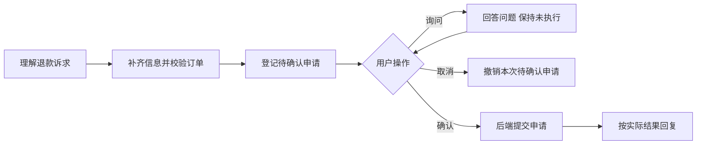

# 电商客服产品设计借鉴总结

整理日期：2026-10-07。

**背景：** 为改造自己的电商客服项目，从本项目的设计探索、问题修复和评测记录中提取可迁移的产品逻辑。

**阅读依据：** [产品设计学习](../04-学习与复盘/产品设计学习.md)、[BadCase](../03-评测与问题/问题台账.md)、[项目交接](../01-项目概览/项目交接.md)、[项目评测记录](../03-评测与问题/项目评测记录.md)，并核对关键实现。

## 核心判断与适用边界

本项目最值得借鉴的是：**让模型负责理解和沟通，让后端负责权限、授权和业务状态，再让回复准确反映执行结果。** 对电商客服改造，这套分工比增加 Agent 数量更有价值。

下面不少设计是本地修复过程中形成的，需要与原版能力分开看。该项目仍使用模拟订单，适合参考设计逻辑，不能直接当成成熟退款系统。真实登录、支付到账、持久恢复、并发幂等及跨会话授权等能力，尚未实现或未充分验证。

## 第一，退款采用“先登记意向、用户确认一次、再执行”的流程

这是最值得优先参考的设计。

用户说“002订单帮我退款，原因是不想要了”，系统先补齐必要信息、校验订单，再登记待确认意向。登记不会直接改变退款业务状态；用户明确确认后，执行层才提交申请。

值得借鉴的两个点：

- **只追问真正缺少的信息。** 没有订单号时，可以列出本人订单供选择，减少用户查找订单号的负担；信息齐全时，不再多问一次“是否要登记”。
- **用户只确认一次。** 内部的登记、凭证传递和执行步骤，不应变成用户反复点头的负担。

项目曾让模型管理两阶段调用，结果要求用户确认两次。后来改为代码保管凭证、处理确认，才把交互收敛下来。模型仍负责理解退款诉求、查询信息和登记意向，执行层负责判断何时允许提交。

**迁移建议：** 展示一张包含订单、退款范围、金额和原因的确认卡，提供确认与取消按钮，由后端校验这次确认对应的申请。

**边界：** 确认卡和按钮是迁移建议，当前项目尚未实现；它的文字确认白名单只适合教学场景。申请内容发生变化时，旧确认不应继续有效。

依据：[产品设计学习中的确认下沉与交互代价](../04-学习与复盘/产品设计学习.md#2026-10-05-exp-20261005-07确认下沉执行层的实施与代价)、[BadCase 中的确认执行层产品讲解](../03-评测与问题/问题台账.md#bc-008-产品设计补充退款确认怎样交给执行层)。

## 第二，把对话中的意向和真实业务进度分开，并按实际状态回复

这是一个容易漏掉、但直接影响信任的设计。

| 状态 | 实际含义 | 回复应该表达什么 |
|---|---|---|
| 等待确认 | 用户提出诉求，尚未提交申请 | 已记录，等待确认 |
| 已撤销待确认意向 | 用户结束这次请求 | 本次意向已撤销，未执行 |
| 申请已受理 | 后端已经记录退款申请 | 已受理，仍在处理 |
| 退款已到账 | 支付系统确认资金结果 | 才能说明到账 |

项目曾出现“系统仍在等待确认，模型却说已经取消”，以及“从未登记，模型却说取消成功”。最后对这些有限、明确的状态，直接由代码选择固定回复。

**迁移建议：** 取消成功、重复申请、无待确认任务等关键结果，用模板准确表达；咨询、解释和问题澄清继续交给模型。收到取消指令时，先检查是否确实有待确认申请；撤销待确认意向不能被描述成撤回已经受理的退款。

**产品取舍：** “不确认”是否保留意向，要作为明确产品规则，不能默认所有用户都把它理解成“暂时等等”。当前项目选择保留意向，并明确提示用户可以回复“取消退款”来撤销。

依据：[BadCase 中的状态回复修复](../03-评测与问题/问题台账.md#2026-10-06-用户复核与a04修复取消回复必须服从真实意向状态)。

## 第三，工具返回要清楚说明业务结果，以及结果的适用边界

项目最早的两个问题很典型：搜不到商品就随机生成一个；退款工具返回成功，却没改变订单。即使模型忠实转述工具结果，用户仍会得到错误信息。

值得参考的是修复后的逻辑：

- 搜索完成但没有匹配：返回空结果，允许澄清或调整条件。
- 商品存在但库存为零：明确缺货。
- 退款申请受理：写入可查询状态，再报告受理。
- 物流数据较旧：提供更新时间和时效提示，避免把历史“派送中”说成现在正在派送。

**迁移建议：** 将接口是否执行完成、查到了什么、业务状态是否变化分别表达；不能只凭 `success=true` 判断任务完成。回复的确定程度应匹配数据源能证明的范围。

**边界：** “没搜到”不一定等于“店里没有”，没有物流轨迹也不等于没有发货。项目的物流“7天过期”只是学习阈值，不宜照搬；实际阈值应结合业务和承运商时效确定。

依据：[产品设计学习第2～4节](../04-学习与复盘/产品设计学习.md)、[商品、物流和退款问题 BC-001／002／005](../03-评测与问题/问题台账.md)。

## 第四，用户身份要贯穿订单、会话和记忆，不能由模型决定

项目修复后，身份由执行层传入，模型只提供订单号和业务参数。用户说“我是小明”，不会因此获得小明订单的访问权限。

更值得参考的是：**隔离范围没有只停在订单查询接口。** 历史对话、摘要、短期记忆和长期记忆也检查用户归属，避免旧上下文先把他人信息送进模型。

**迁移建议：** 从真实登录或渠道认证获得用户身份，沿会话、工具和存储传递。订单列表按用户过滤，查单、物流和退款在返回信息或写回前校验归属；模型不能通过工具参数指定或覆盖身份。恢复历史会话时，同样检查归属。

**边界：** 本项目的 `MOCK_USER_ID` 是模拟身份，不能作为线上认证方案。增加一个“权限 Agent”也不能替代后端权限校验。

依据：[产品设计学习第9节：当前用户](../04-学习与复盘/产品设计学习.md#9-当前用户模型不能用姓名或订单号决定访问权限)、[BC-006](../03-评测与问题/问题台账.md#ecom-bc-006订单列表不分用户别人的订单说成您账户下的)。

## 第五，记忆要区分“用户明确说的”和“工具查出来的”

用户查了一笔黑色 Nike 商品的订单，不代表用户偏好黑色或 Nike，也不代表收件人就是聊天用户。项目最早把这些信息直接记成了用户画像。

修复后，记忆带有来源和类别：用户自述、工具数据、推断分别标记；代码会把来源不合格的身份或偏好降级为查询对象。

| 信息 | 适合怎么记录 |
|---|---|
| 用户说“我喜欢红色，预算500以内” | 用户明确陈述的偏好 |
| 工具返回订单商品为黑色 Nike | 本次订单的商品事实 |
| 用户正在询问002订单退款 | 当前任务及查询对象 |

**迁移建议：** 如果客服主要解决订单和售后问题，优先维护“正在处理哪笔订单、还缺什么、当前到哪一步”，长期偏好可以后做。当前任务状态的价值通常更直接。

**边界：** 来源字段只是加固，模型仍可能标错来源，不能把它当作事实证明。对退款是否已受理等业务事实，应查询业务系统，不能用聊天记忆代替。

依据：[产品设计学习第5～6节：记忆来源与结构化](../04-学习与复盘/产品设计学习.md#5-第三个单变量实验记忆来源区分ecom-bc-003)。

## 第六，规则按职责放置，避免把所有问题都塞进全局 Prompt

项目后期形成的分工值得借鉴：

| 放在哪里 | 适合承担什么 |
|---|---|
| 全局 Prompt | 少量通用原则：业务事实与承诺必须有依据，未知就说明未知 |
| 当前工具结果 | 本次状态、数据时效、已知与未知信息 |
| Skill | 较长的操作流程、复杂政策和例外说明 |
| 执行代码 | 权限检查、确认条件、重复执行保护和状态写回 |

项目实际出现过两种情况：模型没有加载退款 Skill；加载了 Skill，仍跳过确认。因此，**必须生效的业务约束不能只依赖 Skill 被选中或 Prompt 被遵守。** Skill 仍适合承载按需读取的详细说明。

**迁移建议：** 全局保持少量通用规则，工具提供当前业务事实，Skill 提供详细流程，执行代码控制敏感动作。不要每发现一个 Bad Case，就给全局 Prompt 追加一条特定禁令。

**覆盖要求：** 局部约束要覆盖登记、等待确认、受理等相关阶段；工具结果被改写为模型可见通知时，不能丢掉状态和边界信息。项目曾只在受理成功结果里限制渠道承诺，结果模型在登记阶段又说“原路退回”。

依据：[BadCase 中的工具分支、Skill 与全局规则分析](../03-评测与问题/问题台账.md#同一个退款工具为何没带上渠道限制)。

## 建议的改造顺序

先完成一条退款闭环：

该图是迁移建议的简化主链路，信息不全或校验不通过时不能直接进入登记；它不是本项目全部异常路径的实现图。

1. **先做好权限、一次确认和状态写回。** 申请变更后旧确认失效，重复提交不能重复处理；业务状态需要在会话结束或服务重启后仍可查询。
2. **再统一工具结果与回复语义。** 重点区分待确认、已受理、待审核和已到账。
3. **最后按实际需求补记忆与 Skill。** 暂不因模块齐全而增加多 Agent。

以上是迁移优先级建议，不表示当前项目已经实现持久化、完整授权撤销或生产幂等。

## 验收时同时看回复、调用和状态

至少覆盖以下场景：

- 正常登记后确认：只受理一次。
- 不确认：不执行，回复与所选意向规则一致。
- 询问金额：准确回答，不能把“确认一下金额”当成授权。
- 取消后再确认：不执行旧申请。
- 没有申请时取消：不虚报取消成功。
- 重复提交：不重复处理。
- 越权查询或操作：不泄露信息、不改变状态。

每条用例同时核对**用户看到的回复、实际工具调用和业务状态**。执行正确和回复可信需要分别验收。

截至记录中的 EXP-20261006-04，四条确认／取消专项及渠道专项均单次通过，但仍出现无依据的“退款进度会另行通知”承诺。该结果支持指定路径的改善，不能证明全部回复可信、所有自然语言表达稳定，或生产退款安全已经验收。

依据：[项目评测记录第28节](../03-评测与问题/项目评测记录.md#28-exp-20261006-04取消状态回复改版的真实模型验收事前冻结授权后完成)、[项目交接的当前停点](../01-项目概览/项目交接.md#当前停点唯一)。
