# Bad Case

## BC-018：明确换货或部分退款时，规则仍指向整单退款

- 类型／日期：项目，2026-10-12。状态：**商城入口已修改并隔离复测通过，日常加载未做；Python独立工作台不在本轮范围。** 用户补充要求先放人工确认卡与开发中页面，最终50项／25轮截图通过，见[实现验收](../analysis/人工客服占位入口实现验收/结果.md)。下方原始缺口和设计核验保留为历史依据。
- 一句话概述：客户不要退款、只要换货，规则仍按退款准备计划；部分退款也没有被整单能力边界挡住。
- 原始输入：`ORD1234 收到时就破了，我只要换一件，不要退款。`；`ORD1234 两件里只退一件，给我部分退款。`
- 预期输出：保留换货／部分退款诉求，说明助手不能办理，不准备退款或无理由退货申请；无真人渠道时说明缺口，不虚报交接。

预期路径：

实际局部路径：

- 实际输出：两个输入的`intent=refund_request`、计划`requires_workflow=true`。没有执行完整chat，最终对话、确认卡及数据库后果还没测过，不能写成已误退款。
- 错误原因：源码已确认规则按退款关键词命中，没有独立不支持业务出口；模型标签集合也无该出口。Java质量词保护有限，是否实际误准备或旧卡仍可提交需隔离复现。
- 影响：客户真实诉求被覆盖，可能被带入错误整单流程；实际提交和资金损失未观察。
- 怎么改／怎么算改好：按[规划](缺口七不支持业务清晰出口/不支持业务清晰出口产品需求规划.md)接入单一出口，明确替换时使旧卡失效；正常整单办理和纯政策咨询不被误拦。V01–V07修改后验收尚未执行。
- 证据：[UNSUPPORTED-DESIGN-001](项目评测记录.md#unsupported-design-0012026-10-12-不支持业务出口局部现状核验)、[原始记录与源码指纹](../analysis/不支持业务出口设计核验/current.json)。

证据分开记录：BC-001 最初来自静态分析，2026-10-07 已做隔离函数复现；BC-002 来自原版与改版的实际离线回归。BC-003 为商城契约静态核验及 Pydantic 隔离校验，BC-004 为模拟恢复函数核验。本次设计核验没有真实模型或线上业务调用；这些记录不代表生产事故。

## BC-001：查不到最新订单时，审批复核会改用旧快照并可能通过

- 类型：项目。日期：2026-10-06。版本：lesson-41-final-rehearsal；内容指纹见 [导读](../analysis/dianshang-agent.md)。
- 状态：**当前源码已有实现，定向复测证据待对齐。** 2026-10-07 旧版隔离失败保留；2026-10-12 静态核对 `resume.py:112–156` 已在最新事实缺失或异常时阻断。本轮未运行复测，真实接口故障场景未验证，见 [ST-004](项目评测记录.md#st-0042026-10-12-续接时核对旧审批问题与当前源码)。下方实际路径与计划为历史记录。

2026-10-08 范围说明：本次 Java 商城提交绕开 Python 模拟恢复，直接在事务内重读业务事实；支付事实读取故障与保存故障均已在 GAP-001 阻断。此条 Python 模拟复核的旧快照回退仍未修改，不能将商城修复写成本条全部解决。

### 一句话概述

审批前应再次核对订单是否仍未发货，但业务接口查不到订单时，代码拿审批开始时的旧订单继续比较，可能把“现在不知道”当成“现在没有变化”。

### 原始输入

函数场景（合成隔离用例，非用户已报告事故）：`business_recheck(checkpoint)`，checkpoint 有 frozen_fields 和 order_snapshot；`order_fact_from_ecommerce(order_id, runtime_user_id)` 返回 None。2026-10-07 用未发货订单 ORD1234 的合成快照运行；未对真实业务服务注入故障。

### 预期输出与路径

预期是本轮提出的安全标准，不是声称原课程已有测试：返回 passed=false、原因表明最新事实无法核实，恢复保持 blocked，等待重新读取，不新增模拟提交。

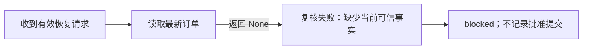

### 实际输出与路径

DESIGN-001 隔离调用实际输出 `{"passed": true, "reason": null, "mismatches": {}}`。源码路径：在线订单为 None 时使用 checkpoint.order_snapshot；旧快照状态与 frozen_fields 相同，比较没有 mismatches，因此通过。该项只运行了复核函数，没有把 None 故障接到完整商城恢复请求。

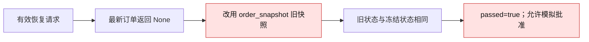

### 错误原因

源码与隔离函数已确认：`backend/agent/workflows/resume.py:33` 读最新订单，`:34` 为空就回快照，`:43` 只比较两项状态，`:46` 无差异就通过。`:111` 使用该结果决定是否阻断。

还没测过：真实 API 故障、无权限或订单变化是否在当前运行环境触发此分支。不能据此声称资金已经被错误退款：本项目只是模拟批准，无真实资金调用。

### 影响

审批人可能看到“业务复核通过”，实际上并未获得最新订单。用于教学时会形成错误的安全理解；若照搬到真实资金操作，可能在订单已发货等状态变化后错误放行，这是推测的迁移风险。

### 计划做法（2026-10-09，尚未实施）

**目标：拿不到最新订单时暂停审核，不能用旧信息证明当前仍符合条件。** 用户已认可这一处理原则；本次只整理计划，状态仍为“待改进”。

1. 审核复核必须读取本人订单的最新事实。查不到订单、查询失败或必要状态字段缺失时，返回“无法核实最新订单，本次未继续处理”，复核结果为 `passed=false`，本次恢复为 `blocked`。
2. 移除在线复核失败后改用 `order_snapshot` 放行的逻辑。旧快照可以保留作申请时的信息展示和比对依据，不能冒充最新查询结果。
3. 阻断时不新增模拟提交，不记录批准成功，也不把申请改成已批准或已拒绝；保存的申请继续待处理。查询恢复后，可以再次核对最新事实并重试。
4. 最新事实完整且与申请时的关键状态一致，才允许继续；已发货等状态变化则停止原未发货退款流程，说明变化原因。区分“无法查询”与“查到状态已变化”，避免都显示成同一种错误。
5. 离线教学需要时，使用明确配置的合成订单来源，并标明“离线模拟复核”；不在真实查询失败后悄悄切换到旧快照。

修改范围预计为 `business_recheck`、恢复入口的失败原因传递，以及必要的工作台失败提示和局部检查。复用现有检查点和回复结构，不改商城 Java 提交与审批，不调用真实模型或资金接口。

#### 验收标准（待运行）

| 场景 | 应得到的结果 |
|---|---|
| 最新订单返回 None，申请时旧快照仍存在 | `passed=false`、恢复 `blocked`；模拟提交数不增加，不显示复核通过 |
| 注入查询异常或缺少必要状态字段 | 同样阻断，说明无法核实；不当作订单状态未变化 |
| 查询恢复，最新本人订单仍符合条件 | 同一待处理申请可重试并继续，不因上次查询失败永久失效 |
| 查到订单已发货等关键状态变化 | 阻断并说明条件变化，不批准原未发货退款 |
| 明确开启离线教学 | 记录合成事实来源及模拟结果，不能标成真实业务复核通过 |

先用合成订单和接口替身检查复核函数，再覆盖完整模拟恢复入口；同时核对回复、检查点状态和模拟提交记录。以上均为计划标准，本轮未运行，不能记为通过。

证据：[resume.py](../backend/agent/workflows/resume.py)、[ST-001/TC-006 与 DESIGN-001](项目评测记录.md)、[DESIGN-001 结果](../analysis/设计借鉴核验/result.json)、[导读异常边界](../analysis/dianshang-agent.md)。暂无真实服务故障运行或修复复测 trace。

## BC-002：三条原有回答契约在离线回归中失败

- 日期：2026-10-06。状态：**原版与改版均复现，未修改判定器或放宽契约；待单独处理。**
- 模式：禁用真实模型和 Embedding；业务网络 patch 阻断、本地种子镜像与字符向量。当时使用原源码备份与差异文件对照；2026-10-07 去品牌清理已移除这两项，现保留历史哈希与非品牌迁移契约。
- 原始输入、预期契约、完整回复与 Trace：见 [baseline-eval.json](../analysis/改造验证/baseline-eval.json)、[huangye-eval.json](../analysis/改造验证/huangye-eval.json)、backend/resources/cases.yml。

| case_id / 改版输入 | 预期 | 实际回复关键部分 | 实际判定 |
|---|---|---|---|
| product-tool-rag-joint-answer：“折叠椅现在的标价、活动价和库存分别是多少？另外，平台露营季满减的一般规则是什么？” | 契约要求同时出现商品详情页、结算页 | “这不代表该规则一定适用于当前商品活动，具体组合以商品页和结算页为准。” | final_price_boundary 缺失 |
| received-return-workflow：“SO20260712090000010-a1000010 已签收，我想七天无理由退货” | 可准备申请、仍需人工审核，不报完成 | “可以准备退货申请；当前还不是退货成功，仍需人工复核。” | human_review_boundary 缺失 |
| promotion-member-rag-path：“露营季活动满减和山友会员券能不能叠加？” | 有门槛、会员条件和两条政策引用 | “但不能与同类型满减券重复叠加；山友会员券需要在有效期内由本人账号使用。” | gold_member_condition 缺失 |

三例的工具、引用、Trace 与会话状态断言没有报告缺失；失败类别都为 answer_semantic_missing。未执行真实模型，不推导真实模型质量。

原因证据：第一例是确定性回复“商品页”与契约“商品详情页”不一致；第二、三例中明确出现“人工复核”“山友会员”，但 runner 的 NFKC 归一化把全角分号/逗号变成半角，随后过滤掉半角标点，导致句边界消失。正向词前 16 字含有前一句“不”，被否定匹配规则拒绝。源码位置 backend/evals/runner.py 的 _normalize_answer_text / _answer_phrase_matches；用实际回复调用同函数已确认 False。属于评测判定与文案契约问题，不能简写成“Agent 不懂业务”。

最小候选处理：单独确认价款边界的同义表述契约；修正归一化保留句边界，并验证正向人工复核/会员条件与真正否定条件的相邻对照。此次架构与机制不动，未实施该修复。改好标准是保留不宣称退货完成、未核实活动适用性等业务边界，避免仅让通过数上升。

影响：现有 13 条规则回归不能准确评价这些回答的语义。一次离线结果不能作为生产准确率；保留 10/13 及原始证据，不使用发布材料的 13/13。

2026-10-07 DESIGN-001 再次用实际同形回复核验，“人工复核”正向匹配为 false；未修改判定器或重算历史通过数。

## BC-003：商城确认卡的动作与两级后端契约不一致，取消只写了聊天文字

- 类型：项目。日期：2026-10-07。版本：当前源码，哈希见 DESIGN-001。
- 状态：**2026-10-08 已修改，隔离 HTTP/数据库及浏览器复测通过；已有 MySQL 部署与在线模型的新退款链路未复测。** 下文保留 2026-10-07 的原始问题证据。

### 一句话概述

客户点击“确认提交申请”，前端、Java、Python 对同一个动作的字段和含义不一致；点击“暂不提交”也没有向后端撤销意向。

### 原始输入

合成待确认流程上的按钮操作：“确认提交申请” / “暂不提交”。前端确认发送 `decision=APPROVED`，Java 仅接受 `CONFIRM_SUBMIT` / `CANCEL_SUBMIT`；Java 转发 Python 的 JSON 只有 session_id、workflow_id、resume_token、decision、reviewer_note。

### 预期输出与路径

用户确认只提交申请、进入待审核，取消由服务端撤销待确认意向；错误或 blocked 不虚报成功。

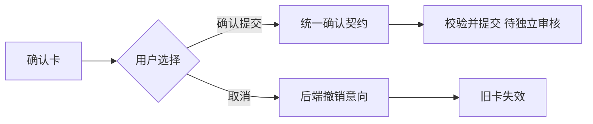

### 实际输出与路径

未实跑商城按钮。源码确认的路径如下；对 Java 同形 JSON 做 Pydantic 校验，报缺 reviewer_id/reviewer_role。

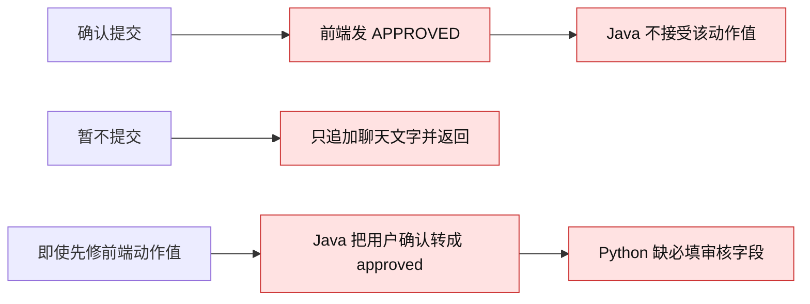

### 错误原因、影响

源码已确认：`ecommerce-backend/frontend/src/shop/App.tsx:1053`、`:1055`、`:1095`；`CustomerServiceGatewayService.java:148`、`:153`；`AgentResumeRequest.java:5`；`backend/api/schemas.py:220`。此外网关订单字段只读 order_no/orderNo，Python 用 order_id，非订单页确认卡可能缺关联订单，尚未浏览器验证。

客户可能提交失败、误认为已经撤销；单纯补 reviewer 字段还会把客户确认包装成审核通过。没有真实退款执行证据。

### 怎么改与怎么算改好

先统一用户提交/取消契约，独立定义用户授权和审核员决定；取消与旧卡失效同步到后端。依据 accepted/status 更新卡片和 handled，失败不得默认报受理。正常、取消、重复、内容变更和 blocked 各测一条商城入口链路；申请金额/范围以可信事实为依据。具体方案见 [产品设计学习](产品设计学习.md#第二p0用户确认不能变成人工审批)。

原始证据：[DESIGN-001](项目评测记录.md#design-0012026-10-07三份材料与源码设计核验)、[结果](../analysis/设计借鉴核验/result.json)。

2026-10-08 修复与复测：两按钮发送统一提交/取消动作；商城网关直接登记 PENDING_REVIEW，不调用 AgentResumeRequest、不伪造审核员。后端取消、旧凭证失效、最新事实校验、数据库回滚、订单行锁防重及独立管理员权限已验证；成功卡片显示申请号与实际状态。39 项接口检查、浏览器 6 组检查见 [GAP-001](项目评测记录.md#gap-0012026-10-08商城确认提交待审核)。申请未审核，余额未变化。

## BC-004：模拟恢复不校验审批角色，批准后还能返回拒绝，检查点未保存终态

- 类型：项目。日期：2026-10-07。版本：当前源码，哈希见 DESIGN-001。
- 状态：**当前源码已有实现，定向复测证据待对齐。** 旧版合成订单隔离失败保留；2026-10-12 静态核对 `resume.py:189–234`、`:373–486` 与 `api/routes.py:65–69` 已有服务端身份、终态保存和冲突保护。本轮未运行复测，未验证真实管理员会话联调，见 [ST-004](项目评测记录.md#st-0042026-10-12-续接时核对旧审批问题与当前源码)。下方实际路径与计划为历史记录。

### 一句话概述

有效恢复凭证被当成了充分审批资格，普通客户角色也能批准；同一流程再次拒绝时返回拒绝，但已经存在的模拟提交记录仍保留。

### 原始输入

用 `build_refund_workflow_checkpoint` 创建合成 ORD1234 未发货检查点；恢复请求 reviewer_id=ordinary-user、reviewer_role=customer、decision=approved，随后同一请求改为 rejected。最新订单函数 Mock 返回相同合成订单。

### 预期输出与路径

普通客户不能审批；合法审核终态应保存，重复同一决定返回相同结果，冲突决定拒绝。

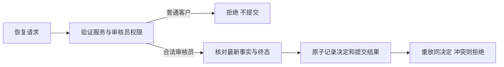

### 实际输出与路径

隔离实际结果：客户角色 approved→completed；随后 rejected→rejected；保存的 checkpoint.workflow.status 仍 paused；模拟 SUBMITTED_ACTIONS 保留一项。

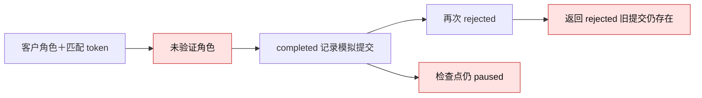

### 错误原因、影响

`backend/agent/workflows/resume.py:103` 不校验 reviewer；`:115` 拷贝 workflow 后只修改副本，未把终态写回检查点；`:118`～`:135` 不拦截冲突终态。`:123` 的 setdefault 仅去重模拟 request_id，不是一套完整状态机或业务幂等。Python HTTP 入口无认证依赖，Java 业务审批入口的权限不能自动覆盖它。

影响为模拟授权与展示状态矛盾；资金、并发和生产攻击没有验证，不声称发生真实退款。

### 计划做法（2026-10-09，尚未实施）

**目标：只有有权审核的人能决定结果；最终决定一旦生效，重复操作不能造成矛盾或第二次提交。** 用户已认可这一处理原则；本次只整理计划，状态仍为“待改进”。

1. 服务端核实审核员身份及权限。普通客户、身份无法核实的请求，即使持有有效恢复凭证也必须拒绝；不能仅凭请求里自填的 `reviewer_id` / `reviewer_role` 放行。客户“确认提交”继续与审核员“批准/拒绝”分开。
2. 校验身份后，再校验恢复凭证与当前申请的绑定。第一次批准前，按 BC-001 核对最新订单；凭证无效或事实不明时，不改变审核结果、不新增模拟提交。
3. 把决定、审核员、最终状态及处理结果写回现有申请检查点，与模拟提交记录保持一致，不能只修改返回给页面的副本。批准与拒绝为最终决定；要求补充信息仍为待处理，之后允许合法审核员继续决定。
4. 同一申请已经批准或拒绝后，合法重试同一决定时返回保存的原结果；批准后的重试不能因订单查询暂时失败而丢失已完成结果，也不能再增加模拟提交。改成相反决定或要求补充信息时，拒绝操作并保留原最终状态。
5. 同一申请的检查、决定保存及模拟提交登记作为一次受控处理。并发两次批准只能产生一条模拟提交；并发批准和拒绝只能有一个最终决定生效，另一个明确提示申请已处理。
6. 首版复用当前进程内的检查点和模拟记录，不新增持久审批平台。服务重启后，旧检查点丢失的凭证应明确失效并阻断；不能显示为恢复成功。跨重启恢复作为后续独立需求，不列为本次已具备能力。

**实施前待明确：** 当前 Python 工作台没有登录认证，页面还会自填固定审核员字段（`frontend/src/hooks/useAgentChat.ts:370`）。需要确定服务端可信身份如何接入，优先评估复用现有管理员认证，不新建一套审核账户；此项未确定前，不能把只检查角色字段的改动称为身份权限修复。工作台继续明确显示“模拟审核”。

修改范围预计为 Python 恢复入口、检查点状态保存、必要的 API 身份校验及工作台请求/结果展示，并补对应检查；具体身份接入范围待上述接入项确定。保留商城独立审核链路，不接入真实退款或改历史业务数据。

#### 验收标准（待运行）

| 场景 | 应得到的结果 |
|---|---|
| 普通客户持有效凭证，或在请求中自称管理员 | 拒绝审核，检查点和模拟提交记录不变 |
| 合法审核员、正确凭证、最新订单符合条件 | 批准成功；返回状态、保存状态及模拟记录一致，只有一条提交 |
| 批准后重复批准，包括最新查询暂时不可用时 | 在身份与凭证校验通过后返回原成功结果及原记录编号，不再提交 |
| 批准后拒绝、拒绝后批准、最终决定后要求补充信息 | 拒绝冲突操作，原最终决定和记录保持不变 |
| 重复拒绝 | 返回原拒绝结果，不产生模拟提交 |
| 要求补充信息后继续审核 | 保持待处理；后续合法批准前仍须复核最新事实 |
| 两个并发批准，或批准与拒绝并发 | 只有一个首次决定生效；同决定重试复用结果，冲突决定被拒绝 |
| 错误凭证或服务重启后使用旧凭证 | 明确阻断，不显示处理成功、不新增模拟提交 |

先用可信身份替身和合成订单验证恢复函数，再覆盖工作台 API 入口及页面展示。单看页面回复或一次 `setdefault` 去重不算通过；必须同时检查保存的决定和模拟记录。本轮未实施、未运行这些验收，不声称真实权限、资金或跨重启恢复已经验证。

证据：[DESIGN-001 结果](../analysis/设计借鉴核验/result.json)、[核验脚本](../analysis/设计借鉴核验/check_design.py)、[完整建议](产品设计学习.md#第二p0用户确认不能变成人工审批)。未修复、未修复复测。

## BC-005：管理员退款已入账，订单仍显示待发货

- 类型：项目。日期：2026-10-09。状态：**已修复并部署本地，隔离审批检查及目标 MySQL 订单界面复测通过。**
- 用户复现：商城订单 `SO20261009061332122-26971b7b` 的199元退款由管理员批准，余额恢复100,000；列表和详情仍待发货。
- 实际证据：售后 `AS-20261009062604598-17039d42` 为 APPROVED，有同号 REFUND 入账及原 PAYMENT，订单仍 PAID_PENDING_SHIPMENT / PAID / UNSHIPPED。[修复前快照](../analysis/退款状态验证/before-live.json)；隔离新增断言在修复前同样失败，[失败日志](../analysis/退款状态验证/java-before.log)。
- 已核实原因：AdminAfterSaleService.approve 仅更新余额、退款流水和售后审批；没有关联订单终态。商城列表/详情只在首次加载读取，切回窗口也没有刷新。
- 改动：在同一个审批事务中，为全额、仍已支付未发货的 REFUND/CANCEL_ORDER 同步订单与支付 REFUNDED、履约 CANCELED、禁止取消；审批/驳回/补材料共用售后行锁。部分金额、补偿和不满足未发货条件的旧流程不标为整单退款。商城新增已退款筛选，并在 focus 时重新读取列表和详情。
- 已有数据：仅修正用户指出的上述订单；SQL 必须匹配已批准全额申请、本人 PAYMENT 与 REFUND 流水及未发货事实。[单笔修正 SQL](../analysis/退款状态验证/repair_test_order.sql) 影响1行，不重走审批、不改余额或资金流水。修复后订单/支付已退款、履约取消，余额仍100,000；[修复后快照](../analysis/退款状态验证/after-live.json)。
- 复测：39项既有检查＋10项新增检查共49通过，含金额部分/补偿/驳回/补材料、重复和并发、故障回滚；隔离浏览器4组通过；实际 MySQL 商城列表、筛选、详情3项只读检查通过；标准 Maven/Docker 构建成功并已部署。[评测](项目评测记录.md#gap-0022026-10-09管理员退款通过后同步订单状态)。
- 边界：新审批写入检查在临时 H2、模型为替身；现有 MySQL 只修正目标订单状态，未执行新的退款批准或模型调用。不扩展已发货退货、部分退款闭环，也不批量修改其他历史订单。

## BC-006：并发退货最终确认读到旧售后状态

- 日期：2026-10-09。状态：已修复，隔离HTTP/资金复测通过，已更新本地服务。
- 接手时Java检查停在“并发最终确认只一次成功与一次退款”。复现两个请求为HTTP200/400，第二个请求沿用锁前普通查询加载的售后实体，随后用最新已退款订单核验，导致状态错误。未观察到第二笔退款，不把错误状态码称为已经发生资金重复。
- 改为只读取归属字段，再依次锁订单、售后、余额并读取当前状态；物流提交和后台订单修改同步使用锁后状态。修复后同申请并发为200/409，正确余额与单笔退款；不同订单并发正确累加。事务失败全部回滚。
- 证据：保留的 [原失败日志](../analysis/七天退货验证/previous-failed-check.log) 与 [98项检查](../analysis/七天退货验证/java-result.json)。新资金行为仅在H2验证；本地MySQL没有执行新退款，更新前后业务行哈希一致。完整范围见 [GAP-003](项目评测记录.md#gap-0032026-10-09-签收七天无理由退货退款完整闭环)。

## BC-007：退款政策咨询得到发票回答

- 类型：项目。日期：2026-10-10。版本：`lesson-41-final-rehearsal`，运行编号 `20261010170124708479`，源码指纹见本条证据。
- 状态：**已关闭（本项范围）。** 用户确认最新版本B01/B02、相关场景与商城入口三项验收完成，见 [MANUAL-002](项目评测记录.md#manual-0022026-10-10-用户确认政策咨询三项验收完成)；此前POLICY-002的B01局部复测证据保留。
- 最新证据：[修改后复测](B01-B02政策咨询修改后复测.md)；以下保留 POLICY-001 修改前原始失败与历史方案。

### 一句话概述

用户只问退款规则，系统把问题送进固定的发票 FAQ 分支，回答了电子发票下载。

### 原始输入

`退款政策是什么？我先了解一下，不申请退款。` 全新会话，合成身份 `intent-eval`，无订单、历史或页面上下文。

### 预期输出与路径

解释当前项目的未发货整单退款通用条件、本人确认提交和管理员独立审核，给出对应政策依据；不要求订单、不建立办理待办或申请。标准在 POLICY-001 调用前冻结，不要求唯一标签。

### 实际输出与路径

完整回复：

> 电子发票一般在订单完成后 24 小时内开具，开具后可以在订单详情页查看和下载。
>
> 如果你在订单详情页暂时没看到，可能是发票还在开具中，建议稍后再刷新看看；如果超过 24 小时仍未显示，可以告诉我订单号，我帮你进一步核实。

模型报告 `faq_query`，命中发票缓存，引用 `invoice_issue`；最终回答模型未调用。工具 0、`workflow=null`、`open_task=null`。

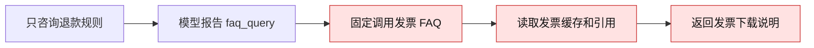

### 错误原因

源码和本次 Trace 已确认：FAQ 分支固定调用 [invoice_faq_result](../backend/agent/customer_service_agent.py#L192)，该函数只读发票缓存/知识（[knowledge.py:59](../backend/retrieval/knowledge.py#L59)）。本次没有重新检索，也没有最终模型生成，不能归为本次检索排序差或生成幻觉。路由契约的 FAQ 说明也只覆盖发票，通用政策咨询的业务承接缺失。

用户后续追问 B01 明明不是发票问题，为什么分到 FAQ。归因补充：本次 FAQ 标签不能算已正确支持的售后咨询；上游缺少清晰的咨询入口与标签边界，解析层仅验证允许标签。模型把它理解成通用规则问答是解释假设，没有内部选择理由的观测证据。详见 [B01 路由说明](售后政策咨询评测复跑与归因.md#b01-为什么会被分到-faq而它明明不是发票问题)。

### 影响

用户得不到退款规则，需要再次提问；答复带引用但主题不对应，容易让用户误以为问题已获得可信解答。本次未观察到办理副作用，不声称发生错误退款。

### 怎么改与怎么算改好

复用 FAQ，只读地按政策主题选择现有退款/退货/发票知识；收窄发票缓存的读取和写入条件，售后咨询首版不缓存生成答案。相同 B01 必须回答匹配政策并引用，保持无工具、无 Workflow、无办理待办；另测正常发票和缓存串题。详见 [最小方案](售后政策咨询评测复跑与归因.md#修正的最小方案)。

后续标签体系评估已将优先建议改为新增 `refund_policy_query`、`return_policy_query`，保留发票 FAQ 的独立范围；此前扩展 FAQ 方案仅保留供比较。依据与实施边界见 [标签评估](意图标签设置评估与调整建议.md#五分两步调整避免一次重建体系)。状态仍是待改进，本轮没有实施或修复后复测。

证据：[POLICY-001](项目评测记录.md#policy-0012026-10-10-售后政策咨询-b01b02-复跑)、[完整响应](../analysis/售后政策咨询验证/20261010170124708479/B01-response.json)、[Trace](../analysis/售后政策咨询验证/20261010170124708479/B01-trace.json)、[版本指纹](../analysis/售后政策咨询验证/20261010170124708479/manifest.json)。冷缓存、商城及修复后行为未测。

## BC-008：退货条件咨询被当成办理，追问订单并保存待办

- 类型：项目。日期：2026-10-10。版本：`lesson-41-final-rehearsal`，运行编号 `20261010170124708479`。
- 状态：**已关闭（本项范围）。** 用户确认三项验收完成，见 [MANUAL-002](项目评测记录.md#manual-0022026-10-10-用户确认政策咨询三项验收完成)；咨询变办理的历史故障及POLICY-002证据保留，后续原因要求修正见BC-009。
- 最新证据：[修改后复测](B01-B02政策咨询修改后复测.md)；以下保留 POLICY-001 修改前原始失败与历史方案。

### 一句话概述

用户明确“只是咨询，暂时不退”，系统仍把它当成退货任务，追问订单号并保存待办。

### 原始输入

`七天无理由退货需要满足什么条件？只是咨询，暂时不退。` 全新会话，合成身份 `intent-eval`，无订单、历史或页面上下文。

### 预期输出与路径

回答本项目七天无理由的通用条件和寄回、验收后退款的流程，提供匹配依据；不要求订单，不声称具体订单有资格，不建立办理待办或申请。标准在 POLICY-001 调用前冻结。

### 实际输出与路径

完整回复：`你要查询哪一个订单？请选择订单号，或直接补充订单号。`

模型报告 `return_request`，计划要求订单工具和售后 Workflow，因缺订单转为 `ask_clarification`；实际工具 0、`workflow=null`、引用 0，最终回答模型因 `clarification_required` 未调用。会话保存 `open_task={intent:return_request, pending_slot:order_id, candidates:[]}`。计划要求 Workflow 不等于实际已执行 Workflow。

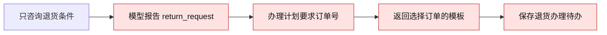

### 错误原因

实际路由偏离已确认。[Prompt 第 10 行](../backend/resources/prompts/route_contract.md#L10) 将“已签收退货、七天无理由”整体导向办理，没有明确售后咨询路径；[RoutePlan](../backend/agent/tools/planning.py#L133) 随后要求订单，[澄清生成](../backend/agent/tools/planning.py#L165) 和 [待办写入](../backend/agent/customer_service_agent.py#L655) 执行了这个办理标签。模型内部选择原因没有直接证据；不能把规则兜底命中说成本次规则覆盖模型，因为本次模型调用成功、没有回退。

### 影响

用户未获得退货条件，还被要求提供不必要的订单信息；错误待办可能让后续补号被解释成继续办理。后一种多轮影响尚未运行，本条不声称已提交申请或退款。

### 怎么改与怎么算改好

在路由契约及故障兜底中明确咨询与申请的区别，咨询走接好政策主题的 FAQ；原办理标签仍用于明确申请。不能只更换追问文案，也不能只换成当前固定发票的 FAQ。B02 应回答匹配条件与依据，`answer_user`，无澄清、工具、Workflow、待办；相邻明确申请仍走原资格核验。详见 [最小方案](售后政策咨询评测复跑与归因.md#修正的最小方案)。

后续标签体系评估将当前优先建议明确为独立 `return_policy_query` 只读路径，与 `return_request` 办理路径分开。具体订单资格与取消意向仍另行定义，不能由新标签顺带宣称完成。见 [标签评估](意图标签设置评估与调整建议.md#五分两步调整避免一次重建体系)。状态未改变。

证据：[POLICY-001](项目评测记录.md#policy-0012026-10-10-售后政策咨询-b01b02-复跑)、[完整响应](../analysis/售后政策咨询验证/20261010170124708479/B02-response.json)、[Trace](../analysis/售后政策咨询验证/20261010170124708479/B02-trace.json)、[版本指纹](../analysis/售后政策咨询验证/20261010170124708479/manifest.json)。后续补号、商城及修复后行为未测。

## BC-009：通用退货SOP的原因要求被用于七天无理由咨询

- 类型：项目。日期：2026-10-10。状态：**已关闭（本项范围）。** 政策同步后POLICY-003的B02局部复测通过；用户随后确认三项验收完成，见 [MANUAL-002](项目评测记录.md#manual-0022026-10-10-用户确认政策咨询三项验收完成)。本轮仅记录确认，未新增助手复测。
- 用户明确确认七天无理由无需填写退货理由；本次保留商品可退限制，重启加载后回复明确无需额外原因，并说明寄回验收流程。最新证据见 [POLICY-003](B01-B02政策咨询修改后复测.md#policy-003用户确认无理由无需填原因政策同步后b02通过)及[本次响应](../analysis/售后政策咨询验证/20261010180912346367/B02-response.json)。下列内容保留为修正前失败与归因。
- 用户追问后的归因范围澄清：“商品须支持七天无理由”这一条件没有冲突，现有代码同样检查购买时可退快照。本条仅针对七天无理由咨询被要求另填原因，不判整份退货政策无效，不认为所有商品均可无理由退，也不取消其他售后的原因要求。产品计划的无理由类型定义见[第39行](缺口一提交申请与审核分开/七天无理由退货退款产品设计计划.md#L39)。
- 输入：`七天无理由退货需要满足什么条件？只是咨询，暂时不退。`；全新会话，无订单/历史。
- 当前行为：正确路由 `return_policy_query`，无订单追问、工具、Workflow或待办；完整回复见 [两版对照](B01-B02政策咨询修改后复测.md#当前行为与预期)。答复说“需要您提供明确的退货原因”，还没有解释确认、待审核、寄回与验收后退款。
- 预期：七天无理由不要求另填原因；按支付、签收七天窗口、购买时商品可退等条件解释；同意后寄回，验收通过才退款。保持只读咨询边界，不承诺具体订单可退。
- 原因与证据：[政策第8行](../backend/resources/knowledge/received_return_policy.md#L8) 本身写明原因要求；当前政策咨询路径直接选该知识，生成模型复述。Java [submitCustomerReturn](../ecommerce-backend/src/main/java/com/teachdemo/ecommerce/order/ShopService.java#L394) 不收额外原因，固定记录七天无理由；[资格核验](../ecommerce-backend/src/main/java/com/teachdemo/ecommerce/order/ShopService.java#L455) 另查可信订单事实。直接归因是知识内容未同步，非本次标签错误或检索错主题。
- 最小方案：在退货政策中明确无理由与其他售后的适用范围，保留商品可退限制；仅无理由无需另编原因，补全对应流程。重启加载政策后重跑B02，验内容与只读状态。若正确来源仍被改写错误，再处理最终回答约束。无需继续新增标签。
- 验证范围：Python `/chat` 一次真实模型调用链；未走商城或真正申请。证据：[POLICY-002](项目评测记录.md#policy-0022026-10-10-b01b02-修改后复测)、[响应](../analysis/售后政策咨询验证/20261010175836855823/B02-response.json)、[Trace](../analysis/售后政策咨询验证/20261010175836855823/B02-trace.json)、[核验](../analysis/售后政策咨询验证/20261010175836855823/verification.json)。

## BC-010：说“第一笔”后仍被反复要求选择订单

- 类型：项目。日期：2026-10-10。版本：78e9030＋本轮差异。
- 状态：**已修复并更新日常本地服务；隔离复测与当前MySQL商城浏览器验收通过，按M06范围关闭。**

### 一句话概述

系统已列出两笔订单，用户说“第一笔”，系统知道还是退款，却不知道是哪笔，再次让用户选择。

### 原始输入

同一会话、本人合成未发货订单ORD9801/ORD9802：“帮我退款。”→助手按此顺序列出两笔→“第一笔。”。真实DeepSeek，Python8000；原始请求见M06-001。

### 预期输出与路径

选中ORD9801，核验当前本人订单；商城缺原因则追问，完整后生成该笔确认卡，未确认不提交。

### 实际输出与路径

两轮回复相同：“你要退款哪一个订单？请选择订单号，或直接补充订单号。 当前账号下可选订单：ORD9801（验收露营椅1）；ORD9802（验收露营椅2）。”第二轮意图refund_request，工具调用为空。

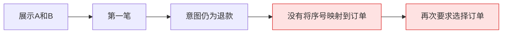

### 错误原因

源码与运行已确认：`customer_service_agent.py`保存open_task候选，但原`build_context`只取明确订单号、页面或最近订单；没有消费候选序号。另有商城集成干扰：网关把页面订单号拼进user_message，不能把附加信息当成用户明确选择。修复后保留原句并按已展示快照映射，不改变合法模型意图。

### 影响

用户无法用序号续办；若回退到另一笔页面或历史订单，存在对象错误的风险。本轮旧版只实际复现重复追问，没有发生错误退款。

### 怎么改与怎么算改好

在现有上下文选择处解析纯序号，使用同用户会话候选；无效选择不回退旧对象。新选择继续经过归属和当前状态核验。第一/第二笔、列表新排序、页面冲突、越界/无候选、跨用户/会话、发货状态变化及改问物流分别验证；商城确认卡对象正确，未确认不新增售后/流水、不改余额。

证据与复测：[M06-001隔离修复](项目评测记录.md#m06-0012026-10-10-候选订单顺序对话验收与最小修复)、[M06-002日常入口收尾](项目评测记录.md#m06-0022026-10-10-日常服务更新与商城浏览器收尾)、[修改前](../analysis/候选订单验收/20261010202923/result.json)、[修改后](../analysis/候选订单验收/20261010203159/result.json)、[商城隔离对话](../analysis/候选订单验收/mall-dialogue.json)、[7项离线检查](../analysis/候选订单验收/candidate-tests.log)、[本地浏览器2组6轮](../analysis/候选订单验收/live/browser-result.json)。本地样本准备经用户授权扣398元演示余额；之后对话未产生售后、审批或资金写入。状态不外推为生产可用或全部自然语言指代已解决。

## BC-011：回复不退款了，确认卡却仍可提交；取消后旧候选还能续办

- 类型：项目；日期：2026-10-10；版本：HEAD `78e9030`＋M06工作区，M07前后指纹见验收目录。
- 状态：**已修复、隔离复测与日常商城浏览器通过，按明确取消未提交办理范围关闭。**

### 一句话概述

用户已经说不退了，助手也答应了，但商城没有取消草稿；另一条选单对话中，取消后说“第一笔”还能重新进入退款。

### 原始输入

隔离H2本人已支付ORD9801：`ORD9801 我要退款，原因：买错了。` → 已有确认卡 → `算了，不退了。`。另一会话：`帮我退款。` → 展示ORD9801/ORD9802 → `取消本次申请。` → `第一笔。`。均为真实DeepSeek对话。

### 预期输出与路径

取消未提交办理，旧卡不可提交，旧候选不能续办；已提交申请不撤销，无待办不虚报取消成功。

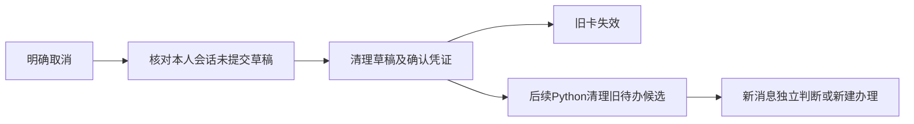

### 实际输出与路径

模型回答“好的，收到，那就不退了”，商城却返回 `confirmRequired=true`，同一旧卡仍显示“确认提交申请”。固定取消在商城成功后，Python没收到取消消息，旧候选继续参与下一轮选单。

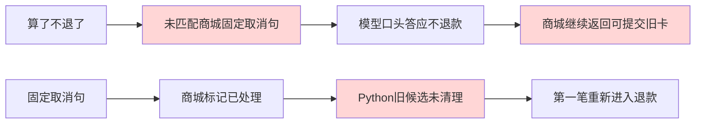

### 错误原因

源码已确认：原网关仅完整匹配三种固定取消句，模型回复没有对应业务取消动作；网关直接处理取消又绕过Python，使Python待办状态残留。不是模型没看懂，也不能仅靠添加取消意图标签解决。

### 影响

用户无法信任“已经不办理”的回复，旧卡仍可能被提交，后续短回复会复活旧申请。本次没有在日常商城点击旧卡提交，未观察到错退资金。

### 怎么改与怎么算改好

独立明确取消句复用同一取消动作，清理商城草稿和凭证、保留 `CANCELLED` 终态；后续用系统状态通知Python在路由前清理旧候选。无待办和已提交状态准确回复，重新申请使用新卡。检查取消回复、服务端凭证、旧卡拒绝、下一轮对话和业务记录；询问“怎么取消”或否定取消不能触发取消。

证据：[M07-001](项目评测记录.md#m07-0012026-10-10-取消未提交售后意向修复与验收)、[修改前](../analysis/取消意向验收/before-live/result.json)、[修改后28项](../analysis/取消意向验收/after-live/result.json)、[日常商城2组9轮](../analysis/取消意向验收/live/browser-result.json)、[业务差异](../analysis/取消意向验收/change.diff)。不承诺任意复合表达、跨重启会话恢复或撤销已提交申请。

## BC-012：服务启动把已消费的演示余额补回10万元

- 类型：项目；日期：2026-10-10；版本：原有 `DataInitializer.saveBalanceAtLeast`，由本轮日常服务更新触发。
- 状态：**初始化保护、精确恢复及重启后核验通过，按演示账户范围关闭。**

### 一句话概述

张三原本已支付两笔199元订单，余额99602；更新重启后被初始化程序补成100000，但没有对应资金流水。

### 原始输入

已有U1001演示余额99602及两笔PAYMENT记录，执行日常服务更新重启。独立H2回归设置同样的低于初始余额状态，再调用 `DataInitializer.run()`，复现补款。

### 预期输出与路径

已有账户的余额和更新时间不变；只给不存在的账户创建初始演示余额。

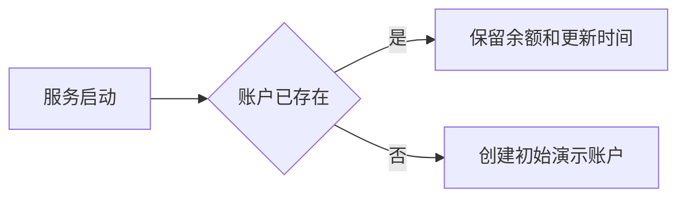

### 实际输出与路径

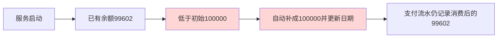

### 错误原因与影响

源码已确认：`saveBalanceAtLeast` 对任何低于初始金额的既有账户补款。重启改变业务金额，造成余额与支付流水不一致；原初始化回归只有高于初始金额的状态，未覆盖已消费余额。

### 怎么改与怎么算改好

改为 `saveBalanceIfMissing`，既有账户不写入。新增低余额回归检查金额、更新时间、流水均不变，原98项＋本项99项通过。实际恢复候选先与更新前整表SHA256精确匹配，才条件回滚本次改变的U1001金额和时间；条件不符停止。最终重启及取消对话后8张业务表均与更新前相同，无新增资金流水。

证据：[INIT-001](项目评测记录.md#init-0012026-10-10-服务重启补回演示余额的发现修复与精确恢复)、[启动变化](../analysis/取消意向验收/live/live-after-startup-drift.json)、[恢复证明](../analysis/取消意向验收/live/balance-restore-proof.json)、[恢复结果](../analysis/取消意向验收/live/balance-restore-result.json)、[最终8表对比](../analysis/取消意向验收/live/live-after.json)。本轮发生过一行本地演示余额的副作用和回滚，不记为全过程零写入，不解释成退款或对外资金操作。

## BC-013：自然取消会被固定规则漏掉，语义模型也可能误取消

- 类型：项目／候选方案独立实验；日期：2026-10-10；版本：CANCEL-COMPARE-001，当前Java正则、DeepSeek Flash专用分类指令及Jev 1.13.0。状态：001三方实验及002/002B定向修改复测完成；危险输出减少但零误取消标准未通过，继续开放。未修改业务代码或执行真实取消。

**一句话概述：** “我想了想 还是不退了”不符合现有整句规则；专用语义判断能覆盖更多说法，但不能把一次正确或总体准确率当成可自动取消的证明。

**原始输入与条件：** 当前有本人ORDER_A未提交退款草稿，助手刚说明可确认或取消。用户说“我想了想 还是不退了”（C04）；另一个输入是“朋友说‘不退了’，但我还是要退”（K05）。另测对象不清“把那个取消吧”，必要历史同时提及ORDER_A退款草稿和ORDER_B未支付订单（A02）。这些是事前构造样本，未接入商城。

**预期输出与路径：** C04识别明确取消；K05继续申请；A02澄清对象。只有明确取消且执行层重新确认本人有效未提交草稿时才能执行取消。分类实验禁止任何真实业务动作。

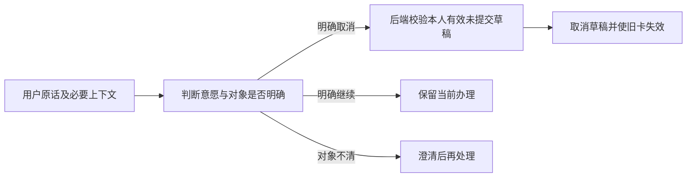

**实际输出与路径：** 固定规则两次将C04归为keep；DeepSeek第一轮cancel、第二轮keep。K05的DeepSeek第一轮keep、第二轮cancel；A02两轮均cancel。Jev对C04、K05两轮均判对，但A02两轮均cancel，首轮confidence=0.89；“取消订单吧”（A05）两轮cancel，首轮confidence=0.91。Jev错误集中在需澄清/复合类；两个模型未经门控都未达到直接接管要求。运行仅记录分类结果，下图“如果直接接管”是风险预测，未发生真实取消。

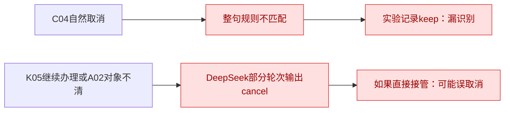

**原因：** 源码已确认规则使用整句matches，固定表达之外没有语义判断。DeepSeek候选指令已经明确区分三类，仍有边界错误和重复不一致；模型为什么在某轮错判尚不能仅凭输出确定，不归因为已确认的提示词缺陷。概率或confidence即使较高也不是业务正确的保证。

**影响：** 漏取消可能保留用户以为已取消的卡；误取消则可能终止用户仍想继续的申请。此处影响为产品风险分析，不是此次实验实际业务损失。

**怎么改与怎么算改好：** 三方案冻结比较已完成并保留所有失败；下一步建议拆开判断取消意愿和当前草稿对象，后续调参用独立样本，不能把同一批反复调到通过称为泛化效果。选定模型后还要验旧卡失效、下一轮候选不复活、无草稿和已提交不被错误执行。未把任何候选接入当前业务。

**证据：** [冻结样本](../analysis/取消语义对比/frozen.json)、[逐条结果](../analysis/取消语义对比/结果.md)、[原始模型回复](../analysis/取消语义对比/deepseek.jsonl)、[评测记录](项目评测记录.md#cancel-compare-0012026-10-10-固定规则deepseek与jev取消判断对比三方完成)。BC-011仍只在原固定句修复范围关闭，不据此认为自然语义问题已解决。

### 2026-10-11 定向修改复测

同日003/003B分流实验：初版DeepSeek也误认A05为当前售后，2次Mock误取消；另有复合确认丢任务及犹豫错问对象。修正版对象不足必须问清、确认保留任务、犹豫优先并细化复核Prompt；另12条24次预期分流、误取消0。旧54次重放误取消0，但3次复合仍待确认，不算原自动成功。按钮/任务仅Mock，真实接入和高分同错未解决，保持开放。见 [CANCEL-ROUTE-003](项目评测记录.md#cancel-route-0032026-10-11-取消按原因分流与复核实验)。

同日置信度诊断：A05对象分0.49/0.46、N18决定分0.45/0.43，低分可以拦截；N10错误决定仍达0.82。事后门槛0.85虽拦住现有错误，也让8次正确候选需复核，未独立验收，不关闭问题。见 [诊断](../analysis/取消语义定向修复/confidence-diagnostic.json)。

问题拆成decision、target、extra_task并由代码组合，英语版细化订单/售后与省略/条件边界，不改变001标签。旧30条Jev危险cancel从12降到A4、B2；新20条两轮从原12降到A8、B4，明确取消12/12保持，但B仍将N10“假如商品降价我可能留下，不过现在继续退”、N18“要是退货运费得自己承担，那就别退了”两轮判cancel。旧A05“取消订单吧”仍两轮误判。对象和决定仍能出错，不能关闭问题或自动接入。

测试器DeepSeek嵌套枚举的TypeError已修复，原失败及修复重跑保留；结构截断与语义失败分开，详细运行与费用限制见 [CANCEL-COMPARE-002](项目评测记录.md#cancel-compare-0022026-10-11-jev澄清与复合请求定向修改及复测)、[报告](../analysis/取消语义定向修复/结果.md)。只使用合成输入和模型API，没有真实草稿取消、旧卡或数据库验收。

### 2026-10-11 首版闭环补验

冻结16句两轮真实模型32次符合事前允许的分支，误取消0；真实低分句在页面通过原卡按钮完成取消。语义指令及测试下限0.9未调整，复合请求只保留或澄清对象。该结果仅覆盖新样本；高分同错、自然改口低分及真实模型未触发冲突卡仍保留，BC-013不关闭。见 [取消闭环验收](../analysis/取消闭环验收/结果.md)。

## BC-014：冲突卡点保留后，草稿还在但提交入口消失

状态：2026-10-11已最小修复并在隔离浏览器复测；后续已加载本地日常服务，执行开关关闭，见 [加载记录](../analysis/取消功能本地加载验收/结果.md)。

输入与路径：本人退款已有未提交确认卡 → 固定模型产生决定冲突 → 页面点击「保留当前办理」。预期是保留草稿并能继续操作，原冲突凭证失效。实际草稿仍为CONFIRM_SUBMIT，但KEEP分支清空resumeToken并只回纯文本，页面所有历史卡失效，没有可点击的提交确认卡。

根因：`CustomerServiceGatewayService.resumeConflict`未在保留后恢复已具备提交信息的确认入口。修复仅增加5行：当前草稿为CONFIRM_SUBMIT时生成新提交凭证并复用pendingRefundResponse；选单/补原因仍只保留，不增加提交按钮。原冲突卡不能用新提交凭证继续操作。

验收：实际浏览器新卡可用、凭证与服务端草稿一致、旧冲突卡重复KEEP为403；选择保留不新增售后或资金流水。另覆盖冲突卡不能提交、取消后旧卡409、版本变化后旧卡失效、选单/补原因不能提前提交。真实模型未触发冲突卡，因此这个修复的冲突按钮证据来自固定模型。见 [修复前证据](../analysis/取消闭环验收/before-fix/result-scripted.json)、[本轮差异](../analysis/取消闭环验收/change.diff)、[最终页面结果](../analysis/取消闭环验收/result-scripted.json)。

## BC-015：还没确定退款订单或说明原因时，低分回复指向不存在的取消按钮

状态：2026-10-11已最小修复并在隔离浏览器复测；后续已加载本地日常服务，执行开关关闭，真实模型页面补验等待数据外发授权，见 [加载记录](../analysis/取消功能本地加载验收/结果.md)。

场景：客户说「帮我退款」，还没确定系统列出的哪笔订单；或已指定ORD9801退款，却还没提供退款原因。随后说「我想了想，还是不退了」，固定模型决定分0.41，复核也同意停止，但分数未达到0.9。预期保留办理并给客户可点击的取消出口。实际回复提示点击「取消本次申请」，页面却没有该按钮。两项缺按钮检查在修改前均失败，其余业务表检查通过。

根因：网关的低分分支只对已有提交确认卡重发卡片，缺订单/原因时返回纯文本。只替换一行，复用现有保留/取消选择卡；已有提交卡、模型问题、下限与前端不变。

验收：固定模型实际页面/接口及业务表检查63/63，包含两个场景的取消、保留后补信息、旧卡重复操作拒绝、内容变化后的旧卡失效、不能提前提交、取消后旧待办清除，以及原24项回归。8张业务表未变，Python取消专项15/15。此次没有新增真实模型调用，不将按钮通过当作识别效果。见 [修改前结果](../analysis/低分取消出口验收/before-fix/result-scripted.json)、[修改差异](../analysis/低分取消出口验收/change.diff)、[最终结果](../analysis/低分取消出口验收/结果.md)。

## BC-016：客户说明取消的是当前退款后，决定仍低分却没有取消按钮

状态：2026-10-11已最小修复、加载本地服务，4组真实页面复测通过，执行开关已关闭。

场景：客户还没选退款订单，或还没说明退款原因，说「我想了想，还是不退了」。Jev对象分低于0.9，系统先追问取消的是购买订单还是退款办理。客户回复「刚才这次退款申请」后，原决定仍低于0.9，系统只回「对象已记为当前售后……办理先留着」，没有保留/取消按钮。

根因：网关只对score_low重发卡，解析对象回复产生的object_noted/below_threshold未复用同一出口。修复：该明确当前退款且仍低分的分支也走原保留/取消卡，并清理已经完成的对象等待，不改变门槛或自动取消条件。已有提交卡沿用原卡。

验证：修改前4组均缺按钮；最终4组真实对话均先追问对象，再由客户明确当前办理并显示卡片，不自动取消。29项页面/接口检查通过，包含保留/取消及旧请求拒绝。见 [修改前](../analysis/取消功能本地加载验收/明确对象后缺出口-修改前/result-live.json)、[最小差异](../analysis/取消功能本地加载验收/object-exit-change.diff)、[逐轮截图](../analysis/取消功能本地加载验收/对话记录与截图.md)。不作为独立模型准确率样本，BC-013仍开放。

## BC-017：客户点保留后补订单或原因，模型仍追问继续还是取消

2026-10-11后续复现与范围补充：新的「是否停止本次尚未提交的退款申请」流程中，保留后补完整订单号仍被判为stop/current，决定分0.30，重复出现停止卡。加强按钮对话记录不足以保证续办。本次在等待选单且无未决确认/对象澄清时，纯完整订单号直接复用Java原订单核验与准备流程，仅增加6行；固定模型故意误判订单号，修改前13项中4项失败，修改后13/13；本地真实页面6/6，补订单后正常询问退款原因，再次主动取消仍受理。8张MySQL业务表未变，代码已加载、双端执行恢复关闭。该次只关闭「完整订单号被重复停止确认拦住」的范围，不扩为所有补原因/自然语言/序号场景均已复测。见 [本轮证据](../analysis/保留后补订单续办验收/结果.md)。下方此前状态与成绩保留各自时间和范围。

状态：2026-10-11已最小修复并在真实页面复测，加载本地服务，执行开关关闭。

场景：客户已经点击「保留当前办理」，随后补充已有订单号或「原因：买错了」。预期继续原办理；实际Jev判为决定不明确，网关回「你决定继续还是取消后再操作」，没有处理补充信息。草稿未被取消。

根因：按钮决定没有写入模型读取的最近对话；模型仍看到此前停止/澄清对话，没有客户最新的明确继续选择。修复：通过身份、凭证与版本校验后，调用已有rememberTurn记录保留按钮决定，不修改模型问题或关键词。

验证：两个保留场景真实复测均可补信息继续；缺订单时补订单后进入询问原因，缺原因时补原因后生成正常提交卡，测试最后点取消，不提交。取消两组同时回归通过，8张MySQL表未变。该失败阶段另有两项KEEP响应字段被错当草稿阶段的测试断言问题，不与实际两项续办失败混算。见 [失败结果](../analysis/取消功能本地加载验收/补出口后保留续办受阻/result-live.json)、[最终结果](../analysis/取消功能本地加载验收/result-live.json)、[报告](../analysis/取消功能本地加载验收/结果.md)。
