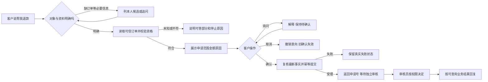

# 产品设计学习

## 2026-10-12：续接时先确认问题是否仍然存在

用户要求阅读断点并确定下一步。助手复核项目交接、四项推进重点、人工入口文案加载证据及当前 `main` 工作区；四项改进按约定范围已有收尾记录，人工入口仍只是导航到说明页。

本轮发现：旧 BC-001/004 仍写“未修复”，但当前 `resume.py:112` 已在最新订单缺失或异常时阻断，`:189` 从商城会话识别审核身份，`:409` 保存决定，`:436` 在锁内处理重复与冲突；`api/routes.py:65` 接入服务端身份，`test_resume_guard.py` 已有对应检查。以上为源码事实，未观察本轮运行行为，见 [ST-004](项目评测记录.md#st-0042026-10-12-续接时核对旧审批问题与当前源码)。

助手判断：旧问题列表不能直接当作编码任务，先复用现有定向检查对齐证据，比重做审批机制更有价值。模拟工作台与商城真实业务的权限、数据和验收边界继续分开；新建真人客服或完整换货需要另定业务范围。本轮没有改业务代码、运行模型或测试，也没有用户理解反馈。唯一停点与最小下一步见 [项目交接](项目交接.md#唯一当前停点)。

## 2026-10-12：查询没成功，不能说成没货

商品查询会把三件不同的事说成同一句：没有这款、这款现在没货、这次没查成。客户听到“缺货”就会换商品；听到“没找到”就会改关键词。查询超时却不该让人改关键词，也不该让人以为系统已经核实过库存。

源码上原来的口子是：搜索失败和零结果都容易变成空；摘要把缺失价格、库存拼进回复；详情里一部分无效返回被当成商品不存在；商品读取失败没有同步编排里的降级标记。规划要求工具结果决定说法，模型和页面只转述。见 [规划](缺口六工具故障反馈/工具故障反馈产品需求规划.md)。

这次只改商品读取边界。`ecommerce_get` 仍给订单和售后用。搜索成功返回列表，空列表是零匹配；超时和其他读取失败分开。详情只有 HTTP 404 且业务码 `NOT_FOUND` 才表示这个编号不存在（`ecommerce_client.py:157`、`:176`）。合法的 0 保留，负数和字符串不算事实。失败和只核实到一部分字段时跳过最终回答模型，避免模型把超时写成缺货（`customer_service_agent.py:404`、`:1148`）。失败不新选商品，也不改未提交的退款草稿。

没有新增意图、重试或熔断。客户说“页面报错”仍走原来的用户报告，不当成已经核实的系统故障。验收见 [FAULT-001](项目评测记录.md#fault-0012026-10-12-工具故障反馈定向验收)。用户尚未对本项取舍给反馈，不代写学习感受。当前停点只维护在 [项目交接](项目交接.md#唯一当前停点)。

## 2026-10-12：先放人工入口，但明确它还不能受理

用户补充：真人客服目前不支持，可以先放入口；需要人工时弹确认卡，点击后跳到独立页面，提示“人工客服功能开发中”。维修、部分订单退款、换货等也使用同一入口，后续再拓展。

助手按该要求修正上一轮“没有真人渠道就不展示按钮”的设计。占位入口可以明确，但点击前后都要说明未接真人，不能把导航叫作受理。实现只复用商城卡片与路由，不为将来建设排队、工单或新Agent；Java执行前拦截明确业务词，避免并行修改Python路由。

实际验证：明确改办未支持业务使旧未提交卡失效；咨询政策和单独要求人工不取消原草稿。正常整单流程继续使用本人确认卡。收尾发现“只退款……商品”被过宽规则误拦，收紧并补相邻样本，另验证Java静态路由后50项通过，见[HUMAN-ENTRY-001](项目评测记录.md#human-entry-0012026-10-12-人工客服占位卡与不支持业务出口)。没有真实坐席、在线模型或日常加载证据，不外推自然语言覆盖率。

## 2026-10-12：不支持业务需要诚实的出口

用户说明已使用另一位Agent修改工具故障反馈，要求本聊天跨过该项继续下一项。本轮接续“不支持业务的清晰出口”，只做源码核验、局部函数诊断和产品规划，避免并行修改共享路由。

已观察：规则把“只要换货，不要退款”和部分退款判为`refund_request`；维修落入普通问候。标签类型无独立不支持出口，Java有限质量词拦截不等于完整保护。没有运行完整chat或业务写入，见[UNSUPPORTED-DESIGN-001](项目评测记录.md#unsupported-design-0012026-10-12-不支持业务出口局部现状核验)。

助手判断：目标明确但办不了，应与目标未知、知识缺失分开。首版只增加一个出口，阻止错误办理；明确改换货时保护旧卡，纯政策咨询不能取消原退款。页面联系客服打开同一个Agent，未找到真人接管接口。没有真实渠道时只能说明入口缺失，不能把“请转人工”包装成任务完成。种子政策与办理能力也应分别核实。

方案见[产品需求规划](缺口七不支持业务清晰出口/不支持业务清晰出口产品需求规划.md)。不实现完整换货、真人坐席或部分退款，不改取消阈值。用户尚未对本项取舍反馈，不代写学习感受。

## 2026-10-11：复核模型不能替用户补出取消对象

用户认可按原因分流，另问三个旧失败是否都是澄清、明确取消/不取消是否均正确。N10明确“现在继续退”应keep；N18需事实，A05需对象确认。首批简单表达成功不能推成所有明确表达都正确，也不能为修复失败把keep改成clarify。

实现隔离Jev→DeepSeek复核→分流/按钮/有序任务。初版A05两模型同错、2次Mock误取消；新集3次复合确认丢任务、2次犹豫错问对象。修正为对象不足必须问清；条件/犹豫优先；复合确认保留任务，复核decision限定当前售后。变化在实验控制代码和复核Prompt，未增加取消关键词或修改商城。

修正版另外12条各两次24/24预期分流、误取消0；旧54条重放51/54按原标准正确，3次复合仍待确认但任务已保留，未算自动成功。5组Mock按钮检查通过；新集未自然触发冲突按钮，证据分开。见 [CANCEL-ROUTE-003](项目评测记录.md#cancel-route-0032026-10-11-取消按原因分流与复核实验)、[报告](../analysis/取消分流验证/结果.md)。新集20/24复核，未证明总体省钱/更快；0.85未校准，政策/按钮/任务仅Mock。用户策略选择已记录，不推测理解感受。

## 2026-10-11：置信度能帮助分流，不能保证错误时一定低分

用户追问剩余误取消、原策略及能否用置信度发现不准。回看002B原始回复：A05“取消订单吧”取消意愿分0.97/0.98，但对象分0.49/0.46；N18运费条件未核实，决定分0.45/0.43；N10明说“现在继续退”仍误判停止，决定分0.82。必须看每个必要判断，不能用高意愿分遮盖低对象分，更不能把confidence解释为真实正确率。[官方定义](https://docs.typesafe.ai/confidence)来自选项概率分布。

仅对既有50条各两次做事后回看，三个问题最低分达到0.5时，6次误取消剩2次、28次正确可执行取消中1次需复核；达到0.85时误取消剩0次，但8次正确取消需复核。正确的N03决定分0.56/0.64，比错误N10还低，分数不能完美区分对错。详见 [诊断](../analysis/取消语义定向修复/confidence-diagnostic.json)。这不是独立阈值验收，不改变冻结实验成绩。

建议保留草稿，按不确定原因处理：对象不清问订单还是售后；条件未成立先核实政策；明确继续按保留办理；复合请求拆任务处理。分数不足可升级模型或展示绑定具体订单的取消确认，模型即使高分也须通过服务端归属、有效、未提交校验。当前M07只有固定整句和按钮驱动取消；002B尚无置信门控，本轮未实施上述策略、调用新模型或修改业务。

## 2026-10-11：把取消意愿和执行条件拆开，仍要验证每个小判断

用户要求针对Jev澄清和复合请求错误做定向修改，并问为什么危险cancel比DeepSeek多。核对001原描述发现：cancel包含明确结束办理，clarify包含结束办理加新任务，同一句可以符合两者。Jev上次12次错误全部来自澄清/复合类，明确不取消20次全部判对；DeepSeek8次则含7次澄清类和1次明确继续。最有依据的判断是原分类把意愿和单草稿执行条件混在一起，并有选项重叠；Jev与DeepSeek在这一边界上的倾向不同。不能仅凭这批结果证明模型训练或架构导致错误。

定向修改为三个独立判断：用户是否已决定结束办理、结束对象是否为当前售后、是否还有其他任务；实验代码组合三项结果。Jev一次API并行三问题，不是三个Agent或三次串行调用。后台的本人、有效、未提交等事实仍属于代码。中文拆分版后，英语细化版进一步强调订单与售后区别、省略不能猜、条件未核实不是最终决定。输入仍中文，未加入业务关键词匹配。机制依据见 [原子问题文档](https://docs.typesafe.ai/introduction)、[已知字面理解限制](https://docs.typesafe.ai/model-jaggedness/jev-1.13)。

新20条两轮，Jev危险cancel从原12降到中文拆分8，再降到英语细化4；明确取消12次均保持。结果证明这两版整体方案改善，不能分别证明拆分、英语或描述细化各自贡献。英语版仍把含“现在继续退”的条件句和未确认运费条件判成cancel。旧集还残留“取消订单”误作售后，以及无草稿/明确继续被过度澄清；不能说已经做对全部自然表达。数据与成功标准见 [CANCEL-COMPARE-002](项目评测记录.md#cancel-compare-0022026-10-11-jev澄清与复合请求定向修改及复测)。

产品反思：模型说“用户想取消”并不等于软件拥有一个完整可执行请求；也不能靠拆成多个问题就默认每一项都会正确。clarify在实验里包括对象澄清和复合请求编排；“先取消再查物流”本来可能很明确，未来应拆任务处理，不能机械要求用户重述。当前只验证单草稿取消的边界，保持此范围，不通过调整标签隐藏能力缺口。旧样本用于调试回归，新样本在冻结描述后用于验证；两版保留失败，不根据新集输出再次调参或置信阈值。

本轮修复了测试脚本对DeepSeek嵌套输出的解析错误，保留失败记录并仅重跑受影响检查；模型输出截断另记，避免把工程错误算成理解错误。预设零危险cancel未达标。实验改动已完成并复测，仍不接入商城，不改真实申请。下一步只围绕保留的条件/订单对象错误设计更明确的判定和不确定路径，并用新样本验证，不重写整套客服。未替用户记录理解感受。

## 2026-10-10：取消分类实验先看误取消，不只看总准确率

用户同意对比固定规则、DeepSeek和Jev。按已讨论边界事前冻结30条合成中文输入，每条两次，未调参。固定规则没有误取消，但24次明确取消意愿中漏16次；DeepSeek专用分类指令正确51/60，却把8次应保留或澄清的输入归为cancel，且“我想了想 还是不退了”两次不一致。具体原话、必要历史、边界和费用见 [CANCEL-COMPARE-001](项目评测记录.md#cancel-compare-0012026-10-10-固定规则deepseek与jev取消判断对比三方完成)。Jev随后完成同一60次测试：明确取消和明确不取消两轮都正确，但6条需澄清/复合样本两轮都归为cancel，共12次不应自动取消的输出，分类正确48/60。

助手判断：85%的总体分类结果不能掩盖误取消风险。固定规则能证明有限说法可识别，模型能扩展覆盖，但仍需要对犹豫、对象、复合请求做明确处理。识别取消意愿和检查是否能取消分开：无草稿或已提交仍可能有撤销意愿，后端不能因此执行当前草稿取消。实验gate只是验证设计计算，不是实际商城副作用证据。两轮不一致提示一次成功不足以宣称自然表达已稳定解决。

DeepSeek费用估算约0.0025–0.005美元/60次，p50约0.53秒；Jev约0.0018美元/60次，p50约0.89秒，p95约2.65秒。Jev本次更便宜，但没有更快，中文计费输入token约为DeepSeek的2.25倍。两轮类别一致也不是判断正确，Jev对“取消订单吧”的错误confidence达0.91。首要判断是中文边界错误能否降低，再比较速度和费用。

后续设计建议：单个分类问题现在同时判断意愿、对象和复合请求，可拆成“是否表达取消意愿”和“是否明确只针对当前草稿”，再由代码组合结果及业务资格。Jev的原生概率有进一步门控价值，但本轮未按失败调阈值；需用未参与调参的新样本验证，不能把当前结果直接当作Jev不适用或可以自动接管的结论。暂不把该指令接入商城，不根据失败改标签，也不一边调参一边把同样样本当最终验收。此次仅新增隔离实验和记录，未替用户记录理解反馈。

## 2026-10-10：Jev判断自然语言取消意愿的可行性

用户指出“我想了想，还是不退了”无法由有限固定句覆盖，并提出用Jev降低语义判断的成本与耗时。静态核对：Java网关的 `CANCEL_DRAFT.matcher(message.trim()).matches()` 要求整句符合规则，该表达不匹配；Python路由只返回业务intent，没有驱动Java取消的结构化动作。未运行这句真实对话。源码见 [网关](../ecommerce-backend/src/main/java/com/teachdemo/ecommerce/customer_service/CustomerServiceGatewayService.java#L324)、[路由客户端](../backend/agent/models/router_client.py#L50)。

助手判断：适合小范围对比实验，不能直接认定最优。[官方API](https://docs.typesafe.ai/api)接受状态与预设问题，Choice返回选项、概率分布及confidence，适合判断是否明确取消当前未提交办理。[模型文档](https://docs.typesafe.ai/models)当前列出jev-1.13.0，输入每百万token0.042美元、输出免费；英语是主要训练语言，中文等语言需自行验证。[介绍文章](https://typesafe.ai/blog/introducing-system-one-models-and-jev)公布70–500ms，但评测一般在美国西海岸运行，不能作为本项目耗时或相对DeepSeek收益。[已知限制](https://docs.typesafe.ai/model-jaggedness/jev-1.13)涉及字面理解、双重否定、对抗输入；输出类型正确不等于业务判断正确。

建议设计（未实施）：只输入用户原话、必要最近对话及服务端草稿摘要，用Choice区分“明确取消当前草稿 / 没有要求取消 / 需澄清或复合请求”。明确取消达到经实验确定的阈值时，Java重新检查归属、有效性和未提交状态，复用cancelPendingRefund、旧卡失效与Python待办清理。按钮直接执行原取消动作。模糊表达澄清，接口失败不猜测、不清草稿，保留按钮取消。confidence由选项概率分布计算，不等于真实业务准确率，见 [置信度文档](https://docs.typesafe.ai/confidence)。

最小实验建议（未冻结、未运行）：同一批人工标注的中文样本对比固定规则、现有DeepSeek语义动作方案和Jev，覆盖自然取消、询问后果、否定取消、双重否定、对象不清、取消加新任务、无草稿和已提交。调参与验收样本分开；关注误取消率、漏取消率、澄清比例、p50/p95耗时和每次成功处理总费用。Jev明确取消时应短路后续DeepSeek路由和生成；如果每轮先Jev再DeepSeek，总耗时和费用可能增加。另验旧卡失效、后续候选不复活及已提交申请不被撤销。

本轮仅官方资料与源码核对、方案留档，未接入或调用Jev、修改业务代码或重新核验服务；中文质量、账号可用性及本地网络收益待验证。用户提出使用意向，不记录为已完成模型替换。

## 2026-10-10：M07取消要同时改变草稿、旧卡和后续对话

用户确认继续实施。先复用M06隔离HTTP/H2样本，冻结 [用例标准](../analysis/取消意向验收/frozen.json)，再运行真实DeepSeek：固定取消可用，但“算了，不退了”得到模型“那就不退了”的回复后，商城仍返回可提交确认卡；等待选单时取消后再说“第一笔”，Python旧候选会恢复退款待办。原版14项检查10项通过、4项失败，源码与对话共同定位了两处断点，见 [M07-001](项目评测记录.md#m07-0012026-10-10-取消未提交售后意向修复与验收)。

最小修复：商城网关扩展独立、明确的取消句，聊天与按钮复用同一个取消动作，清掉草稿内容和凭证并留下 `CANCELLED` 状态；旧卡返回409。[网关](../ecommerce-backend/src/main/java/com/teachdemo/ecommerce/customer_service/CustomerServiceGatewayService.java#L324) 对无待办或已提交状态准确说明没有可取消的未提交办理，不声称撤回已受理申请。后续发送给Python的系统上下文带 `cancelledAfterSaleDraft`，[聊天入口](../backend/agent/customer_service_agent.py#L66) 在路由和选单前清理旧待办；已核验订单事实保留供正常查询。重新申请创建新草稿，新选单待办恢复为未处理状态。没有修改提示词、增加意图标签、依赖、Agent或接口；前端复用现有有效确认令牌机制禁用旧卡。

产品判断：模型理解用户不想退款，不等于业务状态已经取消。用户改变主意时，草稿状态、可执行按钮和下一轮对话应同步变化。商城负责是否有草稿、是否已提交、取消是否成功；Python负责不再把旧候选附给模型，不能只清理其中一层。确定的取消结果由状态模板表达，其他问题仍走原有模型判断。取舍是当前只覆盖明确的独立取消句，不承诺“先取消，再查另一笔”等复合表达或撤销已提交申请。

结果：同一核心标准全部通过，追加边界后隔离模型替身与真实模型各28项、39轮通过；日常MySQL商城浏览器2组9轮、10项通过，用户原本的199元样本被复用，未新增订单、支付或提交售后。Python目标10项通过，全回归47/48，唯一失败仍是既有“7 天/七天”文字断言。Java/H2原98项加初始化保护检查共99项通过。完整结果与来源见 [最终核验](../analysis/取消意向验收/verification.json)。这些是本地构造样本的验证，不是线上成功率；没有替用户记录理解反馈。

更新日常服务时还发现原启动逻辑把消费后的演示余额99602补到100000，属于独立的既有问题BC-012。已改为仅初始化不存在的账户，并用更新前整表哈希证明可精确恢复金额和更新时间；条件回滚一行后，最终8张业务表与更新前完全一致。取消对话阶段无业务写入，不能因此把更新过程中发生过的余额副作用写成“全过程零写入”。说明见 [INIT-001](项目评测记录.md#init-0012026-10-10-服务重启补回演示余额的发现修复与精确恢复)。

## 2026-10-10：M06之后，先验收M07的真实取消链路

用户问解决M06后下一步做什么。助手建议优先M07：结束当前尚未提交的售后办理。静态核对发现，商城并非完全没有取消能力：[网关按钮取消](../ecommerce-backend/src/main/java/com/teachdemo/ecommerce/customer_service/CustomerServiceGatewayService.java#L147) 已处理 `CANCEL_SUBMIT`；[聊天续办](../ecommerce-backend/src/main/java/com/teachdemo/ecommerce/customer_service/CustomerServiceGatewayService.java#L322) 在当前待办未处理时匹配“取消本次申请 / 不退了 / 不申请了”，标记已处理并返回“已取消，未提交”；[商城前端](../ecommerce-backend/frontend/src/shop/App.tsx#L1131) 按回复更新有效确认令牌。此前M07运行没有确认卡，也未走商城取消，不能当作这条取消链路的失败证据，见 [旧测试](缺口二意图识别/意图识别测试.md#设计缺口)。

产品判断：先准备本人订单的未提交确认卡，验证固定表达与按钮取消、旧卡再次提交被拒绝、后续改问物流和重新申请；再验证“算了，不退了”等自然表达。当前固定匹配不直接覆盖这句，但端到端结果尚未运行，不能预先判为失败。取消等待选单或补原因的待办可作为相邻场景单列；撤销已提交申请不并入本轮范围。判断取消成功要看服务端状态、旧卡效力、后续对话及业务记录，不能只看回复或意图标签。复用现有取消机制，只修复验收发现的断点，不因缺少取消标签就先增加标签。

本轮仅源码与历史记录核对，未调用模型、运行业务对话或修改业务代码；未新增通过数或Bad Case。当前停点及下一步统一维护在 [项目交接](项目交接.md#唯一当前停点)。

## 2026-10-10：M06修复中的产品设计思路

用户要求理解“如何做对”，而不只得到功能通过的结论。源码核对确认：原来已保存候选，并将其提供给意图模型；断点是选单代码没有消费序号。本次增加候选序号与订单号的对应规则，没有修改提示词。商城另传用户原句，避免页面附加订单号替用户选择。

设计判断：分别确定用户想办什么、操作哪笔、是否符合条件、是否确认提交。候选绑定刚展示的顺序，归属与状态则重新核验；没有有效候选就追问，不回退旧订单。说明及具体例子见 [通俗解释 Markdown](M06候选订单绑定设计解释.md) / [一页图解](M06候选订单绑定设计解释.html)。

下方“M06从标签正确走到订单正确”保留隔离验收当时的记录。后续日常8000/8081已更新，当前MySQL浏览器2组6轮通过，见 [M06-002](项目评测记录.md#m06-0022026-10-10-日常服务更新与商城浏览器收尾)。本次只核对源码、补充解释，不重新运行业务对话、支付或退款；没有扩展“第一单”等表达。

## 2026-10-10：M06从标签正确走到订单正确

用户要求按对话依次验收。本轮先把两个本人订单真正放入首轮上下文，再发送“第一笔”，复现系统重复追问；此前“测试没有传候选”的不确定性被排除。根因已由对话和源码共同确认：候选被保存并传给意图模型，但对象选择没有消费序号。见 [M06-001](项目评测记录.md#m06-0012026-10-10-候选订单顺序对话验收与最小修复)。

最小修复保留每句由模型判意图：`backend/agent/context.py` 从本会话已展示的候选快照解析纯序号；越界或无候选时阻止页面/历史订单兜底，合法选择仍走现有归属和状态核验。Java网关额外在Runtime Context保存用户原句，Python抽订单号与故障续办使用原句，避免网关附加页面订单污染选择。没有新增意图标签、Agent、依赖或持久化设施。

取舍：列表顺序是用户作出选择的依据，必须绑定当时展示的顺序，不能重新查询排序后再取第一条；候选只提供对象ID，不能代替执行时的事实校验。当前只支持明确的“第一笔/第2笔”等纯序号表达，中文一至十覆盖商城默认十笔，范围外继续澄清；不声称已支持“刚才那个便宜的”等任意指代。Python工作台仍是模拟审批；商城通过真实网关/H2核对确认卡及无写入，不能把工作台“已进入审批”的话术当作商城业务完成。

结果：新增7项离线检查通过；真实模型下Python对象绑定通过，隔离商城6组12轮通过，未提交时余额、流水和售后数不变。全45项Python检查有1项既有文字断言失败，已在原HEAD复现；没有为全绿修改无关政策断言。日常服务未更新，浏览器与当前MySQL尚未验收。未新增用户理解反馈；当前唯一停点维护在交接。

## 2026-10-10：续接判断，先验证候选订单绑定

用户要求读取最新进度和断点并确定下一步。本轮复核交接、MANUAL-002、意图测试、已保存商城入口证据及当前源码；未发起新对话、模型调用或业务写入。政策咨询与办理分离按用户确认保持完成，缺口一与七天退货手测不重开。

助手判断：下一项优先 M06。旧测试虽然给出正确的退款标签，但没有传入两个候选，实际仍追问订单号，不能证明“第一笔”已选对对象（[意图测试](缺口二意图识别/意图识别测试.md) 第58行）。当前 [待办保存](../backend/agent/customer_service_agent.py#L689) 已存候选，[路由上下文](../backend/agent/tools/planning.py#L108) 也列出候选顺序；但 [入口](../backend/agent/customer_service_agent.py#L79) 只抽取明确订单号，再由 [build_context](../backend/agent/context.py#L41) 按本句、页面、最近订单选对象，没有消费待办候选序号。已有 [单元测试](../backend/tests/test_route_priority.py#L109) 只断言故障时保留退款标签与候选提示，没有断言工具实际使用哪笔订单。这是静态缺口证据，完整当前运行行为仍待复现。

产品取舍：知道“用户还想退款”和知道“用户要退哪笔”是两项独立能力。继续细分意图标签不能补齐对象绑定；应复用已展示候选和原有订单核验，控制改动范围。先冻结显示顺序与选择关系，再检查实际工具参数、确认卡对象及未确认不写入的边界。具体行动和唯一当前停点维护在 [项目交接](项目交接.md#唯一当前停点)。

修正两项旧材料的适用范围：当前 [RuntimeOrderSummaryResponse](../ecommerce-backend/src/main/java/com/teachdemo/ecommerce/customer_service/RuntimeOrderSummaryResponse.java#L17) 已含 `userId`，不能沿用2026-10-07“Java缺少归属字段”的归因；当前已有本项目独立 Git（main，78e9030），交接后部“无独立 Git 历史”属于旧状态。已保存的 [商城入口核验](../analysis/商城入口对照/20261010201753/verification.json) 显示，一笔缺少支付流水的种子订单被网关阻断，未生成确认卡；这不推翻政策咨询收尾，也不能作为有效订单成功办理的证据。后续 M06 应使用支付事实完整的隔离订单覆盖成功路径。

本轮只更新学习与交接说明，不新增评测分数或 Bad Case 编号；未重新核验服务状态，也不替用户补写理解反馈。

## 2026-10-10：政策咨询与办理分离按约定范围收尾

用户确认“三项验收也已经完成”，承接上轮列出的最新版本B01/B02、相关场景回归与商城入口验收。结合已保存的标签和政策修正证据，本项状态改为**已完成**，BC-007/008/009按范围关闭；记录见 [MANUAL-002](项目评测记录.md#manual-0022026-10-10-用户确认政策咨询三项验收完成)。

收尾采用用户验收确认，不伪造新增自动化运行或逐项成绩。缺口二的其他事项——候选订单绑定、取消意向、具体资格咨询和换货——各自排期，不把它们继续加成本项完成条件。

## 2026-10-10：用户确认规则后再同步政策材料

用户明确确认“如果是七天无理由的话，就不再需要用户填写退货理由了”。保留商品是否支持七天无理由的条件，区分无理由申请类型与其他售后的问题说明。本轮据此同步退货政策文件，重启加载后只复测B02：无需原因、适用限制与寄回验收流程均表达正确，同时保持只读。结果见 [POLICY-003](B01-B02政策咨询修改后复测.md#policy-003用户确认无理由无需填原因政策同步后b02通过)。

先前直接用代码断言政策错误的表述过强，已澄清为两处要求不一致；这次用户确认才补齐业务决策证据。未更改Java/Python业务逻辑，本次B02局部通过不延伸为全量或商城验收。

## 2026-10-10：两个政策标签接通后，仍须单独验政策内容

用户已修改标签与代码并授权重跑B01/B02。本轮确认新增退款/退货咨询标签和发票独立标签已落入源码，重启旧Agent后用相同输入复测。标签和只读边界均2/2：不强制订单，不建立办理待办，不运行工具或Workflow。但基础内容只有1/2，B02把旧政策的“明确原因”复述为七天无理由条件。当前提交实现固定记录“七天无理由退货”，无需另编原因，剩余问题应归到政策材料同步，不能继续用拆标签处理。

用户提供业务改动；助手只完成运行、状态断言、内容对照和记录。结论是本轮两个输入的局部证据，不是新标签体系全量通过；未替用户推测已认可回复质量。两版完整回复、预期及下一步最小方案见 [POLICY-002复测](B01-B02政策咨询修改后复测.md)。BC-007/008的旧路由症状未再现，BC-009政策内容待修正。

## 2026-10-10：按用户目标评估意图标签，而不是只改名称

用户观察后认为意图标签设置不合理，要求梳理全部标签，并参考 Anthropic、OpenAI、Google PAIR、Microsoft HAX、LangChain、Hugging Face、xAI、Nielsen Norman Group 等官方资料评估政策咨询与操作是否应分开。本轮核对当前 12 项枚举与模型白名单，保存 24 份有/无订单的静态 RoutePlan，实际打开上述官方页面，并补充 Google Dialogflow 直接的意图设计建议。成果见 [标签评估报告](意图标签设置评估与调整建议.md) 与 [图示](图示/意图标签设置评估与调整建议.html)；静态记录见 DESIGN-002。

助手判断：政策咨询与办理必须在目标和执行边界上区分；具体订单资格也是只读，但需要本人订单事实，不能混入通用政策或申请。当前体系部分适合作为课程分流，业务任务、证据状态、故障与安全维度则有混用。不是所有标签都应删除或拆成更细粒度，也不能凭两条失败证明“标签是唯一原因”。

结合现有单标签 JSON 与确定路径映射，本轮将最小优先建议从“扩展 FAQ”调整为新增两个明确的政策查询标签，保留办理与发票路径。官方资料提供的是路由、控制和工具边界原则，不是本项目标签名称或数量的统一标准；具体标签是助手设计建议，尚未实施或验证效果。用户的实际反馈仅记录其对标签设置的判断，没有替用户推测已认可新方案。

## 2026-10-10：复跑政策咨询，区分路由、知识承接与生成

后续用户追问 B01 “明显不是发票问题，为什么路由到 faq_query”。助手补充：当前 FAQ 的说明与执行围绕发票，不能把模型输出合法标签等同于业务理解正确。B01 有咨询路由契约缺口，也有固定发票承接问题；模型是否将它泛化为普通 FAQ 仅是解释假设。此前“复用 FAQ”是拟议的范围扩展，需要同时修改定义和实现。说明补入 [专项总结](售后政策咨询评测复跑与归因.md#b01-为什么会被分到-faq而它明明不是发票问题) 与 BC-007；此次解释没有再调用模型或修改业务代码。

用户要求重跑 B01、B02，说明当前与预期行为、模块归因和最小方案，并保存 Markdown。本轮先冻结行为标准，再用现有 Python `/chat` 全新会话各运行一次。结果见 [POLICY-001](项目评测记录.md#policy-0012026-10-10-售后政策咨询-b01b02-复跑) 和 [专项总结](售后政策咨询评测复跑与归因.md)：B01 返回已有发票缓存；B02 追问订单并保存退货待办，行为 0/2；两个最终回答模型都没有调用。

由此修正的判断是：B01 的直接缺口在 FAQ 的知识主题承接，B02 的首个偏离在意图路由，不能统一称为最终模型幻觉，也不能只改追问文案。最小方案先复用 `faq_query` 接通售后政策，只在发票主题使用现有发票缓存，并同步政策咨询的 Prompt 与故障兜底；保留合法模型标签直接采用。修改政策承接时还须核对旧退货文本，不把本次没有读取的旧政策说成本次错误根因。BC-007/008 已登记；本轮没有实施业务修复。用户没有提供新的理解或感受反馈。

## 2026-10-10：下一项建议，先接好售后政策咨询

用户问“接下来可以处理哪一个缺口”。助手建议优先处理原分析第五项中的**售后政策咨询与办理分离**，先覆盖 B01、B02；取消未提交意向 M07、订单候选绑定 M06 仍作为独立后续范围。此处是建议，用户尚未确认实施，本轮未改业务代码或运行新对话。

依据是已有运行与当前源码，而非仅看标签分数：[意图识别测试](意图识别测试.md) 中 B01 被分到 `faq_query`，实际回答发票下载；B02 被分到 `return_request`，实际要求选择订单。这两条不在 37/37 内。当前 [faq_query 分支](../backend/agent/customer_service_agent.py#L192) 固定调用 [invoice_faq_result](../backend/retrieval/knowledge.py#L59)，因此仅修改路由 Prompt、把咨询塞进 FAQ 标签不能完成修复。两份售后政策材料已经存在，可在核对内容后复用；[退货政策第 8 行](../backend/resources/knowledge/received_return_policy.md#L8) 仍要求明确退货原因，而 [商城提交](../ecommerce-backend/src/main/java/com/teachdemo/ecommerce/order/ShopService.java#L408) 已使用“七天无理由退货”，政策措辞需与已确认业务范围一致，不能直接照搬旧文本。

最小实验建议：固定 B01、B02，再加“明确申请退款/退货”及“先问政策、再明确申请”的相邻对照。通用咨询应回答正确政策并提供对应依据，不要求订单号、不创建待办理任务或确认卡、不提交申请；明确办理仍进入既有资格核验和本人确认流程。分别观察 Python `/chat` 与商城网关的回复、引用、工具调用和会话/业务状态，不混算入口成绩，也不把通用规则当作某笔订单已获资格。

本轮只读核验并记录建议；未重新核验服务、调用在线模型或验证商城咨询行为。没有新增用户理解或感受记录。

## 2026-10-10：缺口二，意图识别与多轮待办

相对课程基线，当前代码里已经落地的产品改动是两处。缺口一是用户确认和人工审批分开。缺口二是意图识别，重点是多轮里还在追问时怎样续办或改口。订单终态同步、七天退货是缺口一这条售后链路上的后续修复，证据仍记为 [GAP-002](项目评测记录.md#gap-0022026-10-09管理员退款通过后同步订单状态)、[GAP-003](项目评测记录.md#gap-0032026-10-09-签收七天无理由退货退款完整闭环)，不改称缺口二。

缺口二承接 2026-10-07 分析里的第四项，但没有照原建议做成“纯槽位回复不调用模型”。用户确认的做法是：每一句仍交给意图模型；只有上一轮还在追问时，附加当前任务、缺少的槽和已经展示的订单候选，由模型决定延续原任务还是改口。没有待办时只看本句。合法模型标签直接采用，不恢复关键词冲突覆盖。模型失败、且本句只是订单号或“第几笔”时，才保留原任务。

和原建议相比，还有三处没有做。政策咨询没有单独入口，B01、B02 仍是设计缺口。取消尚未提交的意向没有做，M07 不记分。M06 的标签能回到退款，但评测请求没有带上两个订单候选，回答仍在追问订单号。商城网关自己的补订单号说明没有并进这次分数，也不要和这份待办重复拼接。

| 材料 | 位置 | 这次说明什么 |
|---|---|---|
| 评测用例 | [意图识别评测用例](意图识别评测用例.md) | 48 条合成用例。单轮可判定 37 条，多轮可判定 7 条。B01、B02、B15、M07 不记分 |
| 测试结果 | [意图识别测试](意图识别测试.md) | 2026-10-10 12:11，运行编号 `20261010121122`，PID 56075。单轮 37/37，多轮 7/7 |
| 路由契约 | [route_contract.md](../backend/resources/prompts/route_contract.md) | 故障报告、任务不清、已恢复后的查询，以及有待办时续办或改口 |
| 待办状态 | [chat:49](../backend/agent/customer_service_agent.py#L49)、[chat:657](../backend/agent/customer_service_agent.py#L657)、[format_open_task:59](../backend/agent/tools/planning.py#L59) | 追问时写入 `open_task`，下一句经 [plan_intent:47](../backend/agent/models/router_client.py#L47) 附给模型 |

单轮里，N12 这类正在报告的故障标为 `degradation_request`，回答承认这是报告，不把它写成已经核实的系统中断。B14 这类没说清要办什么，标为 `unknown`，先追问，不因为有订单号就查订单。A07 这类已经恢复、现在要查物流，仍是 `order_query`。

多轮里，M01 只回复订单号、M03 说“我选择某订单”，同会话最终标签回到退款或退货；只拿末句再分类仍是 `unknown`。M02“先不要退款，查物流”改成 `order_query`。这 44/44 是这条 `/chat` 入口的合成集标签分数，不是线上准确率，也不是商城网关成绩。行为没有另打分，标签正确不能推出已经退款或已经绑定“第一笔”。

## 2026-10-09：手测完成与退货信息职责核对

用户报告手测清单完成并确认七天退货没问题，另提出“后台审核通过退货时，需要管理员填入退货人和退货物流号这些，不应该是由客户填写这些信息嘛”。反馈来源及证据边界见 [MANUAL-001](项目评测记录.md#manual-0012026-10-09-用户确认手测完成)。

源码事实：后台PENDING_REVIEW仅要求地址、联系人、电话（[admin/App.tsx:850](../ecommerce-backend/frontend/src/admin/App.tsx#L850)），服务端将其保存为退回目的地（[AdminAfterSaleService.java:128](../ecommerce-backend/src/main/java/com/teachdemo/ecommerce/aftersale/AdminAfterSaleService.java#L128)）。客户在WAITING_RETURN填写快递公司及退回单号（[shop/App.tsx:982](../ecommerce-backend/frontend/src/shop/App.tsx#L982)）；后台物流为只读显示（[admin/App.tsx:846](../ecommerce-backend/frontend/src/admin/App.tsx#L846)）。当前没有要求管理员录入客户寄回物流，也没有独立寄件人字段。

助手判断与待讨论建议：实际填写职责已经分开，“退货联系人”容易被理解成客户寄件人。可先明确为“商家退货收件人/联系电话/收货地址”，随后再判断是否需要固定地址默认带出，避免每次手填。是否新增寄件人资料应由具体业务需要决定，不因名称混淆增加必填项。本轮未改界面或业务代码，用户尚未确认具体方案。缺口一原范围可收尾，字段说明作为独立设计讨论，不扩大为工作台BC-001/004已解决。

## 2026-10-09：续接时区分工程完成与业务验收

用户要求阅读交接，确定当前断点、交界点及下一步。本轮对照交接、GAP-003和七天退货原始结果，核对206个源码/配置文件哈希及当前四个本地入口；实际结果见 [ST-003](项目评测记录.md#st-0032026-10-09-续接时的版本与服务只读核验)。没有运行新对话或申请。

源码已确认：`ShopService.submitCustomerReturn`仅创建RETURN/PENDING_REVIEW（[ShopService.java:393](../ecommerce-backend/src/main/java/com/teachdemo/ecommerce/order/ShopService.java#L393)）；后台同意只记录地址并进入WAITING_RETURN（[AdminAfterSaleService.java:128](../ecommerce-backend/src/main/java/com/teachdemo/ecommerce/aftersale/AdminAfterSaleService.java#L128)）；最终验收必须确认收货，通过后才在同一事务入账并更新订单（同文件[141行](../ecommerce-backend/src/main/java/com/teachdemo/ecommerce/aftersale/AdminAfterSaleService.java#L141)）。客户提交、同意退货、退款完成是三个不同业务事实，话术和页面均应跟随当前状态。

助手判断：98/15/7的隔离检查已经给出工程证据，当前服务版本也已核对；尚缺新退货申请经过真实模型与当前MySQL的完整观察。接下来应按已有手测清单验证，不因架构范式问答新增规划器或多Agent。用户尚未提供新退货手测结果或理解反馈，不推测其已经完成。当前停点只维护在 [项目交接](项目交接.md)。

## 2026-10-09：backend 的 ReAct 与 Plan-and-Execute 架构判断

用户问题：`backend/` 的 Agent 使用 ReAct 还是 Plan-and-Execute，主要属于哪种架构。本轮沿 `/chat` → `Lesson41Agent.chat` → 路由、工具子环节、售后图、最终回答追踪当前源码，并核对本地已安装 LangChain 的 `create_agent` 实现；没有运行对话或调用在线模型。

**判断：整体是意图路由驱动的单 Agent 业务编排，局部使用受限 ReAct 式工具调用，敏感售后使用固定 Workflow。不能因为存在 RoutePlan 就称为典型 Plan-and-Execute。**

| 层次 | 源码事实 | 架构含义 |
|---|---|---|
| 总编排 | [chat:44](../backend/agent/customer_service_agent.py#L44) 先分类、构造上下文与 RoutePlan，再进入固定业务分支 | 代码控制整体业务流程 |
| 路由 | [plan_intent:47](../backend/agent/models/router_client.py#L47) 提取单个 intent；[路由 Prompt](../backend/resources/prompts/route_contract.md) 要求只输出 intent JSON | 分类选路径，不生成多步任务计划 |
| RoutePlan | [build_route_plan:60](../backend/agent/tools/planning.py#L60) 按意图固定映射工具、知识域、风险及是否需要 Workflow | 工具白名单与执行约束；没有逐步计划执行器 |
| 工具子环节 | [create_agent:214](../backend/agent/tools/langchain_runtime.py#L214)；本地 LangChain factory.py 明确将工具返回作为 ToolMessage，再调用模型，直到无 tool_calls | Function Calling 形式的 ReAct 式循环，不要求文本 Thought/Action/Observation |
| 工具边界 | [参数校验:76](../backend/agent/tools/langchain_runtime.py#L76)、[白名单:201](../backend/agent/tools/langchain_runtime.py#L201)、[调用上限:220](../backend/agent/tools/langchain_runtime.py#L220) | 模型只在受控范围选择只读工具；recursion_limit=4 是图执行步数限制，不是四次工具调用 |
| 售后 | [固定退款图:38](../backend/agent/workflows/after_sale_graph.py#L38) 预定义事实核验→政策关联→审批等待 | 固定状态流程，不是模型规划；当前图运行到 END，恢复走独立入口 |
| 最终回答 | [最终编排:590](../backend/agent/customer_service_agent.py#L590)、[compose_answer:55](../backend/agent/models/answer_client.py#L55) 根据业务结果、工具摘要与引用生成话术，部分路径跳过模型 | 模型表达结果，不负责在此阶段重新规划业务动作 |

以查物流为例：路由选择 order_query → 代码限定 get_order_logistics → 工具 Agent 调用该工具 → 包装器内部先核验订单再读取物流 → 工具返回进入模型 → 总编排另行组织最终回复。[包装器:125](../backend/agent/tools/langchain_runtime.py#L125) 内部两次调用不代表模型自主拆出两步计划。模型不可用或工具子环节未执行时，[总编排:298](../backend/agent/customer_service_agent.py#L298) 进入代码工具兜底，这条路径不发生 ReAct 模型循环。

概念依据：[LangChain Agents](https://docs.langchain.com/oss/python/langchain/agents) 描述模型与工具循环；[Plan-and-Execute](https://www.langchain.com/blog/planning-agents) 将模型生成多步计划与执行分开，部分实现另有重规划。当前代码未实现这种多步规划执行结构。是否适合改架构需结合任务需求；对于查询和明确售后 SOP，当前固定流程提供可检查的动作边界，不能仅因范式名称而增加规划器。这里的取舍解释是助手分析，不是已核实的作者动机。

本轮未发现需要新增 Bad Case 的具体运行现象，也未新增评测通过结论；用户的理解反馈尚未提供。项目运行与退款手测停点继续以 [项目交接](项目交接.md) 为准。

## 2026-10-09：退款完成要同步订单与履约

用户实际完成管理员审核后发现，余额恢复而订单仍待发货。这说明“钱已退”和“业务已结束”必须一起核对：只看余额或售后 APPROVED，仍可能留下可发货订单。

本轮按用户修复请求补齐原管理员代码：未发货整单全额退款入账时，在同一事务同步订单/支付已退款、履约取消；失败一起回滚，重复/并发批准不能再次入账。部分金额与补偿不能据此把整单标为已退款。商城切回窗口读取最新事实，列表/详情与已退款筛选一致。

用户指出的历史订单已基于真实支付、已批准申请和全额退款流水修正状态，没有再批准或再退钱。49项隔离检查、4组浏览器及目标MySQL订单的3项只读页面检查见 [GAP-002](项目评测记录.md#gap-0022026-10-09管理员退款通过后同步订单状态)。本轮不扩大到已发货退货、部分退款或全库修复。

## 2026-10-08：缺口一从方案进入实施

用户已批准 [产品计划](缺口一提交申请与审核分开的产品设计计划.md)，并确认七天无理由退货申请不进入首版。现在的商城链路是：客户提出退款 → 核实本人已支付未发货订单和整单实付金额 → 补齐明确原因 → 确认卡 → 客户提交 → 数据库待审核记录 → 已有管理员独立处理。工作台的模拟批准保持独立。

本次复用 ShopService 登记和现有管理员后台，没有新增 Agent 或审核系统。确认按钮不再冒充 approved，取消从前端聊天文字变成后端状态。申请号、状态和成功文案以持久记录为准；待确认凭证由 Java 生成，内容变化后更新，不能使用工作台的模拟审核凭证。

金额按本人订单的单笔 PAYMENT 流水与订单金额相互核对；无可信记录或不一致就阻断，不使用模型金额或旧快照。提交时在同一事务中锁定订单、防重并保存申请；现有商城创建入口共享锁与待处理状态防重，避免只修客服这一条调用路径。订单状态、发货时间或物流单表明已发货时停止提交。

草稿只存当前会话，重启后重新核对；已提交记录复用业务数据库。原因只接受用户明确原文，例如“原因：行程取消”“因为买错了”或常见明确表达；无法识别时追问，不由模型补值。这是首版的表达范围，不等于完整自然语言原因提取能力。

实际验证与证据见 [GAP-001](项目评测记录.md#gap-0012026-10-08商城确认提交待审核)：隔离 H2 的真实接口/权限/并发/回滚、浏览器与业务记录核对、Python 回归及前端构建。未调用在线模型、未更新既有运行服务，也未触发管理员批准、余额入账或外部资金动作。用户此前对“同一个人点击审核”的疑问通过入口职责分开解决，工作台仍是一人模拟两个角色。

此轮学到的产品取舍：提交申请与审核通过需要不同的操作者和执行入口；仅改按钮字段不足以解决问题，必须核对最终业务记录。其他设计缺口沿用 2026-10-07 的分析，不据此宣称全部完成。

## 2026-10-06：客服能查事实，为什么退款必须换一套流程？

背景：用户要求“帮我快速熟悉一下该开源项目”。本轮只基于本地第 41 课快照做静态拆解，整体链路及证据见 [项目导读](../analysis/dianshang-agent.md)。

做过的探索：沿 `/chat` 追踪物流查询，扩展到退款资格、检查点和 `/chat/resume`；对比活动检索与直接政策挂载，查看模型配置、工具白名单及课程评测。工程核验见 [ST-001](项目评测记录.md)。未体验真实客服响应。

源码事实：

1. 模型路由只输出 intent；工具集合由代码按 intent 建立。物流包装器即使由模型选中，也先查订单归属，然后读物流字段。模型不能在此工具列表里选择真实退款工具（`backend/agent/models/router_client.py:47`、`backend/agent/tools/planning.py:60`、`backend/agent/tools/langchain_runtime.py:125`）。
2. 未发货退款先过代码资格门，再串三个固定图节点并存模拟审批检查点。普通聊天不能完成批准，批准要经过 `/chat/resume`。不过该接口并没有验证审批人的真实权限（`backend/agent/workflows/after_sale_graph.py:72`、`backend/agent/workflows/resume.py:103`）。
3. 商品价格库存来自工具，通用活动政策来自知识；联合回复明确不把通用规则当成该商品最终到手价（`backend/agent/customer_service_agent.py:429`）。
4. 成本字段是教学估算；评测除答案还看工具、引用、Trace 和状态，但答案契约仍是词组/否定检查，不能由一次 13 用例通过推导生产可靠性（`backend/agent/cost.py:60`、`backend/evals/runner.py:42`）。

助手判断与取舍：把只读查询交给模型选择，把退款停点交给固定代码，是合理的学习重点；新增多个客服专家 Agent 暂无必要。本项目已能展示责任边界，但审批身份、事实复核和状态持久化没有达到生产闭环。作者动机只以 README 的课程演练定位为证，其他业务收益均未实测。

替代方案：物流可完全由代码调用工具，再让模型润色，省掉一次工具选择环节；是否采用要看真实复杂任务是否需要模型动态选择多个工具，不能只因“有 Agent”保留额外调用。退款仍应保持执行层资格与审批约束。

学习反思（助手）：`used_langgraph`、`mcp`、`rag_pre_retrieved` 等标签不能单独证明真实的暂停续跑、MCP 连接或语义检索，必须往下看执行函数。本轮对审批复核发现的静态问题独立登记在 [BC-001](BadCase.md)，没有据此替用户决定修改。

用户实际反馈：仅表达希望快速熟悉项目；尚未表达理解程度、困惑或学习感受，不代写这些内容。

## 2026-10-06：按用户旅程理解流程图

用户要求“通俗易懂的中文，可以按照用户旅程来组织”，并调用 answer-me-with-html。本轮按买前咨询、查物流、未发货退款、签收后退货组织七个讲解面板，交付 [HTML 图解](../analysis/图示/用户旅程流程图.html)与[同内容 Markdown](../analysis/图示/用户旅程流程图.md)。

补充判断：用户旅程是需求的阅读顺序，不表示系统包含下单支付；物流状态读取不等于承运商实时查询；模拟审批通过不等于资金退款；通过退货资格检查不等于退货提交。图中注明资格校验的源码限制和课程固定日期。没有新的运行证据或用户理解反馈。

用户补充要求：在最后增加整体流程图，要看到意图识别后具体进入哪个流程。本轮新增第八个面板，画出意图分流、商品优惠判断、订单号及事实检查、订单任务分流、售后资格判断与回复方式选择；附原尺寸 SVG。保留原七个面板，HTML 与 Markdown 同步，未运行 Agent。

## 2026-10-06：保留机制，改成自己的业务原型

用户目标：课程项目不再使用原课程品牌，可以替换相似场景并调整页面样式；要求先阅读源码、给规划，架构和机制不动。本轮只规划，不实施业务代码或页面修改。

### 判断与范围

建议改为虚构品牌的“荒野户外售后服务助手”，英文项目暂名 `TrailDesk`。用户已明确品牌使用“荒野户外”、工作台使用“评测工作台”；英文项目名仅为建议，不作为已确认名称。定位：面向露营用品品牌店的售前与售后服务原型，覆盖商品价格库存、订单物流、活动会员规则、退款资格与模拟审批。核心售后链路保留，首版演示范围选标准实物商品，不扩展租赁、预约、维修、保险或真实资金退款。

换成租赁等场景会引入归还日期、押金、违约金或资源排期，原退款/退货状态机无法直接覆盖。换成相似的实物零售才能满足“不动机制”。改造价值应落在场景一致、交互可用和证据可查；品牌重命名不能证明从零设计了架构。对外说明实际改编来源与个人完成部分，不编造企业上线、真实用户、节省人力或提升指标。

### 已核实的材料与缺口

- 用户本轮补充了 `frontend/` 和 `ecommerce-backend/`。前者是 React + Vite 的 Agent 工作台；后者含 Spring Boot 电商后端及 React + Vite 商城、管理后台。`../analysis/图示/用户旅程流程图.html` 仍只是学习图解。旧截图是原版参考，改造直接使用已有前端。
- 业务适配层默认访问 `127.0.0.1:8081`，补充的 Spring Boot 后端默认监听 8081，提供商品、订单、登录、售后及管理接口。商品种子在 `ecommerce-backend/src/main/java/com/teachdemo/ecommerce/config/DataInitializer.java`；在线事实及商品图片必须同步迁移，不能只修改 Agent 话术。服务与数据库均未运行核验。
- `frontend/src/hooks/useAgentChat.ts` 的评测工作台直接调用 Agent `/chat`、`/chat/resume`、Trace 和 Eval；商城通过 `/api/customer-service/chat`、`/resume` 及 Java 网关调用 Agent。Java 网关根据已登录用户组装上下文并检查会话、订单归属。这是两条不同入口；工作台模拟审批不等于商城用户确认，不合并原接口。真实坐席接管仍无已核实的实现。
- 商品词影响规则路由与 API 查询；离线商品镜像只匹配耳机相关词（`backend/agent/tools/planning.py:22`、`backend/agent/ecommerce_client.py:170`、`:177`）。活动词影响召回、范围过滤和重排（`backend/retrieval/hybrid_retrieval.py:268`、`backend/retrieval/knowledge.py:188`、`:202`）。品牌名还参与反馈回填断言（`backend/evals/feedback.py:113`）。因此不能全局替换后就判定改造成功。

### 业务映射建议

| 原设定 | 首版建议 | 保留的业务语义 |
|---|---|---|
| 课程电商平台客服 Agent | 荒野户外售后服务助手 / TrailDesk | 品牌自营店客服 |
| 耳机、音箱、充电器 | 露营折叠椅、便携折叠桌、野餐垫 | 有价格、库存、订单和可退属性的实物商品 |
| 618 大促 | 露营季满减活动 | 已发布的满减与叠加规则 |
| 金卡会员券 | 山友会员券 | 本人账号、有效期、不可转让；首版内部仍用 gold |
| 售后主管 | 售后审核员 | 模拟人工决定与恢复接口 |
| 课程观察台 | 评测工作台 | 显示本次依据、执行记录与验证结果 |

首轮仅改业务词与样例，不同时修改满 300 减 40、发票 24 小时、七天退货窗口等数值。它们是本原型演示规则，不表示户外行业通行政策。商品查询仍不承担专业选型、性能对比和安全建议。

### 最小修改清单

| 修改面 | 源码位置 | 修改要求 |
|---|---|---|
| 品牌与介绍 | `backend/resources/agent_capabilities.json`；`backend/api/routes.py:22`；`backend/resources/prompts/system_customer_service.md`、`prompt_security.md`、`rag_answering.md`、`prompt_registry.yml`；`backend/agent/tools/runtime_context.py:59` | 统一名称、API 标题、欢迎语与角色文案；`lesson` 等现有响应字段首版不贸然删除，前端按品牌标题呈现 |
| 商品与订单事实 | `backend/agent/ecommerce_client.py`；`backend/resources/cases.yml`；未来页面 runtime_context；`ecommerce-backend/.../config/DataInitializer.java` 的业务种子数据 | 商品名、SKU、价格库存、订单商品、归属用户和售后记录一致；运行时明确使用 business_api、runtime_context 或离线镜像 |
| 商品词与路由示例 | `backend/agent/tools/planning.py:22`；`backend/agent/ecommerce_client.py:177`；`backend/resources/prompts/route_contract.md` | 换成椅/桌/垫的业务词，同步离线匹配词；保留意图集合、优先级、工具白名单和工具参数校验 |
| 活动与知识 | 五份 `backend/resources/knowledge/*.md`；`backend/retrieval/knowledge.py:188`、`:202`、`:238`；`backend/retrieval/hybrid_retrieval.py:268`；`backend/agent/customer_service_agent.py:266` | 同步政策标题正文、关键词、重排词与固定回答；保留过滤/重排算法、阈值和售后规则。知识变更后清索引/缓存或重启，再验证引用 |
| 回归与反馈 | `backend/resources/cases.yml`；`backend/evals/feedback.py:113`；`backend/tests/test_eval_contract.py` 中涉及话术的断言 | 只迁移品牌、样例和对应期望；保留工具、引用、Trace、状态与禁止行为断言，不放宽安全契约 |
| 演示措辞 | `backend/agent/workflows/resume.py:121`；前端审批卡与状态卡 | “本课程版本”可改为“本演示环境”，但保留“模拟审批、不执行真实资金退款”的含义 |
| 项目说明 | `README.md` | 改为业务目标、使用路径、本地启动、数据/模型模式、改编来源和个人贡献；新截图必须来自新页面实际运行，旧截图留作来源材料 |

首版保留 `search_products` 等工具名、intent、DTO 字段、状态枚举、`policy_id`（即使含 618）、课程环境变量及内部类名；不重命名所有标识符。内部版本标签与 course-demo MCP 目录 URI 如需要对外展示，第二步统一迁移所有引用与对应断言，不改目录机制，不宣称已连接真实 MCP 服务。不要为多个虚构品牌做配置框架。

订单号继续用解析器已支持的 SO/ORD 格式（`backend/agent/tools/planning.py:51`），不要直接换成 TR 等前缀。首轮保留固定演示日期；若更新样例日期，必须同步 `AGENT_COURSE_TODAY` 与 deliveredAt，验证七天窗口不变（`backend/agent/workflows/after_sale_graph.py:15`）。

### 页面规划：改布局和信息层级

材料选择（按本轮补充修订）：直接复用三类已有页面，不再新增原生薄前端。商城 `ecommerce-backend/frontend/src/shop/App.tsx` 及 `styles.css` 改为“荒野户外商城”；管理后台 `ecommerce-backend/frontend/src/admin/App.tsx` 及 `styles.css` 改为“荒野户外管理后台”；Agent 工作台 `frontend/src/App.tsx`、`hooks/useAgentChat.ts`、`components/TracePanel.tsx`、`components/EvaluationPanel.tsx` 及 `styles.css` 改为“荒野户外 · 评测工作台”。三套入口统一品牌，保留原有账号、交易、售后、评测功能和接口。

1. **商城与客服**：保留商城浏览、购物车、订单和客服入口；首页改为户外品牌介绍及露营季活动，商品名称、分类、图片及卖点一一对应。客服继续使用已有入口和页面上下文，不显示 token、workflow_id、工具 schema 或课程阶段。窄屏保留可用的导航、商品列表和客服面板。
2. **评测工作台与管理后台**：评测工作台显示本轮步骤（识别需求→核对事实→查规则/校验资格→答复或待审批）；模拟审批与复核、工具、引用、Trace、成本明细按需展开，回归评测独立展示。管理后台保留商品、活动、订单及售后管理，采用同一品牌视觉。工作台演示用户切换不作为商城登录或真实审批权限。
3. **视觉方向**：白底、深绿品牌色、炭灰正文、低饱和浅灰分区；减少旧截图中大量奶油色圆角卡片，采用清晰列表、较小圆角、明确状态标签。中文使用系统字体，保持可见键盘焦点、按钮加载/错误状态、状态文字和至少 4.5:1 的正文对比度。颜色是设计建议，尚未实现或核验。
4. **状态用人话**：`require_approval` 显示“待审核”；资格满足显示“可申请，待人工复核”；模拟批准显示“模拟审批通过”。后端状态原样保留。`transfer_to_human` 只表示建议人工处理，不显示“已分配客服”或“工单已创建”。

使用 ui-ux-pro-max 做了两次本地设计检索；结果中的简洁网格风格适合本页，但返回的 Hero/CTA 营销页布局与客服任务不匹配，未采用。上述业务布局与深绿配色是结合本项目任务的助手建议，不冒充检索工具的原始方案；未持久化工具生成的设计系统。

### 执行顺序与验收

| 顺序 | 交付 | 验证方式 |
|---|---|---|
| 1. 固定基线和运行入口 | 原版快照、依赖与事实模式、可复跑命令 | 不读取/输出密钥；补齐运行材料后先运行原 13 条用例，记录真实结果，失败单列；不能把随包截图当基线 |
| 2. 迁移场景内容 | 一套品牌、三类商品样例、三种履约状态、同语义政策与用例 | 比对迁移前后 intent、工具、政策 ID、状态和审批停点；改变业务词后也能进入原路径 |
| 3. 页面交付 | 荒野户外商城、管理后台及评测工作台三套已有页面的改造 | 商城客服经 Java 网关、工作台经 Agent 原接口；确认身份/页面上下文、会话、追问与模拟审批；键盘及窄屏可用；两套 React 工程构建通过 |
| 4. 回归与项目表达 | 新场景执行记录、新截图、改编说明及个人贡献清单 | 原 13 条结构化用例无新增回归；另验证新商品名无“价格/商品”等提示词也能正确路由、未知商品不编造、未知活动不编造；每项声称有真实证据 |

页面验收包含加载、错误、待审批、拒绝、补材料和成功状态；用户可见名称不混杂课程品牌/新品牌；客户页面无课程阶段标签；退款仍明确是模拟，转人工仍明确其实现范围。工程回归不能替代真实模型答案质量评测，真实模型运行预算需另行明确。

原有 [BC-001](BadCase.md) 的最新事实复核缺口保持已知、未修改状态。本轮换场景不顺手修复它，也不能声称已具备生产级安全审批。首版不加入多 Agent、真实退款、真实 MCP 传输或复杂运营指标。

面试介绍建议在实际完成后使用：“我基于课程提供的客服 Agent 做了一个户外零售服务原型，保留原有工具、知识检索与审批机制，主要完成业务场景迁移、演示数据和页面交互，并做了对应回归验证。”其中未完成的部分不得提前写成已完成；架构为何这样拆仍需要能沿源码解释。

证据等级：源码静态核验与原截图视觉观察；本轮已确认“荒野户外”和“评测工作台”，并核实新增目录。无新运行、无真实模型费用、无业务功能修改，页面布局及商品清单仍是建议。

### 本轮补充：完整材料对应的新增修改位置与验证项

- 商城标题还在 `ecommerce-backend/frontend/index.html`、`shop/index.html`；管理后台标题在 `admin/index.html`。构建入口由 `ecommerce-backend/frontend/vite.config.ts` 指向根 index.html 和 admin/index.html，避免只改未被构建使用的副本。
- 工作台默认品牌、欢迎语、偏好在 `frontend/src/hooks/useAgentChat.ts`，课程示例在 `frontend/src/data/demoScenarios.ts`。首版改当前项目实际使用的示例与课程横幅展示，不删除历史课程数据或破坏按能力启用组件的逻辑。
- 电商后端文档品牌在 `config/ApiDocumentationConfig.java`、`src/main/resources/application.yml`；客服网关说明和确认话术在 `controller/CustomerServiceController.java`、`service/CustomerServiceGatewayService.java`。Java 包名首版不改。
- 数据初始化对已有商品并非无条件更新：`DataInitializer.java:780` 只有图片 URL 变化才更新已有商品的多项字段。仅改种子名称再重启可能仍显示旧商品。实施前先确认数据库是否已有数据，优先使用独立演示库或既有管理 API 更新，不删除原库；同步商品图片、分类、标签、活动、优惠券、偏好、订单商品快照与物流事件文案。
- 新发现的联调待验证项：Java `dto/AgentResumeRequest.java:5` 未携带 reviewer_id/reviewer_role，而 Python `backend/api/schemas.py:224` 要求这两项，商城确认提交可能在 Agent 入口校验失败。源码字段差异已确认，尚未运行复现；先记录为原有基线候选问题，不借换肤顺手改审批机制，也不声称商城确认链路已跑通。
- 不把新材料的登录、余额支付及管理能力归为本人的新增实现。面试贡献以实际修改和验证证据为准。

## 2026-10-06：首版改造实施记录

用户授权“按照这个方案，开始进行改造”。本轮实际完成品牌与户外场景迁移、18 个商品及 SVG 示意图、政策和演示用例同步，以及商城、管理后台和评测工作台的深绿样式调整。工作台复用已有演示集合，隐藏课程阶段选择，把审核放到执行记录前部，回归评测使用原生折叠区；没有新增路由、组件框架或业务服务。

取舍：价格库存、SKU、政策 ID、gold/silver 字段、工具、状态图和鉴权机制保留，只同步参与规则判断的户外名词。Java 初始化的旧数据清理匹配词与服务身份内部标识保持兼容。商品图为合成示意，不借用品牌实拍；高价商品数值沿原种子，不声称做过真实定价研究。

与原计划的实际差别：本机没有可用 Java 环境，未连接数据库。因此商城与后台只以合成 API 核验展示；工作台用实际离线 Agent 验证物流、模拟审批与评测。没有把前端截图写成端到端联调成功。原版离线评测实际为 10/13，改版同样 10/13，保留原失败判定并登记 BC-002。

可核验的个人贡献：业务材料与名词迁移、三套页面品牌和布局、依赖/启动材料、改造前快照及回归与页面证据。原有登录支付、Agent 框架、工具、检索和审批流程仍属于课程基础。本轮没有真实模型、用户规模、生产退款或成本收益数据。

复测结果与截图见 [项目评测记录](项目评测记录.md)，当前剩余工作见 [项目交接](项目交接.md)。

## 2026-10-06：按用户反馈改为卡通露营风格

用户明确不喜欢原深绿色，要求使用 ui-ux-pro-max 改成卡通网页。本轮将商城、管理后台、评测工作台统一为晴空蓝、暖黄、珊瑚橙，配粗描边、硬阴影、贴纸标题与本地 SVG 露营插画；商品示意图同步配色。正文仍用系统中文字体，没有加载远程字体或新增 UI 依赖。

Skill 的 design-system 查询 outdoor ecommerce playful cartoon 返回 Vibrant & Block-based，后续 cartoon playful rounded 的 style 查询返回 Claymorphism、Neubrutalism、Memphis；采用粗描边/色块建议，未采用其绿色推荐与营销页面结构。蓝黄橙是结合用户反馈的本轮设计选择，不声称是检索工具原始色板。React 可访问性查询最终命中 accessible queries，核验继续使用 getByRole 等已有查询。

主要按钮至少 44px 高，轮播圆点保留小视觉点但扩大点击区域；可见焦点和减少动态效果规则保留。主要正文/辅助文字色对实测均达到 4.5:1，最低 4.96:1；不是全站无障碍认证。后端 Python/Java 业务文件 218 个哈希与本轮改前一致。

证据见 [卡通样式检查](../analysis/卡通风格验证/style-check.json) 与 [页面结果](../analysis/卡通风格验证/ui-result.json)；新预览：[商城](../analysis/卡通风格验证/shop-preview.png)、[工作台](../analysis/卡通风格验证/workbench-preview.png)、[后台](../analysis/卡通风格验证/admin-preview.png)。原深绿版截图保留用于比较；2026-10-07 目录清理已移除样式备份与差异文件。

## 2026-10-07：补齐实际商城运行环境

用户要求解决缺少 Java/Maven 的启动问题。本机已有 Docker 与对应构建镜像，因此复用原 Dockerfile，增加两服务 Compose，隔离 MySQL 新卷；不额外安装宿主机 JDK/Maven，不修改业务机制。完整商城登录、商品与客服查询已在实际 Java/MySQL 环境验证，不能再把这一阶段归为页面 fixture。

订单事实已切为真实接口，关闭镜像回退；聊天模型和 Embedding 仍保持关闭。源码中的模拟审批与商城用户确认不等于生产退款；本轮不借启动任务修改已知恢复字段问题。配置和证据详见 README 与 JAVA-001。

## 2026-10-07：三份参考材料如何用于当前项目

### 判断与证据范围

**当前项目值得改的是一条客服任务的对象、依据、授权和完成状态，不是继续增加 Agent 或框架。** 工具白名单、模型参数约束、Java 登录身份、订单归属检查、政策引用、固定售后图、分层 Prompt、Trace 和评测工作台已经存在。优先补现有链路的缺口，比重建这些模块更有价值。

本轮用户要求阅读三份参考材料并结合代码整理建议。实际完成：完整阅读材料，沿商城→Java 网关→Python Agent→工具/知识/售后→回复的链路核对，另做 10 项隔离函数核验。**业务代码没有修改；没有模型调用、业务 HTTP 请求、数据库写入，也没有进行商城端到端复测。** 源码指纹和结果见 [DESIGN-001 证据](../analysis/设计借鉴核验/result.json)，可复跑脚本见 [check_design.py](../analysis/设计借鉴核验/check_design.py)。Mock 只用来核对明确的代码分支，不证明线上表现或真实模型稳定性。

参考来源简称：

- **A**：[0303 值得借鉴的产品设计](参考/0303_值得借鉴的产品设计_副本.md)：事实范围、对象定位、可信身份、记忆证据、业务责任和 Trace。
- **B**：[0304 电商客服产品设计借鉴总结](参考/0304_电商客服产品设计借鉴总结_副本.md)：一次确认、意向与业务状态分开、工具结果、记忆来源、执行约束和联合验收。
- **C**：[Claude 客服指南本地副本](参考/customer-support-chat%20中英对照_副本.md)：理想交互、任务拆解、成功标准、示例、实时工具、引用、性能和渐进扩展。

以下分析只使用所提供的本地材料；没有核验外部指南最新版本。三篇文章中的收益、供应商、模型名称及示例指标不作为本项目已验证事实。A/B 副本里的“项目交接”等相对链接原本指向各自来源项目，不能把它们解释为当前项目的实现证据。

优先级含义：P0＝继续验收售后链路前先处理；P1＝核心体验与判断可信度；P2＝有实际需要时扩展。它是原型改造顺序，不是生产事故等级。

### 第一，保留已经合理的分工，不重复建设

| 可借鉴原则 | 当前已有实现 | 判断 |
|---|---|---|
| 模型理解，代码限定执行 | `customer_service_agent.py:59` 建立计划；`tools/planning.py:60` 建白名单；`tools/langchain_runtime.py:76`、`:93` 校验对象参数 | 保留；白名单存在不等于对象一定选对 |
| 登录身份由后端提供 | Java `customer_service/CustomerServiceGatewayService.java:95` 按 AccountPrincipal 加载资料、检查会话归属；`config/SecurityConfig.java:65` 限制业务及审批接口 | 保留；工作台直连 Python 的请求身份不能等同于登录身份 |
| 商品事实与通用规则分开 | `customer_service_agent.py:429` 先商品工具、再活动知识，明确适用性需核实 | 保留，不让 RAG 计算当前用户最终成交价 |
| 高风险动作由固定流程管理 | `workflows/after_sale_graph.py:33`、`:144` 分开未发货退款和签收退货 | 保留；修资格、授权与状态，不再拆几个售后 Agent |
| 规则按职责加载 | `agent/prompts.py` 与 `resources/prompts/prompt_registry.yml` 区分全局、工具、RAG、风险、话术 | 保留，补局部契约和示例，不给全局追加整本 SOP |
| 失败可定位 | `agent/trace.py`、`evals/runner.py:42`、评测工作台已有工具/引用/状态视图 | 补关键结果和入口联调用例，不新建完整观测后台 |

上述 Python 路径均相对 `backend/`，Java 路径相对 `ecommerce-backend/src/main/java/com/teachdemo/ecommerce/`；下文链接可直接打开真实源码。

### 第二，P0：用户确认不能变成人工审批（缺口一，首版已实施）

2026-10-08 起按 [缺口一计划](缺口一提交申请与审核分开的产品设计计划.md) 实施，证据见 [GAP-001](项目评测记录.md#gap-0012026-10-08商城确认提交待审核)。下面保留 2026-10-07 当时看到的问题，不把后来的订单终态和七天退货写回这一节。

借鉴 B 第一、二、四、六点，A 第三、五点。目标交互是：客户核对一次申请内容并提交，审核员再独立决定是否批准。客户无需看懂恢复令牌或内部图节点。

当前不是“没有确认卡”，而是**已有卡片，前后端及审批语义没有接齐**：

1. [商城 App.tsx:1053](../ecommerce-backend/frontend/src/shop/App.tsx#L1053) 的确认动作传 `APPROVED`；[Java 网关:148](../ecommerce-backend/src/main/java/com/teachdemo/ecommerce/customer_service/CustomerServiceGatewayService.java#L148) 只接受 `CONFIRM_SUBMIT` / `CANCEL_SUBMIT`。两端字面值不同，静态确认；未在浏览器实跑这个失败。
2. 前端“暂不提交”分支只追加文字并返回，没有请求后端取消（App.tsx:1055）。卡片也没有在处理后变成终态，旧卡片仍可能可点。不能据页面文字认定意向已撤销。
3. 即使修正前端枚举，[网关:153](../ecommerce-backend/src/main/java/com/teachdemo/ecommerce/customer_service/CustomerServiceGatewayService.java#L153) 又把客户确认转换成 Python 的 `decision=approved`。这把用户授权与审核结论混在一起。
4. [AgentResumeRequest.java:5](../ecommerce-backend/src/main/java/com/teachdemo/ecommerce/customer_service/AgentResumeRequest.java#L5) 缺少 Python 必填的 reviewer_id/reviewer_role。用同形 JSON 做 Pydantic 隔离校验，确实缺这两项。**不能靠补一个虚假的管理员角色把链路接通。**
5. 网关读 workflow 的 `order_no/orderNo`，Python 输出 `order_id`（网关:305；[resume.py:62](../backend/agent/workflows/resume.py#L62)）。用户在非订单页明确输入订单号时，确认卡关联订单可能缺失。
6. [Python 恢复:103](../backend/agent/workflows/resume.py#L103) 只校验检查点和 token，不验证 reviewer 身份权限；隔离调用中 `reviewer_role=customer` 也返回 completed。同一流程批准后再拒绝能返回 rejected，保存的 checkpoint 仍为 paused。现在的 `setdefault` 只复用一个模拟 request_id，不能证明完整终态或跨会话幂等。

**建议的最小改法：**

- 商城使用已有 actions 契约，统一确认/取消枚举；取消通知后端，卡片显示已取消/已提交/已过期，并禁用旧动作。
- 单独保存“待用户确认”的申请内容：订单、范围、金额依据、原因、版本。缺什么才追问；金额来自业务事实，不让模型猜。范围先限整单未发货退款，部分退款暂不扩展。
- 客户确认只提交申请；独立审核入口负责批准/拒绝。继续纯模拟时，客户确认也必须只进入“模拟待审核”，不能冒充主管批准。
- 一次申请使用独立 ID 和随机凭证，绑定用户、对象、内容版本与过期时间。当前 token 由会话/订单拼接，workflow 仅按 session 命名，同会话切订单会覆盖检查点（resume.py:14、:58、:68）。内容变更使旧卡片失效；终态持久保存并阻止冲突决定。
- [网关:160](../ecommerce-backend/src/main/java/com/teachdemo/ecommerce/customer_service/CustomerServiceGatewayService.java#L160) 不应在任何非异常响应后都标 handled；应根据 accepted/status 区分受理、blocked、待补充，允许安全重试。[网关:345](../ecommerce-backend/src/main/java/com/teachdemo/ecommerce/customer_service/CustomerServiceGatewayService.java#L345) 也不能在缺 answer 时默认宣称已提交。

**复用而非新建：** Java 已有 [ShopService.createAfterSale:316](../ecommerce-backend/src/main/java/com/teachdemo/ecommerce/order/ShopService.java#L316)，能按本人订单创建 PENDING_REVIEW 记录；[AdminAfterSaleService:94](../ecommerce-backend/src/main/java/com/teachdemo/ecommerce/aftersale/AdminAfterSaleService.java#L94) 有管理员审核。未来连接 Agent 时优先复用业务规则，并补该链路必要的资格、金额和幂等校验。注意另一条 `AfterSaleRequestService.create:57` 创建 draft 就会标记订单售后，它不符合“登记意向不改变业务资格”，不能直接拿来当意向登记。

Java 审核可能改变**本地演示余额**，Python 恢复只写模拟内存；接线会改变副作用范围，不能作为“补 DTO”的小改动顺便执行。本轮仅建议，没有接线或触发入账；两者都不等于外部支付渠道到账。

**验收：** 正常确认只生成一笔申请；取消后旧卡不能执行；更改金额/订单/原因后旧确认失效；重复点击及跨会话同一业务提交不重复受理；普通用户无法批准；approved→rejected 等冲突决定被拒绝；blocked 不虚报成功，也不错误耗尽可重试状态。

### 第三，P0：缺少当前事实时停止，不能用旧快照证明现在可操作

借鉴 A 第一、三、四点，B 第三、四点。客户先看到“待发货”，再点击确认时可能已经发货；审批必须重新验证当前业务事实。

已核实的缺口：

- [business_recheck:33](../backend/agent/workflows/resume.py#L33) 最新订单为 None 时改用旧 order_snapshot；DESIGN-001 注入 None，结果仍 `passed=true`。BC-001 本轮从静态风险推进到隔离复现，未修复。
- [退款资格:80](../backend/agent/workflows/after_sale_graph.py#L80) 只有“支付状态有值且非 PAID”才拒绝；支付字段缺失仍可 eligible。隔离核验已复现。
- [订单工具:39](../backend/agent/tools/tool_runtime.py#L39) 优先用上下文订单，`:50` 只有 owner 非空才比较。Java 订单摘要本来就是按登录用户过滤的，但 Python 直连入口未鉴权，因此不能把任意客户端的无 owner 字典当成可信订单。
- [Python 路由](../backend/api/routes.py#L44) 的 chat/resume/Trace 无认证依赖。Java 商城校验已有价值，但绕过网关访问 Python 是不同信任边界；“仅本机演示”和“可对外提供服务”必须区分。

**建议：** 敏感动作复核仅接受最新可信读取；失败就 blocked、可稍后重试。要求支付明确为 PAID，复核身份、归属、履约、支付、资格及申请版本。页面上下文用于找对象，不替代审批时读取。对外接入前让 Python 验证可信网关/服务身份；工作台继续明确为本机演示入口，并保护 Trace/Eval 的访问范围。无需新增权限 Agent。

**验收：** 最新 API 无响应、订单归属不符、支付缺失/变化、确认期间已发货均不产生提交；正常本人已支付未发货订单仍能进入正确待确认/待审核状态。不要只测“查别人订单失败”，还要测别人 session 和恢复凭证。

### 第四，P1：分清办理、进度和正在追问的任务（多轮部分已作为缺口二实施）

2026-10-10：这一节里的多轮追问已按文首缺口二落地，做法改成每句仍交给模型并附上待办。政策咨询和取消当前意向没有做完，顺延为后面的第五项。下面是 2026-10-07 的原分析。

借鉴 A 第五点，B 第一、五点，C 2.2～2.4。

[planning.py:27](../backend/agent/tools/planning.py#L27) 看到“退货”就走 return_request、看到“退款”就走 refund_request；[路由守卫:849](../backend/agent/customer_service_agent.py#L849) 会用这些规则覆盖模型。隔离输入“退款政策是什么？我先了解一下，不申请退款”，即使给一个咨询路由结果也被强制改为 refund_request。**保护高风险执行，应放在执行关卡，不能靠把所有退款提及都当成办理诉求。**

多轮衔接也有缺口：[Agent:49](../backend/agent/customer_service_agent.py#L49) 在 build_context 之前只用当前消息分类；路由模型只接 user_message。用户“帮我退款”被追问订单号后只回复 `ORD1234`，规则会给 general_chat。商城 Java 请求没有 history_messages；Python 记忆虽然写 recent_intent，但没有把它用来恢复澄清任务。工作台会提交历史，也不能因此认为商城具备同样的多轮能力。

**建议：** 路由明确区分“规则咨询 / 发起申请 / 查询进度 / 修改或取消当前意向”。使用现有政策材料承接咨询；只在明确办理且具备业务条件时创建意向。维护一个小型 pending_task：任务类型、待补字段、已确认对象、申请状态。只在等待该字段且回复有效时续接；客户改问物流则切换任务。普通多轮历史由服务端按本人会话保存，不依赖客户端自报历史。

**验收对话：** “退款政策是什么”无需订单即可回答；“帮我退款→哪笔订单→订单号”续接退款；“先别退，查物流”不提交；“确认一下金额”只解释金额；“我不要退款”不被当成新申请。当前真实模型对这些表达的表现尚未测试。

### 第五，P1：政策咨询和取消当前意向仍未分开

这是从第四项顺延出来、缺口二没有接走的部分。B01、B02 仍是设计缺口：问退款政策现在会进发票 FAQ，问退货条件仍会进退货申请。M07 取消尚未提交的意向不记分，这次也没有未提交确认卡。验收仍用上面第四项里尚未完成的那几句，不并进缺口二的 37/37 或 7/7。

### 第六，P1：先确定具体对象，多结果时别自动选第一件

借鉴 A 第二、四点，B 第一、五点。

- [search_products:130](../backend/agent/tools/tool_runtime.py#L130) 直接用 products[0] 生成摘要；DESIGN-001 注入两款帐篷，只回答第一款价格，没有候选或澄清。
- Java 已传 relatedProductId，但 [Agent:281](../backend/agent/customer_service_agent.py#L281) 仍按当前消息生成关键词；没有按该 ID 查询的 Agent 工具。商品详情页“这款多少钱”不能仅凭“页面带了商品信息”认定对象已利用。
- 会话保存 last_product_name，却未用于商品对象解析（[context.py:27](../backend/agent/context.py#L27)、:119）。商品切换和“它/那款”的连续指代尚未形成完整规则。
- [Java RuntimeOrderSummaryResponse:16](../ecommerce-backend/src/main/java/com/teachdemo/ecommerce/customer_service/RuntimeOrderSummaryResponse.java#L16) 不含 userId；[Python 候选:146](../backend/agent/tools/planning.py#L146) 却要求每项 userId 与当前用户相同。按同形摘要隔离调用，读单成功但候选列表为零。不是“候选 UI 没做好”，而是跨服务数据契约不一致。

**建议：** 明确商品 ID/SKU 后复用已有 Java 商品详情 API；文本与当前页面明确冲突时按客户表达或澄清处理。模糊搜索多命中时列候选；只有范围足够明确才直接回答。保存验证过的对象 ID 和来源，切换时更新。订单候选统一为“认证用户的安全摘要”契约，不通过删除归属检查来让候选出现。默认只展示最近订单时，说明范围有限，提供补订单号或查更早订单的途径。

**验收：** 两款帐篷不混价；商品 A→B→“它”跟随 B；详情页能用正确商品 ID；文本指向 B 而页面 A 不静默用 A；多个订单“这笔”不默选；真实 Java 摘要能产生本人候选，截断列表不冒充全部订单。

### 第七，P1：工具结果要分清“无匹配、缺货、故障、部分可答”

借鉴 A 第一、六点，B 第三、六点，C 4.2。

[products_from_ecommerce:157](../backend/agent/ecommerce_client.py#L157) 对正常空列表和异常都返回 []；[search_products:120](../backend/agent/tools/tool_runtime.py#L120) 把两者均记成 product_not_found，并把正常空匹配也标成 business_api_unavailable。DESIGN-001 的空结果与超时注入得到了相同分类。价格/库存字段缺失又会直接拼成 `None 元 / None 件`。物流工具目前主要返回订单状态摘要，没有当前物流节点时间，不能当成承运商实时轨迹。

**建议：** 先用最少字段统一结果：执行是否成功、业务结果类型、对象、已知事实、未知字段、来源与查询时间；确有数据源更新时间时再带更新时间，不能把查询时间冒充状态发生时间。区分无匹配、库存为零、服务不可用、无权限；已知部分继续回答，未知部分明确需核实。实际物流轨迹可复用已有业务物流接口，先保留节点时间，再决定新鲜度规则，不照搬“7天过期”。

**例子：** “当前标价 599 元；库存查询暂时失败，暂不能确认是否有货。”不要把库存失败写成缺货，也不要因此抹掉已确认价格。

**验收：** 正常空搜索可调整条件；缺货明确为零；超时建议重试；价格已知库存缺失仍回答价格；每个结果的 Trace 分类与用户回复一致。

### 第八，P1：事实边界已有 Prompt，还要覆盖模板和最终回复

借鉴 A 第一、六点，B 第二、六点，C 3.2、4.3。

当前 Prompt 已要求事实优先；[最终答复:590](../backend/agent/customer_service_agent.py#L590) 却还会把工具/流程摘要交给模型改写，非空文本便直接采用（[answer_client.py:128](../backend/agent/models/answer_client.py#L128)），没有逐项事实核验。来源检查主要识别注入语句，不等于对回复事实做验证。

另一个具体缺口是 [模型 workflow 投影:153](../backend/agent/models/answer_client.py#L153)：只包含类型/状态/动作/订单/token，退货资格原因、signed_days、退货原因等未保留为结构化证据，只剩基础话术承载。它还把恢复 token 送给模型，模型沟通并不需要这个凭证。

**建议：**

- 待确认、已撤销、无意向、重复提交、复核失败、待审核、模拟批准等有限状态由代码模板回复；咨询与解释保留模型。
- 对商品性能、到货时间、退款渠道、到账期限、通知承诺明确“已知/未知”；仅有椅子名称不能推断承重、防水或儿童适用性。不要把所有缺资料问题都转成人工或整题拒答。
- 最终模型获得公开且必要的资格/业务结果，去掉 token；补少量按场景加载的示例，如部分可答、只咨询不办理、询问金额不授权、取消后旧确认失效。
- 商品/政策来源按用途展示。Java 当前商城响应只留下 answer 等字段，丢弃 citations（网关:339）；先补简洁“依据”信息和安全来源标识，工具内部参数留在工作台。

**验收：** 有依据部分回答；未知性能不补常识结论；查物流不承诺明天到；受理不等于到账；取消没有业务记录就不说撤回成功；政策引用对应具体结论。先人工逐项核对少量真实模型回答，不立即增加第二个 Judge Agent。

### 第九，P1：评测要同时看回复、行为与真实状态，先纠正判定器

借鉴 A 第六点，B 验收要求，C 2.4、3.6。

当前评测已经检查答案、工具、引用、Trace、session_state，应继续复用。但 [runner.py:288](../backend/evals/runner.py#L288) 的 NFKC 把全角分号/逗号转换成半角，过滤器随后删除这些边界；“当前还不是退货成功，仍需人工复核”里的否定词影响后一句。DESIGN-001 复现“人工复核”匹配 false。现有 10/13 不能直接解读成三条 Agent 业务失败，更不能当成真实用户正确率。

**建议：** 先修句边界及已确认同义表述，保留真正否定和错误承诺的相邻反例；若标准修订，对同一历史结果一致重算并说明变化。再把本轮场景加入现有用例结构：政策咨询、补号续接、多商品、部分字段、超时、权限、确认/取消、内容变更、重复/冲突恢复、重启。

原评测主要直调 Python，无法发现前端→Java→Python 的枚举和字段差异；增加少量该入口的契约/端到端检查。连接持久业务记录后，验收还需核对申请、订单、审核记录及演示余额，不能只看 SUBMITTED_ACTIONS。固定工具可由包装器调用，评测只约束必要业务步骤和禁止动作，不要求每次唯一工具轨迹。

Trace 继续利用已有系统，补 task_id、申请版本、可信身份来源、业务结果、事实更新时间/查询时间和网关失败阶段。既有模型/成本数据主要是估算，要用实际请求耗时和供应商 usage 才能讨论时延、费用。CSAT、分流率和 AHT 等等到真实业务与采样方法存在再测，不搬指南的目标值。

### 第十，P1/P2：先让任务与证据可恢复，再考虑画像、转人工平台和流式输出

借鉴 A 第四、五点，B 第五点，C 4.1、4.4、4.5、第五章。

**任务与证据：** Python 会话/检查点/模拟幂等均为内存（[state.py:14](../backend/agent/state.py#L14)），Java 客服会话也是 ConcurrentHashMap；商城聊天只是 React state。先在已有 MySQL 体系持久保存本人任务、待确认内容、申请 ID 与终态，恢复时重查库存/订单/退款事实；不要先建设用户画像或另加 Redis。当前显式偏好与验证对象的分工可以保留。稳定商品规格可按版本复用，实时事实按业务需要刷新，不把上轮模型答案当成新证据。

**共享缓存：** [invoice_faq_result:59](../backend/retrieval/knowledge.py#L59) 使用固定全局 `faq:invoice_issue`；[Agent:611](../backend/agent/customer_service_agent.py#L611) 缓存基于用户问题和运行上下文生成的最终话术。代码机制允许不同发票问法共用上次回答，个性化内容被复用的风险尚未实测。最小改法是只缓存公共政策事实/模板，或按明确任务和政策版本缓存公共答复，用户相关回答不进共享缓存。知识变更后索引和引用缓存需明确重建；现在读取一次后复用，不自动更新。

**日期：** [course_today:15](../backend/agent/workflows/after_sale_graph.py#L15) 默认固定 2026-07-15，而商城操作使用当前日期。继续教学可以显式显示演示基准日；连接真实业务日期时再统一业务时区与时钟，并测第7/8天边界。不能让用户把固定样例资格误读为今天可退。

**转人工：** 当前只有 transfer_to_human 状态/建议，无坐席接管闭环。先提供真实可用的人工联系入口，明确“建议人工核实”；需接工单时再增加已请求、已受理、失败等状态及交接摘要。不要把工具查不到、业务无资格、敏感动作待审批统统说成“已转人工”。人工审批与客服接管是不同动作。

**性能：** 路由模型、只读工具 Agent、最终回答可能构成多次模型调用。先测每阶段耗时；若工具白名单只有一个且参数已确定，可直接执行已有工具，省掉工具选择调用；明确状态模板也可少一次生成。等待态用“正在查订单”等真实阶段提示；仍有长时间生成等待再考虑 SSE。流式不得让未经确认的退款成功文字先展示。无需为了模仿 C 更换 DeepSeek 为 Claude 或把规则全移到首轮 user message。

### 建议实施顺序与一条可验收的目标旅程

| 阶段 | 最小交付 | 验证重点 |
|---|---|---|
| 1：缺口一，打通责任与状态 | 统一确认契约；取消写回；用户确认与审核分开；最新事实失败阻断；支付/身份明确；终态不可反转 | 首版已按 GAP-001 收尾。订单终态、七天退货是后续修复，仍用 GAP-002、GAP-003 |
| 2：缺口二，意图识别与多轮待办 | 单轮边界；追问时把当前任务、缺的槽和已展示候选交给模型；改口则换任务 | 已在 Python `/chat` 复测：单轮 37/37，多轮 7/7。不是商城网关分数。M06 还没绑定候选订单 |
| 3：修其余核心体验 | 政策咨询与取消意向；商品与订单候选；工具结果区分故障与无匹配；关键状态模板；判定器纠错 | 原第 2 阶段里缺口二没接走的部分。固定用例要同时检查对象、回复、调用和状态 |
| 4：补恢复与效率 | 业务任务/终态持久化、证据和政策缓存；日期一致；来源展示；按观测精简模型调用 | 原第 3 阶段顺延。重启、跨用户、知识更新、时延对比；有实际需求再接工单/流式 |

目标示例（设计建议，不是当前实测完成）：

暂不采用：多 Agent、照搬供应商阈值、复杂长期画像、重建 RAG、全量静态材料塞 Prompt、为完整度增加运营平台。现有仅五份政策材料，先修来源、更新和问法覆盖，再根据实际检索失败决定是否升级 Embedding/检索。

**最小下一步建议：先设计并验收“用户确认提交→待审核”的跨端契约，连同取消与失败状态一起完成；不能只修成“点一下就模拟批准”。** 用户本轮只要求整理，本轮未实施任何上述业务改动。

2026-10-10 补记：上面这句话是 2026-10-07 的下一步。缺口一已经按首版收尾，缺口二已经落地意图识别和多轮待办。现在还开放的是顺延后的第五项，以及第六至第十项。
