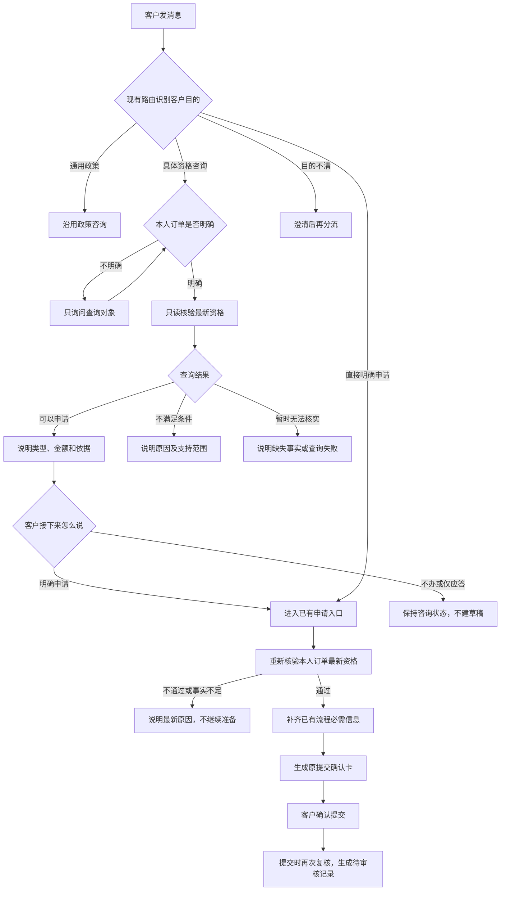

# 只读资格咨询产品设计 Plan

日期：2026-10-11。状态：方案已审阅，代码已实施、通过定向隔离验证并加载日常本地商城；用户手测反馈无问题，当前MVP已收尾。助手未追加真实模型复测，手测反馈独立记录。

实施与证据见[实现验收记录](../../analysis/只读资格咨询实现验收/结果.md)。下文保留经审阅的设计与范围，不将产品预期当作真实模型验收结果。

本文承接[现状与MVP方案](只读资格咨询现状与MVP方案.md)，确定本次实现方向：**新增一个资格咨询意图，复用现有资格规则；客户明确申请后，接回已有办理流程。**

本次只解决[优先级盘点](../项目缺口盘点与推进优先级.md)中的第一项。后续仍按「商品对象定位 → 工具故障反馈 → 不支持业务的清晰出口」推进。

## 1. 要解决的问题与当前表现

客户问「这笔订单能退吗」，是在了解资格；客户说「我要申请退款，原因是买错了」，已经表达办理意愿。两者都需要查资格，但不能产生相同的办理状态。

当前通用政策咨询和退款／退货办理已有路径，具体订单资格咨询缺少独立入口。已核验的一条新会话中，客户提供完整本人订单号并说「还能退吗？先别申请」，系统进入未知任务分支，回复不能只读核验，未调用具体资格规则，也未准备申请。

所以，本次补的是查询入口及咨询后续接能力，不能把现状写成「所有资格咨询都会直接申请」。已有草稿时还存在源码可见的续接风险：咨询可能触发旧卡重发，咨询另一订单可能触发旧草稿清理；这些分支尚未做本轮页面核验。

证据：[当前对话记录](../../analysis/只读资格咨询设计核验/current.json)、[页面截图](../../analysis/只读资格咨询设计核验/当前资格咨询.png)、[Trace](../../analysis/只读资格咨询设计核验/trace.json)。该样本只比较本人订单、余额和售后列表，不能据此宣称资格已通过或全库未变。

## 2. 设计决定与最小范围

1. **只新增一个意图标签：`after_sale_eligibility_query`，中文为「售后资格咨询」。** 同时承接具体订单的退款与七天无理由退货资格问题，不为每个阶段增加标签。
2. 保留 `refund_request`、`return_request` 及现有通用政策标签。新增标签不替代申请标签，也不新增一套对话动作识别结构。
3. 仍用现有大模型路由理解客户目的，代码负责路由约束、订单归属和业务校验。不新增模型、Agent或第二次意图分类调用。
4. 查询只读取事实、返回结果、保留必要的查询对象；不创建办理草稿、确认卡、提交凭证或售后申请。
5. 可办理时，用文字提示客户如何申请；不增加资格页或新按钮。客户明确申请后，复用原补信息和提交确认卡。

范围限于已有能力：**本人订单的未发货整单退款、符合条件的签收七天无理由整单退货。** 不扩展换货、质量售后办理、部分退款、运费计算、物流拦截、会话持久化或复合任务。

## 3. 怎样区分查询与申请

分流看客户想让系统做什么，不只看有没有「退」「申请」「帮我」这些词。大模型负责语义判断；代码限制查询路径能做的动作，防止只读请求产生办理副作用。

| 客户表达 | 预期入口 | 后续行为 |
|---|---|---|
| 「退款政策是什么？」 | 现有 `refund_policy_query` | 回答通用政策，不查询某笔资格 |
| 「七天无理由有什么条件？」 | 现有 `return_policy_query` | 回答通用条件 |
| 「订单A能退吗？先别申请」 | 新增资格咨询 | 查A资格，不准备申请 |
| 「帮我看看这单能不能退」 | 新增资格咨询 | 「帮我看看」是查询，不当作申请 |
| 「我要申请退款，原因买错了」 | 现有 `refund_request` | 查资格，通过后准备申请并复用已给原因 |
| 「我要申请七天无理由退货」 | 现有 `return_request` | 查资格，通过后接原流程，不要求退货理由 |
| 查询后说「那帮我申请退款」 | 现有申请入口 | 对唯一、明确的查询订单重新核验后办理 |
| 查询后说「好的／知道了／可以」 | 咨询回应 | 不把简单应答当作办理授权 |
| 「如果能退就帮我退」等条件与操作混合表达 | MVP先查询，再澄清 | 给结果后要求明确申请，不自动准备或提交 |

「先别申请／只查资格」是查询约束，不能因句子含有「申请」就进入办理。无法确定客户是查询还是办理时，询问「您是先查资格，还是要申请退款？」；澄清前不准备申请。无需为所有表达不断补关键词。

## 4. 各方职责

| 角色／模块 | 负责什么 | 不能替谁做决定 |
|---|---|---|
| 大模型路由 | 判断通用政策、具体资格、明确申请；提取客户提供的信息 | 不能判断真实支付、签收或可退金额，不能凭语义授权提交 |
| 会话与网关 | 绑定本人订单；区分查询上下文和办理草稿；执行对应路径 | 不能因查另一订单就改旧草稿，不能把「好的」当申请 |
| 商城业务层 | 读取最新事实，复用严格资格规则，给出结果和原因 | 不能用粗略售后类型提示代替严格核验 |
| 客户 | 决定是否申请；核对确认卡并确认提交 | 明确申请只授权准备，提交仍需确认 |
| 后台审核 | 按现有流程审核；退货沿用寄回和验收流程 | 查询通过不等于审核通过或已退款 |

关键边界：**模型判断想做什么，业务规则判断能不能做，客户确认是否提交。**

## 5. 产品流程

客户直接说「我要申请退款，原因买错了」，无需先回复资格结果，再问一次要不要办理；核验通过即可接原流程。咨询后转办理要重新核验，不能把上一轮的查询结论当作永久资格。

## 6. 查询结果与会话规则

### 6.1 只返回三种结论

| 结论 | 对客户的说明 | 下一步 |
|---|---|---|
| 可以申请 | 当前可申请的类型、已核实依据；金额可信时说明金额 | 提示明确回复申请，等待客户决定 |
| 不满足当前自助条件 | 具体阻断原因，如超出七天窗口 | 不准备申请；不扩大成「所有售后都不能办」 |
| 暂时无法核实 | 缺少可信支付／签收等事实，或查询服务失败 | 不猜结论；说明可补信息或重试方式 |

退款、退货条件复用商城现有严格规则：订单归属、支付和金额依据、履约状态，以及退货需要的签收时间、七天窗口、购买时可退标记。不得把订单详情里的 `availableAfterSaleTypes` 当作资格证明，也不在Python里复制一套规则。

回复中的金额只能来自可信支付事实；查不到就不报金额。七天窗口按商城当前日期判断。已存在同笔相关申请时，提示查看原申请进度，不引导重复申请。订单不属于当前客户时不泄露订单详情。

查询需要表达的最少信息是：确定的订单、可申请类型、三种结论之一、依据／阻断原因，以及已核实的金额。具体接口字段在实施时沿用现有契约，避免为文案另建数据体系。

### 6.2 查询上下文与申请草稿分开

- 缺订单时，保存「正在等待资格查询对象」，补订单号后继续查询；不能保存成「正在申请退款」。优先复用现有订单定位能力，多笔候选不默选第一笔。
- 查询结束只保留本会话唯一、明确的查询订单及类型，支持「那帮我申请」的指代。新会话、多个候选或对象冲突时重新确认；不新增跨会话记忆，也不缓存资格结论供办理使用。
- 已有未提交草稿时，只读咨询优先于申请续接。咨询不创建、修改或取消旧草稿，不重发旧确认卡；查另一笔订单也不触发申请换单。
- 「先不办」结束本次咨询，不自动取消其他已有草稿。若客户随后申请另一笔订单，沿用已有办理切换规则，明确对象后处理，不暗中覆盖。
- 已有取消确认时，查询不能被当作保留／取消答复；查询结束后，原确认仍待客户明确选择。

这些要求落实在网关的实际处理顺序中；仅在Python增加标签，不能解决网关提前续接造成的副作用。调整应复用单次路由结果，不在网关再加一套语义分类器。

## 7. 预期对话

以下是经审阅的产品预期；本次实际对话另见实现验收记录。假设订单A的最新事实已核实：本人订单、已支付、未发货，可申请整单退款199元。

| 轮次 | 客户输入 | 系统预期 | 状态 |
|---|---|---|---|
| 1 | 「订单A能退吗？先别申请」 | 「按当前查询结果，可申请未发货整单退款199元。如需办理，请回复‘申请退款’。」 | 无申请草稿或确认卡 |
| 2 | 「那帮我申请退款」 | 重新核验A；通过后询问退款原因 | 开始准备，未提交 |
| 3 | 「买错了」 | 展示A、金额和原因的原提交确认卡 | 有草稿，未生成待审核记录 |

若第2轮已说「那帮我申请退款，原因买错了」，直接展示确认卡，不重复问原因。若查询结果是符合七天无理由退货条件，则明确提示「申请七天无理由退货」，进入原退货流程，不另问理由。查询通过的措辞用「可以申请」，不用「保证退款成功」。

## 8. 实施时需要覆盖的最小改动

本节保留实施清单；实际变更和验证范围见实现验收记录。

| 位置 | 必须覆盖的变化 |
|---|---|
| 意图契约与路由 | 在意图枚举、路由Prompt、规则兜底、RoutePlan和相关消费端同步新增标签；移除具体资格必须归未知的旧限制；查询路径仅允许只读能力 |
| 商城资格读取 | 复用 `getCustomerRefundOrder`／`getCustomerReturnOrder` 及其严格规则；对查询场景整理三种结果，不调用会生成草稿的 `prepareRefund` |
| 网关处理顺序 | 让资格咨询先于办理续接与换单逻辑；返回查询结果时不被旧草稿投影成旧确认卡 |
| 会话衔接 | 保存最少的查询对象／等待对象信息，与申请草稿隔离；明确申请后用已有入口重新核验 |
| 页面与回复 | 沿用聊天消息、原订单选择和提交确认卡；若消费端校验意图枚举则同步放行新标签，不新增一套资格按钮 |
| 记录与检查 | Trace能看出查询入口和资格结果；同步相关文档，补本次必要检查 |

推荐顺序：先接通严格只读结果，再接标签与网关分流，最后接咨询后申请及最小验证。全过程只改本次链路，保留现有取消／保留行为，不顺带重构售后状态机。

参考代码：[意图契约](../../backend/api/schemas.py)、[路由Prompt](../../backend/resources/prompts/route_contract.md)、[规则分流](../../backend/agent/tools/planning.py)、[Agent](../../backend/agent/customer_service_agent.py)、[商城网关](../../ecommerce-backend/src/main/java/com/teachdemo/ecommerce/customer_service/CustomerServiceGatewayService.java)、[会话](../../ecommerce-backend/src/main/java/com/teachdemo/ecommerce/customer_service/CustomerServiceSession.java)、[商城资格规则](../../ecommerce-backend/src/main/java/com/teachdemo/ecommerce/order/ShopService.java)。

## 9. 最小验收与停止标准

目标是验证新增路径及关键边界，不追求覆盖所有表达。

| 检查 | 最少验证内容 |
|---|---|
| 一条正常连续对话 | 问资格 → 明确申请 → 补原因 → 原提交确认卡；停在提交前。核对订单、回复、实际状态；咨询阶段无草稿／提交凭证／新申请 |
| 一条业务不通过的咨询 | 用已知不符合条件的本人订单，说明具体原因，不出现确认卡或新申请 |
| 少量定向检查 | 无订单时只等待查询对象；他人订单不泄露；事实缺失或读取失败返回无法核实；已有草稿咨询另一订单时草稿和凭证不变；查询后状态变化时申请重新核验并阻断 |

定向检查优先用已有本地测试或固定结果完成，不全部增加真实页面对话。正常页面流程保留输入、回复、Trace和逐轮截图，核对相关订单、余额、售后记录；不把路由标签正确当作业务验收通过。

相关检查通过即收尾。只有发现本次直接问题才补测；不自动开展48例全量回归、多模型对比、取消分数校准或重复评测已收尾的保留流程。真实模型／页面核验的输入和执行边界另行明确；此前获准的一条演示对话已经完成，不视为后续批量调用授权。

**本项完成标准：客户可以只查资格；查询不改变申请；客户明确申请后能接回原流程；确认提交前不产生新售后申请或资金动作。** 后续提交、审核和退货验收复用已有流程，不纳入本次新增页面验收。

本Plan初次制定时仅新增文档。用户审阅后已授权实施；代码、隔离验证和日常服务状态分别记录在实现验收记录中。
