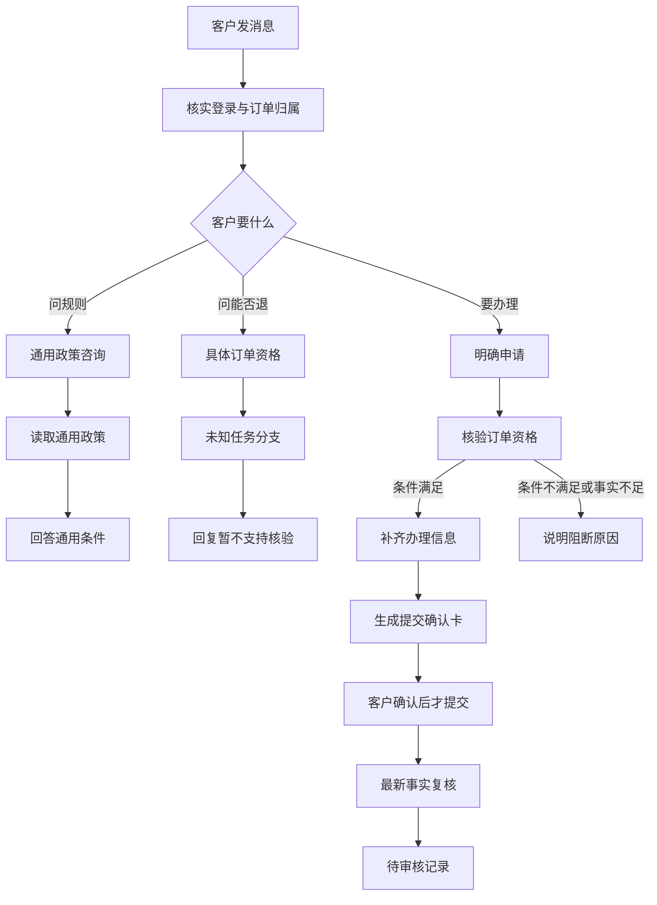
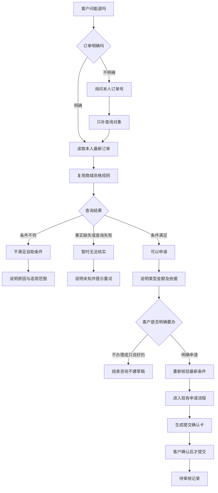

# 只读资格咨询：现状与 MVP 方案

> 先查能不能办，再由客户决定办不办

日期：2026-10-11。
当前有资格规则，但客户只能在办理流程里用到它。MVP 要补一个只查资格的入口，再接回已有申请流程。

## 先给判断
> **本次只做设计**
>
> 客户问「能退吗」，只是授权查询。
> 客户说「帮我申请」，才进入申请准备。
> 客户确认提交后，才生成待审核记录。

现状的问题是查询入口缺失。客户目的清楚，却被放进「未知任务」分支。

MVP 复用商城现有资格规则。模型识别客户目的，商城核验业务条件，客户决定是否办理。

## 当前真实表现
本次只核验一条新会话，不是全量评测。

| 项目 | 实际结果 |
|---|---|
| 查询对象 | 本人野餐垫订单，实付199元，已支付、未发货 |
| 客户输入 | 带完整订单号询问「还能退吗？先别申请。」 |
| 系统回复 | 「还不能只读核验这一笔的资格，也不会准备申请。」 |
| 当前路径 | 分类为未知任务，未调用具体资格核验 |
| 页面动作 | 没有确认卡，也没有办理按钮 |
| 业务读取对比 | 本人订单、余额和售后列表前后相同 |

系统没有替客户申请，但也没有回答这笔订单能否申请。

这里的199元来自实际订单读取。该样本没有执行严格资格核验，不能据此宣称资格已通过。

## 当前产品流程
主图展示新会话。已有草稿的分支另见下文。

现有设计分清了通用政策咨询和办理。具体资格咨询被暂时归入未知任务，避免误申请。

通用政策能说明「通常满足哪些条件」。具体资格还需要本人订单和最新业务事实。

办理流程已经检查资格。缺的是只读入口，以及从咨询到明确办理的衔接。

已有草稿时，网关可能重发原卡。咨询另一笔订单时，还可能按换单逻辑清理旧草稿。

这些是源码可见分支，本次未做第二条页面核验。MVP 要让只读咨询先于办理续接。

## MVP 产品流程
新增一条具体资格查询路径。退款和退货共用入口，结果说明可用的办理类型。

主图的「可以申请」不表示审核会通过。退货还要经过后台审核、寄回和收货验收。

重新核验失败时说明最新原因，不继续准备申请。实际提交时沿用现有最终复核。

为了缩小MVP，先用文字表达办理选择，不增加一套资格按钮。

回复提示：「如需办理，请明确回复申请退款。」

客户说「那帮我申请退款」时，沿用本次咨询的唯一订单。不能把「好的」当成申请授权。

## 三种结果与关键边界
| 结果 | 客户会看到什么 | 允许系统做什么 |
|---|---|---|
| 可以申请 | 说明可申请类型、已核实条件和金额 | 等客户决定，不建草稿或申请 |
| 不满足自助条件 | 说明具体原因，如超出七天窗口 | 不申请，不断言其他售后都不可用 |
| 暂时无法核实 | 说明缺签收时间、支付事实或查询失败 | 保留未知，不把未知说成不能退 |

未发货整单退款检查本人订单、支付和未发货事实。金额必须有可信支付依据。

七天无理由退货还检查签收时间和购买时可退标记。按商城当前日期判断，不用课程固定日期。

订单详情的「可选售后类型」只是粗略提示。不能直接用它证明资格通过。

查询只保存本次咨询的订单上下文。它不创建办理草稿、提交凭证或待审核记录。

已有未提交草稿时，咨询不取消、不修改原草稿。已有申请时先提示查看原进度，不建议重复申请。

客户更换订单或对象不清时，重新确定对象。不能把上一笔查询结论套到另一笔。

## MVP 对话示例
这是预期设计示例，不是当前系统的回复。

假设订单A属于客户，实付199元。最新检查确认已支付且未发货。

| 客户输入 | MVP 系统回复 | 业务状态 |
|---|---|---|
| 订单A还能退吗？先别申请 | 当前可以申请未发货整单退款，金额199元。尚未准备申请。 | 只有咨询上下文 |
| 那帮我申请退款 | 重新核验后，询问退款原因 | 开始准备申请，尚未提交 |
| 原因：买错了 | 展示订单、金额和原因，等待确认 | 已有草稿和提交确认卡 |
| 点击确认提交申请 | 返回申请号和待审核状态 | 创建待审核申请，尚未退款 |

如果客户说「先不办」，就结束咨询。七天无理由退货沿用现有规则，不另问退货理由。

## 最小实现与收尾标准
| 位置 | 最小变化 |
|---|---|
| 意图分流 | 具体资格进入只读查询，不再用未知任务拒答 |
| 商城业务层 | 复用严格资格规则，返回结果、原因与已知事实 |
| 会话衔接 | 区分咨询上下文和办理草稿，明确申请才切换 |
| 页面与回复 | 先用清楚文字表达选择，复用现有提交确认卡 |

先验一条「问资格→明确办理→提交前确认卡」。再验一条典型不符合条件的咨询。

归属和事实缺失用少量接口检查。页面每轮保留截图，不扩大为模型对比或全量评测。

暂不做换货、运费判断、部分退款或复合任务。它们不作为本次前置条件。

### 证据与状态
[当前记录](../../analysis/只读资格咨询设计核验/current.json)、[实际截图](../../analysis/只读资格咨询设计核验/当前资格咨询.png)和[Trace](../../analysis/只读资格咨询设计核验/trace.json)保留在核验目录。

该样本只比较本人订单、余额和售后列表，不宣称全库未变。

代码依据：[分类指令](../../backend/resources/prompts/route_contract.md)、[规则分流](../../backend/agent/tools/planning.py)、[Agent回复](../../backend/agent/customer_service_agent.py)。

业务依据：[商城网关](../../ecommerce-backend/src/main/java/com/teachdemo/ecommerce/customer_service/CustomerServiceGatewayService.java)和[订单资格规则](../../ecommerce-backend/src/main/java/com/teachdemo/ecommerce/order/ShopService.java)。

本次没有修改业务代码。MVP流程和示例都是建议，尚未实现或验收。
